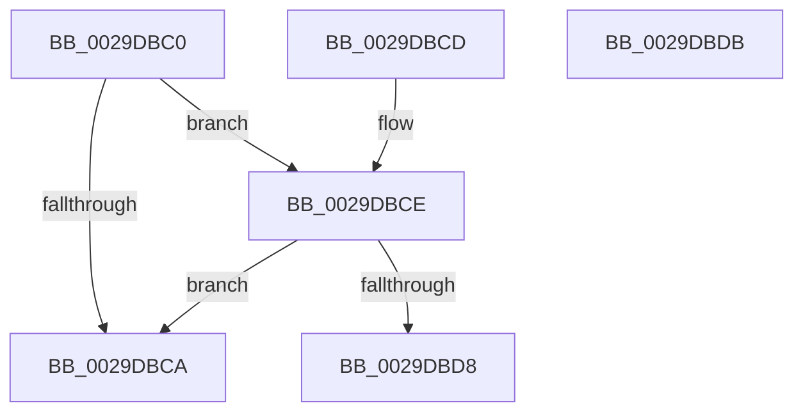

# IoIsActivityTracingEnabled

- RVA: `0x0029DBC0`–`0x0029DBDC` (길이 `28` bytes)
- VA: `0x000000014029DBC0`
- 실행 섹션: `.text`
- PDB 이름 있음: `예`; PDB Function 태그: `아니요`
- unwind 정보 RVA: `0x000DB714`
- 디코드: `12`개 명령, `28/28` bytes 표시
- 미해석 바이트: `0` (있으면 어셈블리에 `.byte`로 보존)

> 이 문서는 커널 이미지의 기계어와 PDB 기호를 분석해 생성했습니다. 4번과 5번은 함수 원형과 자료형을 바이너리 사용 방식에서 추정한 C 해석이며 원본 소스 복구 결과는 아닙니다.

## 1. Dependencies

- 직접 호출 지점: **0**; 고유 호출 대상: **0**
- 직접 호출자로 확인된 함수: **5**
- RIP 상대 이미지 참조: **2**

### Outgoing calls
- 직접 디코드된 call 명령이 없습니다.

### Direct callers
- [IopAllocateReserveIrp](IopAllocateReserveIrp_function_0029C218.md) at `0x0029C32C`
- [IopAllocateReserveIrp](IopAllocateReserveIrp_function_0029C218.md) at `0x0029C3CF`
- [IopAllocateReserveIrp](IopAllocateReserveIrp_function_0029C218.md) at `0x0029C44C`
- [IoMakeAssociatedIrpPriv](IoMakeAssociatedIrpPriv_function_0029D818.md) at `0x0029D845`
- [IoMakeAssociatedIrpPriv](IoMakeAssociatedIrpPriv_function_0029D818.md) at `0x0029DA18`
- [IopAllocateIrpWithExtension](IopAllocateIrpWithExtension_function_0029DF38.md) at `0x0029DF71`
- [IopAllocateBackpocketIrp](../59/IopAllocateBackpocketIrp_function_00596CE0.md) at `0x00596F3E`
- [IovAllocateIrp](../../pagevrfy/BB/IovAllocateIrp_function_00BB9540.md) at `0x00BB95F8`

### Static image references
- `0x0029DBC0` → RVA `0x00E66114` (`.data`; read)
- `0x0029DBCE` → RVA `0x00E66108` (`.data`; read)

## 2. Other-region calls and transfers

- 다른 실행 섹션으로 향하는 call: **0**
- 별도 외부 분기/꼬리 이동을 확인하지 못했습니다.

## 3. Assembly (complete function range)

```asm
0029DBC0  8B 05 4E 85 BC 00               mov eax, dword ptr [rip + 0xbc854e]
0029DBC6  A8 04                           test al, 4
0029DBC8  75 04                           jne 0x14029dbce
0029DBCA  32 C0                           xor al, al
0029DBCC  C3                              ret
0029DBCD  CC                              int3
0029DBCE  8B 05 34 85 BC 00               mov eax, dword ptr [rip + 0xbc8534]
0029DBD4  A8 01                           test al, 1
0029DBD6  74 F2                           je 0x14029dbca
0029DBD8  B0 01                           mov al, 1
0029DBDA  C3                              ret
0029DBDB  CC                              int3
```

## 4. C-style interpretation (structured pseudocode)

```c
__int64 __fastcall IoIsActivityTracingEnabled(void)
{
    __int64 result;

    if ((((unsigned __int8)((unsigned int)(*(unsigned int *)(v_rip + 12354894)))) & (4)) != 0) goto loc_0029DBCE;
loc_0029DBCA:
    result = 0;
    return result;
loc_0029DBCE:
    if ((((unsigned __int8)((unsigned int)(*(unsigned int *)(v_rip + 12354868)))) & (1)) == 0) goto loc_0029DBCA;
    return 1;
}
```

## 5. (Beta) C Style

```c
void IoIsActivityTracingEnabled(void)
{
    int64_t result;

    if ((((uint8_t)((uint32_t)(*(uint32_t *)(v_rip + 0xBC854E)))) & (4)) != 0) goto loc_0029DBCE;
loc_0029DBCA:
    result = 0;
    return result;
loc_0029DBCE:
    if ((((uint8_t)((uint32_t)(*(uint32_t *)(v_rip + 0xBC8534)))) & (1)) == 0) goto loc_0029DBCA;
    return 1;
}
```

## 6. Execution-region graph

[열기: 2D/3D 그래프와 함수 탐색 컨트롤 패널](../../../control-panel.html?section=text&rva=0x0029DBC0&view=graph)

- 2D 그래프는 위에서 아래로 흐르고, 3D 그래프는 빈 공간을 드래그해 회전합니다. Shift+드래그는 이동, 휠은 확대·축소, 함수 노드 선택은 대상 보고서 이동입니다.

### Static fallback


