# IoMakeAssociatedIrpPriv

- RVA: `0x0029D818`–`0x0029DBB8` (길이 `928` bytes)
- VA: `0x000000014029D818`
- 실행 섹션: `.text`
- PDB 이름 있음: `예`; PDB Function 태그: `아니요`
- unwind 정보 RVA: `0x00068070`
- 디코드: `221`개 명령, `928/928` bytes 표시
- 미해석 바이트: `0` (있으면 어셈블리에 `.byte`로 보존)

> 이 문서는 커널 이미지의 기계어와 PDB 기호를 분석해 생성했습니다. 4번과 5번은 함수 원형과 자료형을 바이너리 사용 방식에서 추정한 C 해석이며 원본 소스 복구 결과는 아닙니다.

## 1. Dependencies

- 직접 호출 지점: **12**; 고유 호출 대상: **9**
- 직접 호출자로 확인된 함수: **2**
- RIP 상대 이미지 참조: **3**

### Outgoing calls
- `0x0029D845` → [IoIsActivityTracingEnabled](IoIsActivityTracingEnabled_function_0029DBC0.md) (function, `0x0029DBC0`)
- `0x0029D918` → [ExpInterlockedPopEntrySList](../6B/ExpInterlockedPopEntrySList_function_006BA570.md) (function, `0x006BA570`)
- `0x0029D965` → [memset](../6C/memset_function_006C6C40.md) (function, `0x006C6C40`)
- `0x0029DA18` → [IoIsActivityTracingEnabled](IoIsActivityTracingEnabled_function_0029DBC0.md) (function, `0x0029DBC0`)
- `0x0029DAC5` → [ExFreePoolWithTag](../../poolcode/B8/ExFreePoolWithTag_function_00B82870.md) (function, `0x00B82870`)
- `0x0029DAD8` → [ExAllocatePool2](../../poolcode/B8/ExAllocatePool2_function_00B820F0.md) (function, `0x00B820F0`)
- `0x0029DB09` → [IopSetDiskIoAttributionExtension](IopSetDiskIoAttributionExtension_function_0029C0E4.md) (function, `0x0029C0E4`)
- `0x0029DB24` → [ExpInterlockedPopEntrySList](../6B/ExpInterlockedPopEntrySList_function_006BA570.md) (function, `0x006BA570`)
- `0x0029DB4E` → [IopSetDriverFlagsExtension](IopSetDriverFlagsExtension_function_0029DC14.md) (function, `0x0029DC14`)
- `0x0029DB77` → [IopIrpHasExtensionType](../3F/IopIrpHasExtensionType_function_003F4080.md) (function, `0x003F4080`)
- `0x0029DB93` → [IopIrpHasExtensionType](../3F/IopIrpHasExtensionType_function_003F4080.md) (function, `0x003F4080`)
- `0x0029DBAE` → [IoSetActivityIdIrp](../45/IoSetActivityIdIrp_function_0045B220.md) (function, `0x0045B220`)

### Direct callers
- [IoMakeAssociatedIrpEx](IoMakeAssociatedIrpEx_function_0029D800.md) at `0x0029D804`
- [IoMakeAssociatedIrp](../4B/IoMakeAssociatedIrp_function_004BB1B0.md) at `0x004BB1B9`

### Static image references
- `0x0029D8B2` → RVA `0x00F8D40C` (`.data`; read)
- `0x0029D8B9` → RVA `0x00F8D408` (`.data`; read)
- `0x0029D92C` → RVA `0x00F8D210` (`.data`; read)

## 2. Other-region calls and transfers

- 다른 실행 섹션으로 향하는 call: **2**
  - `0x0029DAC5` → [ExFreePoolWithTag](../../poolcode/B8/ExFreePoolWithTag_function_00B82870.md) (`.text` → `POOLCODE`)
  - `0x0029DAD8` → [ExAllocatePool2](../../poolcode/B8/ExAllocatePool2_function_00B820F0.md) (`.text` → `POOLCODE`)
- 별도 외부 분기/꼬리 이동을 확인하지 못했습니다.

## 3. Assembly (complete function range)

```asm
0029D818  48 89 5C 24 08                  mov qword ptr [rsp + 8], rbx
0029D81D  4C 89 4C 24 20                  mov qword ptr [rsp + 0x20], r9
0029D822  55                              push rbp
0029D823  56                              push rsi
0029D824  57                              push rdi
0029D825  41 54                           push r12
0029D827  41 55                           push r13
0029D829  41 56                           push r14
0029D82B  41 57                           push r15
0029D82D  48 83 EC 30                     sub rsp, 0x30
0029D831  45 33 E4                        xor r12d, r12d
0029D834  45 8A F0                        mov r14b, r8b
0029D837  44 88 A4 24 88 00 00 00         mov byte ptr [rsp + 0x88], r12b
0029D83F  4C 8B C2                        mov r8, rdx
0029D842  48 8B F1                        mov rsi, rcx
0029D845  E8 76 03 00 00                  call 0x14029dbc0
0029D84A  B9 00 01 00 00                  mov ecx, 0x100
0029D84F  84 C0                           test al, al
0029D851  0F 85 1B 03 00 00               jne 0x14029db72
0029D857  48 8B 86 C8 00 00 00            mov rax, qword ptr [rsi + 0xc8]
0029D85E  90                              nop
0029D85F  44 38 66 47                     cmp byte ptr [rsi + 0x47], r12b
0029D863  0F 8C 11 02 00 00               jl 0x14029da7a
0029D869  48 85 C0                        test rax, rax
0029D86C  0F 84 08 02 00 00               je 0x14029da7a
0029D872  F6 40 02 40                     test byte ptr [rax + 2], 0x40
0029D876  0F 84 FE 01 00 00               je 0x14029da7a
0029D87C  41 80 C6 02                     add r14b, 2
0029D880  C6 84 24 88 00 00 00 01         mov byte ptr [rsp + 0x88], 1
0029D888  65 4C 8B 2C 25 20 00 00 00      mov r13, qword ptr gs:[0x20]
0029D891  BA D0 00 00 00                  mov edx, 0xd0
0029D896  49 0F BE CE                     movsx rcx, r14b
0029D89A  0F B7 C1                        movzx eax, cx
0029D89D  48 89 4C 24 28                  mov qword ptr [rsp + 0x28], rcx
0029D8A2  66 C1 E0 03                     shl ax, 3
0029D8A6  44 88 A4 24 80 00 00 00         mov byte ptr [rsp + 0x80], r12b
0029D8AE  44 8D 3C 08                     lea r15d, [rax + rcx]
0029D8B2  0F BE 0D 53 FB CE 00            movsx ecx, byte ptr [rip + 0xcefb53]
0029D8B9  0F BE 05 48 FB CE 00            movsx eax, byte ptr [rip + 0xcefb48]
0029D8C0  66 41 C1 E7 03                  shl r15w, 3
0029D8C5  66 44 03 FA                     add r15w, dx
0029D8C9  41 0F B7 FF                     movzx edi, r15w
0029D8CD  44 3A F1                        cmp r14b, cl
0029D8D0  0F 8F F4 01 00 00               jg 0x14029daca
0029D8D6  C6 84 24 80 00 00 00 04         mov byte ptr [rsp + 0x80], 4
0029D8DE  41 80 FE 01                     cmp r14b, 1
0029D8E2  0F 84 CB 01 00 00               je 0x14029dab3
0029D8E8  44 3A F0                        cmp r14b, al
0029D8EB  0F 8E 67 02 00 00               jle 0x14029db58
0029D8F1  0F B7 C1                        movzx eax, cx
0029D8F4  BD 20 08 00 00                  mov ebp, 0x820
0029D8F9  66 C1 E0 03                     shl ax, 3
0029D8FD  41 BC 20 00 00 00               mov r12d, 0x20
0029D903  8D 3C 08                        lea edi, [rax + rcx]
0029D906  66 C1 E7 03                     shl di, 3
0029D90A  66 03 FA                        add di, dx
0029D90D  49 8B 6C 2D 00                  mov rbp, qword ptr [r13 + rbp]
0029D912  48 8B CD                        mov rcx, rbp
0029D915  FF 45 14                        inc dword ptr [rbp + 0x14]
0029D918  E8 53 CC 41 00                  call 0x1406ba570
0029D91D  48 8B D8                        mov rbx, rax
0029D920  48 85 C0                        test rax, rax
0029D923  0F 84 EA 01 00 00               je 0x14029db13
0029D929  45 33 E4                        xor r12d, r12d
0029D92C  8B 05 DE F8 CE 00               mov eax, dword ptr [rip + 0xcef8de]
0029D932  A8 03                           test al, 3
0029D934  74 1D                           je 0x14029d953
0029D936  48 85 DB                        test rbx, rbx
0029D939  0F 84 8B 01 00 00               je 0x14029daca
0029D93F  41 0F B7 C7                     movzx eax, r15w
0029D943  48 39 43 38                     cmp qword ptr [rbx + 0x38], rax
0029D947  0F 82 70 01 00 00               jb 0x14029dabd
0029D94D  0F B7 7B 38                     movzx edi, word ptr [rbx + 0x38]
0029D951  EB 09                           jmp 0x14029d95c
0029D953  48 85 DB                        test rbx, rbx
0029D956  0F 84 6E 01 00 00               je 0x14029daca
0029D95C  44 0F B7 C7                     movzx r8d, di
0029D960  33 D2                           xor edx, edx
0029D962  48 8B CB                        mov rcx, rbx
0029D965  E8 D6 92 42 00                  call 0x1406c6c40
0029D96A  44 88 73 42                     mov byte ptr [rbx + 0x42], r14b
0029D96E  41 FE C6                        inc r14b
0029D971  44 88 73 43                     mov byte ptr [rbx + 0x43], r14b
0029D975  66 C7 03 06 00                  mov word ptr [rbx], 6
0029D97A  66 89 7B 02                     mov word ptr [rbx + 2], di
0029D97E  65 48 8B 04 25 88 01 00 00      mov rax, qword ptr gs:[0x188]
0029D987  8A 88 4A 02 00 00               mov cl, byte ptr [rax + 0x24a]
0029D98D  48 8D 43 20                     lea rax, [rbx + 0x20]
0029D991  88 4B 46                        mov byte ptr [rbx + 0x46], cl
0029D994  48 89 40 08                     mov qword ptr [rax + 8], rax
0029D998  48 89 00                        mov qword ptr [rax], rax
0029D99B  48 8B 44 24 28                  mov rax, qword ptr [rsp + 0x28]
0029D9A0  8B 4B 10                        mov ecx, dword ptr [rbx + 0x10]
0029D9A3  83 C9 08                        or ecx, 8
0029D9A6  48 8D 14 C5 1A 00 00 00         lea rdx, [rax*8 + 0x1a]
0029D9AE  48 03 D0                        add rdx, rax
0029D9B1  48 8D 14 D3                     lea rdx, [rbx + rdx*8]
0029D9B5  48 89 93 B8 00 00 00            mov qword ptr [rbx + 0xb8], rdx
0029D9BC  41 0F B7 45 24                  movzx eax, word ptr [r13 + 0x24]
0029D9C1  66 89 43 04                     mov word ptr [rbx + 4], ax
0029D9C5  89 4B 10                        mov dword ptr [rbx + 0x10], ecx
0029D9C8  8B 46 10                        mov eax, dword ptr [rsi + 0x10]
0029D9CB  25 02 00 0E 00                  and eax, 0xe0002
0029D9D0  0B C1                           or eax, ecx
0029D9D2  89 43 10                        mov dword ptr [rbx + 0x10], eax
0029D9D5  8A 84 24 80 00 00 00            mov al, byte ptr [rsp + 0x80]
0029D9DC  08 43 47                        or byte ptr [rbx + 0x47], al
0029D9DF  48 8B 86 98 00 00 00            mov rax, qword ptr [rsi + 0x98]
0029D9E6  48 89 83 98 00 00 00            mov qword ptr [rbx + 0x98], rax
0029D9ED  48 89 73 18                     mov qword ptr [rbx + 0x18], rsi
0029D9F1  44 38 A4 24 88 00 00 00         cmp byte ptr [rsp + 0x88], r12b
0029D9F9  74 1D                           je 0x14029da18
0029D9FB  80 43 43 FE                     add byte ptr [rbx + 0x43], 0xfe
0029D9FF  48 8D 82 70 FF FF FF            lea rax, [rdx - 0x90]
0029DA06  80 43 42 FE                     add byte ptr [rbx + 0x42], 0xfe
0029DA0A  48 89 83 B8 00 00 00            mov qword ptr [rbx + 0xb8], rax
0029DA11  48 89 83 C8 00 00 00            mov qword ptr [rbx + 0xc8], rax
0029DA18  E8 A3 01 00 00                  call 0x14029dbc0
0029DA1D  84 C0                           test al, al
0029DA1F  0F 85 69 01 00 00               jne 0x14029db8e
0029DA25  48 8B 86 C8 00 00 00            mov rax, qword ptr [rsi + 0xc8]
0029DA2C  90                              nop
0029DA2D  44 38 66 47                     cmp byte ptr [rsi + 0x47], r12b
0029DA31  7C 0F                           jl 0x14029da42
0029DA33  48 85 C0                        test rax, rax
0029DA36  74 0A                           je 0x14029da42
0029DA38  F6 40 02 40                     test byte ptr [rax + 2], 0x40
0029DA3C  0F 85 AC 00 00 00               jne 0x14029daee
0029DA42  48 8B 86 C8 00 00 00            mov rax, qword ptr [rsi + 0xc8]
0029DA49  90                              nop
0029DA4A  44 38 66 47                     cmp byte ptr [rsi + 0x47], r12b
0029DA4E  7C 11                           jl 0x14029da61
0029DA50  48 85 C0                        test rax, rax
0029DA53  74 0C                           je 0x14029da61
0029DA55  66 0F BA 60 02 08               bt word ptr [rax + 2], 8
0029DA5B  0F 82 DF 00 00 00               jb 0x14029db40
0029DA61  48 8B C3                        mov rax, rbx
0029DA64  48 8B 5C 24 70                  mov rbx, qword ptr [rsp + 0x70]
0029DA69  48 83 C4 30                     add rsp, 0x30
0029DA6D  41 5F                           pop r15
0029DA6F  41 5E                           pop r14
0029DA71  41 5D                           pop r13
0029DA73  41 5C                           pop r12
0029DA75  5F                              pop rdi
0029DA76  5E                              pop rsi
0029DA77  5D                              pop rbp
0029DA78  C3                              ret
0029DA79  CC                              int3
0029DA7A  48 8B 86 C8 00 00 00            mov rax, qword ptr [rsi + 0xc8]
0029DA81  90                              nop
0029DA82  44 38 66 47                     cmp byte ptr [rsi + 0x47], r12b
0029DA86  7C 0F                           jl 0x14029da97
0029DA88  48 85 C0                        test rax, rax
0029DA8B  74 0A                           je 0x14029da97
0029DA8D  66 85 48 02                     test word ptr [rax + 2], cx
0029DA91  0F 85 E5 FD FF FF               jne 0x14029d87c
0029DA97  4D 85 C0                        test r8, r8
0029DA9A  0F 84 E8 FD FF FF               je 0x14029d888
0029DAA0  41 F7 40 30 00 00 00 08         test dword ptr [r8 + 0x30], 0x8000000
0029DAA8  0F 84 DA FD FF FF               je 0x14029d888
0029DAAE  E9 C9 FD FF FF                  jmp 0x14029d87c
0029DAB3  BD 00 08 00 00                  mov ebp, 0x800
0029DAB8  E9 50 FE FF FF                  jmp 0x14029d90d
0029DABD  FF 45 1C                        inc dword ptr [rbp + 0x1c]
0029DAC0  33 D2                           xor edx, edx
0029DAC2  48 8B CB                        mov rcx, rbx
0029DAC5  E8 A6 4D 8E 00                  call 0x140b82870
0029DACA  0F B7 D7                        movzx edx, di
0029DACD  B9 40 00 00 00                  mov ecx, 0x40
0029DAD2  41 B8 49 72 70 20               mov r8d, 0x20707249
0029DAD8  E8 13 46 8E 00                  call 0x140b820f0
0029DADD  48 8B D8                        mov rbx, rax
0029DAE0  48 85 C0                        test rax, rax
0029DAE3  0F 85 73 FE FF FF               jne 0x14029d95c
0029DAE9  E9 76 FF FF FF                  jmp 0x14029da64
0029DAEE  48 8B 96 C8 00 00 00            mov rdx, qword ptr [rsi + 0xc8]
0029DAF5  41 B9 01 00 00 00               mov r9d, 1
0029DAFB  4C 8B 83 98 00 00 00            mov r8, qword ptr [rbx + 0x98]
0029DB02  48 8B CB                        mov rcx, rbx
0029DB05  48 8B 52 10                     mov rdx, qword ptr [rdx + 0x10]
0029DB09  E8 D6 E5 FF FF                  call 0x14029c0e4
0029DB0E  E9 2F FF FF FF                  jmp 0x14029da42
0029DB13  FF 45 18                        inc dword ptr [rbp + 0x18]
0029DB16  4B 8B AC 2C 08 08 00 00         mov rbp, qword ptr [r12 + r13 + 0x808]
0029DB1E  48 8B CD                        mov rcx, rbp
0029DB21  FF 45 14                        inc dword ptr [rbp + 0x14]
0029DB24  E8 47 CA 41 00                  call 0x1406ba570
0029DB29  45 33 E4                        xor r12d, r12d
0029DB2C  48 8B D8                        mov rbx, rax
0029DB2F  48 85 C0                        test rax, rax
0029DB32  0F 85 F4 FD FF FF               jne 0x14029d92c
0029DB38  FF 45 18                        inc dword ptr [rbp + 0x18]
0029DB3B  E9 EC FD FF FF                  jmp 0x14029d92c
0029DB40  48 8B 96 C8 00 00 00            mov rdx, qword ptr [rsi + 0xc8]
0029DB47  48 8B CB                        mov rcx, rbx
0029DB4A  48 8B 52 38                     mov rdx, qword ptr [rdx + 0x38]
0029DB4E  E8 C1 00 00 00                  call 0x14029dc14
0029DB53  E9 09 FF FF FF                  jmp 0x14029da61
0029DB58  0F B7 F8                        movzx edi, ax
0029DB5B  BD 10 08 00 00                  mov ebp, 0x810
0029DB60  66 C1 E0 03                     shl ax, 3
0029DB64  41 BC 10 00 00 00               mov r12d, 0x10
0029DB6A  66 03 F8                        add di, ax
0029DB6D  E9 94 FD FF FF                  jmp 0x14029d906
0029DB72  33 D2                           xor edx, edx
0029DB74  48 8B CE                        mov rcx, rsi
0029DB77  E8 04 65 15 00                  call 0x1403f4080
0029DB7C  84 C0                           test al, al
0029DB7E  0F 85 F8 FC FF FF               jne 0x14029d87c
0029DB84  B9 00 01 00 00                  mov ecx, 0x100
0029DB89  E9 C9 FC FF FF                  jmp 0x14029d857
0029DB8E  33 D2                           xor edx, edx
0029DB90  48 8B CE                        mov rcx, rsi
0029DB93  E8 E8 64 15 00                  call 0x1403f4080
0029DB98  84 C0                           test al, al
0029DB9A  0F 84 85 FE FF FF               je 0x14029da25
0029DBA0  48 8B 96 C8 00 00 00            mov rdx, qword ptr [rsi + 0xc8]
0029DBA7  48 8B CB                        mov rcx, rbx
0029DBAA  48 83 C2 18                     add rdx, 0x18
0029DBAE  E8 6D D6 1B 00                  call 0x14045b220
0029DBB3  E9 6D FE FF FF                  jmp 0x14029da25
```

## 4. C-style interpretation (structured pseudocode)

```c
__int64 __fastcall IoMakeAssociatedIrpPriv(__int64 a1, __int64 a2, unsigned __int8 a3, __int64 a4)
{
    __int64 result;
    __int64 v_r12;
    __int64 v_r14;
    __int64 v_r15;
    __int64 v_rdi;
    __int64 v_rsp;
    unsigned __int64 v_stack_m40;
    unsigned __int8 v_stack_p18;
    unsigned __int64 v_stack_p20;
    unsigned __int64 v_stack_p8;

    v_stack_p8 = v_rbx;
    v_stack_p20 = a4;
    v_rsp = (v_rsp) - (48);
    v_r12 = 0;
    v_stack_p20 = 0;
    result = IoIsActivityTracingEnabled(a1, a2, a2, a4);
    if ((unsigned __int8)(result) != 0) goto loc_0029DB72;
loc_0029D857:
    if ((*(unsigned __int8 *)(a1 + 71)) < 0) goto loc_0029DA7A;
    if (*(unsigned __int64 *)(a1 + 200) == 0) goto loc_0029DA7A;
    if (((*(unsigned __int8 *)(*(unsigned __int64 *)(a1 + 200) + 2)) & (64)) == 0) goto loc_0029DA7A;
loc_0029D87C:
    v_r14 = (unsigned __int8)((a3) + (2));
    v_stack_p20 = 1;
loc_0029D888:
    v_stack_m40 = (__int8)((unsigned __int8)(v_r14));
    result = (unsigned __int16)(((unsigned __int16)((__int8)((unsigned __int8)(v_r14)))) << (3));
    v_stack_p18 = 0;
    v_r15 = (unsigned __int16)((result + (__int8)((unsigned __int8)(v_r14)) * 1) << (3));
    v_r15 = (unsigned __int16)((v_r15) + (208));
    if (((unsigned __int8)(v_r14)) > ((unsigned __int8)((__int8)(*(unsigned __int8 *)(v_rip + 13564755))))) goto loc_0029DACA;
    v_stack_p18 = 4;
    if (((unsigned __int8)(v_r14)) == 1) goto loc_0029DAB3;
    if (((unsigned __int8)(v_r14)) <= ((unsigned __int8)((__int8)(*(unsigned __int8 *)(v_rip + 13564744))))) goto loc_0029DB58;
    result = (unsigned __int16)(((unsigned __int16)((__int8)(*(unsigned __int8 *)(v_rip + 13564755)))) << (3));
loc_0029D906:
    v_rdi = (unsigned __int16)((result + (__int8)(*(unsigned __int8 *)(v_rip + 13564755)) * 1) << (3));
    v_rdi = (unsigned __int16)((v_rdi) + (208));
loc_0029D90D:
    result = ExpInterlockedPopEntrySList(*(unsigned __int64 *)(*(unsigned __int64 *)(gs_base + (0 + 32)) + (unsigned int)(0x820ULL) * 1), 208, a2, a4);
    if (result == 0) goto loc_0029DB13;
    v_r12 = 0;
loc_0029D92C:
    if ((((unsigned __int8)((unsigned int)(*(unsigned int *)(v_rip + 13564126)))) & (3)) == 0) goto loc_0029D953;
    if (result == 0) goto loc_0029DACA;
    if ((*(unsigned __int64 *)(result + 56)) < ((unsigned __int16)(v_r15))) goto loc_0029DABD;
    goto loc_0029D95C;
loc_0029D953:
    if (result == 0) goto loc_0029DACA;
loc_0029D95C:
    a2 = 0;
    result = memset(result, a2, (unsigned __int16)(*(unsigned __int16 *)(result + 56)), a4);
    *(unsigned __int8 *)(result + 66) = (unsigned __int8)(v_r14);
    v_r14 = (unsigned __int8)((v_r14) + 1);
    *(unsigned __int8 *)(result + 67) = (unsigned __int8)(v_r14);
    *(unsigned __int16 *)(result) = 6;
    *(unsigned __int16 *)(result + 2) = (unsigned __int16)(*(unsigned __int16 *)(result + 56));
    *(unsigned __int8 *)(result + 70) = (unsigned __int8)(*(unsigned __int8 *)(*(unsigned __int64 *)(gs_base + (0 + 392)) + 586));
    *(unsigned __int64 *)(result + 32 + 8) = result + 32;
    *(unsigned __int64 *)(result + 32) = result + 32;
    a1 = (unsigned int)(((unsigned int)(*(unsigned int *)(result + 16))) | (8));
    a2 = (v_stack_m40 * 8 + 26) + (v_stack_m40);
    *(unsigned __int64 *)(result + 184) = result + a2 * 8;
    *(unsigned __int16 *)(result + 4) = (unsigned __int16)(*(unsigned __int16 *)(*(unsigned __int64 *)(gs_base + (0 + 32)) + 36));
    *(unsigned int *)(result + 16) = (unsigned int)(a1);
    result = (unsigned int)(((unsigned int)(*(unsigned int *)(a1 + 16))) & (0xE0002ULL));
    result = (unsigned int)((result) | ((unsigned int)(a1)));
    *(unsigned int *)(result + 16) = (unsigned int)(result);
    *(unsigned __int64 *)(result + 152) = *(unsigned __int64 *)(a1 + 152);
    *(unsigned __int64 *)(result + 24) = a1;
    result = *(unsigned __int64 *)(a1 + 152);
    if (v_stack_p20 != 0) {
        result = result + a2 * 8 - 144;
        *(unsigned __int64 *)(result + 184) = result;
        *(unsigned __int64 *)(result + 200) = result;
    }
    result = IoIsActivityTracingEnabled(a1, result + a2 * 8, (unsigned __int16)(*(unsigned __int16 *)(result + 56)), a4);
    if ((unsigned __int8)(result) != 0) goto loc_0029DB8E;
loc_0029DA25:
    if ((*(unsigned __int8 *)(a1 + 71)) < 0) goto loc_0029DA42;
    if (*(unsigned __int64 *)(a1 + 200) == 0) goto loc_0029DA42;
    if (((*(unsigned __int8 *)(*(unsigned __int64 *)(a1 + 200) + 2)) & (64)) != 0) goto loc_0029DAEE;
loc_0029DA42:
    if ((*(unsigned __int8 *)(a1 + 71)) < 0) goto loc_0029DA61;
    if (*(unsigned __int64 *)(a1 + 200) == 0) goto loc_0029DA61;
    if (condition_is_below) goto loc_0029DB40;
loc_0029DA61:
loc_0029DA64:
    v_rsp = (v_rsp) + (48);
    return result;
loc_0029DA7A:
    if ((*(unsigned __int8 *)(a1 + 71)) < 0) goto loc_0029DA97;
    if (*(unsigned __int64 *)(a1 + 200) == 0) goto loc_0029DA97;
    if (((*(unsigned __int16 *)(*(unsigned __int64 *)(a1 + 200) + 2)) & ((unsigned __int16)(a1))) != 0) goto loc_0029D87C;
loc_0029DA97:
    if ((unsigned __int16)(*(unsigned __int16 *)(result + 56)) == 0) goto loc_0029D888;
    if (((*(unsigned int *)((unsigned __int16)(*(unsigned __int16 *)(result + 56)) + 48)) & (0x8000000ULL)) == 0) goto loc_0029D888;
    goto loc_0029D87C;
loc_0029DAB3:
    goto loc_0029D90D;
loc_0029DABD:
    a2 = 0;
    result = ExFreePoolWithTag(v_stack_p8, a2, (unsigned __int16)(*(unsigned __int16 *)(result + 56)), a4);
loc_0029DACA:
    result = ExAllocatePool2(64, (unsigned __int16)(*(unsigned __int16 *)(result + 56)), (unsigned int)(0x20707249ULL), a4);
    if (result != 0) goto loc_0029D95C;
    goto loc_0029DA64;
loc_0029DAEE:
    result = IopSetDiskIoAttributionExtension(result, *(unsigned __int64 *)(*(unsigned __int64 *)(a1 + 200) + 16), *(unsigned __int64 *)(result + 152), 1);
    goto loc_0029DA42;
loc_0029DB13:
    result = ExpInterlockedPopEntrySList(*(unsigned __int64 *)(v_r12 + *(unsigned __int64 *)(gs_base + (0 + 32)) * 1 + 2056), *(unsigned __int64 *)(*(unsigned __int64 *)(a1 + 200) + 16), *(unsigned __int64 *)(result + 152), 1);
    v_r12 = 0;
    if (result != 0) goto loc_0029D92C;
    goto loc_0029D92C;
loc_0029DB40:
    result = IopSetDriverFlagsExtension(result, *(unsigned __int64 *)(*(unsigned __int64 *)(a1 + 200) + 56), *(unsigned __int64 *)(result + 152), 1);
    goto loc_0029DA61;
loc_0029DB58:
    result = (unsigned __int16)((result) << (3));
    v_rdi = (unsigned __int16)(((unsigned __int16)(result)) + ((unsigned __int16)(result)));
    goto loc_0029D906;
loc_0029DB72:
    a2 = 0;
    result = IopIrpHasExtensionType(a1, a2, *(unsigned __int64 *)(result + 152), 1);
    if ((unsigned __int8)(result) != 0) goto loc_0029D87C;
    goto loc_0029D857;
loc_0029DB8E:
    a2 = 0;
    result = IopIrpHasExtensionType(a1, a2, *(unsigned __int64 *)(result + 152), 1);
    if ((unsigned __int8)(result) == 0) goto loc_0029DA25;
    a2 = (*(unsigned __int64 *)(a1 + 200)) + (24);
    result = IoSetActivityIdIrp(result, a2, *(unsigned __int64 *)(result + 152), 1);
    goto loc_0029DA25;
}
```

## 5. (Beta) C Style

```c
int64_t IoMakeAssociatedIrpPriv(void *Arg1, int64_t Arg2, uint8_t Arg3, int64_t Arg4)
{
    uint8_t *arg1 = (uint8_t *)Arg1;

    int64_t result;
    int64_t local_r12;
    int64_t local_r14;
    int64_t local_r15;
    int64_t local_rdi;
    int64_t local_rsp;
    uint64_t v_stack_m40;
    uint8_t v_stack_p18;
    uint64_t v_stack_p20;
    uint64_t v_stack_p8;

    v_stack_p8 = local_rbx;
    v_stack_p20 = Arg4;
    local_rsp = (local_rsp) - (48);
    local_r12 = 0;
    v_stack_p20 = 0;
    result = IoIsActivityTracingEnabled(Arg1, Arg2, Arg2, Arg4);
    if ((uint8_t)(result) != 0) goto loc_0029DB72;
loc_0029D857:
    if ((*(uint8_t *)(arg1 + 0x47)) < 0) goto loc_0029DA7A;
    if (*(uint64_t *)(arg1 + 0xC8) == 0) goto loc_0029DA7A;
    if (((*(uint8_t *)(*(uint64_t *)(arg1 + 0xC8) + 0x2)) & (64)) == 0) goto loc_0029DA7A;
loc_0029D87C:
    local_r14 = (uint8_t)((Arg3) + (2));
    v_stack_p20 = 1;
loc_0029D888:
    v_stack_m40 = (int8_t)((uint8_t)(local_r14));
    result = (uint16_t)(((uint16_t)((int8_t)((uint8_t)(local_r14)))) << (3));
    v_stack_p18 = 0;
    local_r15 = (uint16_t)((result + (int8_t)((uint8_t)(local_r14)) * 1) << (3));
    local_r15 = (uint16_t)((local_r15) + (208));
    if (((uint8_t)(local_r14)) > ((uint8_t)((int8_t)(*(uint8_t *)(v_rip + 0xCEFB53))))) goto loc_0029DACA;
    v_stack_p18 = 4;
    if (((uint8_t)(local_r14)) == 1) goto loc_0029DAB3;
    if (((uint8_t)(local_r14)) <= ((uint8_t)((int8_t)(*(uint8_t *)(v_rip + 0xCEFB48))))) goto loc_0029DB58;
    result = (uint16_t)(((uint16_t)((int8_t)(*(uint8_t *)(v_rip + 0xCEFB53)))) << (3));
loc_0029D906:
    local_rdi = (uint16_t)((result + (int8_t)(*(uint8_t *)(v_rip + 0xCEFB53)) * 1) << (3));
    local_rdi = (uint16_t)((local_rdi) + (208));
loc_0029D90D:
    result = ExpInterlockedPopEntrySList(*(uint64_t *)(*(uint64_t *)(gs_base + (0 + 0x20)) + (uint32_t)(0x820ULL) * 1), 208, Arg2, Arg4);
    if (result == 0) goto loc_0029DB13;
    local_r12 = 0;
loc_0029D92C:
    if ((((uint8_t)((uint32_t)(*(uint32_t *)(v_rip + 0xCEF8DE)))) & (3)) == 0) goto loc_0029D953;
    if (result == 0) goto loc_0029DACA;
    if ((*(uint64_t *)(result + 0x38)) < ((uint16_t)(local_r15))) goto loc_0029DABD;
    goto loc_0029D95C;
loc_0029D953:
    if (result == 0) goto loc_0029DACA;
loc_0029D95C:
    Arg2 = 0;
    result = memset(result, Arg2, (uint16_t)(*(uint16_t *)(result + 0x38)), Arg4);
    *(uint8_t *)(result + 0x42) = (uint8_t)(local_r14);
    local_r14 = (uint8_t)((local_r14) + 1);
    *(uint8_t *)(result + 0x43) = (uint8_t)(local_r14);
    *(uint16_t *)(result) = 6;
    *(uint16_t *)(result + 0x2) = (uint16_t)(*(uint16_t *)(result + 0x38));
    *(uint8_t *)(result + 0x46) = (uint8_t)(*(uint8_t *)(*(uint64_t *)(gs_base + (0 + 0x188)) + 0x24A));
    *(uint64_t *)(result + 0x20 + 0x8) = result + 32;
    *(uint64_t *)(result + 0x20) = result + 32;
    Arg1 = (uint32_t)(((uint32_t)(*(uint32_t *)(result + 0x10))) | (8));
    Arg2 = (v_stack_m40 * 8 + 26) + (v_stack_m40);
    *(uint64_t *)(result + 0xB8) = result + Arg2 * 8;
    *(uint16_t *)(result + 0x4) = (uint16_t)(*(uint16_t *)(*(uint64_t *)(gs_base + (0 + 0x20)) + 0x24));
    *(uint32_t *)(result + 0x10) = (uint32_t)(Arg1);
    result = (uint32_t)(((uint32_t)(*(uint32_t *)(arg1 + 0x10))) & (0xE0002ULL));
    result = (uint32_t)((result) | ((uint32_t)(Arg1)));
    *(uint32_t *)(result + 0x10) = (uint32_t)(result);
    *(uint64_t *)(result + 0x98) = *(uint64_t *)(arg1 + 0x98);
    *(void **)(result + 0x18) = Arg1;
    result = *(uint64_t *)(arg1 + 0x98);
    if (v_stack_p20 != 0) {
        result = result + Arg2 * 8 - 144;
        *(uint64_t *)(result + 0xB8) = result;
        *(uint64_t *)(result + 0xC8) = result;
    }
    result = IoIsActivityTracingEnabled(Arg1, result + Arg2 * 8, (uint16_t)(*(uint16_t *)(result + 0x38)), Arg4);
    if ((uint8_t)(result) != 0) goto loc_0029DB8E;
loc_0029DA25:
    if ((*(uint8_t *)(arg1 + 0x47)) < 0) goto loc_0029DA42;
    if (*(uint64_t *)(arg1 + 0xC8) == 0) goto loc_0029DA42;
    if (((*(uint8_t *)(*(uint64_t *)(arg1 + 0xC8) + 0x2)) & (64)) != 0) goto loc_0029DAEE;
loc_0029DA42:
    if ((*(uint8_t *)(arg1 + 0x47)) < 0) goto loc_0029DA61;
    if (*(uint64_t *)(arg1 + 0xC8) == 0) goto loc_0029DA61;
    if (condition_is_below) goto loc_0029DB40;
loc_0029DA61:
loc_0029DA64:
    local_rsp = (local_rsp) + (48);
    return result;
loc_0029DA7A:
    if ((*(uint8_t *)(arg1 + 0x47)) < 0) goto loc_0029DA97;
    if (*(uint64_t *)(arg1 + 0xC8) == 0) goto loc_0029DA97;
    if (((*(uint16_t *)(*(uint64_t *)(arg1 + 0xC8) + 0x2)) & ((uint16_t)(Arg1))) != 0) goto loc_0029D87C;
loc_0029DA97:
    if ((uint16_t)(*(uint16_t *)(result + 0x38)) == 0) goto loc_0029D888;
    if (((*(uint32_t *)((uint16_t)(*(uint16_t *)(result + 0x38)) + 0x30)) & (0x8000000ULL)) == 0) goto loc_0029D888;
    goto loc_0029D87C;
loc_0029DAB3:
    goto loc_0029D90D;
loc_0029DABD:
    Arg2 = 0;
    result = ExFreePoolWithTag(v_stack_p8, Arg2, (uint16_t)(*(uint16_t *)(result + 0x38)), Arg4);
loc_0029DACA:
    result = ExAllocatePool2(64, (uint16_t)(*(uint16_t *)(result + 0x38)), (uint32_t)(0x20707249ULL), Arg4);
    if (result != 0) goto loc_0029D95C;
    goto loc_0029DA64;
loc_0029DAEE:
    result = IopSetDiskIoAttributionExtension(result, *(uint64_t *)(*(uint64_t *)(arg1 + 0xC8) + 0x10), *(uint64_t *)(result + 0x98), 1);
    goto loc_0029DA42;
loc_0029DB13:
    result = ExpInterlockedPopEntrySList(*(uint64_t *)(local_r12 + *(uint64_t *)(gs_base + (0 + 0x20)) * 1 + 0x808), *(uint64_t *)(*(uint64_t *)(arg1 + 0xC8) + 0x10), *(uint64_t *)(result + 0x98), 1);
    local_r12 = 0;
    if (result != 0) goto loc_0029D92C;
    goto loc_0029D92C;
loc_0029DB40:
    result = IopSetDriverFlagsExtension(result, *(uint64_t *)(*(uint64_t *)(arg1 + 0xC8) + 0x38), *(uint64_t *)(result + 0x98), 1);
    goto loc_0029DA61;
loc_0029DB58:
    result = (uint16_t)((result) << (3));
    local_rdi = (uint16_t)(((uint16_t)(result)) + ((uint16_t)(result)));
    goto loc_0029D906;
loc_0029DB72:
    Arg2 = 0;
    result = IopIrpHasExtensionType(Arg1, Arg2, *(uint64_t *)(result + 0x98), 1);
    if ((uint8_t)(result) != 0) goto loc_0029D87C;
    goto loc_0029D857;
loc_0029DB8E:
    Arg2 = 0;
    result = IopIrpHasExtensionType(Arg1, Arg2, *(uint64_t *)(result + 0x98), 1);
    if ((uint8_t)(result) == 0) goto loc_0029DA25;
    Arg2 = (*(uint64_t *)(arg1 + 0xC8)) + (24);
    result = IoSetActivityIdIrp(result, Arg2, *(uint64_t *)(result + 0x98), 1);
    goto loc_0029DA25;
}
```

### 관측된 메모리 오프셋

구조체 형식이 확인되지 않은 접근은 인자 기준의 오프셋으로만 기록했습니다.

| 기준 인자 | 오프셋 표현 | 폭 (bit) | 접근 |
|---|---:|---:|---|
| `Arg1` | `+ 0x10` | `32` | `R` |
| `Arg1` | `+ 0x47` | `8` | `R` |
| `Arg1` | `+ 0x98` | `64` | `R` |
| `Arg1` | `+ 0xC8` | `64` | `R` |

## 6. Execution-region graph

[열기: 2D/3D 그래프와 함수 탐색 컨트롤 패널](../../../control-panel.html?section=text&rva=0x0029D818&view=graph)

- 2D 그래프는 위에서 아래로 흐르고, 3D 그래프는 빈 공간을 드래그해 회전합니다. Shift+드래그는 이동, 휠은 확대·축소, 함수 노드 선택은 대상 보고서 이동입니다.

### Static fallback

```mermaid
flowchart TD
  bb_0029D818[BB_0029D818]
  bb_0029D857[BB_0029D857]
  bb_0029D869[BB_0029D869]
  bb_0029D872[BB_0029D872]
  bb_0029D87C[BB_0029D87C]
  bb_0029D888[BB_0029D888]
  bb_0029D8D6[BB_0029D8D6]
  bb_0029D8E8[BB_0029D8E8]
  bb_0029D8F1[BB_0029D8F1]
  bb_0029D906[BB_0029D906]
  bb_0029D90D[BB_0029D90D]
  bb_0029D929[BB_0029D929]
  bb_0029D92C[BB_0029D92C]
  bb_0029D936[BB_0029D936]
  bb_0029D93F[BB_0029D93F]
  bb_0029D94D[BB_0029D94D]
  bb_0029D953[BB_0029D953]
  bb_0029D95C[BB_0029D95C]
  bb_0029D9FB[BB_0029D9FB]
  bb_0029DA18[BB_0029DA18]
  bb_0029DA25[BB_0029DA25]
  bb_0029DA33[BB_0029DA33]
  bb_0029DA38[BB_0029DA38]
  bb_0029DA42[BB_0029DA42]
  bb_0029DA50[BB_0029DA50]
  bb_0029DA55[BB_0029DA55]
  bb_0029DA61[BB_0029DA61]
  bb_0029DA64[BB_0029DA64]
  bb_0029DA79[BB_0029DA79]
  bb_0029DA7A[BB_0029DA7A]
  bb_0029DA88[BB_0029DA88]
  bb_0029DA8D[BB_0029DA8D]
  bb_0029DA97[BB_0029DA97]
  bb_0029DAA0[BB_0029DAA0]
  bb_0029DAAE[BB_0029DAAE]
  bb_0029DAB3[BB_0029DAB3]
  bb_0029DABD[BB_0029DABD]
  bb_0029DACA[BB_0029DACA]
  bb_0029DAE9[BB_0029DAE9]
  bb_0029DAEE[BB_0029DAEE]
  bb_0029DB13[BB_0029DB13]
  bb_0029DB38[BB_0029DB38]
  bb_0029DB40[BB_0029DB40]
  bb_0029DB58[BB_0029DB58]
  bb_0029DB72[BB_0029DB72]
  bb_0029DB84[BB_0029DB84]
  bb_0029DB8E[BB_0029DB8E]
  bb_0029DBA0[BB_0029DBA0]
  bb_0029D818 -->|branch| bb_0029DB72
  bb_0029D818 -->|fallthrough| bb_0029D857
  bb_0029D857 -->|branch| bb_0029DA7A
  bb_0029D857 -->|fallthrough| bb_0029D869
  bb_0029D869 -->|branch| bb_0029DA7A
  bb_0029D869 -->|fallthrough| bb_0029D872
  bb_0029D872 -->|branch| bb_0029DA7A
  bb_0029D872 -->|fallthrough| bb_0029D87C
  bb_0029D87C -->|flow| bb_0029D888
  bb_0029D888 -->|branch| bb_0029DACA
  bb_0029D888 -->|fallthrough| bb_0029D8D6
  bb_0029D8D6 -->|branch| bb_0029DAB3
  bb_0029D8D6 -->|fallthrough| bb_0029D8E8
  bb_0029D8E8 -->|branch| bb_0029DB58
  bb_0029D8E8 -->|fallthrough| bb_0029D8F1
  bb_0029D8F1 -->|flow| bb_0029D906
  bb_0029D906 -->|flow| bb_0029D90D
  bb_0029D90D -->|branch| bb_0029DB13
  bb_0029D90D -->|fallthrough| bb_0029D929
  bb_0029D929 -->|flow| bb_0029D92C
  bb_0029D92C -->|branch| bb_0029D953
  bb_0029D92C -->|fallthrough| bb_0029D936
  bb_0029D936 -->|branch| bb_0029DACA
  bb_0029D936 -->|fallthrough| bb_0029D93F
  bb_0029D93F -->|branch| bb_0029DABD
  bb_0029D93F -->|fallthrough| bb_0029D94D
  bb_0029D94D -->|branch| bb_0029D95C
  bb_0029D953 -->|branch| bb_0029DACA
  bb_0029D953 -->|fallthrough| bb_0029D95C
  bb_0029D95C -->|branch| bb_0029DA18
  bb_0029D95C -->|fallthrough| bb_0029D9FB
  bb_0029D9FB -->|flow| bb_0029DA18
  bb_0029DA18 -->|branch| bb_0029DB8E
  bb_0029DA18 -->|fallthrough| bb_0029DA25
  bb_0029DA25 -->|branch| bb_0029DA42
  bb_0029DA25 -->|fallthrough| bb_0029DA33
  bb_0029DA33 -->|branch| bb_0029DA42
  bb_0029DA33 -->|fallthrough| bb_0029DA38
  bb_0029DA38 -->|branch| bb_0029DAEE
  bb_0029DA38 -->|fallthrough| bb_0029DA42
  bb_0029DA42 -->|branch| bb_0029DA61
  bb_0029DA42 -->|fallthrough| bb_0029DA50
  bb_0029DA50 -->|branch| bb_0029DA61
  bb_0029DA50 -->|fallthrough| bb_0029DA55
  bb_0029DA55 -->|branch| bb_0029DB40
  bb_0029DA55 -->|fallthrough| bb_0029DA61
  bb_0029DA61 -->|flow| bb_0029DA64
  bb_0029DA79 -->|flow| bb_0029DA7A
  bb_0029DA7A -->|branch| bb_0029DA97
  bb_0029DA7A -->|fallthrough| bb_0029DA88
  bb_0029DA88 -->|branch| bb_0029DA97
  bb_0029DA88 -->|fallthrough| bb_0029DA8D
  bb_0029DA8D -->|branch| bb_0029D87C
  bb_0029DA8D -->|fallthrough| bb_0029DA97
  bb_0029DA97 -->|branch| bb_0029D888
  bb_0029DA97 -->|fallthrough| bb_0029DAA0
  bb_0029DAA0 -->|branch| bb_0029D888
  bb_0029DAA0 -->|fallthrough| bb_0029DAAE
  bb_0029DAAE -->|branch| bb_0029D87C
  bb_0029DAB3 -->|branch| bb_0029D90D
  bb_0029DABD -->|flow| bb_0029DACA
  bb_0029DACA -->|branch| bb_0029D95C
  bb_0029DACA -->|fallthrough| bb_0029DAE9
  bb_0029DAE9 -->|branch| bb_0029DA64
  bb_0029DAEE -->|branch| bb_0029DA42
  bb_0029DB13 -->|branch| bb_0029D92C
  bb_0029DB13 -->|fallthrough| bb_0029DB38
  bb_0029DB38 -->|branch| bb_0029D92C
  bb_0029DB40 -->|branch| bb_0029DA61
  bb_0029DB58 -->|branch| bb_0029D906
  bb_0029DB72 -->|branch| bb_0029D87C
  bb_0029DB72 -->|fallthrough| bb_0029DB84
  bb_0029DB84 -->|branch| bb_0029D857
  bb_0029DB8E -->|branch| bb_0029DA25
  bb_0029DB8E -->|fallthrough| bb_0029DBA0
  bb_0029DBA0 -->|branch| bb_0029DA25
```


