# IoPageReadEx

- RVA: `0x0029ABF0`–`0x0029B113` (길이 `1,315` bytes)
- VA: `0x000000014029ABF0`
- 실행 섹션: `.text`
- PDB 이름 있음: `예`; PDB Function 태그: `아니요`
- unwind 정보 RVA: `0x00067D2C`
- 디코드: `305`개 명령, `1,315/1,315` bytes 표시
- 미해석 바이트: `0` (있으면 어셈블리에 `.byte`로 보존)

> 이 문서는 커널 이미지의 기계어와 PDB 기호를 분석해 생성했습니다. 4번과 5번은 함수 원형과 자료형을 바이너리 사용 방식에서 추정한 C 해석이며 원본 소스 복구 결과는 아닙니다.

## 1. Dependencies

- 직접 호출 지점: **20**; 고유 호출 대상: **14**
- 직접 호출자로 확인된 함수: **5**
- RIP 상대 이미지 참조: **6**

### Outgoing calls
- `0x0029AC64` → [IoGetRelatedDeviceObject](IoGetRelatedDeviceObject_function_0029B120.md) (function, `0x0029B120`)
- `0x0029AC9A` → [IopAllocateIrpExReturn](../20/IopAllocateIrpExReturn_function_00207720.md) (function, `0x00207720`)
- `0x0029ACAE` → [MmIsFileObjectAPagingFile](MmIsFileObjectAPagingFile_function_0029BDAC.md) (function, `0x0029BDAC`)
- `0x0029AE30` → [ExAllocatePool2](../../poolcode/B8/ExAllocatePool2_function_00B820F0.md) (function, `0x00B820F0`)
- `0x0029AE6F` → [IopQueueThreadIrp](../20/IopQueueThreadIrp_function_002075C0.md) (function, `0x002075C0`)
- `0x0029AEB1` → [IofCallDriver](IofCallDriver_function_0029B4B0.md) (function, `0x0029B4B0`)
- `0x0029AEE9` → [ExAcquireSpinLockShared](../24/ExAcquireSpinLockShared_function_0024DCE0.md) (function, `0x0024DCE0`)
- `0x0029AF06` → [ObfReferenceObjectWithTag](../21/ObfReferenceObjectWithTag_function_00210710.md) (function, `0x00210710`)
- `0x0029AF1C` → [ExReleaseSpinLockShared](../2F/ExReleaseSpinLockShared_function_002F0EF0.md) (function, `0x002F0EF0`)
- `0x0029AF66` → [ExAcquireSpinLockShared](../24/ExAcquireSpinLockShared_function_0024DCE0.md) (function, `0x0024DCE0`)
- `0x0029AF85` → [ExReleaseSpinLockShared](../2F/ExReleaseSpinLockShared_function_002F0EF0.md) (function, `0x002F0EF0`)
- `0x0029AF9C` → [IopSetDiskIoAttributionExtension](IopSetDiskIoAttributionExtension_function_0029C0E4.md) (function, `0x0029C0E4`)
- `0x0029AFA9` → [MmIsFileObjectAPagingFile](MmIsFileObjectAPagingFile_function_0029BDAC.md) (function, `0x0029BDAC`)
- `0x0029AFC9` → [IopAllocateReserveIrp](IopAllocateReserveIrp_function_0029C218.md) (function, `0x0029C218`)
- `0x0029AFE4` → [ExReleaseSpinLockShared](../2F/ExReleaseSpinLockShared_function_002F0EF0.md) (function, `0x002F0EF0`)
- `0x0029AFFB` → [IopSetDiskIoAttributionExtension](IopSetDiskIoAttributionExtension_function_0029C0E4.md) (function, `0x0029C0E4`)
- `0x0029B04B` → [IopSetDiskIoAttributionFromProcess](IopSetDiskIoAttributionFromProcess_function_0029C520.md) (function, `0x0029C520`)
- `0x0029B06B` → [ExAllocatePool2](../../poolcode/B8/ExAllocatePool2_function_00B820F0.md) (function, `0x00B820F0`)
- `0x0029B0B4` → [IopAllocateBackpocketIrp](../59/IopAllocateBackpocketIrp_function_00596CE0.md) (function, `0x00596CE0`)
- `0x0029B109` → [ObDereferenceObjectDeferDeleteWithTag](../26/ObDereferenceObjectDeferDeleteWithTag_function_00263EA0.md) (function, `0x00263EA0`)

### Direct callers
- [MiPageRead](MiPageRead_function_0029A554.md) at `0x0029A577`
- [MiPfIssueCoalescedSupport](../36/MiPfIssueCoalescedSupport_function_0036AE14.md) at `0x0036AF3F`
- [MiIssueHardFaultIo](../38/MiIssueHardFaultIo_function_003812EC.md) at `0x00381436`
- [IoPageRead](../4F/IoPageRead_function_004FCCB0.md) at `0x004FCD2C`
- [MiReadPagefilePage](../66/MiReadPagefilePage_function_0066F78C.md) at `0x0066F955`

### Static image references
- `0x0029AEE2` → RVA `0x00F06590` (`.data`; read)
- `0x0029AF5F` → RVA `0x00F8D1E0` (`.data`; read)
- `0x0029AFB6` → RVA `0x00F8D8BC` (`.data`; read/write)
- `0x0029B014` → RVA `0x00F8D16C` (`.data`; read/write)
- `0x0029B038` → RVA `0x00F8D170` (`.data`; read/write)
- `0x0029B0CA` → RVA `0x00F8D8B8` (`.data`; read/write)

## 2. Other-region calls and transfers

- 다른 실행 섹션으로 향하는 call: **2**
  - `0x0029AE30` → [ExAllocatePool2](../../poolcode/B8/ExAllocatePool2_function_00B820F0.md) (`.text` → `POOLCODE`)
  - `0x0029B06B` → [ExAllocatePool2](../../poolcode/B8/ExAllocatePool2_function_00B820F0.md) (`.text` → `POOLCODE`)
- 별도 외부 분기/꼬리 이동을 확인하지 못했습니다.

## 3. Assembly (complete function range)

```asm
0029ABF0  48 89 5C 24 08                  mov qword ptr [rsp + 8], rbx
0029ABF5  48 89 6C 24 10                  mov qword ptr [rsp + 0x10], rbp
0029ABFA  48 89 74 24 20                  mov qword ptr [rsp + 0x20], rsi
0029ABFF  4C 89 44 24 18                  mov qword ptr [rsp + 0x18], r8
0029AC04  57                              push rdi
0029AC05  41 54                           push r12
0029AC07  41 55                           push r13
0029AC09  41 56                           push r14
0029AC0B  41 57                           push r15
0029AC0D  48 83 EC 30                     sub rsp, 0x30
0029AC11  8B 9C 24 88 00 00 00            mov ebx, dword ptr [rsp + 0x88]
0029AC18  4C 8B F1                        mov r14, rcx
0029AC1B  8B C3                           mov eax, ebx
0029AC1D  4D 8B E9                        mov r13, r9
0029AC20  83 E0 01                        and eax, 1
0029AC23  48 8B EA                        mov rbp, rdx
0029AC26  8B F0                           mov esi, eax
0029AC28  48 89 44 24 28                  mov qword ptr [rsp + 0x28], rax
0029AC2D  48 C1 E6 20                     shl rsi, 0x20
0029AC31  F7 D8                           neg eax
0029AC33  45 1A C9                        sbb r9b, r9b
0029AC36  41 80 E1 04                     and r9b, 4
0029AC3A  45 0F B6 C1                     movzx r8d, r9b
0029AC3E  41 0F B6 C0                     movzx eax, r8b
0029AC42  0C 01                           or al, 1
0029AC44  0F B6 C8                        movzx ecx, al
0029AC47  F6 C3 02                        test bl, 2
0029AC4A  41 0F 45 C8                     cmovne ecx, r8d
0029AC4E  0F B6 D1                        movzx edx, cl
0029AC51  49 8B CE                        mov rcx, r14
0029AC54  0F B6 C2                        movzx eax, dl
0029AC57  0C 02                           or al, 2
0029AC59  44 0F B6 F8                     movzx r15d, al
0029AC5D  F6 C3 08                        test bl, 8
0029AC60  44 0F 44 FA                     cmove r15d, edx
0029AC64  E8 B7 04 00 00                  call 0x14029b120
0029AC69  F6 C3 04                        test bl, 4
0029AC6C  48 89 44 24 20                  mov qword ptr [rsp + 0x20], rax
0029AC71  B9 43 00 00 00                  mov ecx, 0x43
0029AC76  4C 8B E0                        mov r12, rax
0029AC79  BB 03 04 00 00                  mov ebx, 0x403
0029AC7E  0F B6 50 4C                     movzx edx, byte ptr [rax + 0x4c]
0029AC82  0F 44 D9                        cmove ebx, ecx
0029AC85  48 C7 C1 FF FF FF FF            mov rcx, 0xffffffffffffffff
0029AC8C  41 80 FF 04                     cmp r15b, 4
0029AC90  4C 0F 43 E1                     cmovae r12, rcx
0029AC94  45 33 C0                        xor r8d, r8d
0029AC97  49 8B CC                        mov rcx, r12
0029AC9A  E8 81 CA F6 FF                  call 0x140207720
0029AC9F  48 8B F8                        mov rdi, rax
0029ACA2  48 85 C0                        test rax, rax
0029ACA5  0F 84 FB 02 00 00               je 0x14029afa6
0029ACAB  49 8B CE                        mov rcx, r14
0029ACAE  E8 F9 10 00 00                  call 0x14029bdac
0029ACB3  85 C0                           test eax, eax
0029ACB5  75 1A                           jne 0x14029acd1
0029ACB7  0F B7 45 0A                     movzx eax, word ptr [rbp + 0xa]
0029ACBB  B9 06 00 00 00                  mov ecx, 6
0029ACC0  66 0F A3 C8                     bt ax, cx
0029ACC4  0F 92 C1                        setb cl
0029ACC7  F6 C3 40                        test bl, 0x40
0029ACCA  0F 95 C0                        setne al
0029ACCD  84 C8                           test al, cl
0029ACCF  74 04                           je 0x14029acd5
0029ACD1  80 4F 47 20                     or byte ptr [rdi + 0x47], 0x20
0029ACD5  4C 8B 87 B8 00 00 00            mov r8, qword ptr [rdi + 0xb8]
0029ACDC  89 5F 10                        mov dword ptr [rdi + 0x10], ebx
0029ACDF  65 48 8B 0C 25 88 01 00 00      mov rcx, qword ptr gs:[0x188]
0029ACE8  48 8B 81 20 02 00 00            mov rax, qword ptr [rcx + 0x220]
0029ACEF  8B 91 A0 05 00 00               mov edx, dword ptr [rcx + 0x5a0]
0029ACF5  C1 EA 09                        shr edx, 9
0029ACF8  83 E2 07                        and edx, 7
0029ACFB  48 8B 80 A0 02 00 00            mov rax, qword ptr [rax + 0x2a0]
0029AD02  48 85 C0                        test rax, rax
0029AD05  74 0B                           je 0x14029ad12
0029AD07  8B 80 3C 04 00 00               mov eax, dword ptr [rax + 0x43c]
0029AD0D  3B D0                           cmp edx, eax
0029AD0F  0F 4D D0                        cmovge edx, eax
0029AD12  83 FA 02                        cmp edx, 2
0029AD15  0F 8C 1B 02 00 00               jl 0x14029af36
0029AD1B  41 F6 C7 02                     test r15b, 2
0029AD1F  0F 85 CC 03 00 00               jne 0x14029b0f1
0029AD25  8B 47 10                        mov eax, dword ptr [rdi + 0x10]
0029AD28  4C 8B BC 24 80 00 00 00         mov r15, qword ptr [rsp + 0x80]
0029AD30  25 FF FF F1 FF                  and eax, 0xfff1ffff
0029AD35  48 89 6F 08                     mov qword ptr [rdi + 8], rbp
0029AD39  C6 47 40 00                     mov byte ptr [rdi + 0x40], 0
0029AD3D  4C 89 7F 48                     mov qword ptr [rdi + 0x48], r15
0029AD41  4C 89 6F 50                     mov qword ptr [rdi + 0x50], r13
0029AD45  C1 E2 11                        shl edx, 0x11
0029AD48  81 C2 00 00 02 00               add edx, 0x20000
0029AD4E  0B D0                           or edx, eax
0029AD50  89 57 10                        mov dword ptr [rdi + 0x10], edx
0029AD53  8B 45 2C                        mov eax, dword ptr [rbp + 0x2c]
0029AD56  48 03 45 20                     add rax, qword ptr [rbp + 0x20]
0029AD5A  48 8B 94 24 90 00 00 00         mov rdx, qword ptr [rsp + 0x90]
0029AD62  48 89 47 70                     mov qword ptr [rdi + 0x70], rax
0029AD66  4C 89 B7 C0 00 00 00            mov qword ptr [rdi + 0xc0], r14
0029AD6D  65 48 8B 04 25 88 01 00 00      mov rax, qword ptr gs:[0x188]
0029AD76  48 89 87 98 00 00 00            mov qword ptr [rdi + 0x98], rax
0029AD7D  41 C6 40 B8 03                  mov byte ptr [r8 - 0x48], 3
0029AD82  4D 89 70 E8                     mov qword ptr [r8 - 0x18], r14
0029AD86  8B 45 28                        mov eax, dword ptr [rbp + 0x28]
0029AD89  41 89 40 C0                     mov dword ptr [r8 - 0x40], eax
0029AD8D  48 8B 44 24 70                  mov rax, qword ptr [rsp + 0x70]
0029AD92  48 8B 00                        mov rax, qword ptr [rax]
0029AD95  49 89 40 D0                     mov qword ptr [r8 - 0x30], rax
0029AD99  48 8B 9F 98 00 00 00            mov rbx, qword ptr [rdi + 0x98]
0029ADA0  48 85 D2                        test rdx, rdx
0029ADA3  0F 85 45 02 00 00               jne 0x14029afee
0029ADA9  4C 8B B3 50 06 00 00            mov r14, qword ptr [rbx + 0x650]
0029ADB0  45 33 E4                        xor r12d, r12d
0029ADB3  4D 85 F6                        test r14, r14
0029ADB6  0F 85 18 01 00 00               jne 0x14029aed4
0029ADBC  65 48 8B 04 25 88 01 00 00      mov rax, qword ptr gs:[0x188]
0029ADC5  48 3B D8                        cmp rbx, rax
0029ADC8  75 14                           jne 0x14029adde
0029ADCA  48 8B 93 B8 00 00 00            mov rdx, qword ptr [rbx + 0xb8]
0029ADD1  48 3B 93 20 02 00 00            cmp rdx, qword ptr [rbx + 0x220]
0029ADD8  0F 85 6A 02 00 00               jne 0x14029b048
0029ADDE  48 8B 9B 20 02 00 00            mov rbx, qword ptr [rbx + 0x220]
0029ADE5  48 83 BB D8 06 00 00 00         cmp qword ptr [rbx + 0x6d8], 0
0029ADED  0F 85 6C 01 00 00               jne 0x14029af5f
0029ADF3  45 85 E4                        test r12d, r12d
0029ADF6  0F 85 05 03 00 00               jne 0x14029b101
0029ADFC  48 85 F6                        test rsi, rsi
0029ADFF  74 67                           je 0x14029ae68
0029AE01  48 8B 87 C8 00 00 00            mov rax, qword ptr [rdi + 0xc8]
0029AE08  48 85 C0                        test rax, rax
0029AE0B  74 15                           je 0x14029ae22
0029AE0D  80 7F 47 00                     cmp byte ptr [rdi + 0x47], 0
0029AE11  0F 8C 46 02 00 00               jl 0x14029b05d
0029AE17  B9 00 01 00 00                  mov ecx, 0x100
0029AE1C  66 09 48 02                     or word ptr [rax + 2], cx
0029AE20  EB 2D                           jmp 0x14029ae4f
0029AE22  BA 50 00 00 00                  mov edx, 0x50
0029AE27  41 B8 49 72 70 58               mov r8d, 0x58707249
0029AE2D  8D 4A F0                        lea ecx, [rdx - 0x10]
0029AE30  E8 BB 72 8E 00                  call 0x140b820f0
0029AE35  48 85 C0                        test rax, rax
0029AE38  74 2E                           je 0x14029ae68
0029AE3A  66 C7 40 02 00 01               mov word ptr [rax + 2], 0x100
0029AE40  80 4F 47 40                     or byte ptr [rdi + 0x47], 0x40
0029AE44  48 89 87 C8 00 00 00            mov qword ptr [rdi + 0xc8], rax
0029AE4B  66 83 08 01                     or word ptr [rax], 1
0029AE4F  48 8B CE                        mov rcx, rsi
0029AE52  89 70 38                        mov dword ptr [rax + 0x38], esi
0029AE55  48 C1 E9 30                     shr rcx, 0x30
0029AE59  66 89 48 3E                     mov word ptr [rax + 0x3e], cx
0029AE5D  48 8B CE                        mov rcx, rsi
0029AE60  48 C1 E9 20                     shr rcx, 0x20
0029AE64  66 89 48 3C                     mov word ptr [rax + 0x3c], cx
0029AE68  48 8B CF                        mov rcx, rdi
0029AE6B  49 89 7F 08                     mov qword ptr [r15 + 8], rdi
0029AE6F  E8 4C C7 F6 FF                  call 0x1402075c0
0029AE74  65 48 8B 04 25 88 01 00 00      mov rax, qword ptr gs:[0x188]
0029AE7D  80 B8 AD 05 00 00 00            cmp byte ptr [rax + 0x5ad], 0
0029AE84  75 09                           jne 0x14029ae8f
0029AE86  80 B8 AC 05 00 00 01            cmp byte ptr [rax + 0x5ac], 1
0029AE8D  75 1A                           jne 0x14029aea9
0029AE8F  65 48 8B 0C 25 88 01 00 00      mov rcx, qword ptr gs:[0x188]
0029AE98  8B 45 28                        mov eax, dword ptr [rbp + 0x28]
0029AE9B  05 FF 0F 00 00                  add eax, 0xfff
0029AEA0  C1 E8 0C                        shr eax, 0xc
0029AEA3  01 81 DC 05 00 00               add dword ptr [rcx + 0x5dc], eax
0029AEA9  48 8B 4C 24 20                  mov rcx, qword ptr [rsp + 0x20]
0029AEAE  48 8B D7                        mov rdx, rdi
0029AEB1  E8 FA 05 00 00                  call 0x14029b4b0
0029AEB6  48 8B 5C 24 60                  mov rbx, qword ptr [rsp + 0x60]
0029AEBB  48 8B 6C 24 68                  mov rbp, qword ptr [rsp + 0x68]
0029AEC0  48 8B 74 24 78                  mov rsi, qword ptr [rsp + 0x78]
0029AEC5  48 83 C4 30                     add rsp, 0x30
0029AEC9  41 5F                           pop r15
0029AECB  41 5E                           pop r14
0029AECD  41 5D                           pop r13
0029AECF  41 5C                           pop r12
0029AED1  5F                              pop rdi
0029AED2  C3                              ret
0029AED3  CC                              int3
0029AED4  65 48 8B 04 25 88 01 00 00      mov rax, qword ptr gs:[0x188]
0029AEDD  48 3B D8                        cmp rbx, rax
0029AEE0  74 48                           je 0x14029af2a
0029AEE2  48 8D 0D A7 B6 C6 00            lea rcx, [rip + 0xc6b6a7]
0029AEE9  E8 F2 2D FB FF                  call 0x14024dce0
0029AEEE  4C 8B B3 50 06 00 00            mov r14, qword ptr [rbx + 0x650]
0029AEF5  44 0F B6 E8                     movzx r13d, al
0029AEF9  4D 85 F6                        test r14, r14
0029AEFC  74 13                           je 0x14029af11
0029AEFE  BA 44 66 6C 74                  mov edx, 0x746c6644
0029AF03  49 8B CE                        mov rcx, r14
0029AF06  E8 05 58 F7 FF                  call 0x140210710
0029AF0B  41 BC 01 00 00 00               mov r12d, 1
0029AF11  41 0F B6 D5                     movzx edx, r13b
0029AF15  48 8D 0D 74 B6 C6 00            lea rcx, [rip + 0xc6b674]
0029AF1C  E8 CF 5F 05 00                  call 0x1402f0ef0
0029AF21  4D 85 F6                        test r14, r14
0029AF24  0F 84 92 FE FF FF               je 0x14029adbc
0029AF2A  49 8B 9E 20 02 00 00            mov rbx, qword ptr [r14 + 0x220]
0029AF31  E9 AF FE FF FF                  jmp 0x14029ade5
0029AF36  65 48 8B 04 25 88 01 00 00      mov rax, qword ptr gs:[0x188]
0029AF3F  48 3B C8                        cmp rcx, rax
0029AF42  0F 85 BD 00 00 00               jne 0x14029b005
0029AF48  83 B9 E0 05 00 00 00            cmp dword ptr [rcx + 0x5e0], 0
0029AF4F  0F 84 B9 00 00 00               je 0x14029b00e
0029AF55  BA 02 00 00 00                  mov edx, 2
0029AF5A  E9 BC FD FF FF                  jmp 0x14029ad1b
0029AF5F  48 8D 0D 7A 22 CF 00            lea rcx, [rip + 0xcf227a]
0029AF66  E8 75 2D FB FF                  call 0x14024dce0
0029AF6B  48 8B 9B D8 06 00 00            mov rbx, qword ptr [rbx + 0x6d8]
0029AF72  48 8D 0D 67 22 CF 00            lea rcx, [rip + 0xcf2267]
0029AF79  0F B6 D0                        movzx edx, al
0029AF7C  48 85 DB                        test rbx, rbx
0029AF7F  74 63                           je 0x14029afe4
0029AF81  48 8B 5B 18                     mov rbx, qword ptr [rbx + 0x18]
0029AF85  E8 66 5F 05 00                  call 0x1402f0ef0
0029AF8A  65 4C 8B 04 25 88 01 00 00      mov r8, qword ptr gs:[0x188]
0029AF93  45 33 C9                        xor r9d, r9d
0029AF96  48 8B D3                        mov rdx, rbx
0029AF99  48 8B CF                        mov rcx, rdi
0029AF9C  E8 43 11 00 00                  call 0x14029c0e4
0029AFA1  E9 4D FE FF FF                  jmp 0x14029adf3
0029AFA6  49 8B CE                        mov rcx, r14
0029AFA9  E8 FE 0D 00 00                  call 0x14029bdac
0029AFAE  85 C0                           test eax, eax
0029AFB0  0F 84 14 01 00 00               je 0x14029b0ca
0029AFB6  F0 FF 05 FF 28 CF 00            lock inc dword ptr [rip + 0xcf28ff]
0029AFBD  48 8B 54 24 20                  mov rdx, qword ptr [rsp + 0x20]
0029AFC2  45 33 C0                        xor r8d, r8d
0029AFC5  0F B6 52 4C                     movzx edx, byte ptr [rdx + 0x4c]
0029AFC9  E8 4A 12 00 00                  call 0x14029c218
0029AFCE  48 8B F8                        mov rdi, rax
0029AFD1  48 85 C0                        test rax, rax
0029AFD4  0F 85 D1 FC FF FF               jne 0x14029acab
0029AFDA  B8 9A 00 00 C0                  mov eax, 0xc000009a
0029AFDF  E9 D2 FE FF FF                  jmp 0x14029aeb6
0029AFE4  E8 07 5F 05 00                  call 0x1402f0ef0
0029AFE9  E9 05 FE FF FF                  jmp 0x14029adf3
0029AFEE  48 8B 52 18                     mov rdx, qword ptr [rdx + 0x18]
0029AFF2  45 33 C9                        xor r9d, r9d
0029AFF5  4C 8B C3                        mov r8, rbx
0029AFF8  48 8B CF                        mov rcx, rdi
0029AFFB  E8 E4 10 00 00                  call 0x14029c0e4
0029B000  E9 F7 FD FF FF                  jmp 0x14029adfc
0029B005  83 FA 02                        cmp edx, 2
0029B008  0F 8D 0D FD FF FF               jge 0x14029ad1b
0029B00E  41 F6 C7 01                     test r15b, 1
0029B012  75 0B                           jne 0x14029b01f
0029B014  FF 05 52 21 CF 00               inc dword ptr [rip + 0xcf2152]
0029B01A  E9 FC FC FF FF                  jmp 0x14029ad1b
0029B01F  80 7C 24 28 01                  cmp byte ptr [rsp + 0x28], 1
0029B024  74 EE                           je 0x14029b014
0029B026  65 48 8B 04 25 88 01 00 00      mov rax, qword ptr gs:[0x188]
0029B02F  F6 80 A8 05 00 00 40            test byte ptr [rax + 0x5a8], 0x40
0029B036  75 DC                           jne 0x14029b014
0029B038  FF 05 32 21 CF 00               inc dword ptr [rip + 0xcf2132]
0029B03E  BA 02 00 00 00                  mov edx, 2
0029B043  E9 D3 FC FF FF                  jmp 0x14029ad1b
0029B048  48 8B CF                        mov rcx, rdi
0029B04B  E8 D0 14 00 00                  call 0x14029c520
0029B050  85 C0                           test eax, eax
0029B052  0F 88 86 FD FF FF               js 0x14029adde
0029B058  E9 96 FD FF FF                  jmp 0x14029adf3
0029B05D  BA 50 00 00 00                  mov edx, 0x50
0029B062  41 B8 49 72 70 58               mov r8d, 0x58707249
0029B068  8D 4A F0                        lea ecx, [rdx - 0x10]
0029B06B  E8 80 70 8E 00                  call 0x140b820f0
0029B070  48 85 C0                        test rax, rax
0029B073  0F 84 EF FD FF FF               je 0x14029ae68
0029B079  66 C7 40 02 04 01               mov word ptr [rax + 2], 0x104
0029B07F  8B 8F C8 00 00 00               mov ecx, dword ptr [rdi + 0xc8]
0029B085  89 48 04                        mov dword ptr [rax + 4], ecx
0029B088  0F B6 4F 47                     movzx ecx, byte ptr [rdi + 0x47]
0029B08C  80 E1 3F                        and cl, 0x3f
0029B08F  48 89 87 C8 00 00 00            mov qword ptr [rdi + 0xc8], rax
0029B096  80 C9 40                        or cl, 0x40
0029B099  88 4F 47                        mov byte ptr [rdi + 0x47], cl
0029B09C  66 83 08 01                     or word ptr [rax], 1
0029B0A0  E9 AA FD FF FF                  jmp 0x14029ae4f
0029B0A5  48 8B 54 24 20                  mov rdx, qword ptr [rsp + 0x20]
0029B0AA  41 B0 01                        mov r8b, 1
0029B0AD  49 8B CC                        mov rcx, r12
0029B0B0  0F B6 52 4C                     movzx edx, byte ptr [rdx + 0x4c]
0029B0B4  E8 27 BC 2F 00                  call 0x140596ce0
0029B0B9  48 8B F8                        mov rdi, rax
0029B0BC  48 85 C0                        test rax, rax
0029B0BF  0F 84 15 FF FF FF               je 0x14029afda
0029B0C5  E9 E1 FB FF FF                  jmp 0x14029acab
0029B0CA  F0 FF 05 E7 27 CF 00            lock inc dword ptr [rip + 0xcf27e7]
0029B0D1  0F B7 45 0A                     movzx eax, word ptr [rbp + 0xa]
0029B0D5  B9 06 00 00 00                  mov ecx, 6
0029B0DA  66 0F A3 C8                     bt ax, cx
0029B0DE  0F 92 C2                        setb dl
0029B0E1  F6 C3 40                        test bl, 0x40
0029B0E4  0F 95 C0                        setne al
0029B0E7  84 D0                           test al, dl
0029B0E9  0F 84 EB FE FF FF               je 0x14029afda
0029B0EF  EB B4                           jmp 0x14029b0a5
0029B0F1  83 FA 02                        cmp edx, 2
0029B0F4  B8 03 00 00 00                  mov eax, 3
0029B0F9  0F 44 D0                        cmove edx, eax
0029B0FC  E9 24 FC FF FF                  jmp 0x14029ad25
0029B101  BA 44 66 6C 74                  mov edx, 0x746c6644
0029B106  49 8B CE                        mov rcx, r14
0029B109  E8 92 8D FC FF                  call 0x140263ea0
0029B10E  E9 E9 FC FF FF                  jmp 0x14029adfc
```

## 4. C-style interpretation (structured pseudocode)

```c
__int64 __fastcall IoPageReadEx(__int64 a1, __int64 a2, __int64 a3, __int64 a4, __int64 a5, unsigned int a6, __int64 a7)
{
    __int64 result;
    __int64 v_r12;
    __int64 v_r15;
    __int64 v_rbx;
    __int64 v_rsi;
    __int64 v_rsp;
    unsigned __int64 v_stack_m30;
    unsigned __int64 v_stack_m38;
    unsigned __int64 v_stack_p10;
    unsigned __int64 v_stack_p18;
    unsigned __int64 v_stack_p20;
    unsigned __int8 v_stack_p28;
    unsigned __int64 v_stack_p8;

    v_stack_p8 = v_rbx;
    v_stack_p10 = v_rbp;
    v_stack_p20 = v_rsi;
    v_stack_p18 = a3;
    v_rsp = (v_rsp) - (48);
    result = (unsigned int)(((unsigned int)((unsigned int)((unsigned int)(a6)))) & (1));
    v_stack_m30 = result;
    v_rsi = ((unsigned int)((unsigned int)(result))) << (32);
    result = (unsigned int)(-(result));
    a4 = (unsigned __int8)((a4) & (4));
    result = (unsigned __int8)(((unsigned __int8)((unsigned __int8)(a4))) | (1));
    a1 = (unsigned __int8)(result);
    if ((((unsigned __int8)((unsigned int)(a6))) & (2)) != 0) { a1 = (unsigned int)((unsigned __int8)(a4)); }
    result = (unsigned __int8)(((unsigned __int8)((unsigned __int8)(a1))) | (2));
    v_r15 = (unsigned __int8)(result);
    if ((((unsigned __int8)((unsigned int)(a6))) & (8)) == 0) { v_r15 = (unsigned int)((unsigned __int8)(a1)); }
    result = IoGetRelatedDeviceObject(a1, (unsigned __int8)(a1), (unsigned __int8)(a4), a4);
    v_stack_m38 = result;
    v_rbx = (unsigned int)(0x403ULL);
    if ((((unsigned __int8)((unsigned int)(a6))) & (4)) == 0) { v_rbx = 67; }
    v_r12 = result;
    if (((unsigned __int8)(v_r15)) >= 4) { v_r12 = -1; }
    a3 = 0;
    result = IopAllocateIrpExReturn(v_r12, *(unsigned __int8 *)(result + 76), a3, a4);
    if (result == 0) goto loc_0029AFA6;
loc_0029ACAB:
    result = MmIsFileObjectAPagingFile(a1, *(unsigned __int8 *)(result + 76), a3, a4);
    if ((unsigned int)(result) != 0) goto loc_0029ACD1;
    a1 = (condition_is_below) ? 1 : 0;
    result = ((((unsigned __int8)(v_rbx)) & (64)) != 0) ? 1 : 0;
    if ((((unsigned __int8)(result)) & ((unsigned __int8)(a1))) != 0) {
    }
    *(unsigned int *)(result + 16) = (unsigned int)(v_rbx);
    a2 = (unsigned int)(((unsigned int)(*(unsigned int *)(*(unsigned __int64 *)(gs_base + (0 + 392)) + 1440))) >> (9));
    a2 = (unsigned int)((a2) & (7));
    result = *(unsigned __int64 *)(*(unsigned __int64 *)(*(unsigned __int64 *)(gs_base + (0 + 392)) + 544) + 672);
    if (*(unsigned __int64 *)(*(unsigned __int64 *)(*(unsigned __int64 *)(gs_base + (0 + 392)) + 544) + 672) != 0) {
        result = *(unsigned int *)(*(unsigned __int64 *)(*(unsigned __int64 *)(*(unsigned __int64 *)(gs_base + (0 + 392)) + 544) + 672) + 1084);
        if (((unsigned int)(a2)) >= ((unsigned int)(result))) { a2 = (unsigned int)(result); }
    }
    if (((unsigned int)(a2)) < 2) goto loc_0029AF36;
loc_0029AD1B:
    if ((((unsigned __int8)(v_r15)) & (2)) != 0) goto loc_0029B0F1;
loc_0029AD25:
    result = (unsigned int)(((unsigned int)(*(unsigned int *)(result + 16))) & (0xFFF1FFFFULL));
    *(unsigned __int64 *)(result + 8) = a2;
    *(unsigned __int8 *)(result + 64) = 0;
    *(unsigned __int64 *)(result + 72) = a5;
    *(unsigned __int64 *)(result + 80) = a4;
    a2 = (unsigned int)((a2) << (17));
    a2 = (unsigned int)((a2) + (0x20000ULL));
    a2 = (unsigned int)((a2) | ((unsigned int)(result)));
    *(unsigned int *)(result + 16) = (unsigned int)(a2);
    result = ((unsigned int)(*(unsigned int *)(a2 + 44))) + (*(unsigned __int64 *)(a2 + 32));
    *(unsigned __int64 *)(result + 112) = result;
    *(unsigned __int64 *)(result + 192) = a1;
    *(unsigned __int64 *)(result + 152) = *(unsigned __int64 *)(gs_base + (0 + 392));
    *(unsigned __int8 *)(*(unsigned __int64 *)(result + 184) - 72) = 3;
    *(unsigned __int64 *)(*(unsigned __int64 *)(result + 184) - 24) = a1;
    *(unsigned int *)(*(unsigned __int64 *)(result + 184) - 64) = (unsigned int)((unsigned int)(*(unsigned int *)(a2 + 40)));
    *(unsigned __int64 *)(*(unsigned __int64 *)(result + 184) - 48) = *(unsigned __int64 *)(v_stack_p18);
    if (a7 != 0) goto loc_0029AFEE;
    v_r12 = 0;
    if (*(unsigned __int64 *)(*(unsigned __int64 *)(result + 152) + 1616) != 0) goto loc_0029AED4;
loc_0029ADBC:
    if ((*(unsigned __int64 *)(result + 152)) != (*(unsigned __int64 *)(gs_base + (0 + 392)))) goto loc_0029ADDE;
    if ((*(unsigned __int64 *)(*(unsigned __int64 *)(result + 152) + 184)) != (*(unsigned __int64 *)(*(unsigned __int64 *)(result + 152) + 544))) goto loc_0029B048;
loc_0029ADDE:
loc_0029ADE5:
    if ((*(unsigned __int64 *)(*(unsigned __int64 *)(*(unsigned __int64 *)(result + 152) + 544) + 1752)) != 0) goto loc_0029AF5F;
loc_0029ADF3:
    if (0 != 0) goto loc_0029B101;
loc_0029ADFC:
    if (v_rsi == 0) goto loc_0029AE68;
    if (*(unsigned __int64 *)(result + 200) == 0) goto loc_0029AE22;
    if ((*(unsigned __int8 *)(result + 71)) < 0) goto loc_0029B05D;
    goto loc_0029AE4F;
loc_0029AE22:
    result = ExAllocatePool2(80 - 16, 80, (unsigned int)(0x58707249ULL), a4);
    if (result == 0) goto loc_0029AE68;
    *(unsigned __int16 *)(result + 2) = 256;
    *(unsigned __int64 *)(result + 200) = result;
loc_0029AE4F:
    *(unsigned int *)(result + 56) = (unsigned int)(v_rsi);
    a1 = (v_rsi) >> (48);
    *(unsigned __int16 *)(result + 62) = (unsigned __int16)(a1);
    a1 = (v_rsi) >> (32);
    *(unsigned __int16 *)(result + 60) = (unsigned __int16)(a1);
loc_0029AE68:
    *(unsigned __int64 *)(a5 + 8) = result;
    result = IopQueueThreadIrp(result, 80, (unsigned int)(0x58707249ULL), a4);
    if ((*(unsigned __int8 *)(*(unsigned __int64 *)(gs_base + (0 + 392)) + 1453)) != 0) goto loc_0029AE8F;
    result = *(unsigned __int64 *)(gs_base + (0 + 392));
    if ((*(unsigned __int8 *)(*(unsigned __int64 *)(gs_base + (0 + 392)) + 1452)) == 1) {
        a1 = *(unsigned __int64 *)(gs_base + (0 + 392));
        result = *(unsigned int *)(a2 + 40);
        result = (unsigned int)((result) + (0xFFFULL));
        result = (unsigned int)((result) >> (12));
    }
    result = IofCallDriver(v_stack_m38, result, (unsigned int)(0x58707249ULL), a4);
loc_0029AEB6:
    v_rsp = (v_rsp) + (48);
    return result;
loc_0029AED4:
    if (v_stack_p8 == (*(unsigned __int64 *)(gs_base + (0 + 392)))) goto loc_0029AF2A;
    result = ExAcquireSpinLockShared(v_rip + 13022887, result, (unsigned int)(0x58707249ULL), a4);
    if (*(unsigned __int64 *)(v_stack_p8 + 1616) != 0) {
        a2 = 0x746C6644ULL;
        a1 = *(unsigned __int64 *)(v_stack_p8 + 1616);
        result = ObfReferenceObjectWithTag(a1, a2, (unsigned int)(0x58707249ULL), a4);
        v_r12 = 1;
    }
    result = ExReleaseSpinLockShared(v_rip + 13022836, (unsigned __int8)((unsigned __int8)(result)), (unsigned int)(0x58707249ULL), a4);
    if (*(unsigned __int64 *)(v_stack_p8 + 1616) == 0) goto loc_0029ADBC;
loc_0029AF2A:
    goto loc_0029ADE5;
loc_0029AF36:
    if ((v_rip + 13022836) != (*(unsigned __int64 *)(gs_base + (0 + 392)))) goto loc_0029B005;
    if ((*(unsigned int *)(v_rip + 13022836 + 1504)) == 0) goto loc_0029B00E;
    goto loc_0029AD1B;
loc_0029AF5F:
    result = ExAcquireSpinLockShared(v_rip + 13574778, 2, (unsigned int)(0x58707249ULL), a4);
    if (*(unsigned __int64 *)(*(unsigned __int64 *)(*(unsigned __int64 *)(v_stack_p8 + 1616) + 544) + 1752) == 0) goto loc_0029AFE4;
    result = ExReleaseSpinLockShared(v_rip + 13574759, (unsigned __int8)(result), (unsigned int)(0x58707249ULL), a4);
    a4 = 0;
    result = IopSetDiskIoAttributionExtension(result, *(unsigned __int64 *)(*(unsigned __int64 *)(*(unsigned __int64 *)(*(unsigned __int64 *)(v_stack_p8 + 1616) + 544) + 1752) + 24), *(unsigned __int64 *)(gs_base + (0 + 392)), a4);
    goto loc_0029ADF3;
loc_0029AFA6:
    result = MmIsFileObjectAPagingFile(*(unsigned __int64 *)(v_stack_p8 + 1616), *(unsigned __int64 *)(*(unsigned __int64 *)(*(unsigned __int64 *)(*(unsigned __int64 *)(v_stack_p8 + 1616) + 544) + 1752) + 24), *(unsigned __int64 *)(gs_base + (0 + 392)), a4);
    if ((unsigned int)(result) == 0) goto loc_0029B0CA;
    a3 = 0;
    result = IopAllocateReserveIrp(*(unsigned __int64 *)(v_stack_p8 + 1616), *(unsigned __int8 *)(v_stack_p20 + 76), a3, a4);
    if (result != 0) goto loc_0029ACAB;
loc_0029AFDA:
    goto loc_0029AEB6;
loc_0029AFE4:
    result = ExReleaseSpinLockShared(*(unsigned __int64 *)(v_stack_p8 + 1616), *(unsigned __int8 *)(v_stack_p20 + 76), a3, a4);
    goto loc_0029ADF3;
loc_0029AFEE:
    a4 = 0;
    result = IopSetDiskIoAttributionExtension(result, *(unsigned __int64 *)(*(unsigned __int8 *)(v_stack_p20 + 76) + 24), *(unsigned __int64 *)(*(unsigned __int64 *)(*(unsigned __int64 *)(*(unsigned __int64 *)(v_stack_p8 + 1616) + 544) + 1752) + 24), a4);
    goto loc_0029ADFC;
loc_0029B005:
    if (((unsigned int)(*(unsigned __int64 *)(*(unsigned __int8 *)(v_stack_p20 + 76) + 24))) >= 2) goto loc_0029AD1B;
loc_0029B00E:
    if ((((unsigned __int8)(a5)) & (1)) != 0) goto loc_0029B01F;
loc_0029B014:
    goto loc_0029AD1B;
loc_0029B01F:
    if (v_stack_p28 == 1) goto loc_0029B014;
    if (((*(unsigned __int8 *)(*(unsigned __int64 *)(gs_base + (0 + 392)) + 1448)) & (64)) != 0) goto loc_0029B014;
    goto loc_0029AD1B;
loc_0029B048:
    result = IopSetDiskIoAttributionFromProcess(result, 2, *(unsigned __int64 *)(*(unsigned __int64 *)(*(unsigned __int64 *)(*(unsigned __int64 *)(v_stack_p8 + 1616) + 544) + 1752) + 24), a4);
    if (sign_flag) goto loc_0029ADDE;
    goto loc_0029ADF3;
loc_0029B05D:
    result = ExAllocatePool2(80 - 16, 80, (unsigned int)(0x58707249ULL), a4);
    if (result == 0) goto loc_0029AE68;
    *(unsigned __int16 *)(result + 2) = 260;
    *(unsigned int *)(result + 4) = (unsigned int)((unsigned int)(*(unsigned int *)(result + 200)));
    a1 = (unsigned __int8)((*(unsigned __int8 *)(result + 71)) & (63));
    *(unsigned __int64 *)(result + 200) = result;
    a1 = (unsigned __int8)((a1) | (64));
    *(unsigned __int8 *)(result + 71) = (unsigned __int8)(a1);
    goto loc_0029AE4F;
loc_0029B0A5:
    result = IopAllocateBackpocketIrp(v_r12, *(unsigned __int8 *)(v_stack_p20 + 76), 1, a4);
    if (result == 0) goto loc_0029AFDA;
    goto loc_0029ACAB;
loc_0029B0CA:
    a2 = (condition_is_below) ? 1 : 0;
    result = ((((unsigned __int8)(*(unsigned __int64 *)(*(unsigned __int64 *)(*(unsigned __int64 *)(*(unsigned __int64 *)(v_stack_p8 + 1616) + 544) + 1752) + 24))) & (64)) != 0) ? 1 : 0;
    if ((((unsigned __int8)(result)) & ((unsigned __int8)(a2))) == 0) goto loc_0029AFDA;
    goto loc_0029B0A5;
loc_0029B0F1:
    if (((unsigned int)(a2)) == 2) { a2 = 3; }
    goto loc_0029AD25;
loc_0029B101:
    result = ObDereferenceObjectDeferDeleteWithTag(*(unsigned __int64 *)(v_stack_p8 + 1616), (unsigned int)(0x746C6644ULL), 1, a4);
    goto loc_0029ADFC;
}
```

## 5. (Beta) C Style

```c
int64_t IoPageReadEx(int64_t Arg1, void *Arg2, int64_t Arg3, int64_t Arg4, void *Arg5, uint32_t Arg6, int64_t Arg7)
{
    uint8_t *arg2 = (uint8_t *)Arg2;
    uint8_t *arg5 = (uint8_t *)Arg5;

    int64_t result;
    int64_t local_r12;
    int64_t local_r15;
    int64_t local_rbx;
    int64_t local_rsi;
    int64_t local_rsp;
    uint64_t v_stack_m30;
    uint64_t v_stack_m38;
    uint64_t v_stack_p10;
    uint64_t v_stack_p18;
    uint64_t v_stack_p20;
    uint8_t v_stack_p28;
    uint64_t v_stack_p8;

    v_stack_p8 = local_rbx;
    v_stack_p10 = local_rbp;
    v_stack_p20 = local_rsi;
    v_stack_p18 = Arg3;
    local_rsp = (local_rsp) - (48);
    result = (uint32_t)(((uint32_t)((uint32_t)((uint32_t)(Arg6)))) & (1));
    v_stack_m30 = result;
    local_rsi = ((uint32_t)((uint32_t)(result))) << (32);
    result = (uint32_t)(-(result));
    Arg4 = (uint8_t)((Arg4) & (4));
    result = (uint8_t)(((uint8_t)((uint8_t)(Arg4))) | (1));
    Arg1 = (uint8_t)(result);
    if ((((uint8_t)((uint32_t)(Arg6))) & (2)) != 0) { Arg1 = (uint32_t)((uint8_t)(Arg4)); }
    result = (uint8_t)(((uint8_t)((uint8_t)(Arg1))) | (2));
    local_r15 = (uint8_t)(result);
    if ((((uint8_t)((uint32_t)(Arg6))) & (8)) == 0) { local_r15 = (uint32_t)((uint8_t)(Arg1)); }
    result = IoGetRelatedDeviceObject(Arg1, (uint8_t)(Arg1), (uint8_t)(Arg4), Arg4);
    v_stack_m38 = result;
    local_rbx = (uint32_t)(0x403ULL);
    if ((((uint8_t)((uint32_t)(Arg6))) & (4)) == 0) { local_rbx = 67; }
    local_r12 = result;
    if (((uint8_t)(local_r15)) >= 4) { local_r12 = -1; }
    Arg3 = 0;
    result = IopAllocateIrpExReturn(local_r12, *(uint8_t *)(result + 0x4C), Arg3, Arg4);
    if (result == 0) goto loc_0029AFA6;
loc_0029ACAB:
    result = MmIsFileObjectAPagingFile(Arg1, *(uint8_t *)(result + 0x4C), Arg3, Arg4);
    if ((uint32_t)(result) != 0) goto loc_0029ACD1;
    Arg1 = (condition_is_below) ? 1 : 0;
    result = ((((uint8_t)(local_rbx)) & (64)) != 0) ? 1 : 0;
    if ((((uint8_t)(result)) & ((uint8_t)(Arg1))) != 0) {
    }
    *(uint32_t *)(result + 0x10) = (uint32_t)(local_rbx);
    Arg2 = (uint32_t)(((uint32_t)(*(uint32_t *)(*(uint64_t *)(gs_base + (0 + 0x188)) + 0x5A0))) >> (9));
    Arg2 = (uint32_t)((Arg2) & (7));
    result = *(uint64_t *)(*(uint64_t *)(*(uint64_t *)(gs_base + (0 + 0x188)) + 0x220) + 0x2A0);
    if (*(uint64_t *)(*(uint64_t *)(*(uint64_t *)(gs_base + (0 + 0x188)) + 0x220) + 0x2A0) != 0) {
        result = *(uint32_t *)(*(uint64_t *)(*(uint64_t *)(*(uint64_t *)(gs_base + (0 + 0x188)) + 0x220) + 0x2A0) + 0x43C);
        if (((uint32_t)(Arg2)) >= ((uint32_t)(result))) { Arg2 = (uint32_t)(result); }
    }
    if (((uint32_t)(Arg2)) < 2) goto loc_0029AF36;
loc_0029AD1B:
    if ((((uint8_t)(local_r15)) & (2)) != 0) goto loc_0029B0F1;
loc_0029AD25:
    result = (uint32_t)(((uint32_t)(*(uint32_t *)(result + 0x10))) & (0xFFF1FFFFULL));
    *(void **)(result + 0x8) = Arg2;
    *(uint8_t *)(result + 0x40) = 0;
    *(void **)(result + 0x48) = Arg5;
    *(uint64_t *)(result + 0x50) = Arg4;
    Arg2 = (uint32_t)((Arg2) << (17));
    Arg2 = (uint32_t)((Arg2) + (0x20000ULL));
    Arg2 = (uint32_t)((Arg2) | ((uint32_t)(result)));
    *(uint32_t *)(result + 0x10) = (uint32_t)(Arg2);
    result = ((uint32_t)(*(uint32_t *)(arg2 + 0x2C))) + (*(uint64_t *)(arg2 + 0x20));
    *(uint64_t *)(result + 0x70) = result;
    *(uint64_t *)(result + 0xC0) = Arg1;
    *(uint64_t *)(result + 0x98) = *(uint64_t *)(gs_base + (0 + 0x188));
    *(uint8_t *)(*(uint64_t *)(result + 0xB8) - 0x48) = 3;
    *(uint64_t *)(*(uint64_t *)(result + 0xB8) - 0x18) = Arg1;
    *(uint32_t *)(*(uint64_t *)(result + 0xB8) - 0x40) = (uint32_t)((uint32_t)(*(uint32_t *)(arg2 + 0x28)));
    *(uint64_t *)(*(uint64_t *)(result + 0xB8) - 0x30) = *(uint64_t *)(v_stack_p18);
    if (Arg7 != 0) goto loc_0029AFEE;
    local_r12 = 0;
    if (*(uint64_t *)(*(uint64_t *)(result + 0x98) + 0x650) != 0) goto loc_0029AED4;
loc_0029ADBC:
    if ((*(uint64_t *)(result + 0x98)) != (*(uint64_t *)(gs_base + (0 + 0x188)))) goto loc_0029ADDE;
    if ((*(uint64_t *)(*(uint64_t *)(result + 0x98) + 0xB8)) != (*(uint64_t *)(*(uint64_t *)(result + 0x98) + 0x220))) goto loc_0029B048;
loc_0029ADDE:
loc_0029ADE5:
    if ((*(uint64_t *)(*(uint64_t *)(*(uint64_t *)(result + 0x98) + 0x220) + 0x6D8)) != 0) goto loc_0029AF5F;
loc_0029ADF3:
    if (0 != 0) goto loc_0029B101;
loc_0029ADFC:
    if (local_rsi == 0) goto loc_0029AE68;
    if (*(uint64_t *)(result + 0xC8) == 0) goto loc_0029AE22;
    if ((*(uint8_t *)(result + 0x47)) < 0) goto loc_0029B05D;
    goto loc_0029AE4F;
loc_0029AE22:
    result = ExAllocatePool2(80 - 16, 80, (uint32_t)(0x58707249ULL), Arg4);
    if (result == 0) goto loc_0029AE68;
    *(uint16_t *)(result + 0x2) = 256;
    *(uint64_t *)(result + 0xC8) = result;
loc_0029AE4F:
    *(uint32_t *)(result + 0x38) = (uint32_t)(local_rsi);
    Arg1 = (local_rsi) >> (48);
    *(uint16_t *)(result + 0x3E) = (uint16_t)(Arg1);
    Arg1 = (local_rsi) >> (32);
    *(uint16_t *)(result + 0x3C) = (uint16_t)(Arg1);
loc_0029AE68:
    *(uint64_t *)(arg5 + 0x8) = result;
    result = IopQueueThreadIrp(result, 80, (uint32_t)(0x58707249ULL), Arg4);
    if ((*(uint8_t *)(*(uint64_t *)(gs_base + (0 + 0x188)) + 0x5AD)) != 0) goto loc_0029AE8F;
    result = *(uint64_t *)(gs_base + (0 + 0x188));
    if ((*(uint8_t *)(*(uint64_t *)(gs_base + (0 + 0x188)) + 0x5AC)) == 1) {
        Arg1 = *(uint64_t *)(gs_base + (0 + 0x188));
        result = *(uint32_t *)(arg2 + 0x28);
        result = (uint32_t)((result) + (0xFFFULL));
        result = (uint32_t)((result) >> (12));
    }
    result = IofCallDriver(v_stack_m38, result, (uint32_t)(0x58707249ULL), Arg4);
loc_0029AEB6:
    local_rsp = (local_rsp) + (48);
    return result;
loc_0029AED4:
    if (v_stack_p8 == (*(uint64_t *)(gs_base + (0 + 0x188)))) goto loc_0029AF2A;
    result = ExAcquireSpinLockShared(v_rip + 13022887, result, (uint32_t)(0x58707249ULL), Arg4);
    if (*(uint64_t *)(v_stack_p8 + 0x650) != 0) {
        Arg2 = 0x746C6644ULL;
        Arg1 = *(uint64_t *)(v_stack_p8 + 0x650);
        result = ObfReferenceObjectWithTag(Arg1, Arg2, (uint32_t)(0x58707249ULL), Arg4);
        local_r12 = 1;
    }
    result = ExReleaseSpinLockShared(v_rip + 13022836, (uint8_t)((uint8_t)(result)), (uint32_t)(0x58707249ULL), Arg4);
    if (*(uint64_t *)(v_stack_p8 + 0x650) == 0) goto loc_0029ADBC;
loc_0029AF2A:
    goto loc_0029ADE5;
loc_0029AF36:
    if ((v_rip + 13022836) != (*(uint64_t *)(gs_base + (0 + 0x188)))) goto loc_0029B005;
    if ((*(uint32_t *)(v_rip + 0xC6B674 + 0x5E0)) == 0) goto loc_0029B00E;
    goto loc_0029AD1B;
loc_0029AF5F:
    result = ExAcquireSpinLockShared(v_rip + 13574778, 2, (uint32_t)(0x58707249ULL), Arg4);
    if (*(uint64_t *)(*(uint64_t *)(*(uint64_t *)(v_stack_p8 + 0x650) + 0x220) + 0x6D8) == 0) goto loc_0029AFE4;
    result = ExReleaseSpinLockShared(v_rip + 13574759, (uint8_t)(result), (uint32_t)(0x58707249ULL), Arg4);
    Arg4 = 0;
    result = IopSetDiskIoAttributionExtension(result, *(uint64_t *)(*(uint64_t *)(*(uint64_t *)(*(uint64_t *)(v_stack_p8 + 0x650) + 0x220) + 0x6D8) + 0x18), *(uint64_t *)(gs_base + (0 + 0x188)), Arg4);
    goto loc_0029ADF3;
loc_0029AFA6:
    result = MmIsFileObjectAPagingFile(*(uint64_t *)(v_stack_p8 + 0x650), *(uint64_t *)(*(uint64_t *)(*(uint64_t *)(*(uint64_t *)(v_stack_p8 + 0x650) + 0x220) + 0x6D8) + 0x18), *(uint64_t *)(gs_base + (0 + 0x188)), Arg4);
    if ((uint32_t)(result) == 0) goto loc_0029B0CA;
    Arg3 = 0;
    result = IopAllocateReserveIrp(*(uint64_t *)(v_stack_p8 + 0x650), *(uint8_t *)(v_stack_p20 + 0x4C), Arg3, Arg4);
    if (result != 0) goto loc_0029ACAB;
loc_0029AFDA:
    goto loc_0029AEB6;
loc_0029AFE4:
    result = ExReleaseSpinLockShared(*(uint64_t *)(v_stack_p8 + 0x650), *(uint8_t *)(v_stack_p20 + 0x4C), Arg3, Arg4);
    goto loc_0029ADF3;
loc_0029AFEE:
    Arg4 = 0;
    result = IopSetDiskIoAttributionExtension(result, *(uint64_t *)(*(uint8_t *)(v_stack_p20 + 0x4C) + 0x18), *(uint64_t *)(*(uint64_t *)(*(uint64_t *)(*(uint64_t *)(v_stack_p8 + 0x650) + 0x220) + 0x6D8) + 0x18), Arg4);
    goto loc_0029ADFC;
loc_0029B005:
    if (((uint32_t)(*(uint64_t *)(*(uint8_t *)(v_stack_p20 + 0x4C) + 0x18))) >= 2) goto loc_0029AD1B;
loc_0029B00E:
    if ((((uint8_t)(Arg5)) & (1)) != 0) goto loc_0029B01F;
loc_0029B014:
    goto loc_0029AD1B;
loc_0029B01F:
    if (v_stack_p28 == 1) goto loc_0029B014;
    if (((*(uint8_t *)(*(uint64_t *)(gs_base + (0 + 0x188)) + 0x5A8)) & (64)) != 0) goto loc_0029B014;
    goto loc_0029AD1B;
loc_0029B048:
    result = IopSetDiskIoAttributionFromProcess(result, 2, *(uint64_t *)(*(uint64_t *)(*(uint64_t *)(*(uint64_t *)(v_stack_p8 + 0x650) + 0x220) + 0x6D8) + 0x18), Arg4);
    if (sign_flag) goto loc_0029ADDE;
    goto loc_0029ADF3;
loc_0029B05D:
    result = ExAllocatePool2(80 - 16, 80, (uint32_t)(0x58707249ULL), Arg4);
    if (result == 0) goto loc_0029AE68;
    *(uint16_t *)(result + 0x2) = 260;
    *(uint32_t *)(result + 0x4) = (uint32_t)((uint32_t)(*(uint32_t *)(result + 0xC8)));
    Arg1 = (uint8_t)((*(uint8_t *)(result + 0x47)) & (63));
    *(uint64_t *)(result + 0xC8) = result;
    Arg1 = (uint8_t)((Arg1) | (64));
    *(uint8_t *)(result + 0x47) = (uint8_t)(Arg1);
    goto loc_0029AE4F;
loc_0029B0A5:
    result = IopAllocateBackpocketIrp(local_r12, *(uint8_t *)(v_stack_p20 + 0x4C), 1, Arg4);
    if (result == 0) goto loc_0029AFDA;
    goto loc_0029ACAB;
loc_0029B0CA:
    Arg2 = (condition_is_below) ? 1 : 0;
    result = ((((uint8_t)(*(uint64_t *)(*(uint64_t *)(*(uint64_t *)(*(uint64_t *)(v_stack_p8 + 0x650) + 0x220) + 0x6D8) + 0x18))) & (64)) != 0) ? 1 : 0;
    if ((((uint8_t)(result)) & ((uint8_t)(Arg2))) == 0) goto loc_0029AFDA;
    goto loc_0029B0A5;
loc_0029B0F1:
    if (((uint32_t)(Arg2)) == 2) { Arg2 = 3; }
    goto loc_0029AD25;
loc_0029B101:
    result = ObDereferenceObjectDeferDeleteWithTag(*(uint64_t *)(v_stack_p8 + 0x650), (uint32_t)(0x746C6644ULL), 1, Arg4);
    goto loc_0029ADFC;
}
```

### 관측된 메모리 오프셋

구조체 형식이 확인되지 않은 접근은 인자 기준의 오프셋으로만 기록했습니다.

| 기준 인자 | 오프셋 표현 | 폭 (bit) | 접근 |
|---|---:|---:|---|
| `Arg2` | `+ 0xA` | `16` | `R` |
| `Arg2` | `+ 0x20` | `64` | `R` |
| `Arg2` | `+ 0x28` | `32` | `R` |
| `Arg2` | `+ 0x2C` | `32` | `R` |
| `Arg5` | `+ 0x8` | `64` | `W` |

## 6. Execution-region graph

[열기: 2D/3D 그래프와 함수 탐색 컨트롤 패널](../../../control-panel.html?section=text&rva=0x0029ABF0&view=graph)

- 2D 그래프는 위에서 아래로 흐르고, 3D 그래프는 빈 공간을 드래그해 회전합니다. Shift+드래그는 이동, 휠은 확대·축소, 함수 노드 선택은 대상 보고서 이동입니다.

### Static fallback

```mermaid
flowchart TD
  bb_0029ABF0[BB_0029ABF0]
  bb_0029ACAB[BB_0029ACAB]
  bb_0029ACB7[BB_0029ACB7]
  bb_0029ACD1[BB_0029ACD1]
  bb_0029ACD5[BB_0029ACD5]
  bb_0029AD07[BB_0029AD07]
  bb_0029AD12[BB_0029AD12]
  bb_0029AD1B[BB_0029AD1B]
  bb_0029AD25[BB_0029AD25]
  bb_0029ADA9[BB_0029ADA9]
  bb_0029ADBC[BB_0029ADBC]
  bb_0029ADCA[BB_0029ADCA]
  bb_0029ADDE[BB_0029ADDE]
  bb_0029ADE5[BB_0029ADE5]
  bb_0029ADF3[BB_0029ADF3]
  bb_0029ADFC[BB_0029ADFC]
  bb_0029AE01[BB_0029AE01]
  bb_0029AE0D[BB_0029AE0D]
  bb_0029AE17[BB_0029AE17]
  bb_0029AE22[BB_0029AE22]
  bb_0029AE3A[BB_0029AE3A]
  bb_0029AE4F[BB_0029AE4F]
  bb_0029AE68[BB_0029AE68]
  bb_0029AE86[BB_0029AE86]
  bb_0029AE8F[BB_0029AE8F]
  bb_0029AEA9[BB_0029AEA9]
  bb_0029AEB6[BB_0029AEB6]
  bb_0029AED3[BB_0029AED3]
  bb_0029AED4[BB_0029AED4]
  bb_0029AEE2[BB_0029AEE2]
  bb_0029AEFE[BB_0029AEFE]
  bb_0029AF11[BB_0029AF11]
  bb_0029AF2A[BB_0029AF2A]
  bb_0029AF36[BB_0029AF36]
  bb_0029AF48[BB_0029AF48]
  bb_0029AF55[BB_0029AF55]
  bb_0029AF5F[BB_0029AF5F]
  bb_0029AF81[BB_0029AF81]
  bb_0029AFA6[BB_0029AFA6]
  bb_0029AFB6[BB_0029AFB6]
  bb_0029AFDA[BB_0029AFDA]
  bb_0029AFE4[BB_0029AFE4]
  bb_0029AFEE[BB_0029AFEE]
  bb_0029B005[BB_0029B005]
  bb_0029B00E[BB_0029B00E]
  bb_0029B014[BB_0029B014]
  bb_0029B01F[BB_0029B01F]
  bb_0029B026[BB_0029B026]
  bb_0029B038[BB_0029B038]
  bb_0029B048[BB_0029B048]
  bb_0029B058[BB_0029B058]
  bb_0029B05D[BB_0029B05D]
  bb_0029B079[BB_0029B079]
  bb_0029B0A5[BB_0029B0A5]
  bb_0029B0C5[BB_0029B0C5]
  bb_0029B0CA[BB_0029B0CA]
  bb_0029B0EF[BB_0029B0EF]
  bb_0029B0F1[BB_0029B0F1]
  bb_0029B101[BB_0029B101]
  bb_0029ABF0 -->|branch| bb_0029AFA6
  bb_0029ABF0 -->|fallthrough| bb_0029ACAB
  bb_0029ACAB -->|branch| bb_0029ACD1
  bb_0029ACAB -->|fallthrough| bb_0029ACB7
  bb_0029ACB7 -->|branch| bb_0029ACD5
  bb_0029ACB7 -->|fallthrough| bb_0029ACD1
  bb_0029ACD1 -->|flow| bb_0029ACD5
  bb_0029ACD5 -->|branch| bb_0029AD12
  bb_0029ACD5 -->|fallthrough| bb_0029AD07
  bb_0029AD07 -->|flow| bb_0029AD12
  bb_0029AD12 -->|branch| bb_0029AF36
  bb_0029AD12 -->|fallthrough| bb_0029AD1B
  bb_0029AD1B -->|branch| bb_0029B0F1
  bb_0029AD1B -->|fallthrough| bb_0029AD25
  bb_0029AD25 -->|branch| bb_0029AFEE
  bb_0029AD25 -->|fallthrough| bb_0029ADA9
  bb_0029ADA9 -->|branch| bb_0029AED4
  bb_0029ADA9 -->|fallthrough| bb_0029ADBC
  bb_0029ADBC -->|branch| bb_0029ADDE
  bb_0029ADBC -->|fallthrough| bb_0029ADCA
  bb_0029ADCA -->|branch| bb_0029B048
  bb_0029ADCA -->|fallthrough| bb_0029ADDE
  bb_0029ADDE -->|flow| bb_0029ADE5
  bb_0029ADE5 -->|branch| bb_0029AF5F
  bb_0029ADE5 -->|fallthrough| bb_0029ADF3
  bb_0029ADF3 -->|branch| bb_0029B101
  bb_0029ADF3 -->|fallthrough| bb_0029ADFC
  bb_0029ADFC -->|branch| bb_0029AE68
  bb_0029ADFC -->|fallthrough| bb_0029AE01
  bb_0029AE01 -->|branch| bb_0029AE22
  bb_0029AE01 -->|fallthrough| bb_0029AE0D
  bb_0029AE0D -->|branch| bb_0029B05D
  bb_0029AE0D -->|fallthrough| bb_0029AE17
  bb_0029AE17 -->|branch| bb_0029AE4F
  bb_0029AE22 -->|branch| bb_0029AE68
  bb_0029AE22 -->|fallthrough| bb_0029AE3A
  bb_0029AE3A -->|flow| bb_0029AE4F
  bb_0029AE4F -->|flow| bb_0029AE68
  bb_0029AE68 -->|branch| bb_0029AE8F
  bb_0029AE68 -->|fallthrough| bb_0029AE86
  bb_0029AE86 -->|branch| bb_0029AEA9
  bb_0029AE86 -->|fallthrough| bb_0029AE8F
  bb_0029AE8F -->|flow| bb_0029AEA9
  bb_0029AEA9 -->|flow| bb_0029AEB6
  bb_0029AED3 -->|flow| bb_0029AED4
  bb_0029AED4 -->|branch| bb_0029AF2A
  bb_0029AED4 -->|fallthrough| bb_0029AEE2
  bb_0029AEE2 -->|branch| bb_0029AF11
  bb_0029AEE2 -->|fallthrough| bb_0029AEFE
  bb_0029AEFE -->|flow| bb_0029AF11
  bb_0029AF11 -->|branch| bb_0029ADBC
  bb_0029AF11 -->|fallthrough| bb_0029AF2A
  bb_0029AF2A -->|branch| bb_0029ADE5
  bb_0029AF36 -->|branch| bb_0029B005
  bb_0029AF36 -->|fallthrough| bb_0029AF48
  bb_0029AF48 -->|branch| bb_0029B00E
  bb_0029AF48 -->|fallthrough| bb_0029AF55
  bb_0029AF55 -->|branch| bb_0029AD1B
  bb_0029AF5F -->|branch| bb_0029AFE4
  bb_0029AF5F -->|fallthrough| bb_0029AF81
  bb_0029AF81 -->|branch| bb_0029ADF3
  bb_0029AFA6 -->|branch| bb_0029B0CA
  bb_0029AFA6 -->|fallthrough| bb_0029AFB6
  bb_0029AFB6 -->|branch| bb_0029ACAB
  bb_0029AFB6 -->|fallthrough| bb_0029AFDA
  bb_0029AFDA -->|branch| bb_0029AEB6
  bb_0029AFE4 -->|branch| bb_0029ADF3
  bb_0029AFEE -->|branch| bb_0029ADFC
  bb_0029B005 -->|branch| bb_0029AD1B
  bb_0029B005 -->|fallthrough| bb_0029B00E
  bb_0029B00E -->|branch| bb_0029B01F
  bb_0029B00E -->|fallthrough| bb_0029B014
  bb_0029B014 -->|branch| bb_0029AD1B
  bb_0029B01F -->|branch| bb_0029B014
  bb_0029B01F -->|fallthrough| bb_0029B026
  bb_0029B026 -->|branch| bb_0029B014
  bb_0029B026 -->|fallthrough| bb_0029B038
  bb_0029B038 -->|branch| bb_0029AD1B
  bb_0029B048 -->|branch| bb_0029ADDE
  bb_0029B048 -->|fallthrough| bb_0029B058
  bb_0029B058 -->|branch| bb_0029ADF3
  bb_0029B05D -->|branch| bb_0029AE68
  bb_0029B05D -->|fallthrough| bb_0029B079
  bb_0029B079 -->|branch| bb_0029AE4F
  bb_0029B0A5 -->|branch| bb_0029AFDA
  bb_0029B0A5 -->|fallthrough| bb_0029B0C5
  bb_0029B0C5 -->|branch| bb_0029ACAB
  bb_0029B0CA -->|branch| bb_0029AFDA
  bb_0029B0CA -->|fallthrough| bb_0029B0EF
  bb_0029B0EF -->|branch| bb_0029B0A5
  bb_0029B0F1 -->|branch| bb_0029AD25
  bb_0029B101 -->|branch| bb_0029ADFC
```


