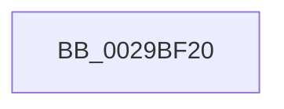

# IoSetDiskIoAttributionFromThread

- RVA: `0x0029BF20`–`0x0029BF30` (길이 `16` bytes)
- VA: `0x000000014029BF20`
- 실행 섹션: `.text`
- PDB 이름 있음: `예`; PDB Function 태그: `아니요`
- unwind 정보 RVA: `0x00067E58`
- 디코드: `5`개 명령, `16/16` bytes 표시
- 미해석 바이트: `0` (있으면 어셈블리에 `.byte`로 보존)

> 이 문서는 커널 이미지의 기계어와 PDB 기호를 분석해 생성했습니다. 4번과 5번은 함수 원형과 자료형을 바이너리 사용 방식에서 추정한 C 해석이며 원본 소스 복구 결과는 아닙니다.

## 1. Dependencies

- 직접 호출 지점: **0**; 고유 호출 대상: **0**
- 직접 호출자로 확인된 함수: **8**
- RIP 상대 이미지 참조: **0**

### Outgoing calls
- 직접 디코드된 call 명령이 없습니다.

### Direct callers
- [MiIssueAsynchronousFlush](MiIssueAsynchronousFlush_function_00299898.md) at `0x00299A03`
- [IoAsynchronousPageWrite](IoAsynchronousPageWrite_function_00299C08.md) at `0x00299D32`
- [MiSynchronousPageWrite](MiSynchronousPageWrite_function_0029A2E4.md) at `0x0029A403`
- [MiIssueSynchronousFlush](MiIssueSynchronousFlush_function_0029A588.md) at `0x0029A6F1`
- [IoSynchronousPageWriteEx](IoSynchronousPageWriteEx_function_0029A860.md) at `0x0029A9A4`
- [IopBuildAsynchronousFsdRequest](IopBuildAsynchronousFsdRequest_function_0029DD40.md) at `0x0029DE55`
- [IoSetIoAttributionIrp](../4B/IoSetIoAttributionIrp_function_004B2760.md) at `0x004B2790`
- [IopSynchronousServiceTail](../../page/8E/IopSynchronousServiceTail_function_008EB440.md) at `0x008EB656`

### Static image references
- 디코드된 RIP-relative 메모리 참조가 없습니다.

## 2. Other-region calls and transfers

- 다른 실행 섹션으로 향하는 call: **0**
- 별도 외부 분기/꼬리 이동을 확인하지 못했습니다.

## 3. Assembly (complete function range)

```asm
0029BF20  40 53                           push rbx
0029BF22  57                              push rdi
0029BF23  48 83 EC 48                     sub rsp, 0x48
0029BF27  48 8B BA 50 06 00 00            mov rdi, qword ptr [rdx + 0x650]
0029BF2E  33 DB                           xor ebx, ebx
```

## 4. C-style interpretation (structured pseudocode)

```c
void __fastcall IoSetDiskIoAttributionFromThread(__int64 a1, __int64 a2)
{
    __int64 v_rbx;
    __int64 v_rsp;

    v_rsp = (v_rsp) - (72);
    v_rbx = 0;
    return;
}
```

## 5. (Beta) C Style

```c
void IoSetDiskIoAttributionFromThread(int64_t Arg1, void *Arg2)
{
    uint8_t *arg2 = (uint8_t *)Arg2;

    int64_t local_rbx;
    int64_t local_rsp;

    local_rsp = (local_rsp) - (72);
    local_rbx = 0;
    return;
}
```

### 관측된 메모리 오프셋

구조체 형식이 확인되지 않은 접근은 인자 기준의 오프셋으로만 기록했습니다.

| 기준 인자 | 오프셋 표현 | 폭 (bit) | 접근 |
|---|---:|---:|---|
| `Arg2` | `+ 0x650` | `64` | `R` |

## 6. Execution-region graph

[열기: 2D/3D 그래프와 함수 탐색 컨트롤 패널](../../../control-panel.html?section=text&rva=0x0029BF20&view=graph)

- 2D 그래프는 위에서 아래로 흐르고, 3D 그래프는 빈 공간을 드래그해 회전합니다. Shift+드래그는 이동, 휠은 확대·축소, 함수 노드 선택은 대상 보고서 이동입니다.

### Static fallback


