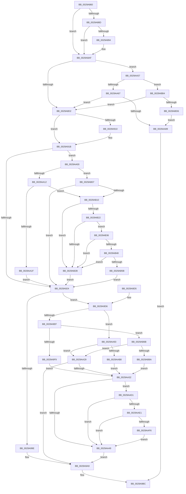

# IoSynchronousPageWriteEx

- RVA: `0x0029A860`–`0x0029ABDB` (길이 `891` bytes)
- VA: `0x000000014029A860`
- 실행 섹션: `.text`
- PDB 이름 있음: `예`; PDB Function 태그: `아니요`
- unwind 정보 RVA: `0x00067D10`
- 디코드: `196`개 명령, `891/891` bytes 표시
- 미해석 바이트: `0` (있으면 어셈블리에 `.byte`로 보존)

> 이 문서는 커널 이미지의 기계어와 PDB 기호를 분석해 생성했습니다. 4번과 5번은 함수 원형과 자료형을 바이너리 사용 방식에서 추정한 C 해석이며 원본 소스 복구 결과는 아닙니다.

## 1. Dependencies

- 직접 호출 지점: **11**; 고유 호출 대상: **10**
- 직접 호출자로 확인된 함수: **3**
- RIP 상대 이미지 참조: **4**

### Outgoing calls
- `0x0029A8AF` → [IoGetRelatedDeviceObject](IoGetRelatedDeviceObject_function_0029B120.md) (function, `0x0029B120`)
- `0x0029A8C1` → [IopAllocateIrpExReturn](../20/IopAllocateIrpExReturn_function_00207720.md) (function, `0x00207720`)
- `0x0029A9A4` → [IoSetDiskIoAttributionFromThread](IoSetDiskIoAttributionFromThread_function_0029BF20.md) (function, `0x0029BF20`)
- `0x0029A9AC` → [IopQueueThreadIrp](../20/IopQueueThreadIrp_function_002075C0.md) (function, `0x002075C0`)
- `0x0029A9B7` → [IofCallDriver](IofCallDriver_function_0029B4B0.md) (function, `0x0029B4B0`)
- `0x0029AA5A` → [MmIsFileObjectAPagingFile](MmIsFileObjectAPagingFile_function_0029BDAC.md) (function, `0x0029BDAC`)
- `0x0029AA78` → [IopAllocateReserveIrp](IopAllocateReserveIrp_function_0029C218.md) (function, `0x0029C218`)
- `0x0029AAA7` → [ExAllocatePool2](../../poolcode/B8/ExAllocatePool2_function_00B820F0.md) (function, `0x00B820F0`)
- `0x0029AAFD` → [IopReferenceIoAttributionFromProcess](../44/IopReferenceIoAttributionFromProcess_function_004458A0.md) (function, `0x004458A0`)
- `0x0029AB79` → [ExAllocatePool2](../../poolcode/B8/ExAllocatePool2_function_00B820F0.md) (function, `0x00B820F0`)
- `0x0029ABC5` → [IopAllocateBackpocketIrp](../59/IopAllocateBackpocketIrp_function_00596CE0.md) (function, `0x00596CE0`)

### Direct callers
- [IoSynchronousPageWrite](IoSynchronousPageWrite_function_00299E30.md) at `0x00299E49`
- [MiZeroPageWrite](MiZeroPageWrite_function_0029F280.md) at `0x0029F3FE`
- [IoWriteCapturedPristineTriageDumpToDedicatedDumpFile](../59/IoWriteCapturedPristineTriageDumpToDedicatedDumpFile_function_005934C0.md) at `0x0059366A`

### Static image references
- `0x0029AA67` → RVA `0x00F8D8C4` (`.data`; read/write)
- `0x0029AB2B` → RVA `0x00F8D174` (`.data`; read/write)
- `0x0029AB5B` → RVA `0x00F8D178` (`.data`; read/write)
- `0x0029ABB4` → RVA `0x00F8D8C0` (`.data`; read/write)

## 2. Other-region calls and transfers

- 다른 실행 섹션으로 향하는 call: **2**
  - `0x0029AAA7` → [ExAllocatePool2](../../poolcode/B8/ExAllocatePool2_function_00B820F0.md) (`.text` → `POOLCODE`)
  - `0x0029AB79` → [ExAllocatePool2](../../poolcode/B8/ExAllocatePool2_function_00B820F0.md) (`.text` → `POOLCODE`)
- 별도 외부 분기/꼬리 이동을 확인하지 못했습니다.

## 3. Assembly (complete function range)

```asm
0029A860  48 89 5C 24 10                  mov qword ptr [rsp + 0x10], rbx
0029A865  48 89 6C 24 18                  mov qword ptr [rsp + 0x18], rbp
0029A86A  48 89 74 24 20                  mov qword ptr [rsp + 0x20], rsi
0029A86F  57                              push rdi
0029A870  41 56                           push r14
0029A872  41 57                           push r15
0029A874  48 83 EC 20                     sub rsp, 0x20
0029A878  48 8B 41 28                     mov rax, qword ptr [rcx + 0x28]
0029A87C  4D 8B F1                        mov r14, r9
0029A87F  4D 8B F8                        mov r15, r8
0029A882  48 8B EA                        mov rbp, rdx
0029A885  48 8B F9                        mov rdi, rcx
0029A888  48 85 C0                        test rax, rax
0029A88B  74 22                           je 0x14029a8af
0029A88D  48 83 78 08 00                  cmp qword ptr [rax + 8], 0
0029A892  74 1B                           je 0x14029a8af
0029A894  65 FF 04 25 74 89 00 00         inc dword ptr gs:[0x8974]
0029A89C  8B 42 28                        mov eax, dword ptr [rdx + 0x28]
0029A89F  05 FF 0F 00 00                  add eax, 0xfff
0029A8A4  C1 E8 0C                        shr eax, 0xc
0029A8A7  65 01 04 25 78 89 00 00         add dword ptr gs:[0x8978], eax
0029A8AF  E8 6C 08 00 00                  call 0x14029b120
0029A8B4  45 33 C0                        xor r8d, r8d
0029A8B7  48 8B C8                        mov rcx, rax
0029A8BA  48 8B F0                        mov rsi, rax
0029A8BD  0F B6 50 4C                     movzx edx, byte ptr [rax + 0x4c]
0029A8C1  E8 5A CE F6 FF                  call 0x140207720
0029A8C6  48 8B D8                        mov rbx, rax
0029A8C9  48 85 C0                        test rax, rax
0029A8CC  0F 84 85 01 00 00               je 0x14029aa57
0029A8D2  80 4B 47 20                     or byte ptr [rbx + 0x47], 0x20
0029A8D6  4C 8B 83 B8 00 00 00            mov r8, qword ptr [rbx + 0xb8]
0029A8DD  48 89 6B 08                     mov qword ptr [rbx + 8], rbp
0029A8E1  C7 43 10 43 00 00 00            mov dword ptr [rbx + 0x10], 0x43
0029A8E8  65 48 8B 0C 25 88 01 00 00      mov rcx, qword ptr gs:[0x188]
0029A8F1  48 8B 81 20 02 00 00            mov rax, qword ptr [rcx + 0x220]
0029A8F8  8B 91 A0 05 00 00               mov edx, dword ptr [rcx + 0x5a0]
0029A8FE  C1 EA 09                        shr edx, 9
0029A901  83 E2 07                        and edx, 7
0029A904  48 8B 80 A0 02 00 00            mov rax, qword ptr [rax + 0x2a0]
0029A90B  48 85 C0                        test rax, rax
0029A90E  74 0B                           je 0x14029a91b
0029A910  8B 80 3C 04 00 00               mov eax, dword ptr [rax + 0x43c]
0029A916  3B D0                           cmp edx, eax
0029A918  0F 4D D0                        cmovge edx, eax
0029A91B  83 FA 02                        cmp edx, 2
0029A91E  0F 8C DC 00 00 00               jl 0x14029aa00
0029A924  8B 43 10                        mov eax, dword ptr [rbx + 0x10]
0029A927  25 FF FF F1 FF                  and eax, 0xfff1ffff
0029A92C  C6 43 40 00                     mov byte ptr [rbx + 0x40], 0
0029A930  4C 89 73 50                     mov qword ptr [rbx + 0x50], r14
0029A934  C1 E2 11                        shl edx, 0x11
0029A937  81 C2 00 00 02 00               add edx, 0x20000
0029A93D  0B D0                           or edx, eax
0029A93F  48 8B 44 24 70                  mov rax, qword ptr [rsp + 0x70]
0029A944  48 89 43 48                     mov qword ptr [rbx + 0x48], rax
0029A948  89 53 10                        mov dword ptr [rbx + 0x10], edx
0029A94B  8B 45 2C                        mov eax, dword ptr [rbp + 0x2c]
0029A94E  48 03 45 20                     add rax, qword ptr [rbp + 0x20]
0029A952  48 89 43 70                     mov qword ptr [rbx + 0x70], rax
0029A956  48 89 BB C0 00 00 00            mov qword ptr [rbx + 0xc0], rdi
0029A95D  65 48 8B 04 25 88 01 00 00      mov rax, qword ptr gs:[0x188]
0029A966  48 89 83 98 00 00 00            mov qword ptr [rbx + 0x98], rax
0029A96D  41 C6 40 B8 04                  mov byte ptr [r8 - 0x48], 4
0029A972  8B 45 28                        mov eax, dword ptr [rbp + 0x28]
0029A975  41 89 40 C0                     mov dword ptr [r8 - 0x40], eax
0029A979  49 8B 07                        mov rax, qword ptr [r15]
0029A97C  49 89 40 D0                     mov qword ptr [r8 - 0x30], rax
0029A980  0F B6 44 24 60                  movzx eax, byte ptr [rsp + 0x60]
0029A985  41 08 40 BA                     or byte ptr [r8 - 0x46], al
0029A989  48 8B 44 24 68                  mov rax, qword ptr [rsp + 0x68]
0029A98E  49 89 78 E8                     mov qword ptr [r8 - 0x18], rdi
0029A992  48 8B AB 98 00 00 00            mov rbp, qword ptr [rbx + 0x98]
0029A999  48 85 C0                        test rax, rax
0029A99C  75 38                           jne 0x14029a9d6
0029A99E  48 8B D5                        mov rdx, rbp
0029A9A1  48 8B CB                        mov rcx, rbx
0029A9A4  E8 77 15 00 00                  call 0x14029bf20
0029A9A9  48 8B CB                        mov rcx, rbx
0029A9AC  E8 0F CC F6 FF                  call 0x1402075c0
0029A9B1  48 8B D3                        mov rdx, rbx
0029A9B4  48 8B CE                        mov rcx, rsi
0029A9B7  E8 F4 0A 00 00                  call 0x14029b4b0
0029A9BC  48 8B 5C 24 48                  mov rbx, qword ptr [rsp + 0x48]
0029A9C1  48 8B 6C 24 50                  mov rbp, qword ptr [rsp + 0x50]
0029A9C6  48 8B 74 24 58                  mov rsi, qword ptr [rsp + 0x58]
0029A9CB  48 83 C4 20                     add rsp, 0x20
0029A9CF  41 5F                           pop r15
0029A9D1  41 5E                           pop r14
0029A9D3  5F                              pop rdi
0029A9D4  C3                              ret
0029A9D5  CC                              int3
0029A9D6  48 8B BB C8 00 00 00            mov rdi, qword ptr [rbx + 0xc8]
0029A9DD  48 8B 40 18                     mov rax, qword ptr [rax + 0x18]
0029A9E1  48 89 44 24 40                  mov qword ptr [rsp + 0x40], rax
0029A9E6  48 85 FF                        test rdi, rdi
0029A9E9  0F 84 A4 00 00 00               je 0x14029aa93
0029A9EF  80 7B 47 00                     cmp byte ptr [rbx + 0x47], 0
0029A9F3  0F 8C 72 01 00 00               jl 0x14029ab6b
0029A9F9  66 83 4F 02 40                  or word ptr [rdi + 2], 0x40
0029A9FE  EB 32                           jmp 0x14029aa32
0029AA00  65 48 8B 04 25 88 01 00 00      mov rax, qword ptr gs:[0x188]
0029AA09  48 3B C8                        cmp rcx, rax
0029AA0C  0F 85 F5 00 00 00               jne 0x14029ab07
0029AA12  83 B9 E0 05 00 00 00            cmp dword ptr [rcx + 0x5e0], 0
0029AA19  0F 84 F1 00 00 00               je 0x14029ab10
0029AA1F  BA 02 00 00 00                  mov edx, 2
0029AA24  E9 FB FE FF FF                  jmp 0x14029a924
0029AA29  48 85 FF                        test rdi, rdi
0029AA2C  0F 84 77 FF FF FF               je 0x14029a9a9
0029AA32  48 8B 8D 20 02 00 00            mov rcx, qword ptr [rbp + 0x220]
0029AA39  F7 81 FC 05 00 00 00 10 00 00   test dword ptr [rcx + 0x5fc], 0x1000
0029AA43  0F 85 88 00 00 00               jne 0x14029aad1
0029AA49  48 8B 44 24 40                  mov rax, qword ptr [rsp + 0x40]
0029AA4E  48 89 47 10                     mov qword ptr [rdi + 0x10], rax
0029AA52  E9 52 FF FF FF                  jmp 0x14029a9a9
0029AA57  48 8B CF                        mov rcx, rdi
0029AA5A  E8 4D 13 00 00                  call 0x14029bdac
0029AA5F  85 C0                           test eax, eax
0029AA61  0F 84 4D 01 00 00               je 0x14029abb4
0029AA67  F0 FF 05 56 2E CF 00            lock inc dword ptr [rip + 0xcf2e56]
0029AA6E  0F B6 56 4C                     movzx edx, byte ptr [rsi + 0x4c]
0029AA72  41 B8 01 00 00 00               mov r8d, 1
0029AA78  E8 9B 17 00 00                  call 0x14029c218
0029AA7D  48 8B D8                        mov rbx, rax
0029AA80  48 85 C0                        test rax, rax
0029AA83  0F 85 49 FE FF FF               jne 0x14029a8d2
0029AA89  B8 9A 00 00 C0                  mov eax, 0xc000009a
0029AA8E  E9 29 FF FF FF                  jmp 0x14029a9bc
0029AA93  41 BE 40 00 00 00               mov r14d, 0x40
0029AA99  BA 50 00 00 00                  mov edx, 0x50
0029AA9E  41 8B CE                        mov ecx, r14d
0029AAA1  41 B8 49 72 70 58               mov r8d, 0x58707249
0029AAA7  E8 44 76 8E 00                  call 0x140b820f0
0029AAAC  48 8B F8                        mov rdi, rax
0029AAAF  48 85 C0                        test rax, rax
0029AAB2  0F 84 71 FF FF FF               je 0x14029aa29
0029AAB8  66 44 89 70 02                  mov word ptr [rax + 2], r14w
0029AABD  44 08 73 47                     or byte ptr [rbx + 0x47], r14b
0029AAC1  48 89 83 C8 00 00 00            mov qword ptr [rbx + 0xc8], rax
0029AAC8  66 83 08 01                     or word ptr [rax], 1
0029AACC  E9 61 FF FF FF                  jmp 0x14029aa32
0029AAD1  48 8B 81 A0 02 00 00            mov rax, qword ptr [rcx + 0x2a0]
0029AAD8  48 85 C0                        test rax, rax
0029AADB  0F 84 68 FF FF FF               je 0x14029aa49
0029AAE1  48 8B 81 A0 02 00 00            mov rax, qword ptr [rcx + 0x2a0]
0029AAE8  48 83 B8 30 06 00 00 00         cmp qword ptr [rax + 0x630], 0
0029AAF0  0F 84 53 FF FF FF               je 0x14029aa49
0029AAF6  4C 8D 44 24 40                  lea r8, [rsp + 0x40]
0029AAFB  B2 01                           mov dl, 1
0029AAFD  E8 9E AD 1A 00                  call 0x1404458a0
0029AB02  E9 42 FF FF FF                  jmp 0x14029aa49
0029AB07  83 FA 02                        cmp edx, 2
0029AB0A  0F 8D 14 FE FF FF               jge 0x14029a924
0029AB10  65 48 8B 0C 25 88 01 00 00      mov rcx, qword ptr gs:[0x188]
0029AB19  F7 41 74 00 04 00 00            test dword ptr [rcx + 0x74], 0x400
0029AB20  75 09                           jne 0x14029ab2b
0029AB22  80 B9 32 02 00 00 01            cmp byte ptr [rcx + 0x232], 1
0029AB29  75 0B                           jne 0x14029ab36
0029AB2B  FF 05 43 26 CF 00               inc dword ptr [rip + 0xcf2643]
0029AB31  E9 EE FD FF FF                  jmp 0x14029a924
0029AB36  65 48 8B 04 25 88 01 00 00      mov rax, qword ptr gs:[0x188]
0029AB3F  F6 80 A8 05 00 00 40            test byte ptr [rax + 0x5a8], 0x40
0029AB46  75 E3                           jne 0x14029ab2b
0029AB48  65 48 8B 04 25 88 01 00 00      mov rax, qword ptr gs:[0x188]
0029AB51  48 83 B8 50 05 00 00 02         cmp qword ptr [rax + 0x550], 2
0029AB59  74 D0                           je 0x14029ab2b
0029AB5B  FF 05 17 26 CF 00               inc dword ptr [rip + 0xcf2617]
0029AB61  BA 02 00 00 00                  mov edx, 2
0029AB66  E9 B9 FD FF FF                  jmp 0x14029a924
0029AB6B  BA 50 00 00 00                  mov edx, 0x50
0029AB70  41 B8 49 72 70 58               mov r8d, 0x58707249
0029AB76  8D 4A F0                        lea ecx, [rdx - 0x10]
0029AB79  E8 72 75 8E 00                  call 0x140b820f0
0029AB7E  48 8B F8                        mov rdi, rax
0029AB81  48 85 C0                        test rax, rax
0029AB84  0F 84 9F FE FF FF               je 0x14029aa29
0029AB8A  66 C7 40 02 44 00               mov word ptr [rax + 2], 0x44
0029AB90  8B 83 C8 00 00 00               mov eax, dword ptr [rbx + 0xc8]
0029AB96  89 47 04                        mov dword ptr [rdi + 4], eax
0029AB99  0F B6 43 47                     movzx eax, byte ptr [rbx + 0x47]
0029AB9D  24 3F                           and al, 0x3f
0029AB9F  48 89 BB C8 00 00 00            mov qword ptr [rbx + 0xc8], rdi
0029ABA6  0C 40                           or al, 0x40
0029ABA8  88 43 47                        mov byte ptr [rbx + 0x47], al
0029ABAB  66 83 0F 01                     or word ptr [rdi], 1
0029ABAF  E9 7E FE FF FF                  jmp 0x14029aa32
0029ABB4  F0 FF 05 05 2D CF 00            lock inc dword ptr [rip + 0xcf2d05]
0029ABBB  0F B6 56 4C                     movzx edx, byte ptr [rsi + 0x4c]
0029ABBF  45 33 C0                        xor r8d, r8d
0029ABC2  48 8B CE                        mov rcx, rsi
0029ABC5  E8 16 C1 2F 00                  call 0x140596ce0
0029ABCA  48 8B D8                        mov rbx, rax
0029ABCD  48 85 C0                        test rax, rax
0029ABD0  0F 85 FC FC FF FF               jne 0x14029a8d2
0029ABD6  E9 AE FE FF FF                  jmp 0x14029aa89
```

## 4. C-style interpretation (structured pseudocode)

```c
__int64 __fastcall IoSynchronousPageWriteEx(__int64 a1, __int64 a2, __int64 a3, __int64 a4, unsigned __int8 a5, __int64 a6, __int64 a7)
{
    __int64 result;
    __int64 v_rsp;
    unsigned __int64 v_stack_p10;
    unsigned __int64 v_stack_p18;
    unsigned __int64 v_stack_p20;
    unsigned __int64 v_stack_p40;

    v_stack_p10 = v_rbx;
    v_stack_p18 = v_rbp;
    v_stack_p20 = v_rsi;
    v_rsp = (v_rsp) - (32);
    if (*(unsigned __int64 *)(a1 + 40) == 0) goto loc_0029A8AF;
    result = *(unsigned __int64 *)(a1 + 40);
    if ((*(unsigned __int64 *)(*(unsigned __int64 *)(a1 + 40) + 8)) != 0) {
        result = *(unsigned int *)(a2 + 40);
        result = (unsigned int)((result) + (0xFFFULL));
        result = (unsigned int)((result) >> (12));
    }
    result = IoGetRelatedDeviceObject(a1, a2, a3, a4);
    a3 = 0;
    result = IopAllocateIrpExReturn(result, *(unsigned __int8 *)(result + 76), a3, a4);
    if (result == 0) goto loc_0029AA57;
loc_0029A8D2:
    *(unsigned __int64 *)(result + 8) = a2;
    *(unsigned int *)(result + 16) = 67;
    a2 = (unsigned int)(((unsigned int)(*(unsigned int *)(*(unsigned __int64 *)(gs_base + (0 + 392)) + 1440))) >> (9));
    a2 = (unsigned int)((a2) & (7));
    result = *(unsigned __int64 *)(*(unsigned __int64 *)(*(unsigned __int64 *)(gs_base + (0 + 392)) + 544) + 672);
    if (*(unsigned __int64 *)(*(unsigned __int64 *)(*(unsigned __int64 *)(gs_base + (0 + 392)) + 544) + 672) != 0) {
        result = *(unsigned int *)(*(unsigned __int64 *)(*(unsigned __int64 *)(*(unsigned __int64 *)(gs_base + (0 + 392)) + 544) + 672) + 1084);
        if (((unsigned int)(a2)) >= ((unsigned int)(result))) { a2 = (unsigned int)(result); }
    }
    if (((unsigned int)(a2)) < 2) goto loc_0029AA00;
loc_0029A924:
    result = (unsigned int)(((unsigned int)(*(unsigned int *)(result + 16))) & (0xFFF1FFFFULL));
    *(unsigned __int8 *)(result + 64) = 0;
    *(unsigned __int64 *)(result + 80) = a4;
    a2 = (unsigned int)((a2) << (17));
    a2 = (unsigned int)((a2) + (0x20000ULL));
    a2 = (unsigned int)((a2) | ((unsigned int)(result)));
    *(unsigned __int64 *)(result + 72) = a7;
    *(unsigned int *)(result + 16) = (unsigned int)(a2);
    result = ((unsigned int)(*(unsigned int *)(a2 + 44))) + (*(unsigned __int64 *)(a2 + 32));
    *(unsigned __int64 *)(result + 112) = result;
    *(unsigned __int64 *)(result + 192) = a1;
    *(unsigned __int64 *)(result + 152) = *(unsigned __int64 *)(gs_base + (0 + 392));
    *(unsigned __int8 *)(*(unsigned __int64 *)(result + 184) - 72) = 4;
    *(unsigned int *)(*(unsigned __int64 *)(result + 184) - 64) = (unsigned int)((unsigned int)(*(unsigned int *)(a2 + 40)));
    *(unsigned __int64 *)(*(unsigned __int64 *)(result + 184) - 48) = *(unsigned __int64 *)(a3);
    *(unsigned __int64 *)(*(unsigned __int64 *)(result + 184) - 24) = a1;
    if (a6 != 0) goto loc_0029A9D6;
    result = IoSetDiskIoAttributionFromThread(result, *(unsigned __int64 *)(result + 152), *(unsigned __int64 *)(result + 184), a4);
loc_0029A9A9:
    result = IopQueueThreadIrp(result, *(unsigned __int64 *)(result + 152), *(unsigned __int64 *)(result + 184), a4);
    result = IofCallDriver(result, result, *(unsigned __int64 *)(result + 184), a4);
loc_0029A9BC:
    v_rsp = (v_rsp) + (32);
    return result;
loc_0029A9D6:
    v_stack_p40 = *(unsigned __int64 *)(result + 24);
    if (*(unsigned __int64 *)(v_stack_p10 + 200) == 0) goto loc_0029AA93;
    if ((*(unsigned __int8 *)(v_stack_p10 + 71)) < 0) goto loc_0029AB6B;
    goto loc_0029AA32;
loc_0029AA00:
    if (result != (*(unsigned __int64 *)(gs_base + (0 + 392)))) goto loc_0029AB07;
    if ((*(unsigned int *)(result + 1504)) == 0) goto loc_0029AB10;
    goto loc_0029A924;
loc_0029AA29:
    if (*(unsigned __int64 *)(v_stack_p10 + 200) == 0) goto loc_0029A9A9;
loc_0029AA32:
    if (((*(unsigned int *)(*(unsigned __int64 *)(v_stack_p18 + 544) + 1532)) & (0x1000ULL)) != 0) goto loc_0029AAD1;
loc_0029AA49:
    *(unsigned __int64 *)(*(unsigned __int64 *)(v_stack_p10 + 200) + 16) = v_stack_p40;
    goto loc_0029A9A9;
loc_0029AA57:
    result = MmIsFileObjectAPagingFile(*(unsigned __int64 *)(v_stack_p10 + 200), 2, *(unsigned __int64 *)(result + 184), a4);
    if ((unsigned int)(result) == 0) goto loc_0029ABB4;
    result = IopAllocateReserveIrp(*(unsigned __int64 *)(v_stack_p10 + 200), *(unsigned __int8 *)(v_stack_p20 + 76), 1, a4);
    if (result != 0) goto loc_0029A8D2;
loc_0029AA89:
    goto loc_0029A9BC;
loc_0029AA93:
    result = ExAllocatePool2(64, 80, (unsigned int)(0x58707249ULL), a4);
    if (result == 0) goto loc_0029AA29;
    *(unsigned __int16 *)(result + 2) = 64;
    *(unsigned __int64 *)(result + 200) = result;
    goto loc_0029AA32;
loc_0029AAD1:
    if (*(unsigned __int64 *)(64 + 672) == 0) goto loc_0029AA49;
    if ((*(unsigned __int64 *)(*(unsigned __int64 *)(64 + 672) + 1584)) == 0) goto loc_0029AA49;
    result = IopReferenceIoAttributionFromProcess(64, 1, v_stack_p40, a4);
    goto loc_0029AA49;
loc_0029AB07:
    if (1 >= 2) goto loc_0029A924;
loc_0029AB10:
    if (((*(unsigned int *)(*(unsigned __int64 *)(gs_base + (0 + 392)) + 116)) & (0x400ULL)) != 0) goto loc_0029AB2B;
    if ((*(unsigned __int8 *)(*(unsigned __int64 *)(gs_base + (0 + 392)) + 562)) != 1) goto loc_0029AB36;
loc_0029AB2B:
    goto loc_0029A924;
loc_0029AB36:
    if (((*(unsigned __int8 *)(*(unsigned __int64 *)(gs_base + (0 + 392)) + 1448)) & (64)) != 0) goto loc_0029AB2B;
    if ((*(unsigned __int64 *)(*(unsigned __int64 *)(gs_base + (0 + 392)) + 1360)) == 2) goto loc_0029AB2B;
    goto loc_0029A924;
loc_0029AB6B:
    result = ExAllocatePool2(80 - 16, 80, (unsigned int)(0x58707249ULL), a4);
    if (result == 0) goto loc_0029AA29;
    *(unsigned __int16 *)(result + 2) = 68;
    *(unsigned int *)(result + 4) = (unsigned int)((unsigned int)(*(unsigned int *)(result + 200)));
    result = (unsigned __int8)((*(unsigned __int8 *)(result + 71)) & (63));
    *(unsigned __int64 *)(result + 200) = result;
    result = (unsigned __int8)((result) | (64));
    *(unsigned __int8 *)(result + 71) = (unsigned __int8)(result);
    goto loc_0029AA32;
loc_0029ABB4:
    a3 = 0;
    result = IopAllocateBackpocketIrp(v_stack_p20, *(unsigned __int8 *)(v_stack_p20 + 76), a3, a4);
    if (result != 0) goto loc_0029A8D2;
    goto loc_0029AA89;
}
```

## 5. (Beta) C Style

```c
int64_t IoSynchronousPageWriteEx(void *Arg1, void *Arg2, void *Arg3, int64_t Arg4, uint8_t Arg5, int64_t Arg6, int64_t Arg7)
{
    uint8_t *arg1 = (uint8_t *)Arg1;
    uint8_t *arg2 = (uint8_t *)Arg2;
    uint8_t *arg3 = (uint8_t *)Arg3;

    int64_t result;
    int64_t local_rsp;
    uint64_t v_stack_p10;
    uint64_t v_stack_p18;
    uint64_t v_stack_p20;
    uint64_t v_stack_p40;

    v_stack_p10 = local_rbx;
    v_stack_p18 = local_rbp;
    v_stack_p20 = local_rsi;
    local_rsp = (local_rsp) - (32);
    if (*(uint64_t *)(arg1 + 0x28) == 0) goto loc_0029A8AF;
    result = *(uint64_t *)(arg1 + 0x28);
    if ((*(uint64_t *)(*(uint64_t *)(arg1 + 0x28) + 0x8)) != 0) {
        result = *(uint32_t *)(arg2 + 0x28);
        result = (uint32_t)((result) + (0xFFFULL));
        result = (uint32_t)((result) >> (12));
    }
    result = IoGetRelatedDeviceObject(Arg1, Arg2, Arg3, Arg4);
    Arg3 = 0;
    result = IopAllocateIrpExReturn(result, *(uint8_t *)(result + 0x4C), Arg3, Arg4);
    if (result == 0) goto loc_0029AA57;
loc_0029A8D2:
    *(void **)(result + 0x8) = Arg2;
    *(uint32_t *)(result + 0x10) = 67;
    Arg2 = (uint32_t)(((uint32_t)(*(uint32_t *)(*(uint64_t *)(gs_base + (0 + 0x188)) + 0x5A0))) >> (9));
    Arg2 = (uint32_t)((Arg2) & (7));
    result = *(uint64_t *)(*(uint64_t *)(*(uint64_t *)(gs_base + (0 + 0x188)) + 0x220) + 0x2A0);
    if (*(uint64_t *)(*(uint64_t *)(*(uint64_t *)(gs_base + (0 + 0x188)) + 0x220) + 0x2A0) != 0) {
        result = *(uint32_t *)(*(uint64_t *)(*(uint64_t *)(*(uint64_t *)(gs_base + (0 + 0x188)) + 0x220) + 0x2A0) + 0x43C);
        if (((uint32_t)(Arg2)) >= ((uint32_t)(result))) { Arg2 = (uint32_t)(result); }
    }
    if (((uint32_t)(Arg2)) < 2) goto loc_0029AA00;
loc_0029A924:
    result = (uint32_t)(((uint32_t)(*(uint32_t *)(result + 0x10))) & (0xFFF1FFFFULL));
    *(uint8_t *)(result + 0x40) = 0;
    *(uint64_t *)(result + 0x50) = Arg4;
    Arg2 = (uint32_t)((Arg2) << (17));
    Arg2 = (uint32_t)((Arg2) + (0x20000ULL));
    Arg2 = (uint32_t)((Arg2) | ((uint32_t)(result)));
    *(uint64_t *)(result + 0x48) = Arg7;
    *(uint32_t *)(result + 0x10) = (uint32_t)(Arg2);
    result = ((uint32_t)(*(uint32_t *)(arg2 + 0x2C))) + (*(uint64_t *)(arg2 + 0x20));
    *(uint64_t *)(result + 0x70) = result;
    *(void **)(result + 0xC0) = Arg1;
    *(uint64_t *)(result + 0x98) = *(uint64_t *)(gs_base + (0 + 0x188));
    *(uint8_t *)(*(uint64_t *)(result + 0xB8) - 0x48) = 4;
    *(uint32_t *)(*(uint64_t *)(result + 0xB8) - 0x40) = (uint32_t)((uint32_t)(*(uint32_t *)(arg2 + 0x28)));
    *(uint64_t *)(*(uint64_t *)(result + 0xB8) - 0x30) = *(uint64_t *)(arg3);
    *(void **)(*(uint64_t *)(result + 0xB8) - 0x18) = Arg1;
    if (Arg6 != 0) goto loc_0029A9D6;
    result = IoSetDiskIoAttributionFromThread(result, *(uint64_t *)(result + 0x98), *(uint64_t *)(result + 0xB8), Arg4);
loc_0029A9A9:
    result = IopQueueThreadIrp(result, *(uint64_t *)(result + 0x98), *(uint64_t *)(result + 0xB8), Arg4);
    result = IofCallDriver(result, result, *(uint64_t *)(result + 0xB8), Arg4);
loc_0029A9BC:
    local_rsp = (local_rsp) + (32);
    return result;
loc_0029A9D6:
    v_stack_p40 = *(uint64_t *)(result + 0x18);
    if (*(uint64_t *)(v_stack_p10 + 0xC8) == 0) goto loc_0029AA93;
    if ((*(uint8_t *)(v_stack_p10 + 0x47)) < 0) goto loc_0029AB6B;
    goto loc_0029AA32;
loc_0029AA00:
    if (result != (*(uint64_t *)(gs_base + (0 + 0x188)))) goto loc_0029AB07;
    if ((*(uint32_t *)(result + 0x5E0)) == 0) goto loc_0029AB10;
    goto loc_0029A924;
loc_0029AA29:
    if (*(uint64_t *)(v_stack_p10 + 0xC8) == 0) goto loc_0029A9A9;
loc_0029AA32:
    if (((*(uint32_t *)(*(uint64_t *)(v_stack_p18 + 0x220) + 0x5FC)) & (0x1000ULL)) != 0) goto loc_0029AAD1;
loc_0029AA49:
    *(uint64_t *)(*(uint64_t *)(v_stack_p10 + 0xC8) + 0x10) = v_stack_p40;
    goto loc_0029A9A9;
loc_0029AA57:
    result = MmIsFileObjectAPagingFile(*(uint64_t *)(v_stack_p10 + 0xC8), 2, *(uint64_t *)(result + 0xB8), Arg4);
    if ((uint32_t)(result) == 0) goto loc_0029ABB4;
    result = IopAllocateReserveIrp(*(uint64_t *)(v_stack_p10 + 0xC8), *(uint8_t *)(v_stack_p20 + 0x4C), 1, Arg4);
    if (result != 0) goto loc_0029A8D2;
loc_0029AA89:
    goto loc_0029A9BC;
loc_0029AA93:
    result = ExAllocatePool2(64, 80, (uint32_t)(0x58707249ULL), Arg4);
    if (result == 0) goto loc_0029AA29;
    *(uint16_t *)(result + 0x2) = 64;
    *(uint64_t *)(result + 0xC8) = result;
    goto loc_0029AA32;
loc_0029AAD1:
    if (*(uint64_t *)(64 + 0x2A0) == 0) goto loc_0029AA49;
    if ((*(uint64_t *)(*(uint64_t *)(64 + 0x2A0) + 0x630)) == 0) goto loc_0029AA49;
    result = IopReferenceIoAttributionFromProcess(64, 1, v_stack_p40, Arg4);
    goto loc_0029AA49;
loc_0029AB07:
    if (1 >= 2) goto loc_0029A924;
loc_0029AB10:
    if (((*(uint32_t *)(*(uint64_t *)(gs_base + (0 + 0x188)) + 0x74)) & (0x400ULL)) != 0) goto loc_0029AB2B;
    if ((*(uint8_t *)(*(uint64_t *)(gs_base + (0 + 0x188)) + 0x232)) != 1) goto loc_0029AB36;
loc_0029AB2B:
    goto loc_0029A924;
loc_0029AB36:
    if (((*(uint8_t *)(*(uint64_t *)(gs_base + (0 + 0x188)) + 0x5A8)) & (64)) != 0) goto loc_0029AB2B;
    if ((*(uint64_t *)(*(uint64_t *)(gs_base + (0 + 0x188)) + 0x550)) == 2) goto loc_0029AB2B;
    goto loc_0029A924;
loc_0029AB6B:
    result = ExAllocatePool2(80 - 16, 80, (uint32_t)(0x58707249ULL), Arg4);
    if (result == 0) goto loc_0029AA29;
    *(uint16_t *)(result + 0x2) = 68;
    *(uint32_t *)(result + 0x4) = (uint32_t)((uint32_t)(*(uint32_t *)(result + 0xC8)));
    result = (uint8_t)((*(uint8_t *)(result + 0x47)) & (63));
    *(uint64_t *)(result + 0xC8) = result;
    result = (uint8_t)((result) | (64));
    *(uint8_t *)(result + 0x47) = (uint8_t)(result);
    goto loc_0029AA32;
loc_0029ABB4:
    Arg3 = 0;
    result = IopAllocateBackpocketIrp(v_stack_p20, *(uint8_t *)(v_stack_p20 + 0x4C), Arg3, Arg4);
    if (result != 0) goto loc_0029A8D2;
    goto loc_0029AA89;
}
```

### 관측된 메모리 오프셋

구조체 형식이 확인되지 않은 접근은 인자 기준의 오프셋으로만 기록했습니다.

| 기준 인자 | 오프셋 표현 | 폭 (bit) | 접근 |
|---|---:|---:|---|
| `Arg1` | `+ 0x28` | `64` | `R` |
| `Arg2` | `+ 0x20` | `64` | `R` |
| `Arg2` | `+ 0x28` | `32` | `R` |
| `Arg2` | `+ 0x2C` | `32` | `R` |
| `Arg3` | `+ 0x0` | `64` | `R` |

## 6. Execution-region graph

[열기: 2D/3D 그래프와 함수 탐색 컨트롤 패널](../../../control-panel.html?section=text&rva=0x0029A860&view=graph)

- 2D 그래프는 위에서 아래로 흐르고, 3D 그래프는 빈 공간을 드래그해 회전합니다. Shift+드래그는 이동, 휠은 확대·축소, 함수 노드 선택은 대상 보고서 이동입니다.

### Static fallback


