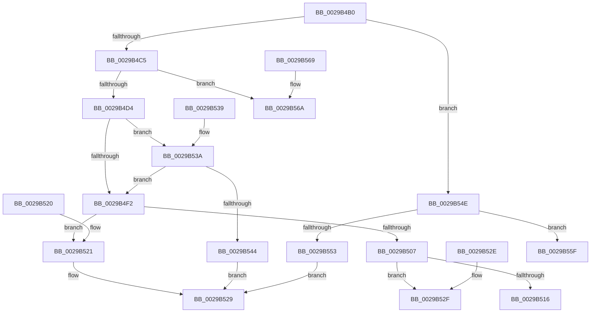

# IofCallDriver

- RVA: `0x0029B4B0`–`0x0029B583` (길이 `211` bytes)
- VA: `0x000000014029B4B0`
- 실행 섹션: `.text`
- PDB 이름 있음: `예`; PDB Function 태그: `아니요`
- unwind 정보 RVA: `0x00067E08`
- 디코드: `60`개 명령, `211/211` bytes 표시
- 미해석 바이트: `0` (있으면 어셈블리에 `.byte`로 보존)

> 이 문서는 커널 이미지의 기계어와 PDB 기호를 분석해 생성했습니다. 4번과 5번은 함수 원형과 자료형을 바이너리 사용 방식에서 추정한 C 해석이며 원본 소스 복구 결과는 아닙니다.

## 1. Dependencies

- 직접 호출 지점: **7**; 고유 호출 대상: **7**
- 직접 호출자로 확인된 함수: **97**
- RIP 상대 이미지 참조: **3**

### Outgoing calls
- `0x0029B516` → [PiDaDispatch](../../page/A0/PiDaDispatch_function_00A00230.md) (function, `0x00A00230`)
- `0x0029B524` → [IopInvalidDeviceRequest](IopInvalidDeviceRequest_function_0029B590.md) (function, `0x0029B590`)
- `0x0029B52F` → [guard_dispatch_icall](../6B/guard_dispatch_icall_function_006BAAD0.md) (function, `0x006BAAD0`)
- `0x0029B547` → [IopPoHandleIrp](../47/IopPoHandleIrp_function_0047096C.md) (function, `0x0047096C`)
- `0x0029B558` → [IovCallDriver](../../pagevrfy/BB/IovCallDriver_function_00BB7D30.md) (function, `0x00BB7D30`)
- `0x0029B55F` → [IopPerfCallDriver](../4A/IopPerfCallDriver_function_004A9680.md) (function, `0x004A9680`)
- `0x0029B57D` → [KeBugCheckEx](../4F/KeBugCheckEx_function_004FD660.md) (function, `0x004FD660`)

### Direct callers
- [PopDequeueQuerySetIrp](../26/PopDequeueQuerySetIrp_function_0026EC34.md) at `0x0026EED5`
- [CcSetValidData](CcSetValidData_function_00299420.md) at `0x00299503`
- [MiIssueAsynchronousFlush](MiIssueAsynchronousFlush_function_00299898.md) at `0x00299A16`
- [IoAsynchronousPageWrite](IoAsynchronousPageWrite_function_00299C08.md) at `0x00299D54`
- [MiSynchronousPageWrite](MiSynchronousPageWrite_function_0029A2E4.md) at `0x0029A416`
- [MiIssueSynchronousFlush](MiIssueSynchronousFlush_function_0029A588.md) at `0x0029A704`
- [IoSynchronousPageWriteEx](IoSynchronousPageWriteEx_function_0029A860.md) at `0x0029A9B7`
- [IoPageReadEx](IoPageReadEx_function_0029ABF0.md) at `0x0029AEB1`
- [sub_0029B1D6](Unknown_function_0029B1D6.md) at `0x0029B2A1`
- [sub_0029B308](Unknown_function_0029B308.md) at `0x0029B340`
- [PopQueueQuerySetIrp](../2B/PopQueueQuerySetIrp_function_002BEF18.md) at `0x002BF09E`
- [IoSynchronousCallDriver](../48/IoSynchronousCallDriver_function_00484050.md) at `0x00484099`
- [IoCallDriver](../49/IoCallDriver_function_0049FE30.md) at `0x0049FE34`
- [FsRtlGetVirtualDiskNestingLevel](../4A/FsRtlGetVirtualDiskNestingLevel_function_004A4530.md) at `0x004A4623`
- [HalpPassIrpFromFdoToPdo](../4E/HalpPassIrpFromFdoToPdo_function_004E15F4.md) at `0x004E160B`
- [SmKmIssueVolumeIo](../60/SmKmIssueVolumeIo_function_0060F9BC.md) at `0x0060FAFC`
- [HalpSetAcpiRealTimeClock](../../page/70/HalpSetAcpiRealTimeClock_function_00705BFC.md) at `0x00705CA4`
- [HalpQueryAcpiWakeAlarmSystemPowerState](../../page/70/HalpQueryAcpiWakeAlarmSystemPowerState_function_0070B634.md) at `0x0070B6D4`
- [HalpQueryPccInterface](../../page/70/HalpQueryPccInterface_function_0070D79C.md) at `0x0070D875`
- [FsRtlBalanceReads](../../page/71/FsRtlBalanceReads_function_00714110.md) at `0x00714188`
- [FsRtlIssueFileNotificationFsctl](../../page/71/FsRtlIssueFileNotificationFsctl_function_007161D8.md) at `0x007162B1`
- [NT_DISK::Control](../../page/71/NT_DISK_Control_function_00716FC0.md) at `0x00717066`
- [IopLoadFileSystemDriver](../../page/71/IopLoadFileSystemDriver_function_0071BB1C.md) at `0x0071BBB2`
- [IopSetRemoteLink](../../page/71/IopSetRemoteLink_function_0071C690.md) at `0x0071C7AC`
- [IoSetInformation](../../page/71/IoSetInformation_function_0071DBF0.md) at `0x0071DEE3`
- [IopIssueSystemEnvironmentCallout](../../page/72/IopIssueSystemEnvironmentCallout_function_00722850.md) at `0x00722860`
- [PiPagePathSetState](../../page/72/PiPagePathSetState_function_0072BDE0.md) at `0x0072BE70`
- [IopEjectDevice](../../page/73/IopEjectDevice_function_0073DC84.md) at `0x0073DE11`
- [PipSendGuestAssignedNotification](../../page/74/PipSendGuestAssignedNotification_function_007404B4.md) at `0x00740518`
- [PopPolicyDeviceHandleWakeAlarmNotification](../../page/76/PopPolicyDeviceHandleWakeAlarmNotification_function_007660A4.md) at `0x007661CB`
- [PopPowerAdapterQueryStatus](../../page/76/PopPowerAdapterQueryStatus_function_00767C44.md) at `0x00767CDF`
- [PopEtDeferredInitDxgContext](../../page/76/PopEtDeferredInitDxgContext_function_00769B40.md) at `0x00769C2E`
- [RawPerformDevIoCtrl](../../page/78/RawPerformDevIoCtrl_function_0078A154.md) at `0x0078A1E9`
- [RawQueryFileSystemInformation](../../page/78/RawQueryFileSystemInformation_function_0078A350.md) at `0x0078A4D3`
- [SmStorePhysicalRequestIssue](../../page/7A/SmStorePhysicalRequestIssue_function_007A732C.md) at `0x007A742C`
- [SmKmSendDeviceControl](../../page/7A/SmKmSendDeviceControl_function_007A8D84.md) at `0x007A8E09`
- [SmKmSendUsageNotification](../../page/7A/SmKmSendUsageNotification_function_007A8E44.md) at `0x007A8ED1`
- [ExpQueryPrmInterface](../../page/7C/ExpQueryPrmInterface_function_007CF018.md) at `0x007CF0E5`
- [VhdVerifyBootDisk](../../page/83/VhdVerifyBootDisk_function_0083BB84.md) at `0x0083BC56`
- [VhdiMountVhdFile](../../page/83/VhdiMountVhdFile_function_0083BED0.md) at `0x0083C0E3`
- [VhdiMountVhdFile](../../page/83/VhdiMountVhdFile_function_0083BED0.md) at `0x0083C36A`
- [VhdiMountVhdFile](../../page/83/VhdiMountVhdFile_function_0083BED0.md) at `0x0083C437`
- [sub_00863E45](../../page/86/Unknown_function_00863E45.md) at `0x00863F43`
- [IopCloseFile](../../page/86/IopCloseFile_function_008640C0.md) at `0x008641F8`
- [IopGetSetSecurityObject](../../page/87/IopGetSetSecurityObject_function_00873A80.md) at `0x00873C18`
- [CmpGetVolumeClusterSize](../../page/87/CmpGetVolumeClusterSize_function_0087B3D4.md) at `0x0087B50D`
- [IopParseDevice](../../page/89/IopParseDevice_function_0089E510.md) at `0x0089F46A`
- [IopParseDevice](../../page/89/IopParseDevice_function_0089E510.md) at `0x008A07B9`
- [IoVolumeDeviceToDosName](../../page/8A/IoVolumeDeviceToDosName_function_008A63F0.md) at `0x008A64DB`
- [IoVolumeDeviceToDosName](../../page/8A/IoVolumeDeviceToDosName_function_008A63F0.md) at `0x008A6582`
- [IoVolumeDeviceToDosName](../../page/8A/IoVolumeDeviceToDosName_function_008A63F0.md) at `0x008A6629`
- [IopQueryNameInternal](../../page/8A/IopQueryNameInternal_function_008A6770.md) at `0x008A69DA`
- [sub_008A8A27](../../page/8A/Unknown_function_008A8A27.md) at `0x008A8B0A`
- [sub_008AD582](../../page/8A/Unknown_function_008AD582.md) at `0x008AD5B4`
- [NtQueryInformationFile](../../page/8A/NtQueryInformationFile_function_008AD630.md) at `0x008ADB45`
- [NtQueryInformationFile](../../page/8A/NtQueryInformationFile_function_008AD630.md) at `0x008AE250`
- [IopSynchronousCall](../../page/8F/IopSynchronousCall_function_008FB018.md) at `0x008FB10B`
- [IoVolumeDeviceToGuidPath](../../page/95/IoVolumeDeviceToGuidPath_function_00952B20.md) at `0x00952BEE`
- [IoVolumeDeviceNameToGuidPath](../../page/95/IoVolumeDeviceNameToGuidPath_function_00952CC0.md) at `0x00952E15`
- [IoVolumeDeviceNameToGuidPath](../../page/95/IoVolumeDeviceNameToGuidPath_function_00952CC0.md) at `0x00952EBB`
- [NtApphelpCacheControl](../../page/95/NtApphelpCacheControl_function_00953050.md) at `0x00953142`
- [FsRtlSetFileSize](../../page/98/FsRtlSetFileSize_function_00982B04.md) at `0x00982BD5`
- [FsRtlGetFileSize](../../page/98/FsRtlGetFileSize_function_00985150.md) at `0x009852A6`
- [RawReadWriteDeviceControl](../../page/9A/RawReadWriteDeviceControl_function_009A3D50.md) at `0x009A3DE2`
- [IopInvalidateVolumesForDevice](../../page/9A/IopInvalidateVolumesForDevice_function_009A5E74.md) at `0x009A6051`
- [CmpFileFlushAndPurge](../../page/9B/CmpFileFlushAndPurge_function_009B2BAC.md) at `0x009B2CDD`
- [WmipForwardWmiIrp](../../page/9E/WmipForwardWmiIrp_function_009E0DB4.md) at `0x009E0F73`
- [FsRtlQueryKernelEaFile](../../page/A0/FsRtlQueryKernelEaFile_function_00A0C680.md) at `0x00A0C7AE`
- [FsRtlSetKernelEaFile](../../page/A0/FsRtlSetKernelEaFile_function_00A0C8B0.md) at `0x00A0C994`
- [FsRtlKernelFsControlFile](../../page/A0/FsRtlKernelFsControlFile_function_00A0CA70.md) at `0x00A0CBDC`
- [PnpQueryInterface](../../page/A2/PnpQueryInterface_function_00A28D38.md) at `0x00A28E3B`
- [IopMountVolume](../../page/A3/IopMountVolume_function_00A329D0.md) at `0x00A32C7B`
- [IopGetSetObjectId](../../page/A3/IopGetSetObjectId_function_00A37190.md) at `0x00A37263`
- [IopGetVolumeId](../../page/A3/IopGetVolumeId_function_00A372CC.md) at `0x00A373BD`
- [FsRtlQueryInformationFile](../../page/A3/FsRtlQueryInformationFile_function_00A38780.md) at `0x00A38871`
- [FsRtlQueryCachedVdl](../../page/A4/FsRtlQueryCachedVdl_function_00A45570.md) at `0x00A4563F`
- [PopThermalWorker](../../page/A4/PopThermalWorker_function_00A4E200.md) at `0x00A4E39C`
- [FsRtlGetSectorSizeInformation](../../page/A6/FsRtlGetSectorSizeInformation_function_00A62EB0.md) at `0x00A6300E`
- [FsRtlGetSectorSizeInformation](../../page/A6/FsRtlGetSectorSizeInformation_function_00A62EB0.md) at `0x00A63144`
- [FsRtlGetSectorSizeInformation](../../page/A6/FsRtlGetSectorSizeInformation_function_00A62EB0.md) at `0x00A631FC`
- [FsRtlGetSectorSizeInformation](../../page/A6/FsRtlGetSectorSizeInformation_function_00A62EB0.md) at `0x00A632B1`
- [FsRtlGetSectorSizeInformation](../../page/A6/FsRtlGetSectorSizeInformation_function_00A62EB0.md) at `0x00A63395`
- [FsRtlIssueDeviceIoControl](../../page/A6/FsRtlIssueDeviceIoControl_function_00A634C0.md) at `0x00A6355F`
- [PnpAsynchronousCall](../../page/A6/PnpAsynchronousCall_function_00A635D0.md) at `0x00A636B1`
- [IopCreateArcName](../../page/A8/IopCreateArcName_function_00A8D580.md) at `0x00A8D6EF`
- [IopCreateArcName](../../page/A8/IopCreateArcName_function_00A8D580.md) at `0x00A8D7BA`
- [IopCreateArcName](../../page/A8/IopCreateArcName_function_00A8D580.md) at `0x00A8D899`
- [IopCreateArcName](../../page/A8/IopCreateArcName_function_00A8D580.md) at `0x00A8D8DD`
- [IopFilterResourceRequirementsCall](../../page/A9/IopFilterResourceRequirementsCall_function_00A92388.md) at `0x00A92467`
- [HalpQueryAcpiRealTimeClock](../../page/A9/HalpQueryAcpiRealTimeClock_function_00A98230.md) at `0x00A982EA`
- [PopFanWorker](../../page/A9/PopFanWorker_function_00A9B050.md) at `0x00A9B24E`
- [RawQueryFsSizeInfo](../../page/AA/RawQueryFsSizeInfo_function_00AA1DC8.md) at `0x00AA1EA8`
- [RawQueryFsSizeInfo](../../page/AA/RawQueryFsSizeInfo_function_00AA1DC8.md) at `0x00AA1F87`
- [HalpCallWakeAlarmDriver](../../page/AA/HalpCallWakeAlarmDriver_function_00AAF5E0.md) at `0x00AAF675`
- [FsRtlGetDirectImageOriginalBase](../../page/AC/FsRtlGetDirectImageOriginalBase_function_00AC9C70.md) at `0x00AC9D24`
- [IoVerifyVolume](../../page/AC/IoVerifyVolume_function_00ACF200.md) at `0x00ACF332`
- [PopBatteryWaitTag](../../page/AD/PopBatteryWaitTag_function_00AD2BF8.md) at `0x00AD2C70`
- [IopFreeBandwidthContract](../../page/AD/IopFreeBandwidthContract_function_00ADC7B4.md) at `0x00ADC8C8`
- [PopBatteryQueryStatus](../../page/AE/PopBatteryQueryStatus_function_00AE1450.md) at `0x00AE15DE`
- [sub_00B174A6](../../page/B1/Unknown_function_00B174A6.md) at `0x00B17627`
- [sub_00B49880](../../page/B4/Unknown_function_00B49880.md) at `0x00B498D3`
- [IoShutdownSystem](../../pagelk/B6/IoShutdownSystem_function_00B63B8C.md) at `0x00B63C6A`
- [IoShutdownSystem](../../pagelk/B6/IoShutdownSystem_function_00B63B8C.md) at `0x00B63D95`
- [IopShutdownBaseFileSystems](../../pagelk/B6/IopShutdownBaseFileSystems_function_00B63E10.md) at `0x00B63ED5`
- [VfIrpSendSynchronousIrp](../../pagevrfy/B9/VfIrpSendSynchronousIrp_function_00B9DEF0.md) at `0x00B9DFF8`
- [ViFilterDispatchGeneric](../../pagevrfy/BA/ViFilterDispatchGeneric_function_00BACFD0.md) at `0x00BAD07C`
- [sub_00BAD17D](../../pagevrfy/BA/Unknown_function_00BAD17D.md) at `0x00BAD1AE`
- [sub_00BAD218](../../pagevrfy/BA/Unknown_function_00BAD218.md) at `0x00BAD23D`
- [IopCreateArcNamesCd](../../init/C2/IopCreateArcNamesCd_function_00C2C060.md) at `0x00C2C290`
- [IopCreateArcNamesCd](../../init/C2/IopCreateArcNamesCd_function_00C2C060.md) at `0x00C2C3DC`
- [IopStoreBootDriveLetter](../../init/C2/IopStoreBootDriveLetter_function_00C2D5CC.md) at `0x00C2D6A4`
- [IopGetBootDiskInformation](../../init/C2/IopGetBootDiskInformation_function_00C2DAAC.md) at `0x00C2DCA5`
- [IopGetBootDiskInformation](../../init/C2/IopGetBootDiskInformation_function_00C2DAAC.md) at `0x00C2DD43`
- [SbpAddTransportToInstance](../../init/C6/SbpAddTransportToInstance_function_00C6F314.md) at `0x00C6F492`
- [SbpStartLanman](../../init/C6/SbpStartLanman_function_00C6F500.md) at `0x00C6F6D8`
- [SbpStartLanman](../../init/C6/SbpStartLanman_function_00C6F500.md) at `0x00C6F842`

### Static image references
- `0x0029B4B4` → RVA `0x00FC6D64` (`ALMOSTRO`; read)
- `0x0029B4FB` → RVA `0x0029B590` (`IopInvalidDeviceRequest`; read)
- `0x0029B507` → RVA `0x00A00230` (`PiDaDispatch`; read)

## 2. Other-region calls and transfers

- 다른 실행 섹션으로 향하는 call: **2**
  - `0x0029B516` → [PiDaDispatch](../../page/A0/PiDaDispatch_function_00A00230.md) (`.text` → `PAGE`)
  - `0x0029B558` → [IovCallDriver](../../pagevrfy/BB/IovCallDriver_function_00BB7D30.md) (`.text` → `PAGEVRFY`)
- 별도 외부 분기/꼬리 이동을 확인하지 못했습니다.

## 3. Assembly (complete function range)

```asm
0029B4B0  48 83 EC 38                     sub rsp, 0x38
0029B4B4  8B 05 AA B8 D2 00               mov eax, dword ptr [rip + 0xd2b8aa]
0029B4BA  4C 8B C9                        mov r9, rcx
0029B4BD  85 C0                           test eax, eax
0029B4BF  0F 85 89 00 00 00               jne 0x14029b54e
0029B4C5  FE 4A 43                        dec byte ptr [rdx + 0x43]
0029B4C8  0F B6 42 43                     movzx eax, byte ptr [rdx + 0x43]
0029B4CC  84 C0                           test al, al
0029B4CE  0F 8E 96 00 00 00               jle 0x14029b56a
0029B4D4  48 8B 82 B8 00 00 00            mov rax, qword ptr [rdx + 0xb8]
0029B4DB  48 83 E8 48                     sub rax, 0x48
0029B4DF  48 89 82 B8 00 00 00            mov qword ptr [rdx + 0xb8], rax
0029B4E6  48 89 48 28                     mov qword ptr [rax + 0x28], rcx
0029B4EA  0F B6 08                        movzx ecx, byte ptr [rax]
0029B4ED  80 F9 16                        cmp cl, 0x16
0029B4F0  74 48                           je 0x14029b53a
0029B4F2  49 8B 41 08                     mov rax, qword ptr [r9 + 8]
0029B4F6  48 8B 44 C8 70                  mov rax, qword ptr [rax + rcx*8 + 0x70]
0029B4FB  48 8D 0D 8E 00 00 00            lea rcx, [rip + 0x8e]
0029B502  48 3B C1                        cmp rax, rcx
0029B505  74 1A                           je 0x14029b521
0029B507  48 8D 0D 22 4D 76 00            lea rcx, [rip + 0x764d22]
0029B50E  48 3B C1                        cmp rax, rcx
0029B511  49 8B C9                        mov rcx, r9
0029B514  75 19                           jne 0x14029b52f
0029B516  E8 15 4D 76 00                  call 0x140a00230
0029B51B  48 83 C4 38                     add rsp, 0x38
0029B51F  C3                              ret
0029B520  CC                              int3
0029B521  49 8B C9                        mov rcx, r9
0029B524  E8 67 00 00 00                  call 0x14029b590
0029B529  48 83 C4 38                     add rsp, 0x38
0029B52D  C3                              ret
0029B52E  CC                              int3
0029B52F  E8 9C F5 41 00                  call 0x1406baad0
0029B534  48 83 C4 38                     add rsp, 0x38
0029B538  C3                              ret
0029B539  CC                              int3
0029B53A  0F B6 40 01                     movzx eax, byte ptr [rax + 1]
0029B53E  2C 02                           sub al, 2
0029B540  3C 01                           cmp al, 1
0029B542  77 AE                           ja 0x14029b4f2
0029B544  48 8B CA                        mov rcx, rdx
0029B547  E8 20 54 1D 00                  call 0x14047096c
0029B54C  EB DB                           jmp 0x14029b529
0029B54E  83 F8 03                        cmp eax, 3
0029B551  74 0C                           je 0x14029b55f
0029B553  4C 8B 44 24 38                  mov r8, qword ptr [rsp + 0x38]
0029B558  E8 D3 C7 91 00                  call 0x140bb7d30
0029B55D  EB CA                           jmp 0x14029b529
0029B55F  E8 1C E1 20 00                  call 0x1404a9680
0029B564  48 83 C4 38                     add rsp, 0x38
0029B568  C3                              ret
0029B569  CC                              int3
0029B56A  45 33 C9                        xor r9d, r9d
0029B56D  48 C7 44 24 20 00 00 00 00      mov qword ptr [rsp + 0x20], 0
0029B576  45 33 C0                        xor r8d, r8d
0029B579  41 8D 49 35                     lea ecx, [r9 + 0x35]
0029B57D  E8 DE 20 26 00                  call 0x1404fd660
0029B582  CC                              int3
```

## 4. C-style interpretation (structured pseudocode)

```c
__int64 __fastcall IofCallDriver(__int64 a1, __int64 a2)
{
    __int64 result;
    __int64 v_rsp;
    unsigned __int64 v_stack_pA8;
    unsigned __int64 v_stack_pC8;

    v_rsp = (v_rsp) - (56);
    if ((unsigned int)((unsigned int)(*(unsigned int *)(v_rip + 13809834))) != 0) goto loc_0029B54E;
    if (condition_is_less_or_equal) goto loc_0029B56A;
    result = (*(unsigned __int64 *)(a2 + 184)) - (72);
    *(unsigned __int64 *)(a2 + 184) = result;
    *(unsigned __int64 *)(result + 40) = a1;
    if (((unsigned __int8)(*(unsigned __int8 *)(result))) == 22) goto loc_0029B53A;
loc_0029B4F2:
    if ((*(unsigned __int64 *)(*(unsigned __int64 *)(a1 + 8) + *(unsigned __int8 *)(result) * 8 + 112)) == (v_rip + 142)) goto loc_0029B521;
    if ((*(unsigned __int64 *)(*(unsigned __int64 *)(a1 + 8) + *(unsigned __int8 *)(result) * 8 + 112)) != (v_rip + 7752994)) goto loc_0029B52F;
    result = PiDaDispatch(a1, a2, a3, a1);
    v_rsp = (v_rsp) + (56);
    return result;
loc_0029B521:
    result = IopInvalidDeviceRequest(a1, a2, a3, a1);
loc_0029B529:
    v_rsp = (v_rsp) + (56);
    return result;
loc_0029B52F:
    result = guard_dispatch_icall(a1, a2, a3, a1);
    v_rsp = (v_rsp) + (56);
    return result;
loc_0029B53A:
    result = (unsigned __int8)((*(unsigned __int8 *)(result + 1)) - (2));
    if (((unsigned __int8)(result)) > 1) goto loc_0029B4F2;
    result = IopPoHandleIrp(a2, a2, a3, a1);
    goto loc_0029B529;
loc_0029B54E:
    if (((unsigned int)(result)) == 3) goto loc_0029B55F;
    result = IovCallDriver(a2, a2, v_stack_pA8, a1);
    goto loc_0029B529;
loc_0029B55F:
    result = IopPerfCallDriver(a2, a2, v_stack_pA8, a1);
    v_rsp = (v_rsp) + (56);
    return result;
loc_0029B56A:
    a4 = 0;
    v_stack_pC8 = 0;
    a3 = 0;
    result = KeBugCheckEx(a4 + 53, a2, a3, a4);
    return result;
}
```

## 5. (Beta) C Style

```c
int64_t IofCallDriver(void *Arg1, void *Arg2)
{
    uint8_t *arg1 = (uint8_t *)Arg1;
    uint8_t *arg2 = (uint8_t *)Arg2;

    int64_t result;
    int64_t local_rsp;
    uint64_t v_stack_pA8;
    uint64_t v_stack_pC8;

    local_rsp = (local_rsp) - (56);
    if ((uint32_t)((uint32_t)(*(uint32_t *)(v_rip + 0xD2B8AA))) != 0) goto loc_0029B54E;
    if (condition_is_less_or_equal) goto loc_0029B56A;
    result = (*(uint64_t *)(arg2 + 0xB8)) - (72);
    *(uint64_t *)(arg2 + 0xB8) = result;
    *(void **)(result + 0x28) = Arg1;
    if (((uint8_t)(*(uint8_t *)(result))) == 22) goto loc_0029B53A;
loc_0029B4F2:
    if ((*(uint64_t *)(*(uint64_t *)(arg1 + 0x8) + *(uint8_t *)(result) * 8 + 0x70)) == (v_rip + 142)) goto loc_0029B521;
    if ((*(uint64_t *)(*(uint64_t *)(arg1 + 0x8) + *(uint8_t *)(result) * 8 + 0x70)) != (v_rip + 7752994)) goto loc_0029B52F;
    result = PiDaDispatch(Arg1, Arg2, a3, Arg1);
    local_rsp = (local_rsp) + (56);
    return result;
loc_0029B521:
    result = IopInvalidDeviceRequest(Arg1, Arg2, a3, Arg1);
loc_0029B529:
    local_rsp = (local_rsp) + (56);
    return result;
loc_0029B52F:
    result = guard_dispatch_icall(Arg1, Arg2, a3, Arg1);
    local_rsp = (local_rsp) + (56);
    return result;
loc_0029B53A:
    result = (uint8_t)((*(uint8_t *)(result + 0x1)) - (2));
    if (((uint8_t)(result)) > 1) goto loc_0029B4F2;
    result = IopPoHandleIrp(Arg2, Arg2, a3, Arg1);
    goto loc_0029B529;
loc_0029B54E:
    if (((uint32_t)(result)) == 3) goto loc_0029B55F;
    result = IovCallDriver(Arg2, Arg2, v_stack_pA8, Arg1);
    goto loc_0029B529;
loc_0029B55F:
    result = IopPerfCallDriver(Arg2, Arg2, v_stack_pA8, Arg1);
    local_rsp = (local_rsp) + (56);
    return result;
loc_0029B56A:
    a4 = 0;
    v_stack_pC8 = 0;
    a3 = 0;
    result = KeBugCheckEx(a4 + 53, Arg2, a3, a4);
    return result;
}
```

### 관측된 메모리 오프셋

구조체 형식이 확인되지 않은 접근은 인자 기준의 오프셋으로만 기록했습니다.

| 기준 인자 | 오프셋 표현 | 폭 (bit) | 접근 |
|---|---:|---:|---|
| `Arg1` | `+ 0x8` | `64` | `R` |
| `Arg2` | `+ 0x43` | `8` | `R` |
| `Arg2` | `+ 0x43` | `8` | `R/W` |
| `Arg2` | `+ 0xB8` | `64` | `R` |
| `Arg2` | `+ 0xB8` | `64` | `W` |

## 6. Execution-region graph

[열기: 2D/3D 그래프와 함수 탐색 컨트롤 패널](../../../control-panel.html?section=text&rva=0x0029B4B0&view=graph)

- 2D 그래프는 위에서 아래로 흐르고, 3D 그래프는 빈 공간을 드래그해 회전합니다. Shift+드래그는 이동, 휠은 확대·축소, 함수 노드 선택은 대상 보고서 이동입니다.

### Static fallback


