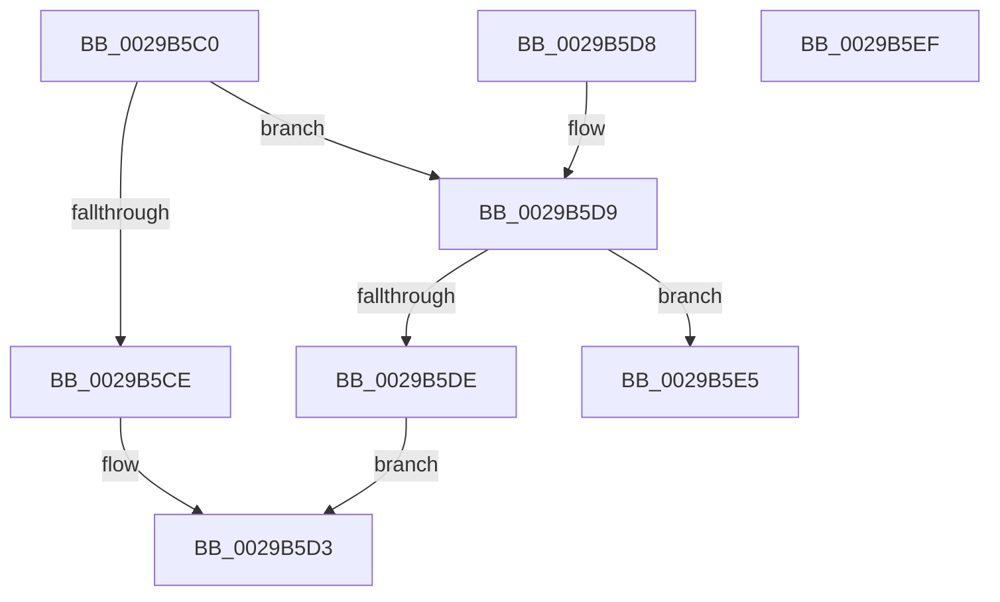

# IofCompleteRequest

- RVA: `0x0029B5C0`–`0x0029B5F0` (길이 `48` bytes)
- VA: `0x000000014029B5C0`
- 실행 섹션: `.text`
- PDB 이름 있음: `예`; PDB Function 태그: `아니요`
- unwind 정보 RVA: `0x00067E1C`
- 디코드: `16`개 명령, `48/48` bytes 표시
- 미해석 바이트: `0` (있으면 어셈블리에 `.byte`로 보존)

> 이 문서는 커널 이미지의 기계어와 PDB 기호를 분석해 생성했습니다. 4번과 5번은 함수 원형과 자료형을 바이너리 사용 방식에서 추정한 C 해석이며 원본 소스 복구 결과는 아닙니다.

## 1. Dependencies

- 직접 호출 지점: **3**; 고유 호출 대상: **3**
- 직접 호출자로 확인된 함수: **93**
- RIP 상대 이미지 참조: **1**

### Outgoing calls
- `0x0029B5CE` → [IopfCompleteRequest](IopfCompleteRequest_function_0029B5F8.md) (function, `0x0029B5F8`)
- `0x0029B5DE` → [IovCompleteRequest](../../pagevrfy/BB/IovCompleteRequest_function_00BB6758.md) (function, `0x00BB6758`)
- `0x0029B5E5` → [IopPerfCompleteRequest](../4A/IopPerfCompleteRequest_function_004A69B8.md) (function, `0x004A69B8`)

### Direct callers
- [IoRaiseHardError](../22/IoRaiseHardError_function_002230D0.md) at `0x002232CA`
- [IopInvalidDeviceRequest](IopInvalidDeviceRequest_function_0029B590.md) at `0x0029B5A0`
- [IopfCompleteRequest](IopfCompleteRequest_function_0029B5F8.md) at `0x0029B83A`
- [FsRtlPrivateLock](../38/FsRtlPrivateLock_function_0038DF90.md) at `0x0038E56A`
- [FsRtlpAcknowledgeOplockBreakByCacheFlags](../3F/FsRtlpAcknowledgeOplockBreakByCacheFlags_function_003F1988.md) at `0x003F1AE8`
- [FsRtlpAcknowledgeOplockBreakByCacheFlags](../3F/FsRtlpAcknowledgeOplockBreakByCacheFlags_function_003F1988.md) at `0x003F1B7D`
- [FsRtlpAcknowledgeOplockBreakByCacheFlags](../3F/FsRtlpAcknowledgeOplockBreakByCacheFlags_function_003F1988.md) at `0x003F1E51`
- [FsRtlpAcknowledgeOplockBreakByCacheFlags](../3F/FsRtlpAcknowledgeOplockBreakByCacheFlags_function_003F1988.md) at `0x003F1EE8`
- [FsRtlpAcknowledgeOplockBreakByCacheFlags](../3F/FsRtlpAcknowledgeOplockBreakByCacheFlags_function_003F1988.md) at `0x003F204A`
- [FsRtlpAcknowledgeOplockBreakByCacheFlags](../3F/FsRtlpAcknowledgeOplockBreakByCacheFlags_function_003F1988.md) at `0x003F23B5`
- [FsRtlpAcknowledgeOplockBreakByCacheFlags](../3F/FsRtlpAcknowledgeOplockBreakByCacheFlags_function_003F1988.md) at `0x003F2492`
- [FsRtlpRequestExclusiveOplock](../3F/FsRtlpRequestExclusiveOplock_function_003F3800.md) at `0x003F394F`
- [FsRtlpRequestExclusiveOplock](../3F/FsRtlpRequestExclusiveOplock_function_003F3800.md) at `0x003F3D86`
- [FsRtlpRequestExclusiveOplock](../3F/FsRtlpRequestExclusiveOplock_function_003F3800.md) at `0x003F3F2C`
- [FsRtlProcessFileLock](../3F/FsRtlProcessFileLock_function_003FD0E0.md) at `0x003FD1FC`
- [FsRtlpOplockCleanup](../42/FsRtlpOplockCleanup_function_00425030.md) at `0x00425608`
- [FsRtlpRemoveAndCompleteRHIrp](../42/FsRtlpRemoveAndCompleteRHIrp_function_00425964.md) at `0x00425A72`
- [PoHandleIrp](../47/PoHandleIrp_function_004709D0.md) at `0x00470BCD`
- [IopPowerDispatch](../47/IopPowerDispatch_function_00470BF0.md) at `0x00470C9C`
- [WmipNotificationIrpCancel](../49/WmipNotificationIrpCancel_function_00491BA0.md) at `0x00491BFA`
- [WmipWriteWnodeToObject](../49/WmipWriteWnodeToObject_function_00491C0C.md) at `0x00491CE7`
- [WmipCompleteGuidIrpWithError](../49/WmipCompleteGuidIrpWithError_function_004955BC.md) at `0x00495629`
- [FsRtlCompleteLockIrpReal](../49/FsRtlCompleteLockIrpReal_function_004973AC.md) at `0x004973C9`
- [FsRtlpRemoveAndCompleteReadOnlyIrp](../4B/FsRtlpRemoveAndCompleteReadOnlyIrp_function_004B495C.md) at `0x004B4A3B`
- [FsRtlpOplockBreakToII](../4B/FsRtlpOplockBreakToII_function_004BB824.md) at `0x004BB929`
- [FsRtlpOplockBreakToII](../4B/FsRtlpOplockBreakToII_function_004BB824.md) at `0x004BB99E`
- [IopPnPCompleteRequest](../4B/IopPnPCompleteRequest_function_004BD6C4.md) at `0x004BD6D1`
- [FsRtlUninitializeOplock](../4E/FsRtlUninitializeOplock_function_004E42C0.md) at `0x004E43C0`
- [FsRtlUninitializeOplock](../4E/FsRtlUninitializeOplock_function_004E42C0.md) at `0x004E4618`
- [FsRtlpOplockBreakByCacheFlags](../4E/FsRtlpOplockBreakByCacheFlags_function_004E4990.md) at `0x004E4B74`
- [FsRtlpOplockBreakByCacheFlags](../4E/FsRtlpOplockBreakByCacheFlags_function_004E4990.md) at `0x004E5333`
- [FsRtlpOplockBreakByCacheFlags](../4E/FsRtlpOplockBreakByCacheFlags_function_004E4990.md) at `0x004E548A`
- [FsRtlpOplockBreakByCacheFlags](../4E/FsRtlpOplockBreakByCacheFlags_function_004E4990.md) at `0x004E5530`
- [FsRtlpOplockBreakByCacheFlags](../4E/FsRtlpOplockBreakByCacheFlags_function_004E4990.md) at `0x004E56A1`
- [FsRtlpOplockBreakByCacheFlags](../4E/FsRtlpOplockBreakByCacheFlags_function_004E4990.md) at `0x004E5733`
- [FsRtlpOplockBreakByCacheFlags](../4E/FsRtlpOplockBreakByCacheFlags_function_004E4990.md) at `0x004E57C9`
- [FsRtlpRequestShareableOplock](../4E/FsRtlpRequestShareableOplock_function_004E6EC8.md) at `0x004E747D`
- [FsRtlpRequestShareableOplock](../4E/FsRtlpRequestShareableOplock_function_004E6EC8.md) at `0x004E7949`
- [FsRtlCancelNotify](../4E/FsRtlCancelNotify_function_004E7F90.md) at `0x004E82C0`
- [WmipReceiveNotifications](../4E/WmipReceiveNotifications_function_004EC280.md) at `0x004EC6DE`
- [FsRtlpOplockBreakToNone](../4F/FsRtlpOplockBreakToNone_function_004F8354.md) at `0x004F843E`
- [FsRtlpOplockBreakToNone](../4F/FsRtlpOplockBreakToNone_function_004F8354.md) at `0x004F8497`
- [FsRtlpCancelExclusiveIrp](../4F/FsRtlpCancelExclusiveIrp_function_004F96CC.md) at `0x004F9761`
- [FsRtlpAcknowledgeOplockBreak](../58/FsRtlpAcknowledgeOplockBreak_function_00582144.md) at `0x0058217B`
- [FsRtlpAcknowledgeOplockBreak](../58/FsRtlpAcknowledgeOplockBreak_function_00582144.md) at `0x005822CA`
- [FsRtlpAcknowledgeOplockBreak](../58/FsRtlpAcknowledgeOplockBreak_function_00582144.md) at `0x0058235F`
- [FsRtlpGrantAnyOplockFromExclusive](../58/FsRtlpGrantAnyOplockFromExclusive_function_00582540.md) at `0x005825DE`
- [FsRtlpGrantAnyOplockFromExclusive](../58/FsRtlpGrantAnyOplockFromExclusive_function_00582540.md) at `0x00582726`
- [IoCompleteRequest](../59/IoCompleteRequest_function_005979D0.md) at `0x005979D4`
- [PiDqIrpCancel](../5A/PiDqIrpCancel_function_005A7CA0.md) at `0x005A7D13`
- [PiSwIrpCancelStartCreate](../5A/PiSwIrpCancelStartCreate_function_005A9E60.md) at `0x005A9ED2`
- [DifIofCompleteRequestWrapper](../62/DifIofCompleteRequestWrapper_function_0062DE80.md) at `0x0062DF57`
- [HalpDispatchWmi](../../page/70/HalpDispatchWmi_function_00708330.md) at `0x00708356`
- [FsRtlUpperOplockFsctrl](../../page/71/FsRtlUpperOplockFsctrl_function_00714B40.md) at `0x00714C6A`
- [FsRtlpNotifyOplockBreakComplete](../../page/71/FsRtlpNotifyOplockBreakComplete_function_00714CC0.md) at `0x00714CC9`
- [FsRtlpOpBatchBreakClosePending](../../page/71/FsRtlpOpBatchBreakClosePending_function_00714CDC.md) at `0x00714D0F`
- [FsRtlpOpBatchBreakClosePending](../../page/71/FsRtlpOpBatchBreakClosePending_function_00714CDC.md) at `0x00714DF1`
- [FsRtlpOplockBreakNotify](../../page/71/FsRtlpOplockBreakNotify_function_00714E10.md) at `0x00714E40`
- [FsRtlpOplockBreakNotify](../../page/71/FsRtlpOplockBreakNotify_function_00714E10.md) at `0x00714E9A`
- [FsRtlpOplockBreakNotify](../../page/71/FsRtlpOplockBreakNotify_function_00714E10.md) at `0x00714ECA`
- [IoSetInformation](../../page/71/IoSetInformation_function_0071DBF0.md) at `0x0071DED5`
- [IopSystemControlDispatch](../../page/73/IopSystemControlDispatch_function_00737DA0.md) at `0x00737DAE`
- [PiSwDispatch](../../page/73/PiSwDispatch_function_0073AA90.md) at `0x0073ABCE`
- [PiSwIrpCleanup](../../page/73/PiSwIrpCleanup_function_0073AC10.md) at `0x0073ADB9`
- [PiSwIrpGetAttributes](../../page/73/PiSwIrpGetAttributes_function_0073AE04.md) at `0x0073AE80`
- [PiSwIrpGetLifetime](../../page/73/PiSwIrpGetLifetime_function_0073AEA4.md) at `0x0073AF20`
- [PiSwIrpSetAttributes](../../page/73/PiSwIrpSetAttributes_function_0073AF44.md) at `0x0073B02F`
- [PiSwIrpSetLifetime](../../page/73/PiSwIrpSetLifetime_function_0073B080.md) at `0x0073B16A`
- [RawShutdown](../../page/78/RawShutdown_function_0078A0A0.md) at `0x0078A0FF`
- [RawSetInformation](../../page/78/RawSetInformation_function_0078A2A8.md) at `0x0078A329`
- [PiSwIrpStartCreate](../../page/8D/PiSwIrpStartCreate_function_008DA834.md) at `0x008DA967`
- [PiSwCompleteCreate](../../page/8D/PiSwCompleteCreate_function_008DAB90.md) at `0x008DAEA2`
- [PiDqDispatch](../../page/8D/PiDqDispatch_function_008DC8A0.md) at `0x008DC96E`
- [PiDqDispatch](../../page/8D/PiDqDispatch_function_008DC8A0.md) at `0x008DC97D`
- [PiDqIrpComplete](../../page/8D/PiDqIrpComplete_function_008DCF08.md) at `0x008DCF45`
- [IopSynchronousServiceTail](../../page/8E/IopSynchronousServiceTail_function_008EB440.md) at `0x008EB5F6`
- [PiSwIrpInterfacePropertySet](../../page/8F/PiSwIrpInterfacePropertySet_function_008F7900.md) at `0x008F7AA2`
- [VrpIoctlDeviceDispatch](../../page/93/VrpIoctlDeviceDispatch_function_00934C50.md) at `0x00934D08`
- [PiSwIrpInterfaceSetState](../../page/94/PiSwIrpInterfaceSetState_function_0094DC24.md) at `0x0094DD61`
- [PiSwPdoPnPDispatch](../../page/94/PiSwPdoPnPDispatch_function_0094DDF0.md) at `0x0094DF72`
- [PiSwIrpPropertySet](../../page/94/PiSwIrpPropertySet_function_0094E97C.md) at `0x0094EB46`
- [PiSwIrpInterfaceRegister](../../page/94/PiSwIrpInterfaceRegister_function_0094F01C.md) at `0x0094F217`
- [PiDqIrpPropertySet](../../page/96/PiDqIrpPropertySet_function_00963770.md) at `0x00963A12`
- [RawQueryInformation](../../page/9A/RawQueryInformation_function_009A361C.md) at `0x009A3667`
- [RawDispatch](../../page/9A/RawDispatch_function_009A3920.md) at `0x009A3A1E`
- [RawDispatch](../../page/9A/RawDispatch_function_009A3920.md) at `0x009A3A39`
- [RawDispatch](../../page/9A/RawDispatch_function_009A3920.md) at `0x009A3B1F`
- [RawCleanup](../../page/9A/RawCleanup_function_009A3B38.md) at `0x009A3BB2`
- [RawClose](../../page/9A/RawClose_function_009A3CCC.md) at `0x009A3D31`
- [RawCreate](../../page/9A/RawCreate_function_009A3E5C.md) at `0x009A3F9F`
- [RawQueryVolumeInformation](../../page/9A/RawQueryVolumeInformation_function_009A4414.md) at `0x009A4467`
- [RawFileSystemControl](../../page/9A/RawFileSystemControl_function_009A4588.md) at `0x009A45BA`
- [PiUEventDispatch](../../page/9C/PiUEventDispatch_function_009C2AD0.md) at `0x009C2B07`
- [PiUEventHandleIoctl](../../page/9C/PiUEventHandleIoctl_function_009C2B74.md) at `0x009C2BBC`
- [WmipIoControl](../../page/9D/WmipIoControl_function_009DEBD0.md) at `0x009DECFD`
- [IopStartApcHardError](../../page/9E/IopStartApcHardError_function_009ECE30.md) at `0x009ECE8A`
- [FsRtlpOplockFsctrlInternal](../../page/9F/FsRtlpOplockFsctrlInternal_function_009F1640.md) at `0x009F19B7`
- [FsRtlpOplockFsctrlInternal](../../page/9F/FsRtlpOplockFsctrlInternal_function_009F1640.md) at `0x009F1B8D`
- [PiDaDispatch](../../page/A0/PiDaDispatch_function_00A00230.md) at `0x00A0030B`
- [FsRtlNotifyCompleteIrp](../../page/A1/FsRtlNotifyCompleteIrp_function_00A1FA28.md) at `0x00A1FB77`
- [IoWMISystemControl](../../page/A4/IoWMISystemControl_function_00A4EB04.md) at `0x00A4EB67`
- [IoWMISystemControl](../../page/A4/IoWMISystemControl_function_00A4EB04.md) at `0x00A4ECA3`
- [IoWMICompleteRequest](../../page/A4/IoWMICompleteRequest_function_00A4EF2C.md) at `0x00A4EF97`
- [PiCMDispatch](../../page/A6/PiCMDispatch_function_00A63AE0.md) at `0x00A63B14`
- [IopRaiseHardError](../../page/A6/IopRaiseHardError_function_00A64260.md) at `0x00A643E7`
- [VrpRegistryDispatch](../../page/A6/VrpRegistryDispatch_function_00A69960.md) at `0x00A6998A`
- [HalpDispatchPnp](../../page/A9/HalpDispatchPnp_function_00A912C0.md) at `0x00A91323`
- [WmipOpenCloseCleanup](../../page/AA/WmipOpenCloseCleanup_function_00AA5D50.md) at `0x00AA5D62`
- [FsRtlNotifyFilterChangeDirectory](../../page/AA/FsRtlNotifyFilterChangeDirectory_function_00AAB9E0.md) at `0x00AABA94`
- [FsRtlNotifyFilterChangeDirectoryLite](../../page/AD/FsRtlNotifyFilterChangeDirectoryLite_function_00ADC950.md) at `0x00ADCA29`
- [sub_00B1C4F6](../../page/B1/Unknown_function_00B1C4F6.md) at `0x00B1C88E`
- [sub_00B25F7E](../../page/B2/Unknown_function_00B25F7E.md) at `0x00B25FFC`
- [sub_00B2D51A](../../page/B2/Unknown_function_00B2D51A.md) at `0x00B2D52F`
- [sub_00B3115E](../../page/B3/Unknown_function_00B3115E.md) at `0x00B312DE`
- [HalpDispatchPower](../../pagelk/B7/HalpDispatchPower_function_00B7C0A0.md) at `0x00B7C0E6`
- [sub_00B811F2](../../pagelk/B8/Unknown_function_00B811F2.md) at `0x00B81210`
- [ViDdiDispatchWmi](../../pagevrfy/B9/ViDdiDispatchWmi_function_00B94470.md) at `0x00B944B8`
- [ViPendingCompleteAfterWait](../../pagevrfy/BA/ViPendingCompleteAfterWait_function_00BA1D18.md) at `0x00BA1E15`
- [ViFilterDispatchGeneric](../../pagevrfy/BA/ViFilterDispatchGeneric_function_00BACFD0.md) at `0x00BAD01C`
- [ViFilterDispatchPnp](../../pagevrfy/BA/ViFilterDispatchPnp_function_00BAD0A0.md) at `0x00BAD0F4`
- [sub_00BAD17D](../../pagevrfy/BA/Unknown_function_00BAD17D.md) at `0x00BAD20A`
- [ViFilterDispatchPower](../../pagevrfy/BA/ViFilterDispatchPower_function_00BAD260.md) at `0x00BAD2AC`

### Static image references
- `0x0029B5C4` → RVA `0x00FC6DD4` (`ALMOSTRO`; read)

## 2. Other-region calls and transfers

- 다른 실행 섹션으로 향하는 call: **1**
  - `0x0029B5DE` → [IovCompleteRequest](../../pagevrfy/BB/IovCompleteRequest_function_00BB6758.md) (`.text` → `PAGEVRFY`)
- 별도 외부 분기/꼬리 이동을 확인하지 못했습니다.

## 3. Assembly (complete function range)

```asm
0029B5C0  48 83 EC 28                     sub rsp, 0x28
0029B5C4  8B 05 0A B8 D2 00               mov eax, dword ptr [rip + 0xd2b80a]
0029B5CA  85 C0                           test eax, eax
0029B5CC  75 0B                           jne 0x14029b5d9
0029B5CE  E8 25 00 00 00                  call 0x14029b5f8
0029B5D3  48 83 C4 28                     add rsp, 0x28
0029B5D7  C3                              ret
0029B5D8  CC                              int3
0029B5D9  83 F8 03                        cmp eax, 3
0029B5DC  74 07                           je 0x14029b5e5
0029B5DE  E8 75 B1 91 00                  call 0x140bb6758
0029B5E3  EB EE                           jmp 0x14029b5d3
0029B5E5  E8 CE B3 20 00                  call 0x1404a69b8
0029B5EA  48 83 C4 28                     add rsp, 0x28
0029B5EE  C3                              ret
0029B5EF  CC                              int3
```

## 4. C-style interpretation (structured pseudocode)

```c
__int64 __fastcall IofCompleteRequest(void)
{
    __int64 result;
    __int64 v_rsp;

    v_rsp = (v_rsp) - (40);
    if ((unsigned int)((unsigned int)(*(unsigned int *)(v_rip + 13809674))) != 0) goto loc_0029B5D9;
    result = IopfCompleteRequest(a1, a2, a3, a4);
loc_0029B5D3:
    v_rsp = (v_rsp) + (40);
    return result;
loc_0029B5D9:
    if (((unsigned int)(result)) == 3) goto loc_0029B5E5;
    result = IovCompleteRequest(a1, a2, a3, a4);
    goto loc_0029B5D3;
loc_0029B5E5:
    result = IopPerfCompleteRequest(a1, a2, a3, a4);
    v_rsp = (v_rsp) + (40);
    return result;
}
```

## 5. (Beta) C Style

```c
void IofCompleteRequest(void)
{
    int64_t result;
    int64_t local_rsp;

    local_rsp = (local_rsp) - (40);
    if ((uint32_t)((uint32_t)(*(uint32_t *)(v_rip + 0xD2B80A))) != 0) goto loc_0029B5D9;
    result = IopfCompleteRequest(a1, a2, a3, a4);
loc_0029B5D3:
    local_rsp = (local_rsp) + (40);
    return result;
loc_0029B5D9:
    if (((uint32_t)(result)) == 3) goto loc_0029B5E5;
    result = IovCompleteRequest(a1, a2, a3, a4);
    goto loc_0029B5D3;
loc_0029B5E5:
    result = IopPerfCompleteRequest(a1, a2, a3, a4);
    local_rsp = (local_rsp) + (40);
    return result;
}
```

## 6. Execution-region graph

[열기: 2D/3D 그래프와 함수 탐색 컨트롤 패널](../../../control-panel.html?section=text&rva=0x0029B5C0&view=graph)

- 2D 그래프는 위에서 아래로 흐르고, 3D 그래프는 빈 공간을 드래그해 회전합니다. Shift+드래그는 이동, 휠은 확대·축소, 함수 노드 선택은 대상 보고서 이동입니다.

### Static fallback


