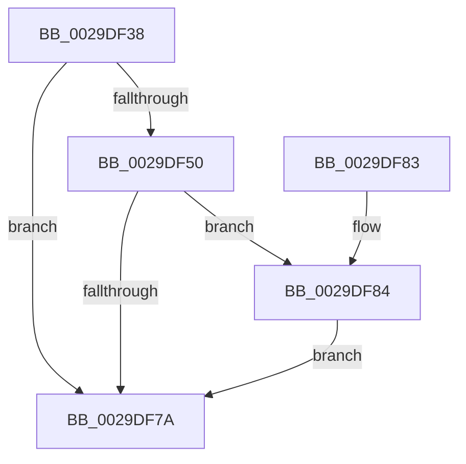

# IopAllocateIrpWithExtension

- RVA: `0x0029DF38`–`0x0029DF8E` (길이 `86` bytes)
- VA: `0x000000014029DF38`
- 실행 섹션: `.text`
- PDB 이름 있음: `예`; PDB Function 태그: `아니요`
- unwind 정보 RVA: `0x00064CA8`
- 디코드: `24`개 명령, `86/86` bytes 표시
- 미해석 바이트: `0` (있으면 어셈블리에 `.byte`로 보존)

> 이 문서는 커널 이미지의 기계어와 PDB 기호를 분석해 생성했습니다. 4번과 5번은 함수 원형과 자료형을 바이너리 사용 방식에서 추정한 C 해석이며 원본 소스 복구 결과는 아닙니다.

## 1. Dependencies

- 직접 호출 지점: **3**; 고유 호출 대상: **3**
- 직접 호출자로 확인된 함수: **5**
- RIP 상대 이미지 참조: **0**

### Outgoing calls
- `0x0029DF43` → [IopAllocateIrpPrivate](../20/IopAllocateIrpPrivate_function_00207770.md) (function, `0x00207770`)
- `0x0029DF71` → [IoIsActivityTracingEnabled](IoIsActivityTracingEnabled_function_0029DBC0.md) (function, `0x0029DBC0`)
- `0x0029DF87` → [IopInitActivityIdIrp](../45/IopInitActivityIdIrp_function_0045B014.md) (function, `0x0045B014`)

### Direct callers
- [IoAllocateIrp](../20/IoAllocateIrp_function_002065D0.md) at `0x002065FE`
- [IoAllocateIrpEx](../20/IoAllocateIrpEx_function_00207510.md) at `0x00207572`
- [IopAllocateIrpExReturn](../20/IopAllocateIrpExReturn_function_00207720.md) at `0x00207757`
- [IopMountVolume](../../page/A3/IopMountVolume_function_00A329D0.md) at `0x00A32BDC`
- [IopInitializeReserveIrps](../../init/C2/IopInitializeReserveIrps_function_00C2CDD0.md) at `0x00C2CDE6`
- [IopInitializeReserveIrps](../../init/C2/IopInitializeReserveIrps_function_00C2CDD0.md) at `0x00C2CE33`
- [IopInitializeReserveIrps](../../init/C2/IopInitializeReserveIrps_function_00C2CDD0.md) at `0x00C2CE7E`
- [IopInitializeReserveIrps](../../init/C2/IopInitializeReserveIrps_function_00C2CDD0.md) at `0x00C2CED7`

### Static image references
- 디코드된 RIP-relative 메모리 참조가 없습니다.

## 2. Other-region calls and transfers

- 다른 실행 섹션으로 향하는 call: **0**
- 별도 외부 분기/꼬리 이동을 확인하지 못했습니다.

## 3. Assembly (complete function range)

```asm
0029DF38  40 53                           push rbx
0029DF3A  48 83 EC 20                     sub rsp, 0x20
0029DF3E  80 C2 02                        add dl, 2
0029DF41  33 C9                           xor ecx, ecx
0029DF43  E8 28 98 F6 FF                  call 0x140207770
0029DF48  48 8B D8                        mov rbx, rax
0029DF4B  48 85 C0                        test rax, rax
0029DF4E  74 2A                           je 0x14029df7a
0029DF50  48 81 80 B8 00 00 00 70 FF FF FF  add qword ptr [rax + 0xb8], -0x90
0029DF5B  48 8B 88 B8 00 00 00            mov rcx, qword ptr [rax + 0xb8]
0029DF62  80 40 43 FE                     add byte ptr [rax + 0x43], 0xfe
0029DF66  80 40 42 FE                     add byte ptr [rax + 0x42], 0xfe
0029DF6A  48 89 88 C8 00 00 00            mov qword ptr [rax + 0xc8], rcx
0029DF71  E8 4A FC FF FF                  call 0x14029dbc0
0029DF76  84 C0                           test al, al
0029DF78  75 0A                           jne 0x14029df84
0029DF7A  48 8B C3                        mov rax, rbx
0029DF7D  48 83 C4 20                     add rsp, 0x20
0029DF81  5B                              pop rbx
0029DF82  C3                              ret
0029DF83  CC                              int3
0029DF84  48 8B CB                        mov rcx, rbx
0029DF87  E8 88 D0 1B 00                  call 0x14045b014
0029DF8C  EB EC                           jmp 0x14029df7a
```

## 4. C-style interpretation (structured pseudocode)

```c
__int64 __fastcall IopAllocateIrpWithExtension(int a1, unsigned __int8 a2)
{
    __int64 result;
    __int64 v_rsp;

    v_rsp = (v_rsp) - (32);
    a2 = (unsigned __int8)((a2) + (2));
    a1 = 0;
    result = IopAllocateIrpPrivate(a1, a2, a3, a4);
    if (result == 0) goto loc_0029DF7A;
    *(unsigned __int64 *)(result + 200) = *(unsigned __int64 *)(result + 184);
    result = IoIsActivityTracingEnabled(*(unsigned __int64 *)(result + 184), a2, a3, a4);
    if ((unsigned __int8)(result) != 0) goto loc_0029DF84;
loc_0029DF7A:
    v_rsp = (v_rsp) + (32);
    return result;
loc_0029DF84:
    result = IopInitActivityIdIrp(result, a2, a3, a4);
    goto loc_0029DF7A;
}
```

## 5. (Beta) C Style

```c
int64_t IopAllocateIrpWithExtension(int32_t Arg1, uint8_t Arg2)
{
    int64_t result;
    int64_t local_rsp;

    local_rsp = (local_rsp) - (32);
    Arg2 = (uint8_t)((Arg2) + (2));
    Arg1 = 0;
    result = IopAllocateIrpPrivate(Arg1, Arg2, a3, a4);
    if (result == 0) goto loc_0029DF7A;
    *(uint64_t *)(result + 0xC8) = *(uint64_t *)(result + 0xB8);
    result = IoIsActivityTracingEnabled(*(uint64_t *)(result + 0xB8), Arg2, a3, a4);
    if ((uint8_t)(result) != 0) goto loc_0029DF84;
loc_0029DF7A:
    local_rsp = (local_rsp) + (32);
    return result;
loc_0029DF84:
    result = IopInitActivityIdIrp(result, Arg2, a3, a4);
    goto loc_0029DF7A;
}
```

## 6. Execution-region graph

[열기: 2D/3D 그래프와 함수 탐색 컨트롤 패널](../../../control-panel.html?section=text&rva=0x0029DF38&view=graph)

- 2D 그래프는 위에서 아래로 흐르고, 3D 그래프는 빈 공간을 드래그해 회전합니다. Shift+드래그는 이동, 휠은 확대·축소, 함수 노드 선택은 대상 보고서 이동입니다.

### Static fallback


