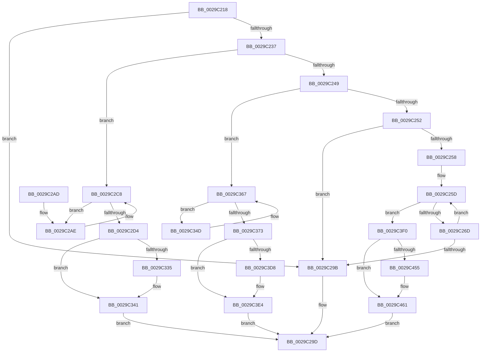

# IopAllocateReserveIrp

- RVA: `0x0029C218`–`0x0029C46D` (길이 `597` bytes)
- VA: `0x000000014029C218`
- 실행 섹션: `.text`
- PDB 이름 있음: `예`; PDB Function 태그: `아니요`
- unwind 정보 RVA: `0x00067EF0`
- 디코드: `134`개 명령, `597/597` bytes 표시
- 미해석 바이트: `0` (있으면 어셈블리에 `.byte`로 보존)

> 이 문서는 커널 이미지의 기계어와 PDB 기호를 분석해 생성했습니다. 4번과 5번은 함수 원형과 자료형을 바이너리 사용 방식에서 추정한 C 해석이며 원본 소스 복구 결과는 아닙니다.

## 1. Dependencies

- 직접 호출 지점: **12**; 고유 호출 대상: **4**
- 직접 호출자로 확인된 함수: **7**
- RIP 상대 이미지 참조: **10**

### Outgoing calls
- `0x0029C28F` → [KeWaitForSingleObject](../20/KeWaitForSingleObject_function_0020E6B0.md) (function, `0x0020E6B0`)
- `0x0029C2C3` → [KeWaitForSingleObject](../20/KeWaitForSingleObject_function_0020E6B0.md) (function, `0x0020E6B0`)
- `0x0029C2F4` → [IoInitializeIrp](../44/IoInitializeIrp_function_00445050.md) (function, `0x00445050`)
- `0x0029C32C` → [IoIsActivityTracingEnabled](IoIsActivityTracingEnabled_function_0029DBC0.md) (function, `0x0029DBC0`)
- `0x0029C33C` → [IopInitActivityIdIrp](../45/IopInitActivityIdIrp_function_0045B014.md) (function, `0x0045B014`)
- `0x0029C362` → [KeWaitForSingleObject](../20/KeWaitForSingleObject_function_0020E6B0.md) (function, `0x0020E6B0`)
- `0x0029C397` → [IoInitializeIrp](../44/IoInitializeIrp_function_00445050.md) (function, `0x00445050`)
- `0x0029C3CF` → [IoIsActivityTracingEnabled](IoIsActivityTracingEnabled_function_0029DBC0.md) (function, `0x0029DBC0`)
- `0x0029C3DF` → [IopInitActivityIdIrp](../45/IopInitActivityIdIrp_function_0045B014.md) (function, `0x0045B014`)
- `0x0029C414` → [IoInitializeIrp](../44/IoInitializeIrp_function_00445050.md) (function, `0x00445050`)
- `0x0029C44C` → [IoIsActivityTracingEnabled](IoIsActivityTracingEnabled_function_0029DBC0.md) (function, `0x0029DBC0`)
- `0x0029C45C` → [IopInitActivityIdIrp](../45/IopInitActivityIdIrp_function_0045B014.md) (function, `0x0045B014`)

### Direct callers
- [IopAllocateIrpMustSucceed](../20/IopAllocateIrpMustSucceed_function_002076C0.md) at `0x002076F9`
- [MiIssueAsynchronousFlush](MiIssueAsynchronousFlush_function_00299898.md) at `0x00299AD8`
- [IoAsynchronousPageWrite](IoAsynchronousPageWrite_function_00299C08.md) at `0x00299DA5`
- [MiSynchronousPageWrite](MiSynchronousPageWrite_function_0029A2E4.md) at `0x0029A4B3`
- [MiIssueSynchronousFlush](MiIssueSynchronousFlush_function_0029A588.md) at `0x0029A767`
- [IoSynchronousPageWriteEx](IoSynchronousPageWriteEx_function_0029A860.md) at `0x0029AA78`
- [IoPageReadEx](IoPageReadEx_function_0029ABF0.md) at `0x0029AFC9`

### Static image references
- `0x0029C22C` → RVA `0x00F8D660` (`.data`; read)
- `0x0029C25F` → RVA `0x00F8D5D8` (`.data`; read/write)
- `0x0029C286` → RVA `0x00F8D5E0` (`.data`; read)
- `0x0029C2B4` → RVA `0x00F8D590` (`.data`; read)
- `0x0029C2CA` → RVA `0x00F8D588` (`.data`; read/write)
- `0x0029C2D4` → RVA `0x00F8D580` (`.data`; read)
- `0x0029C353` → RVA `0x00F8D5B8` (`.data`; read)
- `0x0029C369` → RVA `0x00F8D5B0` (`.data`; read/write)
- `0x0029C373` → RVA `0x00F8D5A8` (`.data`; read)
- `0x0029C3F0` → RVA `0x00F8D5D0` (`.data`; read)

## 2. Other-region calls and transfers

- 다른 실행 섹션으로 향하는 call: **0**
- 별도 외부 분기/꼬리 이동을 확인하지 못했습니다.

## 3. Assembly (complete function range)

```asm
0029C218  48 8B C4                        mov rax, rsp
0029C21B  48 89 58 10                     mov qword ptr [rax + 0x10], rbx
0029C21F  48 89 70 18                     mov qword ptr [rax + 0x18], rsi
0029C223  48 89 48 08                     mov qword ptr [rax + 8], rcx
0029C227  57                              push rdi
0029C228  48 83 EC 30                     sub rsp, 0x30
0029C22C  3A 15 2E 14 CF 00               cmp dl, byte ptr [rip + 0xcf142e]
0029C232  40 8A FA                        mov dil, dl
0029C235  7F 64                           jg 0x14029c29b
0029C237  40 80 C7 02                     add dil, 2
0029C23B  BB 01 00 00 00                  mov ebx, 1
0029C240  40 0F BE F7                     movsx esi, dil
0029C244  45 85 C0                        test r8d, r8d
0029C247  74 7F                           je 0x14029c2c8
0029C249  44 3B C3                        cmp r8d, ebx
0029C24C  0F 84 15 01 00 00               je 0x14029c367
0029C252  41 83 F8 03                     cmp r8d, 3
0029C256  75 43                           jne 0x14029c29b
0029C258  48 83 60 08 00                  and qword ptr [rax + 8], 0
0029C25D  8B C3                           mov eax, ebx
0029C25F  87 05 73 13 CF 00               xchg dword ptr [rip + 0xcf1373], eax
0029C265  3B C3                           cmp eax, ebx
0029C267  0F 85 83 01 00 00               jne 0x14029c3f0
0029C26D  48 8D 44 24 40                  lea rax, [rsp + 0x40]
0029C272  48 C7 44 24 40 80 0F 05 FD      mov qword ptr [rsp + 0x40], 0xfffffffffd050f80
0029C27B  45 33 C9                        xor r9d, r9d
0029C27E  48 89 44 24 20                  mov qword ptr [rsp + 0x20], rax
0029C283  45 33 C0                        xor r8d, r8d
0029C286  48 8D 0D 53 13 CF 00            lea rcx, [rip + 0xcf1353]
0029C28D  33 D2                           xor edx, edx
0029C28F  E8 1C 24 F7 FF                  call 0x14020e6b0
0029C294  3D 02 01 00 00                  cmp eax, 0x102
0029C299  75 C2                           jne 0x14029c25d
0029C29B  33 C0                           xor eax, eax
0029C29D  48 8B 5C 24 48                  mov rbx, qword ptr [rsp + 0x48]
0029C2A2  48 8B 74 24 50                  mov rsi, qword ptr [rsp + 0x50]
0029C2A7  48 83 C4 30                     add rsp, 0x30
0029C2AB  5F                              pop rdi
0029C2AC  C3                              ret
0029C2AD  CC                              int3
0029C2AE  48 83 64 24 20 00               and qword ptr [rsp + 0x20], 0
0029C2B4  48 8D 0D D5 12 CF 00            lea rcx, [rip + 0xcf12d5]
0029C2BB  45 33 C9                        xor r9d, r9d
0029C2BE  45 33 C0                        xor r8d, r8d
0029C2C1  33 D2                           xor edx, edx
0029C2C3  E8 E8 23 F7 FF                  call 0x14020e6b0
0029C2C8  8B C3                           mov eax, ebx
0029C2CA  87 05 B8 12 CF 00               xchg dword ptr [rip + 0xcf12b8], eax
0029C2D0  3B C3                           cmp eax, ebx
0029C2D2  74 DA                           je 0x14029c2ae
0029C2D4  48 8B 0D A5 12 CF 00            mov rcx, qword ptr [rip + 0xcf12a5]
0029C2DB  0F B7 C6                        movzx eax, si
0029C2DE  66 C1 E0 03                     shl ax, 3
0029C2E2  44 8A C7                        mov r8b, dil
0029C2E5  8D 14 30                        lea edx, [rax + rsi]
0029C2E8  B8 D0 00 00 00                  mov eax, 0xd0
0029C2ED  66 C1 E2 03                     shl dx, 3
0029C2F1  66 03 D0                        add dx, ax
0029C2F4  E8 57 8D 1A 00                  call 0x140445050
0029C2F9  48 8B 05 80 12 CF 00            mov rax, qword ptr [rip + 0xcf1280]
0029C300  C6 40 47 21                     mov byte ptr [rax + 0x47], 0x21
0029C304  48 8B 0D 75 12 CF 00            mov rcx, qword ptr [rip + 0xcf1275]
0029C30B  48 81 81 B8 00 00 00 70 FF FF FF  add qword ptr [rcx + 0xb8], -0x90
0029C316  48 8B 81 B8 00 00 00            mov rax, qword ptr [rcx + 0xb8]
0029C31D  80 41 43 FE                     add byte ptr [rcx + 0x43], 0xfe
0029C321  80 41 42 FE                     add byte ptr [rcx + 0x42], 0xfe
0029C325  48 89 81 C8 00 00 00            mov qword ptr [rcx + 0xc8], rax
0029C32C  E8 8F 18 00 00                  call 0x14029dbc0
0029C331  84 C0                           test al, al
0029C333  74 0C                           je 0x14029c341
0029C335  48 8B 0D 44 12 CF 00            mov rcx, qword ptr [rip + 0xcf1244]
0029C33C  E8 D3 EC 1B 00                  call 0x14045b014
0029C341  48 8B 05 38 12 CF 00            mov rax, qword ptr [rip + 0xcf1238]
0029C348  E9 50 FF FF FF                  jmp 0x14029c29d
0029C34D  48 83 64 24 20 00               and qword ptr [rsp + 0x20], 0
0029C353  48 8D 0D 5E 12 CF 00            lea rcx, [rip + 0xcf125e]
0029C35A  45 33 C9                        xor r9d, r9d
0029C35D  45 33 C0                        xor r8d, r8d
0029C360  33 D2                           xor edx, edx
0029C362  E8 49 23 F7 FF                  call 0x14020e6b0
0029C367  8B C3                           mov eax, ebx
0029C369  87 05 41 12 CF 00               xchg dword ptr [rip + 0xcf1241], eax
0029C36F  3B C3                           cmp eax, ebx
0029C371  74 DA                           je 0x14029c34d
0029C373  48 8B 0D 2E 12 CF 00            mov rcx, qword ptr [rip + 0xcf122e]
0029C37A  44 8A C7                        mov r8b, dil
0029C37D  40 0F BE D7                     movsx edx, dil
0029C381  0F B7 C2                        movzx eax, dx
0029C384  66 C1 E0 03                     shl ax, 3
0029C388  66 03 D0                        add dx, ax
0029C38B  B8 D0 00 00 00                  mov eax, 0xd0
0029C390  66 C1 E2 03                     shl dx, 3
0029C394  66 03 D0                        add dx, ax
0029C397  E8 B4 8C 1A 00                  call 0x140445050
0029C39C  48 8B 05 05 12 CF 00            mov rax, qword ptr [rip + 0xcf1205]
0029C3A3  C6 40 47 21                     mov byte ptr [rax + 0x47], 0x21
0029C3A7  48 8B 0D FA 11 CF 00            mov rcx, qword ptr [rip + 0xcf11fa]
0029C3AE  48 81 81 B8 00 00 00 70 FF FF FF  add qword ptr [rcx + 0xb8], -0x90
0029C3B9  48 8B 81 B8 00 00 00            mov rax, qword ptr [rcx + 0xb8]
0029C3C0  80 41 43 FE                     add byte ptr [rcx + 0x43], 0xfe
0029C3C4  80 41 42 FE                     add byte ptr [rcx + 0x42], 0xfe
0029C3C8  48 89 81 C8 00 00 00            mov qword ptr [rcx + 0xc8], rax
0029C3CF  E8 EC 17 00 00                  call 0x14029dbc0
0029C3D4  84 C0                           test al, al
0029C3D6  74 0C                           je 0x14029c3e4
0029C3D8  48 8B 0D C9 11 CF 00            mov rcx, qword ptr [rip + 0xcf11c9]
0029C3DF  E8 30 EC 1B 00                  call 0x14045b014
0029C3E4  48 8B 05 BD 11 CF 00            mov rax, qword ptr [rip + 0xcf11bd]
0029C3EB  E9 AD FE FF FF                  jmp 0x14029c29d
0029C3F0  48 8B 0D D9 11 CF 00            mov rcx, qword ptr [rip + 0xcf11d9]
0029C3F7  44 8A C7                        mov r8b, dil
0029C3FA  40 0F BE D7                     movsx edx, dil
0029C3FE  0F B7 C2                        movzx eax, dx
0029C401  66 C1 E0 03                     shl ax, 3
0029C405  66 03 D0                        add dx, ax
0029C408  B8 D0 00 00 00                  mov eax, 0xd0
0029C40D  66 C1 E2 03                     shl dx, 3
0029C411  66 03 D0                        add dx, ax
0029C414  E8 37 8C 1A 00                  call 0x140445050
0029C419  48 8B 05 B0 11 CF 00            mov rax, qword ptr [rip + 0xcf11b0]
0029C420  C6 40 47 21                     mov byte ptr [rax + 0x47], 0x21
0029C424  48 8B 0D A5 11 CF 00            mov rcx, qword ptr [rip + 0xcf11a5]
0029C42B  48 81 81 B8 00 00 00 70 FF FF FF  add qword ptr [rcx + 0xb8], -0x90
0029C436  48 8B 81 B8 00 00 00            mov rax, qword ptr [rcx + 0xb8]
0029C43D  80 41 43 FE                     add byte ptr [rcx + 0x43], 0xfe
0029C441  80 41 42 FE                     add byte ptr [rcx + 0x42], 0xfe
0029C445  48 89 81 C8 00 00 00            mov qword ptr [rcx + 0xc8], rax
0029C44C  E8 6F 17 00 00                  call 0x14029dbc0
0029C451  84 C0                           test al, al
0029C453  74 0C                           je 0x14029c461
0029C455  48 8B 0D 74 11 CF 00            mov rcx, qword ptr [rip + 0xcf1174]
0029C45C  E8 B3 EB 1B 00                  call 0x14045b014
0029C461  48 8B 05 68 11 CF 00            mov rax, qword ptr [rip + 0xcf1168]
0029C468  E9 30 FE FF FF                  jmp 0x14029c29d
```

## 4. C-style interpretation (structured pseudocode)

```c
__int64 __fastcall IopAllocateReserveIrp(__int64 a1, int a2, int a3, int a4)
{
    __int64 result;
    __int64 v_rdi;
    __int64 v_rsp;
    unsigned __int64 v_stack_m18;
    unsigned __int64 v_stack_p10;
    unsigned __int64 v_stack_p18;
    unsigned __int64 v_stack_p20;
    unsigned __int64 v_stack_p8;

    *(unsigned __int64 *)(v_rsp + 16) = v_rbx;
    *(unsigned __int64 *)(v_rsp + 24) = v_rsi;
    *(unsigned __int64 *)(v_rsp + 8) = a1;
    v_rsp = (v_rsp) - (48);
    if (((unsigned __int8)(a2)) > (*(unsigned __int8 *)(v_rip + 13571118))) goto loc_0029C29B;
    v_rdi = (unsigned __int8)(((unsigned __int8)(a2)) + (2));
    if (a3 == 0) goto loc_0029C2C8;
    if (a3 == 1) goto loc_0029C367;
    if (a3 != 3) goto loc_0029C29B;
loc_0029C25D:
    if (1 != 1) goto loc_0029C3F0;
    v_stack_p8 = 0xFFFFFFFFFD050F80ULL;
    a4 = 0;
    v_stack_m18 = v_stack_p8;
    a3 = 0;
    a2 = 0;
    result = KeWaitForSingleObject(v_rip + 13570899, a2, a3, a4);
    if (((unsigned int)(result)) != 258) goto loc_0029C25D;
loc_0029C29B:
    result = 0;
loc_0029C29D:
    v_rsp = (v_rsp) + (48);
    return result;
loc_0029C2AE:
    a4 = 0;
    a3 = 0;
    a2 = 0;
    result = KeWaitForSingleObject(v_rip + 13570773, a2, a3, a4);
loc_0029C2C8:
    if (((unsigned int)((unsigned int)((unsigned int)(v_stack_p10)))) == ((unsigned int)(v_stack_p10))) goto loc_0029C2AE;
    result = (unsigned __int16)(((unsigned __int16)(v_stack_p18)) << (3));
    a2 = (unsigned __int16)((result + v_stack_p18 * 1) << (3));
    a2 = (unsigned __int16)((a2) + (208));
    result = IoInitializeIrp(*(unsigned __int64 *)(v_rip + 13570725), a2, (unsigned __int8)(v_rdi), a4);
    *(unsigned __int8 *)(*(unsigned __int64 *)(v_rip + 13570688) + 71) = 33;
    *(unsigned __int64 *)(*(unsigned __int64 *)(v_rip + 13570677) + 200) = *(unsigned __int64 *)(*(unsigned __int64 *)(v_rip + 13570677) + 184);
    result = IoIsActivityTracingEnabled(*(unsigned __int64 *)(v_rip + 13570677), a2, (unsigned __int8)(v_rdi), a4);
    if ((unsigned __int8)(result) != 0) {
        a1 = *(unsigned __int64 *)(v_rip + 13570628);
        result = IopInitActivityIdIrp(a1, a2, (unsigned __int8)(v_rdi), a4);
    }
    goto loc_0029C29D;
loc_0029C34D:
    a4 = 0;
    a3 = 0;
    a2 = 0;
    result = KeWaitForSingleObject(v_rip + 13570654, a2, a3, a4);
loc_0029C367:
    if (((unsigned int)((unsigned int)((unsigned int)(v_stack_p10)))) == ((unsigned int)(v_stack_p10))) goto loc_0029C34D;
    result = (unsigned __int16)(((unsigned __int16)((__int8)((unsigned __int8)(v_rdi)))) << (3));
    a2 = (unsigned __int16)(((__int8)((unsigned __int8)(v_rdi))) + ((unsigned __int16)(result)));
    a2 = (unsigned __int16)((a2) << (3));
    a2 = (unsigned __int16)((a2) + (208));
    result = IoInitializeIrp(*(unsigned __int64 *)(v_rip + 13570606), a2, (unsigned __int8)(v_rdi), a4);
    *(unsigned __int8 *)(*(unsigned __int64 *)(v_rip + 13570565) + 71) = 33;
    *(unsigned __int64 *)(*(unsigned __int64 *)(v_rip + 13570554) + 200) = *(unsigned __int64 *)(*(unsigned __int64 *)(v_rip + 13570554) + 184);
    result = IoIsActivityTracingEnabled(*(unsigned __int64 *)(v_rip + 13570554), a2, (unsigned __int8)(v_rdi), a4);
    if ((unsigned __int8)(result) != 0) {
        a1 = *(unsigned __int64 *)(v_rip + 13570505);
        result = IopInitActivityIdIrp(a1, a2, (unsigned __int8)(v_rdi), a4);
    }
    goto loc_0029C29D;
loc_0029C3F0:
    result = (unsigned __int16)(((unsigned __int16)((__int8)((unsigned __int8)(v_rdi)))) << (3));
    a2 = (unsigned __int16)(((__int8)((unsigned __int8)(v_rdi))) + ((unsigned __int16)(result)));
    a2 = (unsigned __int16)((a2) << (3));
    a2 = (unsigned __int16)((a2) + (208));
    result = IoInitializeIrp(*(unsigned __int64 *)(v_rip + 13570521), a2, (unsigned __int8)(v_rdi), a4);
    *(unsigned __int8 *)(*(unsigned __int64 *)(v_rip + 13570480) + 71) = 33;
    *(unsigned __int64 *)(*(unsigned __int64 *)(v_rip + 13570469) + 200) = *(unsigned __int64 *)(*(unsigned __int64 *)(v_rip + 13570469) + 184);
    result = IoIsActivityTracingEnabled(*(unsigned __int64 *)(v_rip + 13570469), a2, (unsigned __int8)(v_rdi), a4);
    if ((unsigned __int8)(result) != 0) {
        a1 = *(unsigned __int64 *)(v_rip + 13570420);
        result = IopInitActivityIdIrp(a1, a2, (unsigned __int8)(v_rdi), a4);
    }
    goto loc_0029C29D;
}
```

## 5. (Beta) C Style

```c
int64_t IopAllocateReserveIrp(int64_t Arg1, int32_t Arg2, int32_t Arg3, int32_t Arg4)
{
    int64_t result;
    int64_t local_rdi;
    int64_t local_rsp;
    uint64_t v_stack_m18;
    uint64_t v_stack_p10;
    uint64_t v_stack_p18;
    uint64_t v_stack_p20;
    uint64_t v_stack_p8;

    *(uint64_t *)(local_rsp + 0x10) = local_rbx;
    *(uint64_t *)(local_rsp + 0x18) = local_rsi;
    *(uint64_t *)(local_rsp + 0x8) = Arg1;
    local_rsp = (local_rsp) - (48);
    if (((uint8_t)(Arg2)) > (*(uint8_t *)(v_rip + 0xCF142E))) goto loc_0029C29B;
    local_rdi = (uint8_t)(((uint8_t)(Arg2)) + (2));
    if (Arg3 == 0) goto loc_0029C2C8;
    if (Arg3 == 1) goto loc_0029C367;
    if (Arg3 != 3) goto loc_0029C29B;
loc_0029C25D:
    if (1 != 1) goto loc_0029C3F0;
    v_stack_p8 = 0xFFFFFFFFFD050F80ULL;
    Arg4 = 0;
    v_stack_m18 = v_stack_p8;
    Arg3 = 0;
    Arg2 = 0;
    result = KeWaitForSingleObject(v_rip + 13570899, Arg2, Arg3, Arg4);
    if (((uint32_t)(result)) != 258) goto loc_0029C25D;
loc_0029C29B:
    result = 0;
loc_0029C29D:
    local_rsp = (local_rsp) + (48);
    return result;
loc_0029C2AE:
    Arg4 = 0;
    Arg3 = 0;
    Arg2 = 0;
    result = KeWaitForSingleObject(v_rip + 13570773, Arg2, Arg3, Arg4);
loc_0029C2C8:
    if (((uint32_t)((uint32_t)((uint32_t)(v_stack_p10)))) == ((uint32_t)(v_stack_p10))) goto loc_0029C2AE;
    result = (uint16_t)(((uint16_t)(v_stack_p18)) << (3));
    Arg2 = (uint16_t)((result + v_stack_p18 * 1) << (3));
    Arg2 = (uint16_t)((Arg2) + (208));
    result = IoInitializeIrp(*(uint64_t *)(v_rip + 0xCF12A5), Arg2, (uint8_t)(local_rdi), Arg4);
    *(uint8_t *)(*(uint64_t *)(v_rip + 0xCF1280) + 0x47) = 33;
    *(uint64_t *)(*(uint64_t *)(v_rip + 0xCF1275) + 0xC8) = *(uint64_t *)(*(uint64_t *)(v_rip + 0xCF1275) + 0xB8);
    result = IoIsActivityTracingEnabled(*(uint64_t *)(v_rip + 0xCF1275), Arg2, (uint8_t)(local_rdi), Arg4);
    if ((uint8_t)(result) != 0) {
        Arg1 = *(uint64_t *)(v_rip + 0xCF1244);
        result = IopInitActivityIdIrp(Arg1, Arg2, (uint8_t)(local_rdi), Arg4);
    }
    goto loc_0029C29D;
loc_0029C34D:
    Arg4 = 0;
    Arg3 = 0;
    Arg2 = 0;
    result = KeWaitForSingleObject(v_rip + 13570654, Arg2, Arg3, Arg4);
loc_0029C367:
    if (((uint32_t)((uint32_t)((uint32_t)(v_stack_p10)))) == ((uint32_t)(v_stack_p10))) goto loc_0029C34D;
    result = (uint16_t)(((uint16_t)((int8_t)((uint8_t)(local_rdi)))) << (3));
    Arg2 = (uint16_t)(((int8_t)((uint8_t)(local_rdi))) + ((uint16_t)(result)));
    Arg2 = (uint16_t)((Arg2) << (3));
    Arg2 = (uint16_t)((Arg2) + (208));
    result = IoInitializeIrp(*(uint64_t *)(v_rip + 0xCF122E), Arg2, (uint8_t)(local_rdi), Arg4);
    *(uint8_t *)(*(uint64_t *)(v_rip + 0xCF1205) + 0x47) = 33;
    *(uint64_t *)(*(uint64_t *)(v_rip + 0xCF11FA) + 0xC8) = *(uint64_t *)(*(uint64_t *)(v_rip + 0xCF11FA) + 0xB8);
    result = IoIsActivityTracingEnabled(*(uint64_t *)(v_rip + 0xCF11FA), Arg2, (uint8_t)(local_rdi), Arg4);
    if ((uint8_t)(result) != 0) {
        Arg1 = *(uint64_t *)(v_rip + 0xCF11C9);
        result = IopInitActivityIdIrp(Arg1, Arg2, (uint8_t)(local_rdi), Arg4);
    }
    goto loc_0029C29D;
loc_0029C3F0:
    result = (uint16_t)(((uint16_t)((int8_t)((uint8_t)(local_rdi)))) << (3));
    Arg2 = (uint16_t)(((int8_t)((uint8_t)(local_rdi))) + ((uint16_t)(result)));
    Arg2 = (uint16_t)((Arg2) << (3));
    Arg2 = (uint16_t)((Arg2) + (208));
    result = IoInitializeIrp(*(uint64_t *)(v_rip + 0xCF11D9), Arg2, (uint8_t)(local_rdi), Arg4);
    *(uint8_t *)(*(uint64_t *)(v_rip + 0xCF11B0) + 0x47) = 33;
    *(uint64_t *)(*(uint64_t *)(v_rip + 0xCF11A5) + 0xC8) = *(uint64_t *)(*(uint64_t *)(v_rip + 0xCF11A5) + 0xB8);
    result = IoIsActivityTracingEnabled(*(uint64_t *)(v_rip + 0xCF11A5), Arg2, (uint8_t)(local_rdi), Arg4);
    if ((uint8_t)(result) != 0) {
        Arg1 = *(uint64_t *)(v_rip + 0xCF1174);
        result = IopInitActivityIdIrp(Arg1, Arg2, (uint8_t)(local_rdi), Arg4);
    }
    goto loc_0029C29D;
}
```

## 6. Execution-region graph

[열기: 2D/3D 그래프와 함수 탐색 컨트롤 패널](../../../control-panel.html?section=text&rva=0x0029C218&view=graph)

- 2D 그래프는 위에서 아래로 흐르고, 3D 그래프는 빈 공간을 드래그해 회전합니다. Shift+드래그는 이동, 휠은 확대·축소, 함수 노드 선택은 대상 보고서 이동입니다.

### Static fallback


