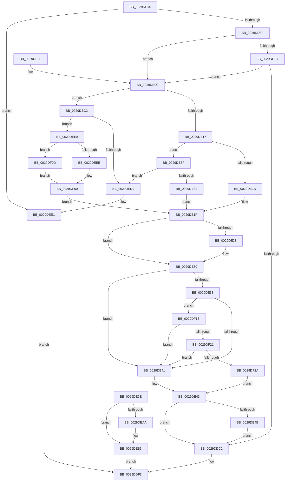

# IopBuildAsynchronousFsdRequest

- RVA: `0x0029DD40`–`0x0029DF31` (길이 `497` bytes)
- VA: `0x000000014029DD40`
- 실행 섹션: `.text`
- PDB 이름 있음: `예`; PDB Function 태그: `아니요`
- unwind 정보 RVA: `0x0006809C`
- 디코드: `133`개 명령, `497/497` bytes 표시
- 미해석 바이트: `0` (있으면 어셈블리에 `.byte`로 보존)

> 이 문서는 커널 이미지의 기계어와 PDB 기호를 분석해 생성했습니다. 4번과 5번은 함수 원형과 자료형을 바이너리 사용 방식에서 추정한 C 해석이며 원본 소스 복구 결과는 아닙니다.

## 1. Dependencies

- 직접 호출 지점: **10**; 고유 호출 대상: **9**
- 직접 호출자로 확인된 함수: **4**
- RIP 상대 이미지 참조: **0**

### Outgoing calls
- `0x0029DD79` → [IopAllocateIrpExReturn](../20/IopAllocateIrpExReturn_function_00207720.md) (function, `0x00207720`)
- `0x0029DDC9` → [PsGetIoPriorityThread](../34/PsGetIoPriorityThread_function_00343930.md) (function, `0x00343930`)
- `0x0029DE55` → [IoSetDiskIoAttributionFromThread](IoSetDiskIoAttributionFromThread_function_0029BF20.md) (function, `0x0029BF20`)
- `0x0029DE71` → [IoAllocateMdl](IoAllocateMdl_function_0029EBF0.md) (function, `0x0029EBF0`)
- `0x0029DE97` → [IopProbeAndLockPages](IopProbeAndLockPages_function_0029F1B0.md) (function, `0x0029F1B0`)
- `0x0029DEAE` → [IoFreeMdl](IoFreeMdl_function_0029EA80.md) (function, `0x0029EA80`)
- `0x0029DEB6` → [IoFreeIrp](../24/IoFreeIrp_function_0024DF70.md) (function, `0x0024DF70`)
- `0x0029DECB` → [ExAllocatePool2](../../poolcode/B8/ExAllocatePool2_function_00B820F0.md) (function, `0x00B820F0`)
- `0x0029DEDC` → [IoFreeIrp](../24/IoFreeIrp_function_0024DF70.md) (function, `0x0024DF70`)
- `0x0029DEF7` → [memcpy](../6C/memcpy_function_006C6840.md) (function, `0x006C6840`)

### Direct callers
- [IoBuildAsynchronousFsdRequest](IoBuildAsynchronousFsdRequest_function_0029DD00.md) at `0x0029DD22`
- [PnpQueryInterface](../../page/A2/PnpQueryInterface_function_00A28D38.md) at `0x00A28DE1`
- [IopBuildSynchronousFsdRequest](../../page/A4/IopBuildSynchronousFsdRequest_function_00A498C0.md) at `0x00A498EA`
- [IopCreateArcName](../../page/A8/IopCreateArcName_function_00A8D580.md) at `0x00A8D778`

### Static image references
- 디코드된 RIP-relative 메모리 참조가 없습니다.

## 2. Other-region calls and transfers

- 다른 실행 섹션으로 향하는 call: **1**
  - `0x0029DECB` → [ExAllocatePool2](../../poolcode/B8/ExAllocatePool2_function_00B820F0.md) (`.text` → `POOLCODE`)
- 별도 외부 분기/꼬리 이동을 확인하지 못했습니다.

## 3. Assembly (complete function range)

```asm
0029DD40  48 89 5C 24 08                  mov qword ptr [rsp + 8], rbx
0029DD45  48 89 74 24 18                  mov qword ptr [rsp + 0x18], rsi
0029DD4A  44 89 4C 24 20                  mov dword ptr [rsp + 0x20], r9d
0029DD4F  57                              push rdi
0029DD50  41 54                           push r12
0029DD52  41 55                           push r13
0029DD54  41 56                           push r14
0029DD56  41 57                           push r15
0029DD58  48 83 EC 30                     sub rsp, 0x30
0029DD5C  45 8B E9                        mov r13d, r9d
0029DD5F  4D 8B F8                        mov r15, r8
0029DD62  48 8B F2                        mov rsi, rdx
0029DD65  44 8B F1                        mov r14d, ecx
0029DD68  4C 8B A4 24 80 00 00 00         mov r12, qword ptr [rsp + 0x80]
0029DD70  45 33 C0                        xor r8d, r8d
0029DD73  8A 52 4C                        mov dl, byte ptr [rdx + 0x4c]
0029DD76  48 8B CE                        mov rcx, rsi
0029DD79  E8 A2 99 F6 FF                  call 0x140207720
0029DD7E  48 8B D8                        mov rbx, rax
0029DD81  48 89 44 24 68                  mov qword ptr [rsp + 0x68], rax
0029DD86  48 85 C0                        test rax, rax
0029DD89  0F 84 52 01 00 00               je 0x14029dee1
0029DD8F  65 48 8B 04 25 88 01 00 00      mov rax, qword ptr gs:[0x188]
0029DD98  48 89 83 98 00 00 00            mov qword ptr [rbx + 0x98], rax
0029DD9F  48 8B BB B8 00 00 00            mov rdi, qword ptr [rbx + 0xb8]
0029DDA6  B9 48 00 00 00                  mov ecx, 0x48
0029DDAB  48 2B F9                        sub rdi, rcx
0029DDAE  44 88 37                        mov byte ptr [rdi], r14b
0029DDB1  41 83 FE 1B                     cmp r14d, 0x1b
0029DDB5  77 55                           ja 0x14029de0c
0029DDB7  B8 00 02 41 08                  mov eax, 0x8410200
0029DDBC  44 0F A3 F0                     bt eax, r14d
0029DDC0  73 4A                           jae 0x14029de0c
0029DDC2  48 8B 8B 98 00 00 00            mov rcx, qword ptr [rbx + 0x98]
0029DDC9  E8 62 5B 0A 00                  call 0x140343930
0029DDCE  C1 E0 11                        shl eax, 0x11
0029DDD1  05 00 00 02 00                  add eax, 0x20000
0029DDD6  8B 4B 10                        mov ecx, dword ptr [rbx + 0x10]
0029DDD9  81 E1 FF FF F1 FF               and ecx, 0xfff1ffff
0029DDDF  0B C1                           or eax, ecx
0029DDE1  89 43 10                        mov dword ptr [rbx + 0x10], eax
0029DDE4  48 8B 84 24 88 00 00 00         mov rax, qword ptr [rsp + 0x88]
0029DDEC  48 89 43 48                     mov qword ptr [rbx + 0x48], rax
0029DDF0  48 8B C3                        mov rax, rbx
0029DDF3  48 8B 5C 24 60                  mov rbx, qword ptr [rsp + 0x60]
0029DDF8  48 8B 74 24 70                  mov rsi, qword ptr [rsp + 0x70]
0029DDFD  48 83 C4 30                     add rsp, 0x30
0029DE01  41 5F                           pop r15
0029DE03  41 5E                           pop r14
0029DE05  41 5D                           pop r13
0029DE07  41 5C                           pop r12
0029DE09  5F                              pop rdi
0029DE0A  C3                              ret
0029DE0B  CC                              int3
0029DE0C  8B 46 30                        mov eax, dword ptr [rsi + 0x30]
0029DE0F  A8 04                           test al, 4
0029DE11  0F 85 AB 00 00 00               jne 0x14029dec2
0029DE17  A8 10                           test al, 0x10
0029DE19  75 44                           jne 0x14029de5f
0029DE1B  4C 89 7B 70                     mov qword ptr [rbx + 0x70], r15
0029DE1F  44 89 6F 08                     mov dword ptr [rdi + 8], r13d
0029DE23  4D 85 E4                        test r12, r12
0029DE26  74 08                           je 0x14029de30
0029DE28  49 8B 04 24                     mov rax, qword ptr [r12]
0029DE2C  48 89 47 18                     mov qword ptr [rdi + 0x18], rax
0029DE30  8B 4E 48                        mov ecx, dword ptr [rsi + 0x48]
0029DE33  83 E9 07                        sub ecx, 7
0029DE36  74 09                           je 0x14029de41
0029DE38  83 E9 01                        sub ecx, 1
0029DE3B  0F 85 D7 00 00 00               jne 0x14029df18
0029DE41  B0 01                           mov al, 1
0029DE43  84 C0                           test al, al
0029DE45  0F 84 77 FF FF FF               je 0x14029ddc2
0029DE4B  48 8B 93 98 00 00 00            mov rdx, qword ptr [rbx + 0x98]
0029DE52  48 8B CB                        mov rcx, rbx
0029DE55  E8 C6 E0 FF FF                  call 0x14029bf20
0029DE5A  E9 63 FF FF FF                  jmp 0x14029ddc2
0029DE5F  48 83 64 24 20 00               and qword ptr [rsp + 0x20], 0
0029DE65  45 33 C9                        xor r9d, r9d
0029DE68  45 33 C0                        xor r8d, r8d
0029DE6B  41 8B D5                        mov edx, r13d
0029DE6E  49 8B CF                        mov rcx, r15
0029DE71  E8 7A 0D 00 00                  call 0x14029ebf0
0029DE76  48 8B C8                        mov rcx, rax
0029DE79  48 89 43 08                     mov qword ptr [rbx + 8], rax
0029DE7D  48 85 C0                        test rax, rax
0029DE80  74 57                           je 0x14029ded9
0029DE82  0F B6 07                        movzx eax, byte ptr [rdi]
0029DE85  45 33 C0                        xor r8d, r8d
0029DE88  41 83 FE 03                     cmp r14d, 3
0029DE8C  41 0F 94 C0                     sete r8b
0029DE90  89 44 24 20                     mov dword ptr [rsp + 0x20], eax
0029DE94  4C 8B CE                        mov r9, rsi
0029DE97  E8 14 13 00 00                  call 0x14029f1b0
0029DE9C  EB 81                           jmp 0x14029de1f
0029DE9E  48 8B 5C 24 68                  mov rbx, qword ptr [rsp + 0x68]
0029DEA3  48 83 7B 08 00                  cmp qword ptr [rbx + 8], 0
0029DEA8  74 09                           je 0x14029deb3
0029DEAA  48 8B 4B 08                     mov rcx, qword ptr [rbx + 8]
0029DEAE  E8 CD 0B 00 00                  call 0x14029ea80
0029DEB3  48 8B CB                        mov rcx, rbx
0029DEB6  E8 B5 00 FB FF                  call 0x14024df70
0029DEBB  33 C0                           xor eax, eax
0029DEBD  E9 31 FF FF FF                  jmp 0x14029ddf3
0029DEC2  41 B8 49 6F 53 42               mov r8d, 0x42536f49
0029DEC8  49 8B D5                        mov rdx, r13
0029DECB  E8 20 42 8E 00                  call 0x140b820f0
0029DED0  48 89 43 18                     mov qword ptr [rbx + 0x18], rax
0029DED4  48 85 C0                        test rax, rax
0029DED7  75 0F                           jne 0x14029dee8
0029DED9  48 8B CB                        mov rcx, rbx
0029DEDC  E8 8F 00 FB FF                  call 0x14024df70
0029DEE1  33 C0                           xor eax, eax
0029DEE3  E9 0B FF FF FF                  jmp 0x14029ddf3
0029DEE8  41 83 FE 04                     cmp r14d, 4
0029DEEC  75 1F                           jne 0x14029df0d
0029DEEE  4D 8B C5                        mov r8, r13
0029DEF1  49 8B D7                        mov rdx, r15
0029DEF4  48 8B C8                        mov rcx, rax
0029DEF7  E8 44 89 42 00                  call 0x1406c6840
0029DEFC  41 8D 46 2C                     lea eax, [r14 + 0x2c]
0029DF00  89 43 10                        mov dword ptr [rbx + 0x10], eax
0029DF03  44 8B 6C 24 78                  mov r13d, dword ptr [rsp + 0x78]
0029DF08  E9 12 FF FF FF                  jmp 0x14029de1f
0029DF0D  4C 89 7B 70                     mov qword ptr [rbx + 0x70], r15
0029DF11  B8 70 00 00 00                  mov eax, 0x70
0029DF16  EB E8                           jmp 0x14029df00
0029DF18  83 E9 01                        sub ecx, 1
0029DF1B  0F 84 20 FF FF FF               je 0x14029de41
0029DF21  83 F9 1B                        cmp ecx, 0x1b
0029DF24  0F 84 17 FF FF FF               je 0x14029de41
0029DF2A  32 C0                           xor al, al
0029DF2C  E9 12 FF FF FF                  jmp 0x14029de43
```

## 4. C-style interpretation (structured pseudocode)

```c
__int64 __fastcall IopBuildAsynchronousFsdRequest(int a1, __int64 a2, __int64 a3, int a4, __int64 a5, __int64 a6)
{
    __int64 result;
    __int64 v_rdi;
    __int64 v_rsp;
    unsigned __int64 v_stack_p10;
    unsigned __int64 v_stack_p18;
    unsigned int v_stack_p20;
    unsigned __int64 v_stack_p68;
    unsigned int v_stack_p78;
    unsigned __int64 v_stack_p8;

    v_stack_p8 = v_rbx;
    v_stack_p18 = v_rsi;
    v_stack_p20 = a4;
    v_rsp = (v_rsp) - (48);
    a3 = 0;
    result = IopAllocateIrpExReturn(a2, *(unsigned __int8 *)(a2 + 76), a3, a4);
    v_stack_p10 = result;
    if (result == 0) goto loc_0029DEE1;
    *(unsigned __int64 *)(result + 152) = *(unsigned __int64 *)(gs_base + (0 + 392));
    v_rdi = (*(unsigned __int64 *)(result + 184)) - (72);
    *(unsigned __int8 *)(v_rdi) = (unsigned __int8)((unsigned int)(a1));
    if (((unsigned int)((unsigned int)(a1))) > 27) goto loc_0029DE0C;
    if (((unsigned int)((unsigned int)(a1))) >= 27) goto loc_0029DE0C;
loc_0029DDC2:
    result = PsGetIoPriorityThread(*(unsigned __int64 *)(result + 152), *(unsigned __int8 *)(a2 + 76), a3, a4);
    result = (unsigned int)((result) << (17));
    result = (unsigned int)((result) + (0x20000ULL));
    a1 = (unsigned int)(((unsigned int)(*(unsigned int *)(result + 16))) & (0xFFF1FFFFULL));
    result = (unsigned int)((result) | (a1));
    *(unsigned int *)(result + 16) = (unsigned int)(result);
    *(unsigned __int64 *)(result + 72) = a6;
loc_0029DDF3:
    v_rsp = (v_rsp) + (48);
    return result;
loc_0029DE0C:
    if ((((unsigned __int8)((unsigned int)(*(unsigned int *)(v_stack_p18 + 48)))) & (4)) != 0) goto loc_0029DEC2;
    if ((((unsigned __int8)((unsigned int)(*(unsigned int *)(v_stack_p18 + 48)))) & (16)) != 0) goto loc_0029DE5F;
    *(unsigned __int64 *)(v_stack_p8 + 112) = 0;
loc_0029DE1F:
    *(unsigned int *)(v_rdi + 8) = (unsigned int)((unsigned int)(a4));
    result = (unsigned int)(*(unsigned int *)(v_stack_p18 + 48));
    if (a5 != 0) {
        result = *(unsigned __int64 *)(a5);
        *(unsigned __int64 *)(v_rdi + 24) = result;
    }
    a1 = (unsigned int)(((unsigned int)(*(unsigned int *)(v_stack_p18 + 72))) - (7));
    if (condition_is_equal) goto loc_0029DE41;
    a1 = (unsigned int)((a1) - (1));
    if (condition_is_not_equal) goto loc_0029DF18;
loc_0029DE41:
loc_0029DE43:
    if (1 == 0) goto loc_0029DDC2;
    result = IoSetDiskIoAttributionFromThread(v_stack_p8, *(unsigned __int64 *)(v_stack_p8 + 152), a3, a4);
    goto loc_0029DDC2;
loc_0029DE5F:
    a4 = 0;
    a3 = 0;
    result = IoAllocateMdl(0, (unsigned int)((unsigned int)((unsigned int)(a4))), a3, a4);
    *(unsigned __int64 *)(v_stack_p8 + 8) = result;
    if (result == 0) goto loc_0029DED9;
    a3 = 0;
    a3 = (((unsigned int)((unsigned int)(a1))) == 3) ? 1 : 0;
    v_stack_p20 = (unsigned int)(*(unsigned __int8 *)(v_rdi));
    result = IopProbeAndLockPages(result, (unsigned int)((unsigned int)((unsigned int)(a4))), a3, v_stack_p18);
    goto loc_0029DE1F;
loc_0029DEC2:
    result = ExAllocatePool2(result, (unsigned int)(a4), (unsigned int)(0x42536F49ULL), v_stack_p18);
    *(unsigned __int64 *)(v_stack_p8 + 24) = result;
    if (result != 0) goto loc_0029DEE8;
loc_0029DED9:
    result = IoFreeIrp(v_stack_p8, (unsigned int)(a4), (unsigned int)(0x42536F49ULL), v_stack_p18);
loc_0029DEE1:
    result = 0;
    goto loc_0029DDF3;
loc_0029DEE8:
    if (((unsigned int)((unsigned int)(a1))) != 4) goto loc_0029DF0D;
    result = memcpy(0, a3, (unsigned int)(a4), v_stack_p18);
loc_0029DF00:
    *(unsigned int *)(v_stack_p8 + 16) = (unsigned int)((unsigned int)(a1) + 44);
    goto loc_0029DE1F;
loc_0029DF0D:
    *(unsigned __int64 *)(v_stack_p8 + 112) = a3;
    goto loc_0029DF00;
loc_0029DF18:
    a1 = (unsigned int)((0) - (1));
    if (condition_is_equal) goto loc_0029DE41;
    if (a1 == 27) goto loc_0029DE41;
    result = 0;
    goto loc_0029DE43;
}
```

## 5. (Beta) C Style

```c
int64_t IopBuildAsynchronousFsdRequest(int32_t Arg1, void *Arg2, int64_t Arg3, int32_t Arg4, int64_t Arg5, int64_t Arg6)
{
    uint8_t *arg2 = (uint8_t *)Arg2;

    int64_t result;
    int64_t local_rdi;
    int64_t local_rsp;
    uint64_t v_stack_p10;
    uint64_t v_stack_p18;
    uint32_t v_stack_p20;
    uint64_t v_stack_p68;
    uint32_t v_stack_p78;
    uint64_t v_stack_p8;

    v_stack_p8 = local_rbx;
    v_stack_p18 = local_rsi;
    v_stack_p20 = Arg4;
    local_rsp = (local_rsp) - (48);
    Arg3 = 0;
    result = IopAllocateIrpExReturn(Arg2, *(uint8_t *)(arg2 + 0x4C), Arg3, Arg4);
    v_stack_p10 = result;
    if (result == 0) goto loc_0029DEE1;
    *(uint64_t *)(result + 0x98) = *(uint64_t *)(gs_base + (0 + 0x188));
    local_rdi = (*(uint64_t *)(result + 0xB8)) - (72);
    *(uint8_t *)(local_rdi) = (uint8_t)((uint32_t)(Arg1));
    if (((uint32_t)((uint32_t)(Arg1))) > 27) goto loc_0029DE0C;
    if (((uint32_t)((uint32_t)(Arg1))) >= 27) goto loc_0029DE0C;
loc_0029DDC2:
    result = PsGetIoPriorityThread(*(uint64_t *)(result + 0x98), *(uint8_t *)(arg2 + 0x4C), Arg3, Arg4);
    result = (uint32_t)((result) << (17));
    result = (uint32_t)((result) + (0x20000ULL));
    Arg1 = (uint32_t)(((uint32_t)(*(uint32_t *)(result + 0x10))) & (0xFFF1FFFFULL));
    result = (uint32_t)((result) | (Arg1));
    *(uint32_t *)(result + 0x10) = (uint32_t)(result);
    *(uint64_t *)(result + 0x48) = Arg6;
loc_0029DDF3:
    local_rsp = (local_rsp) + (48);
    return result;
loc_0029DE0C:
    if ((((uint8_t)((uint32_t)(*(uint32_t *)(v_stack_p18 + 0x30)))) & (4)) != 0) goto loc_0029DEC2;
    if ((((uint8_t)((uint32_t)(*(uint32_t *)(v_stack_p18 + 0x30)))) & (16)) != 0) goto loc_0029DE5F;
    *(uint64_t *)(v_stack_p8 + 0x70) = 0;
loc_0029DE1F:
    *(uint32_t *)(local_rdi + 0x8) = (uint32_t)((uint32_t)(Arg4));
    result = (uint32_t)(*(uint32_t *)(v_stack_p18 + 0x30));
    if (Arg5 != 0) {
        result = *(uint64_t *)(Arg5);
        *(uint64_t *)(local_rdi + 0x18) = result;
    }
    Arg1 = (uint32_t)(((uint32_t)(*(uint32_t *)(v_stack_p18 + 0x48))) - (7));
    if (condition_is_equal) goto loc_0029DE41;
    Arg1 = (uint32_t)((Arg1) - (1));
    if (condition_is_not_equal) goto loc_0029DF18;
loc_0029DE41:
loc_0029DE43:
    if (1 == 0) goto loc_0029DDC2;
    result = IoSetDiskIoAttributionFromThread(v_stack_p8, *(uint64_t *)(v_stack_p8 + 0x98), Arg3, Arg4);
    goto loc_0029DDC2;
loc_0029DE5F:
    Arg4 = 0;
    Arg3 = 0;
    result = IoAllocateMdl(0, (uint32_t)((uint32_t)((uint32_t)(Arg4))), Arg3, Arg4);
    *(uint64_t *)(v_stack_p8 + 0x8) = result;
    if (result == 0) goto loc_0029DED9;
    Arg3 = 0;
    Arg3 = (((uint32_t)((uint32_t)(Arg1))) == 3) ? 1 : 0;
    v_stack_p20 = (uint32_t)(*(uint8_t *)(local_rdi));
    result = IopProbeAndLockPages(result, (uint32_t)((uint32_t)((uint32_t)(Arg4))), Arg3, v_stack_p18);
    goto loc_0029DE1F;
loc_0029DEC2:
    result = ExAllocatePool2(result, (uint32_t)(Arg4), (uint32_t)(0x42536F49ULL), v_stack_p18);
    *(uint64_t *)(v_stack_p8 + 0x18) = result;
    if (result != 0) goto loc_0029DEE8;
loc_0029DED9:
    result = IoFreeIrp(v_stack_p8, (uint32_t)(Arg4), (uint32_t)(0x42536F49ULL), v_stack_p18);
loc_0029DEE1:
    result = 0;
    goto loc_0029DDF3;
loc_0029DEE8:
    if (((uint32_t)((uint32_t)(Arg1))) != 4) goto loc_0029DF0D;
    result = memcpy(0, Arg3, (uint32_t)(Arg4), v_stack_p18);
loc_0029DF00:
    *(uint32_t *)(v_stack_p8 + 0x10) = (uint32_t)((uint32_t)(Arg1) + 44);
    goto loc_0029DE1F;
loc_0029DF0D:
    *(uint64_t *)(v_stack_p8 + 0x70) = Arg3;
    goto loc_0029DF00;
loc_0029DF18:
    Arg1 = (uint32_t)((0) - (1));
    if (condition_is_equal) goto loc_0029DE41;
    if (Arg1 == 27) goto loc_0029DE41;
    result = 0;
    goto loc_0029DE43;
}
```

### 관측된 메모리 오프셋

구조체 형식이 확인되지 않은 접근은 인자 기준의 오프셋으로만 기록했습니다.

| 기준 인자 | 오프셋 표현 | 폭 (bit) | 접근 |
|---|---:|---:|---|
| `Arg2` | `+ 0x30` | `32` | `R` |
| `Arg2` | `+ 0x48` | `32` | `R` |
| `Arg2` | `+ 0x4C` | `8` | `R` |

## 6. Execution-region graph

[열기: 2D/3D 그래프와 함수 탐색 컨트롤 패널](../../../control-panel.html?section=text&rva=0x0029DD40&view=graph)

- 2D 그래프는 위에서 아래로 흐르고, 3D 그래프는 빈 공간을 드래그해 회전합니다. Shift+드래그는 이동, 휠은 확대·축소, 함수 노드 선택은 대상 보고서 이동입니다.

### Static fallback


