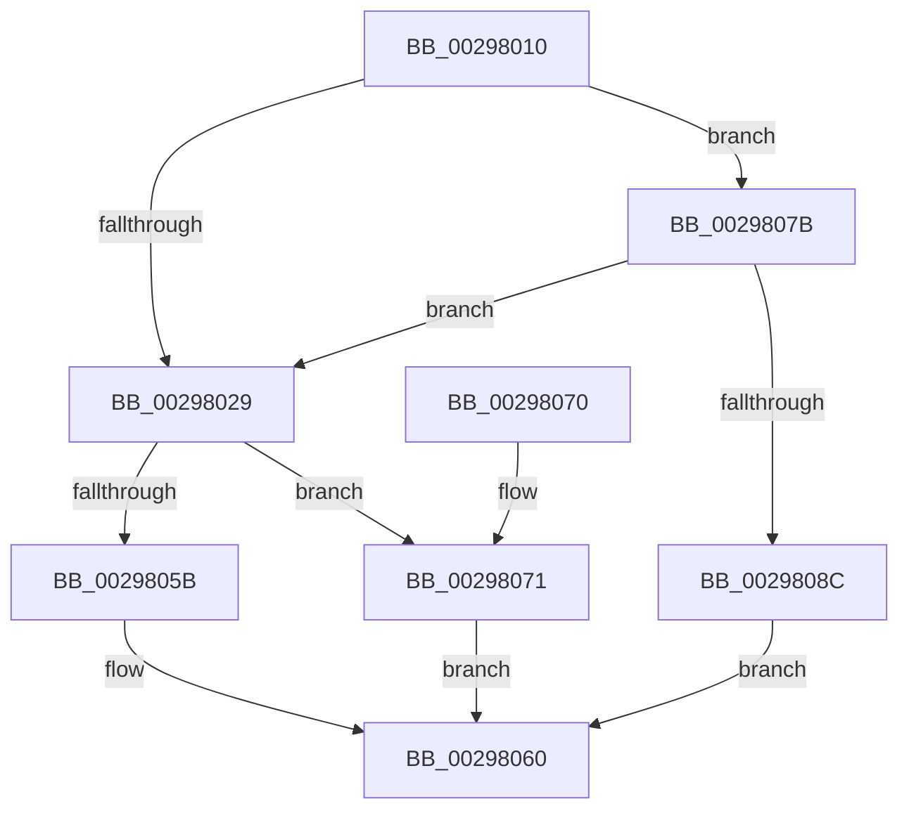

# IopCompletePageWrite

- RVA: `0x00298010`–`0x00298093` (길이 `131` bytes)
- VA: `0x0000000140298010`
- 실행 섹션: `.text`
- PDB 이름 있음: `예`; PDB Function 태그: `아니요`
- unwind 정보 RVA: `0x00067AA4`
- 디코드: `37`개 명령, `131/131` bytes 표시
- 미해석 바이트: `0` (있으면 어셈블리에 `.byte`로 보존)

> 이 문서는 커널 이미지의 기계어와 PDB 기호를 분석해 생성했습니다. 4번과 5번은 함수 원형과 자료형을 바이너리 사용 방식에서 추정한 C 해석이며 원본 소스 복구 결과는 아닙니다.

## 1. Dependencies

- 직접 호출 지점: **4**; 고유 호출 대상: **3**
- 직접 호출자로 확인된 함수: **1**
- RIP 상대 이미지 참조: **1**

### Outgoing calls
- `0x00298041` → [IoFreeIrp](../24/IoFreeIrp_function_0024DF70.md) (function, `0x0024DF70`)
- `0x0029805B` → [MiFlushComplete](MiFlushComplete_function_002980A0.md) (function, `0x002980A0`)
- `0x00298074` → [guard_dispatch_icall](../6B/guard_dispatch_icall_function_006BAAD0.md) (function, `0x006BAAD0`)
- `0x0029808C` → [IoFreeIrp](../24/IoFreeIrp_function_0024DF70.md) (function, `0x0024DF70`)

### Direct callers
- [sub_002514A5](../25/Unknown_function_002514A5.md) at `0x00251590`

### Static image references
- `0x00298046` → RVA `0x002980A0` (`MiFlushComplete`; read)

## 2. Other-region calls and transfers

- 다른 실행 섹션으로 향하는 call: **0**
- 별도 외부 분기/꼬리 이동을 확인하지 못했습니다.

## 3. Assembly (complete function range)

```asm
00298010  48 89 5C 24 08                  mov qword ptr [rsp + 8], rbx
00298015  48 89 74 24 10                  mov qword ptr [rsp + 0x10], rsi
0029801A  57                              push rdi
0029801B  48 83 EC 20                     sub rsp, 0x20
0029801F  48 83 C1 88                     add rcx, -0x78
00298023  80 79 41 00                     cmp byte ptr [rcx + 0x41], 0
00298027  74 52                           je 0x14029807b
00298029  48 8B 41 48                     mov rax, qword ptr [rcx + 0x48]
0029802D  0F 10 41 30                     movups xmm0, xmmword ptr [rcx + 0x30]
00298031  F3 0F 7F 00                     movdqu xmmword ptr [rax], xmm0
00298035  48 8B 71 58                     mov rsi, qword ptr [rcx + 0x58]
00298039  48 8B 59 60                     mov rbx, qword ptr [rcx + 0x60]
0029803D  48 8B 79 48                     mov rdi, qword ptr [rcx + 0x48]
00298041  E8 2A 5F FB FF                  call 0x14024df70
00298046  48 8D 05 53 00 00 00            lea rax, [rip + 0x53]
0029804D  45 33 C0                        xor r8d, r8d
00298050  48 8B D7                        mov rdx, rdi
00298053  48 8B CB                        mov rcx, rbx
00298056  48 3B F0                        cmp rsi, rax
00298059  75 16                           jne 0x140298071
0029805B  E8 40 00 00 00                  call 0x1402980a0
00298060  48 8B 5C 24 30                  mov rbx, qword ptr [rsp + 0x30]
00298065  48 8B 74 24 38                  mov rsi, qword ptr [rsp + 0x38]
0029806A  48 83 C4 20                     add rsp, 0x20
0029806E  5F                              pop rdi
0029806F  C3                              ret
00298070  CC                              int3
00298071  48 8B C6                        mov rax, rsi
00298074  E8 57 2A 42 00                  call 0x1406baad0
00298079  EB E5                           jmp 0x140298060
0029807B  8B 41 30                        mov eax, dword ptr [rcx + 0x30]
0029807E  41 B8 00 00 00 C0               mov r8d, 0xc0000000
00298084  41 23 C0                        and eax, r8d
00298087  41 3B C0                        cmp eax, r8d
0029808A  75 9D                           jne 0x140298029
0029808C  E8 DF 5E FB FF                  call 0x14024df70
00298091  EB CD                           jmp 0x140298060
```

## 4. C-style interpretation (structured pseudocode)

```c
__int64 __fastcall IopCompletePageWrite(__int64 a1, __int64 a2, int a3)
{
    __int64 result;
    __int64 v_rsp;
    unsigned __int64 v_stack_p10;
    unsigned __int64 v_stack_p8;

    v_stack_p8 = v_rbx;
    v_stack_p10 = v_rsi;
    v_rsp = (v_rsp) - (32);
    a1 = (a1) + (-120);
    if ((*(unsigned __int8 *)(a1 + 65)) == 0) goto loc_0029807B;
loc_00298029:
    *(unsigned __int64 *)(*(unsigned __int64 *)(a1 + 72)) = v_xmm0;
    result = IoFreeIrp(a1, a2, a3, a4);
    a3 = 0;
    if ((*(unsigned __int64 *)(a1 + 88)) != (v_rip + 83)) goto loc_00298071;
    result = MiFlushComplete(*(unsigned __int64 *)(a1 + 96), *(unsigned __int64 *)(a1 + 72), a3, a4);
loc_00298060:
    v_rsp = (v_rsp) + (32);
    return result;
loc_00298071:
    result = guard_dispatch_icall(*(unsigned __int64 *)(a1 + 96), *(unsigned __int64 *)(a1 + 72), a3, a4);
    goto loc_00298060;
loc_0029807B:
    result = (unsigned int)(((unsigned int)(*(unsigned int *)(*(unsigned __int64 *)(a1 + 96) + 48))) & ((unsigned int)((unsigned int)(0xC0000000ULL))));
    if (((unsigned int)(result)) != ((unsigned int)((unsigned int)(0xC0000000ULL)))) goto loc_00298029;
    result = IoFreeIrp(*(unsigned __int64 *)(a1 + 96), *(unsigned __int64 *)(a1 + 72), (unsigned int)(0xC0000000ULL), a4);
    goto loc_00298060;
}
```

## 5. (Beta) C Style

```c
int64_t IopCompletePageWrite(void *Arg1, int64_t Arg2, int32_t Arg3)
{
    uint8_t *arg1 = (uint8_t *)Arg1;

    int64_t result;
    int64_t local_rsp;
    uint64_t v_stack_p10;
    uint64_t v_stack_p8;

    v_stack_p8 = local_rbx;
    v_stack_p10 = local_rsi;
    local_rsp = (local_rsp) - (32);
    Arg1 = (Arg1) + (-120);
    if ((*(uint8_t *)(arg1 + 0x41)) == 0) goto loc_0029807B;
loc_00298029:
    *(uint64_t *)(*(uint64_t *)(arg1 + 0x48)) = v_xmm0;
    result = IoFreeIrp(Arg1, Arg2, Arg3, a4);
    Arg3 = 0;
    if ((*(uint64_t *)(arg1 + 0x58)) != (v_rip + 83)) goto loc_00298071;
    result = MiFlushComplete(*(uint64_t *)(arg1 + 0x60), *(uint64_t *)(arg1 + 0x48), Arg3, a4);
loc_00298060:
    local_rsp = (local_rsp) + (32);
    return result;
loc_00298071:
    result = guard_dispatch_icall(*(uint64_t *)(arg1 + 0x60), *(uint64_t *)(arg1 + 0x48), Arg3, a4);
    goto loc_00298060;
loc_0029807B:
    result = (uint32_t)(((uint32_t)(*(uint32_t *)(*(uint64_t *)(arg1 + 0x60) + 0x30))) & ((uint32_t)((uint32_t)(0xC0000000ULL))));
    if (((uint32_t)(result)) != ((uint32_t)((uint32_t)(0xC0000000ULL)))) goto loc_00298029;
    result = IoFreeIrp(*(uint64_t *)(arg1 + 0x60), *(uint64_t *)(arg1 + 0x48), (uint32_t)(0xC0000000ULL), a4);
    goto loc_00298060;
}
```

### 관측된 메모리 오프셋

구조체 형식이 확인되지 않은 접근은 인자 기준의 오프셋으로만 기록했습니다.

| 기준 인자 | 오프셋 표현 | 폭 (bit) | 접근 |
|---|---:|---:|---|
| `Arg1` | `+ 0x30` | `32` | `R` |
| `Arg1` | `+ 0x30` | `128` | `R` |
| `Arg1` | `+ 0x41` | `8` | `R` |
| `Arg1` | `+ 0x48` | `64` | `R` |
| `Arg1` | `+ 0x58` | `64` | `R` |
| `Arg1` | `+ 0x60` | `64` | `R` |

## 6. Execution-region graph

[열기: 2D/3D 그래프와 함수 탐색 컨트롤 패널](../../../control-panel.html?section=text&rva=0x00298010&view=graph)

- 2D 그래프는 위에서 아래로 흐르고, 3D 그래프는 빈 공간을 드래그해 회전합니다. Shift+드래그는 이동, 휠은 확대·축소, 함수 노드 선택은 대상 보고서 이동입니다.

### Static fallback


