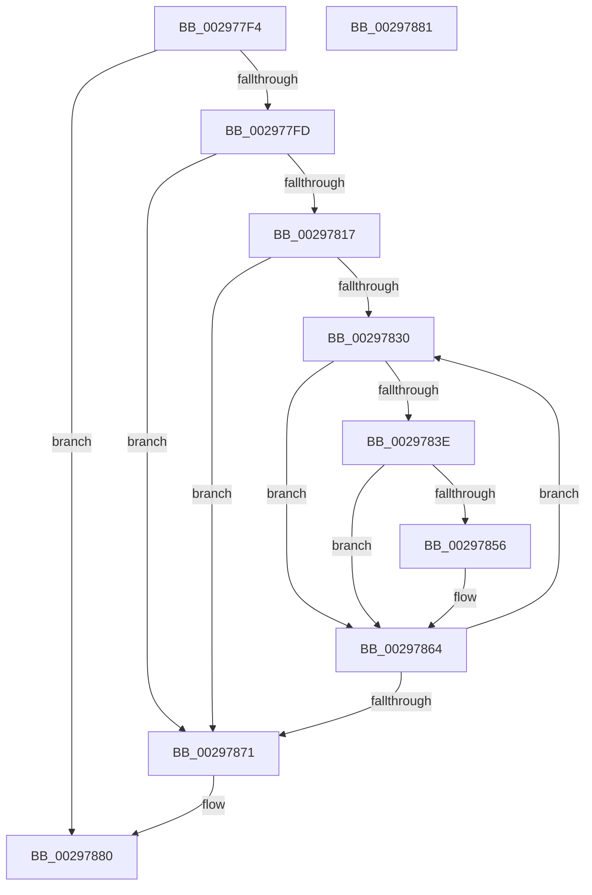

# IopLiveDumpDiscardVirtualAddressRange

- RVA: `0x002977F4`–`0x00297882` (길이 `142` bytes)
- VA: `0x00000001402977F4`
- 실행 섹션: `.text`
- PDB 이름 있음: `예`; PDB Function 태그: `아니요`
- unwind 정보 RVA: `0x00067A3C`
- 디코드: `39`개 명령, `142/142` bytes 표시
- 미해석 바이트: `0` (있으면 어셈블리에 `.byte`로 보존)

> 이 문서는 커널 이미지의 기계어와 PDB 기호를 분석해 생성했습니다. 4번과 5번은 함수 원형과 자료형을 바이너리 사용 방식에서 추정한 C 해석이며 원본 소스 복구 결과는 아닙니다.

## 1. Dependencies

- 직접 호출 지점: **3**; 고유 호출 대상: **3**
- 직접 호출자로 확인된 함수: **7**
- RIP 상대 이미지 참조: **0**

### Outgoing calls
- `0x00297835` → [MmIsAddressValidEx](../27/MmIsAddressValidEx_function_0027FDD0.md) (function, `0x0027FDD0`)
- `0x00297841` → [MmGetPhysicalAddress](../23/MmGetPhysicalAddress_function_0023A500.md) (function, `0x0023A500`)
- `0x0029785F` → [RtlClearBitsEx](RtlClearBitsEx_function_00297740.md) (function, `0x00297740`)

### Direct callers
- [IopLiveDumpAllocateDumpBuffers](../3F/IopLiveDumpAllocateDumpBuffers_function_003F5AE8.md) at `0x003F5C41`
- [IopLiveDumpAllocateDumpBuffers](../3F/IopLiveDumpAllocateDumpBuffers_function_003F5AE8.md) at `0x003F5C53`
- [IopLiveDumpAllocateDumpBuffers](../3F/IopLiveDumpAllocateDumpBuffers_function_003F5AE8.md) at `0x003F5CF6`
- [IopLiveDumpAllocateDumpBuffers](../3F/IopLiveDumpAllocateDumpBuffers_function_003F5AE8.md) at `0x003F5E25`
- [IopLiveDumpAddProcessFilter](../59/IopLiveDumpAddProcessFilter_function_00599008.md) at `0x005990F3`
- [IopLiveDumpAllocAndInitResources](../59/IopLiveDumpAllocAndInitResources_function_005993B0.md) at `0x005994F3`
- [IopLiveDumpAllocAndInitResources](../59/IopLiveDumpAllocAndInitResources_function_005993B0.md) at `0x005995C8`
- [IopLiveDumpAllocAndInitResources](../59/IopLiveDumpAllocAndInitResources_function_005993B0.md) at `0x00599629`
- [IopLiveDumpAllocAndInitResources](../59/IopLiveDumpAllocAndInitResources_function_005993B0.md) at `0x0059970C`
- [IopLiveDumpAllocAndInitResources](../59/IopLiveDumpAllocAndInitResources_function_005993B0.md) at `0x0059971F`
- [IopLiveDumpAllocAndInitResources](../59/IopLiveDumpAllocAndInitResources_function_005993B0.md) at `0x0059988C`
- [IopLiveDumpAllocAndInitResources](../59/IopLiveDumpAllocAndInitResources_function_005993B0.md) at `0x005998B1`
- [IopLiveDumpAllocAndInitResources](../59/IopLiveDumpAllocAndInitResources_function_005993B0.md) at `0x005998CF`
- [IopLiveDumpAllocAndInitResources](../59/IopLiveDumpAllocAndInitResources_function_005993B0.md) at `0x005998E1`
- [IopLiveDumpAllocateExtraBuffers](../59/IopLiveDumpAllocateExtraBuffers_function_00599A9C.md) at `0x00599D68`
- [IopLiveDumpAllocateFromIOSpace](../59/IopLiveDumpAllocateFromIOSpace_function_00599DEC.md) at `0x0059A1DB`
- [IopLiveDumpAllocateIptBuffers](../59/IopLiveDumpAllocateIptBuffers_function_0059A694.md) at `0x0059A709`
- [IopLiveDumpAllocateIptBuffers](../59/IopLiveDumpAllocateIptBuffers_function_0059A694.md) at `0x0059A775`
- [IopLiveDumpAllocateIptBuffers](../59/IopLiveDumpAllocateIptBuffers_function_0059A694.md) at `0x0059A7C7`
- [IopLiveDumpAllocateIptBuffers](../59/IopLiveDumpAllocateIptBuffers_function_0059A694.md) at `0x0059A82D`
- [sub_006EB392](../6E/Unknown_function_006EB392.md) at `0x006EB495`
- [sub_006EB392](../6E/Unknown_function_006EB392.md) at `0x006EB57C`
- [sub_006EB392](../6E/Unknown_function_006EB392.md) at `0x006EB621`

### Static image references
- 디코드된 RIP-relative 메모리 참조가 없습니다.

## 2. Other-region calls and transfers

- 다른 실행 섹션으로 향하는 call: **0**
- 별도 외부 분기/꼬리 이동을 확인하지 못했습니다.

## 3. Assembly (complete function range)

```asm
002977F4  4D 85 C0                        test r8, r8
002977F7  0F 84 83 00 00 00               je 0x140297880
002977FD  48 89 5C 24 08                  mov qword ptr [rsp + 8], rbx
00297802  48 89 74 24 10                  mov qword ptr [rsp + 0x10], rsi
00297807  57                              push rdi
00297808  48 83 EC 20                     sub rsp, 0x20
0029780C  48 8B DA                        mov rbx, rdx
0029780F  48 8B F1                        mov rsi, rcx
00297812  48 85 D2                        test rdx, rdx
00297815  74 5A                           je 0x140297871
00297817  49 F7 C0 FF 0F 00 00            test r8, 0xfff
0029781E  BF 00 00 00 00                  mov edi, 0
00297823  40 0F 95 C7                     setne dil
00297827  49 C1 E8 0C                     shr r8, 0xc
0029782B  49 03 F8                        add rdi, r8
0029782E  74 41                           je 0x140297871
00297830  33 D2                           xor edx, edx
00297832  48 8B CB                        mov rcx, rbx
00297835  E8 96 85 FE FF                  call 0x14027fdd0
0029783A  84 C0                           test al, al
0029783C  74 26                           je 0x140297864
0029783E  48 8B CB                        mov rcx, rbx
00297841  E8 BA 2C FA FF                  call 0x14023a500
00297846  48 C1 E8 0C                     shr rax, 0xc
0029784A  48 8D 8E 40 02 00 00            lea rcx, [rsi + 0x240]
00297851  48 3B 01                        cmp rax, qword ptr [rcx]
00297854  73 0E                           jae 0x140297864
00297856  41 B8 01 00 00 00               mov r8d, 1
0029785C  48 8B D0                        mov rdx, rax
0029785F  E8 DC FE FF FF                  call 0x140297740
00297864  48 81 C3 00 10 00 00            add rbx, 0x1000
0029786B  48 83 EF 01                     sub rdi, 1
0029786F  75 BF                           jne 0x140297830
00297871  48 8B 5C 24 30                  mov rbx, qword ptr [rsp + 0x30]
00297876  48 8B 74 24 38                  mov rsi, qword ptr [rsp + 0x38]
0029787B  48 83 C4 20                     add rsp, 0x20
0029787F  5F                              pop rdi
00297880  C3                              ret
00297881  CC                              int3
```

## 4. C-style interpretation (structured pseudocode)

```c
__int64 __fastcall IopLiveDumpDiscardVirtualAddressRange(__int64 a1, __int64 a2, __int64 a3)
{
    __int64 result;
    __int64 v_rbx;
    __int64 v_rdi;
    __int64 v_rsp;
    unsigned __int64 v_stack_p10;
    unsigned __int64 v_stack_p8;

    if (a3 == 0) goto loc_00297880;
    v_stack_p8 = v_rbx;
    v_stack_p10 = v_rsi;
    v_rsp = (v_rsp) - (32);
    if (a2 == 0) goto loc_00297871;
    v_rdi = (((a3) & (0xFFFULL)) != 0) ? 1 : 0;
    a3 = (a3) >> (12);
    v_rdi = (v_rdi) + (a3);
    if (condition_is_equal) goto loc_00297871;
loc_00297830:
    a2 = 0;
    result = MmIsAddressValidEx(0, a2, a3, a4);
    if ((unsigned __int8)(result) == 0) goto loc_00297864;
    result = MmGetPhysicalAddress(0, a2, a3, a4);
    result = (result) >> (12);
    if (result < (*(unsigned __int64 *)(a1 + 576))) {
        a3 = 1;
        a2 = result;
        result = RtlClearBitsEx(a1 + 576, a2, a3, a4);
    }
    v_rbx = (a2) + (0x1000ULL);
    v_rdi = (v_rdi) - (1);
    if (condition_is_not_equal) goto loc_00297830;
loc_00297871:
    v_rsp = (v_rsp) + (32);
loc_00297880:
    return result;
}
```

## 5. (Beta) C Style

```c
int64_t IopLiveDumpDiscardVirtualAddressRange(void *Arg1, int64_t Arg2, int64_t Arg3)
{
    uint8_t *arg1 = (uint8_t *)Arg1;

    int64_t result;
    int64_t local_rbx;
    int64_t local_rdi;
    int64_t local_rsp;
    uint64_t v_stack_p10;
    uint64_t v_stack_p8;

    if (Arg3 == 0) goto loc_00297880;
    v_stack_p8 = local_rbx;
    v_stack_p10 = local_rsi;
    local_rsp = (local_rsp) - (32);
    if (Arg2 == 0) goto loc_00297871;
    local_rdi = (((Arg3) & (0xFFFULL)) != 0) ? 1 : 0;
    Arg3 = (Arg3) >> (12);
    local_rdi = (local_rdi) + (Arg3);
    if (condition_is_equal) goto loc_00297871;
loc_00297830:
    Arg2 = 0;
    result = MmIsAddressValidEx(0, Arg2, Arg3, a4);
    if ((uint8_t)(result) == 0) goto loc_00297864;
    result = MmGetPhysicalAddress(0, Arg2, Arg3, a4);
    result = (result) >> (12);
    if (result < (*(uint64_t *)(arg1 + 0x240))) {
        Arg3 = 1;
        Arg2 = result;
        result = RtlClearBitsEx(Arg1 + 576, Arg2, Arg3, a4);
    }
    local_rbx = (Arg2) + (0x1000ULL);
    local_rdi = (local_rdi) - (1);
    if (condition_is_not_equal) goto loc_00297830;
loc_00297871:
    local_rsp = (local_rsp) + (32);
loc_00297880:
    return result;
}
```

### 관측된 메모리 오프셋

구조체 형식이 확인되지 않은 접근은 인자 기준의 오프셋으로만 기록했습니다.

| 기준 인자 | 오프셋 표현 | 폭 (bit) | 접근 |
|---|---:|---:|---|
| `Arg1` | `+ 0x0` | `64` | `R` |
| `Arg1` | `+ 0x240` | `64` | `R` |

## 6. Execution-region graph

[열기: 2D/3D 그래프와 함수 탐색 컨트롤 패널](../../../control-panel.html?section=text&rva=0x002977F4&view=graph)

- 2D 그래프는 위에서 아래로 흐르고, 3D 그래프는 빈 공간을 드래그해 회전합니다. Shift+드래그는 이동, 휠은 확대·축소, 함수 노드 선택은 대상 보고서 이동입니다.

### Static fallback


