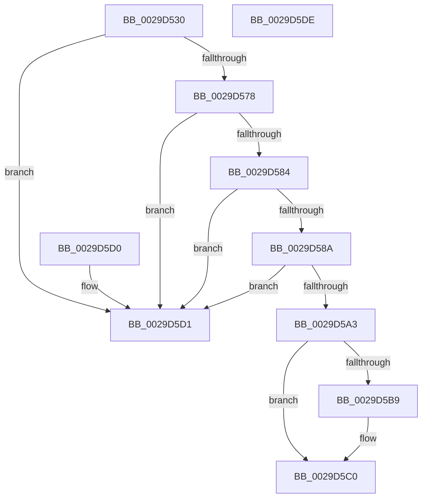

# IopReferenceFileObject

- RVA: `0x0029D530`–`0x0029D5DF` (길이 `175` bytes)
- VA: `0x000000014029D530`
- 실행 섹션: `.text`
- PDB 이름 있음: `예`; PDB Function 태그: `아니요`
- unwind 정보 RVA: `0x00067FDC`
- 디코드: `47`개 명령, `175/175` bytes 표시
- 미해석 바이트: `0` (있으면 어셈블리에 `.byte`로 보존)

> 이 문서는 커널 이미지의 기계어와 PDB 기호를 분석해 생성했습니다. 4번과 5번은 함수 원형과 자료형을 바이너리 사용 방식에서 추정한 C 해석이며 원본 소스 복구 결과는 아닙니다.

## 1. Dependencies

- 직접 호출 지점: **4**; 고유 호출 대상: **4**
- 직접 호출자로 확인된 함수: **21**
- RIP 상대 이미지 참조: **1**

### Outgoing calls
- `0x0029D565` → [ObReferenceObjectByHandle](../../page/86/ObReferenceObjectByHandle_function_00868DB0.md) (function, `0x00868DB0`)
- `0x0029D59A` → [PsIsProcessAppContainer](../../page/A3/PsIsProcessAppContainer_function_00A38C44.md) (function, `0x00A38C44`)
- `0x0029D5AB` → [ObfDereferenceObjectWithTag](../2F/ObfDereferenceObjectWithTag_function_002F78E0.md) (function, `0x002F78E0`)
- `0x0029D5B0` → [Feature_4056573243__private_IsEnabledDeviceUsageNoInline](../59/Feature_4056573243__private_IsEnabledDeviceUsageNoInline_function_00596C8C.md) (function, `0x00596C8C`)

### Direct callers
- [NtSetInformationFile](NtSetInformationFile_function_0029C5E0.md) at `0x0029C76D`
- [IopSetEaOrQuotaInformationFile](../../page/71/IopSetEaOrQuotaInformationFile_function_0071BD70.md) at `0x0071BE23`
- [IopValidateJunctionTarget](../../page/71/IopValidateJunctionTarget_function_0071C808.md) at `0x0071CA15`
- [NtQueryQuotaInformationFile](../../page/72/NtQueryQuotaInformationFile_function_00720FE0.md) at `0x00721334`
- [NtSetVolumeInformationFile](../../page/72/NtSetVolumeInformationFile_function_00721750.md) at `0x007218DE`
- [NtQueryEaFile](../../page/8A/NtQueryEaFile_function_008AC1B0.md) at `0x008AC47A`
- [NtQueryVolumeInformationFile](../../page/8A/NtQueryVolumeInformationFile_function_008AC8C0.md) at `0x008ACA3B`
- [NtFlushBuffersFileEx](../../page/8A/NtFlushBuffersFileEx_function_008ACF10.md) at `0x008ACF50`
- [NtQueryInformationFile](../../page/8A/NtQueryInformationFile_function_008AD630.md) at `0x008AD73A`
- [NtReadFile](../../page/8A/NtReadFile_function_008AEF10.md) at `0x008AEF55`
- [IopXxxControlFile](../../page/8E/IopXxxControlFile_function_008E9AD0.md) at `0x008E9CF3`
- [BuildQueryDirectoryIrp](../../page/8E/BuildQueryDirectoryIrp_function_008EC770.md) at `0x008ECB05`
- [NtCopyFileChunk](../../page/94/NtCopyFileChunk_function_0094B600.md) at `0x0094B831`
- [NtCopyFileChunk](../../page/94/NtCopyFileChunk_function_0094B600.md) at `0x0094B9CF`
- [NtLockFile](../../page/9D/NtLockFile_function_009D86D0.md) at `0x009D8757`
- [NtCancelIoFile](../../page/9E/NtCancelIoFile_function_009E93E0.md) at `0x009E9448`
- [NtNotifyChangeDirectoryFileEx](../../page/A1/NtNotifyChangeDirectoryFileEx_function_00A1DEA0.md) at `0x00A1DF5C`
- [NtCancelIoFileEx](../../page/A4/NtCancelIoFileEx_function_00A44770.md) at `0x00A447C6`
- [NtSetEaFile](../../page/A7/NtSetEaFile_function_00A788A0.md) at `0x00A78955`
- [NtWriteFileGather](../../page/AC/NtWriteFileGather_function_00AC3AE0.md) at `0x00AC3B24`
- [IopIoRingReferenceFileObject](../../page/AD/IopIoRingReferenceFileObject_function_00AD3A8C.md) at `0x00AD3AEE`
- [NtReadFileScatter](../../page/AD/NtReadFileScatter_function_00AD9680.md) at `0x00AD96BC`

### Static image references
- `0x0029D54B` → RVA `0x00FC6AE0` (`ALMOSTRO`; read)

## 2. Other-region calls and transfers

- 다른 실행 섹션으로 향하는 call: **2**
  - `0x0029D565` → [ObReferenceObjectByHandle](../../page/86/ObReferenceObjectByHandle_function_00868DB0.md) (`.text` → `PAGE`)
  - `0x0029D59A` → [PsIsProcessAppContainer](../../page/A3/PsIsProcessAppContainer_function_00A38C44.md) (`.text` → `PAGE`)
- 별도 외부 분기/꼬리 이동을 확인하지 못했습니다.

## 3. Assembly (complete function range)

```asm
0029D530  48 89 5C 24 08                  mov qword ptr [rsp + 8], rbx
0029D535  57                              push rdi
0029D536  48 83 EC 30                     sub rsp, 0x30
0029D53A  48 8B 44 24 60                  mov rax, qword ptr [rsp + 0x60]
0029D53F  49 8B F9                        mov rdi, r9
0029D542  48 89 44 24 28                  mov qword ptr [rsp + 0x28], rax
0029D547  45 0F B6 C8                     movzx r9d, r8b
0029D54B  4C 8B 05 8E 95 D2 00            mov r8, qword ptr [rip + 0xd2958e]
0029D552  48 8D 44 24 58                  lea rax, [rsp + 0x58]
0029D557  48 89 44 24 20                  mov qword ptr [rsp + 0x20], rax
0029D55C  48 C7 44 24 58 00 00 00 00      mov qword ptr [rsp + 0x58], 0
0029D565  E8 46 B8 5C 00                  call 0x140868db0
0029D56A  8B D8                           mov ebx, eax
0029D56C  48 8B 44 24 58                  mov rax, qword ptr [rsp + 0x58]
0029D571  48 89 07                        mov qword ptr [rdi], rax
0029D574  85 DB                           test ebx, ebx
0029D576  78 59                           js 0x14029d5d1
0029D578  48 8B 80 D0 00 00 00            mov rax, qword ptr [rax + 0xd0]
0029D57F  48 85 C0                        test rax, rax
0029D582  74 4D                           je 0x14029d5d1
0029D584  8B 00                           mov eax, dword ptr [rax]
0029D586  A8 04                           test al, 4
0029D588  74 47                           je 0x14029d5d1
0029D58A  65 48 8B 04 25 88 01 00 00      mov rax, qword ptr gs:[0x188]
0029D593  48 8B 88 B8 00 00 00            mov rcx, qword ptr [rax + 0xb8]
0029D59A  E8 A5 B6 79 00                  call 0x140a38c44
0029D59F  84 C0                           test al, al
0029D5A1  74 2E                           je 0x14029d5d1
0029D5A3  48 8B 0F                        mov rcx, qword ptr [rdi]
0029D5A6  BA 44 66 6C 74                  mov edx, 0x746c6644
0029D5AB  E8 30 A3 05 00                  call 0x1402f78e0
0029D5B0  E8 D7 96 2F 00                  call 0x140596c8c
0029D5B5  85 C0                           test eax, eax
0029D5B7  74 07                           je 0x14029d5c0
0029D5B9  48 C7 07 00 00 00 00            mov qword ptr [rdi], 0
0029D5C0  B8 10 09 00 C0                  mov eax, 0xc0000910
0029D5C5  48 8B 5C 24 40                  mov rbx, qword ptr [rsp + 0x40]
0029D5CA  48 83 C4 30                     add rsp, 0x30
0029D5CE  5F                              pop rdi
0029D5CF  C3                              ret
0029D5D0  CC                              int3
0029D5D1  8B C3                           mov eax, ebx
0029D5D3  48 8B 5C 24 40                  mov rbx, qword ptr [rsp + 0x40]
0029D5D8  48 83 C4 30                     add rsp, 0x30
0029D5DC  5F                              pop rdi
0029D5DD  C3                              ret
0029D5DE  CC                              int3
```

## 4. C-style interpretation (structured pseudocode)

```c
__int64 __fastcall IopReferenceFileObject(__int64 a1, __int64 a2, unsigned __int8 a3, __int64 a4, __int64 a5)
{
    __int64 result;
    __int64 v_rsp;
    unsigned __int64 v_stack_m10;
    unsigned __int64 v_stack_m18;
    unsigned __int64 v_stack_p20;
    unsigned __int64 v_stack_p40;
    unsigned __int64 v_stack_p8;

    v_stack_p8 = v_rbx;
    v_rsp = (v_rsp) - (48);
    v_stack_m10 = a5;
    v_stack_m18 = v_stack_p20;
    v_stack_p20 = 0;
    result = ObReferenceObjectByHandle(a1, a2, *(unsigned __int64 *)(v_rip + 13800846), a3);
    *(unsigned __int64 *)(a4) = v_stack_p20;
    if (sign_flag) goto loc_0029D5D1;
    if (*(unsigned __int64 *)(v_stack_p20 + 208) == 0) goto loc_0029D5D1;
    if ((((unsigned __int8)((unsigned int)(*(unsigned int *)(*(unsigned __int64 *)(v_stack_p20 + 208))))) & (4)) == 0) goto loc_0029D5D1;
    result = PsIsProcessAppContainer(*(unsigned __int64 *)(*(unsigned __int64 *)(gs_base + (0 + 392)) + 184), a2, *(unsigned __int64 *)(v_rip + 13800846), a3);
    if ((unsigned __int8)(result) == 0) goto loc_0029D5D1;
    result = ObfDereferenceObjectWithTag(*(unsigned __int64 *)(a4), (unsigned int)(0x746C6644ULL), *(unsigned __int64 *)(v_rip + 13800846), a3);
    result = Feature_4056573243__private_IsEnabledDeviceUsageNoInline(*(unsigned __int64 *)(a4), (unsigned int)(0x746C6644ULL), *(unsigned __int64 *)(v_rip + 13800846), a3);
    if ((unsigned int)(result) != 0) {
        *(unsigned __int64 *)(a4) = 0;
    }
    v_rsp = (v_rsp) + (48);
    return (unsigned int)(0xC0000910ULL);
loc_0029D5D1:
    v_rsp = (v_rsp) + (48);
    return (unsigned int)((unsigned int)(v_stack_p8));
}
```

## 5. (Beta) C Style

```c
int64_t IopReferenceFileObject(int64_t Arg1, int64_t Arg2, uint8_t Arg3, void *Arg4, int64_t Arg5)
{
    uint8_t *arg4 = (uint8_t *)Arg4;

    int64_t result;
    int64_t local_rsp;
    uint64_t v_stack_m10;
    uint64_t v_stack_m18;
    uint64_t v_stack_p20;
    uint64_t v_stack_p40;
    uint64_t v_stack_p8;

    v_stack_p8 = local_rbx;
    local_rsp = (local_rsp) - (48);
    v_stack_m10 = Arg5;
    v_stack_m18 = v_stack_p20;
    v_stack_p20 = 0;
    result = ObReferenceObjectByHandle(Arg1, Arg2, *(uint64_t *)(v_rip + 0xD2958E), Arg3);
    *(uint64_t *)(arg4) = v_stack_p20;
    if (sign_flag) goto loc_0029D5D1;
    if (*(uint64_t *)(v_stack_p20 + 0xD0) == 0) goto loc_0029D5D1;
    if ((((uint8_t)((uint32_t)(*(uint32_t *)(*(uint64_t *)(v_stack_p20 + 0xD0))))) & (4)) == 0) goto loc_0029D5D1;
    result = PsIsProcessAppContainer(*(uint64_t *)(*(uint64_t *)(gs_base + (0 + 0x188)) + 0xB8), Arg2, *(uint64_t *)(v_rip + 0xD2958E), Arg3);
    if ((uint8_t)(result) == 0) goto loc_0029D5D1;
    result = ObfDereferenceObjectWithTag(*(uint64_t *)(arg4), (uint32_t)(0x746C6644ULL), *(uint64_t *)(v_rip + 0xD2958E), Arg3);
    result = Feature_4056573243__private_IsEnabledDeviceUsageNoInline(*(uint64_t *)(arg4), (uint32_t)(0x746C6644ULL), *(uint64_t *)(v_rip + 0xD2958E), Arg3);
    if ((uint32_t)(result) != 0) {
        *(uint64_t *)(arg4) = 0;
    }
    local_rsp = (local_rsp) + (48);
    return (uint32_t)(0xC0000910ULL);
loc_0029D5D1:
    local_rsp = (local_rsp) + (48);
    return (uint32_t)((uint32_t)(v_stack_p8));
}
```

### 관측된 메모리 오프셋

구조체 형식이 확인되지 않은 접근은 인자 기준의 오프셋으로만 기록했습니다.

| 기준 인자 | 오프셋 표현 | 폭 (bit) | 접근 |
|---|---:|---:|---|
| `Arg4` | `+ 0x0` | `64` | `R` |
| `Arg4` | `+ 0x0` | `64` | `W` |

## 6. Execution-region graph

[열기: 2D/3D 그래프와 함수 탐색 컨트롤 패널](../../../control-panel.html?section=text&rva=0x0029D530&view=graph)

- 2D 그래프는 위에서 아래로 흐르고, 3D 그래프는 빈 공간을 드래그해 회전합니다. Shift+드래그는 이동, 휠은 확대·축소, 함수 노드 선택은 대상 보고서 이동입니다.

### Static fallback


