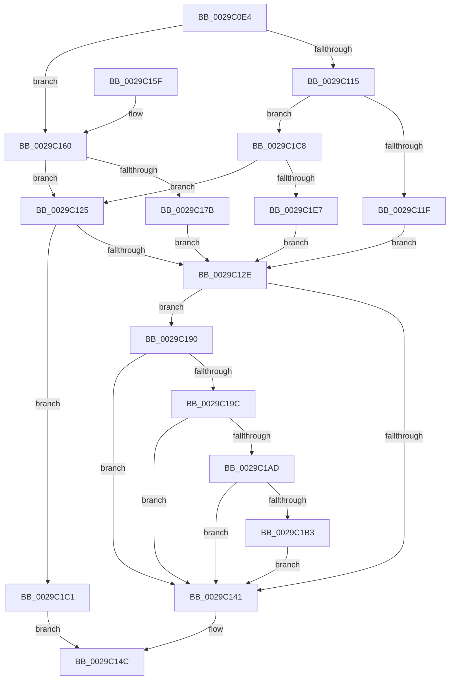

# IopSetDiskIoAttributionExtension

- RVA: `0x0029C0E4`–`0x0029C211` (길이 `301` bytes)
- VA: `0x000000014029C0E4`
- 실행 섹션: `.text`
- PDB 이름 있음: `예`; PDB Function 태그: `아니요`
- unwind 정보 RVA: `0x00067ED8`
- 디코드: `77`개 명령, `301/301` bytes 표시
- 미해석 바이트: `0` (있으면 어셈블리에 `.byte`로 보존)

> 이 문서는 커널 이미지의 기계어와 PDB 기호를 분석해 생성했습니다. 4번과 5번은 함수 원형과 자료형을 바이너리 사용 방식에서 추정한 C 해석이며 원본 소스 복구 결과는 아닙니다.

## 1. Dependencies

- 직접 호출 지점: **3**; 고유 호출 대상: **2**
- 직접 호출자로 확인된 함수: **10**
- RIP 상대 이미지 참조: **0**

### Outgoing calls
- `0x0029C16E` → [ExAllocatePool2](../../poolcode/B8/ExAllocatePool2_function_00B820F0.md) (function, `0x00B820F0`)
- `0x0029C1BA` → [IopReferenceIoAttributionFromProcess](../44/IopReferenceIoAttributionFromProcess_function_004458A0.md) (function, `0x004458A0`)
- `0x0029C1D6` → [ExAllocatePool2](../../poolcode/B8/ExAllocatePool2_function_00B820F0.md) (function, `0x00B820F0`)

### Direct callers
- [MiIssueAsynchronousFlush](MiIssueAsynchronousFlush_function_00299898.md) at `0x00299B56`
- [IoAsynchronousPageWrite](IoAsynchronousPageWrite_function_00299C08.md) at `0x00299DC7`
- [MiSynchronousPageWrite](MiSynchronousPageWrite_function_0029A2E4.md) at `0x0029A43F`
- [MiIssueSynchronousFlush](MiIssueSynchronousFlush_function_0029A588.md) at `0x0029A78C`
- [IoPageReadEx](IoPageReadEx_function_0029ABF0.md) at `0x0029AF9C`
- [IoPageReadEx](IoPageReadEx_function_0029ABF0.md) at `0x0029AFFB`
- [sub_0029BFC9](Unknown_function_0029BFC9.md) at `0x0029C0B5`
- [sub_0029C5AA](Unknown_function_0029C5AA.md) at `0x0029C5BC`
- [IoMakeAssociatedIrpPriv](IoMakeAssociatedIrpPriv_function_0029D818.md) at `0x0029DB09`
- [IoUpdateIrpIoAttributionHandle](IoUpdateIrpIoAttributionHandle_function_0029DBF0.md) at `0x0029DC03`
- [IoPropagateIrpExtensionEx](../46/IoPropagateIrpExtensionEx_function_00461250.md) at `0x00461375`

### Static image references
- 디코드된 RIP-relative 메모리 참조가 없습니다.

## 2. Other-region calls and transfers

- 다른 실행 섹션으로 향하는 call: **2**
  - `0x0029C16E` → [ExAllocatePool2](../../poolcode/B8/ExAllocatePool2_function_00B820F0.md) (`.text` → `POOLCODE`)
  - `0x0029C1D6` → [ExAllocatePool2](../../poolcode/B8/ExAllocatePool2_function_00B820F0.md) (`.text` → `POOLCODE`)
- 별도 외부 분기/꼬리 이동을 확인하지 못했습니다.

## 3. Assembly (complete function range)

```asm
0029C0E4  48 89 5C 24 08                  mov qword ptr [rsp + 8], rbx
0029C0E9  48 89 6C 24 18                  mov qword ptr [rsp + 0x18], rbp
0029C0EE  48 89 54 24 10                  mov qword ptr [rsp + 0x10], rdx
0029C0F3  56                              push rsi
0029C0F4  57                              push rdi
0029C0F5  41 56                           push r14
0029C0F7  48 83 EC 20                     sub rsp, 0x20
0029C0FB  48 8B 99 C8 00 00 00            mov rbx, qword ptr [rcx + 0xc8]
0029C102  45 8B F1                        mov r14d, r9d
0029C105  49 8B E8                        mov rbp, r8
0029C108  48 8B F9                        mov rdi, rcx
0029C10B  BE 40 00 00 00                  mov esi, 0x40
0029C110  48 85 DB                        test rbx, rbx
0029C113  74 4B                           je 0x14029c160
0029C115  80 79 47 00                     cmp byte ptr [rcx + 0x47], 0
0029C119  0F 8C A9 00 00 00               jl 0x14029c1c8
0029C11F  66 09 73 02                     or word ptr [rbx + 2], si
0029C123  EB 09                           jmp 0x14029c12e
0029C125  48 85 DB                        test rbx, rbx
0029C128  0F 84 93 00 00 00               je 0x14029c1c1
0029C12E  48 8B 8D 20 02 00 00            mov rcx, qword ptr [rbp + 0x220]
0029C135  F7 81 FC 05 00 00 00 10 00 00   test dword ptr [rcx + 0x5fc], 0x1000
0029C13F  75 4F                           jne 0x14029c190
0029C141  48 8B 44 24 48                  mov rax, qword ptr [rsp + 0x48]
0029C146  48 89 43 10                     mov qword ptr [rbx + 0x10], rax
0029C14A  33 C0                           xor eax, eax
0029C14C  48 8B 5C 24 40                  mov rbx, qword ptr [rsp + 0x40]
0029C151  48 8B 6C 24 50                  mov rbp, qword ptr [rsp + 0x50]
0029C156  48 83 C4 20                     add rsp, 0x20
0029C15A  41 5E                           pop r14
0029C15C  5F                              pop rdi
0029C15D  5E                              pop rsi
0029C15E  C3                              ret
0029C15F  CC                              int3
0029C160  BA 50 00 00 00                  mov edx, 0x50
0029C165  41 B8 49 72 70 58               mov r8d, 0x58707249
0029C16B  48 8B CE                        mov rcx, rsi
0029C16E  E8 7D 5F 8E 00                  call 0x140b820f0
0029C173  48 8B D8                        mov rbx, rax
0029C176  48 85 C0                        test rax, rax
0029C179  74 AA                           je 0x14029c125
0029C17B  66 89 70 02                     mov word ptr [rax + 2], si
0029C17F  40 08 77 47                     or byte ptr [rdi + 0x47], sil
0029C183  48 89 87 C8 00 00 00            mov qword ptr [rdi + 0xc8], rax
0029C18A  66 83 08 01                     or word ptr [rax], 1
0029C18E  EB 9E                           jmp 0x14029c12e
0029C190  48 8B 81 A0 02 00 00            mov rax, qword ptr [rcx + 0x2a0]
0029C197  48 85 C0                        test rax, rax
0029C19A  74 A5                           je 0x14029c141
0029C19C  48 8B 81 A0 02 00 00            mov rax, qword ptr [rcx + 0x2a0]
0029C1A3  48 83 B8 30 06 00 00 00         cmp qword ptr [rax + 0x630], 0
0029C1AB  74 94                           je 0x14029c141
0029C1AD  41 F6 C6 01                     test r14b, 1
0029C1B1  75 8E                           jne 0x14029c141
0029C1B3  4C 8D 44 24 48                  lea r8, [rsp + 0x48]
0029C1B8  B2 01                           mov dl, 1
0029C1BA  E8 E1 96 1A 00                  call 0x1404458a0
0029C1BF  EB 80                           jmp 0x14029c141
0029C1C1  B8 9A 00 00 C0                  mov eax, 0xc000009a
0029C1C6  EB 84                           jmp 0x14029c14c
0029C1C8  BA 50 00 00 00                  mov edx, 0x50
0029C1CD  41 B8 49 72 70 58               mov r8d, 0x58707249
0029C1D3  48 8B CE                        mov rcx, rsi
0029C1D6  E8 15 5F 8E 00                  call 0x140b820f0
0029C1DB  48 8B D8                        mov rbx, rax
0029C1DE  48 85 C0                        test rax, rax
0029C1E1  0F 84 3E FF FF FF               je 0x14029c125
0029C1E7  66 C7 40 02 44 00               mov word ptr [rax + 2], 0x44
0029C1ED  8B 87 C8 00 00 00               mov eax, dword ptr [rdi + 0xc8]
0029C1F3  89 43 04                        mov dword ptr [rbx + 4], eax
0029C1F6  8A 47 47                        mov al, byte ptr [rdi + 0x47]
0029C1F9  24 3F                           and al, 0x3f
0029C1FB  48 89 9F C8 00 00 00            mov qword ptr [rdi + 0xc8], rbx
0029C202  40 0A C6                        or al, sil
0029C205  88 47 47                        mov byte ptr [rdi + 0x47], al
0029C208  66 83 0B 01                     or word ptr [rbx], 1
0029C20C  E9 1D FF FF FF                  jmp 0x14029c12e
```

## 4. C-style interpretation (structured pseudocode)

```c
__int64 __fastcall IopSetDiskIoAttributionExtension(__int64 a1, __int64 a2, __int64 a3, int a4)
{
    __int64 result;
    __int64 v_rsp;
    unsigned __int64 v_stack_p10;
    unsigned __int64 v_stack_p18;
    unsigned __int64 v_stack_p48;
    unsigned __int64 v_stack_p8;

    v_stack_p8 = v_rbx;
    v_stack_p18 = v_rbp;
    v_stack_p10 = a2;
    v_rsp = (v_rsp) - (32);
    if (*(unsigned __int64 *)(a1 + 200) == 0) goto loc_0029C160;
    if ((*(unsigned __int8 *)(a1 + 71)) < 0) goto loc_0029C1C8;
    goto loc_0029C12E;
loc_0029C125:
    if (*(unsigned __int64 *)(a1 + 200) == 0) goto loc_0029C1C1;
loc_0029C12E:
    if (((*(unsigned int *)(*(unsigned __int64 *)(a3 + 544) + 1532)) & (0x1000ULL)) != 0) goto loc_0029C190;
loc_0029C141:
    *(unsigned __int64 *)(*(unsigned __int64 *)(a1 + 200) + 16) = v_stack_p10;
    result = 0;
loc_0029C14C:
    v_rsp = (v_rsp) + (32);
    return result;
loc_0029C160:
    result = ExAllocatePool2(64, 80, (unsigned int)(0x58707249ULL), a4);
    if (result == 0) goto loc_0029C125;
    *(unsigned __int16 *)(result + 2) = 64;
    *(unsigned __int64 *)(a1 + 200) = result;
    goto loc_0029C12E;
loc_0029C190:
    if (*(unsigned __int64 *)(64 + 672) == 0) goto loc_0029C141;
    if ((*(unsigned __int64 *)(*(unsigned __int64 *)(64 + 672) + 1584)) == 0) goto loc_0029C141;
    if ((((unsigned __int8)((unsigned int)(a4))) & (1)) != 0) goto loc_0029C141;
    result = IopReferenceIoAttributionFromProcess(64, 1, v_stack_p48, a4);
    goto loc_0029C141;
loc_0029C1C1:
    goto loc_0029C14C;
loc_0029C1C8:
    result = ExAllocatePool2(64, 80, (unsigned int)(0x58707249ULL), a4);
    if (result == 0) goto loc_0029C125;
    *(unsigned __int16 *)(result + 2) = 68;
    *(unsigned int *)(result + 4) = (unsigned int)((unsigned int)(*(unsigned int *)(a1 + 200)));
    result = (unsigned __int8)((*(unsigned __int8 *)(a1 + 71)) & (63));
    *(unsigned __int64 *)(a1 + 200) = result;
    result = (unsigned __int8)((result) | (64));
    *(unsigned __int8 *)(a1 + 71) = (unsigned __int8)(result);
    goto loc_0029C12E;
}
```

## 5. (Beta) C Style

```c
int64_t IopSetDiskIoAttributionExtension(void *Arg1, int64_t Arg2, void *Arg3, int32_t Arg4)
{
    uint8_t *arg1 = (uint8_t *)Arg1;
    uint8_t *arg3 = (uint8_t *)Arg3;

    int64_t result;
    int64_t local_rsp;
    uint64_t v_stack_p10;
    uint64_t v_stack_p18;
    uint64_t v_stack_p48;
    uint64_t v_stack_p8;

    v_stack_p8 = local_rbx;
    v_stack_p18 = local_rbp;
    v_stack_p10 = Arg2;
    local_rsp = (local_rsp) - (32);
    if (*(uint64_t *)(arg1 + 0xC8) == 0) goto loc_0029C160;
    if ((*(uint8_t *)(arg1 + 0x47)) < 0) goto loc_0029C1C8;
    goto loc_0029C12E;
loc_0029C125:
    if (*(uint64_t *)(arg1 + 0xC8) == 0) goto loc_0029C1C1;
loc_0029C12E:
    if (((*(uint32_t *)(*(uint64_t *)(arg3 + 0x220) + 0x5FC)) & (0x1000ULL)) != 0) goto loc_0029C190;
loc_0029C141:
    *(uint64_t *)(*(uint64_t *)(arg1 + 0xC8) + 0x10) = v_stack_p10;
    result = 0;
loc_0029C14C:
    local_rsp = (local_rsp) + (32);
    return result;
loc_0029C160:
    result = ExAllocatePool2(64, 80, (uint32_t)(0x58707249ULL), Arg4);
    if (result == 0) goto loc_0029C125;
    *(uint16_t *)(result + 0x2) = 64;
    *(uint64_t *)(arg1 + 0xC8) = result;
    goto loc_0029C12E;
loc_0029C190:
    if (*(uint64_t *)(64 + 0x2A0) == 0) goto loc_0029C141;
    if ((*(uint64_t *)(*(uint64_t *)(64 + 0x2A0) + 0x630)) == 0) goto loc_0029C141;
    if ((((uint8_t)((uint32_t)(Arg4))) & (1)) != 0) goto loc_0029C141;
    result = IopReferenceIoAttributionFromProcess(64, 1, v_stack_p48, Arg4);
    goto loc_0029C141;
loc_0029C1C1:
    goto loc_0029C14C;
loc_0029C1C8:
    result = ExAllocatePool2(64, 80, (uint32_t)(0x58707249ULL), Arg4);
    if (result == 0) goto loc_0029C125;
    *(uint16_t *)(result + 0x2) = 68;
    *(uint32_t *)(result + 0x4) = (uint32_t)((uint32_t)(*(uint32_t *)(arg1 + 0xC8)));
    result = (uint8_t)((*(uint8_t *)(arg1 + 0x47)) & (63));
    *(uint64_t *)(arg1 + 0xC8) = result;
    result = (uint8_t)((result) | (64));
    *(uint8_t *)(arg1 + 0x47) = (uint8_t)(result);
    goto loc_0029C12E;
}
```

### 관측된 메모리 오프셋

구조체 형식이 확인되지 않은 접근은 인자 기준의 오프셋으로만 기록했습니다.

| 기준 인자 | 오프셋 표현 | 폭 (bit) | 접근 |
|---|---:|---:|---|
| `Arg1` | `+ 0x47` | `8` | `R` |
| `Arg1` | `+ 0x47` | `8` | `R/W` |
| `Arg1` | `+ 0x47` | `8` | `W` |
| `Arg1` | `+ 0xC8` | `32` | `R` |
| `Arg1` | `+ 0xC8` | `64` | `R` |
| `Arg1` | `+ 0xC8` | `64` | `W` |
| `Arg3` | `+ 0x220` | `64` | `R` |

## 6. Execution-region graph

[열기: 2D/3D 그래프와 함수 탐색 컨트롤 패널](../../../control-panel.html?section=text&rva=0x0029C0E4&view=graph)

- 2D 그래프는 위에서 아래로 흐르고, 3D 그래프는 빈 공간을 드래그해 회전합니다. Shift+드래그는 이동, 휠은 확대·축소, 함수 노드 선택은 대상 보고서 이동입니다.

### Static fallback


