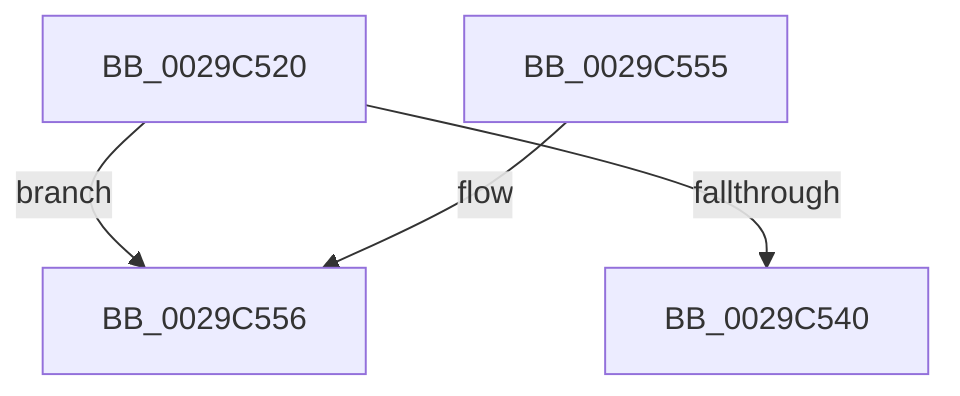

# IopSetDiskIoAttributionFromProcess

- RVA: `0x0029C520`–`0x0029C55D` (길이 `61` bytes)
- VA: `0x000000014029C520`
- 실행 섹션: `.text`
- PDB 이름 있음: `예`; PDB Function 태그: `아니요`
- unwind 정보 RVA: `0x00067F10`
- 디코드: `17`개 명령, `61/61` bytes 표시
- 미해석 바이트: `0` (있으면 어셈블리에 `.byte`로 보존)

> 이 문서는 커널 이미지의 기계어와 PDB 기호를 분석해 생성했습니다. 4번과 5번은 함수 원형과 자료형을 바이너리 사용 방식에서 추정한 C 해석이며 원본 소스 복구 결과는 아닙니다.

## 1. Dependencies

- 직접 호출 지점: **0**; 고유 호출 대상: **0**
- 직접 호출자로 확인된 함수: **3**
- RIP 상대 이미지 참조: **1**

### Outgoing calls
- 직접 디코드된 call 명령이 없습니다.

### Direct callers
- [IoPageReadEx](IoPageReadEx_function_0029ABF0.md) at `0x0029B04B`
- [sub_0029BFC9](Unknown_function_0029BFC9.md) at `0x0029C091`
- [IoSetIoAttributionIrp](../4B/IoSetIoAttributionIrp_function_004B2760.md) at `0x004B2789`

### Static image references
- `0x0029C556` → RVA `0x00F8D1E0` (`.data`; read)

## 2. Other-region calls and transfers

- 다른 실행 섹션으로 향하는 call: **0**
- 별도 외부 분기/꼬리 이동을 확인하지 못했습니다.

## 3. Assembly (complete function range)

```asm
0029C520  48 89 5C 24 10                  mov qword ptr [rsp + 0x10], rbx
0029C525  48 89 74 24 18                  mov qword ptr [rsp + 0x18], rsi
0029C52A  57                              push rdi
0029C52B  48 83 EC 20                     sub rsp, 0x20
0029C52F  33 FF                           xor edi, edi
0029C531  48 8B DA                        mov rbx, rdx
0029C534  48 8B F1                        mov rsi, rcx
0029C537  48 39 BA D8 06 00 00            cmp qword ptr [rdx + 0x6d8], rdi
0029C53E  75 16                           jne 0x14029c556
0029C540  B8 25 02 00 C0                  mov eax, 0xc0000225
0029C545  48 8B 5C 24 38                  mov rbx, qword ptr [rsp + 0x38]
0029C54A  48 8B 74 24 40                  mov rsi, qword ptr [rsp + 0x40]
0029C54F  48 83 C4 20                     add rsp, 0x20
0029C553  5F                              pop rdi
0029C554  C3                              ret
0029C555  CC                              int3
0029C556  48 8D 0D 83 0C CF 00            lea rcx, [rip + 0xcf0c83]
```

## 4. C-style interpretation (structured pseudocode)

```c
__int64 __fastcall IopSetDiskIoAttributionFromProcess(__int64 a1, __int64 a2)
{
    __int64 v_rdi;
    __int64 v_rsp;
    unsigned __int64 v_stack_p10;
    unsigned __int64 v_stack_p18;

    v_stack_p10 = v_rbx;
    v_stack_p18 = v_rsi;
    v_rsp = (v_rsp) - (32);
    v_rdi = 0;
    if ((*(unsigned __int64 *)(a2 + 1752)) != 0) goto loc_0029C556;
    v_rsp = (v_rsp) + (32);
    return (unsigned int)(0xC0000225ULL);
loc_0029C556:
    return (unsigned int)(0xC0000225ULL);
}
```

## 5. (Beta) C Style

```c
int64_t IopSetDiskIoAttributionFromProcess(int64_t Arg1, void *Arg2)
{
    uint8_t *arg2 = (uint8_t *)Arg2;

    int64_t local_rdi;
    int64_t local_rsp;
    uint64_t v_stack_p10;
    uint64_t v_stack_p18;

    v_stack_p10 = local_rbx;
    v_stack_p18 = local_rsi;
    local_rsp = (local_rsp) - (32);
    local_rdi = 0;
    if ((*(uint64_t *)(arg2 + 0x6D8)) != 0) goto loc_0029C556;
    local_rsp = (local_rsp) + (32);
    return (uint32_t)(0xC0000225ULL);
loc_0029C556:
    return (uint32_t)(0xC0000225ULL);
}
```

### 관측된 메모리 오프셋

구조체 형식이 확인되지 않은 접근은 인자 기준의 오프셋으로만 기록했습니다.

| 기준 인자 | 오프셋 표현 | 폭 (bit) | 접근 |
|---|---:|---:|---|
| `Arg2` | `+ 0x6D8` | `64` | `R` |

## 6. Execution-region graph

[열기: 2D/3D 그래프와 함수 탐색 컨트롤 패널](../../../control-panel.html?section=text&rva=0x0029C520&view=graph)

- 2D 그래프는 위에서 아래로 흐르고, 3D 그래프는 빈 공간을 드래그해 회전합니다. Shift+드래그는 이동, 휠은 확대·축소, 함수 노드 선택은 대상 보고서 이동입니다.

### Static fallback


