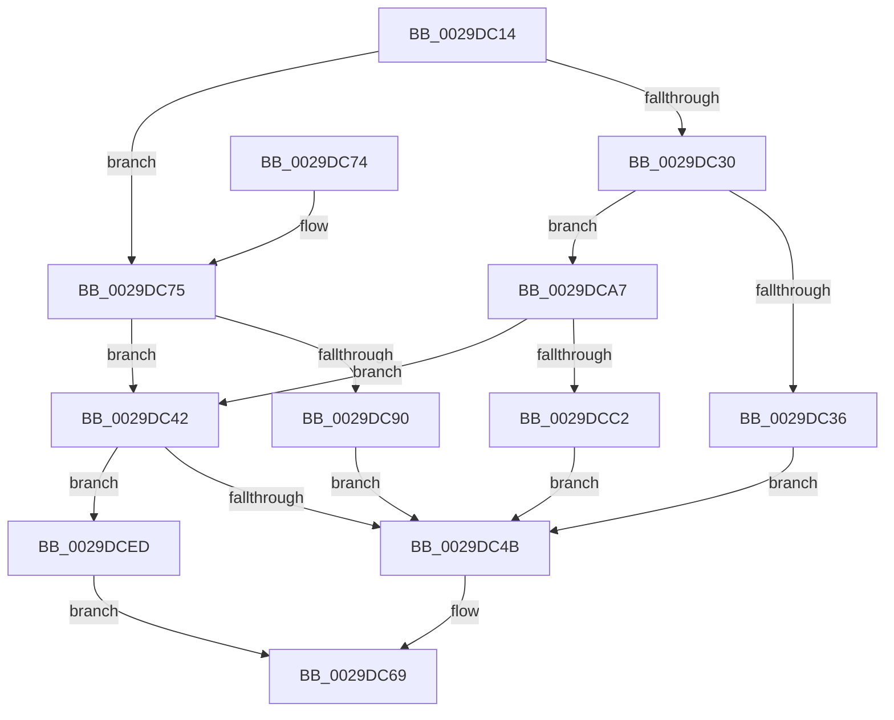

# IopSetDriverFlagsExtension

- RVA: `0x0029DC14`–`0x0029DCF7` (길이 `227` bytes)
- VA: `0x000000014029DC14`
- 실행 섹션: `.text`
- PDB 이름 있음: `예`; PDB Function 태그: `아니요`
- unwind 정보 RVA: `0x0006808C`
- 디코드: `59`개 명령, `227/227` bytes 표시
- 미해석 바이트: `0` (있으면 어셈블리에 `.byte`로 보존)

> 이 문서는 커널 이미지의 기계어와 PDB 기호를 분석해 생성했습니다. 4번과 5번은 함수 원형과 자료형을 바이너리 사용 방식에서 추정한 C 해석이며 원본 소스 복구 결과는 아닙니다.

## 1. Dependencies

- 직접 호출 지점: **2**; 고유 호출 대상: **1**
- 직접 호출자로 확인된 함수: **1**
- RIP 상대 이미지 참조: **0**

### Outgoing calls
- `0x0029DC83` → [ExAllocatePool2](../../poolcode/B8/ExAllocatePool2_function_00B820F0.md) (function, `0x00B820F0`)
- `0x0029DCB5` → [ExAllocatePool2](../../poolcode/B8/ExAllocatePool2_function_00B820F0.md) (function, `0x00B820F0`)

### Direct callers
- [IoMakeAssociatedIrpPriv](IoMakeAssociatedIrpPriv_function_0029D818.md) at `0x0029DB4E`

### Static image references
- 디코드된 RIP-relative 메모리 참조가 없습니다.

## 2. Other-region calls and transfers

- 다른 실행 섹션으로 향하는 call: **2**
  - `0x0029DC83` → [ExAllocatePool2](../../poolcode/B8/ExAllocatePool2_function_00B820F0.md) (`.text` → `POOLCODE`)
  - `0x0029DCB5` → [ExAllocatePool2](../../poolcode/B8/ExAllocatePool2_function_00B820F0.md) (`.text` → `POOLCODE`)
- 별도 외부 분기/꼬리 이동을 확인하지 못했습니다.

## 3. Assembly (complete function range)

```asm
0029DC14  48 89 5C 24 08                  mov qword ptr [rsp + 8], rbx
0029DC19  57                              push rdi
0029DC1A  48 83 EC 20                     sub rsp, 0x20
0029DC1E  4C 8B 81 C8 00 00 00            mov r8, qword ptr [rcx + 0xc8]
0029DC25  48 8B FA                        mov rdi, rdx
0029DC28  48 8B D9                        mov rbx, rcx
0029DC2B  4D 85 C0                        test r8, r8
0029DC2E  74 45                           je 0x14029dc75
0029DC30  80 79 47 00                     cmp byte ptr [rcx + 0x47], 0
0029DC34  7C 71                           jl 0x14029dca7
0029DC36  B8 00 01 00 00                  mov eax, 0x100
0029DC3B  66 41 09 40 02                  or word ptr [r8 + 2], ax
0029DC40  EB 09                           jmp 0x14029dc4b
0029DC42  4D 85 C0                        test r8, r8
0029DC45  0F 84 A2 00 00 00               je 0x14029dced
0029DC4B  48 8B C7                        mov rax, rdi
0029DC4E  41 89 78 38                     mov dword ptr [r8 + 0x38], edi
0029DC52  48 C1 E8 30                     shr rax, 0x30
0029DC56  66 41 89 40 3E                  mov word ptr [r8 + 0x3e], ax
0029DC5B  48 8B C7                        mov rax, rdi
0029DC5E  48 C1 E8 20                     shr rax, 0x20
0029DC62  66 41 89 40 3C                  mov word ptr [r8 + 0x3c], ax
0029DC67  33 C0                           xor eax, eax
0029DC69  48 8B 5C 24 30                  mov rbx, qword ptr [rsp + 0x30]
0029DC6E  48 83 C4 20                     add rsp, 0x20
0029DC72  5F                              pop rdi
0029DC73  C3                              ret
0029DC74  CC                              int3
0029DC75  BA 50 00 00 00                  mov edx, 0x50
0029DC7A  41 B8 49 72 70 58               mov r8d, 0x58707249
0029DC80  8D 4A F0                        lea ecx, [rdx - 0x10]
0029DC83  E8 68 44 8E 00                  call 0x140b820f0
0029DC88  4C 8B C0                        mov r8, rax
0029DC8B  48 85 C0                        test rax, rax
0029DC8E  74 B2                           je 0x14029dc42
0029DC90  66 C7 40 02 00 01               mov word ptr [rax + 2], 0x100
0029DC96  80 4B 47 40                     or byte ptr [rbx + 0x47], 0x40
0029DC9A  48 89 83 C8 00 00 00            mov qword ptr [rbx + 0xc8], rax
0029DCA1  66 83 08 01                     or word ptr [rax], 1
0029DCA5  EB A4                           jmp 0x14029dc4b
0029DCA7  BA 50 00 00 00                  mov edx, 0x50
0029DCAC  41 B8 49 72 70 58               mov r8d, 0x58707249
0029DCB2  8D 4A F0                        lea ecx, [rdx - 0x10]
0029DCB5  E8 36 44 8E 00                  call 0x140b820f0
0029DCBA  4C 8B C0                        mov r8, rax
0029DCBD  48 85 C0                        test rax, rax
0029DCC0  74 80                           je 0x14029dc42
0029DCC2  66 C7 40 02 04 01               mov word ptr [rax + 2], 0x104
0029DCC8  8B 83 C8 00 00 00               mov eax, dword ptr [rbx + 0xc8]
0029DCCE  41 89 40 04                     mov dword ptr [r8 + 4], eax
0029DCD2  8A 43 47                        mov al, byte ptr [rbx + 0x47]
0029DCD5  24 3F                           and al, 0x3f
0029DCD7  4C 89 83 C8 00 00 00            mov qword ptr [rbx + 0xc8], r8
0029DCDE  0C 40                           or al, 0x40
0029DCE0  88 43 47                        mov byte ptr [rbx + 0x47], al
0029DCE3  66 41 83 08 01                  or word ptr [r8], 1
0029DCE8  E9 5E FF FF FF                  jmp 0x14029dc4b
0029DCED  B8 9A 00 00 C0                  mov eax, 0xc000009a
0029DCF2  E9 72 FF FF FF                  jmp 0x14029dc69
```

## 4. C-style interpretation (structured pseudocode)

```c
__int64 __fastcall IopSetDriverFlagsExtension(__int64 a1, __int64 a2)
{
    __int64 result;
    __int64 v_rsp;
    unsigned __int64 v_stack_p8;

    v_stack_p8 = v_rbx;
    v_rsp = (v_rsp) - (32);
    if (*(unsigned __int64 *)(a1 + 200) == 0) goto loc_0029DC75;
    if ((*(unsigned __int8 *)(a1 + 71)) < 0) goto loc_0029DCA7;
    goto loc_0029DC4B;
loc_0029DC42:
    if (*(unsigned __int64 *)(a1 + 200) == 0) goto loc_0029DCED;
loc_0029DC4B:
    *(unsigned int *)(*(unsigned __int64 *)(a1 + 200) + 56) = (unsigned int)(a2);
    result = (a2) >> (48);
    *(unsigned __int16 *)(*(unsigned __int64 *)(a1 + 200) + 62) = (unsigned __int16)(result);
    result = (a2) >> (32);
    *(unsigned __int16 *)(*(unsigned __int64 *)(a1 + 200) + 60) = (unsigned __int16)(result);
    result = 0;
loc_0029DC69:
    v_rsp = (v_rsp) + (32);
    return result;
loc_0029DC75:
    result = ExAllocatePool2(80 - 16, 80, (unsigned int)(0x58707249ULL), a4);
    if (result == 0) goto loc_0029DC42;
    *(unsigned __int16 *)(result + 2) = 256;
    *(unsigned __int64 *)(v_stack_p8 + 200) = result;
    goto loc_0029DC4B;
loc_0029DCA7:
    result = ExAllocatePool2(80 - 16, 80, (unsigned int)(0x58707249ULL), a4);
    if (result == 0) goto loc_0029DC42;
    *(unsigned __int16 *)(result + 2) = 260;
    *(unsigned int *)(result + 4) = (unsigned int)((unsigned int)(*(unsigned int *)(v_stack_p8 + 200)));
    result = (unsigned __int8)((*(unsigned __int8 *)(v_stack_p8 + 71)) & (63));
    *(unsigned __int64 *)(v_stack_p8 + 200) = result;
    result = (unsigned __int8)((result) | (64));
    *(unsigned __int8 *)(v_stack_p8 + 71) = (unsigned __int8)(result);
    goto loc_0029DC4B;
loc_0029DCED:
    goto loc_0029DC69;
}
```

## 5. (Beta) C Style

```c
int64_t IopSetDriverFlagsExtension(void *Arg1, int64_t Arg2)
{
    uint8_t *arg1 = (uint8_t *)Arg1;

    int64_t result;
    int64_t local_rsp;
    uint64_t v_stack_p8;

    v_stack_p8 = local_rbx;
    local_rsp = (local_rsp) - (32);
    if (*(uint64_t *)(arg1 + 0xC8) == 0) goto loc_0029DC75;
    if ((*(uint8_t *)(arg1 + 0x47)) < 0) goto loc_0029DCA7;
    goto loc_0029DC4B;
loc_0029DC42:
    if (*(uint64_t *)(arg1 + 0xC8) == 0) goto loc_0029DCED;
loc_0029DC4B:
    *(uint32_t *)(*(uint64_t *)(arg1 + 0xC8) + 0x38) = (uint32_t)(Arg2);
    result = (Arg2) >> (48);
    *(uint16_t *)(*(uint64_t *)(arg1 + 0xC8) + 0x3E) = (uint16_t)(result);
    result = (Arg2) >> (32);
    *(uint16_t *)(*(uint64_t *)(arg1 + 0xC8) + 0x3C) = (uint16_t)(result);
    result = 0;
loc_0029DC69:
    local_rsp = (local_rsp) + (32);
    return result;
loc_0029DC75:
    result = ExAllocatePool2(80 - 16, 80, (uint32_t)(0x58707249ULL), a4);
    if (result == 0) goto loc_0029DC42;
    *(uint16_t *)(result + 0x2) = 256;
    *(uint64_t *)(v_stack_p8 + 0xC8) = result;
    goto loc_0029DC4B;
loc_0029DCA7:
    result = ExAllocatePool2(80 - 16, 80, (uint32_t)(0x58707249ULL), a4);
    if (result == 0) goto loc_0029DC42;
    *(uint16_t *)(result + 0x2) = 260;
    *(uint32_t *)(result + 0x4) = (uint32_t)((uint32_t)(*(uint32_t *)(v_stack_p8 + 0xC8)));
    result = (uint8_t)((*(uint8_t *)(v_stack_p8 + 0x47)) & (63));
    *(uint64_t *)(v_stack_p8 + 0xC8) = result;
    result = (uint8_t)((result) | (64));
    *(uint8_t *)(v_stack_p8 + 0x47) = (uint8_t)(result);
    goto loc_0029DC4B;
loc_0029DCED:
    goto loc_0029DC69;
}
```

### 관측된 메모리 오프셋

구조체 형식이 확인되지 않은 접근은 인자 기준의 오프셋으로만 기록했습니다.

| 기준 인자 | 오프셋 표현 | 폭 (bit) | 접근 |
|---|---:|---:|---|
| `Arg1` | `+ 0x47` | `8` | `R` |
| `Arg1` | `+ 0x47` | `8` | `R/W` |
| `Arg1` | `+ 0x47` | `8` | `W` |
| `Arg1` | `+ 0xC8` | `32` | `R` |
| `Arg1` | `+ 0xC8` | `64` | `R` |
| `Arg1` | `+ 0xC8` | `64` | `W` |

## 6. Execution-region graph

[열기: 2D/3D 그래프와 함수 탐색 컨트롤 패널](../../../control-panel.html?section=text&rva=0x0029DC14&view=graph)

- 2D 그래프는 위에서 아래로 흐르고, 3D 그래프는 빈 공간을 드래그해 회전합니다. Shift+드래그는 이동, 휠은 확대·축소, 함수 노드 선택은 대상 보고서 이동입니다.

### Static fallback


