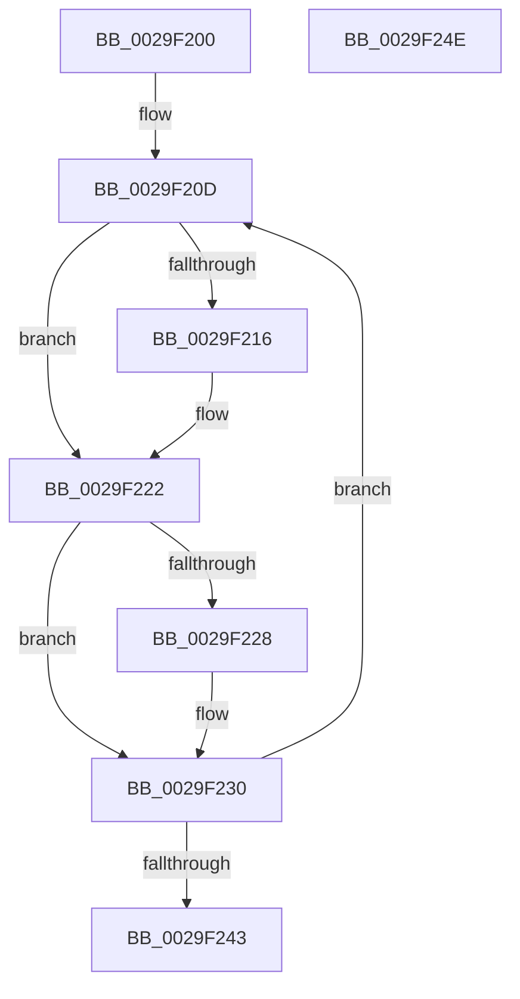

# IopUnlockAndFreeMdl

- RVA: `0x0029F200`–`0x0029F24F` (길이 `79` bytes)
- VA: `0x000000014029F200`
- 실행 섹션: `.text`
- PDB 이름 있음: `예`; PDB Function 태그: `아니요`
- unwind 정보 RVA: `0x0005CAAC`
- 디코드: `26`개 명령, `79/79` bytes 표시
- 미해석 바이트: `0` (있으면 어셈블리에 `.byte`로 보존)

> 이 문서는 커널 이미지의 기계어와 PDB 기호를 분석해 생성했습니다. 4번과 5번은 함수 원형과 자료형을 바이너리 사용 방식에서 추정한 C 해석이며 원본 소스 복구 결과는 아닙니다.

## 1. Dependencies

- 직접 호출 지점: **3**; 고유 호출 대상: **3**
- 직접 호출자로 확인된 함수: **8**
- RIP 상대 이미지 참조: **0**

### Outgoing calls
- `0x0029F21D` → [MmUnmapLockedPages](../24/MmUnmapLockedPages_function_00246E60.md) (function, `0x00246E60`)
- `0x0029F22B` → [MmUnlockPages](MmUnlockPages_function_0029EEE0.md) (function, `0x0029EEE0`)
- `0x0029F236` → [IoFreeMdl](IoFreeMdl_function_0029EA80.md) (function, `0x0029EA80`)

### Direct callers
- [IopAllocateAndPopulateWriteIrp](../40/IopAllocateAndPopulateWriteIrp_function_004011F4.md) at `0x004014F0`
- [IopCopyCompleteReadIrp](../4E/IopCopyCompleteReadIrp_function_004E83F0.md) at `0x004E8444`
- [IopFreeCopyObjectsFromIrp](../4E/IopFreeCopyObjectsFromIrp_function_004E8834.md) at `0x004E885B`
- [IopMcTryUnlockMdl](../5A/IopMcTryUnlockMdl_function_005A3EE8.md) at `0x005A3F25`
- [IopAllocateAndLockMdl](../../page/71/IopAllocateAndLockMdl_function_0071AC6C.md) at `0x0071AD08`
- [IopDeleteIoRing](../../page/71/IopDeleteIoRing_function_0071F8A0.md) at `0x0071F8DF`
- [IopMcCreateBufferEntryMdl](../../page/72/IopMcCreateBufferEntryMdl_function_00722FA8.md) at `0x00723011`
- [IopReadFile](../../page/8A/IopReadFile_function_008AEFF0.md) at `0x008AF8C0`

### Static image references
- 디코드된 RIP-relative 메모리 참조가 없습니다.

## 2. Other-region calls and transfers

- 다른 실행 섹션으로 향하는 call: **0**
- 별도 외부 분기/꼬리 이동을 확인하지 못했습니다.

## 3. Assembly (complete function range)

```asm
0029F200  48 89 5C 24 08                  mov qword ptr [rsp + 8], rbx
0029F205  57                              push rdi
0029F206  48 83 EC 20                     sub rsp, 0x20
0029F20A  48 8B F9                        mov rdi, rcx
0029F20D  8A 47 0A                        mov al, byte ptr [rdi + 0xa]
0029F210  24 05                           and al, 5
0029F212  3C 01                           cmp al, 1
0029F214  75 0C                           jne 0x14029f222
0029F216  48 8B 4F 18                     mov rcx, qword ptr [rdi + 0x18]
0029F21A  48 8B D7                        mov rdx, rdi
0029F21D  E8 3E 7C FA FF                  call 0x140246e60
0029F222  F6 47 0A 02                     test byte ptr [rdi + 0xa], 2
0029F226  74 08                           je 0x14029f230
0029F228  48 8B CF                        mov rcx, rdi
0029F22B  E8 B0 FC FF FF                  call 0x14029eee0
0029F230  48 8B 1F                        mov rbx, qword ptr [rdi]
0029F233  48 8B CF                        mov rcx, rdi
0029F236  E8 45 F8 FF FF                  call 0x14029ea80
0029F23B  48 8B FB                        mov rdi, rbx
0029F23E  48 85 DB                        test rbx, rbx
0029F241  75 CA                           jne 0x14029f20d
0029F243  48 8B 5C 24 30                  mov rbx, qword ptr [rsp + 0x30]
0029F248  48 83 C4 20                     add rsp, 0x20
0029F24C  5F                              pop rdi
0029F24D  C3                              ret
0029F24E  CC                              int3
```

## 4. C-style interpretation (structured pseudocode)

```c
__int64 __fastcall IopUnlockAndFreeMdl(__int64 a1)
{
    __int64 result;
    __int64 v_rsp;
    unsigned __int64 v_stack_p8;

    v_stack_p8 = v_rbx;
    v_rsp = (v_rsp) - (32);
loc_0029F20D:
    result = (unsigned __int8)((*(unsigned __int8 *)(a1 + 10)) & (5));
    if (((unsigned __int8)(result)) == 1) {
        a1 = *(unsigned __int64 *)(a1 + 24);
        a2 = a1;
        result = MmUnmapLockedPages(a1, a2, a3, a4);
    }
    if (((*(unsigned __int8 *)(a1 + 10)) & (2)) != 0) {
        a1 = a1;
        result = MmUnlockPages(a1, a2, a3, a4);
    }
    result = IoFreeMdl(a1, a2, a3, a4);
    if (*(unsigned __int64 *)(a1) != 0) goto loc_0029F20D;
    v_rsp = (v_rsp) + (32);
    return result;
}
```

## 5. (Beta) C Style

```c
int64_t IopUnlockAndFreeMdl(int64_t Arg1)
{
    int64_t result;
    int64_t local_rsp;
    uint64_t v_stack_p8;

    v_stack_p8 = local_rbx;
    local_rsp = (local_rsp) - (32);
loc_0029F20D:
    result = (uint8_t)((*(uint8_t *)(Arg1 + 0xA)) & (5));
    if (((uint8_t)(result)) == 1) {
        Arg1 = *(uint64_t *)(Arg1 + 0x18);
        a2 = Arg1;
        result = MmUnmapLockedPages(Arg1, a2, a3, a4);
    }
    if (((*(uint8_t *)(Arg1 + 0xA)) & (2)) != 0) {
        Arg1 = Arg1;
        result = MmUnlockPages(Arg1, a2, a3, a4);
    }
    result = IoFreeMdl(Arg1, a2, a3, a4);
    if (*(uint64_t *)(Arg1) != 0) goto loc_0029F20D;
    local_rsp = (local_rsp) + (32);
    return result;
}
```

## 6. Execution-region graph

[열기: 2D/3D 그래프와 함수 탐색 컨트롤 패널](../../../control-panel.html?section=text&rva=0x0029F200&view=graph)

- 2D 그래프는 위에서 아래로 흐르고, 3D 그래프는 빈 공간을 드래그해 회전합니다. Shift+드래그는 이동, 휠은 확대·축소, 함수 노드 선택은 대상 보고서 이동입니다.

### Static fallback


