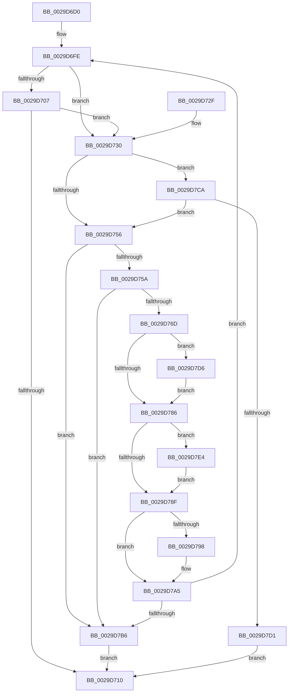

# IopWaitForSynchronousIo

- RVA: `0x0029D6D0`–`0x0029D7F0` (길이 `288` bytes)
- VA: `0x000000014029D6D0`
- 실행 섹션: `.text`
- PDB 이름 있음: `예`; PDB Function 태그: `아니요`
- unwind 정보 RVA: `0x00068050`
- 디코드: `78`개 명령, `288/288` bytes 표시
- 미해석 바이트: `0` (있으면 어셈블리에 `.byte`로 보존)

> 이 문서는 커널 이미지의 기계어와 PDB 기호를 분석해 생성했습니다. 4번과 5번은 함수 원형과 자료형을 바이너리 사용 방식에서 추정한 C 해석이며 원본 소스 복구 결과는 아닙니다.

## 1. Dependencies

- 직접 호출 지점: **4**; 고유 호출 대상: **4**
- 직접 호출자로 확인된 함수: **3**
- RIP 상대 이미지 참조: **1**

### Outgoing calls
- `0x0029D74A` → [KeWaitForSingleObject](../20/KeWaitForSingleObject_function_0020E6B0.md) (function, `0x0020E6B0`)
- `0x0029D7A0` → [KiLowerIrqlProcessIrqlFlags](../4F/KiLowerIrqlProcessIrqlFlags_function_004F5698.md) (function, `0x004F5698`)
- `0x0029D7C0` → [IopCancelAlertedRequest](../../page/A9/IopCancelAlertedRequest_function_00A948F8.md) (function, `0x00A948F8`)
- `0x0029D7DD` → [KiRaiseIrqlProcessIrqlFlags](../4F/KiRaiseIrqlProcessIrqlFlags_function_004F56FC.md) (function, `0x004F56FC`)

### Direct callers
- [NtSetInformationFile](NtSetInformationFile_function_0029C5E0.md) at `0x0029CEA7`
- [sub_008A8BD4](../../page/8A/Unknown_function_008A8BD4.md) at `0x008A8BF0`
- [IopSynchronousServiceTail](../../page/8E/IopSynchronousServiceTail_function_008EB440.md) at `0x008EB821`

### Static image references
- `0x0029D77D` → RVA `0x00FC6D20` (`ALMOSTRO`; read)

## 2. Other-region calls and transfers

- 다른 실행 섹션으로 향하는 call: **1**
  - `0x0029D7C0` → [IopCancelAlertedRequest](../../page/A9/IopCancelAlertedRequest_function_00A948F8.md) (`.text` → `PAGE`)
- 별도 외부 분기/꼬리 이동을 확인하지 못했습니다.

## 3. Assembly (complete function range)

```asm
0029D6D0  48 89 5C 24 18                  mov qword ptr [rsp + 0x18], rbx
0029D6D5  55                              push rbp
0029D6D6  56                              push rsi
0029D6D7  41 54                           push r12
0029D6D9  41 55                           push r13
0029D6DB  41 57                           push r15
0029D6DD  48 83 EC 30                     sub rsp, 0x30
0029D6E1  8B 6A 50                        mov ebp, dword ptr [rdx + 0x50]
0029D6E4  48 8B F2                        mov rsi, rdx
0029D6E7  83 E5 04                        and ebp, 4
0029D6EA  48 89 7C 24 60                  mov qword ptr [rsp + 0x60], rdi
0029D6EF  45 33 ED                        xor r13d, r13d
0029D6F2  45 0F B6 F8                     movzx r15d, r8b
0029D6F6  4C 8B E1                        mov r12, rcx
0029D6F9  4C 89 74 24 68                  mov qword ptr [rsp + 0x68], r14
0029D6FE  F6 86 98 00 00 00 7F            test byte ptr [rsi + 0x98], 0x7f
0029D705  75 29                           jne 0x14029d730
0029D707  44 39 AE 9C 00 00 00            cmp dword ptr [rsi + 0x9c], r13d
0029D70E  74 20                           je 0x14029d730
0029D710  8B 46 38                        mov eax, dword ptr [rsi + 0x38]
0029D713  4C 8B 74 24 68                  mov r14, qword ptr [rsp + 0x68]
0029D718  48 8B 7C 24 60                  mov rdi, qword ptr [rsp + 0x60]
0029D71D  48 8B 5C 24 70                  mov rbx, qword ptr [rsp + 0x70]
0029D722  48 83 C4 30                     add rsp, 0x30
0029D726  41 5F                           pop r15
0029D728  41 5D                           pop r13
0029D72A  41 5C                           pop r12
0029D72C  5E                              pop rsi
0029D72D  5D                              pop rbp
0029D72E  C3                              ret
0029D72F  CC                              int3
0029D730  45 8B C7                        mov r8d, r15d
0029D733  4C 89 6C 24 20                  mov qword ptr [rsp + 0x20], r13
0029D738  85 ED                           test ebp, ebp
0029D73A  48 8D 8E 98 00 00 00            lea rcx, [rsi + 0x98]
0029D741  41 B1 01                        mov r9b, 1
0029D744  45 0F 44 C5                     cmove r8d, r13d
0029D748  33 D2                           xor edx, edx
0029D74A  E8 61 0F F7 FF                  call 0x14020e6b0
0029D74F  3D C0 00 00 00                  cmp eax, 0xc0
0029D754  75 74                           jne 0x14029d7ca
0029D756  85 ED                           test ebp, ebp
0029D758  75 5C                           jne 0x14029d7b6
0029D75A  65 48 8B 04 25 88 01 00 00      mov rax, qword ptr gs:[0x188]
0029D763  8B 80 A0 05 00 00               mov eax, dword ptr [rax + 0x5a0]
0029D769  A8 01                           test al, 1
0029D76B  75 49                           jne 0x14029d7b6
0029D76D  45 32 F6                        xor r14b, r14b
0029D770  44 0F 20 C7                     mov rdi, cr8
0029D774  B8 01 00 00 00                  mov eax, 1
0029D779  44 0F 22 C0                     mov cr8, rax
0029D77D  44 39 2D 9C 95 D2 00            cmp dword ptr [rip + 0xd2959c], r13d
0029D784  75 50                           jne 0x14029d7d6
0029D786  44 39 AE 9C 00 00 00            cmp dword ptr [rsi + 0x9c], r13d
0029D78D  74 55                           je 0x14029d7e4
0029D78F  44 39 2D 8A 95 D2 00            cmp dword ptr [rip + 0xd2958a], r13d
0029D796  74 0D                           je 0x14029d7a5
0029D798  44 0F 20 C1                     mov rcx, cr8
0029D79C  40 0F B6 D7                     movzx edx, dil
0029D7A0  E8 F3 7E 25 00                  call 0x1404f5698
0029D7A5  40 0F B6 C7                     movzx eax, dil
0029D7A9  44 0F 22 C0                     mov cr8, rax
0029D7AD  45 84 F6                        test r14b, r14b
0029D7B0  0F 84 48 FF FF FF               je 0x14029d6fe
0029D7B6  49 8B D4                        mov rdx, r12
0029D7B9  48 8D 8E 98 00 00 00            lea rcx, [rsi + 0x98]
0029D7C0  E8 33 71 7F 00                  call 0x140a948f8
0029D7C5  E9 46 FF FF FF                  jmp 0x14029d710
0029D7CA  3D 01 01 00 00                  cmp eax, 0x101
0029D7CF  74 85                           je 0x14029d756
0029D7D1  E9 3A FF FF FF                  jmp 0x14029d710
0029D7D6  0F B6 D0                        movzx edx, al
0029D7D9  40 0F B6 CF                     movzx ecx, dil
0029D7DD  E8 1A 7F 25 00                  call 0x1404f56fc
0029D7E2  EB A2                           jmp 0x14029d786
0029D7E4  41 80 7C 24 44 01               cmp byte ptr [r12 + 0x44], 1
0029D7EA  41 0F 94 C6                     sete r14b
0029D7EE  EB 9F                           jmp 0x14029d78f
```

## 4. C-style interpretation (structured pseudocode)

```c
__int64 __fastcall IopWaitForSynchronousIo(__int64 a1, __int64 a2, unsigned __int8 a3)
{
    __int64 result;
    __int64 v_r13;
    __int64 v_r14;
    __int64 v_rbp;
    __int64 v_rsp;
    unsigned __int64 v_stack_p10;
    unsigned __int64 v_stack_p18;
    unsigned __int64 v_stack_p20;
    unsigned __int64 v_stack_p8;

    v_stack_p18 = v_rbx;
    v_rsp = (v_rsp) - (48);
    v_rbp = (unsigned int)(((unsigned int)(*(unsigned int *)(a2 + 80))) & (4));
    v_stack_p8 = v_rdi;
    v_r13 = 0;
    v_stack_p10 = v_r14;
loc_0029D6FE:
    if (((*(unsigned __int8 *)(a2 + 152)) & (127)) != 0) goto loc_0029D730;
    if ((*(unsigned int *)(a2 + 156)) == 0) goto loc_0029D730;
loc_0029D710:
    v_rsp = (v_rsp) + (48);
    return (unsigned int)(*(unsigned int *)(a2 + 56));
loc_0029D730:
    v_stack_p20 = 0;
    a3 = (unsigned int)(a3);
    if ((unsigned int)(v_rbp) == 0) { a3 = 0; }
    a2 = 0;
    result = KeWaitForSingleObject(a2 + 152, a2, a3, 1);
    if (((unsigned int)(result)) != 192) goto loc_0029D7CA;
loc_0029D756:
    if ((unsigned int)(v_rbp) != 0) goto loc_0029D7B6;
    if ((((unsigned __int8)((unsigned int)(*(unsigned int *)(*(unsigned __int64 *)(gs_base + (0 + 392)) + 1440)))) & (1)) != 0) goto loc_0029D7B6;
    v_r14 = 0;
    if ((*(unsigned int *)(v_rip + 13800860)) != 0) goto loc_0029D7D6;
loc_0029D786:
    if ((*(unsigned int *)(a2 + 156)) == 0) goto loc_0029D7E4;
loc_0029D78F:
    result = 1;
    if ((*(unsigned int *)(v_rip + 13800842)) != 0) {
        a1 = 1;
        a2 = (unsigned __int8)(v_cr8);
        result = KiLowerIrqlProcessIrqlFlags(a1, a2, a3, 1);
    }
    if (0 == 0) goto loc_0029D6FE;
loc_0029D7B6:
    result = IopCancelAlertedRequest(a2 + 152, a1, a3, 1);
    goto loc_0029D710;
loc_0029D7CA:
    if (((unsigned int)(result)) == 257) goto loc_0029D756;
    goto loc_0029D710;
loc_0029D7D6:
    result = KiRaiseIrqlProcessIrqlFlags((unsigned __int8)(v_cr8), (unsigned __int8)(result), a3, 1);
    goto loc_0029D786;
loc_0029D7E4:
    v_r14 = ((*(unsigned __int8 *)(a1 + 68)) == 1) ? 1 : 0;
    goto loc_0029D78F;
}
```

## 5. (Beta) C Style

```c
int64_t IopWaitForSynchronousIo(void *Arg1, void *Arg2, uint8_t Arg3)
{
    uint8_t *arg1 = (uint8_t *)Arg1;
    uint8_t *arg2 = (uint8_t *)Arg2;

    int64_t result;
    int64_t local_r13;
    int64_t local_r14;
    int64_t local_rbp;
    int64_t local_rsp;
    uint64_t v_stack_p10;
    uint64_t v_stack_p18;
    uint64_t v_stack_p20;
    uint64_t v_stack_p8;

    v_stack_p18 = local_rbx;
    local_rsp = (local_rsp) - (48);
    local_rbp = (uint32_t)(((uint32_t)(*(uint32_t *)(arg2 + 0x50))) & (4));
    v_stack_p8 = local_rdi;
    local_r13 = 0;
    v_stack_p10 = local_r14;
loc_0029D6FE:
    if (((*(uint8_t *)(arg2 + 0x98)) & (127)) != 0) goto loc_0029D730;
    if ((*(uint32_t *)(arg2 + 0x9C)) == 0) goto loc_0029D730;
loc_0029D710:
    local_rsp = (local_rsp) + (48);
    return (uint32_t)(*(uint32_t *)(arg2 + 0x38));
loc_0029D730:
    v_stack_p20 = 0;
    Arg3 = (uint32_t)(Arg3);
    if ((uint32_t)(local_rbp) == 0) { Arg3 = 0; }
    Arg2 = 0;
    result = KeWaitForSingleObject(Arg2 + 152, Arg2, Arg3, 1);
    if (((uint32_t)(result)) != 192) goto loc_0029D7CA;
loc_0029D756:
    if ((uint32_t)(local_rbp) != 0) goto loc_0029D7B6;
    if ((((uint8_t)((uint32_t)(*(uint32_t *)(*(uint64_t *)(gs_base + (0 + 0x188)) + 0x5A0)))) & (1)) != 0) goto loc_0029D7B6;
    local_r14 = 0;
    if ((*(uint32_t *)(v_rip + 0xD2959C)) != 0) goto loc_0029D7D6;
loc_0029D786:
    if ((*(uint32_t *)(arg2 + 0x9C)) == 0) goto loc_0029D7E4;
loc_0029D78F:
    result = 1;
    if ((*(uint32_t *)(v_rip + 0xD2958A)) != 0) {
        Arg1 = 1;
        Arg2 = (uint8_t)(v_cr8);
        result = KiLowerIrqlProcessIrqlFlags(Arg1, Arg2, Arg3, 1);
    }
    if (0 == 0) goto loc_0029D6FE;
loc_0029D7B6:
    result = IopCancelAlertedRequest(Arg2 + 152, Arg1, Arg3, 1);
    goto loc_0029D710;
loc_0029D7CA:
    if (((uint32_t)(result)) == 257) goto loc_0029D756;
    goto loc_0029D710;
loc_0029D7D6:
    result = KiRaiseIrqlProcessIrqlFlags((uint8_t)(v_cr8), (uint8_t)(result), Arg3, 1);
    goto loc_0029D786;
loc_0029D7E4:
    local_r14 = ((*(uint8_t *)(arg1 + 0x44)) == 1) ? 1 : 0;
    goto loc_0029D78F;
}
```

### 관측된 메모리 오프셋

구조체 형식이 확인되지 않은 접근은 인자 기준의 오프셋으로만 기록했습니다.

| 기준 인자 | 오프셋 표현 | 폭 (bit) | 접근 |
|---|---:|---:|---|
| `Arg1` | `+ 0x44` | `8` | `R` |
| `Arg2` | `+ 0x38` | `32` | `R` |
| `Arg2` | `+ 0x50` | `32` | `R` |
| `Arg2` | `+ 0x98` | `8` | `R` |
| `Arg2` | `+ 0x98` | `64` | `R` |
| `Arg2` | `+ 0x9C` | `32` | `R` |

## 6. Execution-region graph

[열기: 2D/3D 그래프와 함수 탐색 컨트롤 패널](../../../control-panel.html?section=text&rva=0x0029D6D0&view=graph)

- 2D 그래프는 위에서 아래로 흐르고, 3D 그래프는 빈 공간을 드래그해 회전합니다. Shift+드래그는 이동, 휠은 확대·축소, 함수 노드 선택은 대상 보고서 이동입니다.

### Static fallback


