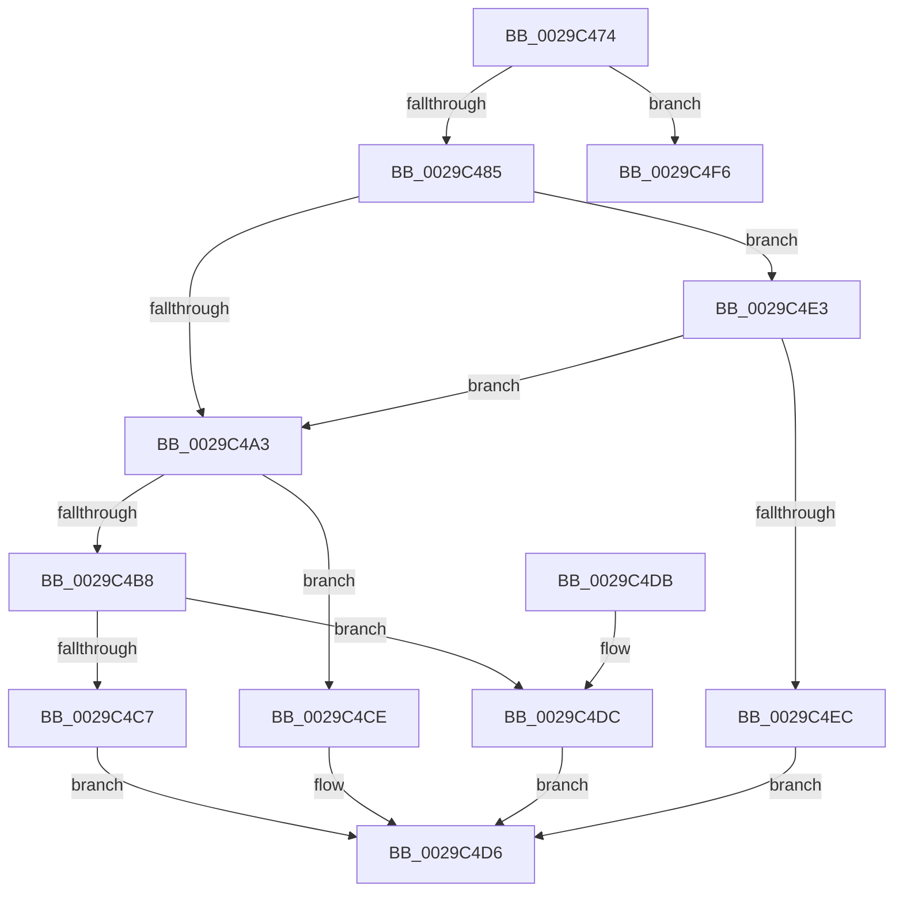

# IopfCallDriver

- RVA: `0x0029C474`–`0x0029C50C` (길이 `152` bytes)
- VA: `0x000000014029C474`
- 실행 섹션: `.text`
- PDB 이름 있음: `예`; PDB Function 태그: `아니요`
- unwind 정보 RVA: `0x00067F04`
- 디코드: `44`개 명령, `152/152` bytes 표시
- 미해석 바이트: `0` (있으면 어셈블리에 `.byte`로 보존)

> 이 문서는 커널 이미지의 기계어와 PDB 기호를 분석해 생성했습니다. 4번과 5번은 함수 원형과 자료형을 바이너리 사용 방식에서 추정한 C 해석이며 원본 소스 복구 결과는 아닙니다.

## 1. Dependencies

- 직접 호출 지점: **5**; 고유 호출 대상: **5**
- 직접 호출자로 확인된 함수: **6**
- RIP 상대 이미지 참조: **2**

### Outgoing calls
- `0x0029C4C7` → [PiDaDispatch](../../page/A0/PiDaDispatch_function_00A00230.md) (function, `0x00A00230`)
- `0x0029C4D1` → [IopInvalidDeviceRequest](IopInvalidDeviceRequest_function_0029B590.md) (function, `0x0029B590`)
- `0x0029C4DC` → [guard_dispatch_icall](../6B/guard_dispatch_icall_function_006BAAD0.md) (function, `0x006BAAD0`)
- `0x0029C4EF` → [IopPoHandleIrp](../47/IopPoHandleIrp_function_0047096C.md) (function, `0x0047096C`)
- `0x0029C506` → [KeBugCheckEx](../4F/KeBugCheckEx_function_004FD660.md) (function, `0x004FD660`)

### Direct callers
- [IofCallDriverSpecifyReturn](../4A/IofCallDriverSpecifyReturn_function_004A8AE0.md) at `0x004A8AEE`
- [IopPerfCallDriver](../4A/IopPerfCallDriver_function_004A9680.md) at `0x004A96E2`
- [IopPerfCallDriver](../4A/IopPerfCallDriver_function_004A9680.md) at `0x004A971B`
- [IovpCallDriverNoIrpTracking](../../pagevrfy/B9/IovpCallDriverNoIrpTracking_function_00B928F8.md) at `0x00B92927`
- [IovpCallDriverWithStackBuffer](../../pagevrfy/B9/IovpCallDriverWithStackBuffer_function_00B92940.md) at `0x00B92AA4`
- [IovCallDriver](../../pagevrfy/BB/IovCallDriver_function_00BB7D30.md) at `0x00BB7D6F`
- [sub_00BBC34E](../../pagevrfy/BB/Unknown_function_00BBC34E.md) at `0x00BBC4E4`

### Static image references
- `0x0029C4AC` → RVA `0x0029B590` (`IopInvalidDeviceRequest`; read)
- `0x0029C4B8` → RVA `0x00A00230` (`PiDaDispatch`; read)

## 2. Other-region calls and transfers

- 다른 실행 섹션으로 향하는 call: **1**
  - `0x0029C4C7` → [PiDaDispatch](../../page/A0/PiDaDispatch_function_00A00230.md) (`.text` → `PAGE`)
- 별도 외부 분기/꼬리 이동을 확인하지 못했습니다.

## 3. Assembly (complete function range)

```asm
0029C474  48 83 EC 38                     sub rsp, 0x38
0029C478  FE 4A 43                        dec byte ptr [rdx + 0x43]
0029C47B  4C 8B C1                        mov r8, rcx
0029C47E  8A 42 43                        mov al, byte ptr [rdx + 0x43]
0029C481  84 C0                           test al, al
0029C483  7E 71                           jle 0x14029c4f6
0029C485  48 8B 82 B8 00 00 00            mov rax, qword ptr [rdx + 0xb8]
0029C48C  48 83 E8 48                     sub rax, 0x48
0029C490  48 89 82 B8 00 00 00            mov qword ptr [rdx + 0xb8], rax
0029C497  48 89 48 28                     mov qword ptr [rax + 0x28], rcx
0029C49B  0F B6 08                        movzx ecx, byte ptr [rax]
0029C49E  80 F9 16                        cmp cl, 0x16
0029C4A1  74 40                           je 0x14029c4e3
0029C4A3  49 8B 40 08                     mov rax, qword ptr [r8 + 8]
0029C4A7  48 8B 44 C8 70                  mov rax, qword ptr [rax + rcx*8 + 0x70]
0029C4AC  48 8D 0D DD F0 FF FF            lea rcx, [rip - 0xf23]
0029C4B3  48 3B C1                        cmp rax, rcx
0029C4B6  74 16                           je 0x14029c4ce
0029C4B8  48 8D 0D 71 3D 76 00            lea rcx, [rip + 0x763d71]
0029C4BF  48 3B C1                        cmp rax, rcx
0029C4C2  49 8B C8                        mov rcx, r8
0029C4C5  75 15                           jne 0x14029c4dc
0029C4C7  E8 64 3D 76 00                  call 0x140a00230
0029C4CC  EB 08                           jmp 0x14029c4d6
0029C4CE  49 8B C8                        mov rcx, r8
0029C4D1  E8 BA F0 FF FF                  call 0x14029b590
0029C4D6  48 83 C4 38                     add rsp, 0x38
0029C4DA  C3                              ret
0029C4DB  CC                              int3
0029C4DC  E8 EF E5 41 00                  call 0x1406baad0
0029C4E1  EB F3                           jmp 0x14029c4d6
0029C4E3  8A 40 01                        mov al, byte ptr [rax + 1]
0029C4E6  2C 02                           sub al, 2
0029C4E8  3C 01                           cmp al, 1
0029C4EA  77 B7                           ja 0x14029c4a3
0029C4EC  48 8B CA                        mov rcx, rdx
0029C4EF  E8 78 44 1D 00                  call 0x14047096c
0029C4F4  EB E0                           jmp 0x14029c4d6
0029C4F6  48 83 64 24 20 00               and qword ptr [rsp + 0x20], 0
0029C4FC  45 33 C9                        xor r9d, r9d
0029C4FF  45 33 C0                        xor r8d, r8d
0029C502  41 8D 49 35                     lea ecx, [r9 + 0x35]
0029C506  E8 55 11 26 00                  call 0x1404fd660
0029C50B  CC                              int3
```

## 4. C-style interpretation (structured pseudocode)

```c
__int64 __fastcall IopfCallDriver(__int64 a1, __int64 a2, __int64 a3, int a4)
{
    __int64 result;
    __int64 v_rsp;
    unsigned __int64 v_stack_p20;

    v_rsp = (v_rsp) - (56);
    if (condition_is_less_or_equal) goto loc_0029C4F6;
    result = (*(unsigned __int64 *)(a2 + 184)) - (72);
    *(unsigned __int64 *)(a2 + 184) = result;
    *(unsigned __int64 *)(result + 40) = a1;
    if (((unsigned __int8)(*(unsigned __int8 *)(result))) == 22) goto loc_0029C4E3;
loc_0029C4A3:
    if ((*(unsigned __int64 *)(*(unsigned __int64 *)(a1 + 8) + *(unsigned __int8 *)(result) * 8 + 112)) == (v_rip - 3875)) goto loc_0029C4CE;
    if ((*(unsigned __int64 *)(*(unsigned __int64 *)(a1 + 8) + *(unsigned __int8 *)(result) * 8 + 112)) != (v_rip + 7748977)) goto loc_0029C4DC;
    result = PiDaDispatch(a1, a2, a1, a4);
    goto loc_0029C4D6;
loc_0029C4CE:
    result = IopInvalidDeviceRequest(a1, a2, a1, a4);
loc_0029C4D6:
    v_rsp = (v_rsp) + (56);
    return result;
loc_0029C4DC:
    result = guard_dispatch_icall(a1, a2, a1, a4);
    goto loc_0029C4D6;
loc_0029C4E3:
    result = (unsigned __int8)((*(unsigned __int8 *)(result + 1)) - (2));
    if (((unsigned __int8)(result)) > 1) goto loc_0029C4A3;
    result = IopPoHandleIrp(a2, a2, a1, a4);
    goto loc_0029C4D6;
loc_0029C4F6:
    a4 = 0;
    a3 = 0;
    result = KeBugCheckEx(a4 + 53, a2, a3, a4);
    return result;
}
```

## 5. (Beta) C Style

```c
int64_t IopfCallDriver(void *Arg1, void *Arg2, int64_t Arg3, int32_t Arg4)
{
    uint8_t *arg1 = (uint8_t *)Arg1;
    uint8_t *arg2 = (uint8_t *)Arg2;

    int64_t result;
    int64_t local_rsp;
    uint64_t v_stack_p20;

    local_rsp = (local_rsp) - (56);
    if (condition_is_less_or_equal) goto loc_0029C4F6;
    result = (*(uint64_t *)(arg2 + 0xB8)) - (72);
    *(uint64_t *)(arg2 + 0xB8) = result;
    *(void **)(result + 0x28) = Arg1;
    if (((uint8_t)(*(uint8_t *)(result))) == 22) goto loc_0029C4E3;
loc_0029C4A3:
    if ((*(uint64_t *)(*(uint64_t *)(arg1 + 0x8) + *(uint8_t *)(result) * 8 + 0x70)) == (v_rip - 3875)) goto loc_0029C4CE;
    if ((*(uint64_t *)(*(uint64_t *)(arg1 + 0x8) + *(uint8_t *)(result) * 8 + 0x70)) != (v_rip + 7748977)) goto loc_0029C4DC;
    result = PiDaDispatch(Arg1, Arg2, Arg1, Arg4);
    goto loc_0029C4D6;
loc_0029C4CE:
    result = IopInvalidDeviceRequest(Arg1, Arg2, Arg1, Arg4);
loc_0029C4D6:
    local_rsp = (local_rsp) + (56);
    return result;
loc_0029C4DC:
    result = guard_dispatch_icall(Arg1, Arg2, Arg1, Arg4);
    goto loc_0029C4D6;
loc_0029C4E3:
    result = (uint8_t)((*(uint8_t *)(result + 0x1)) - (2));
    if (((uint8_t)(result)) > 1) goto loc_0029C4A3;
    result = IopPoHandleIrp(Arg2, Arg2, Arg1, Arg4);
    goto loc_0029C4D6;
loc_0029C4F6:
    Arg4 = 0;
    Arg3 = 0;
    result = KeBugCheckEx(Arg4 + 53, Arg2, Arg3, Arg4);
    return result;
}
```

### 관측된 메모리 오프셋

구조체 형식이 확인되지 않은 접근은 인자 기준의 오프셋으로만 기록했습니다.

| 기준 인자 | 오프셋 표현 | 폭 (bit) | 접근 |
|---|---:|---:|---|
| `Arg1` | `+ 0x8` | `64` | `R` |
| `Arg2` | `+ 0x43` | `8` | `R` |
| `Arg2` | `+ 0x43` | `8` | `R/W` |
| `Arg2` | `+ 0xB8` | `64` | `R` |
| `Arg2` | `+ 0xB8` | `64` | `W` |

## 6. Execution-region graph

[열기: 2D/3D 그래프와 함수 탐색 컨트롤 패널](../../../control-panel.html?section=text&rva=0x0029C474&view=graph)

- 2D 그래프는 위에서 아래로 흐르고, 3D 그래프는 빈 공간을 드래그해 회전합니다. Shift+드래그는 이동, 휠은 확대·축소, 함수 노드 선택은 대상 보고서 이동입니다.

### Static fallback


