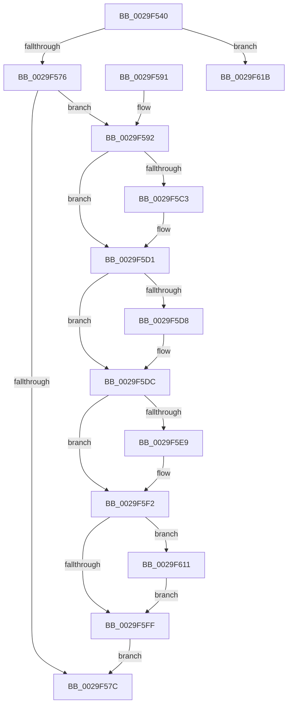

# KeSwappablePageDereference

- RVA: `0x0029F540`–`0x0029F622` (길이 `226` bytes)
- VA: `0x000000014029F540`
- 실행 섹션: `.text`
- PDB 이름 있음: `예`; PDB Function 태그: `아니요`
- unwind 정보 RVA: `0x000682F0`
- 디코드: `59`개 명령, `226/226` bytes 표시
- 미해석 바이트: `0` (있으면 어셈블리에 `.byte`로 보존)

> 이 문서는 커널 이미지의 기계어와 PDB 기호를 분석해 생성했습니다. 4번과 5번은 함수 원형과 자료형을 바이너리 사용 방식에서 추정한 C 해석이며 원본 소스 복구 결과는 아닙니다.

## 1. Dependencies

- 직접 호출 지점: **6**; 고유 호출 대상: **6**
- 직접 호출자로 확인된 함수: **2**
- RIP 상대 이미지 참조: **0**

### Outgoing calls
- `0x0029F5B3` → [KeAbPreAcquire](../21/KeAbPreAcquire_function_00210230.md) (function, `0x00210230`)
- `0x0029F5CC` → [ExfAcquirePushLockExclusiveEx](../20/ExfAcquirePushLockExclusiveEx_function_0020FC90.md) (function, `0x0020FC90`)
- `0x0029F5ED` → [MmUnlockPages](MmUnlockPages_function_0029EEE0.md) (function, `0x0029EEE0`)
- `0x0029F602` → [KeAbPostRelease](../2E/KeAbPostRelease_function_002E1600.md) (function, `0x002E1600`)
- `0x0029F607` → [KeLeaveCriticalRegion](../25/KeLeaveCriticalRegion_function_0025D8B0.md) (function, `0x0025D8B0`)
- `0x0029F614` → [ExfTryToWakePushLock](../26/ExfTryToWakePushLock_function_00265DD0.md) (function, `0x00265DD0`)

### Direct callers
- [KiOutSwapKernelStacks](KiOutSwapKernelStacks_function_0029F628.md) at `0x0029F802`
- [PspSchedulerSharedDataRegionSlotFree](../../page/90/PspSchedulerSharedDataRegionSlotFree_function_00905AD4.md) at `0x00905B3C`

### Static image references
- 디코드된 RIP-relative 메모리 참조가 없습니다.

## 2. Other-region calls and transfers

- 다른 실행 섹션으로 향하는 call: **0**
- 별도 외부 분기/꼬리 이동을 확인하지 못했습니다.

## 3. Assembly (complete function range)

```asm
0029F540  48 89 5C 24 10                  mov qword ptr [rsp + 0x10], rbx
0029F545  48 89 6C 24 18                  mov qword ptr [rsp + 0x18], rbp
0029F54A  48 89 74 24 20                  mov qword ptr [rsp + 0x20], rsi
0029F54F  57                              push rdi
0029F550  48 83 EC 20                     sub rsp, 0x20
0029F554  48 8B F1                        mov rsi, rcx
0029F557  48 C7 C0 FE FF FF FF            mov rax, 0xfffffffffffffffe
0029F55E  F0 48 0F C1 41 10               lock xadd qword ptr [rcx + 0x10], rax
0029F564  48 83 E8 02                     sub rax, 2
0029F568  48 8D 50 02                     lea rdx, [rax + 2]
0029F56C  48 83 FA 02                     cmp rdx, 2
0029F570  0F 82 A5 00 00 00               jb 0x14029f61b
0029F576  48 83 F8 01                     cmp rax, 1
0029F57A  74 16                           je 0x14029f592
0029F57C  48 8B 5C 24 38                  mov rbx, qword ptr [rsp + 0x38]
0029F581  48 8B 6C 24 40                  mov rbp, qword ptr [rsp + 0x40]
0029F586  48 8B 74 24 48                  mov rsi, qword ptr [rsp + 0x48]
0029F58B  48 83 C4 20                     add rsp, 0x20
0029F58F  5F                              pop rdi
0029F590  C3                              ret
0029F591  CC                              int3
0029F592  65 48 8B 04 25 88 01 00 00      mov rax, qword ptr gs:[0x188]
0029F59B  48 8D 79 08                     lea rdi, [rcx + 8]
0029F59F  48 83 CB FF                     or rbx, 0xffffffffffffffff
0029F5A3  45 33 C0                        xor r8d, r8d
0029F5A6  33 D2                           xor edx, edx
0029F5A8  48 8B CF                        mov rcx, rdi
0029F5AB  66 01 98 E4 01 00 00            add word ptr [rax + 0x1e4], bx
0029F5B2  90                              nop
0029F5B3  E8 78 0C F7 FF                  call 0x140210230
0029F5B8  F0 48 0F BA 2F 00               lock bts qword ptr [rdi], 0
0029F5BE  48 8B E8                        mov rbp, rax
0029F5C1  73 0E                           jae 0x14029f5d1
0029F5C3  4C 8B C7                        mov r8, rdi
0029F5C6  48 8B D0                        mov rdx, rax
0029F5C9  48 8B CF                        mov rcx, rdi
0029F5CC  E8 BF 06 F7 FF                  call 0x14020fc90
0029F5D1  33 C9                           xor ecx, ecx
0029F5D3  48 85 ED                        test rbp, rbp
0029F5D6  74 04                           je 0x14029f5dc
0029F5D8  C6 45 0A 01                     mov byte ptr [rbp + 0xa], 1
0029F5DC  B8 01 00 00 00                  mov eax, 1
0029F5E1  F0 48 0F B1 4E 10               lock cmpxchg qword ptr [rsi + 0x10], rcx
0029F5E7  75 09                           jne 0x14029f5f2
0029F5E9  48 8D 4E 18                     lea rcx, [rsi + 0x18]
0029F5ED  E8 EE F8 FF FF                  call 0x14029eee0
0029F5F2  F0 48 0F C1 1F                  lock xadd qword ptr [rdi], rbx
0029F5F7  80 E3 06                        and bl, 6
0029F5FA  80 FB 02                        cmp bl, 2
0029F5FD  74 12                           je 0x14029f611
0029F5FF  48 8B CF                        mov rcx, rdi
0029F602  E8 F9 1F 04 00                  call 0x1402e1600
0029F607  E8 A4 E2 FB FF                  call 0x14025d8b0
0029F60C  E9 6B FF FF FF                  jmp 0x14029f57c
0029F611  48 8B CF                        mov rcx, rdi
0029F614  E8 B7 67 FC FF                  call 0x140265dd0
0029F619  EB E4                           jmp 0x14029f5ff
0029F61B  B9 0E 00 00 00                  mov ecx, 0xe
0029F620  CD 29                           int 0x29
```

## 4. C-style interpretation (structured pseudocode)

```c
__int64 __fastcall KeSwappablePageDereference(__int64 a1, __int64 a2, int a3)
{
    __int64 result;
    __int64 v_rbx;
    __int64 v_rsp;
    unsigned __int64 v_stack_p10;
    unsigned __int64 v_stack_p18;
    unsigned __int64 v_stack_p20;

    v_stack_p10 = v_rbx;
    v_stack_p18 = v_rbp;
    v_stack_p20 = v_rsi;
    v_rsp = (v_rsp) - (32);
    result = (-2) - (2);
    if ((result + 2) < 2) goto loc_0029F61B;
    if (result == 1) goto loc_0029F592;
loc_0029F57C:
    v_rsp = (v_rsp) + (32);
    return result;
loc_0029F592:
    v_rbx = (v_stack_p10) | (-1);
    a3 = 0;
    a2 = 0;
    result = KeAbPreAcquire(a1 + 8, a2, a3, a4);
    if (!(condition_is_above_or_equal)) {
        a3 = a1 + 8;
        a2 = result;
        a1 = a1 + 8;
        result = ExfAcquirePushLockExclusiveEx(a1, a2, a3, a4);
    }
    a1 = 0;
    if (result != 0) {
        *(unsigned __int8 *)(result + 10) = 1;
    }
    result = 1;
    if (result == 0) {
        a1 = v_stack_p20 + 24;
        result = MmUnlockPages(a1, a2, a3, a4);
    }
    v_rbx = (unsigned __int8)((v_rbx) & (6));
    if (((unsigned __int8)(v_rbx)) == 2) goto loc_0029F611;
loc_0029F5FF:
    result = KeAbPostRelease(a1 + 8, a2, a3, a4);
    result = KeLeaveCriticalRegion(a1 + 8, a2, a3, a4);
    goto loc_0029F57C;
loc_0029F611:
    result = ExfTryToWakePushLock(a1 + 8, a2, a3, a4);
    goto loc_0029F5FF;
loc_0029F61B:
    return result;
}
```

## 5. (Beta) C Style

```c
int64_t KeSwappablePageDereference(void *Arg1, int64_t Arg2, int32_t Arg3)
{
    uint8_t *arg1 = (uint8_t *)Arg1;

    int64_t result;
    int64_t local_rbx;
    int64_t local_rsp;
    uint64_t v_stack_p10;
    uint64_t v_stack_p18;
    uint64_t v_stack_p20;

    v_stack_p10 = local_rbx;
    v_stack_p18 = local_rbp;
    v_stack_p20 = local_rsi;
    local_rsp = (local_rsp) - (32);
    result = (-2) - (2);
    if ((result + 2) < 2) goto loc_0029F61B;
    if (result == 1) goto loc_0029F592;
loc_0029F57C:
    local_rsp = (local_rsp) + (32);
    return result;
loc_0029F592:
    local_rbx = (v_stack_p10) | (-1);
    Arg3 = 0;
    Arg2 = 0;
    result = KeAbPreAcquire(Arg1 + 8, Arg2, Arg3, a4);
    if (!(condition_is_above_or_equal)) {
        Arg3 = Arg1 + 8;
        Arg2 = result;
        Arg1 = Arg1 + 8;
        result = ExfAcquirePushLockExclusiveEx(Arg1, Arg2, Arg3, a4);
    }
    Arg1 = 0;
    if (result != 0) {
        *(uint8_t *)(result + 0xA) = 1;
    }
    result = 1;
    if (result == 0) {
        Arg1 = v_stack_p20 + 24;
        result = MmUnlockPages(Arg1, Arg2, Arg3, a4);
    }
    local_rbx = (uint8_t)((local_rbx) & (6));
    if (((uint8_t)(local_rbx)) == 2) goto loc_0029F611;
loc_0029F5FF:
    result = KeAbPostRelease(Arg1 + 8, Arg2, Arg3, a4);
    result = KeLeaveCriticalRegion(Arg1 + 8, Arg2, Arg3, a4);
    goto loc_0029F57C;
loc_0029F611:
    result = ExfTryToWakePushLock(Arg1 + 8, Arg2, Arg3, a4);
    goto loc_0029F5FF;
loc_0029F61B:
    return result;
}
```

### 관측된 메모리 오프셋

구조체 형식이 확인되지 않은 접근은 인자 기준의 오프셋으로만 기록했습니다.

| 기준 인자 | 오프셋 표현 | 폭 (bit) | 접근 |
|---|---:|---:|---|
| `Arg1` | `+ 0x0` | `64` | `R/W` |
| `Arg1` | `+ 0x8` | `64` | `R` |
| `Arg1` | `+ 0x10` | `64` | `R` |
| `Arg1` | `+ 0x10` | `64` | `R/W` |
| `Arg1` | `+ 0x18` | `64` | `R` |

## 6. Execution-region graph

[열기: 2D/3D 그래프와 함수 탐색 컨트롤 패널](../../../control-panel.html?section=text&rva=0x0029F540&view=graph)

- 2D 그래프는 위에서 아래로 흐르고, 3D 그래프는 빈 공간을 드래그해 회전합니다. Shift+드래그는 이동, 휠은 확대·축소, 함수 노드 선택은 대상 보고서 이동입니다.

### Static fallback


