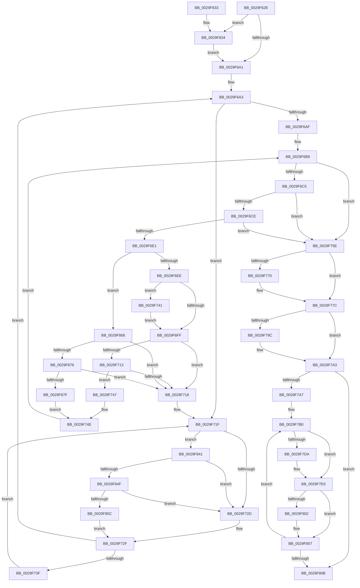

# KiOutSwapKernelStacks

- RVA: `0x0029F628`–`0x0029F88B` (길이 `611` bytes)
- VA: `0x000000014029F628`
- 실행 섹션: `.text`
- PDB 이름 있음: `예`; PDB Function 태그: `아니요`
- unwind 정보 RVA: `0x00068308`
- 디코드: `144`개 명령, `611/611` bytes 표시
- 미해석 바이트: `0` (있으면 어셈블리에 `.byte`로 보존)

> 이 문서는 커널 이미지의 기계어와 PDB 기호를 분석해 생성했습니다. 4번과 5번은 함수 원형과 자료형을 바이너리 사용 방식에서 추정한 C 해석이며 원본 소스 복구 결과는 아닙니다.

## 1. Dependencies

- 직접 호출 지점: **10**; 고유 호출 대상: **10**
- 직접 호출자로 확인된 함수: **1**
- RIP 상대 이미지 참조: **8**

### Outgoing calls
- `0x0029F777` → [KiLowerIrqlProcessIrqlFlags](../4F/KiLowerIrqlProcessIrqlFlags_function_004F5698.md) (function, `0x004F5698`)
- `0x0029F78F` → [KeQueryActiveProcessorCountEx](../24/KeQueryActiveProcessorCountEx_function_00249EF0.md) (function, `0x00249EF0`)
- `0x0029F7D0` → [KiWaitForContextSwap](../2A/KiWaitForContextSwap_function_002A172C.md) (function, `0x002A172C`)
- `0x0029F7E1` → [KiDecrementProcessStackCount](../2A/KiDecrementProcessStackCount_function_002A1620.md) (function, `0x002A1620`)
- `0x0029F7E9` → [MmOutPageKernelStack](MmOutPageKernelStack_function_0029FB40.md) (function, `0x0029FB40`)
- `0x0029F802` → [KeSwappablePageDereference](KeSwappablePageDereference_function_0029F540.md) (function, `0x0029F540`)
- `0x0029F813` → [_security_check_cookie](../6A/_security_check_cookie_function_006AC640.md) (function, `0x006AC640`)
- `0x0029F837` → [KiRaiseIrqlProcessIrqlFlags](../4F/KiRaiseIrqlProcessIrqlFlags_function_004F56FC.md) (function, `0x004F56FC`)
- `0x0029F84F` → [KiCheckVpBackingLongSpinWaitHypercall](../30/KiCheckVpBackingLongSpinWaitHypercall_function_0030F490.md) (function, `0x0030F490`)
- `0x0029F85E` → [HvlNotifyLongSpinWait](../30/HvlNotifyLongSpinWait_function_0030F460.md) (function, `0x0030F460`)

### Direct callers
- [KeSwapProcessOrStack](../5C/KeSwapProcessOrStack_function_005C5E00.md) at `0x005C5E5C`

### Static image references
- `0x0029F641` → RVA `0x00E0A740` (`.data`; read)
- `0x0029F652` → RVA `0x00FC8C40` (`ALMOSTRO`; read)
- `0x0029F675` → RVA `0x00F10A40` (`.data`; read)
- `0x0029F680` → RVA `0x00E66958` (`.data`; read)
- `0x0029F695` → RVA `0x00FC6D20` (`ALMOSTRO`; read)
- `0x0029F721` → RVA `0x00FC52AC` (`ALMOSTRO`; reference)
- `0x0029F784` → RVA `0x00E66958` (`.data`; read/write)
- `0x0029F841` → RVA `0x00FC6AB8` (`ALMOSTRO`; read)

## 2. Other-region calls and transfers

- 다른 실행 섹션으로 향하는 call: **0**
- 별도 외부 분기/꼬리 이동을 확인하지 못했습니다.

## 3. Assembly (complete function range)

```asm
0029F628  4C 8B DC                        mov r11, rsp
0029F62B  49 89 5B 08                     mov qword ptr [r11 + 8], rbx
0029F62F  49 89 6B 10                     mov qword ptr [r11 + 0x10], rbp
0029F633  49 89 73 18                     mov qword ptr [r11 + 0x18], rsi
0029F637  49 89 7B 20                     mov qword ptr [r11 + 0x20], rdi
0029F63B  41 56                           push r14
0029F63D  48 83 EC 50                     sub rsp, 0x50
0029F641  48 8B 05 F8 B0 B6 00            mov rax, qword ptr [rip + 0xb6b0f8]
0029F648  48 33 C4                        xor rax, rsp
0029F64B  48 89 44 24 48                  mov qword ptr [rsp + 0x48], rax
0029F650  33 C0                           xor eax, eax
0029F652  48 8D 1D E7 95 D2 00            lea rbx, [rip + 0xd295e7]
0029F659  0F 57 C0                        xorps xmm0, xmm0
0029F65C  49 BE 20 03 00 00 80 F7 FF FF   movabs r14, 0xfffff78000000320
0029F666  0F 11 44 24 20                  movups xmmword ptr [rsp + 0x20], xmm0
0029F66B  33 F6                           xor esi, esi
0029F66D  0F 11 44 24 30                  movups xmmword ptr [rsp + 0x30], xmm0
0029F672  45 8B 36                        mov r14d, dword ptr [r14]
0029F675  44 2B 35 C4 13 C7 00            sub r14d, dword ptr [rip + 0xc713c4]
0029F67C  49 89 43 E8                     mov qword ptr [r11 - 0x18], rax
0029F680  8B 05 D2 72 BC 00               mov eax, dword ptr [rip + 0xbc72d2]
0029F686  48 8B 1C C3                     mov rbx, qword ptr [rbx + rax*8]
0029F68A  44 0F 20 C5                     mov rbp, cr8
0029F68E  8D 56 02                        lea edx, [rsi + 2]
0029F691  44 0F 22 C2                     mov cr8, rdx
0029F695  39 35 85 76 D2 00               cmp dword ptr [rip + 0xd27685], esi
0029F69B  0F 85 93 01 00 00               jne 0x14029f834
0029F6A1  33 FF                           xor edi, edi
0029F6A3  F0 48 0F BA AB D0 83 00 00 00   lock bts qword ptr [rbx + 0x83d0], 0
0029F6AD  72 70                           jb 0x14029f71f
0029F6AF  4C 8D 93 C0 83 00 00            lea r10, [rbx + 0x83c0]
0029F6B6  49 8B 02                        mov rax, qword ptr [r10]
0029F6B9  48 8B D0                        mov rdx, rax
0029F6BC  49 3B C2                        cmp rax, r10
0029F6BF  0F 84 99 00 00 00               je 0x14029f75e
0029F6C5  83 FE 05                        cmp esi, 5
0029F6C8  0F 83 90 00 00 00               jae 0x14029f75e
0029F6CE  48 8D 88 28 FF FF FF            lea rcx, [rax - 0xd8]
0029F6D5  48 8B 00                        mov rax, qword ptr [rax]
0029F6D8  44 3B B1 B4 01 00 00            cmp r14d, dword ptr [rcx + 0x1b4]
0029F6DF  72 7D                           jb 0x14029f75e
0029F6E1  80 B9 C3 00 00 00 19            cmp byte ptr [rcx + 0xc3], 0x19
0029F6E8  0F 8D 7A 01 00 00               jge 0x14029f868
0029F6EE  F0 0F BA 71 78 11               lock btr dword ptr [rcx + 0x78], 0x11
0029F6F4  F0 0F BA 69 78 14               lock bts dword ptr [rcx + 0x78], 0x14
0029F6FA  4C 8B C1                        mov r8, rcx
0029F6FD  72 42                           jb 0x14029f741
0029F6FF  4C 89 44 F4 20                  mov qword ptr [rsp + rsi*8 + 0x20], r8
0029F704  FF C6                           inc esi
0029F706  4C 8B 0A                        mov r9, qword ptr [rdx]
0029F709  4C 8B 42 08                     mov r8, qword ptr [rdx + 8]
0029F70D  49 39 51 08                     cmp qword ptr [r9 + 8], rdx
0029F711  75 05                           jne 0x14029f718
0029F713  49 39 10                        cmp qword ptr [r8], rdx
0029F716  74 2F                           je 0x14029f747
0029F718  B9 03 00 00 00                  mov ecx, 3
0029F71D  CD 29                           int 0x29
0029F71F  FF C7                           inc edi
0029F721  85 3D 85 5B D2 00               test dword ptr [rip + 0xd25b85], edi
0029F727  0F 84 14 01 00 00               je 0x14029f841
0029F72D  F3 90                           pause
0029F72F  48 8B 83 D0 83 00 00            mov rax, qword ptr [rbx + 0x83d0]
0029F736  48 85 C0                        test rax, rax
0029F739  0F 84 64 FF FF FF               je 0x14029f6a3
0029F73F  EB DE                           jmp 0x14029f71f
0029F741  49 83 C8 01                     or r8, 1
0029F745  EB B8                           jmp 0x14029f6ff
0029F747  4D 89 08                        mov qword ptr [r8], r9
0029F74A  4D 89 41 08                     mov qword ptr [r9 + 8], r8
0029F74E  48 C7 81 C8 02 00 00 00 00 00 00  mov qword ptr [rcx + 0x2c8], 0
0029F759  E9 5B FF FF FF                  jmp 0x14029f6b9
0029F75E  F0 48 83 A3 D0 83 00 00 00      lock and qword ptr [rbx + 0x83d0], 0
0029F767  83 3D B2 75 D2 00 00            cmp dword ptr [rip + 0xd275b2], 0
0029F76E  74 0C                           je 0x14029f77c
0029F770  44 0F 20 C1                     mov rcx, cr8
0029F774  40 8A D5                        mov dl, bpl
0029F777  E8 1C 5F 25 00                  call 0x1404f5698
0029F77C  40 0F B6 C5                     movzx eax, bpl
0029F780  44 0F 22 C0                     mov cr8, rax
0029F784  FF 05 CE 71 BC 00               inc dword ptr [rip + 0xbc71ce]
0029F78A  B9 FF FF 00 00                  mov ecx, 0xffff
0029F78F  E8 5C A7 FA FF                  call 0x140249ef0
0029F794  39 05 BE 71 BC 00               cmp dword ptr [rip + 0xbc71be], eax
0029F79A  75 07                           jne 0x14029f7a3
0029F79C  83 25 B5 71 BC 00 00            and dword ptr [rip + 0xbc71b5], 0
0029F7A3  85 F6                           test esi, esi
0029F7A5  74 64                           je 0x14029f80b
0029F7A7  4C 8D 74 24 20                  lea r14, [rsp + 0x20]
0029F7AC  4D 8D 34 F6                     lea r14, [r14 + rsi*8]
0029F7B0  4D 8D 76 F8                     lea r14, [r14 - 8]
0029F7B4  FF CE                           dec esi
0029F7B6  49 8B 06                        mov rax, qword ptr [r14]
0029F7B9  48 8B D8                        mov rbx, rax
0029F7BC  48 8B F8                        mov rdi, rax
0029F7BF  48 83 E7 FE                     and rdi, 0xfffffffffffffffe
0029F7C3  83 E3 01                        and ebx, 1
0029F7C6  48 85 DB                        test rbx, rbx
0029F7C9  48 0F 44 F8                     cmove rdi, rax
0029F7CD  48 8B CF                        mov rcx, rdi
0029F7D0  E8 57 1F 00 00                  call 0x1402a172c
0029F7D5  83 F3 01                        xor ebx, 1
0029F7D8  74 0C                           je 0x14029f7e6
0029F7DA  48 8B 8F B8 00 00 00            mov rcx, qword ptr [rdi + 0xb8]
0029F7E1  E8 3A 1E 00 00                  call 0x1402a1620
0029F7E6  48 8B CF                        mov rcx, rdi
0029F7E9  E8 52 03 00 00                  call 0x14029fb40
0029F7EE  48 8B 8F 68 04 00 00            mov rcx, qword ptr [rdi + 0x468]
0029F7F5  48 83 A7 20 03 00 00 00         and qword ptr [rdi + 0x320], 0
0029F7FD  48 85 C9                        test rcx, rcx
0029F800  74 05                           je 0x14029f807
0029F802  E8 39 FD FF FF                  call 0x14029f540
0029F807  85 F6                           test esi, esi
0029F809  75 A5                           jne 0x14029f7b0
0029F80B  48 8B 4C 24 48                  mov rcx, qword ptr [rsp + 0x48]
0029F810  48 33 CC                        xor rcx, rsp
0029F813  E8 28 CE 40 00                  call 0x1406ac640
0029F818  48 8B 5C 24 60                  mov rbx, qword ptr [rsp + 0x60]
0029F81D  48 8B 6C 24 68                  mov rbp, qword ptr [rsp + 0x68]
0029F822  48 8B 74 24 70                  mov rsi, qword ptr [rsp + 0x70]
0029F827  48 8B 7C 24 78                  mov rdi, qword ptr [rsp + 0x78]
0029F82C  48 83 C4 50                     add rsp, 0x50
0029F830  41 5E                           pop r14
0029F832  C3                              ret
0029F833  CC                              int3
0029F834  40 8A CD                        mov cl, bpl
0029F837  E8 C0 5E 25 00                  call 0x1404f56fc
0029F83C  E9 60 FE FF FF                  jmp 0x14029f6a1
0029F841  8B 05 71 72 D2 00               mov eax, dword ptr [rip + 0xd27271]
0029F847  A8 40                           test al, 0x40
0029F849  0F 84 DE FE FF FF               je 0x14029f72d
0029F84F  E8 3C FC 06 00                  call 0x14030f490
0029F854  84 C0                           test al, al
0029F856  0F 84 D1 FE FF FF               je 0x14029f72d
0029F85C  8B CF                           mov ecx, edi
0029F85E  E8 FD FB 06 00                  call 0x14030f460
0029F863  E9 C7 FE FF FF                  jmp 0x14029f72f
0029F868  4C 8B 42 08                     mov r8, qword ptr [rdx + 8]
0029F86C  48 39 50 08                     cmp qword ptr [rax + 8], rdx
0029F870  0F 85 A2 FE FF FF               jne 0x14029f718
0029F876  49 39 10                        cmp qword ptr [r8], rdx
0029F879  0F 85 99 FE FF FF               jne 0x14029f718
0029F87F  49 89 00                        mov qword ptr [r8], rax
0029F882  4C 89 40 08                     mov qword ptr [rax + 8], r8
0029F886  E9 C3 FE FF FF                  jmp 0x14029f74e
```

## 4. C-style interpretation (structured pseudocode)

```c
__int64 __fastcall KiOutSwapKernelStacks(void)
{
    __int64 result;
    __int64 v_r14;
    __int64 v_rbx;
    __int64 v_rdi;
    __int64 v_rsi;
    __int64 v_rsp;
    unsigned __int64 v_stack_m10;
    unsigned __int64 v_stack_m28;
    unsigned __int64 v_stack_m38;
    unsigned __int64 v_stack_p10;
    unsigned __int64 v_stack_p18;
    unsigned __int64 v_stack_p20;
    unsigned __int64 v_stack_p8;

    *(unsigned __int64 *)(v_rsp + 8) = v_rbx;
    *(unsigned __int64 *)(v_rsp + 16) = v_rbp;
    *(unsigned __int64 *)(v_rsp + 24) = v_rsi;
    *(unsigned __int64 *)(v_rsp + 32) = v_rdi;
    v_rsp = (v_rsp) - (80);
    result = (*(unsigned __int64 *)(v_rip + 11972856)) ^ (v_rsp);
    v_stack_m10 = result;
    result = 0;
    v_stack_m38 = v_xmm0;
    v_rsi = 0;
    v_stack_m28 = v_xmm0;
    v_r14 = (unsigned int)(((unsigned int)(*(unsigned int *)(v_r14))) - (*(unsigned int *)(v_rip + 13046724)));
    *(unsigned __int64 *)(v_rsp - 24) = 0;
    if ((*(unsigned int *)(v_rip + 13792901)) != 0) goto loc_0029F834;
loc_0029F6A1:
    v_rdi = 0;
loc_0029F6A3:
    if (condition_is_below) goto loc_0029F71F;
loc_0029F6B9:
    if ((*(unsigned __int64 *)(*(unsigned __int64 *)(v_rip + 13800935 + (unsigned int)(*(unsigned int *)(v_rip + 12350162)) * 8) + 33728)) == (*(unsigned __int64 *)(v_rip + 13800935 + (unsigned int)(*(unsigned int *)(v_rip + 12350162)) * 8) + 33728)) goto loc_0029F75E;
    if (0 >= 5) goto loc_0029F75E;
    if (((unsigned int)(v_r14)) < (*(unsigned int *)(*(unsigned __int64 *)(*(unsigned __int64 *)(v_rip + 13800935 + (unsigned int)(*(unsigned int *)(v_rip + 12350162)) * 8) + 33728) - 216 + 436))) goto loc_0029F75E;
    if ((*(unsigned __int8 *)(*(unsigned __int64 *)(*(unsigned __int64 *)(v_rip + 13800935 + (unsigned int)(*(unsigned int *)(v_rip + 12350162)) * 8) + 33728) - 216 + 195)) >= 25) goto loc_0029F868;
    if ((*(unsigned __int8 *)(*(unsigned __int64 *)(*(unsigned __int64 *)(v_rip + 13800935 + (unsigned int)(*(unsigned int *)(v_rip + 12350162)) * 8) + 33728) - 216 + 195)) < 25) goto loc_0029F741;
loc_0029F6FF:
    *(unsigned __int64 *)(v_rsp + v_rsi * 8 + 32) = *(unsigned __int64 *)(*(unsigned __int64 *)(v_rip + 13800935 + (unsigned int)(*(unsigned int *)(v_rip + 12350162)) * 8) + 33728) - 216;
    v_rsi = (unsigned int)((v_rsi) + 1);
    if ((*(unsigned __int64 *)(*(unsigned __int64 *)(*(unsigned __int64 *)(*(unsigned __int64 *)(v_rip + 13800935 + (unsigned int)(*(unsigned int *)(v_rip + 12350162)) * 8) + 33728)) + 8)) != (*(unsigned __int64 *)(*(unsigned __int64 *)(v_rip + 13800935 + (unsigned int)(*(unsigned int *)(v_rip + 12350162)) * 8) + 33728))) goto loc_0029F718;
    if ((*(unsigned __int64 *)(*(unsigned __int64 *)(*(unsigned __int64 *)(*(unsigned __int64 *)(v_rip + 13800935 + (unsigned int)(*(unsigned int *)(v_rip + 12350162)) * 8) + 33728) + 8))) == (*(unsigned __int64 *)(*(unsigned __int64 *)(v_rip + 13800935 + (unsigned int)(*(unsigned int *)(v_rip + 12350162)) * 8) + 33728))) goto loc_0029F747;
loc_0029F718:
loc_0029F71F:
    v_rdi = (unsigned int)((v_rdi) + 1);
    if (((*(unsigned int *)(v_rip + 13785989)) & ((unsigned int)(v_rdi))) == 0) goto loc_0029F841;
loc_0029F72D:
loc_0029F72F:
    if (*(unsigned __int64 *)(*(unsigned __int64 *)(v_rip + 13800935 + (unsigned int)(*(unsigned int *)(v_rip + 12350162)) * 8) + 33744) == 0) goto loc_0029F6A3;
    goto loc_0029F71F;
loc_0029F741:
    a3 = (*(unsigned __int64 *)(*(unsigned __int64 *)(*(unsigned __int64 *)(v_rip + 13800935 + (unsigned int)(*(unsigned int *)(v_rip + 12350162)) * 8) + 33728) + 8)) | (1);
    goto loc_0029F6FF;
loc_0029F747:
    *(unsigned __int64 *)(a3) = *(unsigned __int64 *)(*(unsigned __int64 *)(*(unsigned __int64 *)(v_rip + 13800935 + (unsigned int)(*(unsigned int *)(v_rip + 12350162)) * 8) + 33728));
    *(unsigned __int64 *)(*(unsigned __int64 *)(*(unsigned __int64 *)(*(unsigned __int64 *)(v_rip + 13800935 + (unsigned int)(*(unsigned int *)(v_rip + 12350162)) * 8) + 33728)) + 8) = a3;
loc_0029F74E:
    *(unsigned __int64 *)(3 + 712) = 0;
    goto loc_0029F6B9;
loc_0029F75E:
    result = *(unsigned __int64 *)(*(unsigned __int64 *)(v_rip + 13800935 + (unsigned int)(*(unsigned int *)(v_rip + 12350162)) * 8) + 33744);
    if ((*(unsigned int *)(v_rip + 13792690)) != 0) {
        a1 = v_rsi + 2;
        a2 = (unsigned __int8)(v_cr8);
        result = KiLowerIrqlProcessIrqlFlags(a1, a2, a3, *(unsigned __int64 *)(*(unsigned __int64 *)(*(unsigned __int64 *)(v_rip + 13800935 + (unsigned int)(*(unsigned int *)(v_rip + 12350162)) * 8) + 33728)));
    }
    result = KeQueryActiveProcessorCountEx((unsigned int)(0xFFFFULL), a2, a3, *(unsigned __int64 *)(*(unsigned __int64 *)(*(unsigned __int64 *)(v_rip + 13800935 + (unsigned int)(*(unsigned int *)(v_rip + 12350162)) * 8) + 33728)));
    if ((*(unsigned int *)(v_rip + 12349886)) == ((unsigned int)(result))) {
    }
    if ((unsigned int)(v_rsi) == 0) goto loc_0029F80B;
loc_0029F7B0:
    v_rsi = (unsigned int)((v_rsi) - 1);
    v_rdi = (*(unsigned __int64 *)(v_stack_m38 + v_rsi * 8 - 8)) & (-2);
    v_rbx = (unsigned int)((*(unsigned __int64 *)(v_stack_m38 + v_rsi * 8 - 8)) & (1));
    if (v_rbx == 0) { v_rdi = *(unsigned __int64 *)(v_stack_m38 + v_rsi * 8 - 8); }
    result = KiWaitForContextSwap(v_rdi, a2, a3, *(unsigned __int64 *)(*(unsigned __int64 *)(*(unsigned __int64 *)(v_rip + 13800935 + (unsigned int)(*(unsigned int *)(v_rip + 12350162)) * 8) + 33728)));
    v_rbx = (unsigned int)((v_rbx) ^ (1));
    if (!(condition_is_equal)) {
        a1 = *(unsigned __int64 *)(v_rdi + 184);
        result = KiDecrementProcessStackCount(a1, a2, a3, *(unsigned __int64 *)(*(unsigned __int64 *)(*(unsigned __int64 *)(v_rip + 13800935 + (unsigned int)(*(unsigned int *)(v_rip + 12350162)) * 8) + 33728)));
    }
    result = MmOutPageKernelStack(v_rdi, a2, a3, *(unsigned __int64 *)(*(unsigned __int64 *)(*(unsigned __int64 *)(v_rip + 13800935 + (unsigned int)(*(unsigned int *)(v_rip + 12350162)) * 8) + 33728)));
    if (*(unsigned __int64 *)(v_rdi + 1128) != 0) {
        result = KeSwappablePageDereference(*(unsigned __int64 *)(v_rdi + 1128), a2, a3, *(unsigned __int64 *)(*(unsigned __int64 *)(*(unsigned __int64 *)(v_rip + 13800935 + (unsigned int)(*(unsigned int *)(v_rip + 12350162)) * 8) + 33728)));
    }
    if ((unsigned int)(v_rsi) != 0) goto loc_0029F7B0;
loc_0029F80B:
    a1 = (v_stack_m10) ^ (v_rsp);
    result = _security_check_cookie(a1, a2, a3, *(unsigned __int64 *)(*(unsigned __int64 *)(*(unsigned __int64 *)(v_rip + 13800935 + (unsigned int)(*(unsigned int *)(v_rip + 12350162)) * 8) + 33728)));
    v_rsp = (v_rsp) + (80);
    return result;
loc_0029F834:
    result = KiRaiseIrqlProcessIrqlFlags((unsigned __int8)(v_stack_p10), a2, a3, *(unsigned __int64 *)(*(unsigned __int64 *)(*(unsigned __int64 *)(v_rip + 13800935 + (unsigned int)(*(unsigned int *)(v_rip + 12350162)) * 8) + 33728)));
    goto loc_0029F6A1;
loc_0029F841:
    if ((((unsigned __int8)((unsigned int)(*(unsigned int *)(v_rip + 13791857)))) & (64)) == 0) goto loc_0029F72D;
    result = KiCheckVpBackingLongSpinWaitHypercall((unsigned __int8)(v_stack_p10), a2, a3, *(unsigned __int64 *)(*(unsigned __int64 *)(*(unsigned __int64 *)(v_rip + 13800935 + (unsigned int)(*(unsigned int *)(v_rip + 12350162)) * 8) + 33728)));
    if ((unsigned __int8)(result) == 0) goto loc_0029F72D;
    result = HvlNotifyLongSpinWait((unsigned int)((unsigned int)(v_stack_p20)), a2, a3, *(unsigned __int64 *)(*(unsigned __int64 *)(*(unsigned __int64 *)(v_rip + 13800935 + (unsigned int)(*(unsigned int *)(v_rip + 12350162)) * 8) + 33728)));
    goto loc_0029F72F;
loc_0029F868:
    if ((*(unsigned __int64 *)(result + 8)) != a2) goto loc_0029F718;
    if ((*(unsigned __int64 *)(*(unsigned __int64 *)(a2 + 8))) != a2) goto loc_0029F718;
    *(unsigned __int64 *)(*(unsigned __int64 *)(a2 + 8)) = result;
    *(unsigned __int64 *)(result + 8) = *(unsigned __int64 *)(a2 + 8);
    goto loc_0029F74E;
}
```

## 5. (Beta) C Style

```c
void KiOutSwapKernelStacks(void)
{
    int64_t result;
    int64_t local_r14;
    int64_t local_rbx;
    int64_t local_rdi;
    int64_t local_rsi;
    int64_t local_rsp;
    uint64_t v_stack_m10;
    uint64_t v_stack_m28;
    uint64_t v_stack_m38;
    uint64_t v_stack_p10;
    uint64_t v_stack_p18;
    uint64_t v_stack_p20;
    uint64_t v_stack_p8;

    *(uint64_t *)(local_rsp + 0x8) = local_rbx;
    *(uint64_t *)(local_rsp + 0x10) = local_rbp;
    *(uint64_t *)(local_rsp + 0x18) = local_rsi;
    *(uint64_t *)(local_rsp + 0x20) = local_rdi;
    local_rsp = (local_rsp) - (80);
    result = (*(uint64_t *)(v_rip + 0xB6B0F8)) ^ (local_rsp);
    v_stack_m10 = result;
    result = 0;
    v_stack_m38 = v_xmm0;
    local_rsi = 0;
    v_stack_m28 = v_xmm0;
    local_r14 = (uint32_t)(((uint32_t)(*(uint32_t *)(local_r14))) - (*(uint32_t *)(v_rip + 0xC713C4)));
    *(uint64_t *)(local_rsp - 0x18) = 0;
    if ((*(uint32_t *)(v_rip + 0xD27685)) != 0) goto loc_0029F834;
loc_0029F6A1:
    local_rdi = 0;
loc_0029F6A3:
    if (condition_is_below) goto loc_0029F71F;
loc_0029F6B9:
    if ((*(uint64_t *)(*(uint64_t *)(v_rip + 0xD295E7 + (uint32_t)(*(uint32_t *)(v_rip + 0xBC72D2)) * 8) + 0x83C0)) == (*(uint64_t *)(v_rip + 0xD295E7 + (uint32_t)(*(uint32_t *)(v_rip + 0xBC72D2)) * 8) + 33728)) goto loc_0029F75E;
    if (0 >= 5) goto loc_0029F75E;
    if (((uint32_t)(local_r14)) < (*(uint32_t *)(*(uint64_t *)(*(uint64_t *)(v_rip + 0xD295E7 + (uint32_t)(*(uint32_t *)(v_rip + 0xBC72D2)) * 8) + 0x83C0) - 0xD8 + 0x1B4))) goto loc_0029F75E;
    if ((*(uint8_t *)(*(uint64_t *)(*(uint64_t *)(v_rip + 0xD295E7 + (uint32_t)(*(uint32_t *)(v_rip + 0xBC72D2)) * 8) + 0x83C0) - 0xD8 + 0xC3)) >= 25) goto loc_0029F868;
    if ((*(uint8_t *)(*(uint64_t *)(*(uint64_t *)(v_rip + 0xD295E7 + (uint32_t)(*(uint32_t *)(v_rip + 0xBC72D2)) * 8) + 0x83C0) - 0xD8 + 0xC3)) < 25) goto loc_0029F741;
loc_0029F6FF:
    *(uint64_t *)(local_rsp + local_rsi * 8 + 0x20) = *(uint64_t *)(*(uint64_t *)(v_rip + 0xD295E7 + (uint32_t)(*(uint32_t *)(v_rip + 0xBC72D2)) * 8) + 0x83C0) - 216;
    local_rsi = (uint32_t)((local_rsi) + 1);
    if ((*(uint64_t *)(*(uint64_t *)(*(uint64_t *)(*(uint64_t *)(v_rip + 0xD295E7 + (uint32_t)(*(uint32_t *)(v_rip + 0xBC72D2)) * 8) + 0x83C0)) + 0x8)) != (*(uint64_t *)(*(uint64_t *)(v_rip + 0xD295E7 + (uint32_t)(*(uint32_t *)(v_rip + 0xBC72D2)) * 8) + 0x83C0))) goto loc_0029F718;
    if ((*(uint64_t *)(*(uint64_t *)(*(uint64_t *)(*(uint64_t *)(v_rip + 0xD295E7 + (uint32_t)(*(uint32_t *)(v_rip + 0xBC72D2)) * 8) + 0x83C0) + 0x8))) == (*(uint64_t *)(*(uint64_t *)(v_rip + 0xD295E7 + (uint32_t)(*(uint32_t *)(v_rip + 0xBC72D2)) * 8) + 0x83C0))) goto loc_0029F747;
loc_0029F718:
loc_0029F71F:
    local_rdi = (uint32_t)((local_rdi) + 1);
    if (((*(uint32_t *)(v_rip + 0xD25B85)) & ((uint32_t)(local_rdi))) == 0) goto loc_0029F841;
loc_0029F72D:
loc_0029F72F:
    if (*(uint64_t *)(*(uint64_t *)(v_rip + 0xD295E7 + (uint32_t)(*(uint32_t *)(v_rip + 0xBC72D2)) * 8) + 0x83D0) == 0) goto loc_0029F6A3;
    goto loc_0029F71F;
loc_0029F741:
    a3 = (*(uint64_t *)(*(uint64_t *)(*(uint64_t *)(v_rip + 0xD295E7 + (uint32_t)(*(uint32_t *)(v_rip + 0xBC72D2)) * 8) + 0x83C0) + 0x8)) | (1);
    goto loc_0029F6FF;
loc_0029F747:
    *(uint64_t *)(a3) = *(uint64_t *)(*(uint64_t *)(*(uint64_t *)(v_rip + 0xD295E7 + (uint32_t)(*(uint32_t *)(v_rip + 0xBC72D2)) * 8) + 0x83C0));
    *(uint64_t *)(*(uint64_t *)(*(uint64_t *)(*(uint64_t *)(v_rip + 0xD295E7 + (uint32_t)(*(uint32_t *)(v_rip + 0xBC72D2)) * 8) + 0x83C0)) + 0x8) = a3;
loc_0029F74E:
    *(uint64_t *)(3 + 0x2C8) = 0;
    goto loc_0029F6B9;
loc_0029F75E:
    result = *(uint64_t *)(*(uint64_t *)(v_rip + 0xD295E7 + (uint32_t)(*(uint32_t *)(v_rip + 0xBC72D2)) * 8) + 0x83D0);
    if ((*(uint32_t *)(v_rip + 0xD275B2)) != 0) {
        a1 = local_rsi + 2;
        a2 = (uint8_t)(v_cr8);
        result = KiLowerIrqlProcessIrqlFlags(a1, a2, a3, *(uint64_t *)(*(uint64_t *)(*(uint64_t *)(v_rip + 0xD295E7 + (uint32_t)(*(uint32_t *)(v_rip + 0xBC72D2)) * 8) + 0x83C0)));
    }
    result = KeQueryActiveProcessorCountEx((uint32_t)(0xFFFFULL), a2, a3, *(uint64_t *)(*(uint64_t *)(*(uint64_t *)(v_rip + 0xD295E7 + (uint32_t)(*(uint32_t *)(v_rip + 0xBC72D2)) * 8) + 0x83C0)));
    if ((*(uint32_t *)(v_rip + 0xBC71BE)) == ((uint32_t)(result))) {
    }
    if ((uint32_t)(local_rsi) == 0) goto loc_0029F80B;
loc_0029F7B0:
    local_rsi = (uint32_t)((local_rsi) - 1);
    local_rdi = (*(uint64_t *)(v_stack_m38 + local_rsi * 8 - 0x8)) & (-2);
    local_rbx = (uint32_t)((*(uint64_t *)(v_stack_m38 + local_rsi * 8 - 0x8)) & (1));
    if (local_rbx == 0) { local_rdi = *(uint64_t *)(v_stack_m38 + local_rsi * 8 - 0x8); }
    result = KiWaitForContextSwap(local_rdi, a2, a3, *(uint64_t *)(*(uint64_t *)(*(uint64_t *)(v_rip + 0xD295E7 + (uint32_t)(*(uint32_t *)(v_rip + 0xBC72D2)) * 8) + 0x83C0)));
    local_rbx = (uint32_t)((local_rbx) ^ (1));
    if (!(condition_is_equal)) {
        a1 = *(uint64_t *)(local_rdi + 0xB8);
        result = KiDecrementProcessStackCount(a1, a2, a3, *(uint64_t *)(*(uint64_t *)(*(uint64_t *)(v_rip + 0xD295E7 + (uint32_t)(*(uint32_t *)(v_rip + 0xBC72D2)) * 8) + 0x83C0)));
    }
    result = MmOutPageKernelStack(local_rdi, a2, a3, *(uint64_t *)(*(uint64_t *)(*(uint64_t *)(v_rip + 0xD295E7 + (uint32_t)(*(uint32_t *)(v_rip + 0xBC72D2)) * 8) + 0x83C0)));
    if (*(uint64_t *)(local_rdi + 0x468) != 0) {
        result = KeSwappablePageDereference(*(uint64_t *)(local_rdi + 0x468), a2, a3, *(uint64_t *)(*(uint64_t *)(*(uint64_t *)(v_rip + 0xD295E7 + (uint32_t)(*(uint32_t *)(v_rip + 0xBC72D2)) * 8) + 0x83C0)));
    }
    if ((uint32_t)(local_rsi) != 0) goto loc_0029F7B0;
loc_0029F80B:
    a1 = (v_stack_m10) ^ (local_rsp);
    result = _security_check_cookie(a1, a2, a3, *(uint64_t *)(*(uint64_t *)(*(uint64_t *)(v_rip + 0xD295E7 + (uint32_t)(*(uint32_t *)(v_rip + 0xBC72D2)) * 8) + 0x83C0)));
    local_rsp = (local_rsp) + (80);
    return result;
loc_0029F834:
    result = KiRaiseIrqlProcessIrqlFlags((uint8_t)(v_stack_p10), a2, a3, *(uint64_t *)(*(uint64_t *)(*(uint64_t *)(v_rip + 0xD295E7 + (uint32_t)(*(uint32_t *)(v_rip + 0xBC72D2)) * 8) + 0x83C0)));
    goto loc_0029F6A1;
loc_0029F841:
    if ((((uint8_t)((uint32_t)(*(uint32_t *)(v_rip + 0xD27271)))) & (64)) == 0) goto loc_0029F72D;
    result = KiCheckVpBackingLongSpinWaitHypercall((uint8_t)(v_stack_p10), a2, a3, *(uint64_t *)(*(uint64_t *)(*(uint64_t *)(v_rip + 0xD295E7 + (uint32_t)(*(uint32_t *)(v_rip + 0xBC72D2)) * 8) + 0x83C0)));
    if ((uint8_t)(result) == 0) goto loc_0029F72D;
    result = HvlNotifyLongSpinWait((uint32_t)((uint32_t)(v_stack_p20)), a2, a3, *(uint64_t *)(*(uint64_t *)(*(uint64_t *)(v_rip + 0xD295E7 + (uint32_t)(*(uint32_t *)(v_rip + 0xBC72D2)) * 8) + 0x83C0)));
    goto loc_0029F72F;
loc_0029F868:
    if ((*(uint64_t *)(result + 0x8)) != a2) goto loc_0029F718;
    if ((*(uint64_t *)(*(uint64_t *)(a2 + 0x8))) != a2) goto loc_0029F718;
    *(uint64_t *)(*(uint64_t *)(a2 + 0x8)) = result;
    *(uint64_t *)(result + 0x8) = *(uint64_t *)(a2 + 0x8);
    goto loc_0029F74E;
}
```

## 6. Execution-region graph

[열기: 2D/3D 그래프와 함수 탐색 컨트롤 패널](../../../control-panel.html?section=text&rva=0x0029F628&view=graph)

- 2D 그래프는 위에서 아래로 흐르고, 3D 그래프는 빈 공간을 드래그해 회전합니다. Shift+드래그는 이동, 휠은 확대·축소, 함수 노드 선택은 대상 보고서 이동입니다.

### Static fallback


