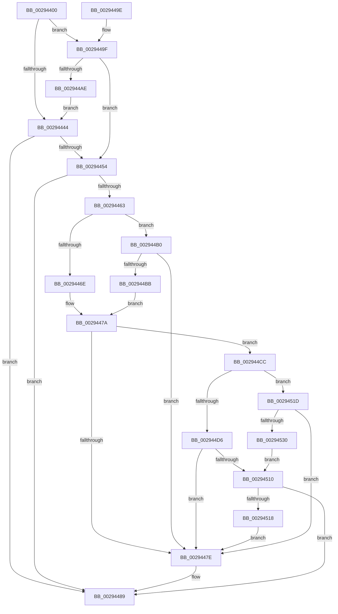

# MI_WSLE_LOG_ACCESS

- RVA: `0x00294400`–`0x00294532` (길이 `306` bytes)
- VA: `0x0000000140294400`
- 실행 섹션: `.text`
- PDB 이름 있음: `예`; PDB Function 태그: `아니요`
- unwind 정보 RVA: `0x00067768`
- 디코드: `79`개 명령, `306/306` bytes 표시
- 미해석 바이트: `0` (있으면 어셈블리에 `.byte`로 보존)

> 이 문서는 커널 이미지의 기계어와 PDB 기호를 분석해 생성했습니다. 4번과 5번은 함수 원형과 자료형을 바이너리 사용 방식에서 추정한 C 해석이며 원본 소스 복구 결과는 아닙니다.

## 1. Dependencies

- 직접 호출 지점: **4**; 고유 호출 대상: **4**
- 직접 호출자로 확인된 함수: **11**
- RIP 상대 이미지 참조: **1**

### Outgoing calls
- `0x00294447` → [MiGetVaAge](../24/MiGetVaAge_function_00240AC0.md) (function, `0x00240AC0`)
- `0x00294457` → [MI_READ_PTE_LOCK_FREE](../28/MI_READ_PTE_LOCK_FREE_function_002828A0.md) (function, `0x002828A0`)
- `0x00294484` → [MiLogPageAccess](../24/MiLogPageAccess_function_00240870.md) (function, `0x00240870`)
- `0x00294503` → [MiGetPagePrivilege](../28/MiGetPagePrivilege_function_00285420.md) (function, `0x00285420`)

### Direct callers
- [MiCombineWithExisting](../22/MiCombineWithExisting_function_0022B4B8.md) at `0x0022B88D`
- [MiDecommitAddToList](../24/MiDecommitAddToList_function_00242264.md) at `0x00242932`
- [MiDeleteVa](../27/MiDeleteVa_function_002789E0.md) at `0x00278D17`
- [MiTrimPteWorker](MiTrimPteWorker_function_00292E2C.md) at `0x00292F1B`
- [MiTrimPte](MiTrimPte_function_00292F30.md) at `0x002931DD`
- [sub_00293F76](Unknown_function_00293F76.md) at `0x002940ED`
- [MiTrimSharedPageFromViews](../2E/MiTrimSharedPageFromViews_function_002E16F8.md) at `0x002E1FC1`
- [MiDeprioritizeVirtualAddresses](../42/MiDeprioritizeVirtualAddresses_function_0042AD1C.md) at `0x0042AFA3`
- [NtUnlockVirtualMemory](../4E/NtUnlockVirtualMemory_function_004EE890.md) at `0x004EEC79`
- [sub_006D9212](../6D/Unknown_function_006D9212.md) at `0x006D93DE`
- [sub_006DB77C](../6D/Unknown_function_006DB77C.md) at `0x006DB845`

### Static image references
- `0x002944B0` → RVA `0x00FC6A88` (`ALMOSTRO`; read)

## 2. Other-region calls and transfers

- 다른 실행 섹션으로 향하는 call: **0**
- 별도 외부 분기/꼬리 이동을 확인하지 못했습니다.

## 3. Assembly (complete function range)

```asm
00294400  48 89 5C 24 08                  mov qword ptr [rsp + 8], rbx
00294405  48 89 6C 24 10                  mov qword ptr [rsp + 0x10], rbp
0029440A  48 89 74 24 18                  mov qword ptr [rsp + 0x18], rsi
0029440F  57                              push rdi
00294410  48 83 EC 20                     sub rsp, 0x20
00294414  48 8B DA                        mov rbx, rdx
00294417  48 8B F9                        mov rdi, rcx
0029441A  48 C1 E3 19                     shl rbx, 0x19
0029441E  48 8B EA                        mov rbp, rdx
00294421  48 B9 00 00 00 00 80 F6 FF FF   movabs rcx, 0xfffff68000000000
0029442B  48 8B C1                        mov rax, rcx
0029442E  48 C1 E0 19                     shl rax, 0x19
00294432  83 CE FF                        or esi, 0xffffffff
00294435  48 2B D8                        sub rbx, rax
00294438  48 C1 FB 10                     sar rbx, 0x10
0029443C  48 8B C1                        mov rax, rcx
0029443F  48 3B D8                        cmp rbx, rax
00294442  73 5B                           jae 0x14029449f
00294444  48 8B D3                        mov rdx, rbx
00294447  E8 74 C6 FA FF                  call 0x140240ac0
0029444C  0F B6 F0                        movzx esi, al
0029444F  83 FE 07                        cmp esi, 7
00294452  74 35                           je 0x140294489
00294454  48 8B CD                        mov rcx, rbp
00294457  E8 44 E4 FE FF                  call 0x1402828a0
0029445C  48 8B D0                        mov rdx, rax
0029445F  A8 20                           test al, 0x20
00294461  74 26                           je 0x140294489
00294463  8B 8F B8 00 00 00               mov ecx, dword ptr [rdi + 0xb8]
00294469  F6 C1 0F                        test cl, 0xf
0029446C  75 42                           jne 0x1402944b0
0029446E  33 C0                           xor eax, eax
00294470  48 39 87 70 02 00 00            cmp qword ptr [rdi + 0x270], rax
00294477  0F 95 C0                        setne al
0029447A  85 C0                           test eax, eax
0029447C  75 4E                           jne 0x1402944cc
0029447E  48 8B D5                        mov rdx, rbp
00294481  48 8B CF                        mov rcx, rdi
00294484  E8 E7 C3 FA FF                  call 0x140240870
00294489  48 8B 5C 24 30                  mov rbx, qword ptr [rsp + 0x30]
0029448E  48 8B 6C 24 38                  mov rbp, qword ptr [rsp + 0x38]
00294493  48 8B 74 24 40                  mov rsi, qword ptr [rsp + 0x40]
00294498  48 83 C4 20                     add rsp, 0x20
0029449C  5F                              pop rdi
0029449D  C3                              ret
0029449E  CC                              int3
0029449F  48 B8 FF FF FF FF FF F6 FF FF   movabs rax, 0xfffff6ffffffffff
002944A9  48 3B D8                        cmp rbx, rax
002944AC  76 A6                           jbe 0x140294454
002944AE  EB 94                           jmp 0x140294444
002944B0  48 0F BA 25 CF 25 D3 00 24      bt qword ptr [rip + 0xd325cf], 0x24
002944B9  73 C3                           jae 0x14029447e
002944BB  8B 87 B8 00 00 00               mov eax, dword ptr [rdi + 0xb8]
002944C1  C1 E8 08                        shr eax, 8
002944C4  C1 E8 03                        shr eax, 3
002944C7  83 E0 01                        and eax, 1
002944CA  EB AE                           jmp 0x14029447a
002944CC  8B 87 B8 00 00 00               mov eax, dword ptr [rdi + 0xb8]
002944D2  A8 0F                           test al, 0xf
002944D4  74 47                           je 0x14029451d
002944D6  48 C1 EA 0C                     shr rdx, 0xc
002944DA  48 B8 FF FF FF FF FF 00 00 00   movabs rax, 0xffffffffff
002944E4  48 23 D0                        and rdx, rax
002944E7  48 8D 0C 52                     lea rcx, [rdx + rdx*2]
002944EB  48 C1 E1 04                     shl rcx, 4
002944EF  48 B8 00 00 00 00 00 DE FF FF   movabs rax, 0xffffde0000000000
002944F9  45 33 C0                        xor r8d, r8d
002944FC  48 03 C8                        add rcx, rax
002944FF  41 8D 50 02                     lea edx, [r8 + 2]
00294503  E8 18 0F FF FF                  call 0x140285420
00294508  A8 41                           test al, 0x41
0029450A  0F 84 6E FF FF FF               je 0x14029447e
00294510  85 F6                           test esi, esi
00294512  0F 85 71 FF FF FF               jne 0x140294489
00294518  E9 61 FF FF FF                  jmp 0x14029447e
0029451D  48 B8 FF FF FE FF FF 7F 00 00   movabs rax, 0x7ffffffeffff
00294527  48 3B D8                        cmp rbx, rax
0029452A  0F 87 4E FF FF FF               ja 0x14029447e
00294530  EB DE                           jmp 0x140294510
```

## 4. C-style interpretation (structured pseudocode)

```c
__int64 __fastcall MI_WSLE_LOG_ACCESS(__int64 a1, __int64 a2, int a3)
{
    __int64 result;
    __int64 v_rbx;
    __int64 v_rsi;
    __int64 v_rsp;
    unsigned __int64 v_stack_p10;
    unsigned __int64 v_stack_p18;
    unsigned __int64 v_stack_p8;

    v_stack_p8 = v_rbx;
    v_stack_p10 = v_rbp;
    v_stack_p18 = v_rsi;
    v_rsp = (v_rsp) - (32);
    v_rbx = (a2) << (25);
    result = (a1) << (25);
    v_rsi = (unsigned int)((v_rsi) | (0xFFFFFFFFULL));
    v_rbx = (v_rbx) - (result);
    v_rbx = (v_rbx) >> (16);
    if (v_rbx >= a1) goto loc_0029449F;
loc_00294444:
    result = MiGetVaAge(a1, v_rbx, a3, a4);
    if (((unsigned int)((unsigned __int8)(result))) == 7) goto loc_00294489;
loc_00294454:
    result = MI_READ_PTE_LOCK_FREE(a2, v_rbx, a3, a4);
    if ((((unsigned __int8)(result)) & (32)) == 0) goto loc_00294489;
    if ((((unsigned __int8)((unsigned int)(*(unsigned int *)(a1 + 184)))) & (15)) != 0) goto loc_002944B0;
    result = 0;
    result = ((*(unsigned __int64 *)(a1 + 624)) != 0) ? 1 : 0;
loc_0029447A:
    if ((unsigned int)(result) != 0) goto loc_002944CC;
loc_0029447E:
    result = MiLogPageAccess(a1, a2, a3, a4);
loc_00294489:
    v_rsp = (v_rsp) + (32);
    return result;
loc_0029449F:
    if (v_stack_p8 <= result) goto loc_00294454;
    goto loc_00294444;
loc_002944B0:
    if (v_stack_p8 >= result) goto loc_0029447E;
    result = (unsigned int)(((unsigned int)(*(unsigned int *)(a1 + 184))) >> (8));
    result = (unsigned int)((result) >> (3));
    result = (unsigned int)((result) & (1));
    goto loc_0029447A;
loc_002944CC:
    if ((((unsigned __int8)((unsigned int)(*(unsigned int *)(a1 + 184)))) & (15)) == 0) goto loc_0029451D;
    a2 = (a2) >> (12);
    a2 = (a2) & ((unsigned int)(*(unsigned int *)(a1 + 184)));
    a1 = (a2 + a2 * 2) << (4);
    a3 = 0;
    a1 = (a1) + ((unsigned int)(*(unsigned int *)(a1 + 184)));
    result = MiGetPagePrivilege(a1, a3 + 2, a3, a4);
    if ((((unsigned __int8)(result)) & (65)) == 0) goto loc_0029447E;
loc_00294510:
    if ((unsigned int)(v_stack_p18) != 0) goto loc_00294489;
    goto loc_0029447E;
loc_0029451D:
    if (v_stack_p8 > result) goto loc_0029447E;
    goto loc_00294510;
}
```

## 5. (Beta) C Style

```c
int64_t MI_WSLE_LOG_ACCESS(void *Arg1, int64_t Arg2, int32_t Arg3)
{
    uint8_t *arg1 = (uint8_t *)Arg1;

    int64_t result;
    int64_t local_rbx;
    int64_t local_rsi;
    int64_t local_rsp;
    uint64_t v_stack_p10;
    uint64_t v_stack_p18;
    uint64_t v_stack_p8;

    v_stack_p8 = local_rbx;
    v_stack_p10 = local_rbp;
    v_stack_p18 = local_rsi;
    local_rsp = (local_rsp) - (32);
    local_rbx = (Arg2) << (25);
    result = (Arg1) << (25);
    local_rsi = (uint32_t)((local_rsi) | (0xFFFFFFFFULL));
    local_rbx = (local_rbx) - (result);
    local_rbx = (local_rbx) >> (16);
    if (local_rbx >= Arg1) goto loc_0029449F;
loc_00294444:
    result = MiGetVaAge(Arg1, local_rbx, Arg3, a4);
    if (((uint32_t)((uint8_t)(result))) == 7) goto loc_00294489;
loc_00294454:
    result = MI_READ_PTE_LOCK_FREE(Arg2, local_rbx, Arg3, a4);
    if ((((uint8_t)(result)) & (32)) == 0) goto loc_00294489;
    if ((((uint8_t)((uint32_t)(*(uint32_t *)(arg1 + 0xB8)))) & (15)) != 0) goto loc_002944B0;
    result = 0;
    result = ((*(uint64_t *)(arg1 + 0x270)) != 0) ? 1 : 0;
loc_0029447A:
    if ((uint32_t)(result) != 0) goto loc_002944CC;
loc_0029447E:
    result = MiLogPageAccess(Arg1, Arg2, Arg3, a4);
loc_00294489:
    local_rsp = (local_rsp) + (32);
    return result;
loc_0029449F:
    if (v_stack_p8 <= result) goto loc_00294454;
    goto loc_00294444;
loc_002944B0:
    if (v_stack_p8 >= result) goto loc_0029447E;
    result = (uint32_t)(((uint32_t)(*(uint32_t *)(arg1 + 0xB8))) >> (8));
    result = (uint32_t)((result) >> (3));
    result = (uint32_t)((result) & (1));
    goto loc_0029447A;
loc_002944CC:
    if ((((uint8_t)((uint32_t)(*(uint32_t *)(arg1 + 0xB8)))) & (15)) == 0) goto loc_0029451D;
    Arg2 = (Arg2) >> (12);
    Arg2 = (Arg2) & ((uint32_t)(*(uint32_t *)(arg1 + 0xB8)));
    Arg1 = (Arg2 + Arg2 * 2) << (4);
    Arg3 = 0;
    Arg1 = (Arg1) + ((uint32_t)(*(uint32_t *)(arg1 + 0xB8)));
    result = MiGetPagePrivilege(Arg1, Arg3 + 2, Arg3, a4);
    if ((((uint8_t)(result)) & (65)) == 0) goto loc_0029447E;
loc_00294510:
    if ((uint32_t)(v_stack_p18) != 0) goto loc_00294489;
    goto loc_0029447E;
loc_0029451D:
    if (v_stack_p8 > result) goto loc_0029447E;
    goto loc_00294510;
}
```

### 관측된 메모리 오프셋

구조체 형식이 확인되지 않은 접근은 인자 기준의 오프셋으로만 기록했습니다.

| 기준 인자 | 오프셋 표현 | 폭 (bit) | 접근 |
|---|---:|---:|---|
| `Arg1` | `+ 0xB8` | `32` | `R` |
| `Arg1` | `+ 0x270` | `64` | `R` |

## 6. Execution-region graph

[열기: 2D/3D 그래프와 함수 탐색 컨트롤 패널](../../../control-panel.html?section=text&rva=0x00294400&view=graph)

- 2D 그래프는 위에서 아래로 흐르고, 3D 그래프는 빈 공간을 드래그해 회전합니다. Shift+드래그는 이동, 휠은 확대·축소, 함수 노드 선택은 대상 보고서 이동입니다.

### Static fallback


