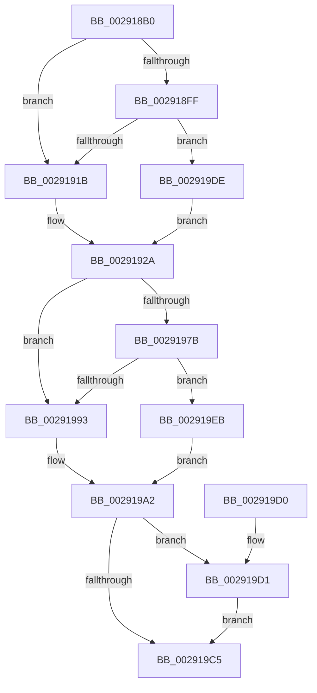

# MiAcquirePrcbAgeTrimLists

- RVA: `0x002918B0`–`0x002919F4` (길이 `324` bytes)
- VA: `0x00000001402918B0`
- 실행 섹션: `.text`
- PDB 이름 있음: `예`; PDB Function 태그: `아니요`
- unwind 정보 RVA: `0x00067454`
- 디코드: `81`개 명령, `324/324` bytes 표시
- 미해석 바이트: `0` (있으면 어셈블리에 `.byte`로 보존)

> 이 문서는 커널 이미지의 기계어와 PDB 기호를 분석해 생성했습니다. 4번과 5번은 함수 원형과 자료형을 바이너리 사용 방식에서 추정한 C 해석이며 원본 소스 복구 결과는 아닙니다.

## 1. Dependencies

- 직접 호출 지점: **1**; 고유 호출 대상: **1**
- 직접 호출자로 확인된 함수: **9**
- RIP 상대 이미지 참조: **0**

### Outgoing calls
- `0x002918C0` → [MiGetProcessorFlushList](../24/MiGetProcessorFlushList_function_00242C90.md) (function, `0x00242C90`)

### Direct callers
- [MiResetAccessBitPteWorker](../22/MiResetAccessBitPteWorker_function_0022A6B8.md) at `0x0022A7AA`
- [MiResetAccessBitPte](../22/MiResetAccessBitPte_function_0022A800.md) at `0x0022A94F`
- [sub_0028FA52](../28/Unknown_function_0028FA52.md) at `0x0028FAED`
- [sub_002901B8](Unknown_function_002901B8.md) at `0x00290206`
- [MiTrimPteWorker](MiTrimPteWorker_function_00292E2C.md) at `0x00292EBB`
- [MiTrimPte](MiTrimPte_function_00292F30.md) at `0x00293111`
- [MiTrimPte](MiTrimPte_function_00292F30.md) at `0x002932D5`
- [MiUpdateOldPteWorker](../49/MiUpdateOldPteWorker_function_0049CFD4.md) at `0x0049D026`
- [MiUpdateOldPte](../4E/MiUpdateOldPte_function_004EDD20.md) at `0x004EDE8C`
- [sub_006FA730](../6F/Unknown_function_006FA730.md) at `0x006FA751`

### Static image references
- 디코드된 RIP-relative 메모리 참조가 없습니다.

## 2. Other-region calls and transfers

- 다른 실행 섹션으로 향하는 call: **0**
- 별도 외부 분기/꼬리 이동을 확인하지 못했습니다.

## 3. Assembly (complete function range)

```asm
002918B0  48 89 5C 24 10                  mov qword ptr [rsp + 0x10], rbx
002918B5  57                              push rdi
002918B6  48 83 EC 20                     sub rsp, 0x20
002918BA  48 8B FA                        mov rdi, rdx
002918BD  48 8B D9                        mov rbx, rcx
002918C0  E8 CB 13 FB FF                  call 0x140242c90
002918C5  45 33 C0                        xor r8d, r8d
002918C8  4C 8B C8                        mov r9, rax
002918CB  41 B2 0F                        mov r10b, 0xf
002918CE  41 BB 00 04 00 00               mov r11d, 0x400
002918D4  44 89 40 10                     mov dword ptr [rax + 0x10], r8d
002918D8  C7 40 14 02 00 00 00            mov dword ptr [rax + 0x14], 2
002918DF  48 89 18                        mov qword ptr [rax], rbx
002918E2  8B 8B B8 00 00 00               mov ecx, dword ptr [rbx + 0xb8]
002918E8  C1 E9 08                        shr ecx, 8
002918EB  C0 E9 03                        shr cl, 3
002918EE  80 E1 01                        and cl, 1
002918F1  88 48 18                        mov byte ptr [rax + 0x18], cl
002918F4  8B 83 B8 00 00 00               mov eax, dword ptr [rbx + 0xb8]
002918FA  41 84 C2                        test r10b, al
002918FD  75 1C                           jne 0x14029191b
002918FF  65 48 8B 04 25 88 01 00 00      mov rax, qword ptr gs:[0x188]
00291908  48 8B 88 B8 00 00 00            mov rcx, qword ptr [rax + 0xb8]
0029190F  49 03 CB                        add rcx, r11
00291912  48 3B D9                        cmp rbx, rcx
00291915  0F 85 C3 00 00 00               jne 0x1402919de
0029191B  8B 83 B8 00 00 00               mov eax, dword ptr [rbx + 0xb8]
00291921  41 84 C2                        test r10b, al
00291924  41 8B C0                        mov eax, r8d
00291927  0F 94 C0                        sete al
0029192A  41 83 61 10 DB                  and dword ptr [r9 + 0x10], 0xffffffdb
0029192F  49 8D 91 28 10 00 00            lea rdx, [r9 + 0x1028]
00291936  41 89 41 08                     mov dword ptr [r9 + 8], eax
0029193A  66 45 89 41 19                  mov word ptr [r9 + 0x19], r8w
0029193F  45 89 41 1C                     mov dword ptr [r9 + 0x1c], r8d
00291943  4D 89 41 20                     mov qword ptr [r9 + 0x20], r8
00291947  4D 89 41 28                     mov qword ptr [r9 + 0x28], r8
0029194B  4C 89 0F                        mov qword ptr [rdi], r9
0029194E  C7 42 10 02 00 00 00            mov dword ptr [rdx + 0x10], 2
00291955  C7 42 14 01 00 00 00            mov dword ptr [rdx + 0x14], 1
0029195C  48 89 1A                        mov qword ptr [rdx], rbx
0029195F  8B 83 B8 00 00 00               mov eax, dword ptr [rbx + 0xb8]
00291965  C1 E8 08                        shr eax, 8
00291968  C0 E8 03                        shr al, 3
0029196B  24 01                           and al, 1
0029196D  88 42 18                        mov byte ptr [rdx + 0x18], al
00291970  8B 83 B8 00 00 00               mov eax, dword ptr [rbx + 0xb8]
00291976  41 84 C2                        test r10b, al
00291979  75 18                           jne 0x140291993
0029197B  65 48 8B 04 25 88 01 00 00      mov rax, qword ptr gs:[0x188]
00291984  48 8B 88 B8 00 00 00            mov rcx, qword ptr [rax + 0xb8]
0029198B  49 03 CB                        add rcx, r11
0029198E  48 3B D9                        cmp rbx, rcx
00291991  75 58                           jne 0x1402919eb
00291993  8B 83 B8 00 00 00               mov eax, dword ptr [rbx + 0xb8]
00291999  41 84 C2                        test r10b, al
0029199C  41 8B C0                        mov eax, r8d
0029199F  0F 94 C0                        sete al
002919A2  83 62 10 DB                     and dword ptr [rdx + 0x10], 0xffffffdb
002919A6  89 42 08                        mov dword ptr [rdx + 8], eax
002919A9  66 44 89 42 19                  mov word ptr [rdx + 0x19], r8w
002919AE  44 89 42 1C                     mov dword ptr [rdx + 0x1c], r8d
002919B2  4C 89 42 20                     mov qword ptr [rdx + 0x20], r8
002919B6  4C 89 42 28                     mov qword ptr [rdx + 0x28], r8
002919BA  48 83 7F 10 01                  cmp qword ptr [rdi + 0x10], 1
002919BF  48 89 57 08                     mov qword ptr [rdi + 8], rdx
002919C3  74 0C                           je 0x1402919d1
002919C5  48 8B 5C 24 38                  mov rbx, qword ptr [rsp + 0x38]
002919CA  48 83 C4 20                     add rsp, 0x20
002919CE  5F                              pop rdi
002919CF  C3                              ret
002919D0  CC                              int3
002919D1  49 8D 81 50 20 00 00            lea rax, [r9 + 0x2050]
002919D8  48 89 47 10                     mov qword ptr [rdi + 0x10], rax
002919DC  EB E7                           jmp 0x1402919c5
002919DE  41 83 49 10 09                  or dword ptr [r9 + 0x10], 9
002919E3  41 8B C0                        mov eax, r8d
002919E6  E9 3F FF FF FF                  jmp 0x14029192a
002919EB  83 4A 10 09                     or dword ptr [rdx + 0x10], 9
002919EF  41 8B C0                        mov eax, r8d
002919F2  EB AE                           jmp 0x1402919a2
```

## 4. C-style interpretation (structured pseudocode)

```c
__int64 __fastcall MiAcquirePrcbAgeTrimLists(__int64 a1, __int64 a2, int a3)
{
    __int64 result;
    __int64 v_rsp;
    unsigned __int64 v_stack_p10;

    v_stack_p10 = v_rbx;
    v_rsp = (v_rsp) - (32);
    result = MiGetProcessorFlushList(a1, a2, a3, a4);
    a3 = 0;
    *(unsigned int *)(result + 16) = 0;
    *(unsigned int *)(result + 20) = 2;
    *(unsigned __int64 *)(result) = a1;
    a1 = (unsigned int)(((unsigned int)(*(unsigned int *)(a1 + 184))) >> (8));
    a1 = (unsigned __int8)((a1) >> (3));
    a1 = (unsigned __int8)((a1) & (1));
    *(unsigned __int8 *)(result + 24) = (unsigned __int8)(a1);
    if (((15) & ((unsigned __int8)((unsigned int)(*(unsigned int *)(a1 + 184))))) != 0) goto loc_0029191B;
    a1 = (*(unsigned __int64 *)(*(unsigned __int64 *)(gs_base + (0 + 392)) + 184)) + ((unsigned int)(0x400ULL));
    if (a1 != a1) goto loc_002919DE;
loc_0029191B:
    result = (((15) & ((unsigned __int8)((unsigned int)(*(unsigned int *)(a1 + 184))))) == 0) ? 1 : 0;
loc_0029192A:
    *(unsigned int *)(result + 8) = (unsigned int)(result);
    *(unsigned __int16 *)(result + 25) = 0;
    *(unsigned int *)(result + 28) = 0;
    *(unsigned __int64 *)(result + 32) = 0;
    *(unsigned __int64 *)(result + 40) = 0;
    *(unsigned __int64 *)(a2) = result;
    *(unsigned int *)(result + 4136 + 16) = 2;
    *(unsigned int *)(result + 4136 + 20) = 1;
    *(unsigned __int64 *)(result + 4136) = a1;
    result = (unsigned int)(((unsigned int)(*(unsigned int *)(a1 + 184))) >> (8));
    result = (unsigned __int8)((result) >> (3));
    result = (unsigned __int8)((result) & (1));
    *(unsigned __int8 *)(result + 4136 + 24) = (unsigned __int8)(result);
    if (((15) & ((unsigned __int8)((unsigned int)(*(unsigned int *)(a1 + 184))))) != 0) goto loc_00291993;
    a1 = (*(unsigned __int64 *)(*(unsigned __int64 *)(gs_base + (0 + 392)) + 184)) + ((unsigned int)(0x400ULL));
    if (a1 != a1) goto loc_002919EB;
loc_00291993:
    result = (((15) & ((unsigned __int8)((unsigned int)(*(unsigned int *)(a1 + 184))))) == 0) ? 1 : 0;
loc_002919A2:
    *(unsigned int *)(result + 4136 + 8) = (unsigned int)(result);
    *(unsigned __int16 *)(result + 4136 + 25) = 0;
    *(unsigned int *)(result + 4136 + 28) = 0;
    *(unsigned __int64 *)(result + 4136 + 32) = 0;
    *(unsigned __int64 *)(result + 4136 + 40) = 0;
    *(unsigned __int64 *)(a2 + 8) = result + 4136;
    if ((*(unsigned __int64 *)(a2 + 16)) == 1) goto loc_002919D1;
loc_002919C5:
    v_rsp = (v_rsp) + (32);
    return result;
loc_002919D1:
    *(unsigned __int64 *)(a2 + 16) = result + 8272;
    goto loc_002919C5;
loc_002919DE:
    goto loc_0029192A;
loc_002919EB:
    goto loc_002919A2;
}
```

## 5. (Beta) C Style

```c
int64_t MiAcquirePrcbAgeTrimLists(void *Arg1, void *Arg2, int32_t Arg3)
{
    uint8_t *arg1 = (uint8_t *)Arg1;
    uint8_t *arg2 = (uint8_t *)Arg2;

    int64_t result;
    int64_t local_rsp;
    uint64_t v_stack_p10;

    v_stack_p10 = local_rbx;
    local_rsp = (local_rsp) - (32);
    result = MiGetProcessorFlushList(Arg1, Arg2, Arg3, a4);
    Arg3 = 0;
    *(uint32_t *)(result + 0x10) = 0;
    *(uint32_t *)(result + 0x14) = 2;
    *(void **)(result) = Arg1;
    Arg1 = (uint32_t)(((uint32_t)(*(uint32_t *)(arg1 + 0xB8))) >> (8));
    Arg1 = (uint8_t)((Arg1) >> (3));
    Arg1 = (uint8_t)((Arg1) & (1));
    *(uint8_t *)(result + 0x18) = (uint8_t)(Arg1);
    if (((15) & ((uint8_t)((uint32_t)(*(uint32_t *)(arg1 + 0xB8))))) != 0) goto loc_0029191B;
    Arg1 = (*(uint64_t *)(*(uint64_t *)(gs_base + (0 + 0x188)) + 0xB8)) + ((uint32_t)(0x400ULL));
    if (Arg1 != Arg1) goto loc_002919DE;
loc_0029191B:
    result = (((15) & ((uint8_t)((uint32_t)(*(uint32_t *)(arg1 + 0xB8))))) == 0) ? 1 : 0;
loc_0029192A:
    *(uint32_t *)(result + 0x8) = (uint32_t)(result);
    *(uint16_t *)(result + 0x19) = 0;
    *(uint32_t *)(result + 0x1C) = 0;
    *(uint64_t *)(result + 0x20) = 0;
    *(uint64_t *)(result + 0x28) = 0;
    *(uint64_t *)(arg2) = result;
    *(uint32_t *)(result + 0x1028 + 0x10) = 2;
    *(uint32_t *)(result + 0x1028 + 0x14) = 1;
    *(void **)(result + 0x1028) = Arg1;
    result = (uint32_t)(((uint32_t)(*(uint32_t *)(arg1 + 0xB8))) >> (8));
    result = (uint8_t)((result) >> (3));
    result = (uint8_t)((result) & (1));
    *(uint8_t *)(result + 0x1028 + 0x18) = (uint8_t)(result);
    if (((15) & ((uint8_t)((uint32_t)(*(uint32_t *)(arg1 + 0xB8))))) != 0) goto loc_00291993;
    Arg1 = (*(uint64_t *)(*(uint64_t *)(gs_base + (0 + 0x188)) + 0xB8)) + ((uint32_t)(0x400ULL));
    if (Arg1 != Arg1) goto loc_002919EB;
loc_00291993:
    result = (((15) & ((uint8_t)((uint32_t)(*(uint32_t *)(arg1 + 0xB8))))) == 0) ? 1 : 0;
loc_002919A2:
    *(uint32_t *)(result + 0x1028 + 0x8) = (uint32_t)(result);
    *(uint16_t *)(result + 0x1028 + 0x19) = 0;
    *(uint32_t *)(result + 0x1028 + 0x1C) = 0;
    *(uint64_t *)(result + 0x1028 + 0x20) = 0;
    *(uint64_t *)(result + 0x1028 + 0x28) = 0;
    *(uint64_t *)(arg2 + 0x8) = result + 4136;
    if ((*(uint64_t *)(arg2 + 0x10)) == 1) goto loc_002919D1;
loc_002919C5:
    local_rsp = (local_rsp) + (32);
    return result;
loc_002919D1:
    *(uint64_t *)(arg2 + 0x10) = result + 8272;
    goto loc_002919C5;
loc_002919DE:
    goto loc_0029192A;
loc_002919EB:
    goto loc_002919A2;
}
```

### 관측된 메모리 오프셋

구조체 형식이 확인되지 않은 접근은 인자 기준의 오프셋으로만 기록했습니다.

| 기준 인자 | 오프셋 표현 | 폭 (bit) | 접근 |
|---|---:|---:|---|
| `Arg1` | `+ 0xB8` | `32` | `R` |
| `Arg2` | `+ 0x0` | `64` | `W` |
| `Arg2` | `+ 0x8` | `64` | `W` |
| `Arg2` | `+ 0x10` | `64` | `R` |
| `Arg2` | `+ 0x10` | `64` | `W` |

## 6. Execution-region graph

[열기: 2D/3D 그래프와 함수 탐색 컨트롤 패널](../../../control-panel.html?section=text&rva=0x002918B0&view=graph)

- 2D 그래프는 위에서 아래로 흐르고, 3D 그래프는 빈 공간을 드래그해 회전합니다. Shift+드래그는 이동, 휠은 확대·축소, 함수 노드 선택은 대상 보고서 이동입니다.

### Static fallback


