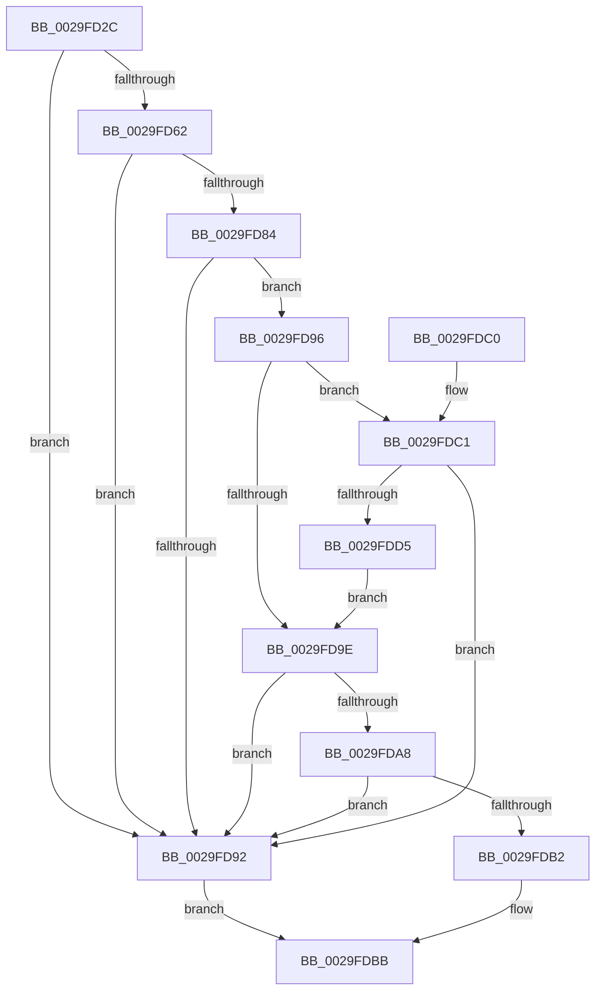

# MiCanStealKernelStack

- RVA: `0x0029FD2C`–`0x0029FDD7` (길이 `171` bytes)
- VA: `0x000000014029FD2C`
- 실행 섹션: `.text`
- PDB 이름 있음: `예`; PDB Function 태그: `아니요`
- unwind 정보 RVA: `0x00068370`
- 디코드: `47`개 명령, `171/171` bytes 표시
- 미해석 바이트: `0` (있으면 어셈블리에 `.byte`로 보존)

> 이 문서는 커널 이미지의 기계어와 PDB 기호를 분석해 생성했습니다. 4번과 5번은 함수 원형과 자료형을 바이너리 사용 방식에서 추정한 C 해석이며 원본 소스 복구 결과는 아닙니다.

## 1. Dependencies

- 직접 호출 지점: **1**; 고유 호출 대상: **1**
- 직접 호출자로 확인된 함수: **2**
- RIP 상대 이미지 참조: **2**

### Outgoing calls
- `0x0029FDC4` → [MiGetPfnKernelStack](../44/MiGetPfnKernelStack_function_0044EFB8.md) (function, `0x0044EFB8`)

### Direct callers
- [MiSwapStackPage](MiSwapStackPage_function_0029FDE0.md) at `0x0029FFD7`
- [sub_006F60F8](../6F/Unknown_function_006F60F8.md) at `0x006F618D`

### Static image references
- `0x0029FD59` → RVA `0x00E2DCE0` (`.data`; read)
- `0x0029FD96` → RVA `0x00E2DBC9` (`.data`; reference)

## 2. Other-region calls and transfers

- 다른 실행 섹션으로 향하는 call: **0**
- 별도 외부 분기/꼬리 이동을 확인하지 못했습니다.

## 3. Assembly (complete function range)

```asm
0029FD2C  48 83 EC 28                     sub rsp, 0x28
0029FD30  44 0F B7 D2                     movzx r10d, dx
0029FD34  4C 8B C9                        mov r9, rcx
0029FD37  48 B9 00 00 00 00 00 DE FF FF   movabs rcx, 0xffffde0000000000
0029FD41  49 8B C1                        mov rax, r9
0029FD44  48 2B C1                        sub rax, rcx
0029FD47  48 B9 AB AA AA AA AA AA AA AA   movabs rcx, 0xaaaaaaaaaaaaaaab
0029FD51  48 C1 F8 04                     sar rax, 4
0029FD55  48 0F AF C1                     imul rax, rcx
0029FD59  48 3B 05 80 DF B8 00            cmp rax, qword ptr [rip + 0xb8df80]
0029FD60  77 30                           ja 0x14029fd92
0029FD62  48 8D 04 40                     lea rax, [rax + rax*2]
0029FD66  48 03 C0                        add rax, rax
0029FD69  48 B9 28 00 00 00 00 DE FF FF   movabs rcx, 0xffffde0000000028
0029FD73  48 8B 04 C1                     mov rax, qword ptr [rcx + rax*8]
0029FD77  BA 01 00 00 00                  mov edx, 1
0029FD7C  48 C1 E8 36                     shr rax, 0x36
0029FD80  85 C2                           test edx, eax
0029FD82  74 0E                           je 0x14029fd92
0029FD84  49 8B 41 28                     mov rax, qword ptr [r9 + 0x28]
0029FD88  48 C1 E8 3C                     shr rax, 0x3c
0029FD8C  24 07                           and al, 7
0029FD8E  3C 02                           cmp al, 2
0029FD90  74 04                           je 0x14029fd96
0029FD92  33 C0                           xor eax, eax
0029FD94  EB 25                           jmp 0x14029fdbb
0029FD96  84 15 2D DE B8 00               test byte ptr [rip + 0xb8de2d], dl
0029FD9C  74 23                           je 0x14029fdc1
0029FD9E  41 8A 41 22                     mov al, byte ptr [r9 + 0x22]
0029FDA2  24 07                           and al, 7
0029FDA4  3C 06                           cmp al, 6
0029FDA6  75 EA                           jne 0x14029fd92
0029FDA8  41 8B 41 20                     mov eax, dword ptr [r9 + 0x20]
0029FDAC  66 41 3B C2                     cmp ax, r10w
0029FDB0  75 E0                           jne 0x14029fd92
0029FDB2  33 C0                           xor eax, eax
0029FDB4  41 38 41 23                     cmp byte ptr [r9 + 0x23], al
0029FDB8  0F 9D C0                        setge al
0029FDBB  48 83 C4 28                     add rsp, 0x28
0029FDBF  C3                              ret
0029FDC0  CC                              int3
0029FDC1  49 8B C9                        mov rcx, r9
0029FDC4  E8 EF F1 1A 00                  call 0x14044efb8
0029FDC9  48 83 C0 20                     add rax, 0x20
0029FDCD  48 A9 DF FF FF FF               test rax, -0x21
0029FDD3  74 BD                           je 0x14029fd92
0029FDD5  EB C7                           jmp 0x14029fd9e
```

## 4. C-style interpretation (structured pseudocode)

```c
__int64 __fastcall MiCanStealKernelStack(__int64 a1, unsigned __int16 a2)
{
    __int64 result;
    __int64 v_rsp;

    v_rsp = (v_rsp) - (40);
    result = (a1) - (a1);
    result = (result) >> (4);
    result = (result) * (a1);
    if (result > (*(unsigned __int64 *)(v_rip + 12115840))) goto loc_0029FD92;
    result = (result + result * 2) + (result + result * 2);
    result = (*(unsigned __int64 *)(a1 + result * 8)) >> (54);
    if (((1) & ((unsigned int)(result))) == 0) goto loc_0029FD92;
    result = (*(unsigned __int64 *)(a1 + 40)) >> (60);
    result = (unsigned __int8)((result) & (7));
    if (((unsigned __int8)(result)) == 2) goto loc_0029FD96;
loc_0029FD92:
    result = 0;
    goto loc_0029FDBB;
loc_0029FD96:
    if (((*(unsigned __int8 *)(v_rip + 12115501)) & (1)) == 0) goto loc_0029FDC1;
loc_0029FD9E:
    result = (unsigned __int8)((*(unsigned __int8 *)(a1 + 34)) & (7));
    if (((unsigned __int8)(result)) != 6) goto loc_0029FD92;
    if (((unsigned __int16)((unsigned int)(*(unsigned int *)(a1 + 32)))) != a2) goto loc_0029FD92;
    result = 0;
    result = ((*(unsigned __int8 *)(a1 + 35)) >= 0) ? 1 : 0;
loc_0029FDBB:
    v_rsp = (v_rsp) + (40);
    return result;
loc_0029FDC1:
    result = MiGetPfnKernelStack(a1, 1, a3, a1);
    result = (result) + (32);
    if (((result) & (-33)) == 0) goto loc_0029FD92;
    goto loc_0029FD9E;
}
```

## 5. (Beta) C Style

```c
int64_t MiCanStealKernelStack(void *Arg1, uint16_t Arg2)
{
    uint8_t *arg1 = (uint8_t *)Arg1;

    int64_t result;
    int64_t local_rsp;

    local_rsp = (local_rsp) - (40);
    result = (Arg1) - (Arg1);
    result = (result) >> (4);
    result = (result) * (Arg1);
    if (result > (*(uint64_t *)(v_rip + 0xB8DF80))) goto loc_0029FD92;
    result = (result + result * 2) + (result + result * 2);
    result = (*(uint64_t *)(arg1 + result * 8)) >> (54);
    if (((1) & ((uint32_t)(result))) == 0) goto loc_0029FD92;
    result = (*(uint64_t *)(arg1 + 0x28)) >> (60);
    result = (uint8_t)((result) & (7));
    if (((uint8_t)(result)) == 2) goto loc_0029FD96;
loc_0029FD92:
    result = 0;
    goto loc_0029FDBB;
loc_0029FD96:
    if (((*(uint8_t *)(v_rip + 0xB8DE2D)) & (1)) == 0) goto loc_0029FDC1;
loc_0029FD9E:
    result = (uint8_t)((*(uint8_t *)(arg1 + 0x22)) & (7));
    if (((uint8_t)(result)) != 6) goto loc_0029FD92;
    if (((uint16_t)((uint32_t)(*(uint32_t *)(arg1 + 0x20)))) != Arg2) goto loc_0029FD92;
    result = 0;
    result = ((*(uint8_t *)(arg1 + 0x23)) >= 0) ? 1 : 0;
loc_0029FDBB:
    local_rsp = (local_rsp) + (40);
    return result;
loc_0029FDC1:
    result = MiGetPfnKernelStack(Arg1, 1, a3, Arg1);
    result = (result) + (32);
    if (((result) & (-33)) == 0) goto loc_0029FD92;
    goto loc_0029FD9E;
}
```

### 관측된 메모리 오프셋

구조체 형식이 확인되지 않은 접근은 인자 기준의 오프셋으로만 기록했습니다.

| 기준 인자 | 오프셋 표현 | 폭 (bit) | 접근 |
|---|---:|---:|---|
| `Arg1` | `+ 0x28` | `64` | `R` |

## 6. Execution-region graph

[열기: 2D/3D 그래프와 함수 탐색 컨트롤 패널](../../../control-panel.html?section=text&rva=0x0029FD2C&view=graph)

- 2D 그래프는 위에서 아래로 흐르고, 3D 그래프는 빈 공간을 드래그해 회전합니다. Shift+드래그는 이동, 휠은 확대·축소, 함수 노드 선택은 대상 보고서 이동입니다.

### Static fallback


