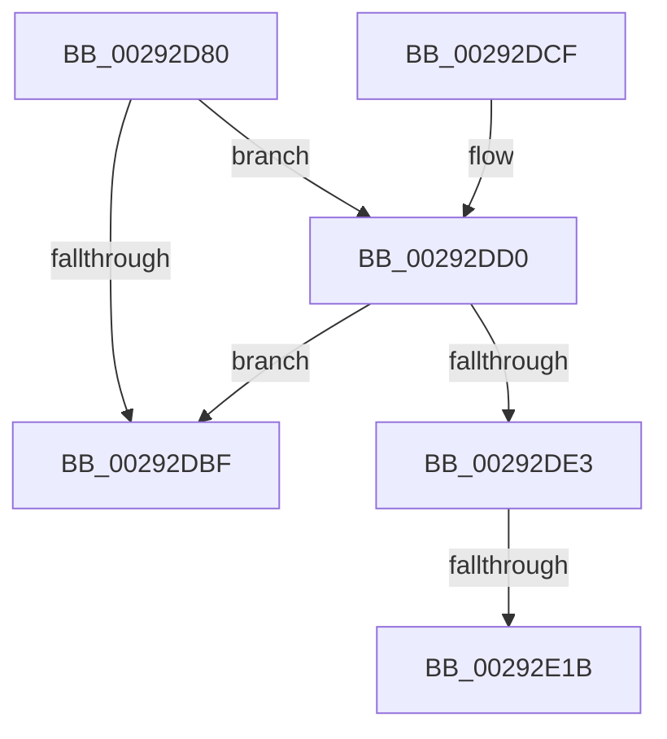

# MiCheckLinearProtectedPteAccessedBit

- RVA: `0x00292D80`–`0x00292E25` (길이 `165` bytes)
- VA: `0x0000000140292D80`
- 실행 섹션: `.text`
- PDB 이름 있음: `예`; PDB Function 태그: `예`
- unwind 정보 RVA: `0x000675F8`
- 디코드: `40`개 명령, `165/165` bytes 표시
- 미해석 바이트: `0` (있으면 어셈블리에 `.byte`로 보존)

> 이 문서는 커널 이미지의 기계어와 PDB 기호를 분석해 생성했습니다. 4번과 5번은 함수 원형과 자료형을 바이너리 사용 방식에서 추정한 C 해석이며 원본 소스 복구 결과는 아닙니다.

## 1. Dependencies

- 직접 호출 지점: **2**; 고유 호출 대상: **2**
- 직접 호출자로 확인된 함수: **132**
- RIP 상대 이미지 참조: **0**

### Outgoing calls
- `0x00292DB1` → [MiGetSystemRegionType](../28/MiGetSystemRegionType_function_0028EC80.md) (function, `0x0028EC80`)
- `0x00292DD0` → [MiSystemVaTypeToVm](../28/MiSystemVaTypeToVm_function_0028EB50.md) (function, `0x0028EB50`)

### Direct callers
- [MmStealTopLevelPage](../22/MmStealTopLevelPage_function_002281E0.md) at `0x00228414`
- [MmStealTopLevelPage](../22/MmStealTopLevelPage_function_002281E0.md) at `0x0022844F`
- [MiReplacePageTablePage](../22/MiReplacePageTablePage_function_00229184.md) at `0x0022996C`
- [MiMapSinglePage](../22/MiMapSinglePage_function_00229D00.md) at `0x00229E12`
- [MiMapArbitraryPage](../22/MiMapArbitraryPage_function_0022A44C.md) at `0x0022A577`
- [MiCombineInitialInstance](../22/MiCombineInitialInstance_function_0022BC0C.md) at `0x0022C734`
- [MiResolveProtoCombine](../22/MiResolveProtoCombine_function_0022CD00.md) at `0x0022D05D`
- [MiBuildForkPte](../22/MiBuildForkPte_function_0022E32C.md) at `0x0022EF4C`
- [MmSetAddressRangeModifiedEx](../23/MmSetAddressRangeModifiedEx_function_00236F20.md) at `0x002373F4`
- [MiLockWorkingSetOptimal](../23/MiLockWorkingSetOptimal_function_00238FC0.md) at `0x0023943C`
- [sub_0023EC2E](../23/Unknown_function_0023EC2E.md) at `0x0023EC57`
- [sub_0023F124](../23/Unknown_function_0023F124.md) at `0x0023F443`
- [sub_0023F124](../23/Unknown_function_0023F124.md) at `0x0023F46A`
- [MiUnlockNestedPageTableWritePte](../23/MiUnlockNestedPageTableWritePte_function_0023F4E4.md) at `0x0023F62C`
- [MiUnlockNestedPageTableWritePte](../23/MiUnlockNestedPageTableWritePte_function_0023F4E4.md) at `0x0023F6BA`
- [sub_002401BF](../24/Unknown_function_002401BF.md) at `0x00240290`
- [sub_002401BF](../24/Unknown_function_002401BF.md) at `0x002402BA`
- [sub_002401BF](../24/Unknown_function_002401BF.md) at `0x002402F0`
- [MmProtectPool](../26/MmProtectPool_function_002697AC.md) at `0x00269D75`
- [MmProtectPool](../26/MmProtectPool_function_002697AC.md) at `0x00269DE1`
- [sub_002760C1](../27/Unknown_function_002760C1.md) at `0x00276228`
- [MiFastLockLeafPageTable](../27/MiFastLockLeafPageTable_function_00276340.md) at `0x0027701E`
- [MiFastLockLeafPageTable](../27/MiFastLockLeafPageTable_function_00276340.md) at `0x00277102`
- [MiWalkPageTablesRecursively](../27/MiWalkPageTablesRecursively_function_002796C0.md) at `0x0027B673`
- [MiMakeSystemAddressValid](../27/MiMakeSystemAddressValid_function_0027FF70.md) at `0x00280BB8`
- [MiLockLowestValidPageTableEx](../28/MiLockLowestValidPageTableEx_function_00280D10.md) at `0x002816AB`
- [MiWriteValidPteNewProtection](../28/MiWriteValidPteNewProtection_function_00281810.md) at `0x00281963`
- [sub_002826A2](../28/Unknown_function_002826A2.md) at `0x002826D5`
- [MiResolveTransitionFault](../28/MiResolveTransitionFault_function_00282940.md) at `0x0028336D`
- [MiResolveTransitionFault](../28/MiResolveTransitionFault_function_00282940.md) at `0x00283751`
- [MiSetVaAgeList](MiSetVaAgeList_function_00290A20.md) at `0x00291566`
- [sub_0029273F](Unknown_function_0029273F.md) at `0x002928CA`
- [MiWriteValidPteVolatile](MiWriteValidPteVolatile_function_00292B60.md) at `0x00292C5E`
- [MiWriteWsle](MiWriteWsle_function_00292CA0.md) at `0x00292D72`
- [MiSetWsleProtection](MiSetWsleProtection_function_002939D8.md) at `0x00293AB5`
- [sub_00293F76](Unknown_function_00293F76.md) at `0x00294232`
- [sub_00293F76](Unknown_function_00293F76.md) at `0x0029429C`
- [MiSwapStackPageNoDpc](../2A/MiSwapStackPageNoDpc_function_002A0270.md) at `0x002A0466`
- [MiAllocateKernelStackPages](../2A/MiAllocateKernelStackPages_function_002A1BEC.md) at `0x002A20E8`
- [MiMakePteClean](../2A/MiMakePteClean_function_002A901C.md) at `0x002A92A3`
- [sub_002ADE4F](../2A/Unknown_function_002ADE4F.md) at `0x002ADE78`
- [MiInsertPhysicalPteMapping](../2A/MiInsertPhysicalPteMapping_function_002AE26C.md) at `0x002AE47D`
- [sub_002B21A1](../2B/Unknown_function_002B21A1.md) at `0x002B2587`
- [sub_002B21A1](../2B/Unknown_function_002B21A1.md) at `0x002B25BF`
- [MiStealPage](../2B/MiStealPage_function_002B28D0.md) at `0x002B3785`
- [MiStealPage](../2B/MiStealPage_function_002B28D0.md) at `0x002B397E`
- [MiCreateSharedZeroPages](../2B/MiCreateSharedZeroPages_function_002B6318.md) at `0x002B6636`
- [MiMakePageAvoidRead](../2B/MiMakePageAvoidRead_function_002B7DE0.md) at `0x002B83C3`
- [MiMakePageAvoidRead](../2B/MiMakePageAvoidRead_function_002B7DE0.md) at `0x002B83F6`
- [MiUnlinkStandbyPfn](../2C/MiUnlinkStandbyPfn_function_002C3510.md) at `0x002C36D7`
- [sub_002C7096](../2C/Unknown_function_002C7096.md) at `0x002C711D`
- [MiMapFrame](../2C/MiMapFrame_function_002C7190.md) at `0x002C7395`
- [sub_002F6E32](../2F/Unknown_function_002F6E32.md) at `0x002F74C2`
- [sub_002F6E32](../2F/Unknown_function_002F6E32.md) at `0x002F7695`
- [MiLinkPoolCommitChain](../31/MiLinkPoolCommitChain_function_00313D20.md) at `0x003140AC`
- [MmMapLockedPagesSpecifyCache](../31/MmMapLockedPagesSpecifyCache_function_00318800.md) at `0x00318C86`
- [MiFillSystemPtes](../31/MiFillSystemPtes_function_00319850.md) at `0x00319D7E`
- [sub_0031EDB1](../31/Unknown_function_0031EDB1.md) at `0x0031EE67`
- [MiComputeCombineHash](../32/MiComputeCombineHash_function_003227C0.md) at `0x0032298C`
- [MiRewritePteWithLockBit](../32/MiRewritePteWithLockBit_function_00322FEC.md) at `0x003230F9`
- [MiRewritePteWithLockBit](../32/MiRewritePteWithLockBit_function_00322FEC.md) at `0x003231D1`
- [MiGetUltraMapping](../32/MiGetUltraMapping_function_00323270.md) at `0x0032382E`
- [MiGetUltraMapping](../32/MiGetUltraMapping_function_00323270.md) at `0x0032385C`
- [MiCompletePrivateZeroFault](../33/MiCompletePrivateZeroFault_function_00330CC0.md) at `0x00331C07`
- [sub_0033284A](../33/Unknown_function_0033284A.md) at `0x003328CE`
- [sub_00332A20](../33/Unknown_function_00332A20.md) at `0x00332ADA`
- [MiMapPageInHyperSpaceWorker](../33/MiMapPageInHyperSpaceWorker_function_00332B10.md) at `0x00332DD9`
- [MiAllocateWsle](../33/MiAllocateWsle_function_003332C0.md) at `0x00333B3B`
- [sub_00345640](../34/Unknown_function_00345640.md) at `0x00345679`
- [MiMakeFaultPfnActive](../36/MiMakeFaultPfnActive_function_00361D00.md) at `0x00361E9B`
- [MiMakeFaultPfnActive](../36/MiMakeFaultPfnActive_function_00361D00.md) at `0x00361EC9`
- [MiCopyOnWrite](../36/MiCopyOnWrite_function_00362A0C.md) at `0x00363245`
- [MiCopyOnWrite](../36/MiCopyOnWrite_function_00362A0C.md) at `0x003633C8`
- [MiReplacePageOfProtoPool](../36/MiReplacePageOfProtoPool_function_00364BB8.md) at `0x003652D3`
- [MiWriteEnclavePte](../36/MiWriteEnclavePte_function_00368570.md) at `0x003686E0`
- [MiPrivateFixup](../36/MiPrivateFixup_function_003693E8.md) at `0x00369949`
- [MiTradeActivePage](../37/MiTradeActivePage_function_00374424.md) at `0x0037471A`
- [MiWriteValidPteNewPage](../37/MiWriteValidPteNewPage_function_00376068.md) at `0x00376163`
- [MiTransformValidPteUsingAccessedBit](../37/MiTransformValidPteUsingAccessedBit_function_00376640.md) at `0x003767BF`
- [MiTransformValidPteUsingAccessedBit](../37/MiTransformValidPteUsingAccessedBit_function_00376640.md) at `0x003767F7`
- [MiIssueHardFault](../38/MiIssueHardFault_function_00380074.md) at `0x0038081B`
- [MiValidateInPage](../38/MiValidateInPage_function_00382E0C.md) at `0x0038335A`
- [MiMapWithLargePages](../3B/MiMapWithLargePages_function_003B6624.md) at `0x003B6779`
- [MiUnmapMdlCommon](../3E/MiUnmapMdlCommon_function_003E7DF0.md) at `0x003E8407`
- [sub_003EC202](../3E/Unknown_function_003EC202.md) at `0x003EC29A`
- [MiInsertLargeVadMapping](../3F/MiInsertLargeVadMapping_function_003F0498.md) at `0x003F05B3`
- [MiScrubPage](../3F/MiScrubPage_function_003F954C.md) at `0x003F9645`
- [MiBuildReservationCluster](../40/MiBuildReservationCluster_function_004071A0.md) at `0x004078A5`
- [MiNoFaultFound](../41/MiNoFaultFound_function_0041BB20.md) at `0x0041BC6D`
- [MiMakeOutswappedPageResident](../43/MiMakeOutswappedPageResident_function_00431AD0.md) at `0x00431E95`
- [MiMakeOutswappedPageResident](../43/MiMakeOutswappedPageResident_function_00431AD0.md) at `0x00432019`
- [MiInitializeSelfmap](../43/MiInitializeSelfmap_function_0043202C.md) at `0x004320DA`
- [MiUpdateImagePfnImportRelocations](../44/MiUpdateImagePfnImportRelocations_function_00449E84.md) at `0x0044A047`
- [MiInitializeSystemPageTable](../45/MiInitializeSystemPageTable_function_00451C88.md) at `0x00451F08`
- [MiClearPteAccessedBitRange](../45/MiClearPteAccessedBitRange_function_004520B8.md) at `0x004521F7`
- [MiPrepareToTradeUsingAccessedBit](../45/MiPrepareToTradeUsingAccessedBit_function_0045B488.md) at `0x0045B562`
- [MiMappingHasIoReferences](../46/MiMappingHasIoReferences_function_00460934.md) at `0x004609E7`
- [MiDeleteProcessShadow](../46/MiDeleteProcessShadow_function_00465BF8.md) at `0x00465E3E`
- [MiCopyTopLevelMappings](../46/MiCopyTopLevelMappings_function_0046C54C.md) at `0x0046C6A0`
- [MiShadowTopLevelPxes](../46/MiShadowTopLevelPxes_function_0046C6B0.md) at `0x0046C810`
- [MiCopyPtes](../46/MiCopyPtes_function_0046C84C.md) at `0x0046C8D7`
- [MiMapPageFileHash](../49/MiMapPageFileHash_function_004921E0.md) at `0x00492675`
- [MiMapMemoryDumpMdl](../4A/MiMapMemoryDumpMdl_function_004A619C.md) at `0x004A63E5`
- [MiProtectAweRegion](../4C/MiProtectAweRegion_function_004CE62C.md) at `0x004CED6B`
- [MiMapKernelScp](../4D/MiMapKernelScp_function_004DCAD4.md) at `0x004DCC95`
- [MiWriteAweClusterPte](../4E/MiWriteAweClusterPte_function_004E16A8.md) at `0x004E176A`
- [MiMakeLargePageTable](../4F/MiMakeLargePageTable_function_004F9198.md) at `0x004F93EE`
- [MiInitializeNewPfns](../67/MiInitializeNewPfns_function_00670E94.md) at `0x006710C0`
- [MiMapMdlCommon](../67/MiMapMdlCommon_function_00674524.md) at `0x00674AD4`
- [MiUpdateLargePageSectionPfns](../67/MiUpdateLargePageSectionPfns_function_00678F8C.md) at `0x006790BA`
- [MiCopyKstack](../67/MiCopyKstack_function_0067B058.md) at `0x0067B15D`
- [MiInitializeSlowPte](../67/MiInitializeSlowPte_function_0067E1F8.md) at `0x0067E296`
- [MiInitializeDynamicBitmap](../67/MiInitializeDynamicBitmap_function_0067F5BC.md) at `0x0067F8DB`
- [MiChangePagingFileMaximum](../67/MiChangePagingFileMaximum_function_0067FEFC.md) at `0x0068006D`
- [MiEnableLargeSubsection](../68/MiEnableLargeSubsection_function_00680BC4.md) at `0x00680CDE`
- [MiFillPageWithImageExtentContents](../68/MiFillPageWithImageExtentContents_function_00680E44.md) at `0x00680F2F`
- [MiFillPageWithImageExtentContents](../68/MiFillPageWithImageExtentContents_function_00680E44.md) at `0x00681003`
- [MiFillPageWithImageExtentContents](../68/MiFillPageWithImageExtentContents_function_00680E44.md) at `0x00681109`
- [MmMapDriverTablePage](../68/MmMapDriverTablePage_function_00683EAC.md) at `0x006840E2`
- [MiDbgReleaseAddress](../68/MiDbgReleaseAddress_function_00685630.md) at `0x006856FC`
- [MiDbgWriteCheck](../68/MiDbgWriteCheck_function_00685BE4.md) at `0x00685EDC`
- [MiPrepareEnclaveMetadataPage](../68/MiPrepareEnclaveMetadataPage_function_00686EAC.md) at `0x00686FF9`
- [MiClearSystemAccessBits](../68/MiClearSystemAccessBits_function_0068A2A0.md) at `0x0068A333`
- [MiDemoteValidLargePageOneLevel](../68/MiDemoteValidLargePageOneLevel_function_0068A3F4.md) at `0x0068A6AE`
- [MiReplicatePteChangeToProcess](../69/MiReplicatePteChangeToProcess_function_00693D24.md) at `0x00693DE0`
- [MiScrubLargeMappedPage](../69/MiScrubLargeMappedPage_function_00693E2C.md) at `0x00694228`
- [MiScrubLargePage](../69/MiScrubLargePage_function_006942E8.md) at `0x00694630`
- [MiCopyMemoryPagefileData](../69/MiCopyMemoryPagefileData_function_00694C04.md) at `0x00694CF8`
- [MiCopyMemoryPagefileData](../69/MiCopyMemoryPagefileData_function_00694C04.md) at `0x00694E71`
- [MiCopyMemoryPagefileData](../69/MiCopyMemoryPagefileData_function_00694C04.md) at `0x00694EC6`
- [sub_006D9212](../6D/Unknown_function_006D9212.md) at `0x006D92ED`
- [sub_006D9212](../6D/Unknown_function_006D9212.md) at `0x006D960D`
- [sub_006DC4D4](../6D/Unknown_function_006DC4D4.md) at `0x006DC67F`
- [sub_006E1950](../6E/Unknown_function_006E1950.md) at `0x006E19A5`
- [sub_006EE9B6](../6E/Unknown_function_006EE9B6.md) at `0x006EEA14`
- [sub_006F7396](../6F/Unknown_function_006F7396.md) at `0x006F7407`
- [MmAllocateNonCachedMemory](../../page/7F/MmAllocateNonCachedMemory_function_007FBB60.md) at `0x007FBCE2`
- [MiCreateHardwareEnclave](../../page/80/MiCreateHardwareEnclave_function_00808500.md) at `0x008087CA`
- [MiValidateImagePfn](../../page/93/MiValidateImagePfn_function_0093EA08.md) at `0x0093ECDA`
- [MiRelocateImagePfn](../../page/93/MiRelocateImagePfn_function_0093F2A8.md) at `0x0093F5B2`
- [MiAllocateProcessShadow](../../page/A5/MiAllocateProcessShadow_function_00A5F1A0.md) at `0x00A5F2D0`
- [MiUpdateForkMaps](../../page/A7/MiUpdateForkMaps_function_00A7DAF8.md) at `0x00A7DD75`
- [MmAllocateIndependentPagesEx](../../page/AA/MmAllocateIndependentPagesEx_function_00AA0CFC.md) at `0x00AA0F5C`
- [MmMapProtectedKernelPage](../../page/AB/MmMapProtectedKernelPage_function_00AB6690.md) at `0x00AB66F2`
- [sub_00B42A1A](../../page/B4/Unknown_function_00B42A1A.md) at `0x00B42ABA`
- [MiConvertHiberPhasePte](../../pagelk/B7/MiConvertHiberPhasePte_function_00B79520.md) at `0x00B795C7`
- [sub_00B80820](../../pagelk/B8/Unknown_function_00B80820.md) at `0x00B8085C`
- [MiInitializeSharedUserData](../../init/C5/MiInitializeSharedUserData_function_00C5F098.md) at `0x00C5F1E1`
- [MiMapDummyPages](../../init/C6/MiMapDummyPages_function_00C60A58.md) at `0x00C60B43`
- [MiProtectSharedUserPage](../../init/C6/MiProtectSharedUserPage_function_00C60F44.md) at `0x00C6109D`
- [MiProtectSharedUserPage](../../init/C6/MiProtectSharedUserPage_function_00C60F44.md) at `0x00C6113A`
- [MxCopyPage](../../init/C6/MxCopyPage_function_00C631F4.md) at `0x00C6327D`
- [MxMapVa](../../init/C6/MxMapVa_function_00C63EC4.md) at `0x00C63FF8`
- [MiFillGapPtes](../../init/C6/MiFillGapPtes_function_00C65AC0.md) at `0x00C65BA5`
- [MiRebaseDynamicRelocationRegions](../../init/C6/MiRebaseDynamicRelocationRegions_function_00C65C4C.md) at `0x00C65CFF`
- [MiInitializeBootShadowStackPage](../../init/C6/MiInitializeBootShadowStackPage_function_00C67D8C.md) at `0x00C67FEA`
- [MiInitializeBootShadowStackPage](../../init/C6/MiInitializeBootShadowStackPage_function_00C67D8C.md) at `0x00C68075`
- [MiInitializeTbFlush](../../init/C6/MiInitializeTbFlush_function_00C6B01C.md) at `0x00C6B0D9`

### Static image references
- 디코드된 RIP-relative 메모리 참조가 없습니다.

## 2. Other-region calls and transfers

- 다른 실행 섹션으로 향하는 call: **0**
- call이 아닌 외부 분기/꼬리 이동: **2**
  - `0x00292E15` → [sub_006DA56C](../6D/Unknown_function_006DA56C.md) (`tail-transfer`)
  - `0x00292E20` → [sub_006DA56C + 0xC](../6D/Unknown_function_006DA56C.md) (`tail-transfer`)

## 3. Assembly (complete function range)

```asm
00292D80  48 89 5C 24 08                  mov qword ptr [rsp + 8], rbx
00292D85  48 89 74 24 10                  mov qword ptr [rsp + 0x10], rsi
00292D8A  57                              push rdi
00292D8B  48 83 EC 30                     sub rsp, 0x30
00292D8F  48 8B F1                        mov rsi, rcx
00292D92  41 8B F8                        mov edi, r8d
00292D95  48 C1 E1 19                     shl rcx, 0x19
00292D99  48 8B DA                        mov rbx, rdx
00292D9C  48 B8 00 00 00 00 80 F6 FF FF   movabs rax, 0xfffff68000000000
00292DA6  48 C1 E0 19                     shl rax, 0x19
00292DAA  48 2B C8                        sub rcx, rax
00292DAD  48 C1 F9 10                     sar rcx, 0x10
00292DB1  E8 CA BE FF FF                  call 0x14028ec80
00292DB6  B9 0B 00 00 00                  mov ecx, 0xb
00292DBB  3B C1                           cmp eax, ecx
00292DBD  74 11                           je 0x140292dd0
00292DBF  48 8B 5C 24 40                  mov rbx, qword ptr [rsp + 0x40]
00292DC4  48 8B 74 24 48                  mov rsi, qword ptr [rsp + 0x48]
00292DC9  48 83 C4 30                     add rsp, 0x30
00292DCD  5F                              pop rdi
00292DCE  C3                              ret
00292DCF  CC                              int3
00292DD0  E8 7B BD FF FF                  call 0x14028eb50
00292DD5  8B 88 B8 00 00 00               mov ecx, dword ptr [rax + 0xb8]
00292DDB  C1 E9 08                        shr ecx, 8
00292DDE  F6 C1 08                        test cl, 8
00292DE1  74 DC                           je 0x140292dbf
00292DE3  48 B9 FF FF FF FF FF 00 00 00   movabs rcx, 0xffffffffff
00292DED  48 8B C3                        mov rax, rbx
00292DF0  48 C1 E8 0C                     shr rax, 0xc
00292DF4  48 23 C1                        and rax, rcx
00292DF7  48 8D 0C 40                     lea rcx, [rax + rax*2]
00292DFB  48 C1 E1 04                     shl rcx, 4
00292DFF  48 B8 00 00 00 00 00 DE FF FF   movabs rax, 0xffffde0000000000
00292E09  48 03 C8                        add rcx, rax
00292E0C  BA 02 00 00 00                  mov edx, 2
00292E11  40 F6 C7 40                     test dil, 0x40
00292E15  0F 84 51 77 44 00               je 0x1406da56c
00292E1B  BA 03 00 00 00                  mov edx, 3
00292E20  E9 53 77 44 00                  jmp 0x1406da578
```

## 4. C-style interpretation (structured pseudocode)

```c
__int64 __fastcall MiCheckLinearProtectedPteAccessedBit(__int64 a1, __int64 a2, int a3)
{
    __int64 result;
    __int64 v_rsp;
    unsigned __int64 v_stack_p10;
    unsigned __int64 v_stack_p8;

    v_stack_p8 = v_rbx;
    v_stack_p10 = v_rsi;
    v_rsp = (v_rsp) - (48);
    a1 = (a1) << (25);
    result = (result) << (25);
    a1 = (a1) - (result);
    a1 = (a1) >> (16);
    result = MiGetSystemRegionType(a1, a2, a3, a4);
    if (((unsigned int)(result)) == 11) goto loc_00292DD0;
loc_00292DBF:
    v_rsp = (v_rsp) + (48);
    return result;
loc_00292DD0:
    result = MiSystemVaTypeToVm(11, a2, a3, a4);
    a1 = (unsigned int)(((unsigned int)(*(unsigned int *)(result + 184))) >> (8));
    if ((((unsigned __int8)(a1)) & (8)) == 0) goto loc_00292DBF;
    result = (v_stack_p8) >> (12);
    result = (result) & (a1);
    a1 = (result + result * 2) << (4);
    a1 = (a1) + (result);
}
```

## 5. (Beta) C Style

```c
int64_t MiCheckLinearProtectedPteAccessedBit(int64_t Arg1, int64_t Arg2, int32_t Arg3)
{
    int64_t result;
    int64_t local_rsp;
    uint64_t v_stack_p10;
    uint64_t v_stack_p8;

    v_stack_p8 = local_rbx;
    v_stack_p10 = local_rsi;
    local_rsp = (local_rsp) - (48);
    Arg1 = (Arg1) << (25);
    result = (result) << (25);
    Arg1 = (Arg1) - (result);
    Arg1 = (Arg1) >> (16);
    result = MiGetSystemRegionType(Arg1, Arg2, Arg3, a4);
    if (((uint32_t)(result)) == 11) goto loc_00292DD0;
loc_00292DBF:
    local_rsp = (local_rsp) + (48);
    return result;
loc_00292DD0:
    result = MiSystemVaTypeToVm(11, Arg2, Arg3, a4);
    Arg1 = (uint32_t)(((uint32_t)(*(uint32_t *)(result + 0xB8))) >> (8));
    if ((((uint8_t)(Arg1)) & (8)) == 0) goto loc_00292DBF;
    result = (v_stack_p8) >> (12);
    result = (result) & (Arg1);
    Arg1 = (result + result * 2) << (4);
    Arg1 = (Arg1) + (result);
}
```

## 6. Execution-region graph

[열기: 2D/3D 그래프와 함수 탐색 컨트롤 패널](../../../control-panel.html?section=text&rva=0x00292D80&view=graph)

- 2D 그래프는 위에서 아래로 흐르고, 3D 그래프는 빈 공간을 드래그해 회전합니다. Shift+드래그는 이동, 휠은 확대·축소, 함수 노드 선택은 대상 보고서 이동입니다.

### Static fallback


