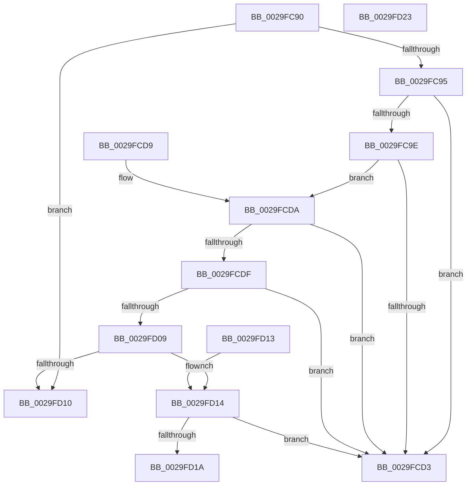

# MiCheckSameSlabType

- RVA: `0x0029FC90`–`0x0029FD24` (길이 `148` bytes)
- VA: `0x000000014029FC90`
- 실행 섹션: `.text`
- PDB 이름 있음: `예`; PDB Function 태그: `아니요`
- unwind 정보 RVA: `0x000DB714`
- 디코드: `43`개 명령, `148/148` bytes 표시
- 미해석 바이트: `0` (있으면 어셈블리에 `.byte`로 보존)

> 이 문서는 커널 이미지의 기계어와 PDB 기호를 분석해 생성했습니다. 4번과 5번은 함수 원형과 자료형을 바이너리 사용 방식에서 추정한 C 해석이며 원본 소스 복구 결과는 아닙니다.

## 1. Dependencies

- 직접 호출 지점: **0**; 고유 호출 대상: **0**
- 직접 호출자로 확인된 함수: **3**
- RIP 상대 이미지 참조: **2**

### Outgoing calls
- 직접 디코드된 call 명령이 없습니다.

### Direct callers
- [MiSwapStackPage](MiSwapStackPage_function_0029FDE0.md) at `0x002A0014`
- [sub_006DB77C](../6D/Unknown_function_006DB77C.md) at `0x006DB8C7`
- [sub_006F60F8](../6F/Unknown_function_006F60F8.md) at `0x006F61E2`

### Static image references
- `0x0029FC95` → RVA `0x00E3CBE6` (`.data`; read)
- `0x0029FCAB` → RVA `0x00E3D240` (`.data`; read)

## 2. Other-region calls and transfers

- 다른 실행 섹션으로 향하는 call: **0**
- 별도 외부 분기/꼬리 이동을 확인하지 못했습니다.

## 3. Assembly (complete function range)

```asm
0029FC90  41 3B D1                        cmp edx, r9d
0029FC93  75 7B                           jne 0x14029fd10
0029FC95  80 3D 4A CF B9 00 00            cmp byte ptr [rip + 0xb9cf4a], 0
0029FC9C  74 35                           je 0x14029fcd3
0029FC9E  49 BA 00 00 00 00 00 DE FF FF   movabs r10, 0xffffde0000000000
0029FCA8  49 8B C2                        mov rax, r10
0029FCAB  48 8B 15 8E D5 B9 00            mov rdx, qword ptr [rip + 0xb9d58e]
0029FCB2  48 2B C8                        sub rcx, rax
0029FCB5  48 C1 F9 04                     sar rcx, 4
0029FCB9  49 BB AB AA AA AA AA AA AA AA   movabs r11, 0xaaaaaaaaaaaaaaab
0029FCC3  49 0F AF CB                     imul rcx, r11
0029FCC7  48 C1 E9 09                     shr rcx, 9
0029FCCB  0F B6 04 4A                     movzx eax, byte ptr [rdx + rcx*2]
0029FCCF  85 C0                           test eax, eax
0029FCD1  75 07                           jne 0x14029fcda
0029FCD3  B8 01 00 00 00                  mov eax, 1
0029FCD8  C3                              ret
0029FCD9  CC                              int3
0029FCDA  83 F8 09                        cmp eax, 9
0029FCDD  75 F4                           jne 0x14029fcd3
0029FCDF  44 0F B6 4C 4A 01               movzx r9d, byte ptr [rdx + rcx*2 + 1]
0029FCE5  41 80 E1 7F                     and r9b, 0x7f
0029FCE9  49 8B C2                        mov rax, r10
0029FCEC  4C 2B C0                        sub r8, rax
0029FCEF  49 C1 F8 04                     sar r8, 4
0029FCF3  4D 0F AF C3                     imul r8, r11
0029FCF7  49 C1 E8 09                     shr r8, 9
0029FCFB  42 0F B6 4C 42 01               movzx ecx, byte ptr [rdx + r8*2 + 1]
0029FD01  80 E1 7F                        and cl, 0x7f
0029FD04  44 3A C9                        cmp r9b, cl
0029FD07  74 CA                           je 0x14029fcd3
0029FD09  83 7C 24 28 00                  cmp dword ptr [rsp + 0x28], 0
0029FD0E  75 04                           jne 0x14029fd14
0029FD10  33 C0                           xor eax, eax
0029FD12  C3                              ret
0029FD13  CC                              int3
0029FD14  41 80 F9 40                     cmp r9b, 0x40
0029FD18  73 B9                           jae 0x14029fcd3
0029FD1A  33 C0                           xor eax, eax
0029FD1C  80 F9 40                        cmp cl, 0x40
0029FD1F  0F 93 C0                        setae al
0029FD22  C3                              ret
0029FD23  CC                              int3
```

## 4. C-style interpretation (structured pseudocode)

```c
__int64 __fastcall MiCheckSameSlabType(__int64 a1, int a2, __int64 a3, int a4, unsigned int a5)
{
    __int64 result;

    if (a2 != a4) goto loc_0029FD10;
    if ((*(unsigned __int8 *)(v_rip + 12177226)) == 0) goto loc_0029FCD3;
    a1 = (a1) - (v_r10);
    a1 = (a1) >> (4);
    a1 = (a1) * (v_r11);
    a1 = (a1) >> (9);
    if ((unsigned int)(*(unsigned __int8 *)(*(unsigned __int64 *)(v_rip + 12178830) + a1 * 2)) != 0) goto loc_0029FCDA;
loc_0029FCD3:
    return 1;
loc_0029FCDA:
    if (1 != 9) goto loc_0029FCD3;
    a4 = (unsigned __int8)((*(unsigned __int8 *)(*(unsigned __int64 *)(v_rip + 12178830) + a1 * 2 + 1)) & (127));
    a3 = (a3) - (v_r10);
    a3 = (a3) >> (4);
    a3 = (a3) * (v_r11);
    a3 = (a3) >> (9);
    a1 = (unsigned __int8)((*(unsigned __int8 *)(*(unsigned __int64 *)(v_rip + 12178830) + a3 * 2 + 1)) & (127));
    if (((unsigned __int8)(a4)) == ((unsigned __int8)(a1))) goto loc_0029FCD3;
    if (a5 != 0) goto loc_0029FD14;
loc_0029FD10:
    result = 0;
    return result;
loc_0029FD14:
    if (((unsigned __int8)(a4)) >= 64) goto loc_0029FCD3;
    result = 0;
    result = (((unsigned __int8)(a1)) >= 64) ? 1 : 0;
    return result;
}
```

## 5. (Beta) C Style

```c
int64_t MiCheckSameSlabType(int64_t Arg1, int32_t Arg2, int64_t Arg3, int32_t Arg4, uint32_t Arg5)
{
    int64_t result;

    if (Arg2 != Arg4) goto loc_0029FD10;
    if ((*(uint8_t *)(v_rip + 0xB9CF4A)) == 0) goto loc_0029FCD3;
    Arg1 = (Arg1) - (local_r10);
    Arg1 = (Arg1) >> (4);
    Arg1 = (Arg1) * (local_r11);
    Arg1 = (Arg1) >> (9);
    if ((uint32_t)(*(uint8_t *)(*(uint64_t *)(v_rip + 0xB9D58E) + Arg1 * 2)) != 0) goto loc_0029FCDA;
loc_0029FCD3:
    return 1;
loc_0029FCDA:
    if (1 != 9) goto loc_0029FCD3;
    Arg4 = (uint8_t)((*(uint8_t *)(*(uint64_t *)(v_rip + 0xB9D58E) + Arg1 * 2 + 0x1)) & (127));
    Arg3 = (Arg3) - (local_r10);
    Arg3 = (Arg3) >> (4);
    Arg3 = (Arg3) * (local_r11);
    Arg3 = (Arg3) >> (9);
    Arg1 = (uint8_t)((*(uint8_t *)(*(uint64_t *)(v_rip + 0xB9D58E) + Arg3 * 2 + 0x1)) & (127));
    if (((uint8_t)(Arg4)) == ((uint8_t)(Arg1))) goto loc_0029FCD3;
    if (Arg5 != 0) goto loc_0029FD14;
loc_0029FD10:
    result = 0;
    return result;
loc_0029FD14:
    if (((uint8_t)(Arg4)) >= 64) goto loc_0029FCD3;
    result = 0;
    result = (((uint8_t)(Arg1)) >= 64) ? 1 : 0;
    return result;
}
```

## 6. Execution-region graph

[열기: 2D/3D 그래프와 함수 탐색 컨트롤 패널](../../../control-panel.html?section=text&rva=0x0029FC90&view=graph)

- 2D 그래프는 위에서 아래로 흐르고, 3D 그래프는 빈 공간을 드래그해 회전합니다. Shift+드래그는 이동, 휠은 확대·축소, 함수 노드 선택은 대상 보고서 이동입니다.

### Static fallback


