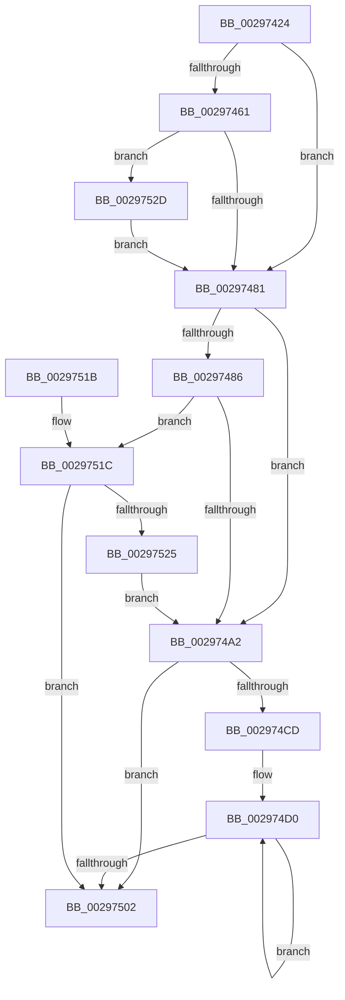

# MiClearVadBits

- RVA: `0x00297424`–`0x00297535` (길이 `273` bytes)
- VA: `0x0000000140297424`
- 실행 섹션: `.text`
- PDB 이름 있음: `예`; PDB Function 태그: `아니요`
- unwind 정보 RVA: `0x0005FDA8`
- 디코드: `73`개 명령, `273/273` bytes 표시
- 미해석 바이트: `0` (있으면 어셈블리에 `.byte`로 보존)

> 이 문서는 커널 이미지의 기계어와 PDB 기호를 분석해 생성했습니다. 4번과 5번은 함수 원형과 자료형을 바이너리 사용 방식에서 추정한 C 해석이며 원본 소스 복구 결과는 아닙니다.

## 1. Dependencies

- 직접 호출 지점: **1**; 고유 호출 대상: **1**
- 직접 호출자로 확인된 함수: **1**
- RIP 상대 이미지 참조: **0**

### Outgoing calls
- `0x002974F0` → [MiClearVadCellBits](MiClearVadCellBits_function_0029753C.md) (function, `0x0029753C`)

### Direct callers
- [MiRemoveVad](MiRemoveVad_function_00295C78.md) at `0x00295E18`

### Static image references
- 디코드된 RIP-relative 메모리 참조가 없습니다.

## 2. Other-region calls and transfers

- 다른 실행 섹션으로 향하는 call: **0**
- 별도 외부 분기/꼬리 이동을 확인하지 못했습니다.

## 3. Assembly (complete function range)

```asm
00297424  48 89 5C 24 10                  mov qword ptr [rsp + 0x10], rbx
00297429  48 89 6C 24 18                  mov qword ptr [rsp + 0x18], rbp
0029742E  48 89 74 24 20                  mov qword ptr [rsp + 0x20], rsi
00297433  57                              push rdi
00297434  41 56                           push r14
00297436  41 57                           push r15
00297438  48 83 EC 30                     sub rsp, 0x30
0029743C  4D 8B F8                        mov r15, r8
0029743F  48 8B E9                        mov rbp, rcx
00297442  48 8B FA                        mov rdi, rdx
00297445  48 C1 ED 10                     shr rbp, 0x10
00297449  48 C1 EF 10                     shr rdi, 0x10
0029744D  33 DB                           xor ebx, ebx
0029744F  4D 8B F1                        mov r14, r9
00297452  4C 8B C2                        mov r8, rdx
00297455  49 C7 C1 00 00 FF FF            mov r9, 0xffffffffffff0000
0029745C  4D 85 FF                        test r15, r15
0029745F  74 20                           je 0x140297481
00297461  41 0F B6 57 21                  movzx edx, byte ptr [r15 + 0x21]
00297466  41 8B 47 1C                     mov eax, dword ptr [r15 + 0x1c]
0029746A  48 C1 E2 20                     shl rdx, 0x20
0029746E  48 0B D0                        or rdx, rax
00297471  48 C1 E2 0C                     shl rdx, 0xc
00297475  48 33 D1                        xor rdx, rcx
00297478  49 85 D1                        test r9, rdx
0029747B  0F 84 AC 00 00 00               je 0x14029752d
00297481  4D 85 F6                        test r14, r14
00297484  74 1C                           je 0x1402974a2
00297486  41 0F B6 4E 20                  movzx ecx, byte ptr [r14 + 0x20]
0029748B  41 8B 46 18                     mov eax, dword ptr [r14 + 0x18]
0029748F  48 C1 E1 20                     shl rcx, 0x20
00297493  48 0B C8                        or rcx, rax
00297496  48 C1 E1 0C                     shl rcx, 0xc
0029749A  49 33 C8                        xor rcx, r8
0029749D  49 85 C9                        test r9, rcx
002974A0  74 7A                           je 0x14029751c
002974A2  65 48 8B 04 25 88 01 00 00      mov rax, qword ptr gs:[0x188]
002974AB  89 5C 24 50                     mov dword ptr [rsp + 0x50], ebx
002974AF  48 8B 88 B8 00 00 00            mov rcx, qword ptr [rax + 0xb8]
002974B6  48 8B B1 10 04 00 00            mov rsi, qword ptr [rcx + 0x410]
002974BD  48 81 C6 00 03 00 00            add rsi, 0x300
002974C4  48 39 9E D8 00 00 00            cmp qword ptr [rsi + 0xd8], rbx
002974CB  76 35                           jbe 0x140297502
002974CD  48 8B C3                        mov rax, rbx
002974D0  48 8D 04 C0                     lea rax, [rax + rax*8]
002974D4  4D 8B CF                        mov r9, r15
002974D7  48 8D 0C C6                     lea rcx, [rsi + rax*8]
002974DB  4C 8B C7                        mov r8, rdi
002974DE  48 8D 44 24 50                  lea rax, [rsp + 0x50]
002974E3  48 8B D5                        mov rdx, rbp
002974E6  48 89 44 24 28                  mov qword ptr [rsp + 0x28], rax
002974EB  4C 89 74 24 20                  mov qword ptr [rsp + 0x20], r14
002974F0  E8 47 00 00 00                  call 0x14029753c
002974F5  FF C3                           inc ebx
002974F7  8B C3                           mov eax, ebx
002974F9  48 3B 86 D8 00 00 00            cmp rax, qword ptr [rsi + 0xd8]
00297500  72 CE                           jb 0x1402974d0
00297502  48 8B 5C 24 58                  mov rbx, qword ptr [rsp + 0x58]
00297507  48 8B 6C 24 60                  mov rbp, qword ptr [rsp + 0x60]
0029750C  48 8B 74 24 68                  mov rsi, qword ptr [rsp + 0x68]
00297511  48 83 C4 30                     add rsp, 0x30
00297515  41 5F                           pop r15
00297517  41 5E                           pop r14
00297519  5F                              pop rdi
0029751A  C3                              ret
0029751B  CC                              int3
0029751C  48 8D 47 FF                     lea rax, [rdi - 1]
00297520  48 3B C7                        cmp rax, rdi
00297523  77 DD                           ja 0x140297502
00297525  48 8B F8                        mov rdi, rax
00297528  E9 75 FF FF FF                  jmp 0x1402974a2
0029752D  48 FF C5                        inc rbp
00297530  E9 4C FF FF FF                  jmp 0x140297481
```

## 4. C-style interpretation (structured pseudocode)

```c
__int64 __fastcall MiClearVadBits(__int64 a1, __int64 a2, __int64 a3, __int64 a4)
{
    __int64 result;
    __int64 v_rbp;
    __int64 v_rbx;
    __int64 v_rdi;
    __int64 v_rsi;
    __int64 v_rsp;
    unsigned __int64 v_stack_m20;
    unsigned __int64 v_stack_m28;
    unsigned __int64 v_stack_p10;
    unsigned __int64 v_stack_p18;
    unsigned __int64 v_stack_p20;
    unsigned int v_stack_p8;

    v_stack_p10 = v_rbx;
    v_stack_p18 = v_rbp;
    v_stack_p20 = v_rsi;
    v_rsp = (v_rsp) - (48);
    v_rbp = (a1) >> (16);
    v_rdi = (a2) >> (16);
    v_rbx = 0;
    if (a3 == 0) goto loc_00297481;
    a2 = (*(unsigned __int8 *)(a3 + 33)) << (32);
    a2 = (a2) | ((unsigned int)(*(unsigned int *)(a3 + 28)));
    a2 = (a2) << (12);
    a2 = (a2) ^ (a1);
    if (((0xFFFFFFFFFFFF0000ULL) & (a2)) == 0) goto loc_0029752D;
loc_00297481:
    if (a4 == 0) goto loc_002974A2;
    a1 = (*(unsigned __int8 *)(a4 + 32)) << (32);
    a1 = (a1) | ((unsigned int)(*(unsigned int *)(a4 + 24)));
    a1 = (a1) << (12);
    a1 = (a1) ^ (a2);
    if (((0xFFFFFFFFFFFF0000ULL) & (a1)) == 0) goto loc_0029751C;
loc_002974A2:
    v_stack_p8 = 0;
    v_rsi = (*(unsigned __int64 *)(*(unsigned __int64 *)(*(unsigned __int64 *)(gs_base + (0 + 392)) + 184) + 1040)) + (768);
    if ((*(unsigned __int64 *)(v_rsi + 216)) <= 0) goto loc_00297502;
loc_002974D0:
    v_stack_m20 = v_stack_p8;
    v_stack_m28 = a4;
    result = MiClearVadCellBits(v_rsi + 0 + 0 * 8 * 8, v_rbp, v_rdi, a3);
    v_rbx = (unsigned int)((v_rbx) + 1);
    if (((unsigned int)((unsigned int)(v_rbx))) < (*(unsigned __int64 *)(v_rsi + 216))) goto loc_002974D0;
loc_00297502:
    v_rsp = (v_rsp) + (48);
    return (unsigned int)((unsigned int)(v_rbx));
loc_0029751C:
    if ((v_rdi - 1) > v_rdi) goto loc_00297502;
    goto loc_002974A2;
loc_0029752D:
    v_rbp = (v_stack_p18) + 1;
    goto loc_00297481;
}
```

## 5. (Beta) C Style

```c
int64_t MiClearVadBits(int64_t Arg1, int64_t Arg2, int64_t Arg3, int64_t Arg4)
{
    int64_t result;
    int64_t local_rbp;
    int64_t local_rbx;
    int64_t local_rdi;
    int64_t local_rsi;
    int64_t local_rsp;
    uint64_t v_stack_m20;
    uint64_t v_stack_m28;
    uint64_t v_stack_p10;
    uint64_t v_stack_p18;
    uint64_t v_stack_p20;
    uint32_t v_stack_p8;

    v_stack_p10 = local_rbx;
    v_stack_p18 = local_rbp;
    v_stack_p20 = local_rsi;
    local_rsp = (local_rsp) - (48);
    local_rbp = (Arg1) >> (16);
    local_rdi = (Arg2) >> (16);
    local_rbx = 0;
    if (Arg3 == 0) goto loc_00297481;
    Arg2 = (*(uint8_t *)(Arg3 + 0x21)) << (32);
    Arg2 = (Arg2) | ((uint32_t)(*(uint32_t *)(Arg3 + 0x1C)));
    Arg2 = (Arg2) << (12);
    Arg2 = (Arg2) ^ (Arg1);
    if (((0xFFFFFFFFFFFF0000ULL) & (Arg2)) == 0) goto loc_0029752D;
loc_00297481:
    if (Arg4 == 0) goto loc_002974A2;
    Arg1 = (*(uint8_t *)(Arg4 + 0x20)) << (32);
    Arg1 = (Arg1) | ((uint32_t)(*(uint32_t *)(Arg4 + 0x18)));
    Arg1 = (Arg1) << (12);
    Arg1 = (Arg1) ^ (Arg2);
    if (((0xFFFFFFFFFFFF0000ULL) & (Arg1)) == 0) goto loc_0029751C;
loc_002974A2:
    v_stack_p8 = 0;
    local_rsi = (*(uint64_t *)(*(uint64_t *)(*(uint64_t *)(gs_base + (0 + 0x188)) + 0xB8) + 0x410)) + (768);
    if ((*(uint64_t *)(local_rsi + 0xD8)) <= 0) goto loc_00297502;
loc_002974D0:
    v_stack_m20 = v_stack_p8;
    v_stack_m28 = Arg4;
    result = MiClearVadCellBits(local_rsi + 0 + 0 * 8 * 8, local_rbp, local_rdi, Arg3);
    local_rbx = (uint32_t)((local_rbx) + 1);
    if (((uint32_t)((uint32_t)(local_rbx))) < (*(uint64_t *)(local_rsi + 0xD8))) goto loc_002974D0;
loc_00297502:
    local_rsp = (local_rsp) + (48);
    return (uint32_t)((uint32_t)(local_rbx));
loc_0029751C:
    if ((local_rdi - 1) > local_rdi) goto loc_00297502;
    goto loc_002974A2;
loc_0029752D:
    local_rbp = (v_stack_p18) + 1;
    goto loc_00297481;
}
```

## 6. Execution-region graph

[열기: 2D/3D 그래프와 함수 탐색 컨트롤 패널](../../../control-panel.html?section=text&rva=0x00297424&view=graph)

- 2D 그래프는 위에서 아래로 흐르고, 3D 그래프는 빈 공간을 드래그해 회전합니다. Shift+드래그는 이동, 휠은 확대·축소, 함수 노드 선택은 대상 보고서 이동입니다.

### Static fallback


