# MiClearVadCellBits

- RVA: `0x0029753C`–`0x0029772B` (길이 `495` bytes)
- VA: `0x000000014029753C`
- 실행 섹션: `.text`
- PDB 이름 있음: `예`; PDB Function 태그: `아니요`
- unwind 정보 RVA: `0x000679AC`
- 디코드: `141`개 명령, `495/495` bytes 표시
- 미해석 바이트: `0` (있으면 어셈블리에 `.byte`로 보존)

> 이 문서는 커널 이미지의 기계어와 PDB 기호를 분석해 생성했습니다. 4번과 5번은 함수 원형과 자료형을 바이너리 사용 방식에서 추정한 C 해석이며 원본 소스 복구 결과는 아닙니다.

## 1. Dependencies

- 직접 호출 지점: **2**; 고유 호출 대상: **2**
- 직접 호출자로 확인된 함수: **1**
- RIP 상대 이미지 참조: **0**

### Outgoing calls
- `0x00297566` → [MiVadBitToUserVa](../../page/9D/MiVadBitToUserVa_function_009D60D0.md) (function, `0x009D60D0`)
- `0x002975EC` → [RtlClearBitsEx](RtlClearBitsEx_function_00297740.md) (function, `0x00297740`)

### Direct callers
- [MiClearVadBits](MiClearVadBits_function_00297424.md) at `0x002974F0`

### Static image references
- 디코드된 RIP-relative 메모리 참조가 없습니다.

## 2. Other-region calls and transfers

- 다른 실행 섹션으로 향하는 call: **1**
  - `0x00297566` → [MiVadBitToUserVa](../../page/9D/MiVadBitToUserVa_function_009D60D0.md) (`.text` → `PAGE`)
- 별도 외부 분기/꼬리 이동을 확인하지 못했습니다.

## 3. Assembly (complete function range)

```asm
0029753C  48 89 5C 24 10                  mov qword ptr [rsp + 0x10], rbx
00297541  48 89 6C 24 18                  mov qword ptr [rsp + 0x18], rbp
00297546  48 89 74 24 20                  mov qword ptr [rsp + 0x20], rsi
0029754B  57                              push rdi
0029754C  41 54                           push r12
0029754E  41 55                           push r13
00297550  41 56                           push r14
00297552  41 57                           push r15
00297554  48 83 EC 20                     sub rsp, 0x20
00297558  4C 8B D2                        mov r10, rdx
0029755B  4D 8B E9                        mov r13, r9
0029755E  33 D2                           xor edx, edx
00297560  49 8B E8                        mov rbp, r8
00297563  48 8B D9                        mov rbx, rcx
00297566  E8 65 EB 73 00                  call 0x1409d60d0
0029756B  48 8B F8                        mov rdi, rax
0029756E  48 89 44 24 50                  mov qword ptr [rsp + 0x50], rax
00297573  48 C1 EF 10                     shr rdi, 0x10
00297577  44 8D 5A 01                     lea r11d, [rdx + 1]
0029757B  4C 8B C8                        mov r9, rax
0029757E  4D 85 D2                        test r10, r10
00297581  0F 84 98 01 00 00               je 0x14029771f
00297587  4D 3B D0                        cmp r10, r8
0029758A  0F 87 21 01 00 00               ja 0x1402976b1
00297590  4C 3B C7                        cmp r8, rdi
00297593  0F 82 18 01 00 00               jb 0x1402976b1
00297599  48 8B 09                        mov rcx, qword ptr [rcx]
0029759C  48 03 CF                        add rcx, rdi
0029759F  4C 3B D1                        cmp r10, rcx
002975A2  0F 83 09 01 00 00               jae 0x1402976b1
002975A8  4C 3B D7                        cmp r10, rdi
002975AB  4D 8B F2                        mov r14, r10
002975AE  4C 0F 42 F7                     cmovb r14, rdi
002975B2  45 33 FF                        xor r15d, r15d
002975B5  4C 3B D7                        cmp r10, rdi
002975B8  41 0F 92 C7                     setb r15b
002975BC  4C 3B C1                        cmp r8, rcx
002975BF  0F 83 4E 01 00 00               jae 0x140297713
002975C5  4C 8B 64 24 78                  mov r12, qword ptr [rsp + 0x78]
002975CA  4C 8B C5                        mov r8, rbp
002975CD  48 8B 73 40                     mov rsi, qword ptr [rbx + 0x40]
002975D1  4D 2B C6                        sub r8, r14
002975D4  4D 03 C3                        add r8, r11
002975D7  4C 2B F7                        sub r14, rdi
002975DA  48 2B EF                        sub rbp, rdi
002975DD  48 2B F7                        sub rsi, rdi
002975E0  41 39 14 24                     cmp dword ptr [r12], edx
002975E4  75 1F                           jne 0x140297605
002975E6  49 8B D6                        mov rdx, r14
002975E9  48 8B CB                        mov rcx, rbx
002975EC  E8 4F 01 00 00                  call 0x140297740
002975F1  4C 8B 4C 24 50                  mov r9, qword ptr [rsp + 0x50]
002975F6  41 BB 01 00 00 00               mov r11d, 1
002975FC  45 85 FF                        test r15d, r15d
002975FF  75 04                           jne 0x140297605
00297601  45 89 1C 24                     mov dword ptr [r12], r11d
00297605  48 8B 43 10                     mov rax, qword ptr [rbx + 0x10]
00297609  41 8B D3                        mov edx, r11d
0029760C  48 3B C6                        cmp rax, rsi
0029760F  0F 82 F7 00 00 00               jb 0x14029770c
00297615  48 39 73 20                     cmp qword ptr [rbx + 0x20], rsi
00297619  0F 82 ED 00 00 00               jb 0x14029770c
0029761F  49 3B C6                        cmp rax, r14
00297622  0F 87 B6 00 00 00               ja 0x1402976de
00297628  33 C9                           xor ecx, ecx
0029762A  4D 85 ED                        test r13, r13
0029762D  0F 84 9E 00 00 00               je 0x1402976d1
00297633  41 0F B6 4D 21                  movzx ecx, byte ptr [r13 + 0x21]
00297638  41 8B 45 1C                     mov eax, dword ptr [r13 + 0x1c]
0029763C  48 C1 E1 20                     shl rcx, 0x20
00297640  48 0B C8                        or rcx, rax
00297643  48 C1 E1 0C                     shl rcx, 0xc
00297647  48 81 C9 FF 0F 00 00            or rcx, 0xfff
0029764E  48 81 C1 FF FF 00 00            add rcx, 0xffff
00297655  48 C1 E9 10                     shr rcx, 0x10
00297659  48 3B CF                        cmp rcx, rdi
0029765C  76 71                           jbe 0x1402976cf
0029765E  48 2B CF                        sub rcx, rdi
00297661  74 6E                           je 0x1402976d1
00297663  85 D2                           test edx, edx
00297665  74 07                           je 0x14029766e
00297667  48 3B CE                        cmp rcx, rsi
0029766A  48 0F 42 CE                     cmovb rcx, rsi
0029766E  48 3B CD                        cmp rcx, rbp
00297671  77 3E                           ja 0x1402976b1
00297673  48 8B 44 24 70                  mov rax, qword ptr [rsp + 0x70]
00297678  48 85 C0                        test rax, rax
0029767B  74 6F                           je 0x1402976ec
0029767D  0F B6 50 20                     movzx edx, byte ptr [rax + 0x20]
00297681  8B 40 18                        mov eax, dword ptr [rax + 0x18]
00297684  4C 8B 03                        mov r8, qword ptr [rbx]
00297687  48 C1 E8 04                     shr rax, 4
0029768B  48 C1 E2 1C                     shl rdx, 0x1c
0029768F  48 0B D0                        or rdx, rax
00297692  49 8D 04 38                     lea rax, [r8 + rdi]
00297696  48 3B D0                        cmp rdx, rax
00297699  77 56                           ja 0x1402976f1
0029769B  48 2B D7                        sub rdx, rdi
0029769E  48 3B 4B 20                     cmp rcx, qword ptr [rbx + 0x20]
002976A2  73 0D                           jae 0x1402976b1
002976A4  48 2B D1                        sub rdx, rcx
002976A7  48 3B 53 18                     cmp rdx, qword ptr [rbx + 0x18]
002976AB  72 04                           jb 0x1402976b1
002976AD  48 89 4B 20                     mov qword ptr [rbx + 0x20], rcx
002976B1  48 8B 5C 24 58                  mov rbx, qword ptr [rsp + 0x58]
002976B6  48 8B 6C 24 60                  mov rbp, qword ptr [rsp + 0x60]
002976BB  48 8B 74 24 68                  mov rsi, qword ptr [rsp + 0x68]
002976C0  48 83 C4 20                     add rsp, 0x20
002976C4  41 5F                           pop r15
002976C6  41 5E                           pop r14
002976C8  41 5D                           pop r13
002976CA  41 5C                           pop r12
002976CC  5F                              pop rdi
002976CD  C3                              ret
002976CE  CC                              int3
002976CF  33 C9                           xor ecx, ecx
002976D1  49 81 F9 00 00 01 00            cmp r9, 0x10000
002976D8  49 0F 42 CB                     cmovb rcx, r11
002976DC  EB 85                           jmp 0x140297663
002976DE  4C 3B F6                        cmp r14, rsi
002976E1  72 13                           jb 0x1402976f6
002976E3  4C 89 73 10                     mov qword ptr [rbx + 0x10], r14
002976E7  E9 3C FF FF FF                  jmp 0x140297628
002976EC  48 8B 13                        mov rdx, qword ptr [rbx]
002976EF  EB AD                           jmp 0x14029769e
002976F1  49 8B D0                        mov rdx, r8
002976F4  EB A8                           jmp 0x14029769e
002976F6  85 D2                           test edx, edx
002976F8  74 E9                           je 0x1402976e3
002976FA  48 3B EE                        cmp rbp, rsi
002976FD  0F 82 25 FF FF FF               jb 0x140297628
00297703  48 89 73 10                     mov qword ptr [rbx + 0x10], rsi
00297707  E9 1C FF FF FF                  jmp 0x140297628
0029770C  33 D2                           xor edx, edx
0029770E  E9 0C FF FF FF                  jmp 0x14029761f
00297713  48 8D 69 FF                     lea rbp, [rcx - 1]
00297717  45 8B FB                        mov r15d, r11d
0029771A  E9 A6 FE FF FF                  jmp 0x1402975c5
0029771F  48 85 FF                        test rdi, rdi
00297722  4D 0F 44 D3                     cmove r10, r11
00297726  E9 5C FE FF FF                  jmp 0x140297587
```

## 4. C-style interpretation (structured pseudocode)

```c
__int64 __fastcall MiClearVadCellBits(__int64 a1, __int64 a2, __int64 a3, __int64 a4, __int64 a5, __int64 a6)
{
    __int64 result;
    __int64 v_r14;
    __int64 v_r15;
    __int64 v_rbp;
    __int64 v_rdi;
    __int64 v_rsi;
    __int64 v_rsp;
    unsigned __int64 v_stack_p10;
    unsigned __int64 v_stack_p18;
    unsigned __int64 v_stack_p20;
    unsigned __int64 v_stack_p8;

    v_stack_p10 = v_rbx;
    v_stack_p18 = v_rbp;
    v_stack_p20 = v_rsi;
    v_rsp = (v_rsp) - (32);
    a2 = 0;
    result = MiVadBitToUserVa(a1, a2, a3, a4);
    v_stack_p8 = result;
    v_rdi = (result) >> (16);
    if (0 == 0) goto loc_0029771F;
loc_00297587:
    if (0 > a3) goto loc_002976B1;
    if (a3 < v_rdi) goto loc_002976B1;
    a1 = (*(unsigned __int64 *)(a1)) + (v_rdi);
    if (0 >= a1) goto loc_002976B1;
    v_r14 = 0;
    if (0 < v_rdi) { v_r14 = v_rdi; }
    v_r15 = 0;
    v_r15 = (0 < v_rdi) ? 1 : 0;
    if (a3 >= a1) goto loc_00297713;
loc_002975C5:
    a3 = (a3) - (v_r14);
    a3 = (a3) + (a2 + 1);
    v_r14 = (v_r14) - (v_rdi);
    v_rbp = (a3) - (v_rdi);
    v_rsi = (*(unsigned __int64 *)(a1 + 64)) - (v_rdi);
    if ((*(unsigned int *)(a6)) != 0) goto loc_00297605;
    result = RtlClearBitsEx(a1, v_r14, a3, result);
    if ((unsigned int)(v_r15) == 0) {
        *(unsigned int *)(a6) = 1;
    }
    if ((*(unsigned __int64 *)(a1 + 16)) < v_rsi) goto loc_0029770C;
    if ((*(unsigned __int64 *)(a1 + 32)) < v_rsi) goto loc_0029770C;
loc_0029761F:
    if ((*(unsigned __int64 *)(a1 + 16)) > v_r14) goto loc_002976DE;
loc_00297628:
    a1 = 0;
    if (a4 == 0) goto loc_002976D1;
    a1 = (*(unsigned __int8 *)(a4 + 33)) << (32);
    a1 = (a1) | ((unsigned int)(*(unsigned int *)(a4 + 28)));
    a1 = (a1) << (12);
    a1 = (a1) | (0xFFFULL);
    a1 = (a1) + (0xFFFFULL);
    a1 = (a1) >> (16);
    if (a1 <= v_rdi) goto loc_002976CF;
    a1 = (a1) - (v_rdi);
    if (condition_is_equal) goto loc_002976D1;
loc_00297663:
    if (1 != 0) {
        if (a1 < v_rsi) { a1 = v_rsi; }
    }
    if (a1 > v_rbp) goto loc_002976B1;
    if (a5 == 0) goto loc_002976EC;
    result = ((unsigned int)(*(unsigned int *)(a5 + 24))) >> (4);
    a2 = (*(unsigned __int8 *)(a5 + 32)) << (28);
    a2 = (a2) | (result);
    if (a2 > (*(unsigned __int64 *)(a1) + v_rdi * 1)) goto loc_002976F1;
    a2 = (a2) - (v_rdi);
loc_0029769E:
    if (a1 >= (*(unsigned __int64 *)(a1 + 32))) goto loc_002976B1;
    a2 = (a2) - (a1);
    if (a2 >= (*(unsigned __int64 *)(a1 + 24))) {
        *(unsigned __int64 *)(a1 + 32) = a1;
    }
    v_rsp = (v_rsp) + (32);
    return *(unsigned __int64 *)(a1) + v_rdi * 1;
loc_002976CF:
    a1 = 0;
loc_002976D1:
    if (v_stack_p8 < 0x10000ULL) { a1 = 1; }
    goto loc_00297663;
loc_002976DE:
    if (v_r14 < v_stack_p20) goto loc_002976F6;
loc_002976E3:
    *(unsigned __int64 *)(v_stack_p10 + 16) = v_r14;
    goto loc_00297628;
loc_002976EC:
    goto loc_0029769E;
loc_002976F1:
    goto loc_0029769E;
loc_002976F6:
    if ((unsigned int)(*(unsigned __int64 *)(a1)) == 0) goto loc_002976E3;
    if (v_stack_p18 < v_stack_p20) goto loc_00297628;
    *(unsigned __int64 *)(v_stack_p10 + 16) = v_stack_p20;
    goto loc_00297628;
loc_0029770C:
    a2 = 0;
    goto loc_0029761F;
loc_00297713:
    goto loc_002975C5;
loc_0029771F:
    if (v_rdi == 0) { a2 = 1; }
    goto loc_00297587;
}
```

## 5. (Beta) C Style

```c
int64_t MiClearVadCellBits(void *Arg1, int64_t Arg2, int64_t Arg3, int64_t Arg4, int64_t Arg5, void *Arg6)
{
    uint8_t *arg1 = (uint8_t *)Arg1;
    uint8_t *arg6 = (uint8_t *)Arg6;

    int64_t result;
    int64_t local_r14;
    int64_t local_r15;
    int64_t local_rbp;
    int64_t local_rdi;
    int64_t local_rsi;
    int64_t local_rsp;
    uint64_t v_stack_p10;
    uint64_t v_stack_p18;
    uint64_t v_stack_p20;
    uint64_t v_stack_p8;

    v_stack_p10 = local_rbx;
    v_stack_p18 = local_rbp;
    v_stack_p20 = local_rsi;
    local_rsp = (local_rsp) - (32);
    Arg2 = 0;
    result = MiVadBitToUserVa(Arg1, Arg2, Arg3, Arg4);
    v_stack_p8 = result;
    local_rdi = (result) >> (16);
    if (0 == 0) goto loc_0029771F;
loc_00297587:
    if (0 > Arg3) goto loc_002976B1;
    if (Arg3 < local_rdi) goto loc_002976B1;
    Arg1 = (*(uint64_t *)(arg1)) + (local_rdi);
    if (0 >= Arg1) goto loc_002976B1;
    local_r14 = 0;
    if (0 < local_rdi) { local_r14 = local_rdi; }
    local_r15 = 0;
    local_r15 = (0 < local_rdi) ? 1 : 0;
    if (Arg3 >= Arg1) goto loc_00297713;
loc_002975C5:
    Arg3 = (Arg3) - (local_r14);
    Arg3 = (Arg3) + (Arg2 + 1);
    local_r14 = (local_r14) - (local_rdi);
    local_rbp = (Arg3) - (local_rdi);
    local_rsi = (*(uint64_t *)(arg1 + 0x40)) - (local_rdi);
    if ((*(uint32_t *)(arg6)) != 0) goto loc_00297605;
    result = RtlClearBitsEx(Arg1, local_r14, Arg3, result);
    if ((uint32_t)(local_r15) == 0) {
        *(uint32_t *)(arg6) = 1;
    }
    if ((*(uint64_t *)(arg1 + 0x10)) < local_rsi) goto loc_0029770C;
    if ((*(uint64_t *)(arg1 + 0x20)) < local_rsi) goto loc_0029770C;
loc_0029761F:
    if ((*(uint64_t *)(arg1 + 0x10)) > local_r14) goto loc_002976DE;
loc_00297628:
    Arg1 = 0;
    if (Arg4 == 0) goto loc_002976D1;
    Arg1 = (*(uint8_t *)(Arg4 + 0x21)) << (32);
    Arg1 = (Arg1) | ((uint32_t)(*(uint32_t *)(Arg4 + 0x1C)));
    Arg1 = (Arg1) << (12);
    Arg1 = (Arg1) | (0xFFFULL);
    Arg1 = (Arg1) + (0xFFFFULL);
    Arg1 = (Arg1) >> (16);
    if (Arg1 <= local_rdi) goto loc_002976CF;
    Arg1 = (Arg1) - (local_rdi);
    if (condition_is_equal) goto loc_002976D1;
loc_00297663:
    if (1 != 0) {
        if (Arg1 < local_rsi) { Arg1 = local_rsi; }
    }
    if (Arg1 > local_rbp) goto loc_002976B1;
    if (Arg5 == 0) goto loc_002976EC;
    result = ((uint32_t)(*(uint32_t *)(Arg5 + 0x18))) >> (4);
    Arg2 = (*(uint8_t *)(Arg5 + 0x20)) << (28);
    Arg2 = (Arg2) | (result);
    if (Arg2 > (*(uint64_t *)(arg1) + local_rdi * 1)) goto loc_002976F1;
    Arg2 = (Arg2) - (local_rdi);
loc_0029769E:
    if (Arg1 >= (*(uint64_t *)(arg1 + 0x20))) goto loc_002976B1;
    Arg2 = (Arg2) - (Arg1);
    if (Arg2 >= (*(uint64_t *)(arg1 + 0x18))) {
        *(void **)(arg1 + 0x20) = Arg1;
    }
    local_rsp = (local_rsp) + (32);
    return *(uint64_t *)(arg1) + local_rdi * 1;
loc_002976CF:
    Arg1 = 0;
loc_002976D1:
    if (v_stack_p8 < 0x10000ULL) { Arg1 = 1; }
    goto loc_00297663;
loc_002976DE:
    if (local_r14 < v_stack_p20) goto loc_002976F6;
loc_002976E3:
    *(uint64_t *)(v_stack_p10 + 0x10) = local_r14;
    goto loc_00297628;
loc_002976EC:
    goto loc_0029769E;
loc_002976F1:
    goto loc_0029769E;
loc_002976F6:
    if ((uint32_t)(*(uint64_t *)(arg1)) == 0) goto loc_002976E3;
    if (v_stack_p18 < v_stack_p20) goto loc_00297628;
    *(uint64_t *)(v_stack_p10 + 0x10) = v_stack_p20;
    goto loc_00297628;
loc_0029770C:
    Arg2 = 0;
    goto loc_0029761F;
loc_00297713:
    goto loc_002975C5;
loc_0029771F:
    if (local_rdi == 0) { Arg2 = 1; }
    goto loc_00297587;
}
```

### 관측된 메모리 오프셋

구조체 형식이 확인되지 않은 접근은 인자 기준의 오프셋으로만 기록했습니다.

| 기준 인자 | 오프셋 표현 | 폭 (bit) | 접근 |
|---|---:|---:|---|
| `Arg1` | `+ 0x0` | `64` | `R` |
| `Arg1` | `+ 0x10` | `64` | `R` |
| `Arg1` | `+ 0x10` | `64` | `W` |
| `Arg1` | `+ 0x18` | `64` | `R` |
| `Arg1` | `+ 0x20` | `64` | `R` |
| `Arg1` | `+ 0x20` | `64` | `W` |
| `Arg1` | `+ 0x40` | `64` | `R` |
| `Arg6` | `+ 0x0` | `32` | `R` |
| `Arg6` | `+ 0x0` | `32` | `W` |

## 6. Execution-region graph

[열기: 2D/3D 그래프와 함수 탐색 컨트롤 패널](../../../control-panel.html?section=text&rva=0x0029753C&view=graph)

- 2D 그래프는 위에서 아래로 흐르고, 3D 그래프는 빈 공간을 드래그해 회전합니다. Shift+드래그는 이동, 휠은 확대·축소, 함수 노드 선택은 대상 보고서 이동입니다.

### Static fallback

```mermaid
flowchart TD
  bb_0029753C[BB_0029753C]
  bb_00297587[BB_00297587]
  bb_00297590[BB_00297590]
  bb_00297599[BB_00297599]
  bb_002975A8[BB_002975A8]
  bb_002975C5[BB_002975C5]
  bb_002975E6[BB_002975E6]
  bb_00297601[BB_00297601]
  bb_00297605[BB_00297605]
  bb_00297615[BB_00297615]
  bb_0029761F[BB_0029761F]
  bb_00297628[BB_00297628]
  bb_00297633[BB_00297633]
  bb_0029765E[BB_0029765E]
  bb_00297663[BB_00297663]
  bb_00297667[BB_00297667]
  bb_0029766E[BB_0029766E]
  bb_00297673[BB_00297673]
  bb_0029767D[BB_0029767D]
  bb_0029769B[BB_0029769B]
  bb_0029769E[BB_0029769E]
  bb_002976A4[BB_002976A4]
  bb_002976AD[BB_002976AD]
  bb_002976B1[BB_002976B1]
  bb_002976CE[BB_002976CE]
  bb_002976CF[BB_002976CF]
  bb_002976D1[BB_002976D1]
  bb_002976DE[BB_002976DE]
  bb_002976E3[BB_002976E3]
  bb_002976EC[BB_002976EC]
  bb_002976F1[BB_002976F1]
  bb_002976F6[BB_002976F6]
  bb_002976FA[BB_002976FA]
  bb_00297703[BB_00297703]
  bb_0029770C[BB_0029770C]
  bb_00297713[BB_00297713]
  bb_0029771F[BB_0029771F]
  bb_0029753C -->|branch| bb_0029771F
  bb_0029753C -->|fallthrough| bb_00297587
  bb_00297587 -->|branch| bb_002976B1
  bb_00297587 -->|fallthrough| bb_00297590
  bb_00297590 -->|branch| bb_002976B1
  bb_00297590 -->|fallthrough| bb_00297599
  bb_00297599 -->|branch| bb_002976B1
  bb_00297599 -->|fallthrough| bb_002975A8
  bb_002975A8 -->|branch| bb_00297713
  bb_002975A8 -->|fallthrough| bb_002975C5
  bb_002975C5 -->|branch| bb_00297605
  bb_002975C5 -->|fallthrough| bb_002975E6
  bb_002975E6 -->|branch| bb_00297605
  bb_002975E6 -->|fallthrough| bb_00297601
  bb_00297601 -->|flow| bb_00297605
  bb_00297605 -->|branch| bb_0029770C
  bb_00297605 -->|fallthrough| bb_00297615
  bb_00297615 -->|branch| bb_0029770C
  bb_00297615 -->|fallthrough| bb_0029761F
  bb_0029761F -->|branch| bb_002976DE
  bb_0029761F -->|fallthrough| bb_00297628
  bb_00297628 -->|branch| bb_002976D1
  bb_00297628 -->|fallthrough| bb_00297633
  bb_00297633 -->|branch| bb_002976CF
  bb_00297633 -->|fallthrough| bb_0029765E
  bb_0029765E -->|branch| bb_002976D1
  bb_0029765E -->|fallthrough| bb_00297663
  bb_00297663 -->|branch| bb_0029766E
  bb_00297663 -->|fallthrough| bb_00297667
  bb_00297667 -->|flow| bb_0029766E
  bb_0029766E -->|branch| bb_002976B1
  bb_0029766E -->|fallthrough| bb_00297673
  bb_00297673 -->|branch| bb_002976EC
  bb_00297673 -->|fallthrough| bb_0029767D
  bb_0029767D -->|branch| bb_002976F1
  bb_0029767D -->|fallthrough| bb_0029769B
  bb_0029769B -->|flow| bb_0029769E
  bb_0029769E -->|branch| bb_002976B1
  bb_0029769E -->|fallthrough| bb_002976A4
  bb_002976A4 -->|branch| bb_002976B1
  bb_002976A4 -->|fallthrough| bb_002976AD
  bb_002976AD -->|flow| bb_002976B1
  bb_002976CE -->|flow| bb_002976CF
  bb_002976CF -->|flow| bb_002976D1
  bb_002976D1 -->|branch| bb_00297663
  bb_002976DE -->|branch| bb_002976F6
  bb_002976DE -->|fallthrough| bb_002976E3
  bb_002976E3 -->|branch| bb_00297628
  bb_002976EC -->|branch| bb_0029769E
  bb_002976F1 -->|branch| bb_0029769E
  bb_002976F6 -->|branch| bb_002976E3
  bb_002976F6 -->|fallthrough| bb_002976FA
  bb_002976FA -->|branch| bb_00297628
  bb_002976FA -->|fallthrough| bb_00297703
  bb_00297703 -->|branch| bb_00297628
  bb_0029770C -->|branch| bb_0029761F
  bb_00297713 -->|branch| bb_002975C5
  bb_0029771F -->|branch| bb_00297587
```


