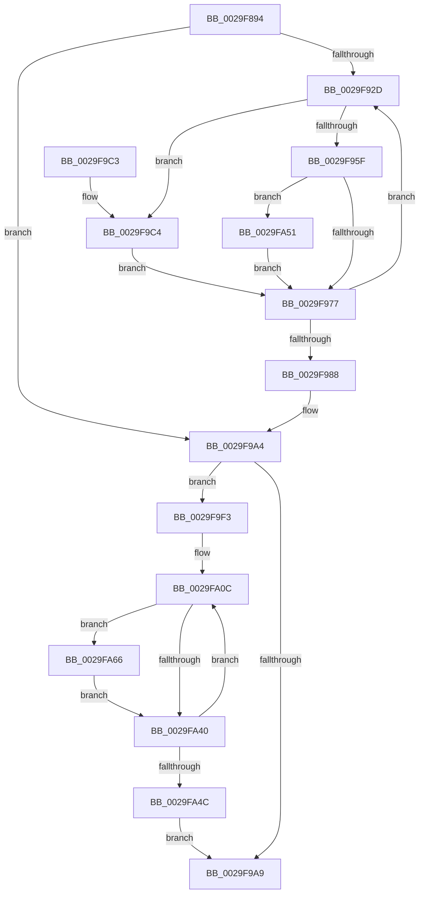

# MiConvertContiguousPages

- RVA: `0x0029F894`–`0x0029FA75` (길이 `481` bytes)
- VA: `0x000000014029F894`
- 실행 섹션: `.text`
- PDB 이름 있음: `예`; PDB Function 태그: `아니요`
- unwind 정보 RVA: `0x0006832C`
- 디코드: `132`개 명령, `481/481` bytes 표시
- 미해석 바이트: `0` (있으면 어셈블리에 `.byte`로 보존)

> 이 문서는 커널 이미지의 기계어와 PDB 기호를 분석해 생성했습니다. 4번과 5번은 함수 원형과 자료형을 바이너리 사용 방식에서 추정한 C 해석이며 원본 소스 복구 결과는 아닙니다.

## 1. Dependencies

- 직접 호출 지점: **9**; 고유 호출 대상: **8**
- 직접 호출자로 확인된 함수: **1**
- RIP 상대 이미지 참조: **0**

### Outgoing calls
- `0x0029F8CB` → [MiMakeDemandZeroPte](../33/MiMakeDemandZeroPte_function_00337A00.md) (function, `0x00337A00`)
- `0x0029F930` → [MiIsFreeZeroPfnCold](../31/MiIsFreeZeroPfnCold_function_0031E5E4.md) (function, `0x0031E5E4`)
- `0x0029F93E` → [MiPfnZeroingNeeded](MiPfnZeroingNeeded_function_0029FA80.md) (function, `0x0029FA80`)
- `0x0029F953` → [MiPageAttributeBatchChangeNeeded](MiPageAttributeBatchChangeNeeded_function_0029FAD0.md) (function, `0x0029FAD0`)
- `0x0029F9D0` → [MiMakeLinkedListPte](../2C/MiMakeLinkedListPte_function_002C98C0.md) (function, `0x002C98C0`)
- `0x0029FA07` → [MiChangePageAttributeBatch](../2A/MiChangePageAttributeBatch_function_002A06E0.md) (function, `0x002A06E0`)
- `0x0029FA1E` → [MiGetPteLink](MiGetPteLink_function_0029FC60.md) (function, `0x0029FC60`)
- `0x0029FA59` → [MiSetFreeZeroPfnCold](../37/MiSetFreeZeroPfnCold_function_00379428.md) (function, `0x00379428`)
- `0x0029FA6E` → [MiSetFreeZeroPfnCold](../37/MiSetFreeZeroPfnCold_function_00379428.md) (function, `0x00379428`)

### Direct callers
- [MiFindContiguousPagesEx](../28/MiFindContiguousPagesEx_function_0028BDE0.md) at `0x0028C640`

### Static image references
- 디코드된 RIP-relative 메모리 참조가 없습니다.

## 2. Other-region calls and transfers

- 다른 실행 섹션으로 향하는 call: **0**
- 별도 외부 분기/꼬리 이동을 확인하지 못했습니다.

## 3. Assembly (complete function range)

```asm
0029F894  48 89 5C 24 18                  mov qword ptr [rsp + 0x18], rbx
0029F899  44 88 4C 24 20                  mov byte ptr [rsp + 0x20], r9b
0029F89E  55                              push rbp
0029F89F  56                              push rsi
0029F8A0  57                              push rdi
0029F8A1  41 54                           push r12
0029F8A3  41 55                           push r13
0029F8A5  41 56                           push r14
0029F8A7  41 57                           push r15
0029F8A9  48 83 EC 30                     sub rsp, 0x30
0029F8AD  48 8B D9                        mov rbx, rcx
0029F8B0  45 8A D1                        mov r10b, r9b
0029F8B3  BD 01 00 00 00                  mov ebp, 1
0029F8B8  45 33 C9                        xor r9d, r9d
0029F8BB  4C 89 4C 24 78                  mov qword ptr [rsp + 0x78], r9
0029F8C0  45 8B E8                        mov r13d, r8d
0029F8C3  48 8B 44 24 78                  mov rax, qword ptr [rsp + 0x78]
0029F8C8  8D 4D 03                        lea ecx, [rbp + 3]
0029F8CB  E8 30 81 09 00                  call 0x140337a00
0029F8D0  4C 8D 34 52                     lea r14, [rdx + rdx*2]
0029F8D4  48 89 44 24 78                  mov qword ptr [rsp + 0x78], rax
0029F8D9  49 C1 E6 04                     shl r14, 4
0029F8DD  4C 03 F3                        add r14, rbx
0029F8E0  49 BC 00 00 00 00 00 DE FF FF   movabs r12, 0xffffde0000000000
0029F8EA  49 8B C4                        mov rax, r12
0029F8ED  49 BF FF FF FF FF 7F 00 00 00   movabs r15, 0x7fffffffff
0029F8F7  44 8D 45 0F                     lea r8d, [rbp + 0xf]
0029F8FB  48 8B F3                        mov rsi, rbx
0029F8FE  4C 89 7C 24 20                  mov qword ptr [rsp + 0x20], r15
0029F903  48 2B F0                        sub rsi, rax
0029F906  49 8B FF                        mov rdi, r15
0029F909  48 C1 FE 04                     sar rsi, 4
0029F90D  48 B8 AB AA AA AA AA AA AA AA   movabs rax, 0xaaaaaaaaaaaaaaab
0029F917  48 0F AF F0                     imul rsi, rax
0029F91B  41 80 FA 02                     cmp r10b, 2
0029F91F  45 0F 45 C1                     cmovne r8d, r9d
0029F923  44 89 44 24 70                  mov dword ptr [rsp + 0x70], r8d
0029F928  49 3B DE                        cmp rbx, r14
0029F92B  74 77                           je 0x14029f9a4
0029F92D  48 8B CB                        mov rcx, rbx
0029F930  E8 AF EC 07 00                  call 0x14031e5e4
0029F935  41 8B D5                        mov edx, r13d
0029F938  48 8B CB                        mov rcx, rbx
0029F93B  44 8B E0                        mov r12d, eax
0029F93E  E8 3D 01 00 00                  call 0x14029fa80
0029F943  41 8B C9                        mov ecx, r9d
0029F946  85 C0                           test eax, eax
0029F948  44 8B F8                        mov r15d, eax
0029F94B  0F 44 CD                        cmove ecx, ebp
0029F94E  8B E9                           mov ebp, ecx
0029F950  48 8B CB                        mov rcx, rbx
0029F953  E8 78 01 00 00                  call 0x14029fad0
0029F958  45 33 C9                        xor r9d, r9d
0029F95B  85 C0                           test eax, eax
0029F95D  75 65                           jne 0x14029f9c4
0029F95F  41 F7 DF                        neg r15d
0029F962  48 1B C0                        sbb rax, rax
0029F965  48 23 44 24 78                  and rax, qword ptr [rsp + 0x78]
0029F96A  48 89 43 10                     mov qword ptr [rbx + 0x10], rax
0029F96E  45 85 E4                        test r12d, r12d
0029F971  0F 85 DA 00 00 00               jne 0x14029fa51
0029F977  44 8B 44 24 70                  mov r8d, dword ptr [rsp + 0x70]
0029F97C  48 83 C3 30                     add rbx, 0x30
0029F980  48 FF C6                        inc rsi
0029F983  49 3B DE                        cmp rbx, r14
0029F986  75 A5                           jne 0x14029f92d
0029F988  44 8A 94 24 88 00 00 00         mov r10b, byte ptr [rsp + 0x88]
0029F990  49 BF FF FF FF FF 7F 00 00 00   movabs r15, 0x7fffffffff
0029F99A  49 BC 00 00 00 00 00 DE FF FF   movabs r12, 0xffffde0000000000
0029F9A4  49 3B FF                        cmp rdi, r15
0029F9A7  75 4A                           jne 0x14029f9f3
0029F9A9  48 8B 9C 24 80 00 00 00         mov rbx, qword ptr [rsp + 0x80]
0029F9B1  8B C5                           mov eax, ebp
0029F9B3  48 83 C4 30                     add rsp, 0x30
0029F9B7  41 5F                           pop r15
0029F9B9  41 5E                           pop r14
0029F9BB  41 5D                           pop r13
0029F9BD  41 5C                           pop r12
0029F9BF  5F                              pop rdi
0029F9C0  5E                              pop rsi
0029F9C1  5D                              pop rbp
0029F9C2  C3                              ret
0029F9C3  CC                              int3
0029F9C4  41 F7 DC                        neg r12d
0029F9C7  48 8B CF                        mov rcx, rdi
0029F9CA  48 1B D2                        sbb rdx, rdx
0029F9CD  83 E2 02                        and edx, 2
0029F9D0  E8 EB 9E 02 00                  call 0x1402c98c0
0029F9D5  48 89 43 10                     mov qword ptr [rbx + 0x10], rax
0029F9D9  48 8B FE                        mov rdi, rsi
0029F9DC  8B C2                           mov eax, edx
0029F9DE  48 89 74 24 20                  mov qword ptr [rsp + 0x20], rsi
0029F9E3  48 83 C8 01                     or rax, 1
0029F9E7  45 85 FF                        test r15d, r15d
0029F9EA  48 0F 44 C2                     cmove rax, rdx
0029F9EE  48 89 03                        mov qword ptr [rbx], rax
0029F9F1  EB 84                           jmp 0x14029f977
0029F9F3  41 80 FA 02                     cmp r10b, 2
0029F9F7  48 8D 4C 24 20                  lea rcx, [rsp + 0x20]
0029F9FC  41 8B D5                        mov edx, r13d
0029F9FF  41 0F 94 C1                     sete r9b
0029FA03  49 83 C8 FF                     or r8, 0xffffffffffffffff
0029FA07  E8 D4 0C 00 00                  call 0x1402a06e0
0029FA0C  4C 8D 1C 7F                     lea r11, [rdi + rdi*2]
0029FA10  49 C1 E3 04                     shl r11, 4
0029FA14  49 8B C4                        mov rax, r12
0029FA17  4C 03 D8                        add r11, rax
0029FA1A  49 8B 4B 10                     mov rcx, qword ptr [r11 + 0x10]
0029FA1E  E8 3D 02 00 00                  call 0x14029fc60
0029FA23  48 8B F8                        mov rdi, rax
0029FA26  49 8B 03                        mov rax, qword ptr [r11]
0029FA29  8A C8                           mov cl, al
0029FA2B  80 E1 01                        and cl, 1
0029FA2E  F6 D9                           neg cl
0029FA30  48 1B C9                        sbb rcx, rcx
0029FA33  48 23 4C 24 78                  and rcx, qword ptr [rsp + 0x78]
0029FA38  49 89 4B 10                     mov qword ptr [r11 + 0x10], rcx
0029FA3C  A8 02                           test al, 2
0029FA3E  75 26                           jne 0x14029fa66
0029FA40  49 C7 03 00 00 00 00            mov qword ptr [r11], 0
0029FA47  49 3B FF                        cmp rdi, r15
0029FA4A  75 C0                           jne 0x14029fa0c
0029FA4C  E9 58 FF FF FF                  jmp 0x14029f9a9
0029FA51  BA 01 00 00 00                  mov edx, 1
0029FA56  48 8B CB                        mov rcx, rbx
0029FA59  E8 CA 99 0D 00                  call 0x140379428
0029FA5E  45 33 C9                        xor r9d, r9d
0029FA61  E9 11 FF FF FF                  jmp 0x14029f977
0029FA66  BA 01 00 00 00                  mov edx, 1
0029FA6B  49 8B CB                        mov rcx, r11
0029FA6E  E8 B5 99 0D 00                  call 0x140379428
0029FA73  EB CB                           jmp 0x14029fa40
```

## 4. C-style interpretation (structured pseudocode)

```c
__int64 __fastcall MiConvertContiguousPages(__int64 a1, __int64 a2, int a3, int a4)
{
    __int64 result;
    __int64 v_r11;
    __int64 v_r12;
    __int64 v_r14;
    __int64 v_r15;
    __int64 v_rbx;
    __int64 v_rsi;
    __int64 v_rsp;
    unsigned __int64 v_stack_m48;
    unsigned __int64 v_stack_p10;
    unsigned __int64 v_stack_p18;
    unsigned __int8 v_stack_p20;
    unsigned __int64 v_stack_p78;
    unsigned int v_stack_p8;

    v_stack_p18 = v_rbx;
    v_stack_p20 = (unsigned __int8)(a4);
    v_rsp = (v_rsp) - (48);
    a4 = 0;
    v_stack_p10 = 0;
    result = MiMakeDemandZeroPte(1 + 3, a2, a3, a4);
    v_stack_p10 = result;
    v_r14 = (a2 + a2 * 2) << (4);
    v_r14 = (v_r14) + (a1);
    v_stack_m48 = v_r15;
    v_rsi = (a1) - (v_r12);
    v_rsi = (v_rsi) >> (4);
    v_rsi = (v_rsi) * (v_r12);
    a3 = 1 + 15;
    if (((unsigned __int8)((unsigned __int8)(a4))) != 2) { a3 = 0; }
    v_stack_p8 = a3;
    if (a1 == v_r14) goto loc_0029F9A4;
loc_0029F92D:
    result = MiIsFreeZeroPfnCold(a1, a2, a3, a4);
    result = MiPfnZeroingNeeded(a1, (unsigned int)((unsigned int)((unsigned int)(a3))), a3, a4);
    a1 = 0;
    if ((unsigned int)(result) == 0) { a1 = 1; }
    result = MiPageAttributeBatchChangeNeeded(a1, (unsigned int)((unsigned int)((unsigned int)(a3))), a3, a4);
    a4 = 0;
    if ((unsigned int)(result) != 0) goto loc_0029F9C4;
    v_r15 = (unsigned int)(-((unsigned int)((unsigned int)(result))));
    result = (result) & (v_stack_p10);
    *(unsigned __int64 *)(a1 + 16) = result;
    if ((unsigned int)((unsigned int)((unsigned int)(result))) != 0) goto loc_0029FA51;
loc_0029F977:
    v_rbx = (a1) + (48);
    v_rsi = (v_rsi) + 1;
    if (v_rbx != v_r14) goto loc_0029F92D;
loc_0029F9A4:
    if (v_r15 != v_r15) goto loc_0029F9F3;
loc_0029F9A9:
    v_rsp = (v_rsp) + (48);
    return (unsigned int)((unsigned int)((unsigned int)((unsigned int)(a1))));
loc_0029F9C4:
    v_r12 = (unsigned int)(-((unsigned int)((unsigned int)(result))));
    a2 = (unsigned int)(((unsigned int)((unsigned int)((unsigned int)(a3)))) & (2));
    result = MiMakeLinkedListPte(v_r15, a2, (unsigned int)(v_stack_p8), a4);
    *(unsigned __int64 *)(v_stack_p18 + 16) = result;
    v_stack_p20 = v_rsi;
    result = ((unsigned int)((unsigned int)(a2))) | (1);
    if ((unsigned int)(v_r15) == 0) { result = a2; }
    *(unsigned __int64 *)(v_stack_p18) = result;
    goto loc_0029F977;
loc_0029F9F3:
    a4 = (((unsigned __int8)(v_stack_p20)) == 2) ? 1 : 0;
    a3 = ((unsigned int)(v_stack_p8)) | (-1);
    result = MiChangePageAttributeBatch(v_stack_p20, (unsigned int)((unsigned int)((unsigned int)(a3))), a3, a4);
loc_0029FA0C:
    v_r11 = (v_rsi + v_rsi * 2) << (4);
    v_r11 = (v_r11) + (v_r12);
    result = MiGetPteLink(*(unsigned __int64 *)(v_r11 + 16), (unsigned int)((unsigned int)((unsigned int)(a3))), a3, a4);
    a1 = (unsigned __int8)(((unsigned __int8)(*(unsigned __int64 *)(v_r11))) & (1));
    a1 = (unsigned __int8)(-(a1));
    a1 = (a1) & (v_stack_p78);
    *(unsigned __int64 *)(v_r11 + 16) = a1;
    if ((((unsigned __int8)(*(unsigned __int64 *)(v_r11))) & (2)) != 0) goto loc_0029FA66;
loc_0029FA40:
    *(unsigned __int64 *)(v_r11) = 0;
    if (result != v_r15) goto loc_0029FA0C;
    goto loc_0029F9A9;
loc_0029FA51:
    result = MiSetFreeZeroPfnCold(v_stack_p18, 1, a3, a4);
    a4 = 0;
    goto loc_0029F977;
loc_0029FA66:
    result = MiSetFreeZeroPfnCold(v_r11, 1, a3, a4);
    goto loc_0029FA40;
}
```

## 5. (Beta) C Style

```c
int64_t MiConvertContiguousPages(int64_t Arg1, int64_t Arg2, int32_t Arg3, int32_t Arg4)
{
    int64_t result;
    int64_t local_r11;
    int64_t local_r12;
    int64_t local_r14;
    int64_t local_r15;
    int64_t local_rbx;
    int64_t local_rsi;
    int64_t local_rsp;
    uint64_t v_stack_m48;
    uint64_t v_stack_p10;
    uint64_t v_stack_p18;
    uint8_t v_stack_p20;
    uint64_t v_stack_p78;
    uint32_t v_stack_p8;

    v_stack_p18 = local_rbx;
    v_stack_p20 = (uint8_t)(Arg4);
    local_rsp = (local_rsp) - (48);
    Arg4 = 0;
    v_stack_p10 = 0;
    result = MiMakeDemandZeroPte(1 + 3, Arg2, Arg3, Arg4);
    v_stack_p10 = result;
    local_r14 = (Arg2 + Arg2 * 2) << (4);
    local_r14 = (local_r14) + (Arg1);
    v_stack_m48 = local_r15;
    local_rsi = (Arg1) - (local_r12);
    local_rsi = (local_rsi) >> (4);
    local_rsi = (local_rsi) * (local_r12);
    Arg3 = 1 + 15;
    if (((uint8_t)((uint8_t)(Arg4))) != 2) { Arg3 = 0; }
    v_stack_p8 = Arg3;
    if (Arg1 == local_r14) goto loc_0029F9A4;
loc_0029F92D:
    result = MiIsFreeZeroPfnCold(Arg1, Arg2, Arg3, Arg4);
    result = MiPfnZeroingNeeded(Arg1, (uint32_t)((uint32_t)((uint32_t)(Arg3))), Arg3, Arg4);
    Arg1 = 0;
    if ((uint32_t)(result) == 0) { Arg1 = 1; }
    result = MiPageAttributeBatchChangeNeeded(Arg1, (uint32_t)((uint32_t)((uint32_t)(Arg3))), Arg3, Arg4);
    Arg4 = 0;
    if ((uint32_t)(result) != 0) goto loc_0029F9C4;
    local_r15 = (uint32_t)(-((uint32_t)((uint32_t)(result))));
    result = (result) & (v_stack_p10);
    *(uint64_t *)(Arg1 + 0x10) = result;
    if ((uint32_t)((uint32_t)((uint32_t)(result))) != 0) goto loc_0029FA51;
loc_0029F977:
    local_rbx = (Arg1) + (48);
    local_rsi = (local_rsi) + 1;
    if (local_rbx != local_r14) goto loc_0029F92D;
loc_0029F9A4:
    if (local_r15 != local_r15) goto loc_0029F9F3;
loc_0029F9A9:
    local_rsp = (local_rsp) + (48);
    return (uint32_t)((uint32_t)((uint32_t)((uint32_t)(Arg1))));
loc_0029F9C4:
    local_r12 = (uint32_t)(-((uint32_t)((uint32_t)(result))));
    Arg2 = (uint32_t)(((uint32_t)((uint32_t)((uint32_t)(Arg3)))) & (2));
    result = MiMakeLinkedListPte(local_r15, Arg2, (uint32_t)(v_stack_p8), Arg4);
    *(uint64_t *)(v_stack_p18 + 0x10) = result;
    v_stack_p20 = local_rsi;
    result = ((uint32_t)((uint32_t)(Arg2))) | (1);
    if ((uint32_t)(local_r15) == 0) { result = Arg2; }
    *(uint64_t *)(v_stack_p18) = result;
    goto loc_0029F977;
loc_0029F9F3:
    Arg4 = (((uint8_t)(v_stack_p20)) == 2) ? 1 : 0;
    Arg3 = ((uint32_t)(v_stack_p8)) | (-1);
    result = MiChangePageAttributeBatch(v_stack_p20, (uint32_t)((uint32_t)((uint32_t)(Arg3))), Arg3, Arg4);
loc_0029FA0C:
    local_r11 = (local_rsi + local_rsi * 2) << (4);
    local_r11 = (local_r11) + (local_r12);
    result = MiGetPteLink(*(uint64_t *)(local_r11 + 0x10), (uint32_t)((uint32_t)((uint32_t)(Arg3))), Arg3, Arg4);
    Arg1 = (uint8_t)(((uint8_t)(*(uint64_t *)(local_r11))) & (1));
    Arg1 = (uint8_t)(-(Arg1));
    Arg1 = (Arg1) & (v_stack_p78);
    *(uint64_t *)(local_r11 + 0x10) = Arg1;
    if ((((uint8_t)(*(uint64_t *)(local_r11))) & (2)) != 0) goto loc_0029FA66;
loc_0029FA40:
    *(uint64_t *)(local_r11) = 0;
    if (result != local_r15) goto loc_0029FA0C;
    goto loc_0029F9A9;
loc_0029FA51:
    result = MiSetFreeZeroPfnCold(v_stack_p18, 1, Arg3, Arg4);
    Arg4 = 0;
    goto loc_0029F977;
loc_0029FA66:
    result = MiSetFreeZeroPfnCold(local_r11, 1, Arg3, Arg4);
    goto loc_0029FA40;
}
```

## 6. Execution-region graph

[열기: 2D/3D 그래프와 함수 탐색 컨트롤 패널](../../../control-panel.html?section=text&rva=0x0029F894&view=graph)

- 2D 그래프는 위에서 아래로 흐르고, 3D 그래프는 빈 공간을 드래그해 회전합니다. Shift+드래그는 이동, 휠은 확대·축소, 함수 노드 선택은 대상 보고서 이동입니다.

### Static fallback


