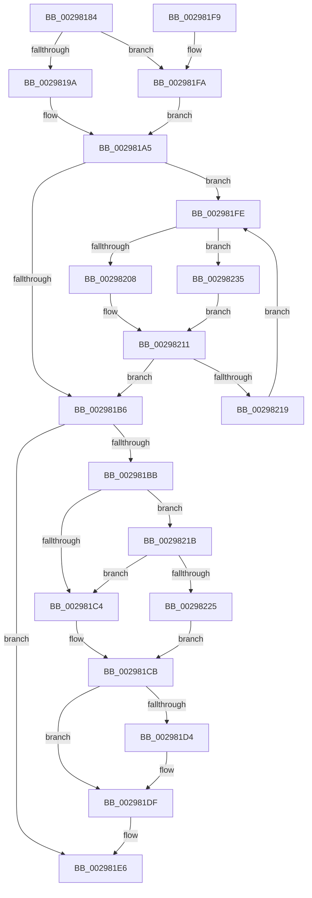

# MiDecrementModifiedWriteCount

- RVA: `0x00298184`–`0x0029823A` (길이 `182` bytes)
- VA: `0x0000000140298184`
- 실행 섹션: `.text`
- PDB 이름 있음: `예`; PDB Function 태그: `아니요`
- unwind 정보 RVA: `0x00067AB8`
- 디코드: `57`개 명령, `182/182` bytes 표시
- 미해석 바이트: `0` (있으면 어셈블리에 `.byte`로 보존)

> 이 문서는 커널 이미지의 기계어와 PDB 기호를 분석해 생성했습니다. 4번과 5번은 함수 원형과 자료형을 바이너리 사용 방식에서 추정한 C 해석이며 원본 소스 복구 결과는 아닙니다.

## 1. Dependencies

- 직접 호출 지점: **3**; 고유 호출 대상: **3**
- 직접 호출자로 확인된 함수: **11**
- RIP 상대 이미지 참조: **3**

### Outgoing calls
- `0x0029819E` → [ExAcquireSpinLockExclusive](../24/ExAcquireSpinLockExclusive_function_00248690.md) (function, `0x00248690`)
- `0x002981DA` → [KiLowerIrqlProcessIrqlFlags](../4F/KiLowerIrqlProcessIrqlFlags_function_004F5698.md) (function, `0x004F5698`)
- `0x0029822E` → [ExpReleaseSpinLockExclusiveFromDpcLevelInstrumented](../2C/ExpReleaseSpinLockExclusiveFromDpcLevelInstrumented_function_002C0F44.md) (function, `0x002C0F44`)

### Direct callers
- [MiDeleteCachedSubsection](MiDeleteCachedSubsection_function_00297888.md) at `0x0029799A`
- [MiEntireSubsectionIsPurged](MiEntireSubsectionIsPurged_function_00297C04.md) at `0x00297C92`
- [MiTrimSharedPage](MiTrimSharedPage_function_00297D14.md) at `0x00297EB4`
- [MiTrimSharedPage](MiTrimSharedPage_function_00297D14.md) at `0x00297FAC`
- [MiFlushComplete](MiFlushComplete_function_002980A0.md) at `0x002980F7`
- [MiPrepareToFlushSubsection](../36/MiPrepareToFlushSubsection_function_00369094.md) at `0x003690E4`
- [MiReservePageFileSpace](../38/MiReservePageFileSpace_function_00383ED8.md) at `0x00384280`
- [MiWriteComplete](../40/MiWriteComplete_function_004069B0.md) at `0x00406BC1`
- [MiBuildReservationCluster](../40/MiBuildReservationCluster_function_004071A0.md) at `0x004078C6`
- [MiReleasePageFileSectionInfo](../4A/MiReleasePageFileSectionInfo_function_004A9A44.md) at `0x004A9A63`
- [MiLocateSharedPageViews](../67/MiLocateSharedPageViews_function_0067F1E4.md) at `0x0067F41C`
- [MiPurgeBadFileOnlyPages](../68/MiPurgeBadFileOnlyPages_function_00681ADC.md) at `0x00681C11`

### Static image references
- `0x002981BB` → RVA `0x00FC6B06` (`ALMOSTRO`; read)
- `0x002981CB` → RVA `0x00FC6D20` (`ALMOSTRO`; read)
- `0x0029821B` → RVA `0x00F0DE58` (`.data`; read)

## 2. Other-region calls and transfers

- 다른 실행 섹션으로 향하는 call: **0**
- 별도 외부 분기/꼬리 이동을 확인하지 못했습니다.

## 3. Assembly (complete function range)

```asm
00298184  48 89 5C 24 08                  mov qword ptr [rsp + 8], rbx
00298189  48 89 74 24 10                  mov qword ptr [rsp + 0x10], rsi
0029818E  57                              push rdi
0029818F  48 83 EC 20                     sub rsp, 0x20
00298193  48 8B F9                        mov rdi, rcx
00298196  85 D2                           test edx, edx
00298198  75 60                           jne 0x1402981fa
0029819A  48 83 C1 48                     add rcx, 0x48
0029819E  E8 ED 04 FB FF                  call 0x140248690
002981A3  8A D8                           mov bl, al
002981A5  FF 4F 4C                        dec dword ptr [rdi + 0x4c]
002981A8  4C 8D 47 50                     lea r8, [rdi + 0x50]
002981AC  49 8B 08                        mov rcx, qword ptr [r8]
002981AF  33 F6                           xor esi, esi
002981B1  48 85 C9                        test rcx, rcx
002981B4  75 48                           jne 0x1402981fe
002981B6  80 FB 11                        cmp bl, 0x11
002981B9  74 2B                           je 0x1402981e6
002981BB  F6 05 44 E9 D2 00 01            test byte ptr [rip + 0xd2e944], 1
002981C2  75 57                           jne 0x14029821b
002981C4  C7 47 48 00 00 00 00            mov dword ptr [rdi + 0x48], 0
002981CB  83 3D 4E EB D2 00 00            cmp dword ptr [rip + 0xd2eb4e], 0
002981D2  74 0B                           je 0x1402981df
002981D4  44 0F 20 C1                     mov rcx, cr8
002981D8  8A D3                           mov dl, bl
002981DA  E8 B9 D4 25 00                  call 0x1404f5698
002981DF  0F B6 CB                        movzx ecx, bl
002981E2  44 0F 22 C1                     mov cr8, rcx
002981E6  48 8B 5C 24 30                  mov rbx, qword ptr [rsp + 0x30]
002981EB  48 8B C6                        mov rax, rsi
002981EE  48 8B 74 24 38                  mov rsi, qword ptr [rsp + 0x38]
002981F3  48 83 C4 20                     add rsp, 0x20
002981F7  5F                              pop rdi
002981F8  C3                              ret
002981F9  CC                              int3
002981FA  B3 11                           mov bl, 0x11
002981FC  EB A7                           jmp 0x1402981a5
002981FE  8B 41 08                        mov eax, dword ptr [rcx + 8]
00298201  48 8B 11                        mov rdx, qword ptr [rcx]
00298204  A8 08                           test al, 8
00298206  74 2D                           je 0x140298235
00298208  48 89 31                        mov qword ptr [rcx], rsi
0029820B  48 8B F1                        mov rsi, rcx
0029820E  49 89 10                        mov qword ptr [r8], rdx
00298211  48 8B CA                        mov rcx, rdx
00298214  48 85 D2                        test rdx, rdx
00298217  74 9D                           je 0x1402981b6
00298219  EB E3                           jmp 0x1402981fe
0029821B  8B 05 37 5C C7 00               mov eax, dword ptr [rip + 0xc75c37]
00298221  85 C0                           test eax, eax
00298223  75 9F                           jne 0x1402981c4
00298225  48 8B 54 24 28                  mov rdx, qword ptr [rsp + 0x28]
0029822A  48 8D 4F 48                     lea rcx, [rdi + 0x48]
0029822E  E8 11 8D 02 00                  call 0x1402c0f44
00298233  EB 96                           jmp 0x1402981cb
00298235  4C 8B C1                        mov r8, rcx
00298238  EB D7                           jmp 0x140298211
```

## 4. C-style interpretation (structured pseudocode)

```c
__int64 __fastcall MiDecrementModifiedWriteCount(__int64 a1, int a2)
{
    __int64 result;
    __int64 v_rsi;
    __int64 v_rsp;
    unsigned __int64 v_stack_p10;
    unsigned __int64 v_stack_p28;
    unsigned __int64 v_stack_p8;

    v_stack_p8 = v_rbx;
    v_stack_p10 = v_rsi;
    v_rsp = (v_rsp) - (32);
    if (a2 != 0) goto loc_002981FA;
    a1 = (a1) + (72);
    result = ExAcquireSpinLockExclusive(a1, a2, a3, a4);
loc_002981A5:
    v_rsi = 0;
    if (*(unsigned __int64 *)(a1 + 80) != 0) goto loc_002981FE;
loc_002981B6:
    if (((unsigned __int8)((unsigned __int8)(result))) == 17) goto loc_002981E6;
    if (((*(unsigned __int8 *)(v_rip + 13822276)) & (1)) != 0) goto loc_0029821B;
loc_002981C4:
    *(unsigned int *)(a1 + 72) = 0;
loc_002981CB:
    if ((*(unsigned int *)(v_rip + 13822798)) != 0) {
        a1 = v_cr8;
        a2 = (unsigned __int8)((unsigned __int8)(result));
        result = KiLowerIrqlProcessIrqlFlags(a1, a2, a1 + 80, a4);
    }
loc_002981E6:
    v_rsp = (v_rsp) + (32);
    return 0;
loc_002981FA:
    goto loc_002981A5;
loc_002981FE:
    if ((((unsigned __int8)((unsigned int)(*(unsigned int *)((unsigned __int8)((unsigned __int8)(result)) + 8)))) & (8)) == 0) goto loc_00298235;
    *(unsigned __int64 *)((unsigned __int8)((unsigned __int8)(result))) = v_stack_p10;
    *(unsigned __int64 *)(a1 + 80) = *(unsigned __int64 *)((unsigned __int8)((unsigned __int8)(result)));
loc_00298211:
    if (*(unsigned __int64 *)((unsigned __int8)((unsigned __int8)(result))) == 0) goto loc_002981B6;
    goto loc_002981FE;
loc_0029821B:
    if ((unsigned int)((unsigned int)(*(unsigned int *)(v_rip + 13065271))) != 0) goto loc_002981C4;
    result = ExpReleaseSpinLockExclusiveFromDpcLevelInstrumented(a1 + 72, v_stack_p28, a1 + 80, a4);
    goto loc_002981CB;
loc_00298235:
    goto loc_00298211;
}
```

## 5. (Beta) C Style

```c
int64_t MiDecrementModifiedWriteCount(void *Arg1, int32_t Arg2)
{
    uint8_t *arg1 = (uint8_t *)Arg1;

    int64_t result;
    int64_t local_rsi;
    int64_t local_rsp;
    uint64_t v_stack_p10;
    uint64_t v_stack_p28;
    uint64_t v_stack_p8;

    v_stack_p8 = local_rbx;
    v_stack_p10 = local_rsi;
    local_rsp = (local_rsp) - (32);
    if (Arg2 != 0) goto loc_002981FA;
    Arg1 = (Arg1) + (72);
    result = ExAcquireSpinLockExclusive(Arg1, Arg2, a3, a4);
loc_002981A5:
    local_rsi = 0;
    if (*(uint64_t *)(arg1 + 0x50) != 0) goto loc_002981FE;
loc_002981B6:
    if (((uint8_t)((uint8_t)(result))) == 17) goto loc_002981E6;
    if (((*(uint8_t *)(v_rip + 0xD2E944)) & (1)) != 0) goto loc_0029821B;
loc_002981C4:
    *(uint32_t *)(arg1 + 0x48) = 0;
loc_002981CB:
    if ((*(uint32_t *)(v_rip + 0xD2EB4E)) != 0) {
        Arg1 = v_cr8;
        Arg2 = (uint8_t)((uint8_t)(result));
        result = KiLowerIrqlProcessIrqlFlags(Arg1, Arg2, Arg1 + 80, a4);
    }
loc_002981E6:
    local_rsp = (local_rsp) + (32);
    return 0;
loc_002981FA:
    goto loc_002981A5;
loc_002981FE:
    if ((((uint8_t)((uint32_t)(*(uint32_t *)((uint8_t)((uint8_t)(result)) + 0x8)))) & (8)) == 0) goto loc_00298235;
    *(uint64_t *)((uint8_t)((uint8_t)(result))) = v_stack_p10;
    *(uint64_t *)(arg1 + 0x50) = *(uint64_t *)((uint8_t)((uint8_t)(result)));
loc_00298211:
    if (*(uint64_t *)((uint8_t)((uint8_t)(result))) == 0) goto loc_002981B6;
    goto loc_002981FE;
loc_0029821B:
    if ((uint32_t)((uint32_t)(*(uint32_t *)(v_rip + 0xC75C37))) != 0) goto loc_002981C4;
    result = ExpReleaseSpinLockExclusiveFromDpcLevelInstrumented(Arg1 + 72, v_stack_p28, Arg1 + 80, a4);
    goto loc_002981CB;
loc_00298235:
    goto loc_00298211;
}
```

### 관측된 메모리 오프셋

구조체 형식이 확인되지 않은 접근은 인자 기준의 오프셋으로만 기록했습니다.

| 기준 인자 | 오프셋 표현 | 폭 (bit) | 접근 |
|---|---:|---:|---|
| `Arg1` | `+ 0x0` | `64` | `R` |
| `Arg1` | `+ 0x48` | `32` | `W` |
| `Arg1` | `+ 0x48` | `64` | `R` |
| `Arg1` | `+ 0x4C` | `32` | `R/W` |
| `Arg1` | `+ 0x50` | `64` | `R` |

## 6. Execution-region graph

[열기: 2D/3D 그래프와 함수 탐색 컨트롤 패널](../../../control-panel.html?section=text&rva=0x00298184&view=graph)

- 2D 그래프는 위에서 아래로 흐르고, 3D 그래프는 빈 공간을 드래그해 회전합니다. Shift+드래그는 이동, 휠은 확대·축소, 함수 노드 선택은 대상 보고서 이동입니다.

### Static fallback


