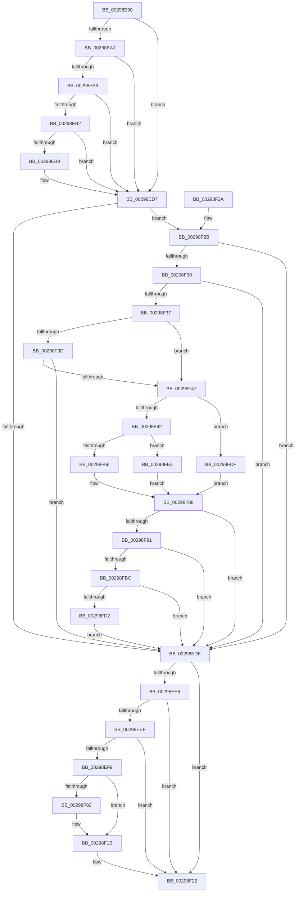

# MiDecrementSubsectionViewCount

- RVA: `0x00298E90`–`0x00298FEC` (길이 `348` bytes)
- VA: `0x0000000140298E90`
- 실행 섹션: `.text`
- PDB 이름 있음: `예`; PDB Function 태그: `아니요`
- unwind 정보 RVA: `0x00067B60`
- 디코드: `91`개 명령, `348/348` bytes 표시
- 미해석 바이트: `0` (있으면 어셈블리에 `.byte`로 보존)

> 이 문서는 커널 이미지의 기계어와 PDB 기호를 분석해 생성했습니다. 4번과 5번은 함수 원형과 자료형을 바이너리 사용 방식에서 추정한 C 해석이며 원본 소스 복구 결과는 아닙니다.

## 1. Dependencies

- 직접 호출 지점: **6**; 고유 호출 대상: **4**
- 직접 호출자로 확인된 함수: **12**
- RIP 상대 이미지 참조: **2**

### Outgoing calls
- `0x00298ED1` → [KeBugCheckEx](../4F/KeBugCheckEx_function_004FD660.md) (function, `0x004FD660`)
- `0x00298F15` → [KeBugCheckEx](../4F/KeBugCheckEx_function_004FD660.md) (function, `0x004FD660`)
- `0x00298F94` → [MiGetSubsectionHoldingCrossPartitionReferences](../45/MiGetSubsectionHoldingCrossPartitionReferences_function_004589E4.md) (function, `0x004589E4`)
- `0x00298F9F` → [MiGetSubsectionHoldingCrossPartitionReferences](../45/MiGetSubsectionHoldingCrossPartitionReferences_function_004589E4.md) (function, `0x004589E4`)
- `0x00298FC3` → [MiUpdateSubsectionCrossPartitionRefs](../4F/MiUpdateSubsectionCrossPartitionRefs_function_004FB5DC.md) (function, `0x004FB5DC`)
- `0x00298FD2` → [MiComputeCrossPartitionSectionCharges](../32/MiComputeCrossPartitionSectionCharges_function_00325BBC.md) (function, `0x00325BBC`)

### Direct callers
- [MiDeleteCachedSubsection](MiDeleteCachedSubsection_function_00297888.md) at `0x00297972`
- [MiDecrementSubsection](MiDecrementSubsection_function_00298D68.md) at `0x00298E1C`
- [MiDeleteSubsectionPages](../32/MiDeleteSubsectionPages_function_00326340.md) at `0x003263C9`
- [MiDeleteControlArea](../36/MiDeleteControlArea_function_003691F4.md) at `0x00369381`
- [MmPurgeSection](../38/MmPurgeSection_function_0038B450.md) at `0x0038B613`
- [MiUpControlAreaRefs](../3B/MiUpControlAreaRefs_function_003B2BF0.md) at `0x003B2E78`
- [MiFlushSection](../40/MiFlushSection_function_004036B0.md) at `0x00403DFD`
- [MiAppendSubsectionChain](../48/MiAppendSubsectionChain_function_00480228.md) at `0x00480318`
- [MiReturnCrossPartitionControlAreaCharges](../4D/MiReturnCrossPartitionControlAreaCharges_function_004D6184.md) at `0x004D61BB`
- [sub_006DA650](../6D/Unknown_function_006DA650.md) at `0x006DA6AC`
- [MiExtendSection](../../page/98/MiExtendSection_function_00982FDC.md) at `0x00983433`
- [sub_00B2A916](../../page/B2/Unknown_function_00B2A916.md) at `0x00B2A95A`

### Static image references
- `0x00298F4C` → RVA `0x00E30088` (`.data`; read)
- `0x00298FE3` → RVA `0x00E38D00` (`.data`; read)

## 2. Other-region calls and transfers

- 다른 실행 섹션으로 향하는 call: **0**
- 별도 외부 분기/꼬리 이동을 확인하지 못했습니다.

## 3. Assembly (complete function range)

```asm
00298E90  48 83 EC 38                     sub rsp, 0x38
00298E94  4C 8B 01                        mov r8, qword ptr [rcx]
00298E97  4C 8B D1                        mov r10, rcx
00298E9A  49 83 78 40 00                  cmp qword ptr [r8 + 0x40], 0
00298E9F  74 36                           je 0x140298ed7
00298EA1  41 8B 40 38                     mov eax, dword ptr [r8 + 0x38]
00298EA5  A8 20                           test al, 0x20
00298EA7  75 2E                           jne 0x140298ed7
00298EA9  8B 41 20                        mov eax, dword ptr [rcx + 0x20]
00298EAC  0F BA E0 10                     bt eax, 0x10
00298EB0  72 25                           jb 0x140298ed7
00298EB2  48 83 79 50 00                  cmp qword ptr [rcx + 0x50], 0
00298EB7  75 1E                           jne 0x140298ed7
00298EB9  45 33 C9                        xor r9d, r9d
00298EBC  48 C7 44 24 20 00 00 00 00      mov qword ptr [rsp + 0x20], 0
00298EC5  4C 8B C1                        mov r8, rcx
00298EC8  BA 01 20 04 00                  mov edx, 0x42001
00298ECD  41 8D 49 1A                     lea ecx, [r9 + 0x1a]
00298ED1  E8 8A 47 26 00                  call 0x1404fd660
00298ED6  CC                              int3
00298ED7  45 33 C9                        xor r9d, r9d
00298EDA  F6 C2 04                        test dl, 4
00298EDD  74 4C                           je 0x140298f2b
00298EDF  49 83 78 40 00                  cmp qword ptr [r8 + 0x40], 0
00298EE4  74 3C                           je 0x140298f22
00298EE6  41 8B 48 38                     mov ecx, dword ptr [r8 + 0x38]
00298EEA  F6 C1 20                        test cl, 0x20
00298EED  75 33                           jne 0x140298f22
00298EEF  41 8B 4A 20                     mov ecx, dword ptr [r10 + 0x20]
00298EF3  0F BA E1 10                     bt ecx, 0x10
00298EF7  72 29                           jb 0x140298f22
00298EF9  49 8B 42 50                     mov rax, qword ptr [r10 + 0x50]
00298EFD  48 85 C0                        test rax, rax
00298F00  75 19                           jne 0x140298f1b
00298F02  45 33 C9                        xor r9d, r9d
00298F05  48 89 44 24 20                  mov qword ptr [rsp + 0x20], rax
00298F0A  4D 8B C2                        mov r8, r10
00298F0D  8D 48 1A                        lea ecx, [rax + 0x1a]
00298F10  BA 01 20 04 00                  mov edx, 0x42001
00298F15  E8 46 47 26 00                  call 0x1404fd660
00298F1A  CC                              int3
00298F1B  48 FF C8                        dec rax
00298F1E  49 89 42 50                     mov qword ptr [r10 + 0x50], rax
00298F22  49 8B C1                        mov rax, r9
00298F25  48 83 C4 38                     add rsp, 0x38
00298F29  C3                              ret
00298F2A  CC                              int3
00298F2B  F6 C2 08                        test dl, 8
00298F2E  74 AF                           je 0x140298edf
00298F30  41 F6 40 3E 0C                  test byte ptr [r8 + 0x3e], 0xc
00298F35  75 A8                           jne 0x140298edf
00298F37  4D 39 48 40                     cmp qword ptr [r8 + 0x40], r9
00298F3B  75 0A                           jne 0x140298f47
00298F3D  41 F7 40 5C 00 00 01 00         test dword ptr [r8 + 0x5c], 0x10000
00298F45  75 98                           jne 0x140298edf
00298F47  41 0F B7 48 3C                  movzx ecx, word ptr [r8 + 0x3c]
00298F4C  48 8B 05 35 71 B9 00            mov rax, qword ptr [rip + 0xb97135]
00298F53  81 E1 FF 03 00 00               and ecx, 0x3ff
00298F59  4C 8B 1C C8                     mov r11, qword ptr [rax + rcx*8]
00298F5D  F6 C2 10                        test dl, 0x10
00298F60  75 7D                           jne 0x140298fdf
00298F62  84 D2                           test dl, dl
00298F64  78 7D                           js 0x140298fe3
00298F66  65 48 8B 04 25 88 01 00 00      mov rax, qword ptr gs:[0x188]
00298F6F  48 8B 88 B8 00 00 00            mov rcx, qword ptr [rax + 0xb8]
00298F76  48 8B 05 0B 71 B9 00            mov rax, qword ptr [rip + 0xb9710b]
00298F7D  0F B7 91 AE 04 00 00            movzx edx, word ptr [rcx + 0x4ae]
00298F84  48 8B 04 D0                     mov rax, qword ptr [rax + rdx*8]
00298F88  49 3B C3                        cmp rax, r11
00298F8B  0F 84 4E FF FF FF               je 0x140298edf
00298F91  49 8B CA                        mov rcx, r10
00298F94  E8 4B FA 1B 00                  call 0x1404589e4
00298F99  48 8B C8                        mov rcx, rax
00298F9C  4C 8B D0                        mov r10, rax
00298F9F  E8 40 FA 1B 00                  call 0x1404589e4
00298FA4  44 8B 58 30                     mov r11d, dword ptr [rax + 0x30]
00298FA8  41 81 E3 FF FF FF 3F            and r11d, 0x3fffffff
00298FAF  41 81 FB FF FF FF 3F            cmp r11d, 0x3fffffff
00298FB6  0F 84 23 FF FF FF               je 0x140298edf
00298FBC  41 8D 53 FF                     lea edx, [r11 - 1]
00298FC0  49 8B CA                        mov rcx, r10
00298FC3  E8 14 26 26 00                  call 0x1404fb5dc
00298FC8  41 83 FB 01                     cmp r11d, 1
00298FCC  0F 85 0D FF FF FF               jne 0x140298edf
00298FD2  E8 E5 CB 08 00                  call 0x140325bbc
00298FD7  4C 8B C8                        mov r9, rax
00298FDA  E9 00 FF FF FF                  jmp 0x140298edf
00298FDF  33 C0                           xor eax, eax
00298FE1  EB A5                           jmp 0x140298f88
00298FE3  48 8D 05 16 FD B9 00            lea rax, [rip + 0xb9fd16]
00298FEA  EB 9C                           jmp 0x140298f88
```

## 4. C-style interpretation (structured pseudocode)

```c
__int64 __fastcall MiDecrementSubsectionViewCount(__int64 a1, __int64 a2, __int64 a3, int a4)
{
    __int64 result;
    __int64 v_r11;
    __int64 v_rsp;
    unsigned __int64 v_stack_m18;

    v_rsp = (v_rsp) - (56);
    if ((*(unsigned __int64 *)(*(unsigned __int64 *)(a1) + 64)) == 0) goto loc_00298ED7;
    if ((((unsigned __int8)((unsigned int)(*(unsigned int *)(*(unsigned __int64 *)(a1) + 56)))) & (32)) != 0) goto loc_00298ED7;
    if (condition_is_below) goto loc_00298ED7;
    result = (unsigned int)(*(unsigned int *)(a1 + 32));
    if ((*(unsigned __int64 *)(a1 + 80)) == 0) {
        a4 = 0;
        v_stack_m18 = 0;
        a3 = a1;
        a2 = 0x42001ULL;
        a1 = a4 + 26;
        result = KeBugCheckEx(a1, a2, a3, a4);
    }
    a4 = 0;
    if ((((unsigned __int8)(a2)) & (4)) == 0) goto loc_00298F2B;
loc_00298EDF:
    if ((*(unsigned __int64 *)(a3 + 64)) == 0) goto loc_00298F22;
    if ((((unsigned __int8)((unsigned int)(*(unsigned int *)(a3 + 56)))) & (32)) != 0) goto loc_00298F22;
    if (condition_is_below) goto loc_00298F22;
    result = *(unsigned __int64 *)(a1 + 80);
    if (*(unsigned __int64 *)(a1 + 80) == 0) {
        a4 = 0;
        v_stack_m18 = *(unsigned __int64 *)(a1 + 80);
        a3 = a1;
        a1 = *(unsigned __int64 *)(a1 + 80) + 26;
        a2 = 0x42001ULL;
        result = KeBugCheckEx(a1, a2, a3, a4);
    }
    result = (result) - 1;
    *(unsigned __int64 *)(a1 + 80) = result;
loc_00298F22:
    v_rsp = (v_rsp) + (56);
    return 0;
loc_00298F2B:
    if ((((unsigned __int8)(a2)) & (8)) == 0) goto loc_00298EDF;
    if (((*(unsigned __int8 *)(a3 + 62)) & (12)) != 0) goto loc_00298EDF;
    if ((*(unsigned __int64 *)(a3 + 64)) != 0) goto loc_00298F47;
    if (((*(unsigned int *)(a3 + 92)) & (0x10000ULL)) != 0) goto loc_00298EDF;
loc_00298F47:
    a1 = (unsigned int)((*(unsigned __int16 *)(a3 + 60)) & (0x3FFULL));
    if ((((unsigned __int8)(a2)) & (16)) != 0) goto loc_00298FDF;
    if (sign_flag) goto loc_00298FE3;
loc_00298F88:
    if ((*(unsigned __int64 *)(*(unsigned __int64 *)(v_rip + 12153099) + *(unsigned __int16 *)(*(unsigned __int64 *)(*(unsigned __int64 *)(gs_base + (0 + 392)) + 184) + 1198) * 8)) == (*(unsigned __int64 *)(*(unsigned __int64 *)(v_rip + 12153141) + a1 * 8))) goto loc_00298EDF;
    result = MiGetSubsectionHoldingCrossPartitionReferences(a1, *(unsigned __int16 *)(*(unsigned __int64 *)(*(unsigned __int64 *)(gs_base + (0 + 392)) + 184) + 1198), a3, a4);
    result = MiGetSubsectionHoldingCrossPartitionReferences(result, *(unsigned __int16 *)(*(unsigned __int64 *)(*(unsigned __int64 *)(gs_base + (0 + 392)) + 184) + 1198), a3, a4);
    v_r11 = (unsigned int)(((unsigned int)(*(unsigned int *)(result + 48))) & (0x3FFFFFFFULL));
    if (((unsigned int)(v_r11)) == 0x3FFFFFFFULL) goto loc_00298EDF;
    result = MiUpdateSubsectionCrossPartitionRefs(result, v_r11 - 1, a3, a4);
    if (((unsigned int)(v_r11)) != 1) goto loc_00298EDF;
    result = MiComputeCrossPartitionSectionCharges(result, v_r11 - 1, a3, a4);
    goto loc_00298EDF;
loc_00298FDF:
    result = 0;
    goto loc_00298F88;
loc_00298FE3:
    goto loc_00298F88;
}
```

## 5. (Beta) C Style

```c
int64_t MiDecrementSubsectionViewCount(void *Arg1, int64_t Arg2, int64_t Arg3, int32_t Arg4)
{
    uint8_t *arg1 = (uint8_t *)Arg1;

    int64_t result;
    int64_t local_r11;
    int64_t local_rsp;
    uint64_t v_stack_m18;

    local_rsp = (local_rsp) - (56);
    if ((*(uint64_t *)(*(uint64_t *)(arg1) + 0x40)) == 0) goto loc_00298ED7;
    if ((((uint8_t)((uint32_t)(*(uint32_t *)(*(uint64_t *)(arg1) + 0x38)))) & (32)) != 0) goto loc_00298ED7;
    if (condition_is_below) goto loc_00298ED7;
    result = (uint32_t)(*(uint32_t *)(arg1 + 0x20));
    if ((*(uint64_t *)(arg1 + 0x50)) == 0) {
        Arg4 = 0;
        v_stack_m18 = 0;
        Arg3 = Arg1;
        Arg2 = 0x42001ULL;
        Arg1 = Arg4 + 26;
        result = KeBugCheckEx(Arg1, Arg2, Arg3, Arg4);
    }
    Arg4 = 0;
    if ((((uint8_t)(Arg2)) & (4)) == 0) goto loc_00298F2B;
loc_00298EDF:
    if ((*(uint64_t *)(Arg3 + 0x40)) == 0) goto loc_00298F22;
    if ((((uint8_t)((uint32_t)(*(uint32_t *)(Arg3 + 0x38)))) & (32)) != 0) goto loc_00298F22;
    if (condition_is_below) goto loc_00298F22;
    result = *(uint64_t *)(arg1 + 0x50);
    if (*(uint64_t *)(arg1 + 0x50) == 0) {
        Arg4 = 0;
        v_stack_m18 = *(uint64_t *)(arg1 + 0x50);
        Arg3 = Arg1;
        Arg1 = *(uint64_t *)(arg1 + 0x50) + 26;
        Arg2 = 0x42001ULL;
        result = KeBugCheckEx(Arg1, Arg2, Arg3, Arg4);
    }
    result = (result) - 1;
    *(uint64_t *)(arg1 + 0x50) = result;
loc_00298F22:
    local_rsp = (local_rsp) + (56);
    return 0;
loc_00298F2B:
    if ((((uint8_t)(Arg2)) & (8)) == 0) goto loc_00298EDF;
    if (((*(uint8_t *)(Arg3 + 0x3E)) & (12)) != 0) goto loc_00298EDF;
    if ((*(uint64_t *)(Arg3 + 0x40)) != 0) goto loc_00298F47;
    if (((*(uint32_t *)(Arg3 + 0x5C)) & (0x10000ULL)) != 0) goto loc_00298EDF;
loc_00298F47:
    Arg1 = (uint32_t)((*(uint16_t *)(Arg3 + 0x3C)) & (0x3FFULL));
    if ((((uint8_t)(Arg2)) & (16)) != 0) goto loc_00298FDF;
    if (sign_flag) goto loc_00298FE3;
loc_00298F88:
    if ((*(uint64_t *)(*(uint64_t *)(v_rip + 0xB9710B) + *(uint16_t *)(*(uint64_t *)(*(uint64_t *)(gs_base + (0 + 0x188)) + 0xB8) + 0x4AE) * 8)) == (*(uint64_t *)(*(uint64_t *)(v_rip + 0xB97135) + arg1 * 8))) goto loc_00298EDF;
    result = MiGetSubsectionHoldingCrossPartitionReferences(Arg1, *(uint16_t *)(*(uint64_t *)(*(uint64_t *)(gs_base + (0 + 0x188)) + 0xB8) + 0x4AE), Arg3, Arg4);
    result = MiGetSubsectionHoldingCrossPartitionReferences(result, *(uint16_t *)(*(uint64_t *)(*(uint64_t *)(gs_base + (0 + 0x188)) + 0xB8) + 0x4AE), Arg3, Arg4);
    local_r11 = (uint32_t)(((uint32_t)(*(uint32_t *)(result + 0x30))) & (0x3FFFFFFFULL));
    if (((uint32_t)(local_r11)) == 0x3FFFFFFFULL) goto loc_00298EDF;
    result = MiUpdateSubsectionCrossPartitionRefs(result, local_r11 - 1, Arg3, Arg4);
    if (((uint32_t)(local_r11)) != 1) goto loc_00298EDF;
    result = MiComputeCrossPartitionSectionCharges(result, local_r11 - 1, Arg3, Arg4);
    goto loc_00298EDF;
loc_00298FDF:
    result = 0;
    goto loc_00298F88;
loc_00298FE3:
    goto loc_00298F88;
}
```

### 관측된 메모리 오프셋

구조체 형식이 확인되지 않은 접근은 인자 기준의 오프셋으로만 기록했습니다.

| 기준 인자 | 오프셋 표현 | 폭 (bit) | 접근 |
|---|---:|---:|---|
| `Arg1` | `+ 0x0` | `64` | `R` |
| `Arg1` | `+ 0x20` | `32` | `R` |
| `Arg1` | `+ 0x50` | `64` | `R` |

## 6. Execution-region graph

[열기: 2D/3D 그래프와 함수 탐색 컨트롤 패널](../../../control-panel.html?section=text&rva=0x00298E90&view=graph)

- 2D 그래프는 위에서 아래로 흐르고, 3D 그래프는 빈 공간을 드래그해 회전합니다. Shift+드래그는 이동, 휠은 확대·축소, 함수 노드 선택은 대상 보고서 이동입니다.

### Static fallback


