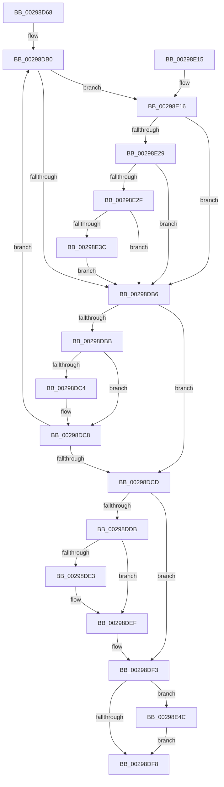

# MiDecrementSubsection

- RVA: `0x00298D68`–`0x00298E7C` (길이 `276` bytes)
- VA: `0x0000000140298D68`
- 실행 섹션: `.text`
- PDB 이름 있음: `예`; PDB Function 태그: `아니요`
- unwind 정보 RVA: `0x00067B40`
- 디코드: `81`개 명령, `276/276` bytes 표시
- 미해석 바이트: `0` (있으면 어셈블리에 `.byte`로 보존)

> 이 문서는 커널 이미지의 기계어와 PDB 기호를 분석해 생성했습니다. 4번과 5번은 함수 원형과 자료형을 바이너리 사용 방식에서 추정한 C 해석이며 원본 소스 복구 결과는 아닙니다.

## 1. Dependencies

- 직접 호출 지점: **6**; 고유 호출 대상: **6**
- 직접 호출자로 확인된 함수: **3**
- RIP 상대 이미지 참조: **2**

### Outgoing calls
- `0x00298D96` → [ExAcquireSpinLockExclusive](../24/ExAcquireSpinLockExclusive_function_00248690.md) (function, `0x00248690`)
- `0x00298DD0` → [ExReleaseSpinLockExclusiveFromDpcLevel](../24/ExReleaseSpinLockExclusiveFromDpcLevel_function_002497E0.md) (function, `0x002497E0`)
- `0x00298DEA` → [KiLowerIrqlProcessIrqlFlags](../4F/KiLowerIrqlProcessIrqlFlags_function_004F5698.md) (function, `0x004F5698`)
- `0x00298E1C` → [MiDecrementSubsectionViewCount](MiDecrementSubsectionViewCount_function_00298E90.md) (function, `0x00298E90`)
- `0x00298E3F` → [MiInsertUnusedSubsection](MiInsertUnusedSubsection_function_00298D50.md) (function, `0x00298D50`)
- `0x00298E72` → [MiReturnCrossPartitionSectionCharges](../4B/MiReturnCrossPartitionSectionCharges_function_004BA61C.md) (function, `0x004BA61C`)

### Direct callers
- [MiTrimSharedPage](MiTrimSharedPage_function_00297D14.md) at `0x00297EAA`
- [MiLocateSharedPageViews](../67/MiLocateSharedPageViews_function_0067F1E4.md) at `0x0067F412`
- [MiPurgeBadFileOnlyPages](../68/MiPurgeBadFileOnlyPages_function_00681ADC.md) at `0x00681BF4`

### Static image references
- `0x00298DDB` → RVA `0x00FC6D20` (`ALMOSTRO`; read)
- `0x00298E54` → RVA `0x00E30088` (`.data`; read)

## 2. Other-region calls and transfers

- 다른 실행 섹션으로 향하는 call: **0**
- 별도 외부 분기/꼬리 이동을 확인하지 못했습니다.

## 3. Assembly (complete function range)

```asm
00298D68  48 89 5C 24 10                  mov qword ptr [rsp + 0x10], rbx
00298D6D  48 89 6C 24 18                  mov qword ptr [rsp + 0x18], rbp
00298D72  48 89 74 24 20                  mov qword ptr [rsp + 0x20], rsi
00298D77  57                              push rdi
00298D78  41 54                           push r12
00298D7A  41 55                           push r13
00298D7C  41 56                           push r14
00298D7E  41 57                           push r15
00298D80  48 83 EC 20                     sub rsp, 0x20
00298D84  48 8B 01                        mov rax, qword ptr [rcx]
00298D87  4C 8B E1                        mov r12, rcx
00298D8A  48 89 44 24 50                  mov qword ptr [rsp + 0x50], rax
00298D8F  4C 8D 70 48                     lea r14, [rax + 0x48]
00298D93  49 8B CE                        mov rcx, r14
00298D96  E8 F5 F8 FA FF                  call 0x140248690
00298D9B  49 8B 14 24                     mov rdx, qword ptr [r12]
00298D9F  33 DB                           xor ebx, ebx
00298DA1  0F B6 E8                        movzx ebp, al
00298DA4  44 8B FB                        mov r15d, ebx
00298DA7  49 8B FC                        mov rdi, r12
00298DAA  8B F3                           mov esi, ebx
00298DAC  4C 8B 6A 40                     mov r13, qword ptr [rdx + 0x40]
00298DB0  48 39 5F 08                     cmp qword ptr [rdi + 8], rbx
00298DB4  75 60                           jne 0x140298e16
00298DB6  49 3B FC                        cmp rdi, r12
00298DB9  74 12                           je 0x140298dcd
00298DBB  48 8B 7F 10                     mov rdi, qword ptr [rdi + 0x10]
00298DBF  4D 85 ED                        test r13, r13
00298DC2  75 04                           jne 0x140298dc8
00298DC4  41 83 E7 F7                     and r15d, 0xfffffff7
00298DC8  48 85 FF                        test rdi, rdi
00298DCB  75 E3                           jne 0x140298db0
00298DCD  49 8B CE                        mov rcx, r14
00298DD0  E8 0B 0A FB FF                  call 0x1402497e0
00298DD5  40 80 FD 11                     cmp bpl, 0x11
00298DD9  74 18                           je 0x140298df3
00298DDB  39 1D 3F DF D2 00               cmp dword ptr [rip + 0xd2df3f], ebx
00298DE1  74 0C                           je 0x140298def
00298DE3  44 0F 20 C1                     mov rcx, cr8
00298DE7  40 8A D5                        mov dl, bpl
00298DEA  E8 A9 C8 25 00                  call 0x1404f5698
00298DEF  44 0F 22 C5                     mov cr8, rbp
00298DF3  48 85 F6                        test rsi, rsi
00298DF6  75 54                           jne 0x140298e4c
00298DF8  48 8B 5C 24 58                  mov rbx, qword ptr [rsp + 0x58]
00298DFD  48 8B 6C 24 60                  mov rbp, qword ptr [rsp + 0x60]
00298E02  48 8B 74 24 68                  mov rsi, qword ptr [rsp + 0x68]
00298E07  48 83 C4 20                     add rsp, 0x20
00298E0B  41 5F                           pop r15
00298E0D  41 5E                           pop r14
00298E0F  41 5D                           pop r13
00298E11  41 5C                           pop r12
00298E13  5F                              pop rdi
00298E14  C3                              ret
00298E15  CC                              int3
00298E16  41 8B D7                        mov edx, r15d
00298E19  48 8B CF                        mov rcx, rdi
00298E1C  E8 6F 00 00 00                  call 0x140298e90
00298E21  48 03 F0                        add rsi, rax
00298E24  4D 85 ED                        test r13, r13
00298E27  74 8D                           je 0x140298db6
00298E29  48 39 5F 50                     cmp qword ptr [rdi + 0x50], rbx
00298E2D  75 87                           jne 0x140298db6
00298E2F  8B 47 20                        mov eax, dword ptr [rdi + 0x20]
00298E32  0F BA E0 10                     bt eax, 0x10
00298E36  0F 82 7A FF FF FF               jb 0x140298db6
00298E3C  48 8B CF                        mov rcx, rdi
00298E3F  E8 0C FF FF FF                  call 0x140298d50
00298E44  48 03 F0                        add rsi, rax
00298E47  E9 6A FF FF FF                  jmp 0x140298db6
00298E4C  48 8B 54 24 50                  mov rdx, qword ptr [rsp + 0x50]
00298E51  4C 8B C6                        mov r8, rsi
00298E54  48 8B 05 2D 72 B9 00            mov rax, qword ptr [rip + 0xb9722d]
00298E5B  0F B7 4A 3C                     movzx ecx, word ptr [rdx + 0x3c]
00298E5F  81 E1 FF 03 00 00               and ecx, 0x3ff
00298E65  48 39 5A 40                     cmp qword ptr [rdx + 0x40], rbx
00298E69  0F 95 C3                        setne bl
00298E6C  48 8B 0C C8                     mov rcx, qword ptr [rax + rcx*8]
00298E70  8B D3                           mov edx, ebx
00298E72  E8 A5 17 22 00                  call 0x1404ba61c
00298E77  E9 7C FF FF FF                  jmp 0x140298df8
```

## 4. C-style interpretation (structured pseudocode)

```c
__int64 __fastcall MiDecrementSubsection(__int64 a1)
{
    __int64 result;
    __int64 v_r15;
    __int64 v_rbx;
    __int64 v_rsi;
    __int64 v_rsp;
    unsigned __int64 v_stack_p10;
    unsigned __int64 v_stack_p18;
    unsigned __int64 v_stack_p20;
    unsigned __int64 v_stack_p50;
    unsigned __int64 v_stack_p8;

    v_stack_p10 = v_rbx;
    v_stack_p18 = v_rbp;
    v_stack_p20 = v_rsi;
    v_rsp = (v_rsp) - (32);
    v_stack_p8 = *(unsigned __int64 *)(a1);
    result = ExAcquireSpinLockExclusive(*(unsigned __int64 *)(a1) + 72, a2, a3, a4);
    v_rbx = 0;
loc_00298DB0:
    if ((*(unsigned __int64 *)(a1 + 8)) != 0) goto loc_00298E16;
loc_00298DB6:
    if (a1 == a1) goto loc_00298DCD;
    v_r15 = 0;
    if (*(unsigned __int64 *)(*(unsigned __int64 *)(a1) + 64) == 0) {
        v_r15 = (unsigned int)((0) & (0xFFFFFFF7ULL));
    }
    if (*(unsigned __int64 *)(a1 + 16) != 0) goto loc_00298DB0;
loc_00298DCD:
    result = ExReleaseSpinLockExclusiveFromDpcLevel(*(unsigned __int64 *)(a1) + 72, *(unsigned __int64 *)(a1), a3, a4);
    if (((unsigned __int8)((unsigned __int8)(result))) == 17) goto loc_00298DF3;
    if ((*(unsigned int *)(v_rip + 13819711)) != 0) {
        a1 = v_cr8;
        a2 = (unsigned __int8)((unsigned __int8)(result));
        result = KiLowerIrqlProcessIrqlFlags(a1, a2, a3, a4);
    }
loc_00298DF3:
    if (0 != 0) goto loc_00298E4C;
loc_00298DF8:
    v_rsp = (v_rsp) + (32);
    return result;
loc_00298E16:
    result = MiDecrementSubsectionViewCount(*(unsigned __int64 *)(a1 + 16), (unsigned int)((unsigned int)(v_r15)), a3, a4);
    v_rsi = (v_stack_p20) + (result);
    if (*(unsigned __int64 *)(*(unsigned __int64 *)(a1) + 64) == 0) goto loc_00298DB6;
    if ((*(unsigned __int64 *)(*(unsigned __int64 *)(a1 + 16) + 80)) != v_stack_p10) goto loc_00298DB6;
    if ((*(unsigned __int64 *)(*(unsigned __int64 *)(a1 + 16) + 80)) < v_stack_p10) goto loc_00298DB6;
    result = MiInsertUnusedSubsection(*(unsigned __int64 *)(a1 + 16), (unsigned int)((unsigned int)(v_r15)), a3, a4);
    v_rsi = (v_rsi) + (result);
    goto loc_00298DB6;
loc_00298E4C:
    a1 = (unsigned int)((*(unsigned __int16 *)(v_stack_p50 + 60)) & (0x3FFULL));
    v_rbx = ((*(unsigned __int64 *)(v_stack_p50 + 64)) != v_stack_p10) ? 1 : 0;
    result = MiReturnCrossPartitionSectionCharges(*(unsigned __int64 *)(*(unsigned __int64 *)(v_rip + 12153389) + a1 * 8), (unsigned int)((unsigned int)(v_rbx)), v_rsi, a4);
    goto loc_00298DF8;
}
```

## 5. (Beta) C Style

```c
int64_t MiDecrementSubsection(void *Arg1)
{
    uint8_t *arg1 = (uint8_t *)Arg1;

    int64_t result;
    int64_t local_r15;
    int64_t local_rbx;
    int64_t local_rsi;
    int64_t local_rsp;
    uint64_t v_stack_p10;
    uint64_t v_stack_p18;
    uint64_t v_stack_p20;
    uint64_t v_stack_p50;
    uint64_t v_stack_p8;

    v_stack_p10 = local_rbx;
    v_stack_p18 = local_rbp;
    v_stack_p20 = local_rsi;
    local_rsp = (local_rsp) - (32);
    v_stack_p8 = *(uint64_t *)(arg1);
    result = ExAcquireSpinLockExclusive(*(uint64_t *)(arg1) + 72, a2, a3, a4);
    local_rbx = 0;
loc_00298DB0:
    if ((*(uint64_t *)(arg1 + 0x8)) != 0) goto loc_00298E16;
loc_00298DB6:
    if (Arg1 == Arg1) goto loc_00298DCD;
    local_r15 = 0;
    if (*(uint64_t *)(*(uint64_t *)(arg1) + 0x40) == 0) {
        local_r15 = (uint32_t)((0) & (0xFFFFFFF7ULL));
    }
    if (*(uint64_t *)(arg1 + 0x10) != 0) goto loc_00298DB0;
loc_00298DCD:
    result = ExReleaseSpinLockExclusiveFromDpcLevel(*(uint64_t *)(arg1) + 72, *(uint64_t *)(arg1), a3, a4);
    if (((uint8_t)((uint8_t)(result))) == 17) goto loc_00298DF3;
    if ((*(uint32_t *)(v_rip + 0xD2DF3F)) != 0) {
        Arg1 = v_cr8;
        a2 = (uint8_t)((uint8_t)(result));
        result = KiLowerIrqlProcessIrqlFlags(Arg1, a2, a3, a4);
    }
loc_00298DF3:
    if (0 != 0) goto loc_00298E4C;
loc_00298DF8:
    local_rsp = (local_rsp) + (32);
    return result;
loc_00298E16:
    result = MiDecrementSubsectionViewCount(*(uint64_t *)(arg1 + 0x10), (uint32_t)((uint32_t)(local_r15)), a3, a4);
    local_rsi = (v_stack_p20) + (result);
    if (*(uint64_t *)(*(uint64_t *)(arg1) + 0x40) == 0) goto loc_00298DB6;
    if ((*(uint64_t *)(*(uint64_t *)(arg1 + 0x10) + 0x50)) != v_stack_p10) goto loc_00298DB6;
    if ((*(uint64_t *)(*(uint64_t *)(arg1 + 0x10) + 0x50)) < v_stack_p10) goto loc_00298DB6;
    result = MiInsertUnusedSubsection(*(uint64_t *)(arg1 + 0x10), (uint32_t)((uint32_t)(local_r15)), a3, a4);
    local_rsi = (local_rsi) + (result);
    goto loc_00298DB6;
loc_00298E4C:
    Arg1 = (uint32_t)((*(uint16_t *)(v_stack_p50 + 0x3C)) & (0x3FFULL));
    local_rbx = ((*(uint64_t *)(v_stack_p50 + 0x40)) != v_stack_p10) ? 1 : 0;
    result = MiReturnCrossPartitionSectionCharges(*(uint64_t *)(*(uint64_t *)(v_rip + 0xB9722D) + arg1 * 8), (uint32_t)((uint32_t)(local_rbx)), local_rsi, a4);
    goto loc_00298DF8;
}
```

### 관측된 메모리 오프셋

구조체 형식이 확인되지 않은 접근은 인자 기준의 오프셋으로만 기록했습니다.

| 기준 인자 | 오프셋 표현 | 폭 (bit) | 접근 |
|---|---:|---:|---|
| `Arg1` | `+ 0x0` | `64` | `R` |

## 6. Execution-region graph

[열기: 2D/3D 그래프와 함수 탐색 컨트롤 패널](../../../control-panel.html?section=text&rva=0x00298D68&view=graph)

- 2D 그래프는 위에서 아래로 흐르고, 3D 그래프는 빈 공간을 드래그해 회전합니다. Shift+드래그는 이동, 휠은 확대·축소, 함수 노드 선택은 대상 보고서 이동입니다.

### Static fallback


