# MiDecrementSubsections

- RVA: `0x00298B50`–`0x00298D47` (길이 `503` bytes)
- VA: `0x0000000140298B50`
- 실행 섹션: `.text`
- PDB 이름 있음: `예`; PDB Function 태그: `아니요`
- unwind 정보 RVA: `0x00067B24`
- 디코드: `129`개 명령, `503/503` bytes 표시
- 미해석 바이트: `0` (있으면 어셈블리에 `.byte`로 보존)

> 이 문서는 커널 이미지의 기계어와 PDB 기호를 분석해 생성했습니다. 4번과 5번은 함수 원형과 자료형을 바이너리 사용 방식에서 추정한 C 해석이며 원본 소스 복구 결과는 아닙니다.

## 1. Dependencies

- 직접 호출 지점: **7**; 고유 호출 대상: **5**
- 직접 호출자로 확인된 함수: **5**
- RIP 상대 이미지 참조: **2**

### Outgoing calls
- `0x00298BF5` → [KeBugCheckEx](../4F/KeBugCheckEx_function_004FD660.md) (function, `0x004FD660`)
- `0x00298CA5` → [KeBugCheckEx](../4F/KeBugCheckEx_function_004FD660.md) (function, `0x004FD660`)
- `0x00298CD9` → [MiInsertUnusedSubsection](MiInsertUnusedSubsection_function_00298D50.md) (function, `0x00298D50`)
- `0x00298CFC` → [MiGetSubsectionHoldingCrossPartitionReferences](../45/MiGetSubsectionHoldingCrossPartitionReferences_function_004589E4.md) (function, `0x004589E4`)
- `0x00298D07` → [MiGetSubsectionHoldingCrossPartitionReferences](../45/MiGetSubsectionHoldingCrossPartitionReferences_function_004589E4.md) (function, `0x004589E4`)
- `0x00298D2B` → [MiUpdateSubsectionCrossPartitionRefs](../4F/MiUpdateSubsectionCrossPartitionRefs_function_004FB5DC.md) (function, `0x004FB5DC`)
- `0x00298D3A` → [MiComputeCrossPartitionSectionCharges](../32/MiComputeCrossPartitionSectionCharges_function_00325BBC.md) (function, `0x00325BBC`)

### Direct callers
- [MmPurgeSection](../38/MmPurgeSection_function_0038B450.md) at `0x0038B635`
- [MmPurgeSection](../38/MmPurgeSection_function_0038B450.md) at `0x0038B646`
- [MiUpControlAreaRefs](../3B/MiUpControlAreaRefs_function_003B2BF0.md) at `0x003B2E1E`
- [MiUpControlAreaRefs](../3B/MiUpControlAreaRefs_function_003B2BF0.md) at `0x003B2E31`
- [MiUpControlAreaRefs](../3B/MiUpControlAreaRefs_function_003B2BF0.md) at `0x003B2E8B`
- [MiReleaseFaultCharges](../47/MiReleaseFaultCharges_function_004798C8.md) at `0x0047991D`
- [MiUpdateActiveSubsection](../67/MiUpdateActiveSubsection_function_0067F034.md) at `0x0067F108`
- [sub_006E19B0](../6E/Unknown_function_006E19B0.md) at `0x006E1A61`
- [sub_006E19B0](../6E/Unknown_function_006E19B0.md) at `0x006E1B44`

### Static image references
- `0x00298C22` → RVA `0x00E30088` (`.data`; read)
- `0x00298CED` → RVA `0x00E38D00` (`.data`; read)

## 2. Other-region calls and transfers

- 다른 실행 섹션으로 향하는 call: **0**
- 별도 외부 분기/꼬리 이동을 확인하지 못했습니다.

## 3. Assembly (complete function range)

```asm
00298B50  48 89 5C 24 08                  mov qword ptr [rsp + 8], rbx
00298B55  48 89 6C 24 10                  mov qword ptr [rsp + 0x10], rbp
00298B5A  48 89 74 24 18                  mov qword ptr [rsp + 0x18], rsi
00298B5F  48 89 7C 24 20                  mov qword ptr [rsp + 0x20], rdi
00298B64  41 56                           push r14
00298B66  48 83 EC 30                     sub rsp, 0x30
00298B6A  48 8B 01                        mov rax, qword ptr [rcx]
00298B6D  41 8B E8                        mov ebp, r8d
00298B70  48 8B FA                        mov rdi, rdx
00298B73  48 8B D9                        mov rbx, rcx
00298B76  33 F6                           xor esi, esi
00298B78  4C 8B 70 40                     mov r14, qword ptr [rax + 0x40]
00298B7C  48 83 7B 08 00                  cmp qword ptr [rbx + 8], 0
00298B81  75 35                           jne 0x140298bb8
00298B83  48 3B DF                        cmp rbx, rdi
00298B86  74 11                           je 0x140298b99
00298B88  48 8B 5B 10                     mov rbx, qword ptr [rbx + 0x10]
00298B8C  4D 85 F6                        test r14, r14
00298B8F  75 03                           jne 0x140298b94
00298B91  83 E5 F7                        and ebp, 0xfffffff7
00298B94  48 85 DB                        test rbx, rbx
00298B97  75 E3                           jne 0x140298b7c
00298B99  48 8B 5C 24 40                  mov rbx, qword ptr [rsp + 0x40]
00298B9E  48 8B C6                        mov rax, rsi
00298BA1  48 8B 74 24 50                  mov rsi, qword ptr [rsp + 0x50]
00298BA6  48 8B 6C 24 48                  mov rbp, qword ptr [rsp + 0x48]
00298BAB  48 8B 7C 24 58                  mov rdi, qword ptr [rsp + 0x58]
00298BB0  48 83 C4 30                     add rsp, 0x30
00298BB4  41 5E                           pop r14
00298BB6  C3                              ret
00298BB7  CC                              int3
00298BB8  4C 8B 03                        mov r8, qword ptr [rbx]
00298BBB  4C 8B D3                        mov r10, rbx
00298BBE  49 83 78 40 00                  cmp qword ptr [r8 + 0x40], 0
00298BC3  74 36                           je 0x140298bfb
00298BC5  41 8B 40 38                     mov eax, dword ptr [r8 + 0x38]
00298BC9  A8 20                           test al, 0x20
00298BCB  75 2E                           jne 0x140298bfb
00298BCD  8B 43 20                        mov eax, dword ptr [rbx + 0x20]
00298BD0  0F BA E0 10                     bt eax, 0x10
00298BD4  72 25                           jb 0x140298bfb
00298BD6  48 83 7B 50 00                  cmp qword ptr [rbx + 0x50], 0
00298BDB  75 1E                           jne 0x140298bfb
00298BDD  45 33 C9                        xor r9d, r9d
00298BE0  48 C7 44 24 20 00 00 00 00      mov qword ptr [rsp + 0x20], 0
00298BE9  4C 8B C3                        mov r8, rbx
00298BEC  BA 01 20 04 00                  mov edx, 0x42001
00298BF1  41 8D 49 1A                     lea ecx, [r9 + 0x1a]
00298BF5  E8 66 4A 26 00                  call 0x1404fd660
00298BFA  CC                              int3
00298BFB  8B C5                           mov eax, ebp
00298BFD  45 33 C9                        xor r9d, r9d
00298C00  24 0C                           and al, 0xc
00298C02  3C 08                           cmp al, 8
00298C04  75 6A                           jne 0x140298c70
00298C06  41 F6 40 3E 0C                  test byte ptr [r8 + 0x3e], 0xc
00298C0B  75 63                           jne 0x140298c70
00298C0D  4D 39 48 40                     cmp qword ptr [r8 + 0x40], r9
00298C11  75 0A                           jne 0x140298c1d
00298C13  41 F7 40 5C 00 00 01 00         test dword ptr [r8 + 0x5c], 0x10000
00298C1B  75 53                           jne 0x140298c70
00298C1D  41 0F B7 40 3C                  movzx eax, word ptr [r8 + 0x3c]
00298C22  48 8B 0D 5F 74 B9 00            mov rcx, qword ptr [rip + 0xb9745f]
00298C29  25 FF 03 00 00                  and eax, 0x3ff
00298C2E  48 8B 14 C1                     mov rdx, qword ptr [rcx + rax*8]
00298C32  40 F6 C5 10                     test bpl, 0x10
00298C36  0F 85 AA 00 00 00               jne 0x140298ce6
00298C3C  40 84 ED                        test bpl, bpl
00298C3F  0F 88 A8 00 00 00               js 0x140298ced
00298C45  65 48 8B 04 25 88 01 00 00      mov rax, qword ptr gs:[0x188]
00298C4E  48 8B 88 B8 00 00 00            mov rcx, qword ptr [rax + 0xb8]
00298C55  0F B7 81 AE 04 00 00            movzx eax, word ptr [rcx + 0x4ae]
00298C5C  48 8B 0D 25 74 B9 00            mov rcx, qword ptr [rip + 0xb97425]
00298C63  48 8B 04 C1                     mov rax, qword ptr [rcx + rax*8]
00298C67  48 3B C2                        cmp rax, rdx
00298C6A  0F 85 89 00 00 00               jne 0x140298cf9
00298C70  49 83 78 40 00                  cmp qword ptr [r8 + 0x40], 0
00298C75  74 3B                           je 0x140298cb2
00298C77  41 8B 40 38                     mov eax, dword ptr [r8 + 0x38]
00298C7B  A8 20                           test al, 0x20
00298C7D  75 33                           jne 0x140298cb2
00298C7F  41 8B 42 20                     mov eax, dword ptr [r10 + 0x20]
00298C83  0F BA E0 10                     bt eax, 0x10
00298C87  72 29                           jb 0x140298cb2
00298C89  49 8B 42 50                     mov rax, qword ptr [r10 + 0x50]
00298C8D  48 85 C0                        test rax, rax
00298C90  75 19                           jne 0x140298cab
00298C92  45 33 C9                        xor r9d, r9d
00298C95  48 89 44 24 20                  mov qword ptr [rsp + 0x20], rax
00298C9A  4D 8B C2                        mov r8, r10
00298C9D  8D 48 1A                        lea ecx, [rax + 0x1a]
00298CA0  BA 01 20 04 00                  mov edx, 0x42001
00298CA5  E8 B6 49 26 00                  call 0x1404fd660
00298CAA  CC                              int3
00298CAB  48 FF C8                        dec rax
00298CAE  49 89 42 50                     mov qword ptr [r10 + 0x50], rax
00298CB2  49 03 F1                        add rsi, r9
00298CB5  4D 85 F6                        test r14, r14
00298CB8  0F 84 C5 FE FF FF               je 0x140298b83
00298CBE  48 83 7B 50 00                  cmp qword ptr [rbx + 0x50], 0
00298CC3  0F 85 BA FE FF FF               jne 0x140298b83
00298CC9  8B 43 20                        mov eax, dword ptr [rbx + 0x20]
00298CCC  0F BA E0 10                     bt eax, 0x10
00298CD0  0F 82 AD FE FF FF               jb 0x140298b83
00298CD6  48 8B CB                        mov rcx, rbx
00298CD9  E8 72 00 00 00                  call 0x140298d50
00298CDE  48 03 F0                        add rsi, rax
00298CE1  E9 9D FE FF FF                  jmp 0x140298b83
00298CE6  33 C0                           xor eax, eax
00298CE8  E9 7A FF FF FF                  jmp 0x140298c67
00298CED  48 8D 05 0C 00 BA 00            lea rax, [rip + 0xba000c]
00298CF4  E9 6E FF FF FF                  jmp 0x140298c67
00298CF9  48 8B CB                        mov rcx, rbx
00298CFC  E8 E3 FC 1B 00                  call 0x1404589e4
00298D01  48 8B C8                        mov rcx, rax
00298D04  4C 8B D0                        mov r10, rax
00298D07  E8 D8 FC 1B 00                  call 0x1404589e4
00298D0C  44 8B 58 30                     mov r11d, dword ptr [rax + 0x30]
00298D10  41 81 E3 FF FF FF 3F            and r11d, 0x3fffffff
00298D17  41 81 FB FF FF FF 3F            cmp r11d, 0x3fffffff
00298D1E  0F 84 4C FF FF FF               je 0x140298c70
00298D24  41 8D 53 FF                     lea edx, [r11 - 1]
00298D28  49 8B CA                        mov rcx, r10
00298D2B  E8 AC 28 26 00                  call 0x1404fb5dc
00298D30  41 83 FB 01                     cmp r11d, 1
00298D34  0F 85 36 FF FF FF               jne 0x140298c70
00298D3A  E8 7D CE 08 00                  call 0x140325bbc
00298D3F  4C 8B C8                        mov r9, rax
00298D42  E9 29 FF FF FF                  jmp 0x140298c70
```

## 4. C-style interpretation (structured pseudocode)

```c
__int64 __fastcall MiDecrementSubsections(__int64 a1, __int64 a2, int a3, int a4)
{
    __int64 result;
    __int64 v_r11;
    __int64 v_rbp;
    __int64 v_rsi;
    __int64 v_rsp;
    unsigned __int64 v_stack_p10;
    unsigned __int64 v_stack_p18;
    unsigned __int64 v_stack_p20;
    unsigned __int64 v_stack_p8;

    v_stack_p8 = v_rbx;
    v_stack_p10 = v_rbp;
    v_stack_p18 = v_rsi;
    v_stack_p20 = v_rdi;
    v_rsp = (v_rsp) - (48);
    v_rsi = 0;
loc_00298B7C:
    if ((*(unsigned __int64 *)(a1 + 8)) != 0) goto loc_00298BB8;
loc_00298B83:
    if (a1 == a2) goto loc_00298B99;
    v_rbp = (unsigned int)(a3);
    if (*(unsigned __int64 *)(*(unsigned __int64 *)(a1) + 64) == 0) {
        v_rbp = (unsigned int)(((unsigned int)(a3)) & (0xFFFFFFF7ULL));
    }
    if (*(unsigned __int64 *)(a1 + 16) != 0) goto loc_00298B7C;
loc_00298B99:
    v_rsp = (v_rsp) + (48);
    return 0;
loc_00298BB8:
    if ((*(unsigned __int64 *)(*(unsigned __int64 *)(v_stack_p8) + 64)) == 0) goto loc_00298BFB;
    if ((((unsigned __int8)((unsigned int)(*(unsigned int *)(*(unsigned __int64 *)(v_stack_p8) + 56)))) & (32)) != 0) goto loc_00298BFB;
    if (condition_is_below) goto loc_00298BFB;
    result = (unsigned int)(*(unsigned int *)(v_stack_p8 + 32));
    if ((*(unsigned __int64 *)(v_stack_p8 + 80)) == 0) {
        a4 = 0;
        v_stack_p20 = 0;
        a3 = v_stack_p8;
        a2 = 0x42001ULL;
        a1 = a4 + 26;
        result = KeBugCheckEx(a1, a2, a3, a4);
    }
    a4 = 0;
    result = (unsigned __int8)(((unsigned int)((unsigned int)(v_stack_p10))) & (12));
    if (((unsigned __int8)(result)) != 8) goto loc_00298C70;
    if (((*(unsigned __int8 *)(a3 + 62)) & (12)) != 0) goto loc_00298C70;
    if ((*(unsigned __int64 *)(a3 + 64)) != 0) goto loc_00298C1D;
    if (((*(unsigned int *)(a3 + 92)) & (0x10000ULL)) != 0) goto loc_00298C70;
loc_00298C1D:
    result = (unsigned int)((*(unsigned __int16 *)(a3 + 60)) & (0x3FFULL));
    if ((((unsigned __int8)(v_stack_p10)) & (16)) != 0) goto loc_00298CE6;
    if (sign_flag) goto loc_00298CED;
loc_00298C67:
    if ((*(unsigned __int64 *)(*(unsigned __int64 *)(v_rip + 12153893) + *(unsigned __int16 *)(*(unsigned __int64 *)(*(unsigned __int64 *)(gs_base + (0 + 392)) + 184) + 1198) * 8)) != (*(unsigned __int64 *)(*(unsigned __int64 *)(v_rip + 12153951) + result * 8))) goto loc_00298CF9;
loc_00298C70:
    if ((*(unsigned __int64 *)(a3 + 64)) == 0) goto loc_00298CB2;
    if ((((unsigned __int8)((unsigned int)(*(unsigned int *)(a3 + 56)))) & (32)) != 0) goto loc_00298CB2;
    if (condition_is_below) goto loc_00298CB2;
    result = *(unsigned __int64 *)(v_stack_p8 + 80);
    if (*(unsigned __int64 *)(v_stack_p8 + 80) == 0) {
        a4 = 0;
        v_stack_p20 = *(unsigned __int64 *)(v_stack_p8 + 80);
        a3 = v_stack_p8;
        a1 = *(unsigned __int64 *)(v_stack_p8 + 80) + 26;
        a2 = 0x42001ULL;
        result = KeBugCheckEx(a1, a2, a3, a4);
    }
    result = (result) - 1;
    *(unsigned __int64 *)(v_stack_p8 + 80) = result;
loc_00298CB2:
    v_rsi = (v_stack_p18) + (0);
    if (*(unsigned __int64 *)(*(unsigned __int64 *)(a1) + 64) == 0) goto loc_00298B83;
    if ((*(unsigned __int64 *)(v_stack_p8 + 80)) != 0) goto loc_00298B83;
    if ((*(unsigned __int64 *)(v_stack_p8 + 80)) < 0) goto loc_00298B83;
    result = MiInsertUnusedSubsection(v_stack_p8, a2, a3, a4);
    v_rsi = (v_rsi) + (result);
    goto loc_00298B83;
loc_00298CE6:
    result = 0;
    goto loc_00298C67;
loc_00298CED:
    goto loc_00298C67;
loc_00298CF9:
    result = MiGetSubsectionHoldingCrossPartitionReferences(v_stack_p8, a2, a3, a4);
    result = MiGetSubsectionHoldingCrossPartitionReferences(result, a2, a3, a4);
    v_r11 = (unsigned int)(((unsigned int)(*(unsigned int *)(result + 48))) & (0x3FFFFFFFULL));
    if (((unsigned int)(v_r11)) == 0x3FFFFFFFULL) goto loc_00298C70;
    result = MiUpdateSubsectionCrossPartitionRefs(result, v_r11 - 1, a3, a4);
    if (((unsigned int)(v_r11)) != 1) goto loc_00298C70;
    result = MiComputeCrossPartitionSectionCharges(result, v_r11 - 1, a3, a4);
    goto loc_00298C70;
}
```

## 5. (Beta) C Style

```c
int64_t MiDecrementSubsections(void *Arg1, int64_t Arg2, int32_t Arg3, int32_t Arg4)
{
    uint8_t *arg1 = (uint8_t *)Arg1;

    int64_t result;
    int64_t local_r11;
    int64_t local_rbp;
    int64_t local_rsi;
    int64_t local_rsp;
    uint64_t v_stack_p10;
    uint64_t v_stack_p18;
    uint64_t v_stack_p20;
    uint64_t v_stack_p8;

    v_stack_p8 = local_rbx;
    v_stack_p10 = local_rbp;
    v_stack_p18 = local_rsi;
    v_stack_p20 = local_rdi;
    local_rsp = (local_rsp) - (48);
    local_rsi = 0;
loc_00298B7C:
    if ((*(uint64_t *)(arg1 + 0x8)) != 0) goto loc_00298BB8;
loc_00298B83:
    if (Arg1 == Arg2) goto loc_00298B99;
    local_rbp = (uint32_t)(Arg3);
    if (*(uint64_t *)(*(uint64_t *)(arg1) + 0x40) == 0) {
        local_rbp = (uint32_t)(((uint32_t)(Arg3)) & (0xFFFFFFF7ULL));
    }
    if (*(uint64_t *)(arg1 + 0x10) != 0) goto loc_00298B7C;
loc_00298B99:
    local_rsp = (local_rsp) + (48);
    return 0;
loc_00298BB8:
    if ((*(uint64_t *)(*(uint64_t *)(v_stack_p8) + 0x40)) == 0) goto loc_00298BFB;
    if ((((uint8_t)((uint32_t)(*(uint32_t *)(*(uint64_t *)(v_stack_p8) + 0x38)))) & (32)) != 0) goto loc_00298BFB;
    if (condition_is_below) goto loc_00298BFB;
    result = (uint32_t)(*(uint32_t *)(v_stack_p8 + 0x20));
    if ((*(uint64_t *)(v_stack_p8 + 0x50)) == 0) {
        Arg4 = 0;
        v_stack_p20 = 0;
        Arg3 = v_stack_p8;
        Arg2 = 0x42001ULL;
        Arg1 = Arg4 + 26;
        result = KeBugCheckEx(Arg1, Arg2, Arg3, Arg4);
    }
    Arg4 = 0;
    result = (uint8_t)(((uint32_t)((uint32_t)(v_stack_p10))) & (12));
    if (((uint8_t)(result)) != 8) goto loc_00298C70;
    if (((*(uint8_t *)(Arg3 + 0x3E)) & (12)) != 0) goto loc_00298C70;
    if ((*(uint64_t *)(Arg3 + 0x40)) != 0) goto loc_00298C1D;
    if (((*(uint32_t *)(Arg3 + 0x5C)) & (0x10000ULL)) != 0) goto loc_00298C70;
loc_00298C1D:
    result = (uint32_t)((*(uint16_t *)(Arg3 + 0x3C)) & (0x3FFULL));
    if ((((uint8_t)(v_stack_p10)) & (16)) != 0) goto loc_00298CE6;
    if (sign_flag) goto loc_00298CED;
loc_00298C67:
    if ((*(uint64_t *)(*(uint64_t *)(v_rip + 0xB97425) + *(uint16_t *)(*(uint64_t *)(*(uint64_t *)(gs_base + (0 + 0x188)) + 0xB8) + 0x4AE) * 8)) != (*(uint64_t *)(*(uint64_t *)(v_rip + 0xB9745F) + result * 8))) goto loc_00298CF9;
loc_00298C70:
    if ((*(uint64_t *)(Arg3 + 0x40)) == 0) goto loc_00298CB2;
    if ((((uint8_t)((uint32_t)(*(uint32_t *)(Arg3 + 0x38)))) & (32)) != 0) goto loc_00298CB2;
    if (condition_is_below) goto loc_00298CB2;
    result = *(uint64_t *)(v_stack_p8 + 0x50);
    if (*(uint64_t *)(v_stack_p8 + 0x50) == 0) {
        Arg4 = 0;
        v_stack_p20 = *(uint64_t *)(v_stack_p8 + 0x50);
        Arg3 = v_stack_p8;
        Arg1 = *(uint64_t *)(v_stack_p8 + 0x50) + 26;
        Arg2 = 0x42001ULL;
        result = KeBugCheckEx(Arg1, Arg2, Arg3, Arg4);
    }
    result = (result) - 1;
    *(uint64_t *)(v_stack_p8 + 0x50) = result;
loc_00298CB2:
    local_rsi = (v_stack_p18) + (0);
    if (*(uint64_t *)(*(uint64_t *)(arg1) + 0x40) == 0) goto loc_00298B83;
    if ((*(uint64_t *)(v_stack_p8 + 0x50)) != 0) goto loc_00298B83;
    if ((*(uint64_t *)(v_stack_p8 + 0x50)) < 0) goto loc_00298B83;
    result = MiInsertUnusedSubsection(v_stack_p8, Arg2, Arg3, Arg4);
    local_rsi = (local_rsi) + (result);
    goto loc_00298B83;
loc_00298CE6:
    result = 0;
    goto loc_00298C67;
loc_00298CED:
    goto loc_00298C67;
loc_00298CF9:
    result = MiGetSubsectionHoldingCrossPartitionReferences(v_stack_p8, Arg2, Arg3, Arg4);
    result = MiGetSubsectionHoldingCrossPartitionReferences(result, Arg2, Arg3, Arg4);
    local_r11 = (uint32_t)(((uint32_t)(*(uint32_t *)(result + 0x30))) & (0x3FFFFFFFULL));
    if (((uint32_t)(local_r11)) == 0x3FFFFFFFULL) goto loc_00298C70;
    result = MiUpdateSubsectionCrossPartitionRefs(result, local_r11 - 1, Arg3, Arg4);
    if (((uint32_t)(local_r11)) != 1) goto loc_00298C70;
    result = MiComputeCrossPartitionSectionCharges(result, local_r11 - 1, Arg3, Arg4);
    goto loc_00298C70;
}
```

### 관측된 메모리 오프셋

구조체 형식이 확인되지 않은 접근은 인자 기준의 오프셋으로만 기록했습니다.

| 기준 인자 | 오프셋 표현 | 폭 (bit) | 접근 |
|---|---:|---:|---|
| `Arg1` | `+ 0x0` | `64` | `R` |

## 6. Execution-region graph

[열기: 2D/3D 그래프와 함수 탐색 컨트롤 패널](../../../control-panel.html?section=text&rva=0x00298B50&view=graph)

- 2D 그래프는 위에서 아래로 흐르고, 3D 그래프는 빈 공간을 드래그해 회전합니다. Shift+드래그는 이동, 휠은 확대·축소, 함수 노드 선택은 대상 보고서 이동입니다.

### Static fallback

```mermaid
flowchart TD
  bb_00298B50[BB_00298B50]
  bb_00298B7C[BB_00298B7C]
  bb_00298B83[BB_00298B83]
  bb_00298B88[BB_00298B88]
  bb_00298B91[BB_00298B91]
  bb_00298B94[BB_00298B94]
  bb_00298B99[BB_00298B99]
  bb_00298BB7[BB_00298BB7]
  bb_00298BB8[BB_00298BB8]
  bb_00298BC5[BB_00298BC5]
  bb_00298BCD[BB_00298BCD]
  bb_00298BD6[BB_00298BD6]
  bb_00298BDD[BB_00298BDD]
  bb_00298BFB[BB_00298BFB]
  bb_00298C06[BB_00298C06]
  bb_00298C0D[BB_00298C0D]
  bb_00298C13[BB_00298C13]
  bb_00298C1D[BB_00298C1D]
  bb_00298C3C[BB_00298C3C]
  bb_00298C45[BB_00298C45]
  bb_00298C67[BB_00298C67]
  bb_00298C70[BB_00298C70]
  bb_00298C77[BB_00298C77]
  bb_00298C7F[BB_00298C7F]
  bb_00298C89[BB_00298C89]
  bb_00298C92[BB_00298C92]
  bb_00298CAB[BB_00298CAB]
  bb_00298CB2[BB_00298CB2]
  bb_00298CBE[BB_00298CBE]
  bb_00298CC9[BB_00298CC9]
  bb_00298CD6[BB_00298CD6]
  bb_00298CE6[BB_00298CE6]
  bb_00298CED[BB_00298CED]
  bb_00298CF9[BB_00298CF9]
  bb_00298D24[BB_00298D24]
  bb_00298D3A[BB_00298D3A]
  bb_00298B50 -->|flow| bb_00298B7C
  bb_00298B7C -->|branch| bb_00298BB8
  bb_00298B7C -->|fallthrough| bb_00298B83
  bb_00298B83 -->|branch| bb_00298B99
  bb_00298B83 -->|fallthrough| bb_00298B88
  bb_00298B88 -->|branch| bb_00298B94
  bb_00298B88 -->|fallthrough| bb_00298B91
  bb_00298B91 -->|flow| bb_00298B94
  bb_00298B94 -->|branch| bb_00298B7C
  bb_00298B94 -->|fallthrough| bb_00298B99
  bb_00298BB7 -->|flow| bb_00298BB8
  bb_00298BB8 -->|branch| bb_00298BFB
  bb_00298BB8 -->|fallthrough| bb_00298BC5
  bb_00298BC5 -->|branch| bb_00298BFB
  bb_00298BC5 -->|fallthrough| bb_00298BCD
  bb_00298BCD -->|branch| bb_00298BFB
  bb_00298BCD -->|fallthrough| bb_00298BD6
  bb_00298BD6 -->|branch| bb_00298BFB
  bb_00298BD6 -->|fallthrough| bb_00298BDD
  bb_00298BDD -->|flow| bb_00298BFB
  bb_00298BFB -->|branch| bb_00298C70
  bb_00298BFB -->|fallthrough| bb_00298C06
  bb_00298C06 -->|branch| bb_00298C70
  bb_00298C06 -->|fallthrough| bb_00298C0D
  bb_00298C0D -->|branch| bb_00298C1D
  bb_00298C0D -->|fallthrough| bb_00298C13
  bb_00298C13 -->|branch| bb_00298C70
  bb_00298C13 -->|fallthrough| bb_00298C1D
  bb_00298C1D -->|branch| bb_00298CE6
  bb_00298C1D -->|fallthrough| bb_00298C3C
  bb_00298C3C -->|branch| bb_00298CED
  bb_00298C3C -->|fallthrough| bb_00298C45
  bb_00298C45 -->|flow| bb_00298C67
  bb_00298C67 -->|branch| bb_00298CF9
  bb_00298C67 -->|fallthrough| bb_00298C70
  bb_00298C70 -->|branch| bb_00298CB2
  bb_00298C70 -->|fallthrough| bb_00298C77
  bb_00298C77 -->|branch| bb_00298CB2
  bb_00298C77 -->|fallthrough| bb_00298C7F
  bb_00298C7F -->|branch| bb_00298CB2
  bb_00298C7F -->|fallthrough| bb_00298C89
  bb_00298C89 -->|branch| bb_00298CAB
  bb_00298C89 -->|fallthrough| bb_00298C92
  bb_00298C92 -->|flow| bb_00298CAB
  bb_00298CAB -->|flow| bb_00298CB2
  bb_00298CB2 -->|branch| bb_00298B83
  bb_00298CB2 -->|fallthrough| bb_00298CBE
  bb_00298CBE -->|branch| bb_00298B83
  bb_00298CBE -->|fallthrough| bb_00298CC9
  bb_00298CC9 -->|branch| bb_00298B83
  bb_00298CC9 -->|fallthrough| bb_00298CD6
  bb_00298CD6 -->|branch| bb_00298B83
  bb_00298CE6 -->|branch| bb_00298C67
  bb_00298CED -->|branch| bb_00298C67
  bb_00298CF9 -->|branch| bb_00298C70
  bb_00298CF9 -->|fallthrough| bb_00298D24
  bb_00298D24 -->|branch| bb_00298C70
  bb_00298D24 -->|fallthrough| bb_00298D3A
  bb_00298D3A -->|branch| bb_00298C70
```


