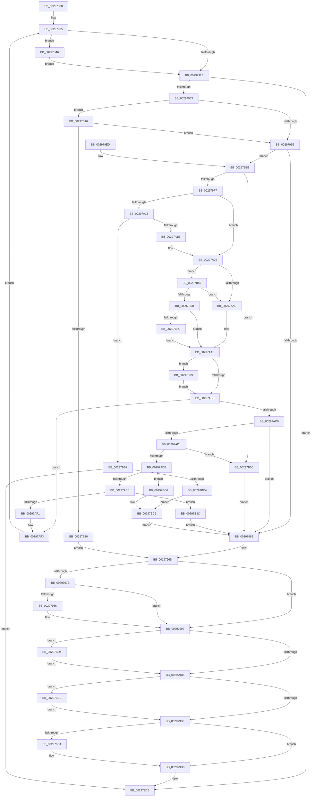

# MiDeleteCachedSubsection

- RVA: `0x00297888`–`0x00297BFB` (길이 `883` bytes)
- VA: `0x0000000140297888`
- 실행 섹션: `.text`
- PDB 이름 있음: `예`; PDB Function 태그: `아니요`
- unwind 정보 RVA: `0x00067A50`
- 디코드: `230`개 명령, `883/883` bytes 표시
- 미해석 바이트: `0` (있으면 어셈블리에 `.byte`로 보존)

> 이 문서는 커널 이미지의 기계어와 PDB 기호를 분석해 생성했습니다. 4번과 5번은 함수 원형과 자료형을 바이너리 사용 방식에서 추정한 C 해석이며 원본 소스 복구 결과는 아닙니다.

## 1. Dependencies

- 직접 호출 지점: **22**; 고유 호출 대상: **17**
- 직접 호출자로 확인된 함수: **2**
- RIP 상대 이미지 참조: **0**

### Outgoing calls
- `0x002978EA` → [MiReleaseSpinLockExclusive](../24/MiReleaseSpinLockExclusive_function_002482C0.md) (function, `0x002482C0`)
- `0x0029791F` → [MiPurgeSubsection](../37/MiPurgeSubsection_function_003712F0.md) (function, `0x003712F0`)
- `0x0029793D` → [ExAcquireSpinLockExclusive](../24/ExAcquireSpinLockExclusive_function_00248690.md) (function, `0x00248690`)
- `0x00297948` → [MiEntireSubsectionIsPurged](MiEntireSubsectionIsPurged_function_00297C04.md) (function, `0x00297C04`)
- `0x00297972` → [MiDecrementSubsectionViewCount](MiDecrementSubsectionViewCount_function_00298E90.md) (function, `0x00298E90`)
- `0x0029798D` → [MiInsertUnusedSubsectionInternal](../67/MiInsertUnusedSubsectionInternal_function_00677EDC.md) (function, `0x00677EDC`)
- `0x0029799A` → [MiDecrementModifiedWriteCount](MiDecrementModifiedWriteCount_function_00298184.md) (function, `0x00298184`)
- `0x002979A8` → [MiReleaseSpinLockExclusive](../24/MiReleaseSpinLockExclusive_function_002482C0.md) (function, `0x002482C0`)
- `0x002979C9` → [ExFreePoolWithTag](../../poolcode/B8/ExFreePoolWithTag_function_00B82870.md) (function, `0x00B82870`)
- `0x00297A08` → [MiPrepareToFlushSubsection](../36/MiPrepareToFlushSubsection_function_00369094.md) (function, `0x00369094`)
- `0x00297A24` → [MiReleaseSpinLockExclusive](../24/MiReleaseSpinLockExclusive_function_002482C0.md) (function, `0x002482C0`)
- `0x00297A77` → [MiFlushSection](../40/MiFlushSection_function_004036B0.md) (function, `0x004036B0`)
- `0x00297A95` → [FsRtlReleaseFileForCcFlush](../../page/9D/FsRtlReleaseFileForCcFlush_function_009D75A0.md) (function, `0x009D75A0`)
- `0x00297ABB` → [ExAcquireSpinLockExclusive](../24/ExAcquireSpinLockExclusive_function_00248690.md) (function, `0x00248690`)
- `0x00297AF9` → [MiReleaseSpinLockExclusive](../24/MiReleaseSpinLockExclusive_function_002482C0.md) (function, `0x002482C0`)
- `0x00297B29` → [MiUpdateSystemProtoPtesTree](MiUpdateSystemProtoPtesTree_function_00295F0C.md) (function, `0x00295F0C`)
- `0x00297B4B` → [MiNotifyUserOfLostData](../67/MiNotifyUserOfLostData_function_00678280.md) (function, `0x00678280`)
- `0x00297B7B` → [MmIsWriteErrorFatal](../40/MmIsWriteErrorFatal_function_00408688.md) (function, `0x00408688`)
- `0x00297BA6` → [ObFastDereferenceObjectDeferDelete](../23/ObFastDereferenceObjectDeferDelete_function_002378C0.md) (function, `0x002378C0`)
- `0x00297BD7` → [FsRtlReleaseFileForCcFlush](../../page/9D/FsRtlReleaseFileForCcFlush_function_009D75A0.md) (function, `0x009D75A0`)
- `0x00297BE4` → [ObfDereferenceObjectWithTag](../2F/ObfDereferenceObjectWithTag_function_002F78E0.md) (function, `0x002F78E0`)
- `0x00297BF1` → [MiReleaseControlAreaWaiters](../28/MiReleaseControlAreaWaiters_function_002865F0.md) (function, `0x002865F0`)

### Direct callers
- [MiDeleteCachedEntries](../67/MiDeleteCachedEntries_function_00677A28.md) at `0x00677B47`
- [MiDeleteDeleteOnCloseSubsections](../67/MiDeleteDeleteOnCloseSubsections_function_00677D20.md) at `0x00677DA5`

### Static image references
- 디코드된 RIP-relative 메모리 참조가 없습니다.

## 2. Other-region calls and transfers

- 다른 실행 섹션으로 향하는 call: **3**
  - `0x002979C9` → [ExFreePoolWithTag](../../poolcode/B8/ExFreePoolWithTag_function_00B82870.md) (`.text` → `POOLCODE`)
  - `0x00297A95` → [FsRtlReleaseFileForCcFlush](../../page/9D/FsRtlReleaseFileForCcFlush_function_009D75A0.md) (`.text` → `PAGE`)
  - `0x00297BD7` → [FsRtlReleaseFileForCcFlush](../../page/9D/FsRtlReleaseFileForCcFlush_function_009D75A0.md) (`.text` → `PAGE`)
- 별도 외부 분기/꼬리 이동을 확인하지 못했습니다.

## 3. Assembly (complete function range)

```asm
00297888  48 8B C4                        mov rax, rsp
0029788B  48 89 58 10                     mov qword ptr [rax + 0x10], rbx
0029788F  4C 89 48 20                     mov qword ptr [rax + 0x20], r9
00297893  4C 89 40 18                     mov qword ptr [rax + 0x18], r8
00297897  55                              push rbp
00297898  56                              push rsi
00297899  57                              push rdi
0029789A  41 54                           push r12
0029789C  41 55                           push r13
0029789E  41 56                           push r14
002978A0  41 57                           push r15
002978A2  48 8D 68 A1                     lea rbp, [rax - 0x5f]
002978A6  48 81 EC 90 00 00 00            sub rsp, 0x90
002978AD  4C 8B 29                        mov r13, qword ptr [rcx]
002978B0  33 C0                           xor eax, eax
002978B2  48 C7 41 50 01 00 00 00         mov qword ptr [rcx + 0x50], 1
002978BA  0F 57 C9                        xorps xmm1, xmm1
002978BD  48 89 45 1F                     mov qword ptr [rbp + 0x1f], rax
002978C1  0F 57 C0                        xorps xmm0, xmm0
002978C4  8B 41 20                        mov eax, dword ptr [rcx + 0x20]
002978C7  48 8B F9                        mov rdi, rcx
002978CA  0F 11 45 EF                     movups xmmword ptr [rbp - 0x11], xmm0
002978CE  83 E0 FE                        and eax, 0xfffffffe
002978D1  4D 8D 7D 48                     lea r15, [r13 + 0x48]
002978D5  0F 11 4D FF                     movups xmmword ptr [rbp - 1], xmm1
002978D9  44 8A F2                        mov r14b, dl
002978DC  0F 11 4D 0F                     movups xmmword ptr [rbp + 0xf], xmm1
002978E0  89 41 20                        mov dword ptr [rcx + 0x20], eax
002978E3  49 8B CF                        mov rcx, r15
002978E6  41 FF 45 4C                     inc dword ptr [r13 + 0x4c]
002978EA  E8 D1 09 FB FF                  call 0x1402482c0
002978EF  48 83 65 DF 00                  and qword ptr [rbp - 0x21], 0
002978F4  33 F6                           xor esi, esi
002978F6  45 33 E4                        xor r12d, r12d
002978F9  48 89 75 D7                     mov qword ptr [rbp - 0x29], rsi
002978FD  33 DB                           xor ebx, ebx
002978FF  8D 4E 08                        lea ecx, [rsi + 8]
00297902  89 4D 67                        mov dword ptr [rbp + 0x67], ecx
00297905  8B 47 2C                        mov eax, dword ptr [rdi + 0x2c]
00297908  44 8B C9                        mov r9d, ecx
0029790B  48 8B 57 08                     mov rdx, qword ptr [rdi + 8]
0029790F  48 8B CF                        mov rcx, rdi
00297912  4C 8D 04 C2                     lea r8, [rdx + rax*8]
00297916  48 8D 45 FF                     lea rax, [rbp - 1]
0029791A  48 89 44 24 20                  mov qword ptr [rsp + 0x20], rax
0029791F  E8 CC 99 0D 00                  call 0x1403712f0
00297924  80 7D 09 00                     cmp byte ptr [rbp + 9], 0
00297928  0F 85 18 02 00 00               jne 0x140297b46
0029792E  48 8B 4D 77                     mov rcx, qword ptr [rbp + 0x77]
00297932  48 8B 45 FF                     mov rax, qword ptr [rbp - 1]
00297936  48 01 41 50                     add qword ptr [rcx + 0x50], rax
0029793A  49 8B CF                        mov rcx, r15
0029793D  E8 4E 0D FB FF                  call 0x140248690
00297942  41 8A D6                        mov dl, r14b
00297945  48 8B CF                        mov rcx, rdi
00297948  E8 B7 02 00 00                  call 0x140297c04
0029794D  8B D8                           mov ebx, eax
0029794F  85 C0                           test eax, eax
00297951  79 7F                           jns 0x1402979d2
00297953  3D 89 01 00 C0                  cmp eax, 0xc0000189
00297958  0F 84 B8 01 00 00               je 0x140297b16
0029795E  3D 2D 02 00 C0                  cmp eax, 0xc000022d
00297963  0F 84 85 00 00 00               je 0x1402979ee
00297969  4C 8B 65 DF                     mov r12, qword ptr [rbp - 0x21]
0029796D  33 D2                           xor edx, edx
0029796F  48 8B CF                        mov rcx, rdi
00297972  E8 19 15 00 00                  call 0x140298e90
00297977  48 83 7F 50 00                  cmp qword ptr [rdi + 0x50], 0
0029797C  75 14                           jne 0x140297992
0029797E  41 8B 45 38                     mov eax, dword ptr [r13 + 0x38]
00297982  A8 01                           test al, 1
00297984  75 0C                           jne 0x140297992
00297986  48 8B 55 7F                     mov rdx, qword ptr [rbp + 0x7f]
0029798A  48 8B CF                        mov rcx, rdi
0029798D  E8 4A 05 3E 00                  call 0x140677edc
00297992  BA 01 00 00 00                  mov edx, 1
00297997  49 8B CD                        mov rcx, r13
0029799A  E8 E5 07 00 00                  call 0x140298184
0029799F  41 8A D6                        mov dl, r14b
002979A2  49 8B CF                        mov rcx, r15
002979A5  48 8B F8                        mov rdi, rax
002979A8  E8 13 09 FB FF                  call 0x1402482c0
002979AD  48 85 F6                        test rsi, rsi
002979B0  0F 85 1E 02 00 00               jne 0x140297bd4
002979B6  48 85 FF                        test rdi, rdi
002979B9  0F 85 2F 02 00 00               jne 0x140297bee
002979BF  4D 85 E4                        test r12, r12
002979C2  74 0C                           je 0x1402979d0
002979C4  33 D2                           xor edx, edx
002979C6  49 8B CC                        mov rcx, r12
002979C9  E8 A2 AE 8E 00                  call 0x140b82870
002979CE  33 DB                           xor ebx, ebx
002979D0  8B C3                           mov eax, ebx
002979D2  48 8B 9C 24 D8 00 00 00         mov rbx, qword ptr [rsp + 0xd8]
002979DA  48 81 C4 90 00 00 00            add rsp, 0x90
002979E1  41 5F                           pop r15
002979E3  41 5E                           pop r14
002979E5  41 5D                           pop r13
002979E7  41 5C                           pop r12
002979E9  5F                              pop rdi
002979EA  5E                              pop rsi
002979EB  5D                              pop rbp
002979EC  C3                              ret
002979ED  CC                              int3
002979EE  45 85 E4                        test r12d, r12d
002979F1  0F 85 15 01 00 00               jne 0x140297b0c
002979F7  4C 8B 65 77                     mov r12, qword ptr [rbp + 0x77]
002979FB  4C 8D 4D D7                     lea r9, [rbp - 0x29]
002979FF  4D 8B C4                        mov r8, r12
00297A02  41 8A D6                        mov dl, r14b
00297A05  48 8B CF                        mov rcx, rdi
00297A08  E8 87 16 0D 00                  call 0x140369094
00297A0D  8B D8                           mov ebx, eax
00297A0F  85 C0                           test eax, eax
00297A11  79 16                           jns 0x140297a29
00297A13  3D 2D 02 00 C0                  cmp eax, 0xc000022d
00297A18  0F 85 99 01 00 00               jne 0x140297bb7
00297A1E  41 8A D6                        mov dl, r14b
00297A21  49 8B CF                        mov rcx, r15
00297A24  E8 97 08 FB FF                  call 0x1402482c0
00297A29  8B 47 2C                        mov eax, dword ptr [rdi + 0x2c]
00297A2C  45 33 F6                        xor r14d, r14d
00297A2F  48 8B 4F 08                     mov rcx, qword ptr [rdi + 8]
00297A33  48 FF C8                        dec rax
00297A36  4C 89 75 E7                     mov qword ptr [rbp - 0x19], r14
00297A3A  4C 8B CF                        mov r9, rdi
00297A3D  4C 8B C7                        mov r8, rdi
00297A40  48 8D 14 C1                     lea rdx, [rcx + rax*8]
00297A44  65 48 8B 04 25 88 01 00 00      mov rax, qword ptr gs:[0x188]
00297A4D  48 C7 80 50 05 00 00 01 00 00 00  mov qword ptr [rax + 0x550], 1
00297A58  48 8D 45 EF                     lea rax, [rbp - 0x11]
00297A5C  48 89 44 24 38                  mov qword ptr [rsp + 0x38], rax
00297A61  48 8D 45 E7                     lea rax, [rbp - 0x19]
00297A65  48 89 44 24 30                  mov qword ptr [rsp + 0x30], rax
00297A6A  C7 44 24 28 02 00 00 00         mov dword ptr [rsp + 0x28], 2
00297A72  4C 89 74 24 20                  mov qword ptr [rsp + 0x20], r14
00297A77  E8 34 BC 16 00                  call 0x1404036b0
00297A7C  8B D8                           mov ebx, eax
00297A7E  65 48 8B 04 25 88 01 00 00      mov rax, qword ptr gs:[0x188]
00297A87  48 8B 75 D7                     mov rsi, qword ptr [rbp - 0x29]
00297A8B  48 8B CE                        mov rcx, rsi
00297A8E  4C 89 B0 50 05 00 00            mov qword ptr [rax + 0x550], r14
00297A95  E8 06 FB 73 00                  call 0x1409d75a0
00297A9A  48 8B 45 E7                     mov rax, qword ptr [rbp - 0x19]
00297A9E  49 01 44 24 58                  add qword ptr [r12 + 0x58], rax
00297AA3  85 DB                           test ebx, ebx
00297AA5  0F 88 AA 00 00 00               js 0x140297b55
00297AAB  44 8B 65 67                     mov r12d, dword ptr [rbp + 0x67]
00297AAF  48 85 F6                        test rsi, rsi
00297AB2  0F 85 E1 00 00 00               jne 0x140297b99
00297AB8  49 8B CF                        mov rcx, r15
00297ABB  E8 D0 0B FB FF                  call 0x140248690
00297AC0  44 8A F0                        mov r14b, al
00297AC3  41 F6 C4 01                     test r12b, 1
00297AC7  75 2A                           jne 0x140297af3
00297AC9  85 DB                           test ebx, ebx
00297ACB  0F 88 98 FE FF FF               js 0x140297969
00297AD1  48 83 7F 50 01                  cmp qword ptr [rdi + 0x50], 1
00297AD6  48 8B 0F                        mov rcx, qword ptr [rdi]
00297AD9  75 31                           jne 0x140297b0c
00297ADB  8B 47 20                        mov eax, dword ptr [rdi + 0x20]
00297ADE  A8 01                           test al, 1
00297AE0  0F 85 E0 00 00 00               jne 0x140297bc6
00297AE6  8B 41 38                        mov eax, dword ptr [rcx + 0x38]
00297AE9  48 8B 75 D7                     mov rsi, qword ptr [rbp - 0x29]
00297AED  A8 01                           test al, 1
00297AEF  75 4B                           jne 0x140297b3c
00297AF1  33 DB                           xor ebx, ebx
00297AF3  41 8A D6                        mov dl, r14b
00297AF6  49 8B CF                        mov rcx, r15
00297AF9  E8 C2 07 FB FF                  call 0x1402482c0
00297AFE  8B 4D 67                        mov ecx, dword ptr [rbp + 0x67]
00297B01  41 BC 01 00 00 00               mov r12d, 1
00297B07  E9 F9 FD FF FF                  jmp 0x140297905
00297B0C  BB 43 02 00 C0                  mov ebx, 0xc0000243
00297B11  E9 53 FE FF FF                  jmp 0x140297969
00297B16  83 7F 68 00                     cmp dword ptr [rdi + 0x68], 0
00297B1A  0F 85 3E FE FF FF               jne 0x14029795e
00297B20  48 8D 4F 78                     lea rcx, [rdi + 0x78]
00297B24  BA 02 00 00 00                  mov edx, 2
00297B29  E8 DE E3 FF FF                  call 0x140295f0c
00297B2E  4C 8B 67 08                     mov r12, qword ptr [rdi + 8]
00297B32  48 83 67 08 00                  and qword ptr [rdi + 8], 0
00297B37  E9 31 FE FF FF                  jmp 0x14029796d
00297B3C  BB 89 01 00 C0                  mov ebx, 0xc0000189
00297B41  E9 23 FE FF FF                  jmp 0x140297969
00297B46  8B D3                           mov edx, ebx
00297B48  49 8B CD                        mov rcx, r13
00297B4B  E8 30 07 3E 00                  call 0x140678280
00297B50  E9 D9 FD FF FF                  jmp 0x14029792e
00297B55  48 8B 46 08                     mov rax, qword ptr [rsi + 8]
00297B59  8B 48 34                        mov ecx, dword ptr [rax + 0x34]
00297B5C  83 E1 10                        and ecx, 0x10
00297B5F  81 FB 33 04 00 C0               cmp ebx, 0xc0000433
00297B65  0F 84 40 FF FF FF               je 0x140297aab
00297B6B  85 C9                           test ecx, ecx
00297B6D  41 8B D6                        mov edx, r14d
00297B70  44 8B C3                        mov r8d, ebx
00297B73  B9 01 00 00 00                  mov ecx, 1
00297B78  0F 95 C2                        setne dl
00297B7B  E8 08 0B 17 00                  call 0x140408688
00297B80  44 8B 65 67                     mov r12d, dword ptr [rbp + 0x67]
00297B84  85 C0                           test eax, eax
00297B86  0F 84 23 FF FF FF               je 0x140297aaf
00297B8C  41 83 CC 01                     or r12d, 1
00297B90  44 89 65 67                     mov dword ptr [rbp + 0x67], r12d
00297B94  E9 16 FF FF FF                  jmp 0x140297aaf
00297B99  49 8D 4D 40                     lea rcx, [r13 + 0x40]
00297B9D  41 B8 4D 6D 53 63               mov r8d, 0x63536d4d
00297BA3  48 8B D6                        mov rdx, rsi
00297BA6  E8 15 FD F9 FF                  call 0x1402378c0
00297BAB  49 8B F6                        mov rsi, r14
00297BAE  4C 89 75 D7                     mov qword ptr [rbp - 0x29], r14
00297BB2  E9 01 FF FF FF                  jmp 0x140297ab8
00297BB7  B8 1B 00 00 C0                  mov eax, 0xc000001b
00297BBC  3B D8                           cmp ebx, eax
00297BBE  0F 84 0E FE FF FF               je 0x1402979d2
00297BC4  EB 05                           jmp 0x140297bcb
00297BC6  BB 88 00 00 C0                  mov ebx, 0xc0000088
00297BCB  48 8B 75 D7                     mov rsi, qword ptr [rbp - 0x29]
00297BCF  E9 95 FD FF FF                  jmp 0x140297969
00297BD4  48 8B CE                        mov rcx, rsi
00297BD7  E8 C4 F9 73 00                  call 0x1409d75a0
00297BDC  BA 4D 6D 53 63                  mov edx, 0x63536d4d
00297BE1  48 8B CE                        mov rcx, rsi
00297BE4  E8 F7 FC 05 00                  call 0x1402f78e0
00297BE9  E9 C8 FD FF FF                  jmp 0x1402979b6
00297BEE  48 8B CF                        mov rcx, rdi
00297BF1  E8 FA E9 FE FF                  call 0x1402865f0
00297BF6  E9 C4 FD FF FF                  jmp 0x1402979bf
```

## 4. C-style interpretation (structured pseudocode)

```c
__int64 __fastcall MiDeleteCachedSubsection(__int64 a1, unsigned __int8 a2, __int64 a3, __int64 a4)
{
    __int64 result;
    __int64 v_r12;
    __int64 v_r14;
    __int64 v_rbx;
    __int64 v_rsi;
    __int64 v_rsp;
    unsigned __int64 v_stack_mA8;
    unsigned __int64 v_stack_p10;
    unsigned __int64 v_stack_p20;
    unsigned int v_stack_p28;
    unsigned __int64 v_stack_p30;
    unsigned __int64 v_stack_p38;

    *(unsigned __int64 *)(v_rsp + 16) = v_rbx;
    *(unsigned __int64 *)(v_rsp + 32) = a4;
    *(unsigned __int64 *)(v_rsp + 24) = a3;
    v_rsp = (v_rsp) - (144);
    result = 0;
    *(unsigned __int64 *)(a1 + 80) = 1;
    *(unsigned __int64 *)(v_rsp - 95 + 31) = 0;
    *(unsigned __int64 *)(v_rsp - 95 - 17) = v_xmm0;
    result = (unsigned int)(((unsigned int)(*(unsigned int *)(a1 + 32))) & (0xFFFFFFFEULL));
    *(unsigned __int64 *)(v_rsp - 95 - 1) = v_xmm1;
    *(unsigned __int64 *)(v_rsp - 95 + 15) = v_xmm1;
    *(unsigned int *)(a1 + 32) = (unsigned int)(result);
    result = MiReleaseSpinLockExclusive(*(unsigned __int64 *)(a1) + 72, a2, a3, a4);
    v_rsi = 0;
    v_r12 = 0;
    *(unsigned __int64 *)(v_rsp - 95 - 41) = 0;
    v_rbx = 0;
    *(unsigned int *)(v_rsp - 95 + 103) = (unsigned int)(v_rsi + 8);
loc_00297905:
    v_stack_mA8 = v_rsp - 95 - 1;
    result = MiPurgeSubsection(a1, *(unsigned __int64 *)(a1 + 8), *(unsigned __int64 *)(a1 + 8) + (unsigned int)(*(unsigned int *)(a1 + 44)) * 8, (unsigned int)((unsigned int)(v_rsi + 8)));
    if ((*(unsigned __int8 *)(v_rsp - 95 + 9)) != 0) goto loc_00297B46;
loc_0029792E:
    result = ExAcquireSpinLockExclusive(*(unsigned __int64 *)(a1) + 72, *(unsigned __int64 *)(a1 + 8), *(unsigned __int64 *)(a1 + 8) + (unsigned int)(*(unsigned int *)(a1 + 44)) * 8, (unsigned int)((unsigned int)(v_rsi + 8)));
    result = MiEntireSubsectionIsPurged(a1, a2, *(unsigned __int64 *)(a1 + 8) + (unsigned int)(*(unsigned int *)(a1 + 44)) * 8, (unsigned int)((unsigned int)(v_rsi + 8)));
    if (!sign_flag) goto loc_002979D2;
    if (((unsigned int)(result)) == 0xC0000189ULL) goto loc_00297B16;
loc_0029795E:
    if (((unsigned int)(result)) == 0xC000022DULL) goto loc_002979EE;
loc_00297969:
loc_0029796D:
    a2 = 0;
    result = MiDecrementSubsectionViewCount(a1, a2, *(unsigned __int64 *)(a1 + 8) + (unsigned int)(*(unsigned int *)(a1 + 44)) * 8, (unsigned int)((unsigned int)(v_rsi + 8)));
    if ((*(unsigned __int64 *)(a1 + 80)) != 0) goto loc_00297992;
    result = (unsigned int)(*(unsigned int *)(*(unsigned __int64 *)(a1) + 56));
    if ((((unsigned __int8)((unsigned int)(*(unsigned int *)(*(unsigned __int64 *)(a1) + 56)))) & (1)) == 0) {
        a2 = *(unsigned __int64 *)(v_rsp - 95 + 127);
        a1 = a1;
        result = MiInsertUnusedSubsectionInternal(a1, a2, *(unsigned __int64 *)(a1 + 8) + (unsigned int)(*(unsigned int *)(a1 + 44)) * 8, (unsigned int)((unsigned int)(v_rsi + 8)));
    }
    result = MiDecrementModifiedWriteCount(*(unsigned __int64 *)(a1), 1, *(unsigned __int64 *)(a1 + 8) + (unsigned int)(*(unsigned int *)(a1 + 44)) * 8, (unsigned int)((unsigned int)(v_rsi + 8)));
    result = MiReleaseSpinLockExclusive(*(unsigned __int64 *)(a1) + 72, a2, *(unsigned __int64 *)(a1 + 8) + (unsigned int)(*(unsigned int *)(a1 + 44)) * 8, (unsigned int)((unsigned int)(v_rsi + 8)));
    if (0 != 0) goto loc_00297BD4;
loc_002979B6:
    if (result != 0) goto loc_00297BEE;
loc_002979BF:
    v_rbx = (unsigned int)((unsigned int)(result));
    if (*(unsigned __int64 *)(v_rsp - 95 - 33) != 0) {
        a2 = 0;
        a1 = *(unsigned __int64 *)(v_rsp - 95 - 33);
        result = ExFreePoolWithTag(a1, a2, *(unsigned __int64 *)(a1 + 8) + (unsigned int)(*(unsigned int *)(a1 + 44)) * 8, (unsigned int)((unsigned int)(v_rsi + 8)));
        v_rbx = 0;
    }
loc_002979D2:
    v_rsp = (v_rsp) + (144);
    return 0;
loc_002979EE:
    if ((unsigned int)(*(unsigned __int64 *)(v_rsp - 95 - 33)) != 0) goto loc_00297B0C;
    result = MiPrepareToFlushSubsection(result, 0, *(unsigned __int64 *)(v_rsp - 95 + 119), v_rsp - 95 - 41);
    if (!sign_flag) goto loc_00297A29;
    if (((unsigned int)(result)) != 0xC000022DULL) goto loc_00297BB7;
    result = MiReleaseSpinLockExclusive(*(unsigned __int64 *)(a1) + 72, 0, *(unsigned __int64 *)(v_rsp - 95 + 119), v_rsp - 95 - 41);
loc_00297A29:
    v_r14 = 0;
    result = ((unsigned int)(*(unsigned int *)(result + 44))) - 1;
    *(unsigned __int64 *)(v_rsp - 95 - 25) = 0;
    *(unsigned __int64 *)(*(unsigned __int64 *)(gs_base + (0 + 392)) + 1360) = 1;
    v_stack_p38 = v_rsp - 95 - 17;
    v_stack_p30 = v_rsp - 95 - 25;
    v_stack_p28 = 2;
    v_stack_p20 = 0;
    result = MiFlushSection(*(unsigned __int64 *)(result + 8), *(unsigned __int64 *)(result + 8) + result * 8, result, result);
    *(unsigned __int64 *)(*(unsigned __int64 *)(gs_base + (0 + 392)) + 1360) = 0;
    result = FsRtlReleaseFileForCcFlush(*(unsigned __int64 *)(v_rsp - 95 - 41), *(unsigned __int64 *)(result + 8) + result * 8, result, result);
    if (sign_flag) goto loc_00297B55;
loc_00297AAB:
loc_00297AAF:
    if (*(unsigned __int64 *)(v_rsp - 95 - 41) != 0) goto loc_00297B99;
loc_00297AB8:
    result = ExAcquireSpinLockExclusive(*(unsigned __int64 *)(a1) + 72, *(unsigned __int64 *)(result + 8) + result * 8, result, result);
    if ((((unsigned __int8)((unsigned int)(*(unsigned int *)(v_rsp - 95 + 103)))) & (1)) != 0) goto loc_00297AF3;
    if (sign_flag) goto loc_00297969;
    if ((*(unsigned __int64 *)(result + 80)) != 1) goto loc_00297B0C;
    if ((((unsigned __int8)((unsigned int)(*(unsigned int *)(result + 32)))) & (1)) != 0) goto loc_00297BC6;
    if ((((unsigned __int8)((unsigned int)(*(unsigned int *)(*(unsigned __int64 *)(result) + 56)))) & (1)) != 0) goto loc_00297B3C;
    v_rbx = 0;
loc_00297AF3:
    result = MiReleaseSpinLockExclusive(*(unsigned __int64 *)(a1) + 72, (unsigned __int8)((unsigned __int8)(result)), result, result);
    goto loc_00297905;
loc_00297B0C:
    goto loc_00297969;
loc_00297B16:
    if ((*(unsigned int *)(result + 104)) != 0) goto loc_0029795E;
    result = MiUpdateSystemProtoPtesTree(result + 120, 2, result, result);
    goto loc_0029796D;
loc_00297B3C:
    goto loc_00297969;
loc_00297B46:
    result = MiNotifyUserOfLostData(*(unsigned __int64 *)(a1), (unsigned int)((unsigned int)((unsigned int)(0xC0000189ULL))), result, result);
    goto loc_0029792E;
loc_00297B55:
    a1 = (unsigned int)(((unsigned int)(*(unsigned int *)(*(unsigned __int64 *)(*(unsigned __int64 *)(v_rsp - 95 - 41) + 8) + 52))) & (16));
    if (((unsigned int)((unsigned int)(0xC0000189ULL))) == 0xC0000433ULL) goto loc_00297AAB;
    a2 = ((unsigned int)(a1) != 0) ? 1 : 0;
    result = MmIsWriteErrorFatal(1, a2, (unsigned int)((unsigned int)((unsigned int)(0xC0000189ULL))), result);
    if ((unsigned int)(result) == 0) goto loc_00297AAF;
    v_r12 = (unsigned int)(((unsigned int)(*(unsigned int *)(v_rsp - 95 + 103))) | (1));
    *(unsigned int *)(v_rsp - 95 + 103) = (unsigned int)(v_r12);
    goto loc_00297AAF;
loc_00297B99:
    result = ObFastDereferenceObjectDeferDelete(*(unsigned __int64 *)(a1) + 64, *(unsigned __int64 *)(v_rsp - 95 - 41), (unsigned int)(0x63536D4DULL), result);
    *(unsigned __int64 *)(v_rsp - 95 - 41) = (unsigned __int8)(result);
    goto loc_00297AB8;
loc_00297BB7:
    if (((unsigned int)((unsigned int)(0xC0000189ULL))) == ((unsigned int)((unsigned int)(0xC000001BULL)))) goto loc_002979D2;
    goto loc_00297BCB;
loc_00297BC6:
loc_00297BCB:
    goto loc_00297969;
loc_00297BD4:
    result = FsRtlReleaseFileForCcFlush(*(unsigned __int64 *)(v_rsp - 95 - 41), *(unsigned __int64 *)(v_rsp - 95 - 41), (unsigned int)(0x63536D4DULL), result);
    result = ObfDereferenceObjectWithTag(*(unsigned __int64 *)(v_rsp - 95 - 41), (unsigned int)(0x63536D4DULL), (unsigned int)(0x63536D4DULL), result);
    goto loc_002979B6;
loc_00297BEE:
    result = MiReleaseControlAreaWaiters(result, (unsigned int)(0x63536D4DULL), (unsigned int)(0x63536D4DULL), result);
    goto loc_002979BF;
}
```

## 5. (Beta) C Style

```c
int64_t MiDeleteCachedSubsection(void *Arg1, uint8_t Arg2, int64_t Arg3, int64_t Arg4)
{
    uint8_t *arg1 = (uint8_t *)Arg1;

    int64_t result;
    int64_t local_r12;
    int64_t local_r14;
    int64_t local_rbx;
    int64_t local_rsi;
    int64_t local_rsp;
    uint64_t v_stack_mA8;
    uint64_t v_stack_p10;
    uint64_t v_stack_p20;
    uint32_t v_stack_p28;
    uint64_t v_stack_p30;
    uint64_t v_stack_p38;

    *(uint64_t *)(local_rsp + 0x10) = local_rbx;
    *(uint64_t *)(local_rsp + 0x20) = Arg4;
    *(uint64_t *)(local_rsp + 0x18) = Arg3;
    local_rsp = (local_rsp) - (144);
    result = 0;
    *(uint64_t *)(arg1 + 0x50) = 1;
    *(uint64_t *)(local_rsp - 0x5F + 0x1F) = 0;
    *(uint64_t *)(local_rsp - 0x5F - 0x11) = v_xmm0;
    result = (uint32_t)(((uint32_t)(*(uint32_t *)(arg1 + 0x20))) & (0xFFFFFFFEULL));
    *(uint64_t *)(local_rsp - 0x5F - 0x1) = v_xmm1;
    *(uint64_t *)(local_rsp - 0x5F + 0xF) = v_xmm1;
    *(uint32_t *)(arg1 + 0x20) = (uint32_t)(result);
    result = MiReleaseSpinLockExclusive(*(uint64_t *)(arg1) + 72, Arg2, Arg3, Arg4);
    local_rsi = 0;
    local_r12 = 0;
    *(uint64_t *)(local_rsp - 0x5F - 0x29) = 0;
    local_rbx = 0;
    *(uint32_t *)(local_rsp - 0x5F + 0x67) = (uint32_t)(local_rsi + 8);
loc_00297905:
    v_stack_mA8 = local_rsp - 95 - 1;
    result = MiPurgeSubsection(Arg1, *(uint64_t *)(arg1 + 0x8), *(uint64_t *)(arg1 + 0x8) + (uint32_t)(*(uint32_t *)(arg1 + 0x2C)) * 8, (uint32_t)((uint32_t)(local_rsi + 8)));
    if ((*(uint8_t *)(local_rsp - 0x5F + 0x9)) != 0) goto loc_00297B46;
loc_0029792E:
    result = ExAcquireSpinLockExclusive(*(uint64_t *)(arg1) + 72, *(uint64_t *)(arg1 + 0x8), *(uint64_t *)(arg1 + 0x8) + (uint32_t)(*(uint32_t *)(arg1 + 0x2C)) * 8, (uint32_t)((uint32_t)(local_rsi + 8)));
    result = MiEntireSubsectionIsPurged(Arg1, Arg2, *(uint64_t *)(arg1 + 0x8) + (uint32_t)(*(uint32_t *)(arg1 + 0x2C)) * 8, (uint32_t)((uint32_t)(local_rsi + 8)));
    if (!sign_flag) goto loc_002979D2;
    if (((uint32_t)(result)) == 0xC0000189ULL) goto loc_00297B16;
loc_0029795E:
    if (((uint32_t)(result)) == 0xC000022DULL) goto loc_002979EE;
loc_00297969:
loc_0029796D:
    Arg2 = 0;
    result = MiDecrementSubsectionViewCount(Arg1, Arg2, *(uint64_t *)(arg1 + 0x8) + (uint32_t)(*(uint32_t *)(arg1 + 0x2C)) * 8, (uint32_t)((uint32_t)(local_rsi + 8)));
    if ((*(uint64_t *)(arg1 + 0x50)) != 0) goto loc_00297992;
    result = (uint32_t)(*(uint32_t *)(*(uint64_t *)(arg1) + 0x38));
    if ((((uint8_t)((uint32_t)(*(uint32_t *)(*(uint64_t *)(arg1) + 0x38)))) & (1)) == 0) {
        Arg2 = *(uint64_t *)(local_rsp - 0x5F + 0x7F);
        Arg1 = Arg1;
        result = MiInsertUnusedSubsectionInternal(Arg1, Arg2, *(uint64_t *)(arg1 + 0x8) + (uint32_t)(*(uint32_t *)(arg1 + 0x2C)) * 8, (uint32_t)((uint32_t)(local_rsi + 8)));
    }
    result = MiDecrementModifiedWriteCount(*(uint64_t *)(arg1), 1, *(uint64_t *)(arg1 + 0x8) + (uint32_t)(*(uint32_t *)(arg1 + 0x2C)) * 8, (uint32_t)((uint32_t)(local_rsi + 8)));
    result = MiReleaseSpinLockExclusive(*(uint64_t *)(arg1) + 72, Arg2, *(uint64_t *)(arg1 + 0x8) + (uint32_t)(*(uint32_t *)(arg1 + 0x2C)) * 8, (uint32_t)((uint32_t)(local_rsi + 8)));
    if (0 != 0) goto loc_00297BD4;
loc_002979B6:
    if (result != 0) goto loc_00297BEE;
loc_002979BF:
    local_rbx = (uint32_t)((uint32_t)(result));
    if (*(uint64_t *)(local_rsp - 0x5F - 0x21) != 0) {
        Arg2 = 0;
        Arg1 = *(uint64_t *)(local_rsp - 0x5F - 0x21);
        result = ExFreePoolWithTag(Arg1, Arg2, *(uint64_t *)(arg1 + 0x8) + (uint32_t)(*(uint32_t *)(arg1 + 0x2C)) * 8, (uint32_t)((uint32_t)(local_rsi + 8)));
        local_rbx = 0;
    }
loc_002979D2:
    local_rsp = (local_rsp) + (144);
    return 0;
loc_002979EE:
    if ((uint32_t)(*(uint64_t *)(local_rsp - 0x5F - 0x21)) != 0) goto loc_00297B0C;
    result = MiPrepareToFlushSubsection(result, 0, *(uint64_t *)(local_rsp - 0x5F + 0x77), local_rsp - 95 - 41);
    if (!sign_flag) goto loc_00297A29;
    if (((uint32_t)(result)) != 0xC000022DULL) goto loc_00297BB7;
    result = MiReleaseSpinLockExclusive(*(uint64_t *)(arg1) + 72, 0, *(uint64_t *)(local_rsp - 0x5F + 0x77), local_rsp - 95 - 41);
loc_00297A29:
    local_r14 = 0;
    result = ((uint32_t)(*(uint32_t *)(result + 0x2C))) - 1;
    *(uint64_t *)(local_rsp - 0x5F - 0x19) = 0;
    *(uint64_t *)(*(uint64_t *)(gs_base + (0 + 0x188)) + 0x550) = 1;
    v_stack_p38 = local_rsp - 95 - 17;
    v_stack_p30 = local_rsp - 95 - 25;
    v_stack_p28 = 2;
    v_stack_p20 = 0;
    result = MiFlushSection(*(uint64_t *)(result + 0x8), *(uint64_t *)(result + 0x8) + result * 8, result, result);
    *(uint64_t *)(*(uint64_t *)(gs_base + (0 + 0x188)) + 0x550) = 0;
    result = FsRtlReleaseFileForCcFlush(*(uint64_t *)(local_rsp - 0x5F - 0x29), *(uint64_t *)(result + 0x8) + result * 8, result, result);
    if (sign_flag) goto loc_00297B55;
loc_00297AAB:
loc_00297AAF:
    if (*(uint64_t *)(local_rsp - 0x5F - 0x29) != 0) goto loc_00297B99;
loc_00297AB8:
    result = ExAcquireSpinLockExclusive(*(uint64_t *)(arg1) + 72, *(uint64_t *)(result + 0x8) + result * 8, result, result);
    if ((((uint8_t)((uint32_t)(*(uint32_t *)(local_rsp - 0x5F + 0x67)))) & (1)) != 0) goto loc_00297AF3;
    if (sign_flag) goto loc_00297969;
    if ((*(uint64_t *)(result + 0x50)) != 1) goto loc_00297B0C;
    if ((((uint8_t)((uint32_t)(*(uint32_t *)(result + 0x20)))) & (1)) != 0) goto loc_00297BC6;
    if ((((uint8_t)((uint32_t)(*(uint32_t *)(*(uint64_t *)(result) + 0x38)))) & (1)) != 0) goto loc_00297B3C;
    local_rbx = 0;
loc_00297AF3:
    result = MiReleaseSpinLockExclusive(*(uint64_t *)(arg1) + 72, (uint8_t)((uint8_t)(result)), result, result);
    goto loc_00297905;
loc_00297B0C:
    goto loc_00297969;
loc_00297B16:
    if ((*(uint32_t *)(result + 0x68)) != 0) goto loc_0029795E;
    result = MiUpdateSystemProtoPtesTree(result + 120, 2, result, result);
    goto loc_0029796D;
loc_00297B3C:
    goto loc_00297969;
loc_00297B46:
    result = MiNotifyUserOfLostData(*(uint64_t *)(arg1), (uint32_t)((uint32_t)((uint32_t)(0xC0000189ULL))), result, result);
    goto loc_0029792E;
loc_00297B55:
    Arg1 = (uint32_t)(((uint32_t)(*(uint32_t *)(*(uint64_t *)(*(uint64_t *)(local_rsp - 0x5F - 0x29) + 0x8) + 0x34))) & (16));
    if (((uint32_t)((uint32_t)(0xC0000189ULL))) == 0xC0000433ULL) goto loc_00297AAB;
    Arg2 = ((uint32_t)(Arg1) != 0) ? 1 : 0;
    result = MmIsWriteErrorFatal(1, Arg2, (uint32_t)((uint32_t)((uint32_t)(0xC0000189ULL))), result);
    if ((uint32_t)(result) == 0) goto loc_00297AAF;
    local_r12 = (uint32_t)(((uint32_t)(*(uint32_t *)(local_rsp - 0x5F + 0x67))) | (1));
    *(uint32_t *)(local_rsp - 0x5F + 0x67) = (uint32_t)(local_r12);
    goto loc_00297AAF;
loc_00297B99:
    result = ObFastDereferenceObjectDeferDelete(*(uint64_t *)(arg1) + 64, *(uint64_t *)(local_rsp - 0x5F - 0x29), (uint32_t)(0x63536D4DULL), result);
    *(uint64_t *)(local_rsp - 0x5F - 0x29) = (uint8_t)(result);
    goto loc_00297AB8;
loc_00297BB7:
    if (((uint32_t)((uint32_t)(0xC0000189ULL))) == ((uint32_t)((uint32_t)(0xC000001BULL)))) goto loc_002979D2;
    goto loc_00297BCB;
loc_00297BC6:
loc_00297BCB:
    goto loc_00297969;
loc_00297BD4:
    result = FsRtlReleaseFileForCcFlush(*(uint64_t *)(local_rsp - 0x5F - 0x29), *(uint64_t *)(local_rsp - 0x5F - 0x29), (uint32_t)(0x63536D4DULL), result);
    result = ObfDereferenceObjectWithTag(*(uint64_t *)(local_rsp - 0x5F - 0x29), (uint32_t)(0x63536D4DULL), (uint32_t)(0x63536D4DULL), result);
    goto loc_002979B6;
loc_00297BEE:
    result = MiReleaseControlAreaWaiters(result, (uint32_t)(0x63536D4DULL), (uint32_t)(0x63536D4DULL), result);
    goto loc_002979BF;
}
```

### 관측된 메모리 오프셋

구조체 형식이 확인되지 않은 접근은 인자 기준의 오프셋으로만 기록했습니다.

| 기준 인자 | 오프셋 표현 | 폭 (bit) | 접근 |
|---|---:|---:|---|
| `Arg1` | `+ 0x0` | `64` | `R` |
| `Arg1` | `+ 0x8` | `64` | `R` |
| `Arg1` | `+ 0x8` | `64` | `R/W` |
| `Arg1` | `+ 0x20` | `32` | `R` |
| `Arg1` | `+ 0x20` | `32` | `W` |
| `Arg1` | `+ 0x2C` | `32` | `R` |
| `Arg1` | `+ 0x50` | `64` | `R` |
| `Arg1` | `+ 0x50` | `64` | `W` |
| `Arg1` | `+ 0x68` | `32` | `R` |
| `Arg1` | `+ 0x78` | `64` | `R` |

## 6. Execution-region graph

[열기: 2D/3D 그래프와 함수 탐색 컨트롤 패널](../../../control-panel.html?section=text&rva=0x00297888&view=graph)

- 2D 그래프는 위에서 아래로 흐르고, 3D 그래프는 빈 공간을 드래그해 회전합니다. Shift+드래그는 이동, 휠은 확대·축소, 함수 노드 선택은 대상 보고서 이동입니다.

### Static fallback


