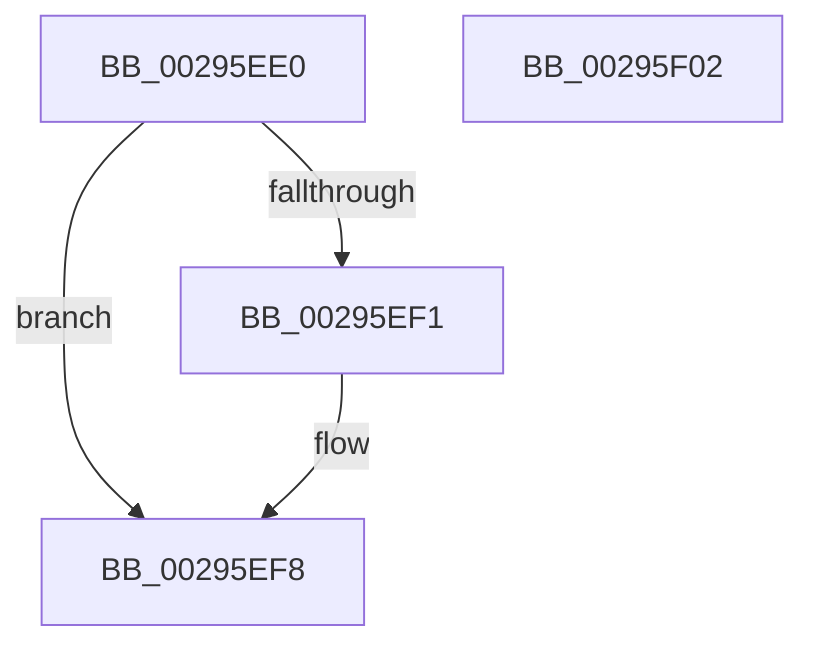

# MiDereferenceVad

- RVA: `0x00295EE0`–`0x00295F03` (길이 `35` bytes)
- VA: `0x0000000140295EE0`
- 실행 섹션: `.text`
- PDB 이름 있음: `예`; PDB Function 태그: `아니요`
- unwind 정보 RVA: `0x000DB714`
- 디코드: `13`개 명령, `35/35` bytes 표시
- 미해석 바이트: `0` (있으면 어셈블리에 `.byte`로 보존)

> 이 문서는 커널 이미지의 기계어와 PDB 기호를 분석해 생성했습니다. 4번과 5번은 함수 원형과 자료형을 바이너리 사용 방식에서 추정한 C 해석이며 원본 소스 복구 결과는 아닙니다.

## 1. Dependencies

- 직접 호출 지점: **0**; 고유 호출 대상: **0**
- 직접 호출자로 확인된 함수: **4**
- RIP 상대 이미지 참조: **0**

### Outgoing calls
- 직접 디코드된 call 명령이 없습니다.

### Direct callers
- [MiRemoveVad](MiRemoveVad_function_00295C78.md) at `0x00295DD1`
- [MiDeprioritizeVad](../42/MiDeprioritizeVad_function_0042AAB4.md) at `0x0042ABD8`
- [MiUnlockAndDereferenceNestedVad](../4E/MiUnlockAndDereferenceNestedVad_function_004EEFCC.md) at `0x004EEFED`
- [MiUnlockAndDereferenceNestedVad](../4E/MiUnlockAndDereferenceNestedVad_function_004EEFCC.md) at `0x004EEFF6`
- [NtAreMappedFilesTheSame](../../page/87/NtAreMappedFilesTheSame_function_0087EC70.md) at `0x0087EEE1`

### Static image references
- 디코드된 RIP-relative 메모리 참조가 없습니다.

## 2. Other-region calls and transfers

- 다른 실행 섹션으로 향하는 call: **0**
- 별도 외부 분기/꼬리 이동을 확인하지 못했습니다.

## 3. Assembly (complete function range)

```asm
00295EE0  B8 FF FF FF FF                  mov eax, 0xffffffff
00295EE5  F0 0F C1 41 24                  lock xadd dword ptr [rcx + 0x24], eax
00295EEA  FF C8                           dec eax
00295EEC  83 F8 FF                        cmp eax, -1
00295EEF  75 07                           jne 0x140295ef8
00295EF1  B9 0E 00 00 00                  mov ecx, 0xe
00295EF6  CD 29                           int 0x29
00295EF8  33 C9                           xor ecx, ecx
00295EFA  85 C0                           test eax, eax
00295EFC  0F 94 C1                        sete cl
00295EFF  8B C1                           mov eax, ecx
00295F01  C3                              ret
00295F02  CC                              int3
```

## 4. C-style interpretation (structured pseudocode)

```c
__int64 __fastcall MiDereferenceVad(__int64 a1)
{
    __int64 result;

    result = (unsigned int)(((unsigned int)(0xFFFFFFFFULL)) - 1);
    if (((unsigned int)(result)) == -1) {
        a1 = 14;
    }
    a1 = 0;
    a1 = ((unsigned int)(result) == 0) ? 1 : 0;
    return (unsigned int)((unsigned int)(a1));
}
```

## 5. (Beta) C Style

```c
int64_t MiDereferenceVad(void *Arg1)
{
    uint8_t *arg1 = (uint8_t *)Arg1;

    int64_t result;

    result = (uint32_t)(((uint32_t)(0xFFFFFFFFULL)) - 1);
    if (((uint32_t)(result)) == -1) {
        Arg1 = 14;
    }
    Arg1 = 0;
    Arg1 = ((uint32_t)(result) == 0) ? 1 : 0;
    return (uint32_t)((uint32_t)(Arg1));
}
```

### 관측된 메모리 오프셋

구조체 형식이 확인되지 않은 접근은 인자 기준의 오프셋으로만 기록했습니다.

| 기준 인자 | 오프셋 표현 | 폭 (bit) | 접근 |
|---|---:|---:|---|
| `Arg1` | `+ 0x24` | `32` | `R/W` |

## 6. Execution-region graph

[열기: 2D/3D 그래프와 함수 탐색 컨트롤 패널](../../../control-panel.html?section=text&rva=0x00295EE0&view=graph)

- 2D 그래프는 위에서 아래로 흐르고, 3D 그래프는 빈 공간을 드래그해 회전합니다. Shift+드래그는 이동, 휠은 확대·축소, 함수 노드 선택은 대상 보고서 이동입니다.

### Static fallback


