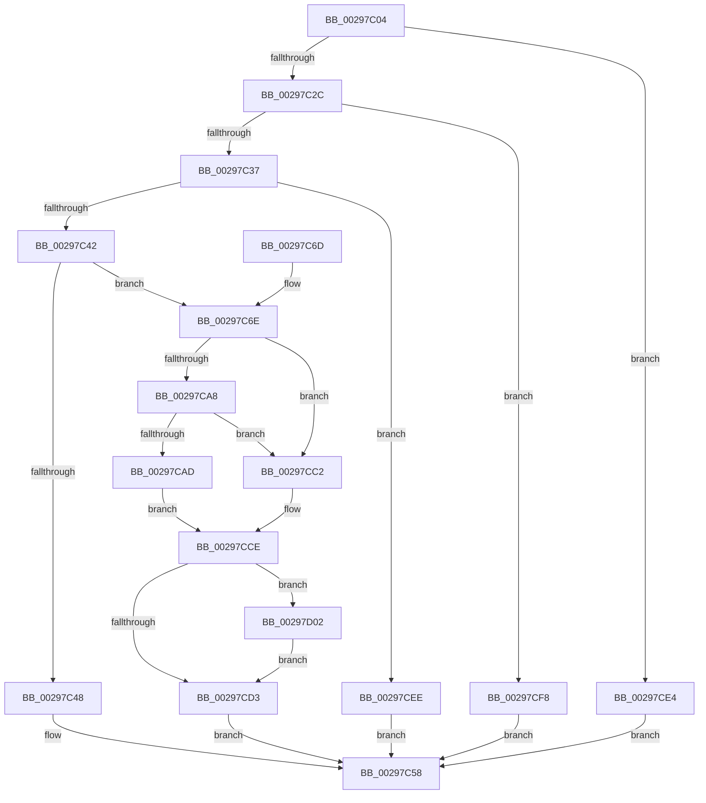

# MiEntireSubsectionIsPurged

- RVA: `0x00297C04`–`0x00297D0C` (길이 `264` bytes)
- VA: `0x0000000140297C04`
- 실행 섹션: `.text`
- PDB 이름 있음: `예`; PDB Function 태그: `아니요`
- unwind 정보 RVA: `0x00067A70`
- 디코드: `71`개 명령, `264/264` bytes 표시
- 미해석 바이트: `0` (있으면 어셈블리에 `.byte`로 보존)

> 이 문서는 커널 이미지의 기계어와 PDB 기호를 분석해 생성했습니다. 4번과 5번은 함수 원형과 자료형을 바이너리 사용 방식에서 추정한 C 해석이며 원본 소스 복구 결과는 아닙니다.

## 1. Dependencies

- 직접 호출 지점: **7**; 고유 호출 대상: **7**
- 직접 호출자로 확인된 함수: **1**
- RIP 상대 이미지 참조: **0**

### Outgoing calls
- `0x00297C77` → [MiUpdateSystemProtoPtesTree](MiUpdateSystemProtoPtesTree_function_00295F0C.md) (function, `0x00295F0C`)
- `0x00297C92` → [MiDecrementModifiedWriteCount](MiDecrementModifiedWriteCount_function_00298184.md) (function, `0x00298184`)
- `0x00297CB0` → [MiRemoveUnusedSegment](../2B/MiRemoveUnusedSegment_function_002BBE74.md) (function, `0x002BBE74`)
- `0x00297CBB` → [MiDestroySection](../46/MiDestroySection_function_00462FDC.md) (function, `0x00462FDC`)
- `0x00297CC9` → [MiReleaseSpinLockExclusive](../24/MiReleaseSpinLockExclusive_function_002482C0.md) (function, `0x002482C0`)
- `0x00297CD8` → [ExFreePoolWithTag](../../poolcode/B8/ExFreePoolWithTag_function_00B82870.md) (function, `0x00B82870`)
- `0x00297D05` → [MiReleaseControlAreaWaiters](../28/MiReleaseControlAreaWaiters_function_002865F0.md) (function, `0x002865F0`)

### Direct callers
- [MiDeleteCachedSubsection](MiDeleteCachedSubsection_function_00297888.md) at `0x00297948`

### Static image references
- 디코드된 RIP-relative 메모리 참조가 없습니다.

## 2. Other-region calls and transfers

- 다른 실행 섹션으로 향하는 call: **1**
  - `0x00297CD8` → [ExFreePoolWithTag](../../poolcode/B8/ExFreePoolWithTag_function_00B82870.md) (`.text` → `POOLCODE`)
- 별도 외부 분기/꼬리 이동을 확인하지 못했습니다.

## 3. Assembly (complete function range)

```asm
00297C04  48 89 5C 24 08                  mov qword ptr [rsp + 8], rbx
00297C09  48 89 6C 24 10                  mov qword ptr [rsp + 0x10], rbp
00297C0E  48 89 74 24 18                  mov qword ptr [rsp + 0x18], rsi
00297C13  57                              push rdi
00297C14  48 83 EC 20                     sub rsp, 0x20
00297C18  48 83 79 50 01                  cmp qword ptr [rcx + 0x50], 1
00297C1D  40 8A F2                        mov sil, dl
00297C20  48 8B 19                        mov rbx, qword ptr [rcx]
00297C23  48 8B F9                        mov rdi, rcx
00297C26  0F 85 B8 00 00 00               jne 0x140297ce4
00297C2C  8B 41 20                        mov eax, dword ptr [rcx + 0x20]
00297C2F  A8 01                           test al, 1
00297C31  0F 85 C1 00 00 00               jne 0x140297cf8
00297C37  8B 43 38                        mov eax, dword ptr [rbx + 0x38]
00297C3A  A8 01                           test al, 1
00297C3C  0F 85 AC 00 00 00               jne 0x140297cee
00297C42  83 79 68 00                     cmp dword ptr [rcx + 0x68], 0
00297C46  74 26                           je 0x140297c6e
00297C48  24 08                           and al, 8
00297C4A  F6 D8                           neg al
00297C4C  1B C0                           sbb eax, eax
00297C4E  25 F3 FD FF FF                  and eax, 0xfffffdf3
00297C53  05 2D 02 00 C0                  add eax, 0xc000022d
00297C58  48 8B 5C 24 30                  mov rbx, qword ptr [rsp + 0x30]
00297C5D  48 8B 6C 24 38                  mov rbp, qword ptr [rsp + 0x38]
00297C62  48 8B 74 24 40                  mov rsi, qword ptr [rsp + 0x40]
00297C67  48 83 C4 20                     add rsp, 0x20
00297C6B  5F                              pop rdi
00297C6C  C3                              ret
00297C6D  CC                              int3
00297C6E  48 83 C1 78                     add rcx, 0x78
00297C72  BA 02 00 00 00                  mov edx, 2
00297C77  E8 90 E2 FF FF                  call 0x140295f0c
00297C7C  48 8B 6F 08                     mov rbp, qword ptr [rdi + 8]
00297C80  BA 01 00 00 00                  mov edx, 1
00297C85  48 83 67 08 00                  and qword ptr [rdi + 8], 0
00297C8A  48 8B CB                        mov rcx, rbx
00297C8D  48 83 67 50 00                  and qword ptr [rdi + 0x50], 0
00297C92  E8 ED 04 00 00                  call 0x140298184
00297C97  48 8B 53 28                     mov rdx, qword ptr [rbx + 0x28]
00297C9B  48 8B F8                        mov rdi, rax
00297C9E  48 0B 53 20                     or rdx, qword ptr [rbx + 0x20]
00297CA2  48 0B 53 18                     or rdx, qword ptr [rbx + 0x18]
00297CA6  75 1A                           jne 0x140297cc2
00297CA8  39 53 4C                        cmp dword ptr [rbx + 0x4c], edx
00297CAB  75 15                           jne 0x140297cc2
00297CAD  48 8B CB                        mov rcx, rbx
00297CB0  E8 BF 41 02 00                  call 0x1402bbe74
00297CB5  40 8A D6                        mov dl, sil
00297CB8  48 8B CB                        mov rcx, rbx
00297CBB  E8 1C B3 1C 00                  call 0x140462fdc
00297CC0  EB 0C                           jmp 0x140297cce
00297CC2  48 8D 4B 48                     lea rcx, [rbx + 0x48]
00297CC6  40 8A D6                        mov dl, sil
00297CC9  E8 F2 05 FB FF                  call 0x1402482c0
00297CCE  48 85 FF                        test rdi, rdi
00297CD1  75 2F                           jne 0x140297d02
00297CD3  33 D2                           xor edx, edx
00297CD5  48 8B CD                        mov rcx, rbp
00297CD8  E8 93 AB 8E 00                  call 0x140b82870
00297CDD  33 C0                           xor eax, eax
00297CDF  E9 74 FF FF FF                  jmp 0x140297c58
00297CE4  B8 43 02 00 C0                  mov eax, 0xc0000243
00297CE9  E9 6A FF FF FF                  jmp 0x140297c58
00297CEE  B8 89 01 00 C0                  mov eax, 0xc0000189
00297CF3  E9 60 FF FF FF                  jmp 0x140297c58
00297CF8  B8 88 00 00 C0                  mov eax, 0xc0000088
00297CFD  E9 56 FF FF FF                  jmp 0x140297c58
00297D02  48 8B CF                        mov rcx, rdi
00297D05  E8 E6 E8 FE FF                  call 0x1402865f0
00297D0A  EB C7                           jmp 0x140297cd3
```

## 4. C-style interpretation (structured pseudocode)

```c
__int64 __fastcall MiEntireSubsectionIsPurged(__int64 a1, unsigned __int8 a2)
{
    __int64 result;
    __int64 v_rsp;
    unsigned __int64 v_stack_p10;
    unsigned __int64 v_stack_p18;
    unsigned __int64 v_stack_p8;

    v_stack_p8 = v_rbx;
    v_stack_p10 = v_rbp;
    v_stack_p18 = v_rsi;
    v_rsp = (v_rsp) - (32);
    if ((*(unsigned __int64 *)(a1 + 80)) != 1) goto loc_00297CE4;
    if ((((unsigned __int8)((unsigned int)(*(unsigned int *)(a1 + 32)))) & (1)) != 0) goto loc_00297CF8;
    if ((((unsigned __int8)((unsigned int)(*(unsigned int *)(*(unsigned __int64 *)(a1) + 56)))) & (1)) != 0) goto loc_00297CEE;
    if ((*(unsigned int *)(a1 + 104)) == 0) goto loc_00297C6E;
    result = (unsigned __int8)(((unsigned int)(*(unsigned int *)(*(unsigned __int64 *)(a1) + 56))) & (8));
    result = (unsigned __int8)(-(result));
    result = (unsigned int)((result) & (0xFFFFFDF3ULL));
    result = (unsigned int)((result) + (0xC000022DULL));
loc_00297C58:
    v_rsp = (v_rsp) + (32);
    return result;
loc_00297C6E:
    a1 = (a1) + (120);
    result = MiUpdateSystemProtoPtesTree(a1, 2, a3, a4);
    result = MiDecrementModifiedWriteCount(v_stack_p8, 1, a3, a4);
    a2 = (*(unsigned __int64 *)(v_stack_p8 + 40)) | (*(unsigned __int64 *)(v_stack_p8 + 32));
    a2 = (a2) | (*(unsigned __int64 *)(v_stack_p8 + 24));
    if (condition_is_not_equal) goto loc_00297CC2;
    if ((*(unsigned int *)(v_stack_p8 + 76)) != a2) goto loc_00297CC2;
    result = MiRemoveUnusedSegment(v_stack_p8, a2, a3, a4);
    result = MiDestroySection(v_stack_p8, (unsigned __int8)(v_stack_p18), a3, a4);
    goto loc_00297CCE;
loc_00297CC2:
    result = MiReleaseSpinLockExclusive(v_stack_p8 + 72, (unsigned __int8)(v_stack_p18), a3, a4);
loc_00297CCE:
    if (result != 0) goto loc_00297D02;
loc_00297CD3:
    a2 = 0;
    result = ExFreePoolWithTag(*(unsigned __int64 *)(a1 + 8), a2, a3, a4);
    result = 0;
    goto loc_00297C58;
loc_00297CE4:
    goto loc_00297C58;
loc_00297CEE:
    goto loc_00297C58;
loc_00297CF8:
    goto loc_00297C58;
loc_00297D02:
    result = MiReleaseControlAreaWaiters(0, a2, a3, a4);
    goto loc_00297CD3;
}
```

## 5. (Beta) C Style

```c
int64_t MiEntireSubsectionIsPurged(void *Arg1, uint8_t Arg2)
{
    uint8_t *arg1 = (uint8_t *)Arg1;

    int64_t result;
    int64_t local_rsp;
    uint64_t v_stack_p10;
    uint64_t v_stack_p18;
    uint64_t v_stack_p8;

    v_stack_p8 = local_rbx;
    v_stack_p10 = local_rbp;
    v_stack_p18 = local_rsi;
    local_rsp = (local_rsp) - (32);
    if ((*(uint64_t *)(arg1 + 0x50)) != 1) goto loc_00297CE4;
    if ((((uint8_t)((uint32_t)(*(uint32_t *)(arg1 + 0x20)))) & (1)) != 0) goto loc_00297CF8;
    if ((((uint8_t)((uint32_t)(*(uint32_t *)(*(uint64_t *)(arg1) + 0x38)))) & (1)) != 0) goto loc_00297CEE;
    if ((*(uint32_t *)(arg1 + 0x68)) == 0) goto loc_00297C6E;
    result = (uint8_t)(((uint32_t)(*(uint32_t *)(*(uint64_t *)(arg1) + 0x38))) & (8));
    result = (uint8_t)(-(result));
    result = (uint32_t)((result) & (0xFFFFFDF3ULL));
    result = (uint32_t)((result) + (0xC000022DULL));
loc_00297C58:
    local_rsp = (local_rsp) + (32);
    return result;
loc_00297C6E:
    Arg1 = (Arg1) + (120);
    result = MiUpdateSystemProtoPtesTree(Arg1, 2, a3, a4);
    result = MiDecrementModifiedWriteCount(v_stack_p8, 1, a3, a4);
    Arg2 = (*(uint64_t *)(v_stack_p8 + 0x28)) | (*(uint64_t *)(v_stack_p8 + 0x20));
    Arg2 = (Arg2) | (*(uint64_t *)(v_stack_p8 + 0x18));
    if (condition_is_not_equal) goto loc_00297CC2;
    if ((*(uint32_t *)(v_stack_p8 + 0x4C)) != Arg2) goto loc_00297CC2;
    result = MiRemoveUnusedSegment(v_stack_p8, Arg2, a3, a4);
    result = MiDestroySection(v_stack_p8, (uint8_t)(v_stack_p18), a3, a4);
    goto loc_00297CCE;
loc_00297CC2:
    result = MiReleaseSpinLockExclusive(v_stack_p8 + 72, (uint8_t)(v_stack_p18), a3, a4);
loc_00297CCE:
    if (result != 0) goto loc_00297D02;
loc_00297CD3:
    Arg2 = 0;
    result = ExFreePoolWithTag(*(uint64_t *)(arg1 + 0x8), Arg2, a3, a4);
    result = 0;
    goto loc_00297C58;
loc_00297CE4:
    goto loc_00297C58;
loc_00297CEE:
    goto loc_00297C58;
loc_00297CF8:
    goto loc_00297C58;
loc_00297D02:
    result = MiReleaseControlAreaWaiters(0, Arg2, a3, a4);
    goto loc_00297CD3;
}
```

### 관측된 메모리 오프셋

구조체 형식이 확인되지 않은 접근은 인자 기준의 오프셋으로만 기록했습니다.

| 기준 인자 | 오프셋 표현 | 폭 (bit) | 접근 |
|---|---:|---:|---|
| `Arg1` | `+ 0x0` | `64` | `R` |
| `Arg1` | `+ 0x8` | `64` | `R` |
| `Arg1` | `+ 0x8` | `64` | `R/W` |
| `Arg1` | `+ 0x20` | `32` | `R` |
| `Arg1` | `+ 0x50` | `64` | `R` |
| `Arg1` | `+ 0x50` | `64` | `R/W` |
| `Arg1` | `+ 0x68` | `32` | `R` |

## 6. Execution-region graph

[열기: 2D/3D 그래프와 함수 탐색 컨트롤 패널](../../../control-panel.html?section=text&rva=0x00297C04&view=graph)

- 2D 그래프는 위에서 아래로 흐르고, 3D 그래프는 빈 공간을 드래그해 회전합니다. Shift+드래그는 이동, 휠은 확대·축소, 함수 노드 선택은 대상 보고서 이동입니다.

### Static fallback


