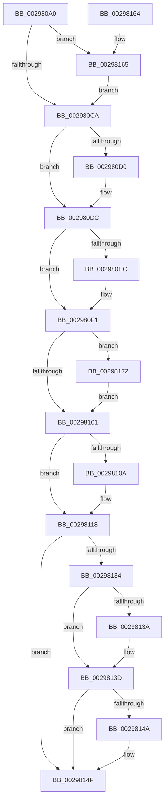

# MiFlushComplete

- RVA: `0x002980A0`–`0x0029817C` (길이 `220` bytes)
- VA: `0x00000001402980A0`
- 실행 섹션: `.text`
- PDB 이름 있음: `예`; PDB Function 태그: `아니요`
- unwind 정보 RVA: `0x0005F944`
- 디코드: `63`개 명령, `220/220` bytes 표시
- 미해석 바이트: `0` (있으면 어셈블리에 `.byte`로 보존)

> 이 문서는 커널 이미지의 기계어와 PDB 기호를 분석해 생성했습니다. 4번과 5번은 함수 원형과 자료형을 바이너리 사용 방식에서 추정한 C 해석이며 원본 소스 복구 결과는 아닙니다.

## 1. Dependencies

- 직접 호출 지점: **8**; 고유 호출 대상: **8**
- 직접 호출자로 확인된 함수: **3**
- RIP 상대 이미지 참조: **0**

### Outgoing calls
- `0x002980D7` → [MmUnmapLockedPages](../24/MmUnmapLockedPages_function_00246E60.md) (function, `0x00246E60`)
- `0x002980E2` → [MiUnlockMdlWritePages](../24/MiUnlockMdlWritePages_function_0024A7C0.md) (function, `0x0024A7C0`)
- `0x002980F7` → [MiDecrementModifiedWriteCount](MiDecrementModifiedWriteCount_function_00298184.md) (function, `0x00298184`)
- `0x0029810F` → [ExFreePoolWithTag](../../poolcode/B8/ExFreePoolWithTag_function_00B82870.md) (function, `0x00B82870`)
- `0x00298126` → [KeSetEvent](../33/KeSetEvent_function_0033F310.md) (function, `0x0033F310`)
- `0x0029814A` → [MiFreeOverlappedFlushEntry](MiFreeOverlappedFlushEntry_function_00298240.md) (function, `0x00298240`)
- `0x00298168` → [MiRetardMdl](../40/MiRetardMdl_function_0040494C.md) (function, `0x0040494C`)
- `0x00298175` → [MiReleaseControlAreaWaiters](../28/MiReleaseControlAreaWaiters_function_002865F0.md) (function, `0x002865F0`)

### Direct callers
- [IopCompletePageWrite](IopCompletePageWrite_function_00298010.md) at `0x0029805B`
- [MiIssueAsynchronousFlush](MiIssueAsynchronousFlush_function_00299898.md) at `0x00299B16`
- [sub_006DA7D6](../6D/Unknown_function_006DA7D6.md) at `0x006DA7DF`

### Static image references
- 디코드된 RIP-relative 메모리 참조가 없습니다.

## 2. Other-region calls and transfers

- 다른 실행 섹션으로 향하는 call: **1**
  - `0x0029810F` → [ExFreePoolWithTag](../../poolcode/B8/ExFreePoolWithTag_function_00B82870.md) (`.text` → `POOLCODE`)
- 별도 외부 분기/꼬리 이동을 확인하지 못했습니다.

## 3. Assembly (complete function range)

```asm
002980A0  48 89 5C 24 08                  mov qword ptr [rsp + 8], rbx
002980A5  48 89 6C 24 10                  mov qword ptr [rsp + 0x10], rbp
002980AA  48 89 74 24 18                  mov qword ptr [rsp + 0x18], rsi
002980AF  57                              push rdi
002980B0  48 83 EC 20                     sub rsp, 0x20
002980B4  48 8B 59 48                     mov rbx, qword ptr [rcx + 0x48]
002980B8  48 8B F2                        mov rsi, rdx
002980BB  48 8B F9                        mov rdi, rcx
002980BE  66 0F BA 63 0A 09               bt word ptr [rbx + 0xa], 9
002980C4  0F 82 9B 00 00 00               jb 0x140298165
002980CA  F6 43 0A 01                     test byte ptr [rbx + 0xa], 1
002980CE  74 0C                           je 0x1402980dc
002980D0  48 8B 4B 18                     mov rcx, qword ptr [rbx + 0x18]
002980D4  48 8B D3                        mov rdx, rbx
002980D7  E8 84 ED FA FF                  call 0x140246e60
002980DC  48 8B D6                        mov rdx, rsi
002980DF  48 8B CB                        mov rcx, rbx
002980E2  E8 D9 26 FB FF                  call 0x14024a7c0
002980E7  83 3E 00                        cmp dword ptr [rsi], 0
002980EA  7D 05                           jge 0x1402980f1
002980EC  48 83 66 08 00                  and qword ptr [rsi + 8], 0
002980F1  48 8B 4F 20                     mov rcx, qword ptr [rdi + 0x20]
002980F5  33 D2                           xor edx, edx
002980F7  E8 88 00 00 00                  call 0x140298184
002980FC  48 85 C0                        test rax, rax
002980FF  75 71                           jne 0x140298172
00298101  48 8D 6F 50                     lea rbp, [rdi + 0x50]
00298105  48 3B DD                        cmp rbx, rbp
00298108  74 0E                           je 0x140298118
0029810A  33 D2                           xor edx, edx
0029810C  48 8B CB                        mov rcx, rbx
0029810F  E8 5C A7 8E 00                  call 0x140b82870
00298114  48 89 6F 48                     mov qword ptr [rdi + 0x48], rbp
00298118  48 83 67 10 00                  and qword ptr [rdi + 0x10], 0
0029811D  48 8D 4F 30                     lea rcx, [rdi + 0x30]
00298121  45 33 C0                        xor r8d, r8d
00298124  33 D2                           xor edx, edx
00298126  E8 E5 71 0A 00                  call 0x14033f310
0029812B  48 8B 4F 28                     mov rcx, qword ptr [rdi + 0x28]
0029812F  48 85 C9                        test rcx, rcx
00298132  74 1B                           je 0x14029814f
00298134  8B 06                           mov eax, dword ptr [rsi]
00298136  85 C0                           test eax, eax
00298138  79 03                           jns 0x14029813d
0029813A  89 41 14                        mov dword ptr [rcx + 0x14], eax
0029813D  83 C8 FF                        or eax, 0xffffffff
00298140  F0 0F C1 41 10                  lock xadd dword ptr [rcx + 0x10], eax
00298145  83 F8 01                        cmp eax, 1
00298148  75 05                           jne 0x14029814f
0029814A  E8 F1 00 00 00                  call 0x140298240
0029814F  48 8B 5C 24 30                  mov rbx, qword ptr [rsp + 0x30]
00298154  48 8B 6C 24 38                  mov rbp, qword ptr [rsp + 0x38]
00298159  48 8B 74 24 40                  mov rsi, qword ptr [rsp + 0x40]
0029815E  48 83 C4 20                     add rsp, 0x20
00298162  5F                              pop rdi
00298163  C3                              ret
00298164  CC                              int3
00298165  48 8B CB                        mov rcx, rbx
00298168  E8 DF C7 16 00                  call 0x14040494c
0029816D  E9 58 FF FF FF                  jmp 0x1402980ca
00298172  48 8B C8                        mov rcx, rax
00298175  E8 76 E4 FE FF                  call 0x1402865f0
0029817A  EB 85                           jmp 0x140298101
```

## 4. C-style interpretation (structured pseudocode)

```c
__int64 __fastcall MiFlushComplete(__int64 a1, __int64 a2, int a3)
{
    __int64 result;
    __int64 v_rsp;
    unsigned __int64 v_stack_p10;
    unsigned __int64 v_stack_p18;
    unsigned __int64 v_stack_p8;

    v_stack_p8 = v_rbx;
    v_stack_p10 = v_rbp;
    v_stack_p18 = v_rsi;
    v_rsp = (v_rsp) - (32);
    if (condition_is_below) goto loc_00298165;
loc_002980CA:
    if (((*(unsigned __int8 *)(*(unsigned __int64 *)(a1 + 72) + 10)) & (1)) != 0) {
        a1 = *(unsigned __int64 *)(*(unsigned __int64 *)(a1 + 72) + 24);
        a2 = *(unsigned __int64 *)(a1 + 72);
        result = MmUnmapLockedPages(a1, a2, a3, a4);
    }
    result = MiUnlockMdlWritePages(*(unsigned __int64 *)(a1 + 72), a2, a3, a4);
    if ((*(unsigned int *)(a2)) < 0) {
    }
    a2 = 0;
    result = MiDecrementModifiedWriteCount(*(unsigned __int64 *)(a1 + 32), a2, a3, a4);
    if (result != 0) goto loc_00298172;
loc_00298101:
    if ((*(unsigned __int64 *)(a1 + 72)) != (a1 + 80)) {
        a2 = 0;
        a1 = *(unsigned __int64 *)(a1 + 72);
        result = ExFreePoolWithTag(a1, a2, a3, a4);
        *(unsigned __int64 *)(a1 + 72) = a1 + 80;
    }
    a3 = 0;
    a2 = 0;
    result = KeSetEvent(a1 + 48, a2, a3, a4);
    if (*(unsigned __int64 *)(a1 + 40) == 0) goto loc_0029814F;
    if (sign_flag) {
        *(unsigned int *)(*(unsigned __int64 *)(a1 + 40) + 20) = (unsigned int)((unsigned int)(*(unsigned int *)(a2)));
    }
    result = (unsigned int)(((unsigned int)(*(unsigned int *)(a2))) | (0xFFFFFFFFULL));
    if (((unsigned int)(result)) == 1) {
        result = MiFreeOverlappedFlushEntry(*(unsigned __int64 *)(a1 + 40), a2, a3, a4);
    }
    v_rsp = (v_rsp) + (32);
    return result;
loc_00298165:
    result = MiRetardMdl(v_stack_p8, a2, a3, a4);
    goto loc_002980CA;
loc_00298172:
    result = MiReleaseControlAreaWaiters(result, a2, a3, a4);
    goto loc_00298101;
}
```

## 5. (Beta) C Style

```c
int64_t MiFlushComplete(void *Arg1, void *Arg2, int32_t Arg3)
{
    uint8_t *arg1 = (uint8_t *)Arg1;
    uint8_t *arg2 = (uint8_t *)Arg2;

    int64_t result;
    int64_t local_rsp;
    uint64_t v_stack_p10;
    uint64_t v_stack_p18;
    uint64_t v_stack_p8;

    v_stack_p8 = local_rbx;
    v_stack_p10 = local_rbp;
    v_stack_p18 = local_rsi;
    local_rsp = (local_rsp) - (32);
    if (condition_is_below) goto loc_00298165;
loc_002980CA:
    if (((*(uint8_t *)(*(uint64_t *)(arg1 + 0x48) + 0xA)) & (1)) != 0) {
        Arg1 = *(uint64_t *)(*(uint64_t *)(arg1 + 0x48) + 0x18);
        Arg2 = *(uint64_t *)(arg1 + 0x48);
        result = MmUnmapLockedPages(Arg1, Arg2, Arg3, a4);
    }
    result = MiUnlockMdlWritePages(*(uint64_t *)(arg1 + 0x48), Arg2, Arg3, a4);
    if ((*(uint32_t *)(arg2)) < 0) {
    }
    Arg2 = 0;
    result = MiDecrementModifiedWriteCount(*(uint64_t *)(arg1 + 0x20), Arg2, Arg3, a4);
    if (result != 0) goto loc_00298172;
loc_00298101:
    if ((*(uint64_t *)(arg1 + 0x48)) != (Arg1 + 80)) {
        Arg2 = 0;
        Arg1 = *(uint64_t *)(arg1 + 0x48);
        result = ExFreePoolWithTag(Arg1, Arg2, Arg3, a4);
        *(void **)(arg1 + 0x48) = Arg1 + 80;
    }
    Arg3 = 0;
    Arg2 = 0;
    result = KeSetEvent(Arg1 + 48, Arg2, Arg3, a4);
    if (*(uint64_t *)(arg1 + 0x28) == 0) goto loc_0029814F;
    if (sign_flag) {
        *(uint32_t *)(*(uint64_t *)(arg1 + 0x28) + 0x14) = (uint32_t)((uint32_t)(*(uint32_t *)(arg2)));
    }
    result = (uint32_t)(((uint32_t)(*(uint32_t *)(arg2))) | (0xFFFFFFFFULL));
    if (((uint32_t)(result)) == 1) {
        result = MiFreeOverlappedFlushEntry(*(uint64_t *)(arg1 + 0x28), Arg2, Arg3, a4);
    }
    local_rsp = (local_rsp) + (32);
    return result;
loc_00298165:
    result = MiRetardMdl(v_stack_p8, Arg2, Arg3, a4);
    goto loc_002980CA;
loc_00298172:
    result = MiReleaseControlAreaWaiters(result, Arg2, Arg3, a4);
    goto loc_00298101;
}
```

### 관측된 메모리 오프셋

구조체 형식이 확인되지 않은 접근은 인자 기준의 오프셋으로만 기록했습니다.

| 기준 인자 | 오프셋 표현 | 폭 (bit) | 접근 |
|---|---:|---:|---|
| `Arg1` | `+ 0x10` | `64` | `R/W` |
| `Arg1` | `+ 0x20` | `64` | `R` |
| `Arg1` | `+ 0x28` | `64` | `R` |
| `Arg1` | `+ 0x30` | `64` | `R` |
| `Arg1` | `+ 0x48` | `64` | `R` |
| `Arg1` | `+ 0x48` | `64` | `W` |
| `Arg1` | `+ 0x50` | `64` | `R` |
| `Arg2` | `+ 0x0` | `32` | `R` |
| `Arg2` | `+ 0x8` | `64` | `R/W` |

## 6. Execution-region graph

[열기: 2D/3D 그래프와 함수 탐색 컨트롤 패널](../../../control-panel.html?section=text&rva=0x002980A0&view=graph)

- 2D 그래프는 위에서 아래로 흐르고, 3D 그래프는 빈 공간을 드래그해 회전합니다. Shift+드래그는 이동, 휠은 확대·축소, 함수 노드 선택은 대상 보고서 이동입니다.

### Static fallback


