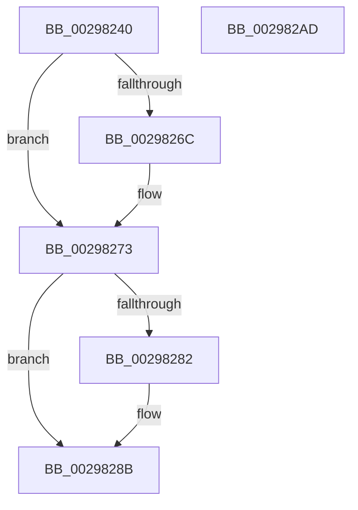

# MiFreeOverlappedFlushEntry

- RVA: `0x00298240`–`0x002982AE` (길이 `110` bytes)
- VA: `0x0000000140298240`
- 실행 섹션: `.text`
- PDB 이름 있음: `예`; PDB Function 태그: `아니요`
- unwind 정보 RVA: `0x0005CAAC`
- 디코드: `34`개 명령, `110/110` bytes 표시
- 미해석 바이트: `0` (있으면 어셈블리에 `.byte`로 보존)

> 이 문서는 커널 이미지의 기계어와 PDB 기호를 분석해 생성했습니다. 4번과 5번은 함수 원형과 자료형을 바이너리 사용 방식에서 추정한 C 해석이며 원본 소스 복구 결과는 아닙니다.

## 1. Dependencies

- 직접 호출 지점: **4**; 고유 호출 대상: **3**
- 직접 호출자로 확인된 함수: **2**
- RIP 상대 이미지 참조: **0**

### Outgoing calls
- `0x0029825E` → [MiFlushRelease](MiFlushRelease_function_002982C0.md) (function, `0x002982C0`)
- `0x0029826E` → [ExFreePoolWithTag](../../poolcode/B8/ExFreePoolWithTag_function_00B82870.md) (function, `0x00B82870`)
- `0x00298290` → [ExFreePoolWithTag](../../poolcode/B8/ExFreePoolWithTag_function_00B82870.md) (function, `0x00B82870`)
- `0x0029829D` → [KeSetEvent](../33/KeSetEvent_function_0033F310.md) (function, `0x0033F310`)

### Direct callers
- [MmFlushSection](../23/MmFlushSection_function_002375E4.md) at `0x00237831`
- [MiFlushComplete](MiFlushComplete_function_002980A0.md) at `0x0029814A`

### Static image references
- 디코드된 RIP-relative 메모리 참조가 없습니다.

## 2. Other-region calls and transfers

- 다른 실행 섹션으로 향하는 call: **2**
  - `0x0029826E` → [ExFreePoolWithTag](../../poolcode/B8/ExFreePoolWithTag_function_00B82870.md) (`.text` → `POOLCODE`)
  - `0x00298290` → [ExFreePoolWithTag](../../poolcode/B8/ExFreePoolWithTag_function_00B82870.md) (`.text` → `POOLCODE`)
- 별도 외부 분기/꼬리 이동을 확인하지 못했습니다.

## 3. Assembly (complete function range)

```asm
00298240  48 89 5C 24 08                  mov qword ptr [rsp + 8], rbx
00298245  57                              push rdi
00298246  48 83 EC 20                     sub rsp, 0x20
0029824A  48 8B 79 20                     mov rdi, qword ptr [rcx + 0x20]
0029824E  48 8B D9                        mov rbx, rcx
00298251  48 8B 09                        mov rcx, qword ptr [rcx]
00298254  48 8B D1                        mov rdx, rcx
00298257  4C 8B 43 08                     mov r8, qword ptr [rbx + 8]
0029825B  48 8B 09                        mov rcx, qword ptr [rcx]
0029825E  E8 5D 00 00 00                  call 0x1402982c0
00298263  48 8B 4B 28                     mov rcx, qword ptr [rbx + 0x28]
00298267  48 85 C9                        test rcx, rcx
0029826A  74 07                           je 0x140298273
0029826C  33 D2                           xor edx, edx
0029826E  E8 FD A5 8E 00                  call 0x140b82870
00298273  48 8B 53 18                     mov rdx, qword ptr [rbx + 0x18]
00298277  8B 43 14                        mov eax, dword ptr [rbx + 0x14]
0029827A  89 02                           mov dword ptr [rdx], eax
0029827C  83 7B 14 00                     cmp dword ptr [rbx + 0x14], 0
00298280  7D 09                           jge 0x14029828b
00298282  48 8B 43 18                     mov rax, qword ptr [rbx + 0x18]
00298286  48 83 60 08 00                  and qword ptr [rax + 8], 0
0029828B  33 D2                           xor edx, edx
0029828D  48 8B CB                        mov rcx, rbx
00298290  E8 DB A5 8E 00                  call 0x140b82870
00298295  45 33 C0                        xor r8d, r8d
00298298  33 D2                           xor edx, edx
0029829A  48 8B CF                        mov rcx, rdi
0029829D  E8 6E 70 0A 00                  call 0x14033f310
002982A2  48 8B 5C 24 30                  mov rbx, qword ptr [rsp + 0x30]
002982A7  48 83 C4 20                     add rsp, 0x20
002982AB  5F                              pop rdi
002982AC  C3                              ret
002982AD  CC                              int3
```

## 4. C-style interpretation (structured pseudocode)

```c
__int64 __fastcall MiFreeOverlappedFlushEntry(__int64 a1)
{
    __int64 result;
    __int64 v_rsp;
    unsigned __int64 v_stack_p8;

    v_stack_p8 = v_rbx;
    v_rsp = (v_rsp) - (32);
    result = MiFlushRelease(*(unsigned __int64 *)(*(unsigned __int64 *)(a1)), *(unsigned __int64 *)(a1), *(unsigned __int64 *)(a1 + 8), a4);
    if (*(unsigned __int64 *)(a1 + 40) != 0) {
        a2 = 0;
        result = ExFreePoolWithTag(*(unsigned __int64 *)(a1 + 40), a2, *(unsigned __int64 *)(a1 + 8), a4);
    }
    *(unsigned int *)(*(unsigned __int64 *)(a1 + 24)) = (unsigned int)((unsigned int)(*(unsigned int *)(a1 + 20)));
    result = (unsigned int)(*(unsigned int *)(a1 + 20));
    if ((*(unsigned int *)(a1 + 20)) < 0) {
        result = *(unsigned __int64 *)(a1 + 24);
    }
    a2 = 0;
    result = ExFreePoolWithTag(a1, a2, *(unsigned __int64 *)(a1 + 8), a4);
    a3 = 0;
    a2 = 0;
    result = KeSetEvent(*(unsigned __int64 *)(a1 + 32), a2, a3, a4);
    v_rsp = (v_rsp) + (32);
    return result;
}
```

## 5. (Beta) C Style

```c
int64_t MiFreeOverlappedFlushEntry(void *Arg1)
{
    uint8_t *arg1 = (uint8_t *)Arg1;

    int64_t result;
    int64_t local_rsp;
    uint64_t v_stack_p8;

    v_stack_p8 = local_rbx;
    local_rsp = (local_rsp) - (32);
    result = MiFlushRelease(*(uint64_t *)(*(uint64_t *)(arg1)), *(uint64_t *)(arg1), *(uint64_t *)(arg1 + 0x8), a4);
    if (*(uint64_t *)(arg1 + 0x28) != 0) {
        a2 = 0;
        result = ExFreePoolWithTag(*(uint64_t *)(arg1 + 0x28), a2, *(uint64_t *)(arg1 + 0x8), a4);
    }
    *(uint32_t *)(*(uint64_t *)(arg1 + 0x18)) = (uint32_t)((uint32_t)(*(uint32_t *)(arg1 + 0x14)));
    result = (uint32_t)(*(uint32_t *)(arg1 + 0x14));
    if ((*(uint32_t *)(arg1 + 0x14)) < 0) {
        result = *(uint64_t *)(arg1 + 0x18);
    }
    a2 = 0;
    result = ExFreePoolWithTag(Arg1, a2, *(uint64_t *)(arg1 + 0x8), a4);
    a3 = 0;
    a2 = 0;
    result = KeSetEvent(*(uint64_t *)(arg1 + 0x20), a2, a3, a4);
    local_rsp = (local_rsp) + (32);
    return result;
}
```

### 관측된 메모리 오프셋

구조체 형식이 확인되지 않은 접근은 인자 기준의 오프셋으로만 기록했습니다.

| 기준 인자 | 오프셋 표현 | 폭 (bit) | 접근 |
|---|---:|---:|---|
| `Arg1` | `+ 0x0` | `64` | `R` |
| `Arg1` | `+ 0x8` | `64` | `R` |
| `Arg1` | `+ 0x14` | `32` | `R` |
| `Arg1` | `+ 0x18` | `64` | `R` |
| `Arg1` | `+ 0x20` | `64` | `R` |
| `Arg1` | `+ 0x28` | `64` | `R` |

## 6. Execution-region graph

[열기: 2D/3D 그래프와 함수 탐색 컨트롤 패널](../../../control-panel.html?section=text&rva=0x00298240&view=graph)

- 2D 그래프는 위에서 아래로 흐르고, 3D 그래프는 빈 공간을 드래그해 회전합니다. Shift+드래그는 이동, 휠은 확대·축소, 함수 노드 선택은 대상 보고서 이동입니다.

### Static fallback


