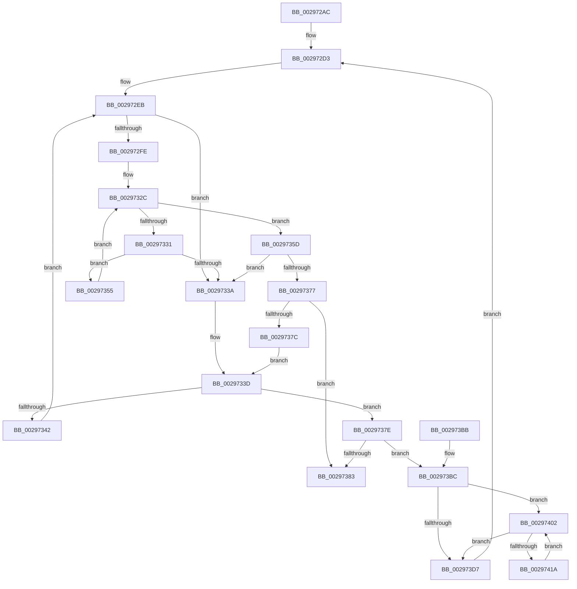

# MiGetHighestUltraLevel

- RVA: `0x002972AC`–`0x0029741C` (길이 `368` bytes)
- VA: `0x00000001402972AC`
- 실행 섹션: `.text`
- PDB 이름 있음: `예`; PDB Function 태그: `아니요`
- unwind 정보 RVA: `0x00067990`
- 디코드: `115`개 명령, `368/368` bytes 표시
- 미해석 바이트: `0` (있으면 어셈블리에 `.byte`로 보존)

> 이 문서는 커널 이미지의 기계어와 PDB 기호를 분석해 생성했습니다. 4번과 5번은 함수 원형과 자료형을 바이너리 사용 방식에서 추정한 C 해석이며 원본 소스 복구 결과는 아닙니다.

## 1. Dependencies

- 직접 호출 지점: **3**; 고유 호출 대상: **3**
- 직접 호출자로 확인된 함수: **1**
- RIP 상대 이미지 참조: **0**

### Outgoing calls
- `0x0029738C` → [RtlClearBitsEx](RtlClearBitsEx_function_00297740.md) (function, `0x00297740`)
- `0x002973C3` → [MI_FLUSH_ENTIRE_TB](../31/MI_FLUSH_ENTIRE_TB_function_00314110.md) (function, `0x00314110`)
- `0x002973F8` → [memset](../6C/memset_function_006C6C40.md) (function, `0x006C6C40`)

### Direct callers
- [MiGetUltraMapping](../32/MiGetUltraMapping_function_00323270.md) at `0x003236C2`

### Static image references
- 디코드된 RIP-relative 메모리 참조가 없습니다.

## 2. Other-region calls and transfers

- 다른 실행 섹션으로 향하는 call: **0**
- 별도 외부 분기/꼬리 이동을 확인하지 못했습니다.

## 3. Assembly (complete function range)

```asm
002972AC  48 89 5C 24 10                  mov qword ptr [rsp + 0x10], rbx
002972B1  48 89 6C 24 18                  mov qword ptr [rsp + 0x18], rbp
002972B6  56                              push rsi
002972B7  57                              push rdi
002972B8  41 54                           push r12
002972BA  41 56                           push r14
002972BC  41 57                           push r15
002972BE  48 83 EC 20                     sub rsp, 0x20
002972C2  48 8B F9                        mov rdi, rcx
002972C5  48 8D 71 18                     lea rsi, [rcx + 0x18]
002972C9  41 BC 01 00 00 00               mov r12d, 1
002972CF  49 83 CF FF                     or r15, 0xffffffffffffffff
002972D3  4C 8B 16                        mov r10, qword ptr [rsi]
002972D6  4C 8B 5F 10                     mov r11, qword ptr [rdi + 0x10]
002972DA  4C 8B 76 08                     mov r14, qword ptr [rsi + 8]
002972DE  4D 3B DA                        cmp r11, r10
002972E1  4D 1B C9                        sbb r9, r9
002972E4  49 8D 52 FF                     lea rdx, [r10 - 1]
002972E8  4D 23 CB                        and r9, r11
002972EB  83 64 24 50 00                  and dword ptr [rsp + 0x50], 0
002972F0  48 8B C2                        mov rax, rdx
002972F3  49 2B C1                        sub rax, r9
002972F6  49 03 C4                        add rax, r12
002972F9  49 3B C4                        cmp rax, r12
002972FC  72 3C                           jb 0x14029733a
002972FE  48 8B C2                        mov rax, rdx
00297301  41 8A C9                        mov cl, r9b
00297304  48 C1 E8 06                     shr rax, 6
00297308  80 E1 3F                        and cl, 0x3f
0029730B  4D 8B C4                        mov r8, r12
0029730E  49 D3 E0                        shl r8, cl
00297311  4D 2B C4                        sub r8, r12
00297314  49 8D 2C C6                     lea rbp, [r14 + rax*8]
00297318  49 8B C1                        mov rax, r9
0029731B  48 C1 E8 06                     shr rax, 6
0029731F  49 8D 1C C6                     lea rbx, [r14 + rax*8]
00297323  48 8B 03                        mov rax, qword ptr [rbx]
00297326  48 F7 D0                        not rax
00297329  4C 0B C0                        or r8, rax
0029732C  4D 3B C7                        cmp r8, r15
0029732F  75 2C                           jne 0x14029735d
00297331  48 83 C3 08                     add rbx, 8
00297335  48 3B DD                        cmp rbx, rbp
00297338  76 1B                           jbe 0x140297355
0029733A  49 8B DF                        mov rbx, r15
0029733D  4D 85 C9                        test r9, r9
00297340  74 3C                           je 0x14029737e
00297342  49 8D 53 01                     lea rdx, [r11 + 1]
00297346  49 3B D2                        cmp rdx, r10
00297349  49 0F 47 D2                     cmova rdx, r10
0029734D  49 2B D4                        sub rdx, r12
00297350  45 33 C9                        xor r9d, r9d
00297353  EB 96                           jmp 0x1402972eb
00297355  4C 8B 03                        mov r8, qword ptr [rbx]
00297358  49 F7 D0                        not r8
0029735B  EB CF                           jmp 0x14029732c
0029735D  49 2B DE                        sub rbx, r14
00297360  49 F7 D0                        not r8
00297363  48 C1 FB 03                     sar rbx, 3
00297367  49 0F BC C0                     bsf rax, r8
0029736B  48 C1 E3 06                     shl rbx, 6
0029736F  48 03 D8                        add rbx, rax
00297372  48 3B DA                        cmp rbx, rdx
00297375  77 C3                           ja 0x14029733a
00297377  49 3B DF                        cmp rbx, r15
0029737A  75 07                           jne 0x140297383
0029737C  EB BF                           jmp 0x14029733d
0029737E  49 3B DF                        cmp rbx, r15
00297381  74 39                           je 0x1402973bc
00297383  4D 8B C4                        mov r8, r12
00297386  48 8B D3                        mov rdx, rbx
00297389  48 8B CE                        mov rcx, rsi
0029738C  E8 AF 03 00 00                  call 0x140297740
00297391  48 8B 6C 24 60                  mov rbp, qword ptr [rsp + 0x60]
00297396  48 8D 4B 01                     lea rcx, [rbx + 1]
0029739A  48 C1 E3 1E                     shl rbx, 0x1e
0029739E  48 03 5F 08                     add rbx, qword ptr [rdi + 8]
002973A2  48 8B C3                        mov rax, rbx
002973A5  48 89 4F 10                     mov qword ptr [rdi + 0x10], rcx
002973A9  48 8B 5C 24 58                  mov rbx, qword ptr [rsp + 0x58]
002973AE  48 83 C4 20                     add rsp, 0x20
002973B2  41 5F                           pop r15
002973B4  41 5E                           pop r14
002973B6  41 5C                           pop r12
002973B8  5F                              pop rdi
002973B9  5E                              pop rsi
002973BA  C3                              ret
002973BB  CC                              int3
002973BC  BA 02 00 00 00                  mov edx, 2
002973C1  33 C9                           xor ecx, ecx
002973C3  E8 48 CD 07 00                  call 0x140314110
002973C8  4C 8B 0E                        mov r9, qword ptr [rsi]
002973CB  45 33 C0                        xor r8d, r8d
002973CE  49 C1 E9 06                     shr r9, 6
002973D2  4D 85 C9                        test r9, r9
002973D5  75 2B                           jne 0x140297402
002973D7  48 8B 47 28                     mov rax, qword ptr [rdi + 0x28]
002973DB  41 B8 00 00 00 00               mov r8d, 0
002973E1  48 8B 4F 30                     mov rcx, qword ptr [rdi + 0x30]
002973E5  A8 1F                           test al, 0x1f
002973E7  41 0F 95 C0                     setne r8b
002973EB  48 C1 E8 05                     shr rax, 5
002973EF  4C 03 C0                        add r8, rax
002973F2  33 D2                           xor edx, edx
002973F4  49 C1 E0 02                     shl r8, 2
002973F8  E8 43 F8 42 00                  call 0x1406c6c40
002973FD  E9 D1 FE FF FF                  jmp 0x1402972d3
00297402  48 8B 47 30                     mov rax, qword ptr [rdi + 0x30]
00297406  48 8B 57 20                     mov rdx, qword ptr [rdi + 0x20]
0029740A  4A 8B 0C C0                     mov rcx, qword ptr [rax + r8*8]
0029740E  4A 09 0C C2                     or qword ptr [rdx + r8*8], rcx
00297412  4D 03 C4                        add r8, r12
00297415  4D 3B C1                        cmp r8, r9
00297418  73 BD                           jae 0x1402973d7
0029741A  EB E6                           jmp 0x140297402
```

## 4. C-style interpretation (structured pseudocode)

```c
__int64 __fastcall MiGetHighestUltraLevel(__int64 a1, __int64 a2, __int64 a3, __int64 a4)
{
    __int64 result;
    __int64 v_r15;
    __int64 v_rbx;
    __int64 v_rsp;
    unsigned __int64 v_stack_p10;
    unsigned __int64 v_stack_p18;
    unsigned int v_stack_p8;

    v_stack_p10 = v_rbx;
    v_stack_p18 = v_rbp;
    v_rsp = (v_rsp) - (32);
    v_r15 = (v_r15) | (-1);
loc_002972D3:
    a4 = (a4) & (*(unsigned __int64 *)(a1 + 16));
loc_002972EB:
    result = (*(unsigned __int64 *)(a1 + 24) - 1) - (a4);
    result = (result) + (1);
    if (result < 1) goto loc_0029733A;
    result = (*(unsigned __int64 *)(a1 + 24) - 1) >> (6);
    a1 = (unsigned __int8)(((unsigned __int8)(a4)) & (63));
    a3 = (1) << ((unsigned __int8)(a1));
    a3 = (a3) - (1);
    result = (a4) >> (6);
    result = ~(*(unsigned __int64 *)(*(unsigned __int64 *)(a1 + 24 + 8) + result * 8));
    a3 = (a3) | (result);
loc_0029732C:
    if (a3 != v_r15) goto loc_0029735D;
    v_rbx = (*(unsigned __int64 *)(a1 + 24 + 8) + result * 8) + (8);
    if (v_rbx <= (*(unsigned __int64 *)(a1 + 24 + 8) + result * 8)) goto loc_00297355;
loc_0029733A:
loc_0029733D:
    if (a4 == 0) goto loc_0029737E;
    a2 = *(unsigned __int64 *)(a1 + 16) + 1;
    if ((*(unsigned __int64 *)(a1 + 16) + 1) > (*(unsigned __int64 *)(a1 + 24))) { a2 = *(unsigned __int64 *)(a1 + 24); }
    a2 = (a2) - (1);
    a4 = 0;
    goto loc_002972EB;
loc_00297355:
    a3 = ~(*(unsigned __int64 *)(v_r15));
    goto loc_0029732C;
loc_0029735D:
    v_rbx = (v_r15) - (*(unsigned __int64 *)(a1 + 24 + 8));
    a3 = ~(a3);
    v_rbx = (v_rbx) >> (3);
    v_rbx = (v_rbx) << (6);
    v_rbx = (v_rbx) + (result);
    if (v_rbx > a2) goto loc_0029733A;
    if (v_rbx != v_r15) goto loc_00297383;
    goto loc_0029733D;
loc_0029737E:
    if (v_rbx == v_r15) goto loc_002973BC;
loc_00297383:
    result = RtlClearBitsEx(a1 + 24, v_rbx, 1, a4);
    v_rbx = (v_rbx) << (30);
    v_rbx = (v_rbx) + (*(unsigned __int64 *)(a1 + 8));
    *(unsigned __int64 *)(a1 + 16) = v_rbx + 1;
    v_rsp = (v_rsp) + (32);
    return v_rbx;
loc_002973BC:
    a1 = 0;
    result = MI_FLUSH_ENTIRE_TB(a1, 2, 1, a4);
    a3 = 0;
    a4 = (*(unsigned __int64 *)(a1 + 24)) >> (6);
    if (a4 != 0) goto loc_00297402;
loc_002973D7:
    a3 = ((((unsigned __int8)(*(unsigned __int64 *)(a1 + 40))) & (31)) != 0) ? 1 : 0;
    result = (*(unsigned __int64 *)(a1 + 40)) >> (5);
    a3 = (a3) + (result);
    a2 = 0;
    a3 = (a3) << (2);
    result = memset(*(unsigned __int64 *)(a1 + 48), a2, a3, a4);
    goto loc_002972D3;
loc_00297402:
    a3 = (a3) + (1);
    if (a3 >= a4) goto loc_002973D7;
    goto loc_00297402;
}
```

## 5. (Beta) C Style

```c
int64_t MiGetHighestUltraLevel(void *Arg1, int64_t Arg2, int64_t Arg3, int64_t Arg4)
{
    uint8_t *arg1 = (uint8_t *)Arg1;

    int64_t result;
    int64_t local_r15;
    int64_t local_rbx;
    int64_t local_rsp;
    uint64_t v_stack_p10;
    uint64_t v_stack_p18;
    uint32_t v_stack_p8;

    v_stack_p10 = local_rbx;
    v_stack_p18 = local_rbp;
    local_rsp = (local_rsp) - (32);
    local_r15 = (local_r15) | (-1);
loc_002972D3:
    Arg4 = (Arg4) & (*(uint64_t *)(arg1 + 0x10));
loc_002972EB:
    result = (*(uint64_t *)(arg1 + 0x18) - 1) - (Arg4);
    result = (result) + (1);
    if (result < 1) goto loc_0029733A;
    result = (*(uint64_t *)(arg1 + 0x18) - 1) >> (6);
    Arg1 = (uint8_t)(((uint8_t)(Arg4)) & (63));
    Arg3 = (1) << ((uint8_t)(Arg1));
    Arg3 = (Arg3) - (1);
    result = (Arg4) >> (6);
    result = ~(*(uint64_t *)(*(uint64_t *)(arg1 + 0x18 + 0x8) + result * 8));
    Arg3 = (Arg3) | (result);
loc_0029732C:
    if (Arg3 != local_r15) goto loc_0029735D;
    local_rbx = (*(uint64_t *)(arg1 + 0x18 + 0x8) + result * 8) + (8);
    if (local_rbx <= (*(uint64_t *)(arg1 + 0x18 + 0x8) + result * 8)) goto loc_00297355;
loc_0029733A:
loc_0029733D:
    if (Arg4 == 0) goto loc_0029737E;
    Arg2 = *(uint64_t *)(arg1 + 0x10) + 1;
    if ((*(uint64_t *)(arg1 + 0x10) + 1) > (*(uint64_t *)(arg1 + 0x18))) { Arg2 = *(uint64_t *)(arg1 + 0x18); }
    Arg2 = (Arg2) - (1);
    Arg4 = 0;
    goto loc_002972EB;
loc_00297355:
    Arg3 = ~(*(uint64_t *)(local_r15));
    goto loc_0029732C;
loc_0029735D:
    local_rbx = (local_r15) - (*(uint64_t *)(arg1 + 0x18 + 0x8));
    Arg3 = ~(Arg3);
    local_rbx = (local_rbx) >> (3);
    local_rbx = (local_rbx) << (6);
    local_rbx = (local_rbx) + (result);
    if (local_rbx > Arg2) goto loc_0029733A;
    if (local_rbx != local_r15) goto loc_00297383;
    goto loc_0029733D;
loc_0029737E:
    if (local_rbx == local_r15) goto loc_002973BC;
loc_00297383:
    result = RtlClearBitsEx(Arg1 + 24, local_rbx, 1, Arg4);
    local_rbx = (local_rbx) << (30);
    local_rbx = (local_rbx) + (*(uint64_t *)(arg1 + 0x8));
    *(uint64_t *)(arg1 + 0x10) = local_rbx + 1;
    local_rsp = (local_rsp) + (32);
    return local_rbx;
loc_002973BC:
    Arg1 = 0;
    result = MI_FLUSH_ENTIRE_TB(Arg1, 2, 1, Arg4);
    Arg3 = 0;
    Arg4 = (*(uint64_t *)(arg1 + 0x18)) >> (6);
    if (Arg4 != 0) goto loc_00297402;
loc_002973D7:
    Arg3 = ((((uint8_t)(*(uint64_t *)(arg1 + 0x28))) & (31)) != 0) ? 1 : 0;
    result = (*(uint64_t *)(arg1 + 0x28)) >> (5);
    Arg3 = (Arg3) + (result);
    Arg2 = 0;
    Arg3 = (Arg3) << (2);
    result = memset(*(uint64_t *)(arg1 + 0x30), Arg2, Arg3, Arg4);
    goto loc_002972D3;
loc_00297402:
    Arg3 = (Arg3) + (1);
    if (Arg3 >= Arg4) goto loc_002973D7;
    goto loc_00297402;
}
```

### 관측된 메모리 오프셋

구조체 형식이 확인되지 않은 접근은 인자 기준의 오프셋으로만 기록했습니다.

| 기준 인자 | 오프셋 표현 | 폭 (bit) | 접근 |
|---|---:|---:|---|
| `Arg1` | `+ 0x0` | `64` | `R` |
| `Arg1` | `+ 0x8` | `64` | `R` |
| `Arg1` | `+ 0x10` | `64` | `R` |
| `Arg1` | `+ 0x10` | `64` | `W` |
| `Arg1` | `+ 0x18` | `64` | `R` |
| `Arg1` | `+ 0x20` | `64` | `R` |
| `Arg1` | `+ 0x28` | `64` | `R` |
| `Arg1` | `+ 0x30` | `64` | `R` |

## 6. Execution-region graph

[열기: 2D/3D 그래프와 함수 탐색 컨트롤 패널](../../../control-panel.html?section=text&rva=0x002972AC&view=graph)

- 2D 그래프는 위에서 아래로 흐르고, 3D 그래프는 빈 공간을 드래그해 회전합니다. Shift+드래그는 이동, 휠은 확대·축소, 함수 노드 선택은 대상 보고서 이동입니다.

### Static fallback


