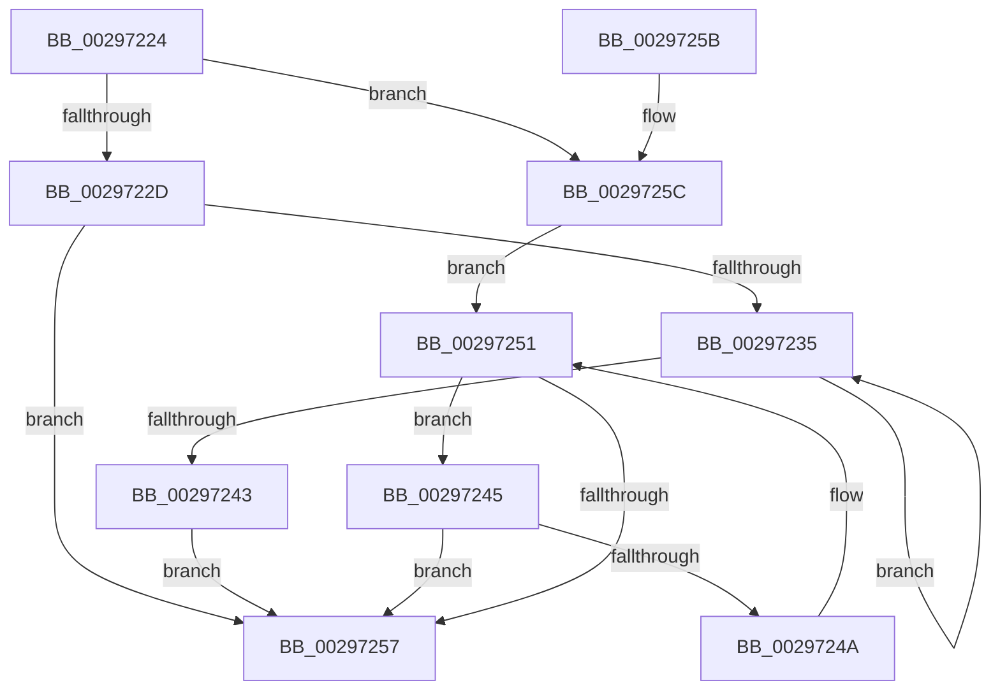

# MiGetNextVad

- RVA: `0x00297224`–`0x00297262` (길이 `62` bytes)
- VA: `0x0000000140297224`
- 실행 섹션: `.text`
- PDB 이름 있음: `예`; PDB Function 태그: `아니요`
- unwind 정보 RVA: `0x000DB714`
- 디코드: `23`개 명령, `62/62` bytes 표시
- 미해석 바이트: `0` (있으면 어셈블리에 `.byte`로 보존)

> 이 문서는 커널 이미지의 기계어와 PDB 기호를 분석해 생성했습니다. 4번과 5번은 함수 원형과 자료형을 바이너리 사용 방식에서 추정한 C 해석이며 원본 소스 복구 결과는 아닙니다.

## 1. Dependencies

- 직접 호출 지점: **0**; 고유 호출 대상: **0**
- 직접 호출자로 확인된 함수: **21**
- RIP 상대 이미지 참조: **0**

### Outgoing calls
- 직접 디코드된 call 명령이 없습니다.

### Direct callers
- [sub_0024A490](../24/Unknown_function_0024A490.md) at `0x0024A501`
- [MiWalkPageTablesRecursively](../27/MiWalkPageTablesRecursively_function_002796C0.md) at `0x0027B1F3`
- [MiRemoveVad](MiRemoveVad_function_00295C78.md) at `0x00295CF3`
- [MiEmptyWorkingSetPrivatePagesByVa](../2A/MiEmptyWorkingSetPrivatePagesByVa_function_002A6AC0.md) at `0x002A6BB5`
- [MmOutSwapWorkingSet](../2A/MmOutSwapWorkingSet_function_002A6BC8.md) at `0x002A6EA4`
- [MiReturnLockedVadOrNextVa](../31/MiReturnLockedVadOrNextVa_function_00316980.md) at `0x00316D79`
- [MiReleaseOutSwappedProcessCommit](../3C/MiReleaseOutSwappedProcessCommit_function_003C8320.md) at `0x003C84AF`
- [NtLockVirtualMemory](../40/NtLockVirtualMemory_function_004088A0.md) at `0x00408E18`
- [NtLockVirtualMemory](../40/NtLockVirtualMemory_function_004088A0.md) at `0x00408F0D`
- [MiDeleteEmptyPageTableCommit](../48/MiDeleteEmptyPageTableCommit_function_004834F4.md) at `0x00483713`
- [MiLeapPrefetch](../4C/MiLeapPrefetch_function_004CAED0.md) at `0x004CAFCE`
- [NtUnlockVirtualMemory](../4E/NtUnlockVirtualMemory_function_004EE890.md) at `0x004EEA8C`
- [NtUnlockVirtualMemory](../4E/NtUnlockVirtualMemory_function_004EE890.md) at `0x004EEDA2`
- [MiReleaseCommitForResetPages](../66/MiReleaseCommitForResetPages_function_0066FAF8.md) at `0x0066FBA1`
- [MiHotPatchProcess](../../page/80/MiHotPatchProcess_function_00803B78.md) at `0x00803D77`
- [sub_0087F5A3](../../page/87/Unknown_function_0087F5A3.md) at `0x0087F5DA`
- [MiLockVadRange](../../page/87/MiLockVadRange_function_0087F670.md) at `0x0087F70F`
- [MiLockVadRange](../../page/87/MiLockVadRange_function_0087F670.md) at `0x0087F90F`
- [MiCoalescePlaceholderAllocations](../../page/88/MiCoalescePlaceholderAllocations_function_0088095C.md) at `0x00880A0E`
- [MiCoalescePlaceholderAllocations](../../page/88/MiCoalescePlaceholderAllocations_function_0088095C.md) at `0x00880A19`
- [MiCoalescePlaceholderAllocations](../../page/88/MiCoalescePlaceholderAllocations_function_0088095C.md) at `0x00880A54`
- [MiCoalescePlaceholderAllocations](../../page/88/MiCoalescePlaceholderAllocations_function_0088095C.md) at `0x00880AAC`
- [MiMapAllImageScpPages](../../page/8D/MiMapAllImageScpPages_function_008D0534.md) at `0x008D0586`
- [MiCommitInitialVadMetadataBits](../../page/8D/MiCommitInitialVadMetadataBits_function_008D09CC.md) at `0x008D0A4E`
- [sub_009E5A2C](../../page/9E/Unknown_function_009E5A2C.md) at `0x009E5C16`
- [MmCleanProcessAddressSpace](../../page/A1/MmCleanProcessAddressSpace_function_00A17EC0.md) at `0x00A17F88`
- [MiUpdateVadBits](../../page/A8/MiUpdateVadBits_function_00A8DAC8.md) at `0x00A8DB21`

### Static image references
- 디코드된 RIP-relative 메모리 참조가 없습니다.

## 2. Other-region calls and transfers

- 다른 실행 섹션으로 향하는 call: **0**
- 별도 외부 분기/꼬리 이동을 확인하지 못했습니다.

## 3. Assembly (complete function range)

```asm
00297224  48 8B 51 08                     mov rdx, qword ptr [rcx + 8]
00297228  48 85 D2                        test rdx, rdx
0029722B  74 2F                           je 0x14029725c
0029722D  48 8B 0A                        mov rcx, qword ptr [rdx]
00297230  48 85 C9                        test rcx, rcx
00297233  74 22                           je 0x140297257
00297235  48 8B 01                        mov rax, qword ptr [rcx]
00297238  48 8B D1                        mov rdx, rcx
0029723B  48 8B C8                        mov rcx, rax
0029723E  48 85 C0                        test rax, rax
00297241  75 F2                           jne 0x140297235
00297243  EB 12                           jmp 0x140297257
00297245  48 39 0A                        cmp qword ptr [rdx], rcx
00297248  74 0D                           je 0x140297257
0029724A  48 8B CA                        mov rcx, rdx
0029724D  48 8B 52 10                     mov rdx, qword ptr [rdx + 0x10]
00297251  48 83 E2 FC                     and rdx, 0xfffffffffffffffc
00297255  75 EE                           jne 0x140297245
00297257  48 8B C2                        mov rax, rdx
0029725A  C3                              ret
0029725B  CC                              int3
0029725C  48 8B 51 10                     mov rdx, qword ptr [rcx + 0x10]
00297260  EB EF                           jmp 0x140297251
```

## 4. C-style interpretation (structured pseudocode)

```c
__int64 __fastcall MiGetNextVad(__int64 a1)
{
    if (*(unsigned __int64 *)(a1 + 8) == 0) goto loc_0029725C;
    if (*(unsigned __int64 *)(*(unsigned __int64 *)(a1 + 8)) == 0) goto loc_00297257;
loc_00297235:
    if (*(unsigned __int64 *)(*(unsigned __int64 *)(*(unsigned __int64 *)(a1 + 8))) != 0) goto loc_00297235;
    goto loc_00297257;
loc_00297245:
    if ((*(unsigned __int64 *)(*(unsigned __int64 *)(*(unsigned __int64 *)(a1 + 8)))) == (*(unsigned __int64 *)(*(unsigned __int64 *)(*(unsigned __int64 *)(a1 + 8))))) goto loc_00297257;
loc_00297251:
    a2 = (*(unsigned __int64 *)(*(unsigned __int64 *)(*(unsigned __int64 *)(a1 + 8)) + 16)) & (-4);
    if (condition_is_not_equal) goto loc_00297245;
loc_00297257:
    return a2;
loc_0029725C:
    goto loc_00297251;
}
```

## 5. (Beta) C Style

```c
int64_t MiGetNextVad(void *Arg1)
{
    uint8_t *arg1 = (uint8_t *)Arg1;

    if (*(uint64_t *)(arg1 + 0x8) == 0) goto loc_0029725C;
    if (*(uint64_t *)(*(uint64_t *)(arg1 + 0x8)) == 0) goto loc_00297257;
loc_00297235:
    if (*(uint64_t *)(*(uint64_t *)(*(uint64_t *)(arg1 + 0x8))) != 0) goto loc_00297235;
    goto loc_00297257;
loc_00297245:
    if ((*(uint64_t *)(*(uint64_t *)(*(uint64_t *)(arg1 + 0x8)))) == (*(uint64_t *)(*(uint64_t *)(*(uint64_t *)(arg1 + 0x8))))) goto loc_00297257;
loc_00297251:
    a2 = (*(uint64_t *)(*(uint64_t *)(*(uint64_t *)(arg1 + 0x8)) + 0x10)) & (-4);
    if (condition_is_not_equal) goto loc_00297245;
loc_00297257:
    return a2;
loc_0029725C:
    goto loc_00297251;
}
```

### 관측된 메모리 오프셋

구조체 형식이 확인되지 않은 접근은 인자 기준의 오프셋으로만 기록했습니다.

| 기준 인자 | 오프셋 표현 | 폭 (bit) | 접근 |
|---|---:|---:|---|
| `Arg1` | `+ 0x8` | `64` | `R` |
| `Arg1` | `+ 0x10` | `64` | `R` |

## 6. Execution-region graph

[열기: 2D/3D 그래프와 함수 탐색 컨트롤 패널](../../../control-panel.html?section=text&rva=0x00297224&view=graph)

- 2D 그래프는 위에서 아래로 흐르고, 3D 그래프는 빈 공간을 드래그해 회전합니다. Shift+드래그는 이동, 휠은 확대·축소, 함수 노드 선택은 대상 보고서 이동입니다.

### Static fallback


