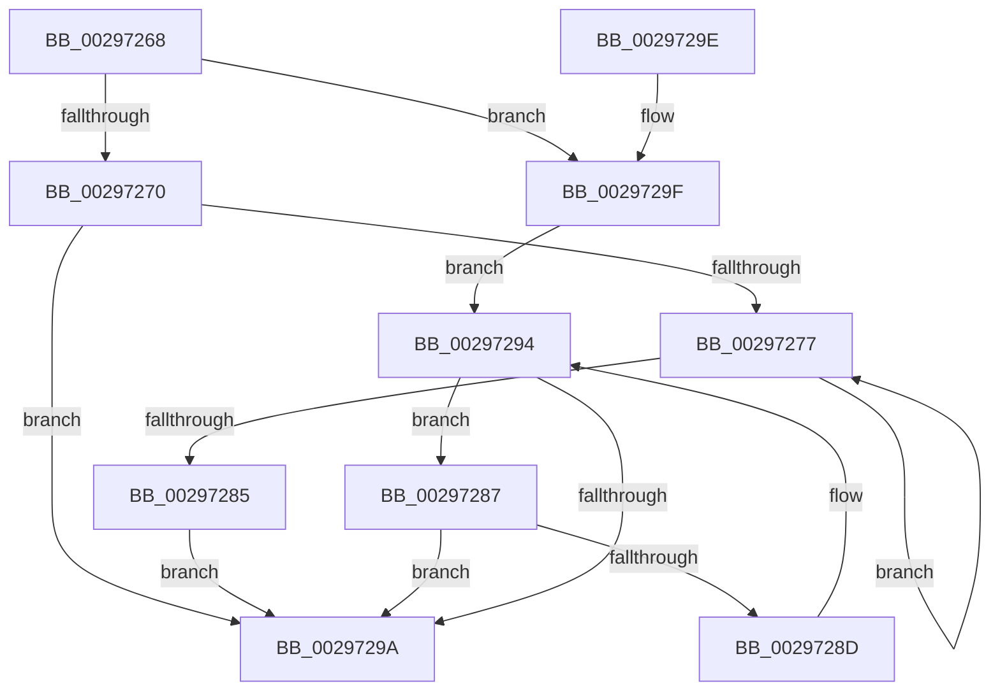

# MiGetPreviousVad

- RVA: `0x00297268`–`0x002972A5` (길이 `61` bytes)
- VA: `0x0000000140297268`
- 실행 섹션: `.text`
- PDB 이름 있음: `예`; PDB Function 태그: `아니요`
- unwind 정보 RVA: `0x000DB714`
- 디코드: `21`개 명령, `61/61` bytes 표시
- 미해석 바이트: `0` (있으면 어셈블리에 `.byte`로 보존)

> 이 문서는 커널 이미지의 기계어와 PDB 기호를 분석해 생성했습니다. 4번과 5번은 함수 원형과 자료형을 바이너리 사용 방식에서 추정한 C 해석이며 원본 소스 복구 결과는 아닙니다.

## 1. Dependencies

- 직접 호출 지점: **0**; 고유 호출 대상: **0**
- 직접 호출자로 확인된 함수: **4**
- RIP 상대 이미지 참조: **0**

### Outgoing calls
- 직접 디코드된 call 명령이 없습니다.

### Direct callers
- [MiRemoveVad](MiRemoveVad_function_00295C78.md) at `0x00295CE6`
- [MiLocateLowestConflictingVad](../44/MiLocateLowestConflictingVad_function_0044BD14.md) at `0x0044BD34`
- [MiDeleteEmptyPageTableCommit](../48/MiDeleteEmptyPageTableCommit_function_004834F4.md) at `0x00483723`
- [sub_009E5A2C](../../page/9E/Unknown_function_009E5A2C.md) at `0x009E5BE7`

### Static image references
- 디코드된 RIP-relative 메모리 참조가 없습니다.

## 2. Other-region calls and transfers

- 다른 실행 섹션으로 향하는 call: **0**
- 별도 외부 분기/꼬리 이동을 확인하지 못했습니다.

## 3. Assembly (complete function range)

```asm
00297268  48 8B 11                        mov rdx, qword ptr [rcx]
0029726B  48 85 D2                        test rdx, rdx
0029726E  74 2F                           je 0x14029729f
00297270  48 83 7A 08 00                  cmp qword ptr [rdx + 8], 0
00297275  74 23                           je 0x14029729a
00297277  48 8B 42 08                     mov rax, qword ptr [rdx + 8]
0029727B  48 8B D0                        mov rdx, rax
0029727E  48 83 78 08 00                  cmp qword ptr [rax + 8], 0
00297283  75 F2                           jne 0x140297277
00297285  EB 13                           jmp 0x14029729a
00297287  48 39 4A 08                     cmp qword ptr [rdx + 8], rcx
0029728B  74 0D                           je 0x14029729a
0029728D  48 8B CA                        mov rcx, rdx
00297290  48 8B 52 10                     mov rdx, qword ptr [rdx + 0x10]
00297294  48 83 E2 FC                     and rdx, 0xfffffffffffffffc
00297298  75 ED                           jne 0x140297287
0029729A  48 8B C2                        mov rax, rdx
0029729D  C3                              ret
0029729E  CC                              int3
0029729F  48 8B 51 10                     mov rdx, qword ptr [rcx + 0x10]
002972A3  EB EF                           jmp 0x140297294
```

## 4. C-style interpretation (structured pseudocode)

```c
__int64 __fastcall MiGetPreviousVad(__int64 a1)
{
    if (*(unsigned __int64 *)(a1) == 0) goto loc_0029729F;
    if ((*(unsigned __int64 *)(*(unsigned __int64 *)(a1) + 8)) == 0) goto loc_0029729A;
loc_00297277:
    if ((*(unsigned __int64 *)(*(unsigned __int64 *)(*(unsigned __int64 *)(a1) + 8) + 8)) != 0) goto loc_00297277;
    goto loc_0029729A;
loc_00297287:
    if ((*(unsigned __int64 *)(*(unsigned __int64 *)(*(unsigned __int64 *)(a1) + 8) + 8)) == a1) goto loc_0029729A;
loc_00297294:
    a2 = (*(unsigned __int64 *)(*(unsigned __int64 *)(*(unsigned __int64 *)(a1) + 8) + 16)) & (-4);
    if (condition_is_not_equal) goto loc_00297287;
loc_0029729A:
    return a2;
loc_0029729F:
    goto loc_00297294;
}
```

## 5. (Beta) C Style

```c
int64_t MiGetPreviousVad(void *Arg1)
{
    uint8_t *arg1 = (uint8_t *)Arg1;

    if (*(uint64_t *)(arg1) == 0) goto loc_0029729F;
    if ((*(uint64_t *)(*(uint64_t *)(arg1) + 0x8)) == 0) goto loc_0029729A;
loc_00297277:
    if ((*(uint64_t *)(*(uint64_t *)(*(uint64_t *)(arg1) + 0x8) + 0x8)) != 0) goto loc_00297277;
    goto loc_0029729A;
loc_00297287:
    if ((*(uint64_t *)(*(uint64_t *)(*(uint64_t *)(arg1) + 0x8) + 0x8)) == Arg1) goto loc_0029729A;
loc_00297294:
    a2 = (*(uint64_t *)(*(uint64_t *)(*(uint64_t *)(arg1) + 0x8) + 0x10)) & (-4);
    if (condition_is_not_equal) goto loc_00297287;
loc_0029729A:
    return a2;
loc_0029729F:
    goto loc_00297294;
}
```

### 관측된 메모리 오프셋

구조체 형식이 확인되지 않은 접근은 인자 기준의 오프셋으로만 기록했습니다.

| 기준 인자 | 오프셋 표현 | 폭 (bit) | 접근 |
|---|---:|---:|---|
| `Arg1` | `+ 0x0` | `64` | `R` |
| `Arg1` | `+ 0x10` | `64` | `R` |

## 6. Execution-region graph

[열기: 2D/3D 그래프와 함수 탐색 컨트롤 패널](../../../control-panel.html?section=text&rva=0x00297268&view=graph)

- 2D 그래프는 위에서 아래로 흐르고, 3D 그래프는 빈 공간을 드래그해 회전합니다. Shift+드래그는 이동, 휠은 확대·축소, 함수 노드 선택은 대상 보고서 이동입니다.

### Static fallback


