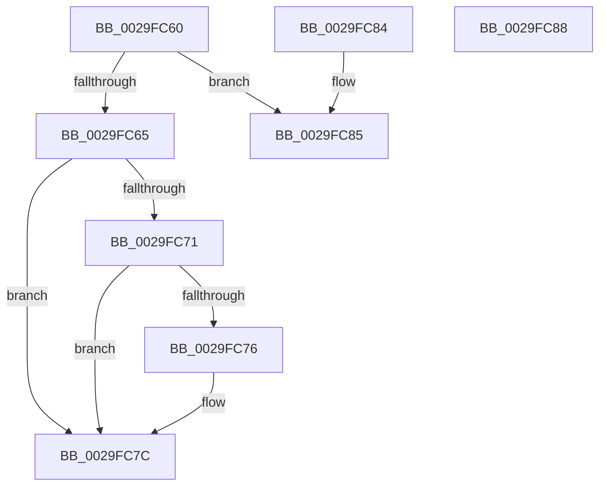

# MiGetPteLink

- RVA: `0x0029FC60`–`0x0029FC89` (길이 `41` bytes)
- VA: `0x000000014029FC60`
- 실행 섹션: `.text`
- PDB 이름 있음: `예`; PDB Function 태그: `아니요`
- unwind 정보 RVA: `0x000DB714`
- 디코드: `16`개 명령, `41/41` bytes 표시
- 미해석 바이트: `0` (있으면 어셈블리에 `.byte`로 보존)

> 이 문서는 커널 이미지의 기계어와 PDB 기호를 분석해 생성했습니다. 4번과 5번은 함수 원형과 자료형을 바이너리 사용 방식에서 추정한 C 해석이며 원본 소스 복구 결과는 아닙니다.

## 1. Dependencies

- 직접 호출 지점: **0**; 고유 호출 대상: **0**
- 직접 호출자로 확인된 함수: **3**
- RIP 상대 이미지 참조: **1**

### Outgoing calls
- 직접 디코드된 call 명령이 없습니다.

### Direct callers
- [MiConvertContiguousPages](MiConvertContiguousPages_function_0029F894.md) at `0x0029FA1E`
- [MiChangePageAttributeBatch](../2A/MiChangePageAttributeBatch_function_002A06E0.md) at `0x002A0753`
- [MiChangePageAttributeBatch](../2A/MiChangePageAttributeBatch_function_002A06E0.md) at `0x002A0884`
- [MiPerformFinalZeroing](../4F/MiPerformFinalZeroing_function_004F9594.md) at `0x004F95E8`

### Static image references
- `0x0029FC65` → RVA `0x00E2DC80` (`.data`; read)

## 2. Other-region calls and transfers

- 다른 실행 섹션으로 향하는 call: **0**
- 별도 외부 분기/꼬리 이동을 확인하지 못했습니다.

## 3. Assembly (complete function range)

```asm
0029FC60  48 85 C9                        test rcx, rcx
0029FC63  74 20                           je 0x14029fc85
0029FC65  48 8B 05 14 E0 B8 00            mov rax, qword ptr [rip + 0xb8e014]
0029FC6C  48 85 C0                        test rax, rax
0029FC6F  74 0B                           je 0x14029fc7c
0029FC71  F6 C1 10                        test cl, 0x10
0029FC74  75 06                           jne 0x14029fc7c
0029FC76  48 F7 D0                        not rax
0029FC79  48 23 C8                        and rcx, rax
0029FC7C  48 C1 E9 19                     shr rcx, 0x19
0029FC80  48 8B C1                        mov rax, rcx
0029FC83  C3                              ret
0029FC84  CC                              int3
0029FC85  33 C0                           xor eax, eax
0029FC87  C3                              ret
0029FC88  CC                              int3
```

## 4. C-style interpretation (structured pseudocode)

```c
__int64 __fastcall MiGetPteLink(__int64 a1)
{
    __int64 result;

    if (a1 == 0) goto loc_0029FC85;
    if (*(unsigned __int64 *)(v_rip + 12115988) == 0) goto loc_0029FC7C;
    result = *(unsigned __int64 *)(v_rip + 12115988);
    if ((((unsigned __int8)(a1)) & (16)) == 0) {
        result = ~(*(unsigned __int64 *)(v_rip + 12115988));
        a1 = (a1) & (result);
    }
    a1 = (a1) >> (25);
    return a1;
loc_0029FC85:
    result = 0;
    return result;
}
```

## 5. (Beta) C Style

```c
int64_t MiGetPteLink(int64_t Arg1)
{
    int64_t result;

    if (Arg1 == 0) goto loc_0029FC85;
    if (*(uint64_t *)(v_rip + 0xB8E014) == 0) goto loc_0029FC7C;
    result = *(uint64_t *)(v_rip + 0xB8E014);
    if ((((uint8_t)(Arg1)) & (16)) == 0) {
        result = ~(*(uint64_t *)(v_rip + 0xB8E014));
        Arg1 = (Arg1) & (result);
    }
    Arg1 = (Arg1) >> (25);
    return Arg1;
loc_0029FC85:
    result = 0;
    return result;
}
```

## 6. Execution-region graph

[열기: 2D/3D 그래프와 함수 탐색 컨트롤 패널](../../../control-panel.html?section=text&rva=0x0029FC60&view=graph)

- 2D 그래프는 위에서 아래로 흐르고, 3D 그래프는 빈 공간을 드래그해 회전합니다. Shift+드래그는 이동, 휠은 확대·축소, 함수 노드 선택은 대상 보고서 이동입니다.

### Static fallback


