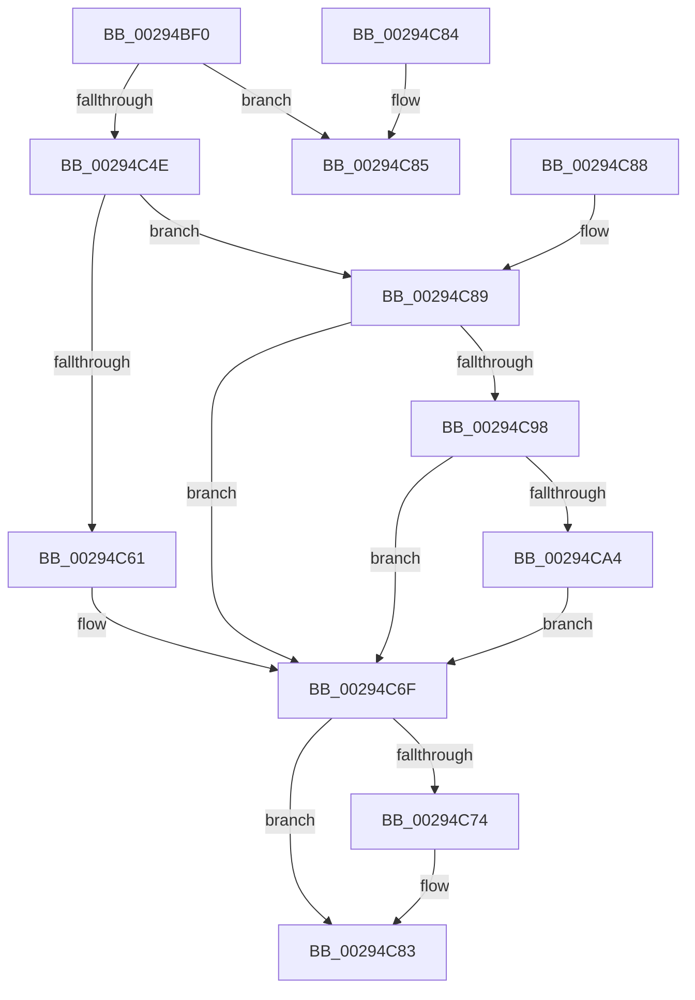

# MiGetSystemCacheReverseMap

- RVA: `0x00294BF0`–`0x00294CA9` (길이 `185` bytes)
- VA: `0x0000000140294BF0`
- 실행 섹션: `.text`
- PDB 이름 있음: `예`; PDB Function 태그: `아니요`
- unwind 정보 RVA: `0x000DB714`
- 디코드: `47`개 명령, `185/185` bytes 표시
- 미해석 바이트: `0` (있으면 어셈블리에 `.byte`로 보존)

> 이 문서는 커널 이미지의 기계어와 PDB 기호를 분석해 생성했습니다. 4번과 5번은 함수 원형과 자료형을 바이너리 사용 방식에서 추정한 C 해석이며 원본 소스 복구 결과는 아닙니다.

## 1. Dependencies

- 직접 호출 지점: **0**; 고유 호출 대상: **0**
- 직접 호출자로 확인된 함수: **9**
- RIP 상대 이미지 참조: **2**

### Outgoing calls
- 직접 디코드된 call 명령이 없습니다.

### Direct callers
- [MmMapViewInSystemCache](../27/MmMapViewInSystemCache_function_00273094.md) at `0x002731A3`
- [sub_0027B90E](../27/Unknown_function_0027B90E.md) at `0x0027BA2B`
- [MiSynchronizeSystemVa](../28/MiSynchronizeSystemVa_function_0028ECB8.md) at `0x0028EE12`
- [MmUnmapViewInSystemCache](MmUnmapViewInSystemCache_function_00293B70.md) at `0x00293C52`
- [MiReleaseSystemCacheView](MiReleaseSystemCacheView_function_00294CE0.md) at `0x00294D03`
- [MiFastTrimWorkingSet](../2A/MiFastTrimWorkingSet_function_002AD420.md) at `0x002AD6BE`
- [MiTrimSharedPageFromViews](../2E/MiTrimSharedPageFromViews_function_002E16F8.md) at `0x002E1BC9`
- [MmFreeSystemCacheReserveView](../../page/7F/MmFreeSystemCacheReserveView_function_007FE2D8.md) at `0x007FE2F1`
- [MmHardFaultBytesRequired](../../page/9A/MmHardFaultBytesRequired_function_009A70F0.md) at `0x009A70FE`

### Static image references
- `0x00294C68` → RVA `0x00E38BB8` (`.data`; read)
- `0x00294C98` → RVA `0x00FC6AB0` (`ALMOSTRO`; read)

## 2. Other-region calls and transfers

- 다른 실행 섹션으로 향하는 call: **0**
- 별도 외부 분기/꼬리 이동을 확인하지 못했습니다.

## 3. Assembly (complete function range)

```asm
00294BF0  48 8B C1                        mov rax, rcx
00294BF3  48 8B D1                        mov rdx, rcx
00294BF6  48 C1 E8 12                     shr rax, 0x12
00294BFA  25 F8 FF FF 3F                  and eax, 0x3ffffff8
00294BFF  48 B9 00 00 00 40 FB F6 FF FF   movabs rcx, 0xfffff6fb40000000
00294C09  48 8B 04 08                     mov rax, qword ptr [rax + rcx]
00294C0D  48 B9 FF FF FF FF FF 00 00 00   movabs rcx, 0xffffffffff
00294C17  48 C1 E8 0C                     shr rax, 0xc
00294C1B  48 23 C1                        and rax, rcx
00294C1E  48 8D 04 40                     lea rax, [rax + rax*2]
00294C22  48 C1 E0 04                     shl rax, 4
00294C26  48 B9 00 00 00 00 00 DE FF FF   movabs rcx, 0xffffde0000000000
00294C30  48 03 C1                        add rax, rcx
00294C33  48 8B 08                        mov rcx, qword ptr [rax]
00294C36  8B 40 24                        mov eax, dword ptr [rax + 0x24]
00294C39  25 00 00 FF 03                  and eax, 0x3ff0000
00294C3E  48 D1 E9                        shr rcx, 1
00294C41  48 C1 E0 0F                     shl rax, 0xf
00294C45  0F BA F1 1F                     btr ecx, 0x1f
00294C49  48 0B C1                        or rax, rcx
00294C4C  74 37                           je 0x140294c85
00294C4E  48 B9 00 00 00 00 00 FF FF FF   movabs rcx, 0xffffff0000000000
00294C58  48 03 C8                        add rcx, rax
00294C5B  48 83 F9 01                     cmp rcx, 1
00294C5F  76 28                           jbe 0x140294c89
00294C61  48 FF C8                        dec rax
00294C64  48 C1 E0 04                     shl rax, 4
00294C68  48 03 05 49 3F BA 00            add rax, qword ptr [rip + 0xba3f49]
00294C6F  48 85 C0                        test rax, rax
00294C72  74 0F                           je 0x140294c83
00294C74  48 C1 EA 12                     shr rdx, 0x12
00294C78  83 E2 07                        and edx, 7
00294C7B  48 8D 0C 92                     lea rcx, [rdx + rdx*4]
00294C7F  48 8D 04 C8                     lea rax, [rax + rcx*8]
00294C83  C3                              ret
00294C84  CC                              int3
00294C85  33 C0                           xor eax, eax
00294C87  C3                              ret
00294C88  CC                              int3
00294C89  48 B9 01 00 00 00 00 01 00 00   movabs rcx, 0x10000000001
00294C93  48 3B C1                        cmp rax, rcx
00294C96  75 D7                           jne 0x140294c6f
00294C98  48 8B 0D 11 1E D3 00            mov rcx, qword ptr [rip + 0xd31e11]
00294C9F  48 85 C9                        test rcx, rcx
00294CA2  74 CB                           je 0x140294c6f
00294CA4  48 8B C1                        mov rax, rcx
00294CA7  EB C6                           jmp 0x140294c6f
```

## 4. C-style interpretation (structured pseudocode)

```c
__int64 __fastcall MiGetSystemCacheReverseMap(__int64 a1)
{
    __int64 result;

    result = (a1) >> (18);
    result = (unsigned int)((result) & (0x3FFFFFF8ULL));
    result = (*(unsigned __int64 *)(result + a1 * 1)) >> (12);
    result = (result) & (a1);
    result = (result + result * 2) << (4);
    result = (result) + (a1);
    result = (unsigned int)(((unsigned int)(*(unsigned int *)(result + 36))) & (0x3FF0000ULL));
    a1 = (*(unsigned __int64 *)(result)) >> (1);
    result = (result) << (15);
    result = (result) | (a1);
    if (condition_is_equal) goto loc_00294C85;
    a1 = (a1) + (result);
    if (a1 <= 1) goto loc_00294C89;
    result = (result) - 1;
    result = (result) << (4);
    result = (result) + (*(unsigned __int64 *)(v_rip + 12205897));
loc_00294C6F:
    if (result != 0) {
        a2 = (a1) >> (18);
        a2 = (unsigned int)((a2) & (7));
        a1 = a2 + a2 * 4;
        result = result + a1 * 8;
    }
    return result;
loc_00294C85:
    result = 0;
    return result;
loc_00294C89:
    if (0 != a1) goto loc_00294C6F;
    if (*(unsigned __int64 *)(v_rip + 13835793) == 0) goto loc_00294C6F;
    goto loc_00294C6F;
}
```

## 5. (Beta) C Style

```c
int64_t MiGetSystemCacheReverseMap(int64_t Arg1)
{
    int64_t result;

    result = (Arg1) >> (18);
    result = (uint32_t)((result) & (0x3FFFFFF8ULL));
    result = (*(uint64_t *)(result + Arg1 * 1)) >> (12);
    result = (result) & (Arg1);
    result = (result + result * 2) << (4);
    result = (result) + (Arg1);
    result = (uint32_t)(((uint32_t)(*(uint32_t *)(result + 0x24))) & (0x3FF0000ULL));
    Arg1 = (*(uint64_t *)(result)) >> (1);
    result = (result) << (15);
    result = (result) | (Arg1);
    if (condition_is_equal) goto loc_00294C85;
    Arg1 = (Arg1) + (result);
    if (Arg1 <= 1) goto loc_00294C89;
    result = (result) - 1;
    result = (result) << (4);
    result = (result) + (*(uint64_t *)(v_rip + 0xBA3F49));
loc_00294C6F:
    if (result != 0) {
        a2 = (Arg1) >> (18);
        a2 = (uint32_t)((a2) & (7));
        Arg1 = a2 + a2 * 4;
        result = result + Arg1 * 8;
    }
    return result;
loc_00294C85:
    result = 0;
    return result;
loc_00294C89:
    if (0 != Arg1) goto loc_00294C6F;
    if (*(uint64_t *)(v_rip + 0xD31E11) == 0) goto loc_00294C6F;
    goto loc_00294C6F;
}
```

## 6. Execution-region graph

[열기: 2D/3D 그래프와 함수 탐색 컨트롤 패널](../../../control-panel.html?section=text&rva=0x00294BF0&view=graph)

- 2D 그래프는 위에서 아래로 흐르고, 3D 그래프는 빈 공간을 드래그해 회전합니다. Shift+드래그는 이동, 휠은 확대·축소, 함수 노드 선택은 대상 보고서 이동입니다.

### Static fallback


