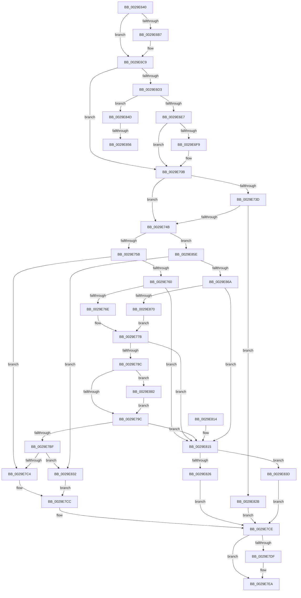

# MiGetWorkingSetInfoEx

- RVA: `0x0029E640`–`0x0029E88C` (길이 `588` bytes)
- VA: `0x000000014029E640`
- 실행 섹션: `.text`
- PDB 이름 있음: `예`; PDB Function 태그: `예`
- unwind 정보 RVA: `0x00068194`
- 디코드: `150`개 명령, `588/588` bytes 표시
- 미해석 바이트: `0` (있으면 어셈블리에 `.byte`로 보존)

> 이 문서는 커널 이미지의 기계어와 PDB 기호를 분석해 생성했습니다. 4번과 5번은 함수 원형과 자료형을 바이너리 사용 방식에서 추정한 C 해석이며 원본 소스 복구 결과는 아닙니다.

## 1. Dependencies

- 직접 호출 지점: **7**; 고유 호출 대상: **7**
- 직접 호출자로 확인된 함수: **3**
- RIP 상대 이미지 참조: **3**

### Outgoing calls
- `0x0029E6A8` → [memset](../6C/memset_function_006C6C40.md) (function, `0x006C6C40`)
- `0x0029E700` → [KeStackAttachProcess](../21/KeStackAttachProcess_function_00216800.md) (function, `0x00216800`)
- `0x0029E72F` → [MiLockWorkingSetShared](../27/MiLockWorkingSetShared_function_0027CBF0.md) (function, `0x0027CBF0`)
- `0x0029E7B5` → [MiWalkPageTables](../2C/MiWalkPageTables_function_002C2710.md) (function, `0x002C2710`)
- `0x0029E7D5` → [MiUnlockWorkingSetShared](../27/MiUnlockWorkingSetShared_function_0027D690.md) (function, `0x0027D690`)
- `0x0029E7E5` → [KiUnstackDetachProcess](../21/KiUnstackDetachProcess_function_00217D30.md) (function, `0x00217D30`)
- `0x0029E7F3` → [_security_check_cookie](../6A/_security_check_cookie_function_006AC640.md) (function, `0x006AC640`)

### Direct callers
- [MiGetWorkingSetInfo](MiGetWorkingSetInfo_function_0029E498.md) at `0x0029E5B8`
- [EtwpEnumerateWorkingSet](../../page/7B/EtwpEnumerateWorkingSet_function_007BFFA4.md) at `0x007BFFFA`
- [MmLogSystemShareablePfnInfo](../../page/80/MmLogSystemShareablePfnInfo_function_008093F4.md) at `0x008094AF`

### Static image references
- `0x0029E65E` → RVA `0x00E0A740` (`.data`; read)
- `0x0029E6DA` → RVA `0x00FC6B70` (`ALMOSTRO`; read)
- `0x0029E710` → RVA `0x003D2160` (`MiQueryLeafPte`; read)

## 2. Other-region calls and transfers

- 다른 실행 섹션으로 향하는 call: **0**
- call이 아닌 외부 분기/꼬리 이동: **2**
  - `0x0029E850` → [sub_006DAA6A](../6D/Unknown_function_006DAA6A.md) (`tail-transfer`)
  - `0x0029E859` → [sub_006DAA6A + 0x4](../6D/Unknown_function_006DAA6A.md) (`tail-transfer`)

## 3. Assembly (complete function range)

```asm
0029E640  48 89 5C 24 10                  mov qword ptr [rsp + 0x10], rbx
0029E645  48 89 74 24 20                  mov qword ptr [rsp + 0x20], rsi
0029E64A  55                              push rbp
0029E64B  57                              push rdi
0029E64C  41 54                           push r12
0029E64E  41 56                           push r14
0029E650  41 57                           push r15
0029E652  48 8D 6C 24 B0                  lea rbp, [rsp - 0x50]
0029E657  48 81 EC 50 01 00 00            sub rsp, 0x150
0029E65E  48 8B 05 DB C0 B6 00            mov rax, qword ptr [rip + 0xb6c0db]
0029E665  48 33 C4                        xor rax, rsp
0029E668  48 89 45 40                     mov qword ptr [rbp + 0x40], rax
0029E66C  0F 57 C0                        xorps xmm0, xmm0
0029E66F  0F 57 C9                        xorps xmm1, xmm1
0029E672  49 8B F0                        mov rsi, r8
0029E675  44 8B F2                        mov r14d, edx
0029E678  48 8B F9                        mov rdi, rcx
0029E67B  33 C0                           xor eax, eax
0029E67D  33 D2                           xor edx, edx
0029E67F  48 89 44 24 40                  mov qword ptr [rsp + 0x40], rax
0029E684  41 B8 C0 00 00 00               mov r8d, 0xc0
0029E68A  48 8D 4C 24 50                  lea rcx, [rsp + 0x50]
0029E68F  0F 11 45 10                     movups xmmword ptr [rbp + 0x10], xmm0
0029E693  4D 8B F9                        mov r15, r9
0029E696  0F 11 45 20                     movups xmmword ptr [rbp + 0x20], xmm0
0029E69A  0F 11 45 30                     movups xmmword ptr [rbp + 0x30], xmm0
0029E69E  0F 11 4C 24 20                  movups xmmword ptr [rsp + 0x20], xmm1
0029E6A3  0F 11 4C 24 30                  movups xmmword ptr [rsp + 0x30], xmm1
0029E6A8  E8 93 85 42 00                  call 0x1406c6c40
0029E6AD  33 DB                           xor ebx, ebx
0029E6AF  45 33 E4                        xor r12d, r12d
0029E6B2  45 85 F6                        test r14d, r14d
0029E6B5  79 12                           jns 0x14029e6c9
0029E6B7  41 0F BA E6 1E                  bt r14d, 0x1e
0029E6BC  8D 43 01                        lea eax, [rbx + 1]
0029E6BF  8D 4B 03                        lea ecx, [rbx + 3]
0029E6C2  0F 42 C1                        cmovb eax, ecx
0029E6C5  89 44 24 20                     mov dword ptr [rsp + 0x20], eax
0029E6C9  8B 87 B8 00 00 00               mov eax, dword ptr [rdi + 0xb8]
0029E6CF  A8 0F                           test al, 0xf
0029E6D1  75 38                           jne 0x14029e70b
0029E6D3  48 8D 9F 00 FC FF FF            lea rbx, [rdi - 0x400]
0029E6DA  48 3B 1D 8F 84 D2 00            cmp rbx, qword ptr [rip + 0xd2848f]
0029E6E1  0F 84 66 01 00 00               je 0x14029e84d
0029E6E7  65 48 8B 04 25 88 01 00 00      mov rax, qword ptr gs:[0x188]
0029E6F0  48 39 98 B8 00 00 00            cmp qword ptr [rax + 0xb8], rbx
0029E6F7  74 12                           je 0x14029e70b
0029E6F9  48 8D 55 10                     lea rdx, [rbp + 0x10]
0029E6FD  48 8B CB                        mov rcx, rbx
0029E700  E8 FB 80 F7 FF                  call 0x140216800
0029E705  41 BC 01 00 00 00               mov r12d, 1
0029E70B  48 83 4D 80 FF                  or qword ptr [rbp - 0x80], 0xffffffffffffffff
0029E710  48 8D 05 49 3A 13 00            lea rax, [rip + 0x133a49]
0029E717  48 89 45 F8                     mov qword ptr [rbp - 8], rax
0029E71B  48 8B CF                        mov rcx, rdi
0029E71E  48 8D 44 24 20                  lea rax, [rsp + 0x20]
0029E723  C7 44 24 50 06 00 01 00         mov dword ptr [rsp + 0x50], 0x10006
0029E72B  48 89 45 08                     mov qword ptr [rbp + 8], rax
0029E72F  E8 BC E4 FD FF                  call 0x14027cbf0
0029E734  88 44 24 59                     mov byte ptr [rsp + 0x59], al
0029E738  48 85 DB                        test rbx, rbx
0029E73B  74 0E                           je 0x14029e74b
0029E73D  8B 83 F4 01 00 00               mov eax, dword ptr [rbx + 0x1f4]
0029E743  A8 20                           test al, 0x20
0029E745  0F 85 E0 00 00 00               jne 0x14029e82b
0029E74B  48 8B 97 80 00 00 00            mov rdx, qword ptr [rdi + 0x80]
0029E752  45 85 F6                        test r14d, r14d
0029E755  0F 89 03 01 00 00               jns 0x14029e85e
0029E75B  48 85 D2                        test rdx, rdx
0029E75E  74 64                           je 0x14029e7c4
0029E760  B9 10 00 00 00                  mov ecx, 0x10
0029E765  4C 3B F9                        cmp r15, rcx
0029E768  0F 82 A7 00 00 00               jb 0x14029e815
0029E76E  49 8D 47 F0                     lea rax, [r15 - 0x10]
0029E772  B9 08 00 00 00                  mov ecx, 8
0029E777  48 C1 E8 03                     shr rax, 3
0029E77B  4C 8D 40 01                     lea r8, [rax + 1]
0029E77F  4C 8D 0C 0E                     lea r9, [rsi + rcx]
0029E783  49 3B D0                        cmp rdx, r8
0029E786  0F 87 89 00 00 00               ja 0x14029e815
0029E78C  8B 87 B8 00 00 00               mov eax, dword ptr [rdi + 0xb8]
0029E792  24 0F                           and al, 0xf
0029E794  3C 01                           cmp al, 1
0029E796  0F 84 E6 00 00 00               je 0x14029e882
0029E79C  48 8D 4C 24 50                  lea rcx, [rsp + 0x50]
0029E7A1  48 89 7C 24 70                  mov qword ptr [rsp + 0x70], rdi
0029E7A6  4C 89 44 24 38                  mov qword ptr [rsp + 0x38], r8
0029E7AB  4C 89 4C 24 28                  mov qword ptr [rsp + 0x28], r9
0029E7B0  48 89 5C 24 40                  mov qword ptr [rsp + 0x40], rbx
0029E7B5  E8 56 3F 02 00                  call 0x1402c2710
0029E7BA  83 F8 05                        cmp eax, 5
0029E7BD  74 56                           je 0x14029e815
0029E7BF  45 85 F6                        test r14d, r14d
0029E7C2  79 6E                           jns 0x14029e832
0029E7C4  48 8B 44 24 30                  mov rax, qword ptr [rsp + 0x30]
0029E7C9  48 89 06                        mov qword ptr [rsi], rax
0029E7CC  33 DB                           xor ebx, ebx
0029E7CE  8A 54 24 59                     mov dl, byte ptr [rsp + 0x59]
0029E7D2  48 8B CF                        mov rcx, rdi
0029E7D5  E8 B6 EE FD FF                  call 0x14027d690
0029E7DA  45 85 E4                        test r12d, r12d
0029E7DD  74 0B                           je 0x14029e7ea
0029E7DF  33 D2                           xor edx, edx
0029E7E1  48 8D 4D 10                     lea rcx, [rbp + 0x10]
0029E7E5  E8 46 95 F7 FF                  call 0x140217d30
0029E7EA  8B C3                           mov eax, ebx
0029E7EC  48 8B 4D 40                     mov rcx, qword ptr [rbp + 0x40]
0029E7F0  48 33 CC                        xor rcx, rsp
0029E7F3  E8 48 DE 40 00                  call 0x1406ac640
0029E7F8  4C 8D 9C 24 50 01 00 00         lea r11, [rsp + 0x150]
0029E800  49 8B 5B 38                     mov rbx, qword ptr [r11 + 0x38]
0029E804  49 8B 73 48                     mov rsi, qword ptr [r11 + 0x48]
0029E808  49 8B E3                        mov rsp, r11
0029E80B  41 5F                           pop r15
0029E80D  41 5E                           pop r14
0029E80F  41 5C                           pop r12
0029E811  5F                              pop rdi
0029E812  5D                              pop rbp
0029E813  C3                              ret
0029E814  CC                              int3
0029E815  48 8B 8F 80 00 00 00            mov rcx, qword ptr [rdi + 0x80]
0029E81C  BB 04 00 00 C0                  mov ebx, 0xc0000004
0029E821  45 85 F6                        test r14d, r14d
0029E824  79 17                           jns 0x14029e83d
0029E826  48 89 0E                        mov qword ptr [rsi], rcx
0029E829  EB A3                           jmp 0x14029e7ce
0029E82B  BB 0A 01 00 C0                  mov ebx, 0xc000010a
0029E830  EB 9C                           jmp 0x14029e7ce
0029E832  48 8B 44 24 30                  mov rax, qword ptr [rsp + 0x30]
0029E837  48 89 46 08                     mov qword ptr [rsi + 8], rax
0029E83B  EB 8F                           jmp 0x14029e7cc
0029E83D  48 8B 87 88 00 00 00            mov rax, qword ptr [rdi + 0x88]
0029E844  48 2B C8                        sub rcx, rax
0029E847  48 89 4E 08                     mov qword ptr [rsi + 8], rcx
0029E84B  EB 81                           jmp 0x14029e7ce
0029E84D  45 85 F6                        test r14d, r14d
0029E850  0F 89 14 C2 43 00               jns 0x1406daa6a
0029E856  4C 21 26                        and qword ptr [rsi], r12
0029E859  E9 10 C2 43 00                  jmp 0x1406daa6e
0029E85E  48 8B 87 88 00 00 00            mov rax, qword ptr [rdi + 0x88]
0029E865  48 2B D0                        sub rdx, rax
0029E868  74 C8                           je 0x14029e832
0029E86A  49 83 FF 30                     cmp r15, 0x30
0029E86E  72 A5                           jb 0x14029e815
0029E870  49 8D 47 D0                     lea rax, [r15 - 0x30]
0029E874  B9 10 00 00 00                  mov ecx, 0x10
0029E879  48 C1 E8 05                     shr rax, 5
0029E87D  E9 F9 FE FF FF                  jmp 0x14029e77b
0029E882  83 4C 24 50 01                  or dword ptr [rsp + 0x50], 1
0029E887  E9 10 FF FF FF                  jmp 0x14029e79c
```

## 4. C-style interpretation (structured pseudocode)

```c
__int64 __fastcall MiGetWorkingSetInfoEx(__int64 a1, int a2, __int64 a3, __int64 a4)
{
    __int64 result;
    __int64 v_r12;
    __int64 v_rbx;
    __int64 v_rsp;
    unsigned int v_stack_m100;
    unsigned __int64 v_stack_m108;
    unsigned __int8 v_stack_m11F;
    unsigned __int64 v_stack_m120;
    unsigned __int64 v_stack_m128;
    unsigned __int64 v_stack_m138;
    unsigned __int64 v_stack_m140;
    unsigned __int64 v_stack_m148;
    unsigned __int64 v_stack_m150;
    unsigned __int64 v_stack_m158;
    unsigned __int64 v_stack_m28;
    unsigned __int64 v_stack_m38;
    unsigned __int64 v_stack_m48;
    unsigned __int64 v_stack_m58;
    unsigned __int64 v_stack_m68;
    unsigned __int64 v_stack_m70;
    unsigned __int64 v_stack_m78;
    unsigned __int64 v_stack_m80;
    unsigned __int64 v_stack_mF8;
    unsigned __int64 v_stack_p10;
    unsigned __int64 v_stack_p20;

    v_stack_p10 = v_rbx;
    v_stack_p20 = v_rsi;
    v_rsp = (v_rsp) - (336);
    result = (*(unsigned __int64 *)(v_rip + 11976923)) ^ (v_rsp);
    v_stack_m38 = result;
    result = 0;
    a2 = 0;
    v_stack_m138 = 0;
    v_stack_m68 = v_xmm0;
    v_stack_m58 = v_xmm0;
    v_stack_m48 = v_xmm0;
    v_stack_m158 = v_xmm1;
    v_stack_m148 = v_xmm1;
    result = memset(v_stack_m128, a2, 192, a4);
    v_rbx = 0;
    v_r12 = 0;
    if (sign_flag) {
        result = v_rbx + 1;
        a1 = v_rbx + 3;
        if (condition_is_below) { result = (unsigned int)(a1); }
        v_stack_m158 = (unsigned int)(result);
    }
    if ((((unsigned __int8)((unsigned int)(*(unsigned int *)(a1 + 184)))) & (15)) != 0) goto loc_0029E70B;
    if ((a1 - 1024) == (*(unsigned __int64 *)(v_rip + 13796495))) goto loc_0029E84D;
    result = *(unsigned __int64 *)(gs_base + (0 + 392));
    if ((*(unsigned __int64 *)(*(unsigned __int64 *)(gs_base + (0 + 392)) + 184)) != (a1 - 1024)) {
        a2 = v_stack_m68;
        a1 = a1 - 1024;
        result = KeStackAttachProcess(a1, a2, 192, a4);
        v_r12 = 1;
    }
    v_stack_m80 = v_rip + 1260105;
    v_stack_m128 = 0x10006ULL;
    v_stack_m70 = v_stack_m158;
    result = MiLockWorkingSetShared(a1, a2, 192, a4);
    v_stack_m11F = (unsigned __int8)(result);
    if (a1 - 1024 == 0) goto loc_0029E74B;
    if ((((unsigned __int8)((unsigned int)(*(unsigned int *)(a1 - 1024 + 500)))) & (32)) != 0) goto loc_0029E82B;
loc_0029E74B:
    if (!sign_flag) goto loc_0029E85E;
    if (*(unsigned __int64 *)(a1 + 128) == 0) goto loc_0029E7C4;
    if (a4 < 16) goto loc_0029E815;
    result = (a4 - 16) >> (3);
loc_0029E77B:
    if ((*(unsigned __int64 *)(a1 + 128)) > (result + 1)) goto loc_0029E815;
    result = (unsigned __int8)(((unsigned int)(*(unsigned int *)(a1 + 184))) & (15));
    if (((unsigned __int8)(result)) == 1) goto loc_0029E882;
loc_0029E79C:
    v_stack_m108 = a1;
    v_stack_m140 = result + 1;
    v_stack_m150 = a3 + 8 * 1;
    v_stack_m138 = a1 - 1024;
    result = MiWalkPageTables(v_stack_m128, *(unsigned __int64 *)(a1 + 128), result + 1, a3 + 8 * 1);
    if (((unsigned int)(result)) == 5) goto loc_0029E815;
    if (!sign_flag) goto loc_0029E832;
loc_0029E7C4:
    *(unsigned __int64 *)(a3) = v_stack_m148;
loc_0029E7CC:
    v_rbx = 0;
loc_0029E7CE:
    result = MiUnlockWorkingSetShared(a1, v_stack_m11F, result + 1, a3 + 8 * 1);
    if ((unsigned int)(v_r12) != 0) {
        a2 = 0;
        a1 = v_stack_m68;
        result = KiUnstackDetachProcess(a1, a2, result + 1, a3 + 8 * 1);
    }
    a1 = (v_stack_m38) ^ (v_rsp);
    result = _security_check_cookie(a1, a2, result + 1, a3 + 8 * 1);
    return result;
loc_0029E815:
    if (!sign_flag) goto loc_0029E83D;
    *(unsigned __int64 *)(*(unsigned __int64 *)(v_stack_m28 + 72)) = *(unsigned __int64 *)(a1 + 128);
    goto loc_0029E7CE;
loc_0029E82B:
    goto loc_0029E7CE;
loc_0029E832:
    *(unsigned __int64 *)(*(unsigned __int64 *)(v_stack_m28 + 72) + 8) = v_stack_m120;
    goto loc_0029E7CC;
loc_0029E83D:
    a1 = (*(unsigned __int64 *)(a1 + 128)) - (*(unsigned __int64 *)(a1 + 136));
    *(unsigned __int64 *)(*(unsigned __int64 *)(v_stack_m28 + 72) + 8) = a1;
    goto loc_0029E7CE;
loc_0029E84D:
loc_0029E85E:
    a2 = (a2) - (*(unsigned __int64 *)(a1 + 136));
    if (condition_is_equal) goto loc_0029E832;
    if (a4 < 48) goto loc_0029E815;
    result = (a4 - 48) >> (5);
    goto loc_0029E77B;
loc_0029E882:
    goto loc_0029E79C;
}
```

## 5. (Beta) C Style

```c
int64_t MiGetWorkingSetInfoEx(void *Arg1, int32_t Arg2, void *Arg3, int64_t Arg4)
{
    uint8_t *arg1 = (uint8_t *)Arg1;
    uint8_t *arg3 = (uint8_t *)Arg3;

    int64_t result;
    int64_t local_r12;
    int64_t local_rbx;
    int64_t local_rsp;
    uint32_t v_stack_m100;
    uint64_t v_stack_m108;
    uint8_t v_stack_m11F;
    uint64_t v_stack_m120;
    uint64_t v_stack_m128;
    uint64_t v_stack_m138;
    uint64_t v_stack_m140;
    uint64_t v_stack_m148;
    uint64_t v_stack_m150;
    uint64_t v_stack_m158;
    uint64_t v_stack_m28;
    uint64_t v_stack_m38;
    uint64_t v_stack_m48;
    uint64_t v_stack_m58;
    uint64_t v_stack_m68;
    uint64_t v_stack_m70;
    uint64_t v_stack_m78;
    uint64_t v_stack_m80;
    uint64_t v_stack_mF8;
    uint64_t v_stack_p10;
    uint64_t v_stack_p20;

    v_stack_p10 = local_rbx;
    v_stack_p20 = local_rsi;
    local_rsp = (local_rsp) - (336);
    result = (*(uint64_t *)(v_rip + 0xB6C0DB)) ^ (local_rsp);
    v_stack_m38 = result;
    result = 0;
    Arg2 = 0;
    v_stack_m138 = 0;
    v_stack_m68 = v_xmm0;
    v_stack_m58 = v_xmm0;
    v_stack_m48 = v_xmm0;
    v_stack_m158 = v_xmm1;
    v_stack_m148 = v_xmm1;
    result = memset(v_stack_m128, Arg2, 192, Arg4);
    local_rbx = 0;
    local_r12 = 0;
    if (sign_flag) {
        result = local_rbx + 1;
        Arg1 = local_rbx + 3;
        if (condition_is_below) { result = (uint32_t)(Arg1); }
        v_stack_m158 = (uint32_t)(result);
    }
    if ((((uint8_t)((uint32_t)(*(uint32_t *)(arg1 + 0xB8)))) & (15)) != 0) goto loc_0029E70B;
    if ((Arg1 - 1024) == (*(uint64_t *)(v_rip + 0xD2848F))) goto loc_0029E84D;
    result = *(uint64_t *)(gs_base + (0 + 0x188));
    if ((*(uint64_t *)(*(uint64_t *)(gs_base + (0 + 0x188)) + 0xB8)) != (Arg1 - 1024)) {
        Arg2 = v_stack_m68;
        Arg1 = Arg1 - 1024;
        result = KeStackAttachProcess(Arg1, Arg2, 192, Arg4);
        local_r12 = 1;
    }
    v_stack_m80 = v_rip + 1260105;
    v_stack_m128 = 0x10006ULL;
    v_stack_m70 = v_stack_m158;
    result = MiLockWorkingSetShared(Arg1, Arg2, 192, Arg4);
    v_stack_m11F = (uint8_t)(result);
    if (Arg1 - 1024 == 0) goto loc_0029E74B;
    if ((((uint8_t)((uint32_t)(*(uint32_t *)(arg1 - 0x400 + 0x1F4)))) & (32)) != 0) goto loc_0029E82B;
loc_0029E74B:
    if (!sign_flag) goto loc_0029E85E;
    if (*(uint64_t *)(arg1 + 0x80) == 0) goto loc_0029E7C4;
    if (Arg4 < 16) goto loc_0029E815;
    result = (Arg4 - 16) >> (3);
loc_0029E77B:
    if ((*(uint64_t *)(arg1 + 0x80)) > (result + 1)) goto loc_0029E815;
    result = (uint8_t)(((uint32_t)(*(uint32_t *)(arg1 + 0xB8))) & (15));
    if (((uint8_t)(result)) == 1) goto loc_0029E882;
loc_0029E79C:
    v_stack_m108 = Arg1;
    v_stack_m140 = result + 1;
    v_stack_m150 = Arg3 + 8 * 1;
    v_stack_m138 = Arg1 - 1024;
    result = MiWalkPageTables(v_stack_m128, *(uint64_t *)(arg1 + 0x80), result + 1, Arg3 + 8 * 1);
    if (((uint32_t)(result)) == 5) goto loc_0029E815;
    if (!sign_flag) goto loc_0029E832;
loc_0029E7C4:
    *(uint64_t *)(arg3) = v_stack_m148;
loc_0029E7CC:
    local_rbx = 0;
loc_0029E7CE:
    result = MiUnlockWorkingSetShared(Arg1, v_stack_m11F, result + 1, Arg3 + 8 * 1);
    if ((uint32_t)(local_r12) != 0) {
        Arg2 = 0;
        Arg1 = v_stack_m68;
        result = KiUnstackDetachProcess(Arg1, Arg2, result + 1, Arg3 + 8 * 1);
    }
    Arg1 = (v_stack_m38) ^ (local_rsp);
    result = _security_check_cookie(Arg1, Arg2, result + 1, Arg3 + 8 * 1);
    return result;
loc_0029E815:
    if (!sign_flag) goto loc_0029E83D;
    *(uint64_t *)(*(uint64_t *)(v_stack_m28 + 0x48)) = *(uint64_t *)(arg1 + 0x80);
    goto loc_0029E7CE;
loc_0029E82B:
    goto loc_0029E7CE;
loc_0029E832:
    *(uint64_t *)(*(uint64_t *)(v_stack_m28 + 0x48) + 0x8) = v_stack_m120;
    goto loc_0029E7CC;
loc_0029E83D:
    Arg1 = (*(uint64_t *)(arg1 + 0x80)) - (*(uint64_t *)(arg1 + 0x88));
    *(void **)(*(uint64_t *)(v_stack_m28 + 0x48) + 0x8) = Arg1;
    goto loc_0029E7CE;
loc_0029E84D:
loc_0029E85E:
    Arg2 = (Arg2) - (*(uint64_t *)(arg1 + 0x88));
    if (condition_is_equal) goto loc_0029E832;
    if (Arg4 < 48) goto loc_0029E815;
    result = (Arg4 - 48) >> (5);
    goto loc_0029E77B;
loc_0029E882:
    goto loc_0029E79C;
}
```

### 관측된 메모리 오프셋

구조체 형식이 확인되지 않은 접근은 인자 기준의 오프셋으로만 기록했습니다.

| 기준 인자 | 오프셋 표현 | 폭 (bit) | 접근 |
|---|---:|---:|---|
| `Arg1` | `- 0x400` | `64` | `R` |
| `Arg1` | `+ 0x80` | `64` | `R` |
| `Arg1` | `+ 0x88` | `64` | `R` |
| `Arg1` | `+ 0xB8` | `32` | `R` |
| `Arg3` | `+ 0x0` | `64` | `R/W` |
| `Arg3` | `+ 0x0` | `64` | `W` |
| `Arg3` | `+ 0x0 + rcx*1` | `64` | `R` |
| `Arg3` | `+ 0x8` | `64` | `W` |

## 6. Execution-region graph

[열기: 2D/3D 그래프와 함수 탐색 컨트롤 패널](../../../control-panel.html?section=text&rva=0x0029E640&view=graph)

- 2D 그래프는 위에서 아래로 흐르고, 3D 그래프는 빈 공간을 드래그해 회전합니다. Shift+드래그는 이동, 휠은 확대·축소, 함수 노드 선택은 대상 보고서 이동입니다.

### Static fallback


