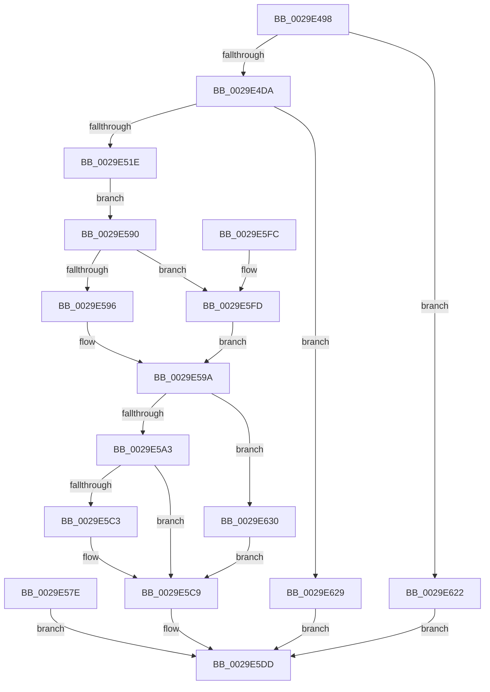

# MiGetWorkingSetInfo

- RVA: `0x0029E498`–`0x0029E637` (길이 `415` bytes)
- VA: `0x000000014029E498`
- 실행 섹션: `.text`
- PDB 이름 있음: `예`; PDB Function 태그: `아니요`
- unwind 정보 RVA: `0x0006815C`
- 디코드: `113`개 명령, `415/415` bytes 표시
- 미해석 바이트: `0` (있으면 어셈블리에 `.byte`로 보존)

> 이 문서는 커널 이미지의 기계어와 PDB 기호를 분석해 생성했습니다. 4번과 5번은 함수 원형과 자료형을 바이너리 사용 방식에서 추정한 C 해석이며 원본 소스 복구 결과는 아닙니다.

## 1. Dependencies

- 직접 호출 지점: **7**; 고유 호출 대상: **6**
- 직접 호출자로 확인된 함수: **1**
- RIP 상대 이미지 참조: **0**

### Outgoing calls
- `0x0029E508` → [MiAllocatePool](../35/MiAllocatePool_function_0035B540.md) (function, `0x0035B540`)
- `0x0029E577` → [MmProbeAndLockPages](../23/MmProbeAndLockPages_function_0023B990.md) (function, `0x0023B990`)
- `0x0029E587` → [ExFreePoolWithTag](../../poolcode/B8/ExFreePoolWithTag_function_00B82870.md) (function, `0x00B82870`)
- `0x0029E5B8` → [MiGetWorkingSetInfoEx](MiGetWorkingSetInfoEx_function_0029E640.md) (function, `0x0029E640`)
- `0x0029E5CC` → [MmUnlockPages](MmUnlockPages_function_0029EEE0.md) (function, `0x0029EEE0`)
- `0x0029E5D6` → [ExFreePoolWithTag](../../poolcode/B8/ExFreePoolWithTag_function_00B82870.md) (function, `0x00B82870`)
- `0x0029E615` → [MmMapLockedPagesSpecifyCache](../31/MmMapLockedPagesSpecifyCache_function_00318800.md) (function, `0x00318800`)

### Direct callers
- [MmQueryVirtualMemory](../../page/9D/MmQueryVirtualMemory_function_009D9280.md) at `0x009D972A`

### Static image references
- 디코드된 RIP-relative 메모리 참조가 없습니다.

## 2. Other-region calls and transfers

- 다른 실행 섹션으로 향하는 call: **2**
  - `0x0029E587` → [ExFreePoolWithTag](../../poolcode/B8/ExFreePoolWithTag_function_00B82870.md) (`.text` → `POOLCODE`)
  - `0x0029E5D6` → [ExFreePoolWithTag](../../poolcode/B8/ExFreePoolWithTag_function_00B82870.md) (`.text` → `POOLCODE`)
- 별도 외부 분기/꼬리 이동을 확인하지 못했습니다.

## 3. Assembly (complete function range)

```asm
0029E498  48 8B C4                        mov rax, rsp
0029E49B  48 89 58 08                     mov qword ptr [rax + 8], rbx
0029E49F  48 89 70 10                     mov qword ptr [rax + 0x10], rsi
0029E4A3  48 89 78 18                     mov qword ptr [rax + 0x18], rdi
0029E4A7  4C 89 60 20                     mov qword ptr [rax + 0x20], r12
0029E4AB  41 55                           push r13
0029E4AD  41 56                           push r14
0029E4AF  41 57                           push r15
0029E4B1  48 83 EC 30                     sub rsp, 0x30
0029E4B5  49 8B F9                        mov rdi, r9
0029E4B8  49 8B F0                        mov rsi, r8
0029E4BB  44 8B FA                        mov r15d, edx
0029E4BE  4C 8B E9                        mov r13, rcx
0029E4C1  45 33 E4                        xor r12d, r12d
0029E4C4  4C 8B 74 24 70                  mov r14, qword ptr [rsp + 0x70]
0029E4C9  4D 89 26                        mov qword ptr [r14], r12
0029E4CC  B8 FF FF FF FF                  mov eax, 0xffffffff
0029E4D1  4C 3B C8                        cmp r9, rax
0029E4D4  0F 87 48 01 00 00               ja 0x14029e622
0029E4DA  49 8B C1                        mov rax, r9
0029E4DD  25 FF 0F 00 00                  and eax, 0xfff
0029E4E2  48 F7 D8                        neg rax
0029E4E5  48 1B D2                        sbb rdx, rdx
0029E4E8  48 F7 DA                        neg rdx
0029E4EB  48 83 C2 07                     add rdx, 7
0029E4EF  49 8B C1                        mov rax, r9
0029E4F2  48 C1 E8 0C                     shr rax, 0xc
0029E4F6  48 03 D0                        add rdx, rax
0029E4F9  48 C1 E2 03                     shl rdx, 3
0029E4FD  41 8D 4C 24 40                  lea ecx, [r12 + 0x40]
0029E502  41 B8 4D 6D 20 20               mov r8d, 0x20206d4d
0029E508  E8 33 D0 0B 00                  call 0x14035b540
0029E50D  48 8B D8                        mov rbx, rax
0029E510  48 89 44 24 70                  mov qword ptr [rsp + 0x70], rax
0029E515  48 85 C0                        test rax, rax
0029E518  0F 84 0B 01 00 00               je 0x14029e629
0029E51E  4C 89 20                        mov qword ptr [rax], r12
0029E521  8B D6                           mov edx, esi
0029E523  8B CA                           mov ecx, edx
0029E525  41 B8 FF 0F 00 00               mov r8d, 0xfff
0029E52B  49 23 C8                        and rcx, r8
0029E52E  49 03 C8                        add rcx, r8
0029E531  48 03 CF                        add rcx, rdi
0029E534  48 C1 E9 0C                     shr rcx, 0xc
0029E538  66 83 C1 06                     add cx, 6
0029E53C  66 C1 E1 03                     shl cx, 3
0029E540  66 89 48 08                     mov word ptr [rax + 8], cx
0029E544  66 44 89 60 0A                  mov word ptr [rax + 0xa], r12w
0029E549  48 81 E6 00 F0 FF FF            and rsi, 0xfffffffffffff000
0029E550  48 89 70 20                     mov qword ptr [rax + 0x20], rsi
0029E554  41 23 D0                        and edx, r8d
0029E557  89 50 2C                        mov dword ptr [rax + 0x2c], edx
0029E55A  89 78 28                        mov dword ptr [rax + 0x28], edi
0029E55D  65 48 8B 14 25 88 01 00 00      mov rdx, qword ptr gs:[0x188]
0029E566  41 8D 74 24 01                  lea esi, [r12 + 1]
0029E56B  44 8B C6                        mov r8d, esi
0029E56E  8A 92 32 02 00 00               mov dl, byte ptr [rdx + 0x232]
0029E574  48 8B C8                        mov rcx, rax
0029E577  E8 14 D4 F9 FF                  call 0x14023b990
0029E57C  EB 12                           jmp 0x14029e590
0029E57E  8B D8                           mov ebx, eax
0029E580  33 D2                           xor edx, edx
0029E582  48 8B 4C 24 70                  mov rcx, qword ptr [rsp + 0x70]
0029E587  E8 E4 42 8E 00                  call 0x140b82870
0029E58C  8B C3                           mov eax, ebx
0029E58E  EB 4D                           jmp 0x14029e5dd
0029E590  F6 43 0A 05                     test byte ptr [rbx + 0xa], 5
0029E594  74 67                           je 0x14029e5fd
0029E596  48 8B 73 18                     mov rsi, qword ptr [rbx + 0x18]
0029E59A  48 85 F6                        test rsi, rsi
0029E59D  0F 84 8D 00 00 00               je 0x14029e630
0029E5A3  41 0F BA EF 1F                  bts r15d, 0x1f
0029E5A8  49 8D 8D 00 04 00 00            lea rcx, [r13 + 0x400]
0029E5AF  4C 8B CF                        mov r9, rdi
0029E5B2  4C 8B C6                        mov r8, rsi
0029E5B5  41 8B D7                        mov edx, r15d
0029E5B8  E8 83 00 00 00                  call 0x14029e640
0029E5BD  8B F8                           mov edi, eax
0029E5BF  85 C0                           test eax, eax
0029E5C1  78 06                           js 0x14029e5c9
0029E5C3  48 8B 0E                        mov rcx, qword ptr [rsi]
0029E5C6  49 89 0E                        mov qword ptr [r14], rcx
0029E5C9  48 8B CB                        mov rcx, rbx
0029E5CC  E8 0F 09 00 00                  call 0x14029eee0
0029E5D1  33 D2                           xor edx, edx
0029E5D3  48 8B CB                        mov rcx, rbx
0029E5D6  E8 95 42 8E 00                  call 0x140b82870
0029E5DB  8B C7                           mov eax, edi
0029E5DD  48 8B 5C 24 50                  mov rbx, qword ptr [rsp + 0x50]
0029E5E2  48 8B 74 24 58                  mov rsi, qword ptr [rsp + 0x58]
0029E5E7  48 8B 7C 24 60                  mov rdi, qword ptr [rsp + 0x60]
0029E5EC  4C 8B 64 24 68                  mov r12, qword ptr [rsp + 0x68]
0029E5F1  48 83 C4 30                     add rsp, 0x30
0029E5F5  41 5F                           pop r15
0029E5F7  41 5E                           pop r14
0029E5F9  41 5D                           pop r13
0029E5FB  C3                              ret
0029E5FC  CC                              int3
0029E5FD  C7 44 24 28 10 00 00 40         mov dword ptr [rsp + 0x28], 0x40000010
0029E605  44 89 64 24 20                  mov dword ptr [rsp + 0x20], r12d
0029E60A  45 33 C9                        xor r9d, r9d
0029E60D  44 8B C6                        mov r8d, esi
0029E610  33 D2                           xor edx, edx
0029E612  48 8B CB                        mov rcx, rbx
0029E615  E8 E6 A1 07 00                  call 0x140318800
0029E61A  48 8B F0                        mov rsi, rax
0029E61D  E9 78 FF FF FF                  jmp 0x14029e59a
0029E622  B8 06 02 00 C0                  mov eax, 0xc0000206
0029E627  EB B4                           jmp 0x14029e5dd
0029E629  B8 9A 00 00 C0                  mov eax, 0xc000009a
0029E62E  EB AD                           jmp 0x14029e5dd
0029E630  BF 9A 00 00 C0                  mov edi, 0xc000009a
0029E635  EB 92                           jmp 0x14029e5c9
```

## 4. C-style interpretation (structured pseudocode)

```c
__int64 __fastcall MiGetWorkingSetInfo(__int64 a1, __int64 a2, __int64 a3, __int64 a4, __int64 a5)
{
    __int64 result;
    __int64 v_r12;
    __int64 v_rsi;
    __int64 v_rsp;
    unsigned __int64 v_stack_p10;
    unsigned __int64 v_stack_p18;
    unsigned __int64 v_stack_p20;
    unsigned __int64 v_stack_p28;
    unsigned __int64 v_stack_p8;

    *(unsigned __int64 *)(v_rsp + 8) = v_rbx;
    *(unsigned __int64 *)(v_rsp + 16) = v_rsi;
    *(unsigned __int64 *)(v_rsp + 24) = v_rdi;
    *(unsigned __int64 *)(v_rsp + 32) = v_r12;
    v_rsp = (v_rsp) - (48);
    v_r12 = 0;
    *(unsigned __int64 *)(a5) = 0;
    if (a4 > ((unsigned int)(0xFFFFFFFFULL))) goto loc_0029E622;
    result = (unsigned int)((a4) & (0xFFFULL));
    result = -(result);
    a2 = -(a2);
    a2 = (a2) + (7);
    result = (a4) >> (12);
    a2 = (a2) + (result);
    a2 = (a2) << (3);
    result = MiAllocatePool(v_r12 + 64, a2, (unsigned int)(0x20206D4DULL), a4);
    v_stack_p28 = result;
    if (result == 0) goto loc_0029E629;
    *(unsigned __int64 *)(result) = 0;
    a1 = ((unsigned int)((unsigned int)((unsigned int)((unsigned int)(a3))))) & ((unsigned int)(0xFFFULL));
    a1 = (a1) + ((unsigned int)(0xFFFULL));
    a1 = (a1) + (a4);
    a1 = (a1) >> (12);
    a1 = (unsigned __int16)((a1) + (6));
    a1 = (unsigned __int16)((a1) << (3));
    *(unsigned __int16 *)(result + 8) = (unsigned __int16)(a1);
    *(unsigned __int16 *)(result + 10) = 0;
    v_rsi = (a3) & (0xFFFFFFFFFFFFF000ULL);
    *(unsigned __int64 *)(result + 32) = v_rsi;
    a2 = (unsigned int)(((unsigned int)((unsigned int)(a3))) & ((unsigned int)((unsigned int)(0xFFFULL))));
    *(unsigned int *)(result + 44) = (unsigned int)(a2);
    *(unsigned int *)(result + 40) = (unsigned int)(a4);
    result = MmProbeAndLockPages(result, *(unsigned __int8 *)(*(unsigned __int64 *)(gs_base + (0 + 392)) + 562), (unsigned int)((unsigned int)(v_r12 + 1)), a4);
    goto loc_0029E590;
loc_0029E590:
    if (((*(unsigned __int8 *)(result + 10)) & (5)) == 0) goto loc_0029E5FD;
loc_0029E59A:
    if (*(unsigned __int64 *)(result + 24) == 0) goto loc_0029E630;
    result = MiGetWorkingSetInfoEx(a1 + 1024, (unsigned int)((unsigned int)((unsigned int)((unsigned int)(a2)))), *(unsigned __int64 *)(result + 24), a4);
    if (!(sign_flag)) {
        a1 = *(unsigned __int64 *)(*(unsigned __int64 *)(result + 24));
        *(unsigned __int64 *)(a5) = a1;
    }
    result = MmUnlockPages(result, (unsigned int)((unsigned int)((unsigned int)((unsigned int)(a2)))), *(unsigned __int64 *)(result + 24), a4);
    a2 = 0;
    result = ExFreePoolWithTag(result, a2, *(unsigned __int64 *)(result + 24), a4);
loc_0029E5DD:
    v_rsp = (v_rsp) + (48);
    return (unsigned int)((unsigned int)((unsigned int)((unsigned int)(result))));
loc_0029E5FD:
    v_stack_p28 = 0x40000010ULL;
    v_stack_p20 = (unsigned int)(v_stack_p20);
    a4 = 0;
    a2 = 0;
    result = MmMapLockedPagesSpecifyCache(v_stack_p8, a2, (unsigned int)((unsigned int)(v_stack_p10)), a4);
    goto loc_0029E59A;
loc_0029E622:
    goto loc_0029E5DD;
loc_0029E629:
    goto loc_0029E5DD;
loc_0029E630:
    goto loc_0029E5C9;
}
```

## 5. (Beta) C Style

```c
int64_t MiGetWorkingSetInfo(void *Arg1, int64_t Arg2, int64_t Arg3, int64_t Arg4, void *Arg5)
{
    uint8_t *arg1 = (uint8_t *)Arg1;
    uint8_t *arg5 = (uint8_t *)Arg5;

    int64_t result;
    int64_t local_r12;
    int64_t local_rsi;
    int64_t local_rsp;
    uint64_t v_stack_p10;
    uint64_t v_stack_p18;
    uint64_t v_stack_p20;
    uint64_t v_stack_p28;
    uint64_t v_stack_p8;

    *(uint64_t *)(local_rsp + 0x8) = local_rbx;
    *(uint64_t *)(local_rsp + 0x10) = local_rsi;
    *(uint64_t *)(local_rsp + 0x18) = local_rdi;
    *(uint64_t *)(local_rsp + 0x20) = local_r12;
    local_rsp = (local_rsp) - (48);
    local_r12 = 0;
    *(uint64_t *)(arg5) = 0;
    if (Arg4 > ((uint32_t)(0xFFFFFFFFULL))) goto loc_0029E622;
    result = (uint32_t)((Arg4) & (0xFFFULL));
    result = -(result);
    Arg2 = -(Arg2);
    Arg2 = (Arg2) + (7);
    result = (Arg4) >> (12);
    Arg2 = (Arg2) + (result);
    Arg2 = (Arg2) << (3);
    result = MiAllocatePool(local_r12 + 64, Arg2, (uint32_t)(0x20206D4DULL), Arg4);
    v_stack_p28 = result;
    if (result == 0) goto loc_0029E629;
    *(uint64_t *)(result) = 0;
    Arg1 = ((uint32_t)((uint32_t)((uint32_t)((uint32_t)(Arg3))))) & ((uint32_t)(0xFFFULL));
    Arg1 = (Arg1) + ((uint32_t)(0xFFFULL));
    Arg1 = (Arg1) + (Arg4);
    Arg1 = (Arg1) >> (12);
    Arg1 = (uint16_t)((Arg1) + (6));
    Arg1 = (uint16_t)((Arg1) << (3));
    *(uint16_t *)(result + 0x8) = (uint16_t)(Arg1);
    *(uint16_t *)(result + 0xA) = 0;
    local_rsi = (Arg3) & (0xFFFFFFFFFFFFF000ULL);
    *(uint64_t *)(result + 0x20) = local_rsi;
    Arg2 = (uint32_t)(((uint32_t)((uint32_t)(Arg3))) & ((uint32_t)((uint32_t)(0xFFFULL))));
    *(uint32_t *)(result + 0x2C) = (uint32_t)(Arg2);
    *(uint32_t *)(result + 0x28) = (uint32_t)(Arg4);
    result = MmProbeAndLockPages(result, *(uint8_t *)(*(uint64_t *)(gs_base + (0 + 0x188)) + 0x232), (uint32_t)((uint32_t)(local_r12 + 1)), Arg4);
    goto loc_0029E590;
loc_0029E590:
    if (((*(uint8_t *)(result + 0xA)) & (5)) == 0) goto loc_0029E5FD;
loc_0029E59A:
    if (*(uint64_t *)(result + 0x18) == 0) goto loc_0029E630;
    result = MiGetWorkingSetInfoEx(Arg1 + 1024, (uint32_t)((uint32_t)((uint32_t)((uint32_t)(Arg2)))), *(uint64_t *)(result + 0x18), Arg4);
    if (!(sign_flag)) {
        Arg1 = *(uint64_t *)(*(uint64_t *)(result + 0x18));
        *(void **)(arg5) = Arg1;
    }
    result = MmUnlockPages(result, (uint32_t)((uint32_t)((uint32_t)((uint32_t)(Arg2)))), *(uint64_t *)(result + 0x18), Arg4);
    Arg2 = 0;
    result = ExFreePoolWithTag(result, Arg2, *(uint64_t *)(result + 0x18), Arg4);
loc_0029E5DD:
    local_rsp = (local_rsp) + (48);
    return (uint32_t)((uint32_t)((uint32_t)((uint32_t)(result))));
loc_0029E5FD:
    v_stack_p28 = 0x40000010ULL;
    v_stack_p20 = (uint32_t)(v_stack_p20);
    Arg4 = 0;
    Arg2 = 0;
    result = MmMapLockedPagesSpecifyCache(v_stack_p8, Arg2, (uint32_t)((uint32_t)(v_stack_p10)), Arg4);
    goto loc_0029E59A;
loc_0029E622:
    goto loc_0029E5DD;
loc_0029E629:
    goto loc_0029E5DD;
loc_0029E630:
    goto loc_0029E5C9;
}
```

### 관측된 메모리 오프셋

구조체 형식이 확인되지 않은 접근은 인자 기준의 오프셋으로만 기록했습니다.

| 기준 인자 | 오프셋 표현 | 폭 (bit) | 접근 |
|---|---:|---:|---|
| `Arg1` | `+ 0x400` | `64` | `R` |
| `Arg5` | `+ 0x0` | `64` | `W` |

## 6. Execution-region graph

[열기: 2D/3D 그래프와 함수 탐색 컨트롤 패널](../../../control-panel.html?section=text&rva=0x0029E498&view=graph)

- 2D 그래프는 위에서 아래로 흐르고, 3D 그래프는 빈 공간을 드래그해 회전합니다. Shift+드래그는 이동, 휠은 확대·축소, 함수 노드 선택은 대상 보고서 이동입니다.

### Static fallback


