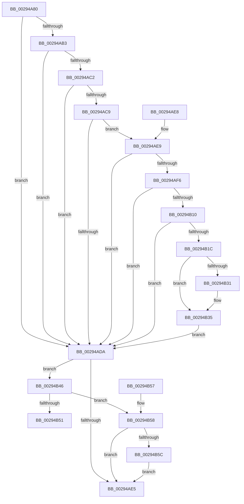

# MiGetWsleProtection

- RVA: `0x00294A80`–`0x00294B61` (길이 `225` bytes)
- VA: `0x0000000140294A80`
- 실행 섹션: `.text`
- PDB 이름 있음: `예`; PDB Function 태그: `아니요`
- unwind 정보 RVA: `0x000DB714`
- 디코드: `61`개 명령, `225/225` bytes 표시
- 미해석 바이트: `0` (있으면 어셈블리에 `.byte`로 보존)

> 이 문서는 커널 이미지의 기계어와 PDB 기호를 분석해 생성했습니다. 4번과 5번은 함수 원형과 자료형을 바이너리 사용 방식에서 추정한 C 해석이며 원본 소스 복구 결과는 아닙니다.

## 1. Dependencies

- 직접 호출 지점: **0**; 고유 호출 대상: **0**
- 직접 호출자로 확인된 함수: **4**
- RIP 상대 이미지 참조: **1**

### Outgoing calls
- 직접 디코드된 call 명령이 없습니다.

### Direct callers
- [MiBuildForkPte](../22/MiBuildForkPte_function_0022E32C.md) at `0x0022E8BB`
- [MiSetReadOnlyOnSectionView](MiSetReadOnlyOnSectionView_function_00294538.md) at `0x002946C1`
- [MiPteForTrimmedProto](MiPteForTrimmedProto_function_0029496C.md) at `0x00294989`
- [MiCopyOnWrite](../36/MiCopyOnWrite_function_00362A0C.md) at `0x00362C26`

### Static image references
- `0x00294AE9` → RVA `0x00FC6A88` (`ALMOSTRO`; read)

## 2. Other-region calls and transfers

- 다른 실행 섹션으로 향하는 call: **0**
- 별도 외부 분기/꼬리 이동을 확인하지 못했습니다.

## 3. Assembly (complete function range)

```asm
00294A80  4C 8B D1                        mov r10, rcx
00294A83  48 B8 F8 FF FF FF 7F 00 00 00   movabs rax, 0x7ffffffff8
00294A8D  49 C1 EA 09                     shr r10, 9
00294A91  4C 23 D0                        and r10, rax
00294A94  48 B8 00 00 00 00 80 F6 FF FF   movabs rax, 0xfffff68000000000
00294A9E  4C 03 D0                        add r10, rax
00294AA1  49 8B 02                        mov rax, qword ptr [r10]
00294AA4  48 B9 00 D0 BE 7D FB F6 FF FF   movabs rcx, 0xfffff6fb7dbed000
00294AAE  4C 3B D1                        cmp r10, rcx
00294AB1  72 27                           jb 0x140294ada
00294AB3  48 B9 F8 D7 BE 7D FB F6 FF FF   movabs rcx, 0xfffff6fb7dbed7f8
00294ABD  4C 3B D1                        cmp r10, rcx
00294AC0  77 18                           ja 0x140294ada
00294AC2  48 8B C8                        mov rcx, rax
00294AC5  A8 01                           test al, 1
00294AC7  74 11                           je 0x140294ada
00294AC9  A8 42                           test al, 0x42
00294ACB  41 0F 95 C1                     setne r9b
00294ACF  A8 20                           test al, 0x20
00294AD1  41 0F 95 C0                     setne r8b
00294AD5  45 84 C8                        test r8b, r9b
00294AD8  74 0F                           je 0x140294ae9
00294ADA  0F B6 CA                        movzx ecx, dl
00294ADD  C1 E9 04                        shr ecx, 4
00294AE0  83 E1 07                        and ecx, 7
00294AE3  75 61                           jne 0x140294b46
00294AE5  8B C1                           mov eax, ecx
00294AE7  C3                              ret
00294AE8  CC                              int3
00294AE9  48 F7 05 94 1F D3 00 00 00 60 00  test qword ptr [rip + 0xd31f94], 0x600000
00294AF4  74 E4                           je 0x140294ada
00294AF6  65 4C 8B 04 25 88 01 00 00      mov r8, qword ptr gs:[0x188]
00294AFF  4D 8B 88 B8 00 00 00            mov r9, qword ptr [r8 + 0xb8]
00294B06  41 80 B9 60 01 00 00 01         cmp byte ptr [r9 + 0x160], 1
00294B0E  74 CA                           je 0x140294ada
00294B10  4D 8B 81 08 05 00 00            mov r8, qword ptr [r9 + 0x508]
00294B17  4D 85 C0                        test r8, r8
00294B1A  74 BE                           je 0x140294ada
00294B1C  49 C1 EA 03                     shr r10, 3
00294B20  41 81 E2 FF 01 00 00            and r10d, 0x1ff
00294B27  4F 8B 04 D0                     mov r8, qword ptr [r8 + r10*8]
00294B2B  41 F6 C0 20                     test r8b, 0x20
00294B2F  74 04                           je 0x140294b35
00294B31  48 83 C9 20                     or rcx, 0x20
00294B35  48 8B C1                        mov rax, rcx
00294B38  48 83 C8 42                     or rax, 0x42
00294B3C  41 F6 C0 42                     test r8b, 0x42
00294B40  48 0F 44 C1                     cmove rax, rcx
00294B44  EB 94                           jmp 0x140294ada
00294B46  0F B6 D0                        movzx edx, al
00294B49  80 E2 18                        and dl, 0x18
00294B4C  80 FA 08                        cmp dl, 8
00294B4F  75 07                           jne 0x140294b58
00294B51  83 C9 18                        or ecx, 0x18
00294B54  8B C1                           mov eax, ecx
00294B56  C3                              ret
00294B57  CC                              int3
00294B58  A8 10                           test al, 0x10
00294B5A  74 89                           je 0x140294ae5
00294B5C  83 C9 08                        or ecx, 8
00294B5F  EB 84                           jmp 0x140294ae5
```

## 4. C-style interpretation (structured pseudocode)

```c
__int64 __fastcall MiGetWsleProtection(__int64 a1, unsigned __int8 a2)
{
    __int64 result;
    __int64 v_r10;

    v_r10 = (a1) >> (9);
    v_r10 = (v_r10) & (result);
    v_r10 = (v_r10) + (result);
    if (v_r10 < a1) goto loc_00294ADA;
    if (v_r10 > a1) goto loc_00294ADA;
    if ((((unsigned __int8)(*(unsigned __int64 *)(v_r10))) & (1)) == 0) goto loc_00294ADA;
    a4 = ((((unsigned __int8)(*(unsigned __int64 *)(v_r10))) & (66)) != 0) ? 1 : 0;
    a3 = ((((unsigned __int8)(*(unsigned __int64 *)(v_r10))) & (32)) != 0) ? 1 : 0;
    if ((((unsigned __int8)(a3)) & ((unsigned __int8)(a4))) == 0) goto loc_00294AE9;
loc_00294ADA:
    a1 = (unsigned int)((a2) >> (4));
    a1 = (unsigned int)((a1) & (7));
    if (condition_is_not_equal) goto loc_00294B46;
loc_00294AE5:
    return (unsigned int)((unsigned int)(a1));
loc_00294AE9:
    if (((*(unsigned __int64 *)(v_rip + 13836180)) & (0x600000ULL)) == 0) goto loc_00294ADA;
    if ((*(unsigned __int8 *)(*(unsigned __int64 *)(*(unsigned __int64 *)(gs_base + (0 + 392)) + 184) + 352)) == 1) goto loc_00294ADA;
    if (*(unsigned __int64 *)(*(unsigned __int64 *)(*(unsigned __int64 *)(gs_base + (0 + 392)) + 184) + 1288) == 0) goto loc_00294ADA;
    v_r10 = (v_r10) >> (3);
    v_r10 = (unsigned int)((v_r10) & (511));
    if ((((unsigned __int8)(*(unsigned __int64 *)(*(unsigned __int64 *)(*(unsigned __int64 *)(*(unsigned __int64 *)(gs_base + (0 + 392)) + 184) + 1288) + v_r10 * 8))) & (32)) != 0) {
        a1 = (a1) | (32);
    }
    result = (a1) | (66);
    if ((((unsigned __int8)(*(unsigned __int64 *)(*(unsigned __int64 *)(*(unsigned __int64 *)(*(unsigned __int64 *)(gs_base + (0 + 392)) + 184) + 1288) + v_r10 * 8))) & (66)) == 0) { result = a1; }
    goto loc_00294ADA;
loc_00294B46:
    a2 = (unsigned __int8)(((unsigned __int8)(result)) & (24));
    if (a2 != 8) goto loc_00294B58;
    a1 = (unsigned int)((a1) | (24));
    return (unsigned int)((unsigned int)(a1));
loc_00294B58:
    if ((((unsigned __int8)((unsigned int)((unsigned int)(a1)))) & (16)) == 0) goto loc_00294AE5;
    a1 = (unsigned int)((a1) | (8));
    goto loc_00294AE5;
}
```

## 5. (Beta) C Style

```c
int64_t MiGetWsleProtection(int64_t Arg1, uint8_t Arg2)
{
    int64_t result;
    int64_t local_r10;

    local_r10 = (Arg1) >> (9);
    local_r10 = (local_r10) & (result);
    local_r10 = (local_r10) + (result);
    if (local_r10 < Arg1) goto loc_00294ADA;
    if (local_r10 > Arg1) goto loc_00294ADA;
    if ((((uint8_t)(*(uint64_t *)(local_r10))) & (1)) == 0) goto loc_00294ADA;
    a4 = ((((uint8_t)(*(uint64_t *)(local_r10))) & (66)) != 0) ? 1 : 0;
    a3 = ((((uint8_t)(*(uint64_t *)(local_r10))) & (32)) != 0) ? 1 : 0;
    if ((((uint8_t)(a3)) & ((uint8_t)(a4))) == 0) goto loc_00294AE9;
loc_00294ADA:
    Arg1 = (uint32_t)((Arg2) >> (4));
    Arg1 = (uint32_t)((Arg1) & (7));
    if (condition_is_not_equal) goto loc_00294B46;
loc_00294AE5:
    return (uint32_t)((uint32_t)(Arg1));
loc_00294AE9:
    if (((*(uint64_t *)(v_rip + 0xD31F94)) & (0x600000ULL)) == 0) goto loc_00294ADA;
    if ((*(uint8_t *)(*(uint64_t *)(*(uint64_t *)(gs_base + (0 + 0x188)) + 0xB8) + 0x160)) == 1) goto loc_00294ADA;
    if (*(uint64_t *)(*(uint64_t *)(*(uint64_t *)(gs_base + (0 + 0x188)) + 0xB8) + 0x508) == 0) goto loc_00294ADA;
    local_r10 = (local_r10) >> (3);
    local_r10 = (uint32_t)((local_r10) & (511));
    if ((((uint8_t)(*(uint64_t *)(*(uint64_t *)(*(uint64_t *)(*(uint64_t *)(gs_base + (0 + 0x188)) + 0xB8) + 0x508) + local_r10 * 8))) & (32)) != 0) {
        Arg1 = (Arg1) | (32);
    }
    result = (Arg1) | (66);
    if ((((uint8_t)(*(uint64_t *)(*(uint64_t *)(*(uint64_t *)(*(uint64_t *)(gs_base + (0 + 0x188)) + 0xB8) + 0x508) + local_r10 * 8))) & (66)) == 0) { result = Arg1; }
    goto loc_00294ADA;
loc_00294B46:
    Arg2 = (uint8_t)(((uint8_t)(result)) & (24));
    if (Arg2 != 8) goto loc_00294B58;
    Arg1 = (uint32_t)((Arg1) | (24));
    return (uint32_t)((uint32_t)(Arg1));
loc_00294B58:
    if ((((uint8_t)((uint32_t)((uint32_t)(Arg1)))) & (16)) == 0) goto loc_00294AE5;
    Arg1 = (uint32_t)((Arg1) | (8));
    goto loc_00294AE5;
}
```

## 6. Execution-region graph

[열기: 2D/3D 그래프와 함수 탐색 컨트롤 패널](../../../control-panel.html?section=text&rva=0x00294A80&view=graph)

- 2D 그래프는 위에서 아래로 흐르고, 3D 그래프는 빈 공간을 드래그해 회전합니다. Shift+드래그는 이동, 휠은 확대·축소, 함수 노드 선택은 대상 보고서 이동입니다.

### Static fallback


