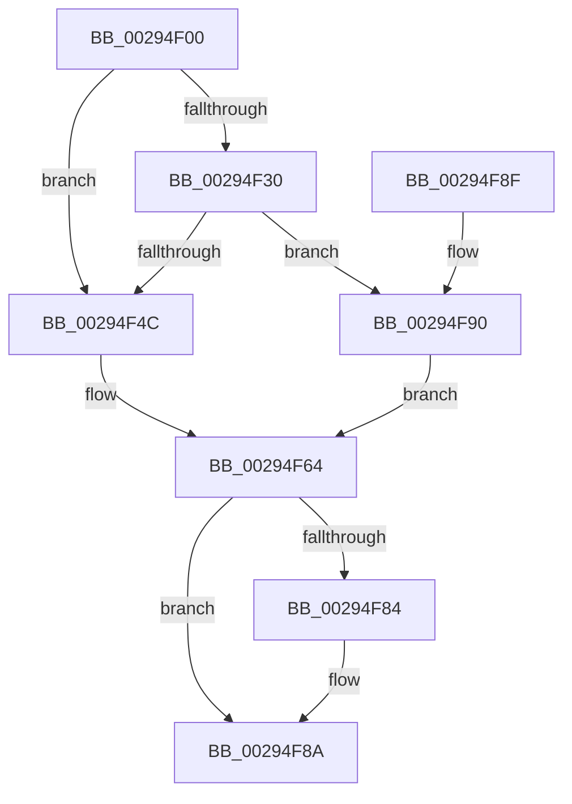

# MiInitializeTbFlushList

- RVA: `0x00294F00`–`0x00294F9B` (길이 `155` bytes)
- VA: `0x0000000140294F00`
- 실행 섹션: `.text`
- PDB 이름 있음: `예`; PDB Function 태그: `아니요`
- unwind 정보 RVA: `0x000DB714`
- 디코드: `43`개 명령, `155/155` bytes 표시
- 미해석 바이트: `0` (있으면 어셈블리에 `.byte`로 보존)

> 이 문서는 커널 이미지의 기계어와 PDB 기호를 분석해 생성했습니다. 4번과 5번은 함수 원형과 자료형을 바이너리 사용 방식에서 추정한 C 해석이며 원본 소스 복구 결과는 아닙니다.

## 1. Dependencies

- 직접 호출 지점: **0**; 고유 호출 대상: **0**
- 직접 호출자로 확인된 함수: **67**
- RIP 상대 이미지 참조: **0**

### Outgoing calls
- 직접 디코드된 call 명령이 없습니다.

### Direct callers
- [MmProtectMdlSystemAddress](../22/MmProtectMdlSystemAddress_function_00227B50.md) at `0x00227C49`
- [MiBuildForkPte](../22/MiBuildForkPte_function_0022E32C.md) at `0x0022EC16`
- [MmProtectPool](../26/MmProtectPool_function_002697AC.md) at `0x00269C69`
- [MiSetReadOnlyOnSectionView](MiSetReadOnlyOnSectionView_function_00294538.md) at `0x00294714`
- [NtGetWriteWatch](../2A/NtGetWriteWatch_function_002A7CE0.md) at `0x002A8512`
- [MiMoveDirtyBitsToPfns](../2A/MiMoveDirtyBitsToPfns_function_002A8624.md) at `0x002A8793`
- [MiUnlockOpportunisticPagesInPageTable](../2A/MiUnlockOpportunisticPagesInPageTable_function_002AA88C.md) at `0x002AA919`
- [MiReplaceRotateWithDemandZeroNoCopy](../2A/MiReplaceRotateWithDemandZeroNoCopy_function_002AAB04.md) at `0x002AAC26`
- [MiReplaceRotateWithDemandZeroNoCopy](../2A/MiReplaceRotateWithDemandZeroNoCopy_function_002AAB04.md) at `0x002AAC4C`
- [sub_002C1B88](../2C/Unknown_function_002C1B88.md) at `0x002C1CCF`
- [sub_002C1E57](../2C/Unknown_function_002C1E57.md) at `0x002C1EAB`
- [sub_002C3A7C](../2C/Unknown_function_002C3A7C.md) at `0x002C413E`
- [MiTrimSharedPageFromViews](../2E/MiTrimSharedPageFromViews_function_002E16F8.md) at `0x002E1B80`
- [MiTrimSharedPageFromViews](../2E/MiTrimSharedPageFromViews_function_002E16F8.md) at `0x002E1CA0`
- [MiTrimSharedPageFromViews](../2E/MiTrimSharedPageFromViews_function_002E16F8.md) at `0x002E200F`
- [MiSharePages](../31/MiSharePages_function_00315110.md) at `0x00315CB8`
- [MiFillSystemPtes](../31/MiFillSystemPtes_function_00319850.md) at `0x0031A194`
- [MiDecommitHardwareEnclavePages](../36/MiDecommitHardwareEnclavePages_function_003688D4.md) at `0x00368C0F`
- [MiLockCode](../36/MiLockCode_function_0036F91C.md) at `0x0036FF6F`
- [MiFlushValidPteFromTb](../37/MiFlushValidPteFromTb_function_00376878.md) at `0x003768C8`
- [MiSetSystemCodeProtection](../38/MiSetSystemCodeProtection_function_00384420.md) at `0x00384756`
- [MiUnmapMdlCommon](../3E/MiUnmapMdlCommon_function_003E7DF0.md) at `0x003E7F67`
- [MiLargePageFault](../3F/MiLargePageFault_function_003F01C4.md) at `0x003F02DE`
- [MiUnmapContiguousMemory](../3F/MiUnmapContiguousMemory_function_003F7908.md) at `0x003F7A7E`
- [MiConsumeSystemCacheTbFlushNeededView](../41/MiConsumeSystemCacheTbFlushNeededView_function_004193B4.md) at `0x00419461`
- [MiQueryVpabAccessedState](../42/MiQueryVpabAccessedState_function_00428E70.md) at `0x00428F5F`
- [MiDeprioritizeVirtualAddresses](../42/MiDeprioritizeVirtualAddresses_function_0042AD1C.md) at `0x0042B068`
- [sub_00436E60](../43/Unknown_function_00436E60.md) at `0x00436E83`
- [sub_0044565B](../44/Unknown_function_0044565B.md) at `0x00445786`
- [MiInitializeSystemPageTable](../45/MiInitializeSystemPageTable_function_00451C88.md) at `0x00451F8F`
- [MiClearPteAccessedBitRange](../45/MiClearPteAccessedBitRange_function_004520B8.md) at `0x0045218D`
- [MiRevokeExecutePte](../46/MiRevokeExecutePte_function_00460BA0.md) at `0x00460C94`
- [MiDeleteSystemPageTable](../49/MiDeleteSystemPageTable_function_004916B0.md) at `0x00491713`
- [MiConvertAndFlushWsleVas](../49/MiConvertAndFlushWsleVas_function_00492CB4.md) at `0x00492E0A`
- [MiReleaseLargePdeMappings](../49/MiReleaseLargePdeMappings_function_0049D0B0.md) at `0x0049D154`
- [MiMakeVaRangeNoAccess](../4A/MiMakeVaRangeNoAccess_function_004A3CE0.md) at `0x004A3D5A`
- [MiMapMemoryDumpMdl](../4A/MiMapMemoryDumpMdl_function_004A619C.md) at `0x004A625A`
- [MiSetPagingOfDriver](../4A/MiSetPagingOfDriver_function_004A76C4.md) at `0x004A794A`
- [MiUnmapKernelScp](../4A/MiUnmapKernelScp_function_004A82E8.md) at `0x004A8433`
- [MiAdjustSecureDriverStateForIatCapture](../4B/MiAdjustSecureDriverStateForIatCapture_function_004BE864.md) at `0x004BE957`
- [MiSwitchToTransition](../4C/MiSwitchToTransition_function_004C0F5C.md) at `0x004C1679`
- [MiReadyReservedView](../4C/MiReadyReservedView_function_004CC0D8.md) at `0x004CC180`
- [MiProtectAweRegion](../4C/MiProtectAweRegion_function_004CE62C.md) at `0x004CEC00`
- [MiMapMdlWithLargePages](../4D/MiMapMdlWithLargePages_function_004D10B8.md) at `0x004D12DD`
- [MiProtectEnclavePages](../4D/MiProtectEnclavePages_function_004D5528.md) at `0x004D59BE`
- [NtUnlockVirtualMemory](../4E/NtUnlockVirtualMemory_function_004EE890.md) at `0x004EECA7`
- [MiDecommitAddTbFlushEntries](../4F/MiDecommitAddTbFlushEntries_function_004FB798.md) at `0x004FB7F1`
- [MiPageBootRegistry](../66/MiPageBootRegistry_function_0066E82C.md) at `0x0066EA3A`
- [MiSetPageProtection](../67/MiSetPageProtection_function_00674BDC.md) at `0x00674C91`
- [MiStackTheftFreezeProcessors](../67/MiStackTheftFreezeProcessors_function_0067B274.md) at `0x0067B36D`
- [MiClearDriverTablePtes](../68/MiClearDriverTablePtes_function_00683024.md) at `0x006831A8`
- [MiFlushEnclaveTb](../68/MiFlushEnclaveTb_function_00686E10.md) at `0x00686E6F`
- [MiBuildPhysicalPageFreeChain](../68/MiBuildPhysicalPageFreeChain_function_00687C80.md) at `0x00687DFC`
- [MiGetAweFlushList](../68/MiGetAweFlushList_function_00688D34.md) at `0x00688D5A`
- [MiClearSystemAccessBits](../68/MiClearSystemAccessBits_function_0068A2A0.md) at `0x0068A36D`
- [MiDemoteValidLargePageOneLevel](../68/MiDemoteValidLargePageOneLevel_function_0068A3F4.md) at `0x0068A804`
- [MiWritePteHighLevel](../68/MiWritePteHighLevel_function_0068AA08.md) at `0x0068AA7D`
- [MiScrubLargeMappedPage](../69/MiScrubLargeMappedPage_function_00693E2C.md) at `0x006940B0`
- [MiCalibrateTbFlush](../69/MiCalibrateTbFlush_function_006955EC.md) at `0x0069565A`
- [sub_006D9212](../6D/Unknown_function_006D9212.md) at `0x006D9374`
- [sub_006D9212](../6D/Unknown_function_006D9212.md) at `0x006D942F`
- [sub_006DAFCA](../6D/Unknown_function_006DAFCA.md) at `0x006DB0FB`
- [sub_006DB6A6](../6D/Unknown_function_006DB6A6.md) at `0x006DB6DB`
- [sub_006DB77C](../6D/Unknown_function_006DB77C.md) at `0x006DB82E`
- [sub_006E362E](../6E/Unknown_function_006E362E.md) at `0x006E3671`
- [MiProtectLargeKernelHalRange](../../page/7F/MiProtectLargeKernelHalRange_function_007F8D20.md) at `0x007F8E46`
- [MmDeleteShadowMapping](../../page/80/MmDeleteShadowMapping_function_00807D00.md) at `0x00807DA0`
- [MiEliminateZeroPages](../../page/8C/MiEliminateZeroPages_function_008CF1A0.md) at `0x008CF207`
- [MmUnmapProtectedKernelPageRange](../../page/AA/MmUnmapProtectedKernelPageRange_function_00AA36DC.md) at `0x00AA3744`
- [MiMarkBootKernelStack](../../init/C6/MiMarkBootKernelStack_function_00C68244.md) at `0x00C683AC`
- [MiFreeBootDriverPages](../../init/C7/MiFreeBootDriverPages_function_00C7695C.md) at `0x00C769FA`

### Static image references
- 디코드된 RIP-relative 메모리 참조가 없습니다.

## 2. Other-region calls and transfers

- 다른 실행 섹션으로 향하는 call: **0**
- 별도 외부 분기/꼬리 이동을 확인하지 못했습니다.

## 3. Assembly (complete function range)

```asm
00294F00  8B 44 24 28                     mov eax, dword ptr [rsp + 0x28]
00294F04  4C 8B D2                        mov r10, rdx
00294F07  89 41 14                        mov dword ptr [rcx + 0x14], eax
00294F0A  44 89 41 0C                     mov dword ptr [rcx + 0xc], r8d
00294F0E  44 89 49 10                     mov dword ptr [rcx + 0x10], r9d
00294F12  48 89 11                        mov qword ptr [rcx], rdx
00294F15  8B 82 B8 00 00 00               mov eax, dword ptr [rdx + 0xb8]
00294F1B  C1 E8 08                        shr eax, 8
00294F1E  C0 E8 03                        shr al, 3
00294F21  24 01                           and al, 1
00294F23  88 41 18                        mov byte ptr [rcx + 0x18], al
00294F26  8B 82 B8 00 00 00               mov eax, dword ptr [rdx + 0xb8]
00294F2C  A8 0F                           test al, 0xf
00294F2E  75 1C                           jne 0x140294f4c
00294F30  65 48 8B 04 25 88 01 00 00      mov rax, qword ptr gs:[0x188]
00294F39  48 8B 90 B8 00 00 00            mov rdx, qword ptr [rax + 0xb8]
00294F40  48 81 C2 00 04 00 00            add rdx, 0x400
00294F47  4C 3B D2                        cmp r10, rdx
00294F4A  75 44                           jne 0x140294f90
00294F4C  41 8B 82 B8 00 00 00            mov eax, dword ptr [r10 + 0xb8]
00294F53  33 D2                           xor edx, edx
00294F55  A8 0F                           test al, 0xf
00294F57  41 BA 01 00 00 00               mov r10d, 1
00294F5D  44 8B C2                        mov r8d, edx
00294F60  45 0F 44 C2                     cmove r8d, r10d
00294F64  8B 41 10                        mov eax, dword ptr [rcx + 0x10]
00294F67  83 E0 DB                        and eax, 0xffffffdb
00294F6A  44 89 41 08                     mov dword ptr [rcx + 8], r8d
00294F6E  66 C7 41 19 00 00               mov word ptr [rcx + 0x19], 0
00294F74  89 51 1C                        mov dword ptr [rcx + 0x1c], edx
00294F77  48 89 51 20                     mov qword ptr [rcx + 0x20], rdx
00294F7B  89 41 10                        mov dword ptr [rcx + 0x10], eax
00294F7E  41 F6 C1 04                     test r9b, 4
00294F82  74 06                           je 0x140294f8a
00294F84  83 C8 04                        or eax, 4
00294F87  89 41 10                        mov dword ptr [rcx + 0x10], eax
00294F8A  48 89 51 28                     mov qword ptr [rcx + 0x28], rdx
00294F8E  C3                              ret
00294F8F  CC                              int3
00294F90  33 D2                           xor edx, edx
00294F92  83 49 10 09                     or dword ptr [rcx + 0x10], 9
00294F96  44 8B C2                        mov r8d, edx
00294F99  EB C9                           jmp 0x140294f64
```

## 4. C-style interpretation (structured pseudocode)

```c
__int64 __fastcall MiInitializeTbFlushList(__int64 a1, __int64 a2, int a3, int a4, unsigned int a5)
{
    __int64 result;

    *(unsigned int *)(a1 + 20) = (unsigned int)((unsigned int)(a5));
    *(unsigned int *)(a1 + 12) = a3;
    *(unsigned int *)(a1 + 16) = a4;
    *(unsigned __int64 *)(a1) = a2;
    result = (unsigned int)(((unsigned int)(*(unsigned int *)(a2 + 184))) >> (8));
    result = (unsigned __int8)((result) >> (3));
    result = (unsigned __int8)((result) & (1));
    *(unsigned __int8 *)(a1 + 24) = (unsigned __int8)(result);
    if ((((unsigned __int8)((unsigned int)(*(unsigned int *)(a2 + 184)))) & (15)) != 0) goto loc_00294F4C;
    a2 = (*(unsigned __int64 *)(*(unsigned __int64 *)(gs_base + (0 + 392)) + 184)) + (0x400ULL);
    if (a2 != a2) goto loc_00294F90;
loc_00294F4C:
    a2 = 0;
    a3 = 0;
    if ((((unsigned __int8)((unsigned int)(*(unsigned int *)(a2 + 184)))) & (15)) == 0) { a3 = 1; }
loc_00294F64:
    result = (unsigned int)(((unsigned int)(*(unsigned int *)(a1 + 16))) & (0xFFFFFFDBULL));
    *(unsigned int *)(a1 + 8) = a3;
    *(unsigned __int16 *)(a1 + 25) = 0;
    *(unsigned int *)(a1 + 28) = 0;
    *(unsigned __int64 *)(a1 + 32) = 0;
    *(unsigned int *)(a1 + 16) = (unsigned int)(result);
    if ((((unsigned __int8)(a4)) & (4)) != 0) {
        result = (unsigned int)((result) | (4));
        *(unsigned int *)(a1 + 16) = (unsigned int)(result);
    }
    *(unsigned __int64 *)(a1 + 40) = 0;
    return result;
loc_00294F90:
    a2 = 0;
    goto loc_00294F64;
}
```

## 5. (Beta) C Style

```c
int64_t MiInitializeTbFlushList(void *Arg1, void *Arg2, int32_t Arg3, int32_t Arg4, uint32_t Arg5)
{
    uint8_t *arg1 = (uint8_t *)Arg1;
    uint8_t *arg2 = (uint8_t *)Arg2;

    int64_t result;

    *(uint32_t *)(arg1 + 0x14) = (uint32_t)((uint32_t)(Arg5));
    *(uint32_t *)(arg1 + 0xC) = Arg3;
    *(uint32_t *)(arg1 + 0x10) = Arg4;
    *(void **)(arg1) = Arg2;
    result = (uint32_t)(((uint32_t)(*(uint32_t *)(arg2 + 0xB8))) >> (8));
    result = (uint8_t)((result) >> (3));
    result = (uint8_t)((result) & (1));
    *(uint8_t *)(arg1 + 0x18) = (uint8_t)(result);
    if ((((uint8_t)((uint32_t)(*(uint32_t *)(arg2 + 0xB8)))) & (15)) != 0) goto loc_00294F4C;
    Arg2 = (*(uint64_t *)(*(uint64_t *)(gs_base + (0 + 0x188)) + 0xB8)) + (0x400ULL);
    if (Arg2 != Arg2) goto loc_00294F90;
loc_00294F4C:
    Arg2 = 0;
    Arg3 = 0;
    if ((((uint8_t)((uint32_t)(*(uint32_t *)(arg2 + 0xB8)))) & (15)) == 0) { Arg3 = 1; }
loc_00294F64:
    result = (uint32_t)(((uint32_t)(*(uint32_t *)(arg1 + 0x10))) & (0xFFFFFFDBULL));
    *(uint32_t *)(arg1 + 0x8) = Arg3;
    *(uint16_t *)(arg1 + 0x19) = 0;
    *(uint32_t *)(arg1 + 0x1C) = 0;
    *(uint64_t *)(arg1 + 0x20) = 0;
    *(uint32_t *)(arg1 + 0x10) = (uint32_t)(result);
    if ((((uint8_t)(Arg4)) & (4)) != 0) {
        result = (uint32_t)((result) | (4));
        *(uint32_t *)(arg1 + 0x10) = (uint32_t)(result);
    }
    *(uint64_t *)(arg1 + 0x28) = 0;
    return result;
loc_00294F90:
    Arg2 = 0;
    goto loc_00294F64;
}
```

### 관측된 메모리 오프셋

구조체 형식이 확인되지 않은 접근은 인자 기준의 오프셋으로만 기록했습니다.

| 기준 인자 | 오프셋 표현 | 폭 (bit) | 접근 |
|---|---:|---:|---|
| `Arg1` | `+ 0x0` | `64` | `W` |
| `Arg1` | `+ 0x8` | `32` | `W` |
| `Arg1` | `+ 0xC` | `32` | `W` |
| `Arg1` | `+ 0x10` | `32` | `R` |
| `Arg1` | `+ 0x10` | `32` | `R/W` |
| `Arg1` | `+ 0x10` | `32` | `W` |
| `Arg1` | `+ 0x14` | `32` | `W` |
| `Arg1` | `+ 0x18` | `8` | `W` |
| `Arg1` | `+ 0x19` | `16` | `W` |
| `Arg1` | `+ 0x1C` | `32` | `W` |
| `Arg1` | `+ 0x20` | `64` | `W` |
| `Arg1` | `+ 0x28` | `64` | `W` |
| `Arg2` | `+ 0xB8` | `32` | `R` |

## 6. Execution-region graph

[열기: 2D/3D 그래프와 함수 탐색 컨트롤 패널](../../../control-panel.html?section=text&rva=0x00294F00&view=graph)

- 2D 그래프는 위에서 아래로 흐르고, 3D 그래프는 빈 공간을 드래그해 회전합니다. Shift+드래그는 이동, 휠은 확대·축소, 함수 노드 선택은 대상 보고서 이동입니다.

### Static fallback


