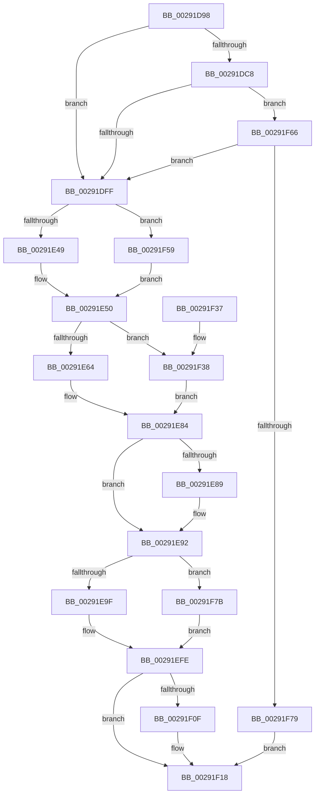

# MiInsertActivePageTableLinksTail

- RVA: `0x00291D98`–`0x00291F9F` (길이 `519` bytes)
- VA: `0x0000000140291D98`
- 실행 섹션: `.text`
- PDB 이름 있음: `예`; PDB Function 태그: `아니요`
- unwind 정보 RVA: `0x00067500`
- 디코드: `131`개 명령, `519/519` bytes 표시
- 미해석 바이트: `0` (있으면 어셈블리에 `.byte`로 보존)

> 이 문서는 커널 이미지의 기계어와 PDB 기호를 분석해 생성했습니다. 4번과 5번은 함수 원형과 자료형을 바이너리 사용 방식에서 추정한 C 해석이며 원본 소스 복구 결과는 아닙니다.

## 1. Dependencies

- 직접 호출 지점: **2**; 고유 호출 대상: **2**
- 직접 호출자로 확인된 함수: **5**
- RIP 상대 이미지 참조: **0**

### Outgoing calls
- `0x00291E8D` → [ExAcquireSpinLockExclusiveAtDpcLevel](../24/ExAcquireSpinLockExclusiveAtDpcLevel_function_00248E80.md) (function, `0x00248E80`)
- `0x00291F13` → [ExReleaseSpinLockExclusiveFromDpcLevel](../24/ExReleaseSpinLockExclusiveFromDpcLevel_function_002497E0.md) (function, `0x002497E0`)

### Direct callers
- [MiAddWorkingSetEntries](../27/MiAddWorkingSetEntries_function_0027DC00.md) at `0x0027DFD9`
- [MiSetVaAgeList](MiSetVaAgeList_function_00290A20.md) at `0x00290F6A`
- [MiSetVaAgeList](MiSetVaAgeList_function_00290A20.md) at `0x0029116A`
- [sub_00291A10](Unknown_function_00291A10.md) at `0x00291BB8`
- [sub_00292218](Unknown_function_00292218.md) at `0x00292548`
- [MiSetPfnOldestWsleLeafAge](MiSetPfnOldestWsleLeafAge_function_00293AC4.md) at `0x00293B3A`

### Static image references
- 디코드된 RIP-relative 메모리 참조가 없습니다.

## 2. Other-region calls and transfers

- 다른 실행 섹션으로 향하는 call: **0**
- 별도 외부 분기/꼬리 이동을 확인하지 못했습니다.

## 3. Assembly (complete function range)

```asm
00291D98  48 8B C4                        mov rax, rsp
00291D9B  48 89 58 08                     mov qword ptr [rax + 8], rbx
00291D9F  48 89 68 10                     mov qword ptr [rax + 0x10], rbp
00291DA3  48 89 70 18                     mov qword ptr [rax + 0x18], rsi
00291DA7  48 89 78 20                     mov qword ptr [rax + 0x20], rdi
00291DAB  41 54                           push r12
00291DAD  41 56                           push r14
00291DAF  41 57                           push r15
00291DB1  48 83 EC 20                     sub rsp, 0x20
00291DB5  8B 81 B8 00 00 00               mov eax, dword ptr [rcx + 0xb8]
00291DBB  45 8B F1                        mov r14d, r9d
00291DBE  48 8B FA                        mov rdi, rdx
00291DC1  4C 8B C9                        mov r9, rcx
00291DC4  A8 0F                           test al, 0xf
00291DC6  74 37                           je 0x140291dff
00291DC8  48 8B 52 08                     mov rdx, qword ptr [rdx + 8]
00291DCC  48 B9 00 00 00 00 80 F6 FF FF   movabs rcx, 0xfffff68000000000
00291DD6  48 8B C1                        mov rax, rcx
00291DD9  48 C1 E2 19                     shl rdx, 0x19
00291DDD  48 C1 E0 19                     shl rax, 0x19
00291DE1  48 2B D0                        sub rdx, rax
00291DE4  48 C1 FA 10                     sar rdx, 0x10
00291DE8  48 C1 E2 19                     shl rdx, 0x19
00291DEC  48 2B D0                        sub rdx, rax
00291DEF  48 C1 FA 10                     sar rdx, 0x10
00291DF3  48 8B C1                        mov rax, rcx
00291DF6  48 3B D0                        cmp rdx, rax
00291DF9  0F 83 67 01 00 00               jae 0x140291f66
00291DFF  41 0F B6 C0                     movzx eax, r8b
00291E03  49 BF 00 00 00 00 00 DE FF FF   movabs r15, 0xffffde0000000000
00291E0D  48 8D 0C 40                     lea rcx, [rax + rax*2]
00291E11  49 8B 41 10                     mov rax, qword ptr [r9 + 0x10]
00291E15  48 8D 34 C8                     lea rsi, [rax + rcx*8]
00291E19  49 8B C7                        mov rax, r15
00291E1C  8B 5F 24                        mov ebx, dword ptr [rdi + 0x24]
00291E1F  48 8B EF                        mov rbp, rdi
00291E22  48 2B E8                        sub rbp, rax
00291E25  49 BC AB AA AA AA AA AA AA AA   movabs r12, 0xaaaaaaaaaaaaaaab
00291E2F  8B 47 24                        mov eax, dword ptr [rdi + 0x24]
00291E32  41 B8 00 00 00 04               mov r8d, 0x4000000
00291E38  48 C1 FD 04                     sar rbp, 4
00291E3C  49 0F AF EC                     imul rbp, r12
00291E40  41 85 C0                        test r8d, eax
00291E43  0F 84 10 01 00 00               je 0x140291f59
00291E49  48 8B 0F                        mov rcx, qword ptr [rdi]
00291E4C  48 C1 E9 20                     shr rcx, 0x20
00291E50  41 0B D8                        or ebx, r8d
00291E53  8B D1                           mov edx, ecx
00291E55  89 5F 24                        mov dword ptr [rdi + 0x24], ebx
00291E58  8B 47 24                        mov eax, dword ptr [rdi + 0x24]
00291E5B  41 85 C0                        test r8d, eax
00291E5E  0F 84 D4 00 00 00               je 0x140291f38
00291E64  48 8B 07                        mov rax, qword ptr [rdi]
00291E67  48 C1 E2 20                     shl rdx, 0x20
00291E6B  48 8B CA                        mov rcx, rdx
00291E6E  48 33 C8                        xor rcx, rax
00291E71  48 B8 FF FF FF FF 00 FC FF FF   movabs rax, 0xfffffc00ffffffff
00291E7B  48 23 C8                        and rcx, rax
00291E7E  48 33 CA                        xor rcx, rdx
00291E81  48 89 0F                        mov qword ptr [rdi], rcx
00291E84  45 85 F6                        test r14d, r14d
00291E87  75 09                           jne 0x140291e92
00291E89  48 8D 4E 40                     lea rcx, [rsi + 0x40]
00291E8D  E8 EE 6F FB FF                  call 0x140248e80
00291E92  4C 8B 46 50                     mov r8, qword ptr [rsi + 0x50]
00291E96  4D 85 C0                        test r8, r8
00291E99  0F 84 DC 00 00 00               je 0x140291f7b
00291E9F  49 8B C7                        mov rax, r15
00291EA2  49 8B D0                        mov rdx, r8
00291EA5  48 8B CD                        mov rcx, rbp
00291EA8  48 2B D0                        sub rdx, rax
00291EAB  49 8B 40 10                     mov rax, qword ptr [r8 + 0x10]
00291EAF  48 33 C8                        xor rcx, rax
00291EB2  48 C1 FA 04                     sar rdx, 4
00291EB6  49 0F AF D4                     imul rdx, r12
00291EBA  48 B8 00 00 00 00 00 FF FF FF   movabs rax, 0xffffff0000000000
00291EC4  48 23 C8                        and rcx, rax
00291EC7  48 33 CD                        xor rcx, rbp
00291ECA  49 89 48 10                     mov qword ptr [r8 + 0x10], rcx
00291ECE  48 B9 FF FF FF FF 3F 00 00 00   movabs rcx, 0x3fffffffff
00291ED8  48 8B 47 10                     mov rax, qword ptr [rdi + 0x10]
00291EDC  48 8B C2                        mov rax, rdx
00291EDF  48 25 FF 3F FF FF               and rax, 0xffffffffffff3fff
00291EE5  48 C1 E0 18                     shl rax, 0x18
00291EE9  48 0B C1                        or rax, rcx
00291EEC  48 89 47 10                     mov qword ptr [rdi + 0x10], rax
00291EF0  8B C2                           mov eax, edx
00291EF2  33 C3                           xor eax, ebx
00291EF4  25 00 00 FF FF                  and eax, 0xffff0000
00291EF9  33 C2                           xor eax, edx
00291EFB  89 47 24                        mov dword ptr [rdi + 0x24], eax
00291EFE  48 89 7E 50                     mov qword ptr [rsi + 0x50], rdi
00291F02  8B 46 44                        mov eax, dword ptr [rsi + 0x44]
00291F05  FF C0                           inc eax
00291F07  89 46 44                        mov dword ptr [rsi + 0x44], eax
00291F0A  45 85 F6                        test r14d, r14d
00291F0D  75 09                           jne 0x140291f18
00291F0F  48 8D 4E 40                     lea rcx, [rsi + 0x40]
00291F13  E8 C8 78 FB FF                  call 0x1402497e0
00291F18  48 8B 5C 24 40                  mov rbx, qword ptr [rsp + 0x40]
00291F1D  48 8B 6C 24 48                  mov rbp, qword ptr [rsp + 0x48]
00291F22  48 8B 74 24 50                  mov rsi, qword ptr [rsp + 0x50]
00291F27  48 8B 7C 24 58                  mov rdi, qword ptr [rsp + 0x58]
00291F2C  48 83 C4 20                     add rsp, 0x20
00291F30  41 5F                           pop r15
00291F32  41 5E                           pop r14
00291F34  41 5C                           pop r12
00291F36  C3                              ret
00291F37  CC                              int3
00291F38  48 8B 47 10                     mov rax, qword ptr [rdi + 0x10]
00291F3C  48 C1 E2 10                     shl rdx, 0x10
00291F40  48 8B CA                        mov rcx, rdx
00291F43  48 33 C8                        xor rcx, rax
00291F46  48 81 E1 FF FF 00 FC            and rcx, 0xfffffffffc00ffff
00291F4D  48 33 CA                        xor rcx, rdx
00291F50  48 89 4F 10                     mov qword ptr [rdi + 0x10], rcx
00291F54  E9 2B FF FF FF                  jmp 0x140291e84
00291F59  48 8B 4F 10                     mov rcx, qword ptr [rdi + 0x10]
00291F5D  48 C1 E9 10                     shr rcx, 0x10
00291F61  E9 EA FE FF FF                  jmp 0x140291e50
00291F66  48 B8 FF FF FF FF FF F6 FF FF   movabs rax, 0xfffff6ffffffffff
00291F70  48 3B D0                        cmp rdx, rax
00291F73  0F 87 86 FE FF FF               ja 0x140291dff
00291F79  EB 9D                           jmp 0x140291f18
00291F7B  48 8B 47 10                     mov rax, qword ptr [rdi + 0x10]
00291F7F  81 CB FF FF 00 00               or ebx, 0xffff
00291F85  48 B8 FF FF FF FF 3F FF FF FF   movabs rax, 0xffffff3fffffffff
00291F8F  48 89 47 10                     mov qword ptr [rdi + 0x10], rax
00291F93  89 5F 24                        mov dword ptr [rdi + 0x24], ebx
00291F96  48 89 7E 48                     mov qword ptr [rsi + 0x48], rdi
00291F9A  E9 5F FF FF FF                  jmp 0x140291efe
```

## 4. C-style interpretation (structured pseudocode)

```c
__int64 __fastcall MiInsertActivePageTableLinksTail(__int64 a1, __int64 a2, unsigned __int8 a3, int a4)
{
    __int64 result;
    __int64 v_rbp;
    __int64 v_rbx;
    __int64 v_rsp;
    unsigned __int64 v_stack_p10;
    unsigned __int64 v_stack_p18;
    unsigned __int64 v_stack_p20;
    unsigned __int64 v_stack_p8;

    *(unsigned __int64 *)(v_rsp + 8) = v_rbx;
    *(unsigned __int64 *)(v_rsp + 16) = v_rbp;
    *(unsigned __int64 *)(v_rsp + 24) = v_rsi;
    *(unsigned __int64 *)(v_rsp + 32) = v_rdi;
    v_rsp = (v_rsp) - (32);
    if ((((unsigned __int8)((unsigned int)(*(unsigned int *)(a1 + 184)))) & (15)) == 0) goto loc_00291DFF;
    a2 = (*(unsigned __int64 *)(a2 + 8)) << (25);
    result = (a1) << (25);
    a2 = (a2) - (result);
    a2 = (a2) >> (16);
    a2 = (a2) << (25);
    a2 = (a2) - (result);
    a2 = (a2) >> (16);
    if (a2 >= a1) goto loc_00291F66;
loc_00291DFF:
    v_rbp = (a2) - (v_r15);
    v_rbp = (v_rbp) >> (4);
    v_rbp = (v_rbp) * (v_r12);
    if ((((unsigned int)((unsigned int)(0x4000000ULL))) & ((unsigned int)((unsigned int)(*(unsigned int *)(a2 + 36))))) == 0) goto loc_00291F59;
    a1 = (*(unsigned __int64 *)(a2)) >> (32);
loc_00291E50:
    v_rbx = (unsigned int)(((unsigned int)(*(unsigned int *)(a2 + 36))) | ((unsigned int)((unsigned int)(0x4000000ULL))));
    *(unsigned int *)(a2 + 36) = (unsigned int)(v_rbx);
    if ((((unsigned int)((unsigned int)(0x4000000ULL))) & ((unsigned int)((unsigned int)(*(unsigned int *)(a2 + 36))))) == 0) goto loc_00291F38;
    a2 = ((unsigned int)((unsigned int)(a1))) << (32);
    a1 = (a2) ^ (*(unsigned __int64 *)(a2));
    a1 = (a1) & (*(unsigned __int64 *)(a2));
    a1 = (a1) ^ (a2);
    *(unsigned __int64 *)(a2) = a1;
loc_00291E84:
    result = *(unsigned __int64 *)(a2);
    if ((unsigned int)((unsigned int)(a4)) == 0) {
        a1 = *(unsigned __int64 *)(a1 + 16) + a3 + a3 * 2 * 8 + 64;
        result = ExAcquireSpinLockExclusiveAtDpcLevel(a1, a2, (unsigned int)(0x4000000ULL), a1);
    }
    if (*(unsigned __int64 *)(*(unsigned __int64 *)(a1 + 16) + a3 + a3 * 2 * 8 + 80) == 0) goto loc_00291F7B;
    a2 = (*(unsigned __int64 *)(*(unsigned __int64 *)(a1 + 16) + a3 + a3 * 2 * 8 + 80)) - (v_r15);
    a1 = (v_rbp) ^ (*(unsigned __int64 *)(*(unsigned __int64 *)(*(unsigned __int64 *)(a1 + 16) + a3 + a3 * 2 * 8 + 80) + 16));
    a2 = (a2) >> (4);
    a2 = (a2) * (v_r12);
    a1 = (a1) & (*(unsigned __int64 *)(*(unsigned __int64 *)(*(unsigned __int64 *)(a1 + 16) + a3 + a3 * 2 * 8 + 80) + 16));
    a1 = (a1) ^ (v_rbp);
    *(unsigned __int64 *)(*(unsigned __int64 *)(*(unsigned __int64 *)(a1 + 16) + a3 + a3 * 2 * 8 + 80) + 16) = a1;
    result = (a2) & (0xFFFFFFFFFFFF3FFFULL);
    result = (result) << (24);
    result = (result) | (a1);
    *(unsigned __int64 *)(a2 + 16) = result;
    result = (unsigned int)(((unsigned int)((unsigned int)(a2))) ^ ((unsigned int)(v_rbx)));
    result = (unsigned int)((result) & (0xFFFF0000ULL));
    result = (unsigned int)((result) ^ ((unsigned int)(a2)));
    *(unsigned int *)(a2 + 36) = (unsigned int)(result);
loc_00291EFE:
    *(unsigned __int64 *)(*(unsigned __int64 *)(a1 + 16) + a3 + a3 * 2 * 8 + 80) = a2;
    result = (unsigned int)(((unsigned int)(*(unsigned int *)(*(unsigned __int64 *)(a1 + 16) + a3 + a3 * 2 * 8 + 68))) + 1);
    *(unsigned int *)(*(unsigned __int64 *)(a1 + 16) + a3 + a3 * 2 * 8 + 68) = (unsigned int)(result);
    if ((unsigned int)((unsigned int)(a4)) == 0) {
        a1 = *(unsigned __int64 *)(a1 + 16) + a3 + a3 * 2 * 8 + 64;
        result = ExReleaseSpinLockExclusiveFromDpcLevel(a1, a2, *(unsigned __int64 *)(*(unsigned __int64 *)(a1 + 16) + a3 + a3 * 2 * 8 + 80), a1);
    }
    v_rsp = (v_rsp) + (32);
    return result;
loc_00291F38:
    a2 = (a2) << (16);
    a1 = (a2) ^ (*(unsigned __int64 *)(v_stack_p20 + 16));
    a1 = (a1) & (0xFFFFFFFFFC00FFFFULL);
    a1 = (a1) ^ (a2);
    *(unsigned __int64 *)(v_stack_p20 + 16) = a1;
    goto loc_00291E84;
loc_00291F59:
    a1 = (*(unsigned __int64 *)(v_stack_p20 + 16)) >> (16);
    goto loc_00291E50;
loc_00291F66:
    if (a2 > (*(unsigned __int64 *)(v_stack_p20 + 16))) goto loc_00291DFF;
    goto loc_00291F18;
loc_00291F7B:
    v_rbx = (unsigned int)((v_stack_p8) | (0xFFFFULL));
    *(unsigned __int64 *)(v_stack_p20 + 16) = *(unsigned __int64 *)(v_stack_p20 + 16);
    *(unsigned int *)(v_stack_p20 + 36) = (unsigned int)(v_rbx);
    *(unsigned __int64 *)(v_stack_p18 + 72) = v_stack_p20;
    goto loc_00291EFE;
}
```

## 5. (Beta) C Style

```c
int64_t MiInsertActivePageTableLinksTail(void *Arg1, void *Arg2, void *Arg3, int32_t Arg4)
{
    uint8_t *arg1 = (uint8_t *)Arg1;
    uint8_t *arg2 = (uint8_t *)Arg2;
    uint8_t *arg3 = (uint8_t *)Arg3;

    int64_t result;
    int64_t local_rbp;
    int64_t local_rbx;
    int64_t local_rsp;
    uint64_t v_stack_p10;
    uint64_t v_stack_p18;
    uint64_t v_stack_p20;
    uint64_t v_stack_p8;

    *(uint64_t *)(local_rsp + 0x8) = local_rbx;
    *(uint64_t *)(local_rsp + 0x10) = local_rbp;
    *(uint64_t *)(local_rsp + 0x18) = local_rsi;
    *(uint64_t *)(local_rsp + 0x20) = local_rdi;
    local_rsp = (local_rsp) - (32);
    if ((((uint8_t)((uint32_t)(*(uint32_t *)(arg1 + 0xB8)))) & (15)) == 0) goto loc_00291DFF;
    Arg2 = (*(uint64_t *)(arg2 + 0x8)) << (25);
    result = (Arg1) << (25);
    Arg2 = (Arg2) - (result);
    Arg2 = (Arg2) >> (16);
    Arg2 = (Arg2) << (25);
    Arg2 = (Arg2) - (result);
    Arg2 = (Arg2) >> (16);
    if (Arg2 >= Arg1) goto loc_00291F66;
loc_00291DFF:
    local_rbp = (Arg2) - (local_r15);
    local_rbp = (local_rbp) >> (4);
    local_rbp = (local_rbp) * (local_r12);
    if ((((uint32_t)((uint32_t)(0x4000000ULL))) & ((uint32_t)((uint32_t)(*(uint32_t *)(arg2 + 0x24))))) == 0) goto loc_00291F59;
    Arg1 = (*(uint64_t *)(arg2)) >> (32);
loc_00291E50:
    local_rbx = (uint32_t)(((uint32_t)(*(uint32_t *)(arg2 + 0x24))) | ((uint32_t)((uint32_t)(0x4000000ULL))));
    *(uint32_t *)(arg2 + 0x24) = (uint32_t)(local_rbx);
    if ((((uint32_t)((uint32_t)(0x4000000ULL))) & ((uint32_t)((uint32_t)(*(uint32_t *)(arg2 + 0x24))))) == 0) goto loc_00291F38;
    Arg2 = ((uint32_t)((uint32_t)(Arg1))) << (32);
    Arg1 = (Arg2) ^ (*(uint64_t *)(arg2));
    Arg1 = (Arg1) & (*(uint64_t *)(arg2));
    Arg1 = (Arg1) ^ (Arg2);
    *(void **)(arg2) = Arg1;
loc_00291E84:
    result = *(uint64_t *)(arg2);
    if ((uint32_t)((uint32_t)(Arg4)) == 0) {
        Arg1 = *(uint64_t *)(arg1 + 0x10) + Arg3 + Arg3 * 2 * 8 + 64;
        result = ExAcquireSpinLockExclusiveAtDpcLevel(Arg1, Arg2, (uint32_t)(0x4000000ULL), Arg1);
    }
    if (*(uint64_t *)(*(uint64_t *)(arg1 + 0x10) + arg3 + arg3 * 2 * 8 + 0x50) == 0) goto loc_00291F7B;
    Arg2 = (*(uint64_t *)(*(uint64_t *)(arg1 + 0x10) + arg3 + arg3 * 2 * 8 + 0x50)) - (local_r15);
    Arg1 = (local_rbp) ^ (*(uint64_t *)(*(uint64_t *)(*(uint64_t *)(arg1 + 0x10) + arg3 + arg3 * 2 * 8 + 0x50) + 0x10));
    Arg2 = (Arg2) >> (4);
    Arg2 = (Arg2) * (local_r12);
    Arg1 = (Arg1) & (*(uint64_t *)(*(uint64_t *)(*(uint64_t *)(arg1 + 0x10) + arg3 + arg3 * 2 * 8 + 0x50) + 0x10));
    Arg1 = (Arg1) ^ (local_rbp);
    *(void **)(*(uint64_t *)(*(uint64_t *)(arg1 + 0x10) + arg3 + arg3 * 2 * 8 + 0x50) + 0x10) = Arg1;
    result = (Arg2) & (0xFFFFFFFFFFFF3FFFULL);
    result = (result) << (24);
    result = (result) | (Arg1);
    *(uint64_t *)(arg2 + 0x10) = result;
    result = (uint32_t)(((uint32_t)((uint32_t)(Arg2))) ^ ((uint32_t)(local_rbx)));
    result = (uint32_t)((result) & (0xFFFF0000ULL));
    result = (uint32_t)((result) ^ ((uint32_t)(Arg2)));
    *(uint32_t *)(arg2 + 0x24) = (uint32_t)(result);
loc_00291EFE:
    *(void **)(*(uint64_t *)(arg1 + 0x10) + arg3 + arg3 * 2 * 8 + 0x50) = Arg2;
    result = (uint32_t)(((uint32_t)(*(uint32_t *)(*(uint64_t *)(arg1 + 0x10) + arg3 + arg3 * 2 * 8 + 0x44))) + 1);
    *(uint32_t *)(*(uint64_t *)(arg1 + 0x10) + arg3 + arg3 * 2 * 8 + 0x44) = (uint32_t)(result);
    if ((uint32_t)((uint32_t)(Arg4)) == 0) {
        Arg1 = *(uint64_t *)(arg1 + 0x10) + Arg3 + Arg3 * 2 * 8 + 64;
        result = ExReleaseSpinLockExclusiveFromDpcLevel(Arg1, Arg2, *(uint64_t *)(*(uint64_t *)(arg1 + 0x10) + arg3 + arg3 * 2 * 8 + 0x50), Arg1);
    }
    local_rsp = (local_rsp) + (32);
    return result;
loc_00291F38:
    Arg2 = (Arg2) << (16);
    Arg1 = (Arg2) ^ (*(uint64_t *)(v_stack_p20 + 0x10));
    Arg1 = (Arg1) & (0xFFFFFFFFFC00FFFFULL);
    Arg1 = (Arg1) ^ (Arg2);
    *(void **)(v_stack_p20 + 0x10) = Arg1;
    goto loc_00291E84;
loc_00291F59:
    Arg1 = (*(uint64_t *)(v_stack_p20 + 0x10)) >> (16);
    goto loc_00291E50;
loc_00291F66:
    if (Arg2 > (*(uint64_t *)(v_stack_p20 + 0x10))) goto loc_00291DFF;
    goto loc_00291F18;
loc_00291F7B:
    local_rbx = (uint32_t)((v_stack_p8) | (0xFFFFULL));
    *(uint64_t *)(v_stack_p20 + 0x10) = *(uint64_t *)(v_stack_p20 + 0x10);
    *(uint32_t *)(v_stack_p20 + 0x24) = (uint32_t)(local_rbx);
    *(uint64_t *)(v_stack_p18 + 0x48) = v_stack_p20;
    goto loc_00291EFE;
}
```

### 관측된 메모리 오프셋

구조체 형식이 확인되지 않은 접근은 인자 기준의 오프셋으로만 기록했습니다.

| 기준 인자 | 오프셋 표현 | 폭 (bit) | 접근 |
|---|---:|---:|---|
| `Arg1` | `+ 0x10` | `64` | `R` |
| `Arg1` | `+ 0xB8` | `32` | `R` |
| `Arg2` | `+ 0x0` | `64` | `R` |
| `Arg2` | `+ 0x0` | `64` | `W` |
| `Arg2` | `+ 0x8` | `64` | `R` |
| `Arg2` | `+ 0x10` | `64` | `R` |
| `Arg2` | `+ 0x10` | `64` | `W` |
| `Arg2` | `+ 0x24` | `32` | `R` |
| `Arg2` | `+ 0x24` | `32` | `W` |
| `Arg3` | `+ 0x0 + rax*2` | `64` | `R` |

## 6. Execution-region graph

[열기: 2D/3D 그래프와 함수 탐색 컨트롤 패널](../../../control-panel.html?section=text&rva=0x00291D98&view=graph)

- 2D 그래프는 위에서 아래로 흐르고, 3D 그래프는 빈 공간을 드래그해 회전합니다. Shift+드래그는 이동, 휠은 확대·축소, 함수 노드 선택은 대상 보고서 이동입니다.

### Static fallback


