# MiIssueAsynchronousFlush

- RVA: `0x00299898`–`0x00299BFF` (길이 `871` bytes)
- VA: `0x0000000140299898`
- 실행 섹션: `.text`
- PDB 이름 있음: `예`; PDB Function 태그: `예`
- unwind 정보 RVA: `0x00067C3C`
- 디코드: `218`개 명령, `871/871` bytes 표시
- 미해석 바이트: `0` (있으면 어셈블리에 `.byte`로 보존)

> 이 문서는 커널 이미지의 기계어와 PDB 기호를 분석해 생성했습니다. 4번과 5번은 함수 원형과 자료형을 바이너리 사용 방식에서 추정한 C 해석이며 원본 소스 복구 결과는 아닙니다.

## 1. Dependencies

- 직접 호출 지점: **16**; 고유 호출 대상: **12**
- 직접 호출자로 확인된 함수: **1**
- RIP 상대 이미지 참조: **4**

### Outgoing calls
- `0x00299935` → [IoGetRelatedDeviceObject](IoGetRelatedDeviceObject_function_0029B120.md) (function, `0x0029B120`)
- `0x00299946` → [IopAllocateIrpExReturn](../20/IopAllocateIrpExReturn_function_00207720.md) (function, `0x00207720`)
- `0x00299A03` → [IoSetDiskIoAttributionFromThread](IoSetDiskIoAttributionFromThread_function_0029BF20.md) (function, `0x0029BF20`)
- `0x00299A0B` → [IopQueueThreadIrp](../20/IopQueueThreadIrp_function_002075C0.md) (function, `0x002075C0`)
- `0x00299A16` → [IofCallDriver](IofCallDriver_function_0029B4B0.md) (function, `0x0029B4B0`)
- `0x00299A89` → [KiLowerIrqlProcessIrqlFlags](../4F/KiLowerIrqlProcessIrqlFlags_function_004F5698.md) (function, `0x004F5698`)
- `0x00299ABB` → [MmIsFileObjectAPagingFile](MmIsFileObjectAPagingFile_function_0029BDAC.md) (function, `0x0029BDAC`)
- `0x00299AD8` → [IopAllocateReserveIrp](IopAllocateReserveIrp_function_0029C218.md) (function, `0x0029C218`)
- `0x00299B16` → [MiFlushComplete](MiFlushComplete_function_002980A0.md) (function, `0x002980A0`)
- `0x00299B2B` → [KiLowerIrqlProcessIrqlFlags](../4F/KiLowerIrqlProcessIrqlFlags_function_004F5698.md) (function, `0x004F5698`)
- `0x00299B56` → [IopSetDiskIoAttributionExtension](IopSetDiskIoAttributionExtension_function_0029C0E4.md) (function, `0x0029C0E4`)
- `0x00299B66` → [KiRaiseIrqlProcessIrqlFlags](../4F/KiRaiseIrqlProcessIrqlFlags_function_004F56FC.md) (function, `0x004F56FC`)
- `0x00299B75` → [KiRaiseIrqlProcessIrqlFlags](../4F/KiRaiseIrqlProcessIrqlFlags_function_004F56FC.md) (function, `0x004F56FC`)
- `0x00299BA6` → [KiLowerIrqlProcessIrqlFlags](../4F/KiLowerIrqlProcessIrqlFlags_function_004F5698.md) (function, `0x004F5698`)
- `0x00299BC1` → [IopAllocateBackpocketIrp](../59/IopAllocateBackpocketIrp_function_00596CE0.md) (function, `0x00596CE0`)
- `0x00299BEC` → [KiRaiseIrqlProcessIrqlFlags](../4F/KiRaiseIrqlProcessIrqlFlags_function_004F56FC.md) (function, `0x004F56FC`)

### Direct callers
- [MiFlushSection](../40/MiFlushSection_function_004036B0.md) at `0x00403D8E`

### Static image references
- `0x002999AA` → RVA `0x002980A0` (`MiFlushComplete`; read)
- `0x00299A4B` → RVA `0x00FC6D20` (`ALMOSTRO`; read)
- `0x00299AC8` → RVA `0x00F8D8CC` (`.data`; read/write)
- `0x00299BB1` → RVA `0x00F8D8C8` (`.data`; read/write)

## 2. Other-region calls and transfers

- 다른 실행 섹션으로 향하는 call: **0**
- call이 아닌 외부 분기/꼬리 이동: **4**
  - `0x00299B99` → [sub_006DA7D6 + 0x35](../6D/Unknown_function_006DA7D6.md) (`tail-transfer`)
  - `0x00299BAC` → [sub_006DA7D6 + 0x35](../6D/Unknown_function_006DA7D6.md) (`tail-transfer`)
  - `0x00299BE0` → [sub_006DA7D6](../6D/Unknown_function_006DA7D6.md) (`tail-transfer`)
  - `0x00299BF2` → [sub_006DA7D6](../6D/Unknown_function_006DA7D6.md) (`tail-transfer`)

## 3. Assembly (complete function range)

```asm
00299898  48 89 5C 24 08                  mov qword ptr [rsp + 8], rbx
0029989D  48 89 6C 24 10                  mov qword ptr [rsp + 0x10], rbp
002998A2  48 89 74 24 18                  mov qword ptr [rsp + 0x18], rsi
002998A7  57                              push rdi
002998A8  41 54                           push r12
002998AA  41 55                           push r13
002998AC  41 56                           push r14
002998AE  41 57                           push r15
002998B0  48 83 EC 40                     sub rsp, 0x40
002998B4  C6 42 32 06                     mov byte ptr [rdx + 0x32], 6
002998B8  48 8D 42 38                     lea rax, [rdx + 0x38]
002998BC  4C 8B F9                        mov r15, rcx
002998BF  49 8B E9                        mov rbp, r9
002998C2  33 C9                           xor ecx, ecx
002998C4  4D 8B E8                        mov r13, r8
002998C7  66 89 4A 30                     mov word ptr [rdx + 0x30], cx
002998CB  48 8B DA                        mov rbx, rdx
002998CE  89 4A 34                        mov dword ptr [rdx + 0x34], ecx
002998D1  48 89 40 08                     mov qword ptr [rax + 8], rax
002998D5  48 89 00                        mov qword ptr [rax], rax
002998D8  4C 8B 72 48                     mov r14, qword ptr [rdx + 0x48]
002998DC  89 0A                           mov dword ptr [rdx], ecx
002998DE  48 89 4A 08                     mov qword ptr [rdx + 8], rcx
002998E2  41 8B 46 28                     mov eax, dword ptr [r14 + 0x28]
002998E6  48 C1 E8 0C                     shr rax, 0xc
002998EA  48 83 C0 06                     add rax, 6
002998EE  49 8D 04 C6                     lea rax, [r14 + rax*8]
002998F2  48 89 42 10                     mov qword ptr [rdx + 0x10], rax
002998F6  8D 41 01                        lea eax, [rcx + 1]
002998F9  4D 85 C9                        test r9, r9
002998FC  74 05                           je 0x140299903
002998FE  F0 41 01 41 10                  lock add dword ptr [r9 + 0x10], eax
00299903  49 8B 47 28                     mov rax, qword ptr [r15 + 0x28]
00299907  4C 8D 62 18                     lea r12, [rdx + 0x18]
0029990B  48 85 C0                        test rax, rax
0029990E  74 22                           je 0x140299932
00299910  48 39 48 08                     cmp qword ptr [rax + 8], rcx
00299914  74 1C                           je 0x140299932
00299916  65 FF 04 25 74 89 00 00         inc dword ptr gs:[0x8974]
0029991E  41 8B 46 28                     mov eax, dword ptr [r14 + 0x28]
00299922  05 FF 0F 00 00                  add eax, 0xfff
00299927  C1 E8 0C                        shr eax, 0xc
0029992A  65 01 04 25 78 89 00 00         add dword ptr gs:[0x8978], eax
00299932  49 8B CF                        mov rcx, r15
00299935  E8 E6 17 00 00                  call 0x14029b120
0029993A  45 33 C0                        xor r8d, r8d
0029993D  48 8B C8                        mov rcx, rax
00299940  48 8B F0                        mov rsi, rax
00299943  8A 50 4C                        mov dl, byte ptr [rax + 0x4c]
00299946  E8 D5 DD F6 FF                  call 0x140207720
0029994B  48 8B F8                        mov rdi, rax
0029994E  48 85 C0                        test rax, rax
00299951  0F 84 61 01 00 00               je 0x140299ab8
00299957  4D 85 E4                        test r12, r12
0029995A  74 04                           je 0x140299960
0029995C  49 89 3C 24                     mov qword ptr [r12], rdi
00299960  80 4F 47 20                     or byte ptr [rdi + 0x47], 0x20
00299964  45 33 E4                        xor r12d, r12d
00299967  48 8B 8F B8 00 00 00            mov rcx, qword ptr [rdi + 0xb8]
0029996E  8B 84 24 A0 00 00 00            mov eax, dword ptr [rsp + 0xa0]
00299975  C1 E0 11                        shl eax, 0x11
00299978  05 00 00 02 00                  add eax, 0x20000
0029997D  4C 89 77 08                     mov qword ptr [rdi + 8], r14
00299981  83 C8 03                        or eax, 3
00299984  89 47 10                        mov dword ptr [rdi + 0x10], eax
00299987  65 48 8B 04 25 88 01 00 00      mov rax, qword ptr gs:[0x188]
00299990  48 89 87 98 00 00 00            mov qword ptr [rdi + 0x98], rax
00299997  4C 89 BF C0 00 00 00            mov qword ptr [rdi + 0xc0], r15
0029999E  41 8B 46 2C                     mov eax, dword ptr [r14 + 0x2c]
002999A2  49 03 46 20                     add rax, qword ptr [r14 + 0x20]
002999A6  48 89 47 70                     mov qword ptr [rdi + 0x70], rax
002999AA  48 8D 05 EF E6 FF FF            lea rax, [rip - 0x1911]
002999B1  48 89 47 58                     mov qword ptr [rdi + 0x58], rax
002999B5  44 88 67 40                     mov byte ptr [rdi + 0x40], r12b
002999B9  48 89 5F 48                     mov qword ptr [rdi + 0x48], rbx
002999BD  48 89 5F 60                     mov qword ptr [rdi + 0x60], rbx
002999C1  C6 41 B8 04                     mov byte ptr [rcx - 0x48], 4
002999C5  41 8B 46 28                     mov eax, dword ptr [r14 + 0x28]
002999C9  89 41 C0                        mov dword ptr [rcx - 0x40], eax
002999CC  48 8B 84 24 90 00 00 00         mov rax, qword ptr [rsp + 0x90]
002999D4  48 89 41 D0                     mov qword ptr [rcx - 0x30], rax
002999D8  8A 84 24 98 00 00 00            mov al, byte ptr [rsp + 0x98]
002999DF  08 41 BA                        or byte ptr [rcx - 0x46], al
002999E2  48 8B 84 24 A8 00 00 00         mov rax, qword ptr [rsp + 0xa8]
002999EA  4C 89 79 E8                     mov qword ptr [rcx - 0x18], r15
002999EE  48 8B CF                        mov rcx, rdi
002999F1  65 48 8B 14 25 88 01 00 00      mov rdx, qword ptr gs:[0x188]
002999FA  48 85 C0                        test rax, rax
002999FD  0F 85 49 01 00 00               jne 0x140299b4c
00299A03  E8 18 25 00 00                  call 0x14029bf20
00299A08  48 8B CF                        mov rcx, rdi
00299A0B  E8 B0 DB F6 FF                  call 0x1402075c0
00299A10  48 8B D7                        mov rdx, rdi
00299A13  48 8B CE                        mov rcx, rsi
00299A16  E8 95 1A 00 00                  call 0x14029b4b0
00299A1B  BE 00 00 00 C0                  mov esi, 0xc0000000
00299A20  8B C8                           mov ecx, eax
00299A22  23 CE                           and ecx, esi
00299A24  8B F8                           mov edi, eax
00299A26  41 BF 01 00 00 00               mov r15d, 1
00299A2C  3B CE                           cmp ecx, esi
00299A2E  0F 84 97 01 00 00               je 0x140299bcb
00299A34  8B C7                           mov eax, edi
00299A36  23 C6                           and eax, esi
00299A38  3B C6                           cmp eax, esi
00299A3A  0F 84 B1 00 00 00               je 0x140299af1
00299A40  41 8B F4                        mov esi, r12d
00299A43  44 0F 20 C7                     mov rdi, cr8
00299A47  45 0F 22 C7                     mov cr8, r15
00299A4B  44 39 25 CE D2 D2 00            cmp dword ptr [rip + 0xd2d2ce], r12d
00299A52  0F 85 08 01 00 00               jne 0x140299b60
00299A58  41 BE 08 01 00 00               mov r14d, 0x108
00299A5E  49 8D AD 40 08 00 00            lea rbp, [r13 + 0x840]
00299A65  49 03 DE                        add rbx, r14
00299A68  48 3B DD                        cmp rbx, rbp
00299A6B  49 0F 43 DD                     cmovae rbx, r13
00299A6F  4C 39 63 10                     cmp qword ptr [rbx + 0x10], r12
00299A73  0F 85 03 01 00 00               jne 0x140299b7c
00299A79  44 39 25 A0 D2 D2 00            cmp dword ptr [rip + 0xd2d2a0], r12d
00299A80  74 0C                           je 0x140299a8e
00299A82  44 0F 20 C1                     mov rcx, cr8
00299A86  40 8A D7                        mov dl, dil
00299A89  E8 0A BC 25 00                  call 0x1404f5698
00299A8E  40 0F B6 C7                     movzx eax, dil
00299A92  44 0F 22 C0                     mov cr8, rax
00299A96  48 8B C3                        mov rax, rbx
00299A99  4C 8D 5C 24 40                  lea r11, [rsp + 0x40]
00299A9E  49 8B 5B 30                     mov rbx, qword ptr [r11 + 0x30]
00299AA2  49 8B 6B 38                     mov rbp, qword ptr [r11 + 0x38]
00299AA6  49 8B 73 40                     mov rsi, qword ptr [r11 + 0x40]
00299AAA  49 8B E3                        mov rsp, r11
00299AAD  41 5F                           pop r15
00299AAF  41 5E                           pop r14
00299AB1  41 5D                           pop r13
00299AB3  41 5C                           pop r12
00299AB5  5F                              pop rdi
00299AB6  C3                              ret
00299AB7  CC                              int3
00299AB8  49 8B CF                        mov rcx, r15
00299ABB  E8 EC 22 00 00                  call 0x14029bdac
00299AC0  85 C0                           test eax, eax
00299AC2  0F 84 E9 00 00 00               je 0x140299bb1
00299AC8  F0 FF 05 FD 3D CF 00            lock inc dword ptr [rip + 0xcf3dfd]
00299ACF  8A 56 4C                        mov dl, byte ptr [rsi + 0x4c]
00299AD2  41 B8 01 00 00 00               mov r8d, 1
00299AD8  E8 3B 27 00 00                  call 0x14029c218
00299ADD  48 8B F8                        mov rdi, rax
00299AE0  48 85 C0                        test rax, rax
00299AE3  0F 85 6E FE FF FF               jne 0x140299957
00299AE9  BF 9A 00 00 C0                  mov edi, 0xc000009a
00299AEE  45 33 E4                        xor r12d, r12d
00299AF1  89 3B                           mov dword ptr [rbx], edi
00299AF3  4C 89 63 08                     mov qword ptr [rbx + 8], r12
00299AF7  44 0F 20 C6                     mov rsi, cr8
00299AFB  B8 01 00 00 00                  mov eax, 1
00299B00  44 0F 22 C0                     mov cr8, rax
00299B04  44 39 25 15 D2 D2 00            cmp dword ptr [rip + 0xd2d215], r12d
00299B0B  75 63                           jne 0x140299b70
00299B0D  45 33 C0                        xor r8d, r8d
00299B10  48 8B D3                        mov rdx, rbx
00299B13  48 8B CB                        mov rcx, rbx
00299B16  E8 85 E5 FF FF                  call 0x1402980a0
00299B1B  44 39 25 FE D1 D2 00            cmp dword ptr [rip + 0xd2d1fe], r12d
00299B22  74 0C                           je 0x140299b30
00299B24  44 0F 20 C1                     mov rcx, cr8
00299B28  40 8A D6                        mov dl, sil
00299B2B  E8 68 BB 25 00                  call 0x1404f5698
00299B30  40 0F B6 C6                     movzx eax, sil
00299B34  44 0F 22 C0                     mov cr8, rax
00299B38  48 85 ED                        test rbp, rbp
00299B3B  0F 85 B6 00 00 00               jne 0x140299bf7
00299B41  45 89 66 28                     mov dword ptr [r14 + 0x28], r12d
00299B45  33 C0                           xor eax, eax
00299B47  E9 4D FF FF FF                  jmp 0x140299a99
00299B4C  4C 8B C2                        mov r8, rdx
00299B4F  45 33 C9                        xor r9d, r9d
00299B52  48 8B 50 18                     mov rdx, qword ptr [rax + 0x18]
00299B56  E8 89 25 00 00                  call 0x14029c0e4
00299B5B  E9 A8 FE FF FF                  jmp 0x140299a08
00299B60  41 8A D7                        mov dl, r15b
00299B63  40 8A CF                        mov cl, dil
00299B66  E8 91 BB 25 00                  call 0x1404f56fc
00299B6B  E9 E8 FE FF FF                  jmp 0x140299a58
00299B70  8A D0                           mov dl, al
00299B72  40 8A CE                        mov cl, sil
00299B75  E8 82 BB 25 00                  call 0x1404f56fc
00299B7A  EB 91                           jmp 0x140299b0d
00299B7C  44 39 63 34                     cmp dword ptr [rbx + 0x34], r12d
00299B80  0F 85 F3 FE FF FF               jne 0x140299a79
00299B86  41 03 F7                        add esi, r15d
00299B89  83 FE 08                        cmp esi, 8
00299B8C  0F 85 D3 FE FF FF               jne 0x140299a65
00299B92  44 39 25 87 D1 D2 00            cmp dword ptr [rip + 0xd2d187], r12d
00299B99  0F 84 6C 0C 44 00               je 0x1406da80b
00299B9F  44 0F 20 C1                     mov rcx, cr8
00299BA3  40 8A D7                        mov dl, dil
00299BA6  E8 ED BA 25 00                  call 0x1404f5698
00299BAB  90                              nop
00299BAC  E9 5A 0C 44 00                  jmp 0x1406da80b
00299BB1  F0 FF 05 10 3D CF 00            lock inc dword ptr [rip + 0xcf3d10]
00299BB8  8A 56 4C                        mov dl, byte ptr [rsi + 0x4c]
00299BBB  45 33 C0                        xor r8d, r8d
00299BBE  48 8B CE                        mov rcx, rsi
00299BC1  E8 1A D1 2F 00                  call 0x140596ce0
00299BC6  E9 12 FF FF FF                  jmp 0x140299add
00299BCB  89 03                           mov dword ptr [rbx], eax
00299BCD  4C 89 63 08                     mov qword ptr [rbx + 8], r12
00299BD1  44 0F 20 C7                     mov rdi, cr8
00299BD5  45 0F 22 C7                     mov cr8, r15
00299BD9  44 39 25 40 D1 D2 00            cmp dword ptr [rip + 0xd2d140], r12d
00299BE0  0F 84 F0 0B 44 00               je 0x1406da7d6
00299BE6  41 8A D7                        mov dl, r15b
00299BE9  40 8A CF                        mov cl, dil
00299BEC  E8 0B BB 25 00                  call 0x1404f56fc
00299BF1  90                              nop
00299BF2  E9 DF 0B 44 00                  jmp 0x1406da7d6
00299BF7  89 7D 14                        mov dword ptr [rbp + 0x14], edi
00299BFA  E9 42 FF FF FF                  jmp 0x140299b41
```

## 4. C-style interpretation (structured pseudocode)

```c
__int64 __fastcall MiIssueAsynchronousFlush(__int64 a1, __int64 a2, __int64 a3, __int64 a4, __int64 a5, unsigned __int8 a6, unsigned int a7, __int64 a8)
{
    __int64 result;
    __int64 v_r12;
    __int64 v_rbx;
    __int64 v_rsi;
    __int64 v_rsp;
    unsigned __int64 v_stack_m28;
    unsigned __int64 v_stack_p10;
    unsigned __int64 v_stack_p18;
    unsigned __int64 v_stack_p8;

    v_stack_p8 = v_rbx;
    v_stack_p10 = v_rbp;
    v_stack_p18 = v_rsi;
    v_rsp = (v_rsp) - (64);
    *(unsigned __int8 *)(a2 + 50) = 6;
    a1 = 0;
    *(unsigned __int16 *)(a2 + 48) = 0;
    *(unsigned int *)(a2 + 52) = 0;
    *(unsigned __int64 *)(a2 + 56 + 8) = a2 + 56;
    *(unsigned __int64 *)(a2 + 56) = a2 + 56;
    *(unsigned int *)(a2) = 0;
    *(unsigned __int64 *)(a2 + 8) = 0;
    result = ((unsigned int)(*(unsigned int *)(*(unsigned __int64 *)(a2 + 72) + 40))) >> (12);
    result = (result) + (6);
    *(unsigned __int64 *)(a2 + 16) = *(unsigned __int64 *)(a2 + 72) + result * 8;
    if (a4 != 0) {
    }
    if (*(unsigned __int64 *)(a1 + 40) == 0) goto loc_00299932;
    result = *(unsigned __int64 *)(a1 + 40);
    if ((*(unsigned __int64 *)(*(unsigned __int64 *)(a1 + 40) + 8)) != 0) {
        result = *(unsigned int *)(*(unsigned __int64 *)(a2 + 72) + 40);
        result = (unsigned int)((result) + (0xFFFULL));
        result = (unsigned int)((result) >> (12));
    }
    result = IoGetRelatedDeviceObject(0, a2, a3, a4);
    a3 = 0;
    result = IopAllocateIrpExReturn(result, *(unsigned __int8 *)(result + 76), a3, a4);
    if (result == 0) goto loc_00299AB8;
loc_00299957:
    if (a2 + 24 != 0) {
        *(unsigned __int64 *)(a2 + 24) = result;
    }
    v_r12 = 0;
    result = (unsigned int)(((unsigned int)(a7)) << (17));
    result = (unsigned int)((result) + (0x20000ULL));
    *(unsigned __int64 *)(result + 8) = *(unsigned __int64 *)(a2 + 72);
    result = (unsigned int)((result) | (3));
    *(unsigned int *)(result + 16) = (unsigned int)(result);
    *(unsigned __int64 *)(result + 152) = *(unsigned __int64 *)(gs_base + (0 + 392));
    *(unsigned __int64 *)(result + 192) = 0;
    result = ((unsigned int)(*(unsigned int *)(*(unsigned __int64 *)(a2 + 72) + 44))) + (*(unsigned __int64 *)(*(unsigned __int64 *)(a2 + 72) + 32));
    *(unsigned __int64 *)(result + 112) = result;
    *(unsigned __int64 *)(result + 88) = v_rip - 6417;
    *(unsigned __int8 *)(result + 64) = 0;
    *(unsigned __int64 *)(result + 72) = a2;
    *(unsigned __int64 *)(result + 96) = a2;
    *(unsigned __int8 *)(*(unsigned __int64 *)(result + 184) - 72) = 4;
    *(unsigned int *)(*(unsigned __int64 *)(result + 184) - 64) = (unsigned int)((unsigned int)(*(unsigned int *)(*(unsigned __int64 *)(a2 + 72) + 40)));
    *(unsigned __int64 *)(*(unsigned __int64 *)(result + 184) - 48) = a5;
    *(unsigned __int64 *)(*(unsigned __int64 *)(result + 184) - 24) = 0;
    if (a8 != 0) goto loc_00299B4C;
    result = IoSetDiskIoAttributionFromThread(result, *(unsigned __int64 *)(gs_base + (0 + 392)), a3, a4);
loc_00299A08:
    result = IopQueueThreadIrp(result, *(unsigned __int64 *)(gs_base + (0 + 392)), a3, a4);
    result = IofCallDriver(result, result, a3, a4);
    a1 = (unsigned int)(((unsigned int)((unsigned int)(result))) & ((unsigned int)((unsigned int)(0xC0000000ULL))));
    if (((unsigned int)(a1)) == ((unsigned int)((unsigned int)(0xC0000000ULL)))) goto loc_00299BCB;
    result = (unsigned int)(((unsigned int)((unsigned int)((unsigned int)((unsigned int)(result))))) & ((unsigned int)((unsigned int)(0xC0000000ULL))));
    if (((unsigned int)(result)) == ((unsigned int)((unsigned int)(0xC0000000ULL)))) goto loc_00299AF1;
    if ((*(unsigned int *)(v_rip + 13816526)) != 0) goto loc_00299B60;
loc_00299A58:
loc_00299A65:
    v_rbx = (a2) + (264);
    if (v_rbx >= (a3 + 2112)) { v_rbx = 0; }
    if ((*(unsigned __int64 *)(v_rbx + 16)) != 0) goto loc_00299B7C;
loc_00299A79:
    if ((*(unsigned int *)(v_rip + 13816480)) != 0) {
        a1 = 1;
        a2 = (unsigned __int8)(v_cr8);
        result = KiLowerIrqlProcessIrqlFlags(a1, a2, a3, a4);
    }
loc_00299A99:
    return v_rbx;
loc_00299AB8:
    result = MmIsFileObjectAPagingFile(1, a2, a3, a4);
    if ((unsigned int)(result) == 0) goto loc_00299BB1;
    result = IopAllocateReserveIrp(1, *(unsigned __int8 *)(*(unsigned __int64 *)(v_stack_m28 + 64) + 76), 1, a4);
loc_00299ADD:
    if (result != 0) goto loc_00299957;
    v_r12 = 0;
loc_00299AF1:
    *(unsigned int *)(*(unsigned __int64 *)(v_stack_m28 + 48)) = (unsigned int)((unsigned int)(0xC000009AULL));
    *(unsigned __int64 *)(*(unsigned __int64 *)(v_stack_m28 + 48) + 8) = 0;
    if ((*(unsigned int *)(v_rip + 13816341)) != 0) goto loc_00299B70;
loc_00299B0D:
    a3 = 0;
    result = MiFlushComplete(*(unsigned __int64 *)(v_stack_m28 + 48), *(unsigned __int64 *)(v_stack_m28 + 48), a3, a4);
    if ((*(unsigned int *)(v_rip + 13816318)) != 0) {
        a1 = 1;
        a2 = (unsigned __int8)((unsigned __int8)(v_cr8));
        result = KiLowerIrqlProcessIrqlFlags(a1, a2, a3, a4);
    }
    if (*(unsigned __int64 *)(v_stack_m28 + 56) != 0) goto loc_00299BF7;
loc_00299B41:
    *(unsigned int *)(264 + 40) = 0;
    result = 0;
    goto loc_00299A99;
loc_00299B4C:
    a4 = 0;
    result = IopSetDiskIoAttributionExtension(a1, *(unsigned __int64 *)(result + 24), a2, a4);
    goto loc_00299A08;
loc_00299B60:
    result = KiRaiseIrqlProcessIrqlFlags((unsigned __int8)((unsigned int)(0xC000009AULL)), 1, a2, a4);
    goto loc_00299A58;
loc_00299B70:
    result = KiRaiseIrqlProcessIrqlFlags((unsigned __int8)((unsigned __int8)(v_cr8)), (unsigned __int8)(result), a2, a4);
    goto loc_00299B0D;
loc_00299B7C:
    if ((*(unsigned int *)(*(unsigned __int64 *)(v_stack_m28 + 48) + 52)) != 0) goto loc_00299A79;
    v_rsi = (unsigned int)(((unsigned __int8)(v_cr8)) + (1));
    if (((unsigned int)(v_rsi)) != 8) goto loc_00299A65;
    result = KiLowerIrqlProcessIrqlFlags((unsigned __int8)((unsigned __int8)(v_cr8)), (unsigned __int8)((unsigned int)(0xC000009AULL)), a2, a4);
loc_00299BB1:
    a3 = 0;
    result = IopAllocateBackpocketIrp(v_rsi, *(unsigned __int8 *)(v_rsi + 76), a3, a4);
    goto loc_00299ADD;
loc_00299BCB:
    *(unsigned int *)(*(unsigned __int64 *)(v_stack_m28 + 48)) = (unsigned int)(result);
    *(unsigned __int64 *)(*(unsigned __int64 *)(v_stack_m28 + 48) + 8) = 0;
    result = KiRaiseIrqlProcessIrqlFlags((unsigned __int8)((unsigned __int8)((unsigned __int8)(v_cr8))), 1, a3, a4);
loc_00299BF7:
    *(unsigned int *)(*(unsigned __int64 *)(v_stack_m28 + 56) + 20) = (unsigned int)((unsigned __int8)((unsigned __int8)(v_cr8)));
    goto loc_00299B41;
}
```

## 5. (Beta) C Style

```c
int64_t MiIssueAsynchronousFlush(void *Arg1, void *Arg2, void *Arg3, int64_t Arg4, int64_t Arg5, uint8_t Arg6, uint32_t Arg7, int64_t Arg8)
{
    uint8_t *arg1 = (uint8_t *)Arg1;
    uint8_t *arg2 = (uint8_t *)Arg2;
    uint8_t *arg3 = (uint8_t *)Arg3;

    int64_t result;
    int64_t local_r12;
    int64_t local_rbx;
    int64_t local_rsi;
    int64_t local_rsp;
    uint64_t v_stack_m28;
    uint64_t v_stack_p10;
    uint64_t v_stack_p18;
    uint64_t v_stack_p8;

    v_stack_p8 = local_rbx;
    v_stack_p10 = local_rbp;
    v_stack_p18 = local_rsi;
    local_rsp = (local_rsp) - (64);
    *(uint8_t *)(arg2 + 0x32) = 6;
    Arg1 = 0;
    *(uint16_t *)(arg2 + 0x30) = 0;
    *(uint32_t *)(arg2 + 0x34) = 0;
    *(void **)(arg2 + 0x38 + 0x8) = Arg2 + 56;
    *(void **)(arg2 + 0x38) = Arg2 + 56;
    *(uint32_t *)(arg2) = 0;
    *(uint64_t *)(arg2 + 0x8) = 0;
    result = ((uint32_t)(*(uint32_t *)(*(uint64_t *)(arg2 + 0x48) + 0x28))) >> (12);
    result = (result) + (6);
    *(uint64_t *)(arg2 + 0x10) = *(uint64_t *)(arg2 + 0x48) + result * 8;
    if (Arg4 != 0) {
    }
    if (*(uint64_t *)(arg1 + 0x28) == 0) goto loc_00299932;
    result = *(uint64_t *)(arg1 + 0x28);
    if ((*(uint64_t *)(*(uint64_t *)(arg1 + 0x28) + 0x8)) != 0) {
        result = *(uint32_t *)(*(uint64_t *)(arg2 + 0x48) + 0x28);
        result = (uint32_t)((result) + (0xFFFULL));
        result = (uint32_t)((result) >> (12));
    }
    result = IoGetRelatedDeviceObject(0, Arg2, Arg3, Arg4);
    Arg3 = 0;
    result = IopAllocateIrpExReturn(result, *(uint8_t *)(result + 0x4C), Arg3, Arg4);
    if (result == 0) goto loc_00299AB8;
loc_00299957:
    if (Arg2 + 24 != 0) {
        *(uint64_t *)(arg2 + 0x18) = result;
    }
    local_r12 = 0;
    result = (uint32_t)(((uint32_t)(Arg7)) << (17));
    result = (uint32_t)((result) + (0x20000ULL));
    *(uint64_t *)(result + 0x8) = *(uint64_t *)(arg2 + 0x48);
    result = (uint32_t)((result) | (3));
    *(uint32_t *)(result + 0x10) = (uint32_t)(result);
    *(uint64_t *)(result + 0x98) = *(uint64_t *)(gs_base + (0 + 0x188));
    *(uint64_t *)(result + 0xC0) = 0;
    result = ((uint32_t)(*(uint32_t *)(*(uint64_t *)(arg2 + 0x48) + 0x2C))) + (*(uint64_t *)(*(uint64_t *)(arg2 + 0x48) + 0x20));
    *(uint64_t *)(result + 0x70) = result;
    *(uint64_t *)(result + 0x58) = v_rip - 6417;
    *(uint8_t *)(result + 0x40) = 0;
    *(void **)(result + 0x48) = Arg2;
    *(void **)(result + 0x60) = Arg2;
    *(uint8_t *)(*(uint64_t *)(result + 0xB8) - 0x48) = 4;
    *(uint32_t *)(*(uint64_t *)(result + 0xB8) - 0x40) = (uint32_t)((uint32_t)(*(uint32_t *)(*(uint64_t *)(arg2 + 0x48) + 0x28)));
    *(uint64_t *)(*(uint64_t *)(result + 0xB8) - 0x30) = Arg5;
    *(uint64_t *)(*(uint64_t *)(result + 0xB8) - 0x18) = 0;
    if (Arg8 != 0) goto loc_00299B4C;
    result = IoSetDiskIoAttributionFromThread(result, *(uint64_t *)(gs_base + (0 + 0x188)), Arg3, Arg4);
loc_00299A08:
    result = IopQueueThreadIrp(result, *(uint64_t *)(gs_base + (0 + 0x188)), Arg3, Arg4);
    result = IofCallDriver(result, result, Arg3, Arg4);
    Arg1 = (uint32_t)(((uint32_t)((uint32_t)(result))) & ((uint32_t)((uint32_t)(0xC0000000ULL))));
    if (((uint32_t)(Arg1)) == ((uint32_t)((uint32_t)(0xC0000000ULL)))) goto loc_00299BCB;
    result = (uint32_t)(((uint32_t)((uint32_t)((uint32_t)((uint32_t)(result))))) & ((uint32_t)((uint32_t)(0xC0000000ULL))));
    if (((uint32_t)(result)) == ((uint32_t)((uint32_t)(0xC0000000ULL)))) goto loc_00299AF1;
    if ((*(uint32_t *)(v_rip + 0xD2D2CE)) != 0) goto loc_00299B60;
loc_00299A58:
loc_00299A65:
    local_rbx = (Arg2) + (264);
    if (local_rbx >= (Arg3 + 2112)) { local_rbx = 0; }
    if ((*(uint64_t *)(local_rbx + 0x10)) != 0) goto loc_00299B7C;
loc_00299A79:
    if ((*(uint32_t *)(v_rip + 0xD2D2A0)) != 0) {
        Arg1 = 1;
        Arg2 = (uint8_t)(v_cr8);
        result = KiLowerIrqlProcessIrqlFlags(Arg1, Arg2, Arg3, Arg4);
    }
loc_00299A99:
    return local_rbx;
loc_00299AB8:
    result = MmIsFileObjectAPagingFile(1, Arg2, Arg3, Arg4);
    if ((uint32_t)(result) == 0) goto loc_00299BB1;
    result = IopAllocateReserveIrp(1, *(uint8_t *)(*(uint64_t *)(v_stack_m28 + 0x40) + 0x4C), 1, Arg4);
loc_00299ADD:
    if (result != 0) goto loc_00299957;
    local_r12 = 0;
loc_00299AF1:
    *(uint32_t *)(*(uint64_t *)(v_stack_m28 + 0x30)) = (uint32_t)((uint32_t)(0xC000009AULL));
    *(uint64_t *)(*(uint64_t *)(v_stack_m28 + 0x30) + 0x8) = 0;
    if ((*(uint32_t *)(v_rip + 0xD2D215)) != 0) goto loc_00299B70;
loc_00299B0D:
    Arg3 = 0;
    result = MiFlushComplete(*(uint64_t *)(v_stack_m28 + 0x30), *(uint64_t *)(v_stack_m28 + 0x30), Arg3, Arg4);
    if ((*(uint32_t *)(v_rip + 0xD2D1FE)) != 0) {
        Arg1 = 1;
        Arg2 = (uint8_t)((uint8_t)(v_cr8));
        result = KiLowerIrqlProcessIrqlFlags(Arg1, Arg2, Arg3, Arg4);
    }
    if (*(uint64_t *)(v_stack_m28 + 0x38) != 0) goto loc_00299BF7;
loc_00299B41:
    *(uint32_t *)(264 + 0x28) = 0;
    result = 0;
    goto loc_00299A99;
loc_00299B4C:
    Arg4 = 0;
    result = IopSetDiskIoAttributionExtension(Arg1, *(uint64_t *)(result + 0x18), Arg2, Arg4);
    goto loc_00299A08;
loc_00299B60:
    result = KiRaiseIrqlProcessIrqlFlags((uint8_t)((uint32_t)(0xC000009AULL)), 1, Arg2, Arg4);
    goto loc_00299A58;
loc_00299B70:
    result = KiRaiseIrqlProcessIrqlFlags((uint8_t)((uint8_t)(v_cr8)), (uint8_t)(result), Arg2, Arg4);
    goto loc_00299B0D;
loc_00299B7C:
    if ((*(uint32_t *)(*(uint64_t *)(v_stack_m28 + 0x30) + 0x34)) != 0) goto loc_00299A79;
    local_rsi = (uint32_t)(((uint8_t)(v_cr8)) + (1));
    if (((uint32_t)(local_rsi)) != 8) goto loc_00299A65;
    result = KiLowerIrqlProcessIrqlFlags((uint8_t)((uint8_t)(v_cr8)), (uint8_t)((uint32_t)(0xC000009AULL)), Arg2, Arg4);
loc_00299BB1:
    Arg3 = 0;
    result = IopAllocateBackpocketIrp(local_rsi, *(uint8_t *)(local_rsi + 0x4C), Arg3, Arg4);
    goto loc_00299ADD;
loc_00299BCB:
    *(uint32_t *)(*(uint64_t *)(v_stack_m28 + 0x30)) = (uint32_t)(result);
    *(uint64_t *)(*(uint64_t *)(v_stack_m28 + 0x30) + 0x8) = 0;
    result = KiRaiseIrqlProcessIrqlFlags((uint8_t)((uint8_t)((uint8_t)(v_cr8))), 1, Arg3, Arg4);
loc_00299BF7:
    *(uint32_t *)(*(uint64_t *)(v_stack_m28 + 0x38) + 0x14) = (uint32_t)((uint8_t)((uint8_t)(v_cr8)));
    goto loc_00299B41;
}
```

### 관측된 메모리 오프셋

구조체 형식이 확인되지 않은 접근은 인자 기준의 오프셋으로만 기록했습니다.

| 기준 인자 | 오프셋 표현 | 폭 (bit) | 접근 |
|---|---:|---:|---|
| `Arg1` | `+ 0x28` | `64` | `R` |
| `Arg2` | `+ 0x0` | `32` | `W` |
| `Arg2` | `+ 0x0` | `64` | `W` |
| `Arg2` | `+ 0x8` | `64` | `W` |
| `Arg2` | `+ 0x10` | `64` | `W` |
| `Arg2` | `+ 0x18` | `64` | `R` |
| `Arg2` | `+ 0x30` | `16` | `W` |
| `Arg2` | `+ 0x32` | `8` | `W` |
| `Arg2` | `+ 0x34` | `32` | `W` |
| `Arg2` | `+ 0x38` | `64` | `R` |
| `Arg2` | `+ 0x48` | `64` | `R` |
| `Arg3` | `+ 0x840` | `64` | `R` |

## 6. Execution-region graph

[열기: 2D/3D 그래프와 함수 탐색 컨트롤 패널](../../../control-panel.html?section=text&rva=0x00299898&view=graph)

- 2D 그래프는 위에서 아래로 흐르고, 3D 그래프는 빈 공간을 드래그해 회전합니다. Shift+드래그는 이동, 휠은 확대·축소, 함수 노드 선택은 대상 보고서 이동입니다.

### Static fallback

```mermaid
flowchart TD
  bb_00299898[BB_00299898]
  bb_002998FE[BB_002998FE]
  bb_00299903[BB_00299903]
  bb_00299910[BB_00299910]
  bb_00299916[BB_00299916]
  bb_00299932[BB_00299932]
  bb_00299957[BB_00299957]
  bb_0029995C[BB_0029995C]
  bb_00299960[BB_00299960]
  bb_00299A03[BB_00299A03]
  bb_00299A08[BB_00299A08]
  bb_00299A34[BB_00299A34]
  bb_00299A40[BB_00299A40]
  bb_00299A58[BB_00299A58]
  bb_00299A65[BB_00299A65]
  bb_00299A79[BB_00299A79]
  bb_00299A82[BB_00299A82]
  bb_00299A8E[BB_00299A8E]
  bb_00299A99[BB_00299A99]
  bb_00299AB7[BB_00299AB7]
  bb_00299AB8[BB_00299AB8]
  bb_00299AC8[BB_00299AC8]
  bb_00299ADD[BB_00299ADD]
  bb_00299AE9[BB_00299AE9]
  bb_00299AF1[BB_00299AF1]
  bb_00299B0D[BB_00299B0D]
  bb_00299B24[BB_00299B24]
  bb_00299B30[BB_00299B30]
  bb_00299B41[BB_00299B41]
  bb_00299B4C[BB_00299B4C]
  bb_00299B60[BB_00299B60]
  bb_00299B70[BB_00299B70]
  bb_00299B7C[BB_00299B7C]
  bb_00299B86[BB_00299B86]
  bb_00299B92[BB_00299B92]
  bb_00299B9F[BB_00299B9F]
  bb_00299BB1[BB_00299BB1]
  bb_00299BCB[BB_00299BCB]
  bb_00299BE6[BB_00299BE6]
  bb_00299BF7[BB_00299BF7]
  bb_00299898 -->|branch| bb_00299903
  bb_00299898 -->|fallthrough| bb_002998FE
  bb_002998FE -->|flow| bb_00299903
  bb_00299903 -->|branch| bb_00299932
  bb_00299903 -->|fallthrough| bb_00299910
  bb_00299910 -->|branch| bb_00299932
  bb_00299910 -->|fallthrough| bb_00299916
  bb_00299916 -->|flow| bb_00299932
  bb_00299932 -->|branch| bb_00299AB8
  bb_00299932 -->|fallthrough| bb_00299957
  bb_00299957 -->|branch| bb_00299960
  bb_00299957 -->|fallthrough| bb_0029995C
  bb_0029995C -->|flow| bb_00299960
  bb_00299960 -->|branch| bb_00299B4C
  bb_00299960 -->|fallthrough| bb_00299A03
  bb_00299A03 -->|flow| bb_00299A08
  bb_00299A08 -->|branch| bb_00299BCB
  bb_00299A08 -->|fallthrough| bb_00299A34
  bb_00299A34 -->|branch| bb_00299AF1
  bb_00299A34 -->|fallthrough| bb_00299A40
  bb_00299A40 -->|branch| bb_00299B60
  bb_00299A40 -->|fallthrough| bb_00299A58
  bb_00299A58 -->|flow| bb_00299A65
  bb_00299A65 -->|branch| bb_00299B7C
  bb_00299A65 -->|fallthrough| bb_00299A79
  bb_00299A79 -->|branch| bb_00299A8E
  bb_00299A79 -->|fallthrough| bb_00299A82
  bb_00299A82 -->|flow| bb_00299A8E
  bb_00299A8E -->|flow| bb_00299A99
  bb_00299AB7 -->|flow| bb_00299AB8
  bb_00299AB8 -->|branch| bb_00299BB1
  bb_00299AB8 -->|fallthrough| bb_00299AC8
  bb_00299AC8 -->|flow| bb_00299ADD
  bb_00299ADD -->|branch| bb_00299957
  bb_00299ADD -->|fallthrough| bb_00299AE9
  bb_00299AE9 -->|flow| bb_00299AF1
  bb_00299AF1 -->|branch| bb_00299B70
  bb_00299AF1 -->|fallthrough| bb_00299B0D
  bb_00299B0D -->|branch| bb_00299B30
  bb_00299B0D -->|fallthrough| bb_00299B24
  bb_00299B24 -->|flow| bb_00299B30
  bb_00299B30 -->|branch| bb_00299BF7
  bb_00299B30 -->|fallthrough| bb_00299B41
  bb_00299B41 -->|branch| bb_00299A99
  bb_00299B4C -->|branch| bb_00299A08
  bb_00299B60 -->|branch| bb_00299A58
  bb_00299B70 -->|branch| bb_00299B0D
  bb_00299B7C -->|branch| bb_00299A79
  bb_00299B7C -->|fallthrough| bb_00299B86
  bb_00299B86 -->|branch| bb_00299A65
  bb_00299B86 -->|fallthrough| bb_00299B92
  bb_00299B92 -->|fallthrough| bb_00299B9F
  bb_00299BB1 -->|branch| bb_00299ADD
  bb_00299BCB -->|fallthrough| bb_00299BE6
  bb_00299BF7 -->|branch| bb_00299B41
```


