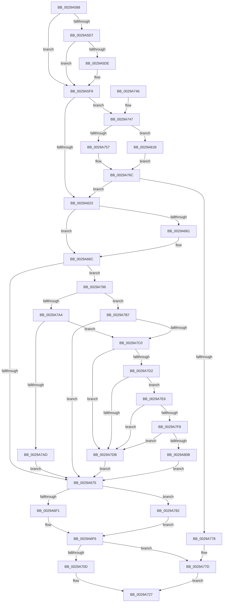

# MiIssueSynchronousFlush

- RVA: `0x0029A588`–`0x0029A835` (길이 `685` bytes)
- VA: `0x000000014029A588`
- 실행 섹션: `.text`
- PDB 이름 있음: `예`; PDB Function 태그: `아니요`
- unwind 정보 RVA: `0x00067CF0`
- 디코드: `158`개 명령, `685/685` bytes 표시
- 미해석 바이트: `0` (있으면 어셈블리에 `.byte`로 보존)

> 이 문서는 커널 이미지의 기계어와 PDB 기호를 분석해 생성했습니다. 4번과 5번은 함수 원형과 자료형을 바이너리 사용 방식에서 추정한 C 해석이며 원본 소스 복구 결과는 아닙니다.

## 1. Dependencies

- 직접 호출 지점: **10**; 고유 호출 대상: **10**
- 직접 호출자로 확인된 함수: **1**
- RIP 상대 이미지 참조: **4**

### Outgoing calls
- `0x0029A5F9` → [IoGetRelatedDeviceObject](IoGetRelatedDeviceObject_function_0029B120.md) (function, `0x0029B120`)
- `0x0029A60A` → [IopAllocateIrpExReturn](../20/IopAllocateIrpExReturn_function_00207720.md) (function, `0x00207720`)
- `0x0029A6F1` → [IoSetDiskIoAttributionFromThread](IoSetDiskIoAttributionFromThread_function_0029BF20.md) (function, `0x0029BF20`)
- `0x0029A6F9` → [IopQueueThreadIrp](../20/IopQueueThreadIrp_function_002075C0.md) (function, `0x002075C0`)
- `0x0029A704` → [IofCallDriver](IofCallDriver_function_0029B4B0.md) (function, `0x0029B4B0`)
- `0x0029A722` → [KeWaitForSingleObject](../20/KeWaitForSingleObject_function_0020E6B0.md) (function, `0x0020E6B0`)
- `0x0029A74A` → [MmIsFileObjectAPagingFile](MmIsFileObjectAPagingFile_function_0029BDAC.md) (function, `0x0029BDAC`)
- `0x0029A767` → [IopAllocateReserveIrp](IopAllocateReserveIrp_function_0029C218.md) (function, `0x0029C218`)
- `0x0029A78C` → [IopSetDiskIoAttributionExtension](IopSetDiskIoAttributionExtension_function_0029C0E4.md) (function, `0x0029C0E4`)
- `0x0029A82B` → [IopAllocateBackpocketIrp](../59/IopAllocateBackpocketIrp_function_00596CE0.md) (function, `0x00596CE0`)

### Direct callers
- [MiFlushSection](../40/MiFlushSection_function_004036B0.md) at `0x00403CE8`

### Static image references
- `0x0029A757` → RVA `0x00F8D8C4` (`.data`; read/write)
- `0x0029A7DB` → RVA `0x00F8D174` (`.data`; read/write)
- `0x0029A80B` → RVA `0x00F8D178` (`.data`; read/write)
- `0x0029A81B` → RVA `0x00F8D8C0` (`.data`; read/write)

## 2. Other-region calls and transfers

- 다른 실행 섹션으로 향하는 call: **0**
- 별도 외부 분기/꼬리 이동을 확인하지 못했습니다.

## 3. Assembly (complete function range)

```asm
0029A588  4C 8B DC                        mov r11, rsp
0029A58B  49 89 5B 08                     mov qword ptr [r11 + 8], rbx
0029A58F  49 89 6B 10                     mov qword ptr [r11 + 0x10], rbp
0029A593  49 89 73 18                     mov qword ptr [r11 + 0x18], rsi
0029A597  49 89 7B 20                     mov qword ptr [r11 + 0x20], rdi
0029A59B  41 54                           push r12
0029A59D  41 56                           push r14
0029A59F  41 57                           push r15
0029A5A1  48 83 EC 50                     sub rsp, 0x50
0029A5A5  83 64 24 34 00                  and dword ptr [rsp + 0x34], 0
0029A5AA  49 8D 43 D0                     lea rax, [r11 - 0x30]
0029A5AE  C7 44 24 30 00 00 06 00         mov dword ptr [rsp + 0x30], 0x60000
0029A5B6  45 8A F9                        mov r15b, r9b
0029A5B9  49 89 43 D8                     mov qword ptr [r11 - 0x28], rax
0029A5BD  4D 8B E0                        mov r12, r8
0029A5C0  49 8D 43 D0                     lea rax, [r11 - 0x30]
0029A5C4  48 8B EA                        mov rbp, rdx
0029A5C7  49 89 43 D0                     mov qword ptr [r11 - 0x30], rax
0029A5CB  48 8B F1                        mov rsi, rcx
0029A5CE  48 8B 41 28                     mov rax, qword ptr [rcx + 0x28]
0029A5D2  48 85 C0                        test rax, rax
0029A5D5  74 22                           je 0x14029a5f9
0029A5D7  48 83 78 08 00                  cmp qword ptr [rax + 8], 0
0029A5DC  74 1B                           je 0x14029a5f9
0029A5DE  65 FF 04 25 74 89 00 00         inc dword ptr gs:[0x8974]
0029A5E6  8B 42 28                        mov eax, dword ptr [rdx + 0x28]
0029A5E9  05 FF 0F 00 00                  add eax, 0xfff
0029A5EE  C1 E8 0C                        shr eax, 0xc
0029A5F1  65 01 04 25 78 89 00 00         add dword ptr gs:[0x8978], eax
0029A5F9  E8 22 0B 00 00                  call 0x14029b120
0029A5FE  45 33 C0                        xor r8d, r8d
0029A601  48 8B C8                        mov rcx, rax
0029A604  48 8B F8                        mov rdi, rax
0029A607  8A 50 4C                        mov dl, byte ptr [rax + 0x4c]
0029A60A  E8 11 D1 F6 FF                  call 0x140207720
0029A60F  4C 8B B4 24 98 00 00 00         mov r14, qword ptr [rsp + 0x98]
0029A617  48 8B D8                        mov rbx, rax
0029A61A  48 85 C0                        test rax, rax
0029A61D  0F 84 24 01 00 00               je 0x14029a747
0029A623  80 4B 47 20                     or byte ptr [rbx + 0x47], 0x20
0029A627  4C 8B 83 B8 00 00 00            mov r8, qword ptr [rbx + 0xb8]
0029A62E  48 89 6B 08                     mov qword ptr [rbx + 8], rbp
0029A632  C7 43 10 43 00 00 00            mov dword ptr [rbx + 0x10], 0x43
0029A639  65 48 8B 0C 25 88 01 00 00      mov rcx, qword ptr gs:[0x188]
0029A642  48 8B 81 20 02 00 00            mov rax, qword ptr [rcx + 0x220]
0029A649  8B 91 A0 05 00 00               mov edx, dword ptr [rcx + 0x5a0]
0029A64F  C1 EA 09                        shr edx, 9
0029A652  83 E2 07                        and edx, 7
0029A655  48 8B 80 A0 02 00 00            mov rax, qword ptr [rax + 0x2a0]
0029A65C  48 85 C0                        test rax, rax
0029A65F  74 0B                           je 0x14029a66c
0029A661  8B 80 3C 04 00 00               mov eax, dword ptr [rax + 0x43c]
0029A667  3B D0                           cmp edx, eax
0029A669  0F 4D D0                        cmovge edx, eax
0029A66C  83 FA 02                        cmp edx, 2
0029A66F  0F 8C 21 01 00 00               jl 0x14029a796
0029A675  8B 43 10                        mov eax, dword ptr [rbx + 0x10]
0029A678  48 8B CB                        mov rcx, rbx
0029A67B  C6 43 40 00                     mov byte ptr [rbx + 0x40], 0
0029A67F  25 FF FF F1 FF                  and eax, 0xfff1ffff
0029A684  4C 89 73 48                     mov qword ptr [rbx + 0x48], r14
0029A688  C1 E2 11                        shl edx, 0x11
0029A68B  81 C2 00 00 02 00               add edx, 0x20000
0029A691  0B D0                           or edx, eax
0029A693  48 8D 44 24 30                  lea rax, [rsp + 0x30]
0029A698  48 89 43 50                     mov qword ptr [rbx + 0x50], rax
0029A69C  89 53 10                        mov dword ptr [rbx + 0x10], edx
0029A69F  8B 45 2C                        mov eax, dword ptr [rbp + 0x2c]
0029A6A2  48 03 45 20                     add rax, qword ptr [rbp + 0x20]
0029A6A6  48 89 43 70                     mov qword ptr [rbx + 0x70], rax
0029A6AA  48 89 B3 C0 00 00 00            mov qword ptr [rbx + 0xc0], rsi
0029A6B1  65 48 8B 04 25 88 01 00 00      mov rax, qword ptr gs:[0x188]
0029A6BA  48 89 83 98 00 00 00            mov qword ptr [rbx + 0x98], rax
0029A6C1  41 C6 40 B8 04                  mov byte ptr [r8 - 0x48], 4
0029A6C6  8B 45 28                        mov eax, dword ptr [rbp + 0x28]
0029A6C9  45 08 78 BA                     or byte ptr [r8 - 0x46], r15b
0029A6CD  41 89 40 C0                     mov dword ptr [r8 - 0x40], eax
0029A6D1  48 8B 84 24 90 00 00 00         mov rax, qword ptr [rsp + 0x90]
0029A6D9  4D 89 60 D0                     mov qword ptr [r8 - 0x30], r12
0029A6DD  49 89 70 E8                     mov qword ptr [r8 - 0x18], rsi
0029A6E1  48 8B 93 98 00 00 00            mov rdx, qword ptr [rbx + 0x98]
0029A6E8  48 85 C0                        test rax, rax
0029A6EB  0F 85 91 00 00 00               jne 0x14029a782
0029A6F1  E8 2A 18 00 00                  call 0x14029bf20
0029A6F6  48 8B CB                        mov rcx, rbx
0029A6F9  E8 C2 CE F6 FF                  call 0x1402075c0
0029A6FE  48 8B D3                        mov rdx, rbx
0029A701  48 8B CF                        mov rcx, rdi
0029A704  E8 A7 0D 00 00                  call 0x14029b4b0
0029A709  85 C0                           test eax, eax
0029A70B  78 70                           js 0x14029a77d
0029A70D  48 83 64 24 20 00               and qword ptr [rsp + 0x20], 0
0029A713  48 8D 4C 24 30                  lea rcx, [rsp + 0x30]
0029A718  45 33 C9                        xor r9d, r9d
0029A71B  45 33 C0                        xor r8d, r8d
0029A71E  41 8D 51 13                     lea edx, [r9 + 0x13]
0029A722  E8 89 3F F7 FF                  call 0x14020e6b0
0029A727  4C 8D 5C 24 50                  lea r11, [rsp + 0x50]
0029A72C  49 8B 5B 20                     mov rbx, qword ptr [r11 + 0x20]
0029A730  49 8B 6B 28                     mov rbp, qword ptr [r11 + 0x28]
0029A734  49 8B 73 30                     mov rsi, qword ptr [r11 + 0x30]
0029A738  49 8B 7B 38                     mov rdi, qword ptr [r11 + 0x38]
0029A73C  49 8B E3                        mov rsp, r11
0029A73F  41 5F                           pop r15
0029A741  41 5E                           pop r14
0029A743  41 5C                           pop r12
0029A745  C3                              ret
0029A746  CC                              int3
0029A747  48 8B CE                        mov rcx, rsi
0029A74A  E8 5D 16 00 00                  call 0x14029bdac
0029A74F  85 C0                           test eax, eax
0029A751  0F 84 C4 00 00 00               je 0x14029a81b
0029A757  F0 FF 05 66 31 CF 00            lock inc dword ptr [rip + 0xcf3166]
0029A75E  8A 57 4C                        mov dl, byte ptr [rdi + 0x4c]
0029A761  41 B8 01 00 00 00               mov r8d, 1
0029A767  E8 AC 1A 00 00                  call 0x14029c218
0029A76C  48 8B D8                        mov rbx, rax
0029A76F  48 85 C0                        test rax, rax
0029A772  0F 85 AB FE FF FF               jne 0x14029a623
0029A778  B8 9A 00 00 C0                  mov eax, 0xc000009a
0029A77D  41 89 06                        mov dword ptr [r14], eax
0029A780  EB A5                           jmp 0x14029a727
0029A782  4C 8B C2                        mov r8, rdx
0029A785  45 33 C9                        xor r9d, r9d
0029A788  48 8B 50 18                     mov rdx, qword ptr [rax + 0x18]
0029A78C  E8 53 19 00 00                  call 0x14029c0e4
0029A791  E9 60 FF FF FF                  jmp 0x14029a6f6
0029A796  65 48 8B 04 25 88 01 00 00      mov rax, qword ptr gs:[0x188]
0029A79F  48 3B C8                        cmp rcx, rax
0029A7A2  75 13                           jne 0x14029a7b7
0029A7A4  83 B9 E0 05 00 00 00            cmp dword ptr [rcx + 0x5e0], 0
0029A7AB  74 13                           je 0x14029a7c0
0029A7AD  BA 02 00 00 00                  mov edx, 2
0029A7B2  E9 BE FE FF FF                  jmp 0x14029a675
0029A7B7  83 FA 02                        cmp edx, 2
0029A7BA  0F 8D B5 FE FF FF               jge 0x14029a675
0029A7C0  65 48 8B 0C 25 88 01 00 00      mov rcx, qword ptr gs:[0x188]
0029A7C9  F7 41 74 00 04 00 00            test dword ptr [rcx + 0x74], 0x400
0029A7D0  75 09                           jne 0x14029a7db
0029A7D2  80 B9 32 02 00 00 01            cmp byte ptr [rcx + 0x232], 1
0029A7D9  75 0B                           jne 0x14029a7e6
0029A7DB  FF 05 93 29 CF 00               inc dword ptr [rip + 0xcf2993]
0029A7E1  E9 8F FE FF FF                  jmp 0x14029a675
0029A7E6  65 48 8B 04 25 88 01 00 00      mov rax, qword ptr gs:[0x188]
0029A7EF  F6 80 A8 05 00 00 40            test byte ptr [rax + 0x5a8], 0x40
0029A7F6  75 E3                           jne 0x14029a7db
0029A7F8  65 48 8B 04 25 88 01 00 00      mov rax, qword ptr gs:[0x188]
0029A801  48 83 B8 50 05 00 00 02         cmp qword ptr [rax + 0x550], 2
0029A809  74 D0                           je 0x14029a7db
0029A80B  FF 05 67 29 CF 00               inc dword ptr [rip + 0xcf2967]
0029A811  BA 02 00 00 00                  mov edx, 2
0029A816  E9 5A FE FF FF                  jmp 0x14029a675
0029A81B  F0 FF 05 9E 30 CF 00            lock inc dword ptr [rip + 0xcf309e]
0029A822  8A 57 4C                        mov dl, byte ptr [rdi + 0x4c]
0029A825  45 33 C0                        xor r8d, r8d
0029A828  48 8B CF                        mov rcx, rdi
0029A82B  E8 B0 C4 2F 00                  call 0x140596ce0
0029A830  E9 37 FF FF FF                  jmp 0x14029a76c
```

## 4. C-style interpretation (structured pseudocode)

```c
__int64 __fastcall MiIssueSynchronousFlush(__int64 a1, __int64 a2, __int64 a3, int a4, __int64 a5, __int64 a6)
{
    __int64 result;
    __int64 v_rsp;
    unsigned __int64 v_stack_m18;
    unsigned int v_stack_m34;
    unsigned int v_stack_m38;
    unsigned __int64 v_stack_m48;

    *(unsigned __int64 *)(v_rsp + 8) = v_rbx;
    *(unsigned __int64 *)(v_rsp + 16) = v_rbp;
    *(unsigned __int64 *)(v_rsp + 24) = v_rsi;
    *(unsigned __int64 *)(v_rsp + 32) = v_rdi;
    v_rsp = (v_rsp) - (80);
    v_stack_m38 = 0x60000ULL;
    *(unsigned __int64 *)(v_rsp - 40) = v_rsp - 48;
    *(unsigned __int64 *)(v_rsp - 48) = v_rsp - 48;
    if (*(unsigned __int64 *)(a1 + 40) == 0) goto loc_0029A5F9;
    result = *(unsigned __int64 *)(a1 + 40);
    if ((*(unsigned __int64 *)(*(unsigned __int64 *)(a1 + 40) + 8)) != 0) {
        result = *(unsigned int *)(a2 + 40);
        result = (unsigned int)((result) + (0xFFFULL));
        result = (unsigned int)((result) >> (12));
    }
    result = IoGetRelatedDeviceObject(a1, a2, a3, a4);
    a3 = 0;
    result = IopAllocateIrpExReturn(result, *(unsigned __int8 *)(result + 76), a3, a4);
    if (result == 0) goto loc_0029A747;
loc_0029A623:
    *(unsigned __int64 *)(result + 8) = a2;
    *(unsigned int *)(result + 16) = 67;
    a2 = (unsigned int)(((unsigned int)(*(unsigned int *)(*(unsigned __int64 *)(gs_base + (0 + 392)) + 1440))) >> (9));
    a2 = (unsigned int)((a2) & (7));
    result = *(unsigned __int64 *)(*(unsigned __int64 *)(*(unsigned __int64 *)(gs_base + (0 + 392)) + 544) + 672);
    if (*(unsigned __int64 *)(*(unsigned __int64 *)(*(unsigned __int64 *)(gs_base + (0 + 392)) + 544) + 672) != 0) {
        result = *(unsigned int *)(*(unsigned __int64 *)(*(unsigned __int64 *)(*(unsigned __int64 *)(gs_base + (0 + 392)) + 544) + 672) + 1084);
        if (((unsigned int)(a2)) >= ((unsigned int)(result))) { a2 = (unsigned int)(result); }
    }
    if (((unsigned int)(a2)) < 2) goto loc_0029A796;
loc_0029A675:
    *(unsigned __int8 *)(result + 64) = 0;
    result = (unsigned int)(((unsigned int)(*(unsigned int *)(result + 16))) & (0xFFF1FFFFULL));
    *(unsigned __int64 *)(result + 72) = a6;
    a2 = (unsigned int)((a2) << (17));
    a2 = (unsigned int)((a2) + (0x20000ULL));
    a2 = (unsigned int)((a2) | ((unsigned int)(result)));
    *(unsigned __int64 *)(result + 80) = v_stack_m38;
    *(unsigned int *)(result + 16) = (unsigned int)(a2);
    result = ((unsigned int)(*(unsigned int *)(a2 + 44))) + (*(unsigned __int64 *)(a2 + 32));
    *(unsigned __int64 *)(result + 112) = result;
    *(unsigned __int64 *)(result + 192) = a1;
    *(unsigned __int64 *)(result + 152) = *(unsigned __int64 *)(gs_base + (0 + 392));
    *(unsigned __int8 *)(*(unsigned __int64 *)(result + 184) - 72) = 4;
    *(unsigned int *)(*(unsigned __int64 *)(result + 184) - 64) = (unsigned int)((unsigned int)(*(unsigned int *)(a2 + 40)));
    *(unsigned __int64 *)(*(unsigned __int64 *)(result + 184) - 48) = 0;
    *(unsigned __int64 *)(*(unsigned __int64 *)(result + 184) - 24) = a1;
    if (a5 != 0) goto loc_0029A782;
    result = IoSetDiskIoAttributionFromThread(result, *(unsigned __int64 *)(result + 152), *(unsigned __int64 *)(result + 184), a4);
loc_0029A6F6:
    result = IopQueueThreadIrp(result, *(unsigned __int64 *)(result + 152), *(unsigned __int64 *)(result + 184), a4);
    result = IofCallDriver(result, result, *(unsigned __int64 *)(result + 184), a4);
    if (sign_flag) goto loc_0029A77D;
    a4 = 0;
    a3 = 0;
    result = KeWaitForSingleObject(v_stack_m38, a4 + 19, a3, a4);
loc_0029A727:
    return result;
loc_0029A747:
    result = MmIsFileObjectAPagingFile(*(unsigned __int64 *)(v_stack_m18 + 48), a4 + 19, a3, a4);
    if ((unsigned int)(result) == 0) goto loc_0029A81B;
    result = IopAllocateReserveIrp(*(unsigned __int64 *)(v_stack_m18 + 48), *(unsigned __int8 *)(*(unsigned __int64 *)(v_stack_m18 + 56) + 76), 1, a4);
loc_0029A76C:
    if (result != 0) goto loc_0029A623;
loc_0029A77D:
    *(unsigned int *)(a6) = (unsigned int)((unsigned int)(0xC000009AULL));
    goto loc_0029A727;
loc_0029A782:
    a4 = 0;
    result = IopSetDiskIoAttributionExtension(*(unsigned __int64 *)(v_stack_m18 + 48), *(unsigned __int64 *)((unsigned int)(0xC000009AULL) + 24), *(unsigned __int8 *)(*(unsigned __int64 *)(v_stack_m18 + 56) + 76), a4);
    goto loc_0029A6F6;
loc_0029A796:
    if ((*(unsigned __int64 *)(v_stack_m18 + 48)) != (*(unsigned __int64 *)(gs_base + (0 + 392)))) goto loc_0029A7B7;
    if ((*(unsigned int *)(*(unsigned __int64 *)(v_stack_m18 + 48) + 1504)) == 0) goto loc_0029A7C0;
    goto loc_0029A675;
loc_0029A7B7:
    if (2 >= 2) goto loc_0029A675;
loc_0029A7C0:
    if (((*(unsigned int *)(*(unsigned __int64 *)(gs_base + (0 + 392)) + 116)) & (0x400ULL)) != 0) goto loc_0029A7DB;
    if ((*(unsigned __int8 *)(*(unsigned __int64 *)(gs_base + (0 + 392)) + 562)) != 1) goto loc_0029A7E6;
loc_0029A7DB:
    goto loc_0029A675;
loc_0029A7E6:
    if (((*(unsigned __int8 *)(*(unsigned __int64 *)(gs_base + (0 + 392)) + 1448)) & (64)) != 0) goto loc_0029A7DB;
    if ((*(unsigned __int64 *)(*(unsigned __int64 *)(gs_base + (0 + 392)) + 1360)) == 2) goto loc_0029A7DB;
    goto loc_0029A675;
loc_0029A81B:
    a3 = 0;
    result = IopAllocateBackpocketIrp(*(unsigned __int64 *)(v_stack_m18 + 56), *(unsigned __int8 *)(*(unsigned __int64 *)(v_stack_m18 + 56) + 76), a3, a4);
    goto loc_0029A76C;
}
```

## 5. (Beta) C Style

```c
int64_t MiIssueSynchronousFlush(void *Arg1, void *Arg2, int64_t Arg3, int32_t Arg4, int64_t Arg5, void *Arg6)
{
    uint8_t *arg1 = (uint8_t *)Arg1;
    uint8_t *arg2 = (uint8_t *)Arg2;
    uint8_t *arg6 = (uint8_t *)Arg6;

    int64_t result;
    int64_t local_rsp;
    uint64_t v_stack_m18;
    uint32_t v_stack_m34;
    uint32_t v_stack_m38;
    uint64_t v_stack_m48;

    *(uint64_t *)(local_rsp + 0x8) = local_rbx;
    *(uint64_t *)(local_rsp + 0x10) = local_rbp;
    *(uint64_t *)(local_rsp + 0x18) = local_rsi;
    *(uint64_t *)(local_rsp + 0x20) = local_rdi;
    local_rsp = (local_rsp) - (80);
    v_stack_m38 = 0x60000ULL;
    *(uint64_t *)(local_rsp - 0x28) = local_rsp - 48;
    *(uint64_t *)(local_rsp - 0x30) = local_rsp - 48;
    if (*(uint64_t *)(arg1 + 0x28) == 0) goto loc_0029A5F9;
    result = *(uint64_t *)(arg1 + 0x28);
    if ((*(uint64_t *)(*(uint64_t *)(arg1 + 0x28) + 0x8)) != 0) {
        result = *(uint32_t *)(arg2 + 0x28);
        result = (uint32_t)((result) + (0xFFFULL));
        result = (uint32_t)((result) >> (12));
    }
    result = IoGetRelatedDeviceObject(Arg1, Arg2, Arg3, Arg4);
    Arg3 = 0;
    result = IopAllocateIrpExReturn(result, *(uint8_t *)(result + 0x4C), Arg3, Arg4);
    if (result == 0) goto loc_0029A747;
loc_0029A623:
    *(void **)(result + 0x8) = Arg2;
    *(uint32_t *)(result + 0x10) = 67;
    Arg2 = (uint32_t)(((uint32_t)(*(uint32_t *)(*(uint64_t *)(gs_base + (0 + 0x188)) + 0x5A0))) >> (9));
    Arg2 = (uint32_t)((Arg2) & (7));
    result = *(uint64_t *)(*(uint64_t *)(*(uint64_t *)(gs_base + (0 + 0x188)) + 0x220) + 0x2A0);
    if (*(uint64_t *)(*(uint64_t *)(*(uint64_t *)(gs_base + (0 + 0x188)) + 0x220) + 0x2A0) != 0) {
        result = *(uint32_t *)(*(uint64_t *)(*(uint64_t *)(*(uint64_t *)(gs_base + (0 + 0x188)) + 0x220) + 0x2A0) + 0x43C);
        if (((uint32_t)(Arg2)) >= ((uint32_t)(result))) { Arg2 = (uint32_t)(result); }
    }
    if (((uint32_t)(Arg2)) < 2) goto loc_0029A796;
loc_0029A675:
    *(uint8_t *)(result + 0x40) = 0;
    result = (uint32_t)(((uint32_t)(*(uint32_t *)(result + 0x10))) & (0xFFF1FFFFULL));
    *(void **)(result + 0x48) = Arg6;
    Arg2 = (uint32_t)((Arg2) << (17));
    Arg2 = (uint32_t)((Arg2) + (0x20000ULL));
    Arg2 = (uint32_t)((Arg2) | ((uint32_t)(result)));
    *(uint64_t *)(result + 0x50) = v_stack_m38;
    *(uint32_t *)(result + 0x10) = (uint32_t)(Arg2);
    result = ((uint32_t)(*(uint32_t *)(arg2 + 0x2C))) + (*(uint64_t *)(arg2 + 0x20));
    *(uint64_t *)(result + 0x70) = result;
    *(void **)(result + 0xC0) = Arg1;
    *(uint64_t *)(result + 0x98) = *(uint64_t *)(gs_base + (0 + 0x188));
    *(uint8_t *)(*(uint64_t *)(result + 0xB8) - 0x48) = 4;
    *(uint32_t *)(*(uint64_t *)(result + 0xB8) - 0x40) = (uint32_t)((uint32_t)(*(uint32_t *)(arg2 + 0x28)));
    *(uint64_t *)(*(uint64_t *)(result + 0xB8) - 0x30) = 0;
    *(void **)(*(uint64_t *)(result + 0xB8) - 0x18) = Arg1;
    if (Arg5 != 0) goto loc_0029A782;
    result = IoSetDiskIoAttributionFromThread(result, *(uint64_t *)(result + 0x98), *(uint64_t *)(result + 0xB8), Arg4);
loc_0029A6F6:
    result = IopQueueThreadIrp(result, *(uint64_t *)(result + 0x98), *(uint64_t *)(result + 0xB8), Arg4);
    result = IofCallDriver(result, result, *(uint64_t *)(result + 0xB8), Arg4);
    if (sign_flag) goto loc_0029A77D;
    Arg4 = 0;
    Arg3 = 0;
    result = KeWaitForSingleObject(v_stack_m38, Arg4 + 19, Arg3, Arg4);
loc_0029A727:
    return result;
loc_0029A747:
    result = MmIsFileObjectAPagingFile(*(uint64_t *)(v_stack_m18 + 0x30), Arg4 + 19, Arg3, Arg4);
    if ((uint32_t)(result) == 0) goto loc_0029A81B;
    result = IopAllocateReserveIrp(*(uint64_t *)(v_stack_m18 + 0x30), *(uint8_t *)(*(uint64_t *)(v_stack_m18 + 0x38) + 0x4C), 1, Arg4);
loc_0029A76C:
    if (result != 0) goto loc_0029A623;
loc_0029A77D:
    *(uint32_t *)(arg6) = (uint32_t)((uint32_t)(0xC000009AULL));
    goto loc_0029A727;
loc_0029A782:
    Arg4 = 0;
    result = IopSetDiskIoAttributionExtension(*(uint64_t *)(v_stack_m18 + 0x30), *(uint64_t *)((uint32_t)(0xC000009AULL) + 0x18), *(uint8_t *)(*(uint64_t *)(v_stack_m18 + 0x38) + 0x4C), Arg4);
    goto loc_0029A6F6;
loc_0029A796:
    if ((*(uint64_t *)(v_stack_m18 + 0x30)) != (*(uint64_t *)(gs_base + (0 + 0x188)))) goto loc_0029A7B7;
    if ((*(uint32_t *)(*(uint64_t *)(v_stack_m18 + 0x30) + 0x5E0)) == 0) goto loc_0029A7C0;
    goto loc_0029A675;
loc_0029A7B7:
    if (2 >= 2) goto loc_0029A675;
loc_0029A7C0:
    if (((*(uint32_t *)(*(uint64_t *)(gs_base + (0 + 0x188)) + 0x74)) & (0x400ULL)) != 0) goto loc_0029A7DB;
    if ((*(uint8_t *)(*(uint64_t *)(gs_base + (0 + 0x188)) + 0x232)) != 1) goto loc_0029A7E6;
loc_0029A7DB:
    goto loc_0029A675;
loc_0029A7E6:
    if (((*(uint8_t *)(*(uint64_t *)(gs_base + (0 + 0x188)) + 0x5A8)) & (64)) != 0) goto loc_0029A7DB;
    if ((*(uint64_t *)(*(uint64_t *)(gs_base + (0 + 0x188)) + 0x550)) == 2) goto loc_0029A7DB;
    goto loc_0029A675;
loc_0029A81B:
    Arg3 = 0;
    result = IopAllocateBackpocketIrp(*(uint64_t *)(v_stack_m18 + 0x38), *(uint8_t *)(*(uint64_t *)(v_stack_m18 + 0x38) + 0x4C), Arg3, Arg4);
    goto loc_0029A76C;
}
```

### 관측된 메모리 오프셋

구조체 형식이 확인되지 않은 접근은 인자 기준의 오프셋으로만 기록했습니다.

| 기준 인자 | 오프셋 표현 | 폭 (bit) | 접근 |
|---|---:|---:|---|
| `Arg1` | `+ 0x28` | `64` | `R` |
| `Arg2` | `+ 0x20` | `64` | `R` |
| `Arg2` | `+ 0x28` | `32` | `R` |
| `Arg2` | `+ 0x2C` | `32` | `R` |
| `Arg6` | `+ 0x0` | `32` | `W` |

## 6. Execution-region graph

[열기: 2D/3D 그래프와 함수 탐색 컨트롤 패널](../../../control-panel.html?section=text&rva=0x0029A588&view=graph)

- 2D 그래프는 위에서 아래로 흐르고, 3D 그래프는 빈 공간을 드래그해 회전합니다. Shift+드래그는 이동, 휠은 확대·축소, 함수 노드 선택은 대상 보고서 이동입니다.

### Static fallback


